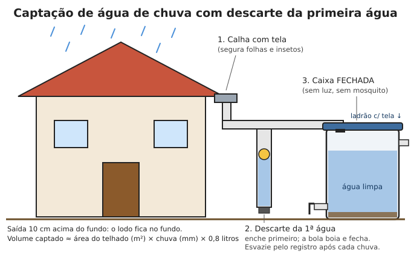
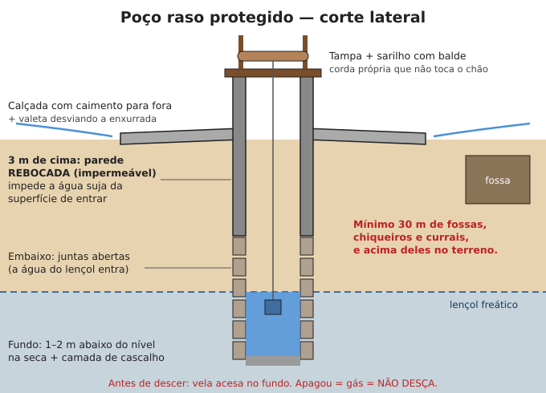

# Encontrar e captar água

**Resumo:** a melhor fonte de longo prazo é, nesta ordem: **nascente protegida**, **poço
bem construído**, **água de chuva** captada de telhado limpo. Rios, lagos e açudes servem,
mas sempre exigem tratamento. Planeje a fonte permanente nas primeiras semanas.

---

## Fontes, da mais segura para a menos segura

| Fonte | Qualidade típica | Observações |
|---|---|---|
| Nascente protegida (água brotando da rocha/solo) | Boa | Proteja contra animais e enxurrada; ainda assim trate |
| Poço profundo / artesiano (>20 m) | Boa | Precisa de bomba ou sarilho; risco baixo |
| Água de chuva (telhado limpo, descartando a primeira água) | Boa | Excelente no Brasil, onde chove bastante na maior parte do ano |
| Poço raso / cacimba (<10 m) | Média | Contamina fácil com fossas; mantenha 30 m de distância delas |
| Rio de corrente rápida, longe de cidades | Média | Pegue a água a montante (acima) de povoados e pastos |
| Lago, represa, açude | Ruim a média | Algas, fezes de animais, agrotóxicos |
| Água parada, poça, enchente | Muito ruim | Use só em último caso, com filtragem + tratamento forte |

> **ATENÇÃO:** nenhum tratamento caseiro remove de forma confiável **agrotóxicos, metais
> pesados, combustível ou produtos industriais**. Evite água perto de lavouras com veneno,
> minas, garimpos, indústrias, lixões e postos de combustível. Água com cheiro de
> combustível ou química, brilho oleoso ou cor estranha: **não use para beber**.

## Água de chuva

No Brasil, 1 mm de chuva = **1 litro por metro quadrado** de telhado. É a fonte mais fácil
de montar.

### Quanto dá para captar
```
Litros captados = área do telhado (m²) × chuva (mm) × 0,8
```
(0,8 = perdas por evaporação, respingos e descarte da primeira água)

Exemplo: telhado de 60 m², chuva de 20 mm → 60 × 20 × 0,8 = **960 L** em uma única chuva.

Uma casa de 60 m² em região com 1.200 mm/ano capta cerca de **57.600 L/ano** — mais que o
suficiente para beber e cozinhar para uma família grande.




### Montagem simples
1. **Telhado:** telha cerâmica, metálica ou fibrocimento sem pintura tóxica. Evite telhados
   com muito musgo, fezes de pássaros ou árvores em cima.
2. **Calha** com tela fina na entrada (segura folhas e insetos).
3. **Descarte da primeira água (desvio):** os primeiros ~1 L por m² de telhado lavam a sujeira.
   Faça um cano vertical fechado embaixo, com uma bolinha flutuante ou simplesmente um
   tubo que enche primeiro; quando enche, a água limpa segue para o reservatório.
   Esvazie o tubo depois de cada chuva.
4. **Reservatório:** caixa d'água, tambor de 200 L de grau alimentício, cisterna de placas
   (cimento). Deve ser **fechado** (sem luz = sem algas; sem acesso = sem mosquito da dengue).
5. **Saída** a ~10 cm acima do fundo (o lodo fica no fundo) e **ladrão** (extravasor) com tela.
6. Trate antes de beber (cloro ou fervura). Para lavar, regar e animais, pode usar direto.

### Cisterna de placas (modelo do semiárido)
- Modelo usado em milhões de casas no Nordeste: 16.000 L, placas pré-moldadas de cimento
  e areia, semi-enterrada, coberta.
- Materiais aproximados: ~ 14 sacos de cimento, areia, brita, arame galvanizado, cal para
  pintura interna. Um pedreiro e ajudante fazem em ~1 semana.
- Pinte por fora de branco (cal) para refletir o sol e manter a água fresca.

## Poços

### Poço raso escavado (cacimba / cisterna de lençol)
- **Onde:** parte baixa do terreno, mas **no mínimo 30 m de fossas, chiqueiros, currais e
  cemitérios**, e acima deles no sentido do declive (a sujeira escorre morro abaixo).
- Sinais de água perto da superfície: vegetação verde na seca, brejos, bananeiras e
  taboas crescendo bem, poços de vizinhos.
- **Escavação:** diâmetro de 1 a 1,5 m. Escave até 1–2 m abaixo do nível onde a água
  começa a minar, de preferência no fim da estação seca (nível mais baixo).
- **Revestimento:** anéis de concreto, tijolos ou pedras assentadas. Os primeiros 3 m de
  cima devem ser **impermeáveis** (reboco) para impedir que a água da superfície entre.
- **Proteção:** mureta de 50–80 cm, tampa, calçada de concreto ao redor com caimento
  para fora, valeta para desviar a enxurrada.
- **Retirada:** balde com corda própria (que não encosta no chão) e sarilho; melhor ainda,
  bomba manual.




> **ATENÇÃO — escavar poço mata gente todo ano.** Gases (CO₂, metano, gás de motor) se
> acumulam no fundo. Antes de descer: baixe uma **vela acesa** — se apagar, não desça.
> Nunca use motor a combustão dentro ou perto da boca do poço. Sempre com corda de
> segurança amarrada na cintura e alguém em cima. Escore as paredes em solo arenoso.

### Poço tubular a trado (manual)
- Um trado manual (broca de 10–15 cm de diâmetro com cabo em T, emendável) fura até
  10–15 m em solo sem rocha.
- Revista com cano de PVC. Na parte inferior, faça cortes finos no cano (filtro) e envolva
  com tela de nylon. Preencha ao redor com areia grossa/cascalho fino.
- Retire a água com bomba manual ou com um "balde de poço" (cano estreito com válvula de
  retenção no fundo).

### Desinfecção de poço (após construção ou enchente)
1. Calcule o volume: π × raio² × altura da água. Ex.: raio 0,5 m, água 2 m → 3,14 × 0,25 × 2 = 1,57 m³ = 1.570 L.
2. Para desinfecção de choque, use cerca de **50 mg/L de cloro**: com água sanitária 2,5%,
   são **2 litros por 1.000 L** de água. (1.570 L → ~3,1 L de água sanitária).
3. Misture, lave as paredes com a água clorada, tampe e espere **12 a 24 horas**.
4. Bombeie/retire até o cheiro de cloro sumir quase totalmente. Só então use, ainda tratando
   a água de beber.

## Nascentes

- **Proteja a área**: cerque num raio de pelo menos 20–50 m para impedir gado e porcos.
  Plante árvores nativas ao redor — mata ciliar mantém a nascente viva.
- **Caixa de captação:** uma pequena caixa de alvenaria ou um tambor sobre o olho d'água,
  com tampa, cano de saída, ladrão e preenchimento de pedras/cascalho. Assim a água sai
  direto do solo para o cano, sem contato com o ar e animais.
- Método "solo-cimento" da Embrapa: pedras limpas sobre o olho d'água, coberta de lona
  e uma mistura de solo com cimento, com cano saindo — barato e eficaz.
- Leve a água por mangueira até a casa usando a gravidade, se a nascente estiver acima.

## Encontrar água na natureza

- **Siga o terreno para baixo:** vales, grotas e o pé de morros concentram água.
- **Vegetação verde e densa** em época seca indica água no subsolo.
- **Animais:** trilhas de animais convergindo para um ponto; pássaros voando baixo e em
  linha reta ao amanhecer e entardecer (pombas, periquitos); abelhas (voam até ~3 km da água).
- **Leito seco de rio:** cave na parte externa das curvas, onde a água corria mais forte;
  muitas vezes há água a 30–60 cm.
- **Orvalho:** passe um pano nas plantas ao amanhecer e torça. Dá alguns copos por hora.
- **Transpiração de plantas:** amarre um saco plástico transparente em um galho com folhas,
  ao sol. Em 4–6 h junta 100–500 mL. Use plantas conhecidas não venenosas.
- **Plantas:** cipó-d'água (corte um pedaço de 1 m primeiro em cima, depois embaixo; se o
  líquido sair claro, sem cheiro e sem gosto amargo, pode beber), bambu (água nos gomos —
  agite para ouvir), coco verde, bromélias (água acumulada — filtre e ferva, tem larvas).
- **Mar:** água salgada **não pode ser bebida** — desidrata mais. Só destilada
  (veja [Tratamento](02-tratamento-e-purificacao.md#destilação)).

> **NUNCA beba:** urina, água do mar, água de radiador de carro (anticongelante é veneno),
> água de piscina tratada por tempo longo (excesso de produtos — só para higiene ou,
> em último caso, tratada), líquido de cactos desconhecidos.

## Transporte de água

- 1 litro = 1 kg. Um adulto carrega 20 L (20 kg) por distâncias curtas; use carrinho de
  mão, carroça, bicicleta com reboque ou animal.
- Bombonas de 20–50 L fechadas evitam derramar e contaminar.
- Galões que já tiveram veneno, combustível ou químicos **nunca** devem ser usados para água.

---

Ver também: [Tratamento e purificação](02-tratamento-e-purificacao.md) · [Irrigação](../04-agricultura/07-irrigacao.md) · [Saneamento](../02-saude/09-higiene-e-saneamento.md)
