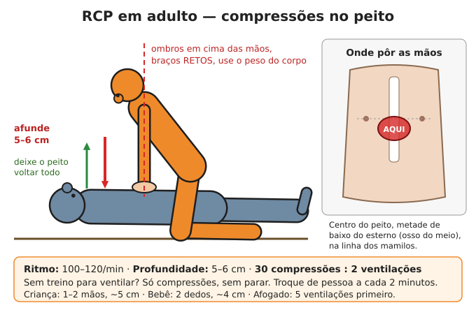
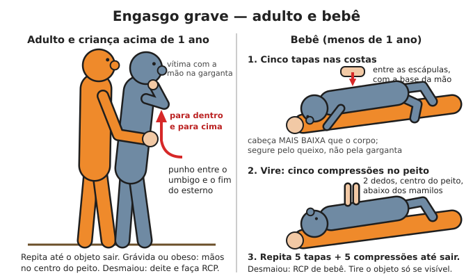
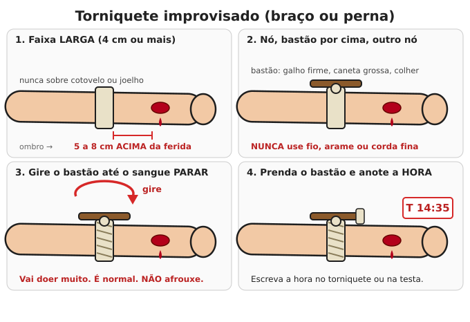
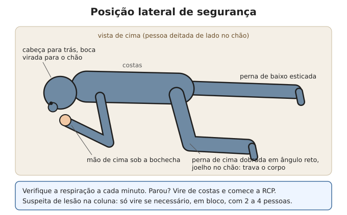

# Primeiros socorros e RCP

**Resumo:** sempre na mesma ordem: **segurança da cena → hemorragia grave → via aérea →
respiração → circulação/choque → resto**. Quem para um sangramento e mantém a via aérea
aberta salva a maioria das vidas que podem ser salvas.

---

## 1. Avaliação da vítima — método X-A-B-C-D-E

Antes de tudo: **o local é seguro para você?** (fogo, fios elétricos, trânsito, desabamento,
gás, agressor). Você ferido não ajuda ninguém. Use luvas ou saco plástico nas mãos.

| Letra | O que verificar | O que fazer |
|---|---|---|
| **X** — eXsanguinação | Sangramento grave (jato, poça crescendo) | Compressão forte direta; torniquete se for membro |
| **A** — Via aérea | Fala? Ronca? Gorgoleja? | Inclinar cabeça para trás e elevar o queixo; limpar boca |
| **B** — Respiração | O peito sobe? Quantas vezes por minuto? | Se não respira: RCP. Se respira mal: sentar, acalmar |
| **C** — Circulação | Pele fria, pálida, suada? Pulso rápido e fraco? | Tratar choque (deitar, pernas elevadas, aquecer) |
| **D** — Disfunção neurológica | Acordado? Responde a voz? A dor? Não responde? | Posição lateral de segurança se inconsciente e respirando |
| **E** — Exposição | Outros ferimentos escondidos? Frio? | Examinar o corpo todo, depois **cobrir e aquecer** |

### Sinais vitais normais (em repouso)

| Idade | Respirações/min | Pulso (batimentos/min) |
|---|---|---|
| Recém-nascido | 30–60 | 100–160 |
| 1–5 anos | 20–30 | 80–130 |
| 6–12 anos | 18–25 | 70–110 |
| Adulto | 12–20 | 60–100 |

- **Pulso:** dois dedos no punho, lado do polegar, ou no pescoço ao lado da traqueia. Conte 15 s × 4.
- **Enchimento capilar:** aperte a unha por 5 s; a cor deve voltar em **menos de 2 segundos**.
  Mais que isso = má circulação/choque/desidratação.
- **Temperatura:** normal 36–37,5 °C. Febre ≥ 37,8 °C. Febre alta ≥ 39 °C.

## 2. RCP — Ressuscitação cardiopulmonar

**Quando:** a pessoa **não responde** e **não respira normalmente** (ou só dá "suspiros"
espaçados, chamados de *gasping* — isso NÃO é respiração normal).

### Adulto
1. Chame alto e toque nos ombros. Sem resposta → grite por ajuda, mande alguém buscar
   socorro e um DEA (desfibrilador) se existir.
2. Deite a pessoa de costas em superfície firme.
3. Ajoelhe-se ao lado. Coloque a base de uma mão **no centro do peito** (metade de baixo do
   esterno, entre os mamilos), a outra mão por cima, dedos entrelaçados.
4. Braços **retos**, ombros acima das mãos. Use o peso do corpo.
5. Comprima **5 a 6 cm** de profundidade, **100 a 120 vezes por minuto**.
6. Deixe o peito **voltar totalmente** entre cada compressão. Minimize pausas.
7. **Se treinado e disposto:** a cada 30 compressões, 2 ventilações:
   - Incline a cabeça para trás, eleve o queixo, tape o nariz, sele sua boca na dela,
     sopre por 1 segundo até ver o peito subir. Duas vezes. Volte às compressões.
8. **Se não souber ventilar:** faça só compressões contínuas. Ainda salva vidas.
9. Troque de socorrista a cada 2 minutos (cansaço reduz a qualidade).
10. Continue até: a pessoa reagir/respirar, chegar ajuda, você ficar exausto, ou o local
    ficar perigoso.

### Criança (1 ano até puberdade)
- Uma ou duas mãos, afundar **~5 cm** (1/3 do peito). Mesma frequência.
- Comece com **5 ventilações** se a causa provável for respiratória (afogamento, engasgo).
- 30:2 se sozinho; 15:2 se houver dois socorristas treinados.

### Bebê (menos de 1 ano)
- **Dois dedos** no centro do peito, logo abaixo da linha dos mamilos. Afundar **~4 cm**.
- Ventilação: sua boca cobrindo **boca e nariz** do bebê, sopros leves (só o ar da bochecha).
- Comece com 5 ventilações; depois 30:2 (ou 15:2 com dois socorristas).

### Afogado
- Tire da água sem se arriscar (jogue algo que flutue, use uma vara; não pule se não for treinado).
- **Comece com 5 ventilações**, depois 30:2. Não perca tempo tentando "tirar a água do pulmão".

### Quando parar em situação sem recursos
Sem hospital e sem desfibrilador, as chances caem muito após 20–30 minutos de RCP sem
resposta. É aceitável parar após **30 minutos** sem nenhum sinal de vida (exceto em
afogamento em água fria e hipotermia — nesses, insista mais).

## 3. Engasgo (obstrução das vias aéreas)

**Engasgo leve** (tosse, consegue falar): incentive a tossir. Não bata nas costas.

**Engasgo grave** (não fala, não tosse, mãos no pescoço, ficando roxo):

**Adulto e criança acima de 1 ano:**
1. Fique atrás da pessoa, uma perna entre as dela.
2. Punho fechado **entre o umbigo e o fim do esterno**, outra mão por cima.
3. Puxe com força **para dentro e para cima**, em "J". Repita até o objeto sair.
4. Grávida ou obeso: mãos no **centro do peito** em vez da barriga.
5. Sozinho: empurre a barriga com força contra o encosto de uma cadeira.
6. Desmaiou: deite, inicie RCP. A cada vez que abrir a via aérea, olhe a boca e retire o
   objeto **só se estiver visível**.

**Bebê:**
1. Bebê de bruços sobre seu antebraço, cabeça mais baixa que o corpo, segurando o queixo.
2. **5 tapas firmes** nas costas, entre as escápulas, com a base da mão.
3. Vire o bebê de barriga para cima, cabeça baixa: **5 compressões** no peito com 2 dedos.
4. Repita até sair ou o bebê ficar inconsciente (então RCP).

## 4. Hemorragia

### Sequência
1. **Compressão direta:** pano limpo/gaze sobre o ferimento, aperte **com força**, sem soltar,
   por **no mínimo 10 minutos** (relógio!). Não fique levantando para olhar.
2. Encharcou: coloque mais pano por cima. Não retire o primeiro (arranca o coágulo).
3. **Enfaixe apertado** por cima (bandagem compressiva) para liberar suas mãos.
4. **Ferimento profundo em virilha, axila, pescoço** (onde não dá torniquete): **encha a
   ferida** com gaze/pano limpo empurrando com os dedos até o fundo (tamponamento) e
   aperte por cima por 3–10 minutos.
5. **Torniquete** (só braço ou perna), quando a compressão não para o sangue ou em
   amputação/sangramento em jato:
   - 5 a 8 cm **acima** do ferimento (nunca sobre o cotovelo ou joelho).
   - Improvisado: faixa de pano de **4 cm de largura ou mais** (nunca fio, corda fina ou
     arame), dê um nó, coloque um bastão (caneta forte, galho) sobre o nó, dê outro nó e
     **gire o bastão até o sangue parar**. Prenda o bastão.
   - **Anote a hora** na testa da vítima ou no próprio torniquete.
   - Doer muito é normal. **Não afrouxe** para "aliviar".
   - Em situação sem resgate: um torniquete pode ficar até ~2 horas com risco baixo de
     perder o membro. Se o resgate não vier, depois de 2 h e com o sangramento controlado
     por curativo compressivo forte, pode-se tentar afrouxar lentamente observando; se
     voltar a sangrar, reaperte. Isso é decisão de último recurso.
6. Trate o **choque** (abaixo).

### Objeto cravado (faca, vergalhão, galho)
**Não retire.** Ele pode estar tampando o vaso. Estabilize com panos enrolados em volta e
enfaixe. Retirar só se impedir a RCP ou o transporte for impossível com ele.

### Sangramento nasal
- Sente a pessoa **inclinada para a frente** (não para trás — engole sangue e vomita).
- Aperte a parte mole do nariz com força por **10–15 minutos** sem soltar. Gelo na testa ajuda.
- Não pare após 30 minutos, ou depois de pancada forte na cabeça → grave.

### Sangramento interno (suspeite se)
Pancada forte em barriga/tórax, barriga dura e dolorida, vômito com sangue ou "borra de
café", fezes pretas, sinais de choque sem sangramento visível. Não há tratamento caseiro:
repouso absoluto, nada pela boca, tratar choque, buscar cirurgia se existir.

## 5. Choque (circulação falhando)

**Sinais:** pele pálida, fria e suada; pulso rápido e fraco; respiração rápida; sede;
confusão, agitação ou sonolência; lábios azulados.

**O que fazer:**
1. Trate a causa (pare o sangramento, por exemplo).
2. Deite a pessoa de costas. **Eleve as pernas ~30 cm** (exceto se houver fratura de perna,
   lesão de coluna, cabeça ou dificuldade para respirar — aí deixe deitada reta ou semi-sentada).
3. **Aqueça** (cobertor por baixo e por cima). Choque + frio = morte.
4. Afrouxe roupas apertadas. Acalme.
5. Consciente, sem lesão na barriga e sem previsão de cirurgia: pequenos goles de soro de
   reidratação. Inconsciente: nada pela boca.

## 6. Posição lateral de segurança (inconsciente que respira)

1. Ajoelhe-se ao lado. Braço mais próximo dobrado para cima (em ângulo reto).
2. O outro braço cruza o peito, dorso da mão encostado na bochecha do seu lado.
3. Dobre o joelho do lado oposto e puxe-o, rolando a pessoa para o seu lado.
4. Ajuste a perna de cima em ângulo reto e a cabeça inclinada para trás, boca virada para baixo
   (para escorrer vômito).
5. Verifique a respiração a cada minuto. Se parar: RCP.

## 7. Outras emergências comuns

### Desmaio
- Deite, eleve as pernas. Afrouxe roupas, ventile. Acorda em 1–2 minutos.
- Não acordou em 2 minutos, ou desmaio com dor no peito, falta de ar, convulsão → grave.

### Convulsão
1. **Não segure** a pessoa e **não coloque nada na boca** (ela não "engole a língua").
2. Afaste objetos perigosos, proteja a cabeça com algo macio.
3. Cronometre. Ao terminar, posição lateral de segurança. Ela fica confusa e sonolenta.
4. **Grave se:** durar mais de 5 minutos, uma emenda na outra, primeira convulsão da vida,
   grávida, após pancada na cabeça, ou não acorda depois.
5. **Criança com febre:** convulsão febril costuma ser curta e benigna; baixe a febre
   (roupas leves, paracetamol/dipirona na dose certa) — não use banho gelado.

### Infarto (ataque cardíaco)
- **Sinais:** dor ou aperto no peito (pode ir para braço esquerdo, mandíbula, costas,
  estômago), suor frio, falta de ar, náusea. Em mulheres, idosos e diabéticos pode ser só
  cansaço, falta de ar ou mal-estar.
- **Faça:** repouso absoluto, semi-sentado. **Mastigar 1 comprimido de AAS (aspirina) de
  300 mg** (ou 3–4 de 100 mg) se não houver alergia, sangramento ativo, úlcera sangrando
  ou suspeita de AVC hemorrágico. Se a pessoa já usa nitrato sublingual (Isordil) prescrito,
  pode usar. Se parar de respirar → RCP.

### AVC (derrame) — teste **SAMU**
- **S**orriso: peça para sorrir — um lado da boca cai?
- **A**braço: levante os dois braços — um cai ou não sobe?
- **M**úsica: peça para cantar/falar uma frase — fala enrolada ou não consegue?
- **U**rgente: qualquer sinal = urgência. Anote a hora do início.
- Sem hospital: deite com a cabeça elevada 30°, nada pela boca até ter certeza que engole
  sem engasgar (teste com uma colher de água), posicione de lado se vomitar.
  **Não dê AAS** sem saber se é AVC hemorrágico ou isquêmico.

### Hipoglicemia (açúcar baixo — comum em diabéticos)
- **Sinais:** tremor, suor frio, fome, confusão, comportamento estranho, pode desmaiar.
- Consciente: **15–20 g de açúcar** — 1 colher de sopa de açúcar ou mel na água, um copo de
  suco, 3–4 balas. Repita em 15 minutos se não melhorar. Depois, uma refeição.
- Inconsciente: nada pela boca líquido (risco de engasgar). Esfregue açúcar ou mel **na
  parte interna da bochecha/gengiva**, posição lateral.

### Reação alérgica grave (anafilaxia)
- **Sinais:** inchaço de lábios, língua, garganta; chiado; dificuldade para respirar; placas
  vermelhas pelo corpo; tontura, desmaio — minutos após picada, alimento ou remédio.
- **Adrenalina** é o único tratamento que salva: se tiver caneta de adrenalina, aplique na
  coxa (lado de fora), pode ser sobre a roupa. Se tiver ampola de adrenalina 1 mg/mL:
  **0,01 mg/kg intramuscular na coxa**, máximo **0,5 mg (0,5 mL) em adulto**, 0,3 mL em
  criança de ~30 kg, 0,15 mL em criança de ~15 kg. Pode repetir a cada 5–15 min se não melhorar.
- Depois: anti-histamínico (loratadina, dexclorfeniramina) e corticoide (prednisona) ajudam,
  mas **não substituem** a adrenalina.
- Deitar com pernas elevadas; se respirar mal, sentado.

### Crise de asma
- Sente a pessoa inclinada para a frente, acalme, afrouxe roupas.
- Bombinha de salbutamol (aerossol): **4 a 10 jatos**, um a cada 30–60 s, com espaçador
  (garrafa PET de 500 mL com furo no fundo para a bombinha funciona). Repita a cada 20 min
  na primeira hora se necessário.
- Grave: não consegue falar frases, lábios roxos, sonolência.

### Traumatismo craniano (pancada na cabeça)
**Sinais de perigo** (nas primeiras 24–48 h, acorde a pessoa a cada 2–3 h para checar):
- Vômitos repetidos, sonolência crescente, confusão, convulsão
- Pupilas de tamanhos diferentes
- Sangue ou líquido claro saindo de nariz ou ouvido
- Fraqueza de um lado do corpo, fala enrolada
- Dor de cabeça que só piora
Repouso, cabeça elevada 30°, nada de álcool nem sedativos. Analgesia com **paracetamol**
(evite AAS e anti-inflamatórios nas primeiras 24 h).

### Suspeita de lesão na coluna
Queda de altura, acidente de carro, mergulho em água rasa, pancada forte nas costas/pescoço,
ou formigamento/fraqueza nas pernas e braços.
- **Não mova** a pessoa sem necessidade. Se precisar (perigo, vômito), role em bloco com
  2–4 pessoas mantendo cabeça, pescoço e tronco alinhados.
- Imobilize o pescoço com toalhas enroladas dos dois lados da cabeça.
- Transporte em superfície rígida (porta, tábua larga).

### Intoxicação / envenenamento
- **Não provoque vômito** (pode piorar, principalmente com produtos cáusticos e derivados de
  petróleo).
- Produto na pele: tire a roupa, lave com muita água por 15–20 min.
- Nos olhos: lave com água corrente por **15–20 minutos**, pálpebras abertas.
- Gases (fumaça, cloro misturado, monóxido): ar fresco imediatamente.
- **Carvão ativado** (vende em farmácia, em pó ou cápsulas): 1 g/kg (adulto: 25–50 g),
  até 1 hora após ingestão de **remédios ou plantas venenosas**. **Não** serve para ácidos,
  soda cáustica, querosene/gasolina, álcool, ferro, lítio. Só se a pessoa estiver acordada
  e engolindo bem.
- Guarde a embalagem do produto para saber o que foi.

### Lesões nos olhos
- Cisco: lave com água limpa; puxe a pálpebra superior sobre a inferior; use ponta de
  pano úmido para retirar se estiver na parte branca. **Nunca** esfregue.
- Objeto cravado: não retire. Cubra **os dois olhos** (um copo de papel sobre o ferido) para
  reduzir o movimento.
- Químico: lavar **20 minutos** sem parar. Cal/cimento: retire o pó seco antes e depois lave.

## 8. Transporte improvisado

- **Maca:** dois paus de 2 m + cobertor dobrado em três em volta deles; ou duas camisas
  com os paus passando pelas mangas.
- **Cadeira de dois socorristas:** cada um segura o próprio punho direito com a mão
  esquerda e o punho esquerdo do outro com a mão direita, formando um assento.
- Arraste pelos ombros (segurando a roupa ou pelas axilas) sobre um cobertor para tirar
  de local perigoso.

---

Ver também: [Ferimentos e fraturas](02-ferimentos-queimaduras-fraturas.md) ·
[Medicamentos](04-medicamentos-e-doses.md) · [Calor, frio e ambiente](10-calor-frio-e-ambiente.md) ·
[Cartões de bolso](../00-emergencia/04-cartoes-de-bolso.md)
