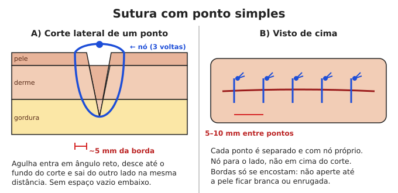
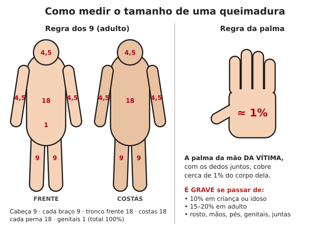
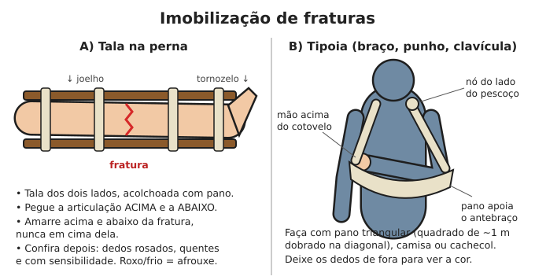

# Ferimentos, queimaduras e fraturas

**Resumo:** sem antibiótico fácil, **qualquer ferida pode matar por infecção**. A regra
número 1 é **lavar muito com água limpa** (litros, não um copinho). Na dúvida, **não feche**
a ferida: deixe aberta, coberta e limpa.

---

## 1. Ferimentos (cortes, perfurações, arranhões)

### Passo a passo
1. **Pare o sangramento** (compressão — veja [Primeiros socorros](01-primeiros-socorros.md#4-hemorragia)).
2. **Lave suas mãos** e use luvas se tiver.
3. **Irrigue a ferida com muita água limpa** (fervida e fria, tratada com cloro, soro
   fisiológico ou mesmo água potável da torneira):
   - Mínimo **1 litro** para cortes médios; vários litros para feridas sujas/grandes.
   - Use pressão: saco plástico limpo cheio de água com um furinho de agulha, ou seringa de
     20 mL sem agulha. A pressão do jato arrasta a sujeira e os micróbios.
4. **Retire sujeira visível** (terra, farpas, pedaços de roupa) com pinça fervida.
5. Limpe **a pele ao redor** com sabão, clorexidina ou PVPI. **Não** jogue álcool, iodo
   concentrado, água oxigenada repetidamente ou pó de café **dentro** da ferida — eles
   lesam o tecido e atrasam a cicatrização.
6. Decida se vai fechar ou deixar aberta (tabela abaixo).
7. Cubra com gaze/pano limpo. Troque **1 vez por dia** ou quando molhar/sujar.
8. **Vacina antitetânica**: se a última dose foi há mais de 10 anos (ou 5 anos em ferida
   suja), procure vacinar se ainda houver posto de saúde.

### Fechar ou deixar aberta?

| FECHE (sutura, fita ou cola) | NÃO FECHE (deixe aberta, cubra e limpe) |
|---|---|
| Corte limpo, bordas retas, objeto limpo | Mordida de animal ou de pessoa |
| Menos de **6–8 horas** (rosto: até 12–24 h) | Ferida com mais de 8–12 horas |
| Você conseguiu limpar totalmente | Ferida suja de terra, fezes, esterco, ferrugem |
| Bordas se encostam sem tensão | Perfurações profundas (prego, espinho, faca estreita) |
| | Feridas por esmagamento ou com tecido morto |
| | Já mostra sinais de infecção |

**Feridas deixadas abertas** cicatrizam de dentro para fora (demoram mais e deixam cicatriz
maior, mas raramente formam abscesso fechado). Se após 3–5 dias estiver limpa, vermelha
viva e sem pus, pode-se fechar com fita adesiva (fechamento tardio).

### Como fechar
**Fita adesiva de sutura (steri-strip) — a opção mais segura para leigos:**
1. Seque bem a pele ao redor (sem tocar a ferida).
2. Cole tiras de ~3 mm de largura a cada 3–5 mm, atravessando a ferida, aproximando
   as bordas sem enrugar.
3. Fita improvisada: esparadrapo ou fita silver tape cortada em "borboleta" (com o meio
   estreito e sem cola sobre a ferida).
4. Não molhe por 24–48 h. Deixe cair sozinha (5–10 dias).

**Sutura com ponto simples (para quem foi treinado ou em último caso):**
1. Material: agulha curva com fio de nylon (náilon 3-0 ou 4-0) de farmácia. Na falta, agulha de
   costura e linha de nylon ou de pesca **fervidas 20 minutos**.
2. Anestesia local (lidocaína) se houver; senão, gelo antes ajuda um pouco.
3. Entre com a agulha a ~5 mm da borda, em ângulo reto à pele, atravesse até o fundo da
   ferida e saia do outro lado à mesma distância. Cada ponto é independente.
4. Dê **3 nós** (cada um em sentido contrário), sem apertar demais — a borda deve só encostar,
   não ficar branca nem enrugada.
5. Pontos a cada **5–10 mm**. Comece pelo meio da ferida e vá dividindo.
6. **Deixe o fundo sem espaço vazio.** Ferida profunda que não dá para fechar em uma camada
   → deixe aberta.

**Quando retirar os pontos:**

| Local | Dias |
|---|---|
| Rosto | 4–5 |
| Couro cabeludo | 7–10 |
| Braços, tronco | 7–10 |
| Mãos | 10–14 |
| Pernas, pés, articulações | 10–14 |

### Sinais de infecção
- Vermelhidão que **aumenta** (marque a borda com caneta e compare no dia seguinte)
- Inchaço, calor, dor que piora após o 2º dia
- Pus, mau cheiro
- **Riscos vermelhos subindo pelo braço/perna** (linfangite) → grave
- Febre, calafrios → infecção se espalhando → grave

**O que fazer:**
1. Se a ferida foi fechada: **abra** (retire alguns pontos) para drenar.
2. Compressas mornas 4 vezes ao dia por 15–20 minutos.
3. Lave com água limpa 2 vezes ao dia.
4. Antibiótico se houver sinais de espalhamento, febre ou ferida de alto risco
   (mordida, mão, pé de diabético) — veja [Medicamentos](04-medicamentos-e-doses.md#antibióticos).

### Abscesso (bolsa de pus)
- Área inchada, vermelha, quente, que fica **mole no centro** ("flutuante").
- Compressas mornas ajudam a "amadurecer".
- Quando mole: limpe a pele, faça um **corte pequeno com lâmina fervida** no ponto mais mole,
  deixe o pus sair, irrigue com água limpa, coloque uma tira de gaze dentro para não fechar
  (troque diariamente). Não aperte com força demais.
- **Não abra** abscessos no rosto perto do nariz e olhos, no pescoço, na mama perto do
  mamilo, ou nas mãos se não souber — risco de lesar estruturas.

### Mel e açúcar em feridas
- **Mel** (puro, de preferência aquecido a no máximo 40 °C para manter as propriedades, ou
  mel esterilizado para uso médico) tem efeito antibacteriano comprovado. Cubra a ferida
  limpa com uma camada de mel e gaze; troque 1–2 vezes ao dia.
- **Açúcar** granulado puro na ferida infectada (prática antiga, ainda usada em alguns
  hospitais) desidrata as bactérias. Troque quando virar xarope (1–2 vezes ao dia).
- Não usar mel em bebês menores de 1 ano por via oral (botulismo); na pele é considerado aceitável.

### Feridas que precisam de atenção especial
- **Mordida de animal:** lave com **água e sabão em abundância por 15 minutos** (reduz muito o
  risco de raiva). Não feche. Antibiótico preventivo (amoxicilina + clavulanato) é indicado em
  mordidas profundas, de gato, nas mãos. Veja [Raiva](03-doencas-e-infeccoes.md#raiva).
- **Prego enferrujado/espinho no pé:** irrigue bem, deixe aberto, deixe o pé de molho em água
  morna com sabão 2× ao dia, observe por 1–2 semanas. Risco de tétano.
- **Feridas no rosto:** sangram muito mas cicatrizam bem; podem ser fechadas até 24 h depois.
- **Pé diabético:** qualquer ferida é grave — limpe todos os dias, não ande sobre ela.

## 2. Queimaduras

### Primeiros minutos
1. **Afaste da fonte.** Roupa pegando fogo: **pare, deite e role**; abafe com cobertor.
2. **Esfrie com água corrente fria (não gelada) por 20 minutos.** Funciona até 3 horas após
   a queimadura. Não use gelo.
3. Retire anéis, relógios, roupas que não estejam grudadas (incham rápido).
4. **Não** passe pasta de dente, manteiga, óleo, borra de café, clara de ovo ou qualquer
   receita caseira.
5. Cubra com **filme plástico de PVC** (aquele de cozinha) colocado em tiras, sem enrolar
   apertado, ou pano limpo úmido.
6. Mantenha a pessoa **aquecida** (queimados grandes perdem calor rápido).

### Gravidade

| Grau | Aparência | Dor | Cicatrização |
|---|---|---|---|
| 1º grau | Vermelha, sem bolhas (como queimadura de sol) | Dói | 3–7 dias, sem cicatriz |
| 2º grau superficial | Bolhas, base rosada e úmida | Dói muito | 10–21 dias |
| 2º grau profundo | Bolhas, base esbranquiçada/manchada | Dói menos | Semanas; cicatriz |
| 3º grau | Branca, marrom ou preta, como couro, seca | Não dói no centro | Não cicatriza sozinha se for grande |

### Tamanho — regra da palma
- **A palma da mão da vítima (com os dedos) = cerca de 1% do corpo.**
- Regra dos 9 (adulto): cabeça 9%, cada braço 9%, frente do tronco 18%, costas 18%,
  cada perna 18%, genitais 1%.

**É grave se:** maior que 10% em criança/idoso ou 15–20% em adulto; 2º grau profundo ou
3º grau maior que a palma; queimaduras em rosto, mãos, pés, genitais, articulações; elétrica;
química; queimadura em volta de todo o membro ou tórax; inalou fumaça (rouquidão, fuligem no
nariz, tosse) — esta pode fechar a via aérea em horas.

### Hidratação no queimado grande (sem soro na veia)
Queimaduras grandes perdem muito líquido nas primeiras 24–48 horas.
- Dê **soro de reidratação oral** em goles frequentes. Meta aproximada em adulto com 20% de
  queimadura: **4 a 6 litros nas primeiras 24 h** (metade nas primeiras 8 h).
- Fórmula de referência (Parkland): **4 mL × peso (kg) × % queimada** em 24 h, metade nas
  primeiras 8 h. Ex.: 70 kg × 20% × 4 = 5.600 mL.
- Bom sinal: urina clara e frequente (adulto: pelo menos ~0,5 mL/kg por hora, ou seja,
  ~35 mL/h para 70 kg).

### Cuidado diário
- Lave delicadamente com água limpa e sabão neutro 1 vez ao dia.
- **Bolhas:** não estoure as pequenas. Bolhas grandes e tensas, ou já rompidas: retire a pele
  solta com tesoura fervida.
- Cubra com camada fina de: **sulfadiazina de prata 1%** (pomada de farmácia), **mel**, ou
  **babosa (aloe vera)** fresca nas queimaduras leves. Gaze por cima.
- Dor: paracetamol, dipirona, ibuprofeno.
- Mantenha articulações queimadas em posição de extensão (esticadas) e mova-as diariamente
  para não "travar" com a cicatriz.
- Muita proteína na alimentação (ovos, carne, feijão) para cicatrizar.

### Queimaduras específicas
- **Química:** escove o pó seco antes, depois lave com água corrente por **30–60 minutos**.
- **Elétrica:** desligue a energia antes de tocar. A lesão interna é maior do que a pele mostra;
  pode causar arritmia — observe o coração.
- **Sol:** compressas frias, babosa, hidratação, sombra.

## 3. Fraturas, luxações e entorses

### Como reconhecer uma fratura
Dor forte no ponto, inchaço, deformidade, osso aparecendo, estalo no momento do trauma,
não consegue usar o membro, dor ao apertar o osso (não só a "carne").

### Princípios da imobilização

1. **Não tente endireitar** fraturas próximas de articulações (cotovelo, joelho, punho).
2. Imobilize **a articulação acima e a abaixo** da fratura.
3. Talas: tábua, galho reto, papelão grosso dobrado, revista enrolada, saco de dormir enrolado.
   Acolchoe com pano.
4. Amarre com faixas acima e abaixo da fratura (não em cima dela), firmes mas sem apertar.
5. **Verifique a circulação** depois de imobilizar: dedos rosados, quentes, sensibilidade.
   Se ficarem roxos, frios ou dormentes, afrouxe.
6. Eleve o membro e use frio (pano molhado/gelo enrolado) 20 min a cada 2 horas no 1º dia.

### Alinhar uma fratura do meio do osso (último recurso, sem hospital)
Se o membro está **muito torto** no meio do osso e longe de ajuda (dias), alinhar melhora
a circulação e a cicatrização:
1. Dê analgésico 30–60 min antes, se tiver.
2. Uma pessoa segura firme acima da fratura; outra puxa **devagar e com força constante**
   na direção do osso (tração), por 1–2 minutos, e vai trazendo para a posição reta.
3. Imobilize na nova posição. Confira circulação.
4. Se houver resistência forte ou dor insuportável, pare.

### Fratura exposta (osso para fora)
- **Não empurre** o osso para dentro.
- Lave abundantemente com água limpa, cubra com pano limpo úmido, imobilize.
- Risco altíssimo de infecção: **antibiótico** (cefalexina ou amoxicilina + clavulanato) desde já
  se houver.

### Tempo de consolidação (aproximado, adulto)

| Osso | Semanas imobilizado |
|---|---|
| Dedos da mão | 3–4 |
| Punho / antebraço | 6–8 |
| Úmero (braço) | 6–8 |
| Clavícula | 4–6 (tipoia) |
| Costelas | 4–6 (não enfaixar apertado — respire fundo várias vezes por dia para evitar pneumonia) |
| Tíbia (canela) | 8–12 |
| Fêmur (coxa) | 12+ — muito grave, sangra muito internamente |
| Tornozelo | 6–8 |

Crianças consolidam em cerca de metade do tempo.

### Tala gessada improvisada
- Gesso de farmácia é o ideal. Improviso: tiras de pano mergulhadas em **mistura de gesso em pó
  (de construção) com água** ou em **cola branca + farinha**, aplicadas sobre acolchoamento,
  deixando secar. Faça só como **tala** (meia-calha), não enrolado fechado — o membro incha
  e o gesso fechado pode cortar a circulação.

### Luxação (osso "saiu do lugar" na articulação)
- Imobilize na posição em que está e busque ajuda.
- **Dedo:** puxar o dedo na direção do eixo com firmeza geralmente o recoloca. Depois, amarre-o
  ao dedo vizinho por 2–3 semanas.
- **Ombro (último recurso, longe de ajuda):** pessoa deitada de barriga para baixo em uma mesa
  alta, com o braço machucado pendurado para fora e um peso de 3–5 kg amarrado no punho
  (balde com água). Deixe relaxar por 20–30 minutos — muitas vezes o ombro volta sozinho.
  Depois, tipoia por 2–3 semanas.
- **Mandíbula, quadril, joelho, cotovelo:** não tente sem treinamento.

### Entorse (torção)
- **P.R.I.C.E.**: **P**roteja, **R**epouso nas primeiras 48 h, **I**ce (frio) 20 min a cada 2–3 h,
  **C**ompressão com atadura, **E**levação acima do coração.
- Depois de 2–3 dias, comece a mexer devagar dentro do limite da dor.
- Se não consegue dar 4 passos ou dói ao apertar o osso do tornozelo → trate como fratura.

## 4. Amputação

1. Torniquete ou compressão forte no coto.
2. A parte amputada: lave com água limpa, embrulhe em pano úmido, coloque em saco plástico
   e o saco sobre gelo/água fria (**nunca** direto no gelo). Só serve se houver cirurgião em
   poucas horas.
3. Sem cirurgião: cuide do coto como ferida aberta, troque curativos diariamente,
   antibiótico se houver.

## 5. Tétano

- Bactéria do solo, esterco e ferrugem suja que entra por feridas (principalmente perfurações).
- Sintomas 3–21 dias depois: mandíbula travada, rigidez no pescoço, espasmos dolorosos.
- **Não tem cura em casa.** Prevenção: vacina (dT a cada 10 anos), limpeza rigorosa de feridas,
  usar calçados e luvas no trabalho com terra e esterco.
- **Vacine-se agora** enquanto há postos de saúde — toda a família, inclusive gestantes (dTpa).

---

Ver também: [Primeiros socorros](01-primeiros-socorros.md) · [Medicamentos](04-medicamentos-e-doses.md) · [Plantas medicinais](05-plantas-medicinais.md)
