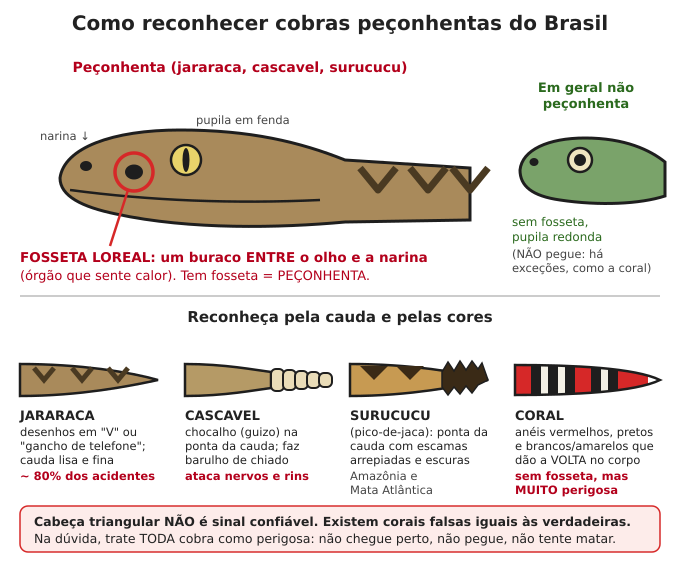

# Animais peçonhentos

**Resumo:** no Brasil, as maiores ameaças são **cobras** (jararaca, cascavel, surucucu,
coral), **escorpião-amarelo** (perigoso para crianças), **aranhas** (armadeira e marrom),
**taturana** (lagarta *Lonomia*) e **enxames de abelhas**. O único tratamento eficaz para
envenenamento grave é o **soro** específico. Saiba onde fica o hospital ou posto de
referência mais próximo **antes** de precisar.

---

## Cobras

### Os quatro grupos perigosos

| Grupo | Exemplos | Sinais do envenenamento | Soro |
|---|---|---|---|
| **Botrópico** (~80% dos casos) | Jararaca, jararacuçu, urutu, caiçaca | Dor forte e inchaço que sobem pelo membro, manchas roxas, bolhas, **sangramento** (gengiva, urina, picada) | Antibotrópico |
| **Crotálico** | Cascavel | **Pouca dor local.** Pálpebras caídas, visão dupla/turva, rosto "caído", dor muscular, **urina escura** (cor de Coca-Cola) → falência dos rins | Anticrotálico |
| **Laquético** | Surucucu-pico-de-jaca | Como jararaca + diarreia, cólica, pressão baixa, batimento lento | Antilaquético |
| **Elapídico** | Coral-verdadeira | Pouca dor; pálpebras caídas, dificuldade de engolir e **respirar** (paralisia) | Antielapídico |

### O que fazer
1. **Afaste-se** da cobra (ela pode picar de novo). Não perca tempo caçando-a; uma foto de
   longe ajuda, se der.
2. **Deite e acalme** a vítima. Movimento espalha o veneno mais rápido.
3. Retire **anéis, pulseiras, relógio, calçados** do membro picado (vai inchar).
4. **Lave** o local com água e sabão.
5. Mantenha o membro **estendido e em repouso**, em posição confortável.
6. **Hidrate** com água ou soro de reidratação (principalmente na cascavel, para proteger os rins),
   se a pessoa estiver acordada e engolindo bem.
7. **Transporte** para o local com soro antiofídico o mais rápido possível — carregue a pessoa
   em vez de deixá-la andar. O soro funciona melhor nas **primeiras 6 horas**, mas vale a
   pena até muitas horas depois.

### O que NÃO fazer
- **Não** faça torniquete ou garrote (piora a necrose).
- **Não** corte, não fure, não chupe o veneno.
- **Não** coloque gelo, folhas, pó de café, querosene, esterco ou qualquer substância.
- **Não** dê bebida alcoólica, querosene ou "remédios caseiros".
- **Não** dê anti-inflamatório nem AAS (aumentam o sangramento). Para dor: dipirona ou paracetamol.

### Sem soro disponível (último recurso)
- Repouso absoluto, membro estendido, hidratação abundante (adulto: 3–4 L/dia se a urina estiver
  diminuindo ou escurecendo), dor com dipirona/paracetamol.
- **Observe:** sangramentos, urina (quantidade e cor), respiração, pálpebras. Na coral e na
  cascavel, a respiração pode parar: se parar, **ventilação boca a boca contínua** pode manter a
  pessoa viva até o efeito passar ou chegar ajuda.
- Limpe as bolhas e áreas de necrose como feridas ([Ferimentos](02-ferimentos-queimaduras-fraturas.md));
  antibiótico se infeccionar.
- Vacina antitetânica se possível.

## Escorpiões

- **Escorpião-amarelo** (*Tityus serrulatus*): o mais perigoso; vive em cidades, entulho, esgoto,
  muros, caixas de luz. Crianças menores de 10 anos e idosos correm mais risco.
- **Sintomas leves:** dor forte no local, formigamento, suor local.
- **Sintomas graves (principalmente em criança, em 1–3 horas):** **vômitos repetidos**, suor
  intenso, agitação, salivação, tremores, coração acelerado, falta de ar → **emergência**
  (soro antiescorpiônico).
- **O que fazer:** lave, **compressa morna** (alivia a dor), analgésico (dipirona). Anestésico local
  (lidocaína) injetado no local alivia muito a dor (se houver quem saiba). Criança picada →
  observar de perto por 6 horas e buscar o soro se vomitar.

## Aranhas

| Aranha | Onde vive | Sintomas | O que fazer |
|---|---|---|---|
| **Armadeira** (*Phoneutria*) | Bananeiras, entulho, dentro de sapatos; agressiva, "arma" o corpo para pular | Dor imediata **muito forte** que irradia; casos graves em crianças (suor, vômito, pressão alterada) | Compressa morna, analgésico, observar crianças |
| **Aranha-marrom** (*Loxosceles*) | Atrás de móveis, quadros, roupas guardadas, telhas; pequena (~3 cm), não agressiva | **Picada quase indolor.** 12–36 h depois: mancha roxa e branca, bolha, ferida que necrosa. Pode dar urina escura (destrói glóbulos vermelhos) | Procure atendimento (soro antiloxoscélico nas primeiras 36 h); cuide da ferida; hidratação |
| **Viúva-negra** (*Latrodectus*) | Vegetação rasteira, praias | Câimbras e contrações musculares, suor, dor abdominal | Compressa morna, analgésico |
| **Caranguejeira** | Buracos no chão, troncos | Pouco perigosa; pelos irritam pele e olhos | Lavar; anti-histamínico |

## Lagartas (taturana, lagarta-de-fogo)

- Contato causa dor em queimação: lave com água fria, compressa fria, analgésico.
- **Lonomia** (taturana marrom-esverdeada, vive em grupos em troncos de árvores frutíferas no Sul e
  Sudeste): o veneno impede a coagulação do sangue. **Observe 24–72 h**: sangramento de gengiva,
  urina com sangue, manchas roxas → soro antilonômico. Fatal sem tratamento em casos graves.

## Abelhas, vespas e formigas

- **Ferrão de abelha:** raspe com a unha ou a lâmina de uma faca (não aperte com pinça — injeta mais
  veneno). Lave, compressa fria, anti-histamínico.
- **Muitas picadas** (adulto: acima de ~50–100; criança: bem menos) causam envenenamento grave
  mesmo sem alergia: vômito, urina escura, falência dos rins → hidratação abundante, buscar ajuda.
- **Alergia grave (anafilaxia):** inchaço no rosto/garganta, falta de ar, desmaio → **adrenalina**
  ([Primeiros socorros](01-primeiros-socorros.md#reação-alérgica-grave-anafilaxia)).
- **Ataque de enxame (abelha africanizada):** **corra** em linha reta para longe e para dentro de
  casa/carro; cubra rosto e cabeça com a camisa. Não pule na água (elas esperam você subir). Não
  fique abanando os braços.

## Animais aquáticos

| Animal | O que fazer |
|---|---|
| **Arraia de rio ou mar** (ferrão na cauda; dor fortíssima) | Mergulhe o local em **água quente** (o mais quente que a pessoa aguente sem queimar, ~45 °C) por 30–90 min — o calor destrói o veneno e alivia muito. Retire restos do ferrão, lave, não feche a ferida, observe infecção |
| **Bagre, mandi, peixe-escorpião** (ferrões) | Mesma técnica da água quente |
| **Água-viva** | Não esfregue, não use água doce. Lave com **vinagre** (exceto caravela) ou água do mar; retire tentáculos com pinça/cartão; depois água quente ajuda na dor |
| **Caravela** (bolha azul-arroxeada flutuante) | Água do mar, retirar tentáculos, água quente; **não use vinagre** |
| **Ouriço-do-mar** | Retire os espinhos visíveis; água quente; óleo e pano ajudam a amolecer os restantes |

## Prevenção (a parte que mais salva)

- **Botas de cano alto e perneiras** no mato e na roça — ~70% das picadas de cobra são do joelho
  para baixo. **Luvas de couro** ao mexer em lenha, pedras, entulho, buracos.
- Nunca enfie a mão em buracos, ninhos, montes de folhas ou cupinzeiros.
- **Terreiro limpo:** capim baixo perto da casa, sem entulho, lenha guardada longe e acima do chão.
- **Controle de ratos** (comida fechada, lixo longe) — cobras vêm atrás de ratos.
- **Galinhas, galinhas-d'angola e gatos** ajudam a controlar escorpiões, aranhas e ratos.
- Sacuda **roupas, toalhas e calçados** antes de usar. Afaste camas da parede. Mosquiteiro.
- Vede frestas, ralos (tela ou tampa) e caixas de luz.
- Ilumine o caminho à noite (lanterna).

---

Ver também: [Primeiros socorros](01-primeiros-socorros.md) · [Medicamentos](04-medicamentos-e-doses.md) · [Perdido no mato](../11-natureza-e-desastres/01-perdido-no-mato.md)
