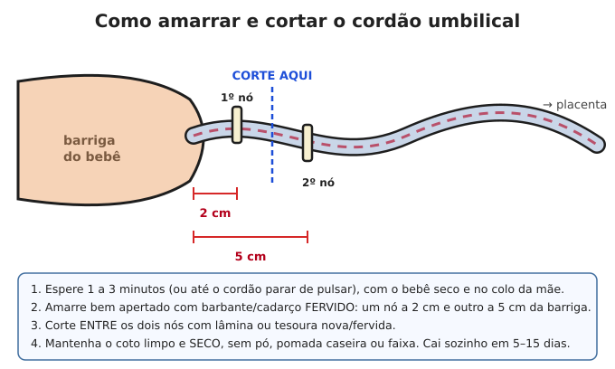
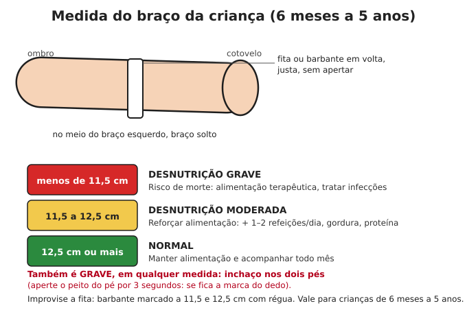

# Parto, bebês e crianças

**Resumo:** a maioria dos partos é normal e **o corpo da mãe sabe o que fazer**. O papel de
quem ajuda é manter tudo **limpo**, **não apressar**, **não puxar**, manter o bebê **quente**
e vigiar o **sangramento da mãe** depois. Amamentação exclusiva até 6 meses é a melhor
proteção que um bebê pode ter, principalmente sem água tratada.

---

## Gestação

- **Ácido fólico** (0,4–5 mg/dia) antes e nos primeiros 3 meses previne defeitos no bebê.
- **Ferro** e comida variada (feijão, folhas verde-escuras, ovos, carne, fígado).
- Evitar: álcool, fumo, peixe cru, carne malpassada, queijo não pasteurizado, maioria das plantas
  medicinais, ibuprofeno no fim da gestação, contato com fezes de gato (toxoplasmose).
- **Data provável do parto:** primeiro dia da última menstruação **+ 7 dias − 3 meses + 1 ano**.
  (Ex.: 10 de março → 17 de dezembro.)

### Sinais de perigo na gravidez (busque ajuda se houver qualquer chance)
- Sangramento vaginal
- **Dor de cabeça forte, visão embaçada ou com pontos brilhantes, inchaço súbito do rosto e mãos**
  (pré-eclâmpsia → pode causar convulsões)
- Convulsão
- Febre
- Bebê parou de mexer (normal: 10 movimentos em até 2 horas, depois de 28 semanas)
- Bolsa rompeu antes de 37 semanas, ou com líquido verde-escuro/fétido
- Dor forte e contínua na barriga

## Parto de emergência

### Prepare (antes ou assim que começar)
- Lugar **limpo, quente**, com boa luz. Plástico ou lona coberto com panos limpos.
- **Mãos e unhas** muito bem lavadas com sabão; luvas se houver.
- **Barbante ou cadarço fervido** por 20 min (2 pedaços de 20 cm), **lâmina nova** ou tesoura fervida.
- Toalhas e panos limpos e secos (para secar e aquecer o bebê), touca/gorro.
- Bacia para a placenta, absorventes ou panos para a mãe.
- Água potável e comida leve para a mãe.

### Fases do trabalho de parto
1. **Dilatação** (horas; 1º filho: 8–18 h, seguintes: menos): contrações cada vez mais fortes e
   próximas. Deixe a mãe **andar, mudar de posição, beber, comer leve, urinar**. Não mande fazer
   força ainda.
2. **Expulsão** (até 1–2 h): vontade incontrolável de fazer força, como para evacuar. Agora sim,
   ela empurra **durante** as contrações.
3. **Placenta** (5–30 min após o bebê).

### Nascimento — passo a passo
1. A mãe escolhe a posição: **de cócoras, de lado, de quatro, semi-sentada**. Deitada de costas
   reta é a pior.
2. Quando a cabeça aparecer, **apoie** com a mão espalmada para ela sair **devagar** (evita rasgos).
   Peça para a mãe soprar em vez de empurrar nesse momento.
3. **Cordão no pescoço?** Passe o dedo: se estiver frouxo, **passe por cima da cabeça**. Se
   estiver apertado, deixe o bebê nascer com ele (o bebê dá uma "cambalhota" junto ao corpo da mãe)
   e solte depois.
4. A cabeça gira sozinha para o lado. Na próxima contração, os ombros saem: guie **levemente**
   para baixo (ombro de cima) e depois para cima (ombro de baixo). **Nunca puxe** pela cabeça.
5. **Ombro preso** (cabeça sai e "volta para dentro", nada acontece em 1 minuto):
   - Mãe deitada puxa os **joelhos com força em direção ao peito** (bem abertos), e alguém aperta
     com o punho **logo acima do osso do púbis**, para baixo e para o lado.
   - Se não sair: mãe vira **de quatro** e tenta de novo.
6. Anote a hora do nascimento.

### Bebê logo depois de nascer (o primeiro minuto)
1. **Seque** o bebê inteiro com pano limpo, esfregando vigorosamente (estimula a respiração).
   Troque o pano molhado por um seco.
2. Coloque **pele com pele** sobre a barriga/peito da mãe e cubra os dois. Gorro na cabeça.
3. Bebê deve **chorar ou respirar bem** em até 30 segundos. Ficar rosado leva alguns minutos
   (mãos e pés azulados no início são normais).
4. **Não respira?**
   - Esfregue as costas e dê leves petelecos na sola dos pés.
   - Limpe boca e depois nariz com pano (ou pera de sucção).
   - Cabeça em posição neutra (um pano dobrado sob os ombros ajuda).
   - **Ventile:** sua boca cobrindo boca e nariz do bebê, **sopros leves** (só o ar das bochechas),
     **40 a 60 por minuto**, observando o peito subir.
   - Se após 30 s de ventilação o coração estiver abaixo de 60 batimentos/min (sinta no cordão ou
     no peito): **3 compressões para 1 ventilação**, com dois polegares no meio do peito.
5. Bebê deve ser **amamentado na primeira hora**.

### Cordão umbilical

### Placenta e sangramento (o momento mais perigoso para a mãe)
1. **Não puxe o cordão.** Espere a placenta sair sozinha (5–30 min) com a força da mãe; pode
   ajudar ela ficar de cócoras.
2. Examine a placenta: deve estar **inteira** (um disco sem pedaços faltando). Pedaços retidos
   causam hemorragia e infecção.
3. **Massageie o útero:** apalpe abaixo do umbigo uma bola firme ("tamanho de uma toranja"). Se
   estiver mole, massageie em círculos com firmeza até endurecer. Repita a cada 15 minutos por
   2 horas. Ensine a mãe a fazer.
4. **Amamentar e esvaziar a bexiga** ajudam o útero a contrair.
5. **Hemorragia** (sangue encharcando mais de 1 pano/absorvente grande em 5 minutos, ou mais de
   ~500 mL): massagem forte e contínua do útero, bebê no peito, pernas elevadas, mãe aquecida,
   líquidos. **Misoprostol** (se houver): 800 microgramas sob a língua. Ocitocina injetável
   (10 UI no músculo) se houver e alguém souber aplicar.
6. Laceração (rasgo) pequena cicatriza sozinha; mantenha limpa, banho de assento com água morna.

### Situações graves no parto
| Situação | O que fazer |
|---|---|
| **Cordão sai antes do bebê** (prolapso) | Mãe de **joelhos com o peito no chão** (bumbum para cima); com a mão limpa, empurre suavemente a parte do bebê que está descendo para longe do cordão; mantenha o cordão úmido e quente. Emergência extrema |
| **Bebê sentado** (nádegas ou pés primeiro) | **Mãos fora!** Deixe nascer sozinho até o umbigo, sem tocar. Mãe de quatro ou na beira da cama. Só apoie o corpo; se a cabeça demorar, alguém aperta acima do púbis |
| **Trabalho de parto parado** (força por mais de 2 h sem progresso) | Mudar de posição, andar, esvaziar bexiga, comer/beber. Sem progresso: precisa de ajuda especializada |
| **Febre na mãe após o parto, corrimento fétido** | Infecção do útero: antibiótico (amoxicilina + metronidazol, ou amoxicilina+clavulanato) |
| **Convulsão** (eclâmpsia) | Proteger, posição lateral, ambiente escuro e calmo; precisa de sulfato de magnésio e parto rápido |

## Cuidados com o recém-nascido

- **Calor:** bebês perdem calor muito rápido. Pele com pele, gorro, roupas em camadas
  (uma camada a mais que o adulto).
- **Coto umbilical:** limpo e seco. Álcool 70% ou clorexidina se houver. Sem faixa, sem pó, sem
  pomada caseira. Vermelhidão subindo pela barriga ou pus com mau cheiro = infecção grave.
- **Olhos:** limpar com água fervida morna, de dentro para fora.
- **Icterícia** (amarelo): comum do 2º ao 5º dia. Amamentar bastante e expor ao sol indireto da
  manhã alguns minutos ajuda. **Perigo:** amarelo nas primeiras 24 h, amarelo até as pernas/pés,
  bebê molinho que não mama.
- **Sinais de perigo no bebê (até 2 meses):** não mama, vomita tudo, convulsão, respira rápido
  (> 60/min) ou com gemido, afundamento das costelas, febre (≥ 37,5 °C) ou temperatura baixa
  (< 35,5 °C), muito mole/não acorda, umbigo com pus. → Tratar como emergência; antibiótico
  (amoxicilina) se não houver nenhum recurso.

## Amamentação

- **Exclusiva até 6 meses**: nada de água, chá ou outro leite. O leite materno tem toda a água
  necessária, mesmo no calor, e protege contra diarreia — a maior causa de morte de bebês sem
  saneamento.
- **Livre demanda:** sempre que o bebê quiser, dia e noite (8–12 vezes/dia no início).
- **Pega correta:** boca bem aberta, lábios virados para fora, **abocanha a aréola** (não só o
  bico), queixo encostado no seio, bochechas cheias. Pega errada = fissura e dor.
- Quanto mais o bebê mama, mais leite é produzido. Mãe precisa beber muita água e comer bem.
- **Fissura:** passe o próprio leite no bico e deixe secar ao ar; corrija a pega.
- **Mastite** (seio vermelho, quente, dolorido, febre): **continue amamentando** (principalmente
  desse lado), compressas mornas antes e frias depois, analgésico; se não melhorar em 24 h,
  cefalexina ou amoxicilina+clavulanato.
- **Se a mãe faltar:** outra mulher que esteja amamentando (ama de leite) é a melhor opção.
  Leite de cabra ou vaca **puro não serve** para bebês pequenos (rim imaturo, falta nutrientes);
  se for a única opção (receita da OMS para menores de 6 meses): **100 mL de leite fervido +
  50 mL de água fervida + 2 colheres de chá rasas de açúcar (10 g)**. Dê também polivitamínico
  infantil se houver, e busque outra mulher que amamente o quanto antes.
  Lave e ferva tudo o que usar. **Copinho** é mais seguro que mamadeira (que é difícil de limpar).

## Alimentação de 6 meses a 2 anos

- Aos 6 meses, comece com **papas amassadas** (não liquidificadas): legume + cereal/tubérculo +
  feijão + carne/ovo + um fio de óleo. Frutas amassadas. **Continue o peito até 2 anos ou mais.**
- 6–8 meses: 2–3 refeições/dia; 9–11 meses: 3–4; 12–24 meses: 3–4 + 1–2 lanches.
- **Sem sal adicionado e sem açúcar** no primeiro ano. **Sem mel** antes de 1 ano (botulismo).
- Ovo, fígado e feijão previnem anemia. Ofereça água tratada a partir dos 6 meses.

## Desnutrição infantil

- **Sinais:** perda de peso, braços e pernas finos, costelas aparecendo, criança apática, cabelo
  ralo e descolorido, ou **inchaço nos pés e rosto** (forma grave chamada kwashiorkor).
- **Tratamento caseiro (moderada):** mais refeições por dia (5–6), comida **densa em energia**
  (acrescente óleo, manteiga, pasta de amendoim, leite em pó à papa), proteína em toda refeição,
  vermífugo, tratar diarreias, vitamina A se houver.
- **Grave:** a realimentação deve ser **gradual** (pequenas quantidades frequentes nos primeiros
  dias) — comer muito de repente pode ser fatal. Mantenha aquecida e trate infecções.

## Vacinas

Enquanto existirem postos de saúde, **mantenha a caderneta de vacinação em dia** (BCG, hepatite B,
pentavalente, pólio, rotavírus, pneumocócica, meningocócica, febre amarela, tríplice viral,
varicela, DTP, HPV) e vacine os adultos (dT/dTpa, febre amarela, hepatite B, tríplice viral, gripe).
Doenças evitáveis por vacina voltam rapidamente quando o sistema de saúde colapsa.

## Sinais de perigo em qualquer criança (procure ajuda imediatamente)

- Não consegue beber ou mamar
- Vomita tudo o que ingere
- Teve convulsão
- Está muito sonolenta, mole ou não acorda
- Respiração rápida ou com afundamento entre as costelas
- Desidratação grave (veja [Doenças](03-doencas-e-infeccoes.md#diarreia-e-desidratação))
- Manchas roxas que não somem ao pressionar + febre

---

Ver também: [Doenças e infecções](03-doencas-e-infeccoes.md) · [Medicamentos (doses infantis)](04-medicamentos-e-doses.md#tabela-rápida-de-doses-infantis) · [Nutrição](../03-alimentacao/03-nutricao-e-racionamento.md)
