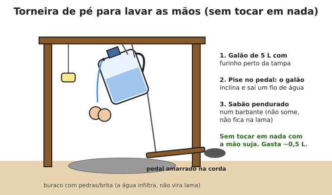
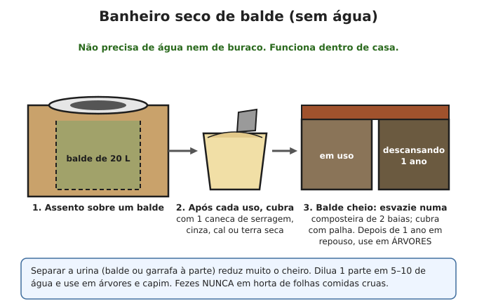
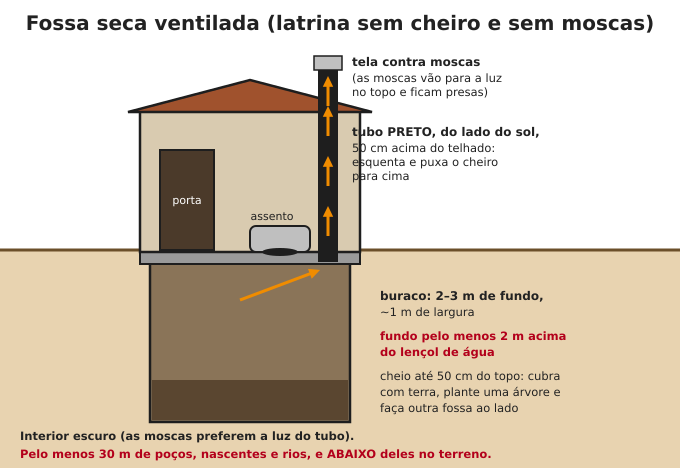

# Higiene e saneamento

**Resumo:** fezes humanas contaminando água e comida matam mais gente em desastres do que
fome ou violência. Três medidas evitam a maioria das doenças: **(1) lavar as mãos com sabão**,
**(2) banheiro longe e abaixo das fontes de água**, **(3) água tratada**. Organize isso nos
primeiros dias.

---

## Lavagem das mãos

**Quando:** depois de usar o banheiro, de limpar criança, de mexer com animais, lixo ou terra;
antes de cozinhar, comer, amamentar e cuidar de feridas.

**Como (40–60 segundos):** molhe, ensaboe, esfregue palmas, dorso, entre os dedos, unhas (na
palma da outra mão) e polegares; enxágue em água corrente; seque ao ar ou em pano limpo.

- **Sem sabão:** cinza de madeira esfregada com água funciona razoavelmente (é alcalina).
- **Álcool 70%** mata micróbios em mãos sem sujeira visível. Não funciona bem contra
  norovírus e esporos — prefira sabão quando houver diarreia.
- Unhas curtas.

Monte uma **torneira de pé** (conhecida como *tippy tap*) do lado de fora de cada banheiro e da
cozinha. Gasta pouquíssima água e ninguém toca em nada com a mão suja.

## Banheiro sem água encanada

### Regras de localização (para qualquer tipo de banheiro)
- **No mínimo 30 metros** de poços, nascentes, rios e cisternas.
- **Abaixo** das fontes de água no terreno (a contaminação escorre para baixo).
- Fundo de fossas a **pelo menos 2 metros acima** do lençol de água (mais em solo arenoso).
- Perto o suficiente da casa para ser usado à noite (crianças e idosos!), com caminho iluminado.

### Opção 1 — Primeiras horas/dias: vaso sem água
Se a descarga não funciona mas o vaso existe:
1. Coloque um **saco de lixo resistente** (ou dois) dentro do vaso.
2. Após cada uso, cubra com **serragem, cinza, cal, terra seca ou areia** (e um pouco de água
   sanitária se houver).
3. Feche o saco quando estiver 1/3 cheio, coloque em um balde/tambor com tampa, fora de casa.
4. Depois, enterre em vala longe da água (veja abaixo).

Dica: jogar um balde de água de reuso (água de lavar roupa) no vaso faz a descarga funcionar se a
rede de esgoto ainda escoa.

### Opção 2 — Banheiro seco de balde

- Não precisa de água nem de buraco. Bem feito, **não tem cheiro**.
- Material de cobertura é o segredo: serragem fina é o melhor; também folhas secas trituradas,
  palha picada, cinza, terra seca.
- Composteira de 2 baias: enche uma por ~6–12 meses, depois deixa descansar **pelo menos 1 ano**
  enquanto usa a outra. O composto maduro (cheiro de terra) vai para **árvores frutíferas e
  culturas não comidas cruas** — nunca em alface, couve, rabanete.

### Opção 3 — Vala/trincheira (acampamento, grupo grande, curto prazo)
- Vala de **30 cm de largura × 50–90 cm de profundidade**, comprimento conforme o grupo
  (~1 m para cada 25 pessoas por semana).
- Terra retirada fica ao lado com uma pá: **cada um cobre o que fez**.
- Quando faltar 30 cm para encher, cubra com terra, compacte e marque o local.

### Opção 4 — Fossa seca ventilada (permanente)

- Dura anos para uma família. Sem cheiro e sem moscas se o tubo estiver bem feito.
- **Tampa** sempre fechada quando não estiver em uso.
- Jogue um punhado de **cinza ou cal** depois de usar.
- Não jogue lixo, plástico ou absorventes.

### Para quem tem fossa séptica e esgoto
- Fossa séptica continua funcionando sem energia se a casa tiver água para a descarga (use água
  de reuso). Evite jogar gordura, papel em excesso e produtos químicos fortes.

## Lixo

- **Separe:** orgânico (vai para composteira, galinhas e porcos) / reciclável útil (vidros, latas,
  plásticos — guarde, são recursos!) / rejeito.
- **Rejeito:** enterre em vala longe da água, coberto com terra a cada dia, ou queime **só o que
  for seguro** (papel, madeira) longe de casas. **Nunca queime plástico, borracha ou pilhas**
  (fumaça tóxica).
- **Lixo acumulado = ratos = leptospirose e peste.** Restos de comida sempre tampados.
- Cadáveres de animais: enterre a pelo menos 1 m de profundidade, coberto de cal se houver,
  longe da água.

## Controle de pragas

- **Ratos:** comida em recipientes fechados (tambores, latas, vidros), lixo tampado, sem entulho
  perto da casa, gatos, ratoeiras. Veneno: só em último caso e longe de crianças e animais.
- **Moscas:** cobrir fezes e lixo; telas; armadilha de garrafa PET com isca (fruta podre, carne).
- **Mosquitos:** sem água parada; mosquiteiros (de preferência impregnados com inseticida); repelente
  (citronela, óleo de andiroba, de cravo diluído); roupas compridas ao entardecer.
- **Baratas:** limpeza; ácido bórico + açúcar + farinha em bolinhas (longe de crianças).
- **Barbeiros, pulgas, percevejos:** paredes rebocadas, frestas fechadas, colchões ao sol,
  roupa de cama lavada em água quente.

## Higiene pessoal

- **Banho:** mesmo com pouca água, lave diariamente **axilas, virilha, pés e mãos** (banho de
  caneca ou pano molhado). Pele limpa = menos micose, sarna e infecção.
- **Pés:** secos, unhas curtas, calçado sempre (ancilóstomo, bicho-de-pé, cortes).
- **Roupas:** lave com sabão; seque **ao sol** (o sol mata muitos micróbios e ovos de parasitas).
  Passar a ferro também mata (inclusive ovos de mosca berneira em roupas secando ao ar livre).
- **Piolho:** pente fino diário com o cabelo molhado e condicionador/óleo por 2–3 semanas
  (o ciclo de ovos dura ~7–10 dias); ferva pentes; lave roupas de cama em água quente.
- **Menstruação:** absorventes de pano (algodão em várias camadas) — lavar com água fria primeiro,
  depois sabão, secar ao sol. **Coletor menstrual** de silicone dura até 10 anos: excelente item de
  estoque. Ferva entre os ciclos.
- **Escova de dentes:** veja [Saúde bucal](08-saude-bucal.md).

## Cozinha segura

- Mãos lavadas, superfícies limpas, panos fervidos com frequência.
- **Cozinhe bem** carnes, ovos e peixes. Coma enquanto quente.
- **Não deixe comida cozida mais de 2 horas em temperatura ambiente** (no calor, menos).
  Reaqueça até ferver.
- Frutas e verduras cruas: lave e deixe de molho **15 minutos em água com 1 colher de sopa de
  água sanitária por litro**, depois enxágue com água tratada.
- Separe tábuas/facas de carne crua das de alimentos prontos.
- Água de beber e de lavar alimentos sempre tratada.

## Desinfecção com cloro (água sanitária 2–2,5%)

| Uso | Diluição |
|---|---|
| Frutas e verduras | 1 colher de sopa por litro, 15 min, enxaguar |
| Superfícies, chão, banheiro | 1 copo (200 mL) em 10 L de água (≈ 0,05%) |
| Roupas e superfícies de doentes (cólera, diarreia) | 1 parte de água sanitária para 4 partes de água (≈ 0,5%) |
| Fezes e vômitos de doentes | Cubra com a solução 0,5% por 10–30 min antes de descartar |

Prepare as soluções no dia — elas perdem força em horas.

---

Ver também: [Doenças e infecções](03-doencas-e-infeccoes.md) · [Água](../01-agua/02-tratamento-e-purificacao.md) · [Compostagem](../04-agricultura/01-solo-adubacao-compostagem.md)
