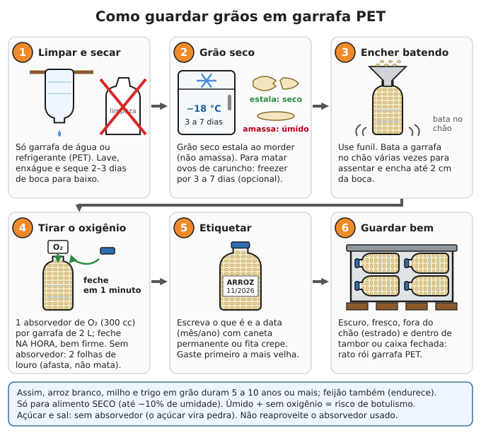

# Estoque de alimentos

**Resumo:** guarde o que a família já come, use sempre o mais antigo primeiro e reponha (estoque
rotativo). Grão **seco**, no **escuro**, em lugar **fresco** e **sem oxigênio** dura anos. Os inimigos
são umidade, calor, insetos e ratos. Um adulto precisa por ano de cerca de **70 kg de arroz,
35 kg de feijão, 50 kg de outras farinhas e massas, 18 L de óleo e 18 kg de açúcar**.

---

## Regras de ouro

1. **Guarde o que você come e coma o que você guarda.** Comida estranha à família encalha e vence.
2. **Primeiro que entra, primeiro que sai.** A compra nova vai para trás (ou para baixo); o mais
   velho fica na frente e é usado primeiro. Assim nada vence.
3. **Escuro, fresco, seco e fechado.** Como regra prática, cada 10 °C a menos de temperatura
   dobra o tempo que um alimento seco dura.
4. **Variedade:** só arroz e feijão causam doenças de carência em poucos meses. Inclua gordura,
   sal iodado, açúcar, leite em pó, vitaminas e **sementes** para plantar.
5. **Comece pequeno:** 1 semana → 1 mês → 3 meses → 1 ano. Um item extra a cada compra já ajuda.
6. **Não ponha tudo num lugar só** (fogo, enchente, roubo) e **não conte a todos** o que tem.
   Veja [Segurança](../12-comunidade-e-seguranca/02-seguranca.md).

## Quanto guardar

Por **adulto** com atividade moderada. A tabela dá cerca de **2.500 kcal e 60 g de proteína por dia**.

| Alimento | Por mês | Por ano | Observação |
|---|---|---|---|
| Arroz branco | 6 kg | 70 kg | Base do estoque; é o que mais dura |
| Feijão (e lentilha, grão-de-bico, ervilha seca) | 3 kg | 35 kg | Proteína principal |
| Macarrão / farinha de trigo | 2 kg | 24 kg | Trigo em grão dura mais que farinha |
| Farinha de mandioca | 1 kg | 12 kg | Torrada e bem seca |
| Milho em grão / fubá | 1 kg | 12 kg | Prefira grão inteiro e moa quando for usar |
| Aveia em flocos | 0,5 kg | 6 kg | Mingau para crianças e doentes |
| Óleo / banha | 1,5 L | 18 L | A caloria mais concentrada; rancifica em 1–2 anos |
| Açúcar / rapadura | 1,5 kg | 18 kg | Também para conservas e doces |
| Mel | 250 g | 3 kg | Nunca para bebê com menos de 1 ano |
| Leite em pó | 1 kg | 12 kg | Dobre se houver criança |
| Sal **iodado** | 0,5 kg | 6 kg | Mais 10–20 kg por família para salgar carne e conservas |
| Enlatados de carne e peixe (sardinha, atum, carne) | 8 latas | 100 latas | Proteína pronta |
| Amendoim / castanhas | 300 g | 4 kg | Gordura, proteína e vitamina B |
| Vinagre (4% de acidez ou mais) | 0,5 L | 6 L | Conservas, limpeza |
| Multivitamínico | 30 comprimidos | 365 comprimidos | Seguro contra carências |
| Café, chá, temperos secos, fermento, bicarbonato | a gosto | a gosto | Moral e variedade |

**Fator para cada pessoa** (multiplique a tabela):

| Pessoa | Fator |
|---|---|
| Criança de 1 a 3 anos | 0,4 |
| Criança de 4 a 8 anos | 0,6 |
| De 9 a 13 anos | 0,8 |
| De 14 a 18 anos | 1,0 (rapaz que trabalha pesado: 1,2) |
| Adulto em trabalho braçal pesado (roça, carregar água e lenha) | 1,3 |
| Gestante ou mãe que amamenta | 1,2 |
| Idoso (mais de 60 anos) | 0,8 |

**Exemplo:** casal + criança de 6 anos + criança de 2 anos = 1 + 1 + 0,6 + 0,4 = **3,0**.
Arroz para 1 ano: 70 kg × 3,0 = **210 kg**. Feijão: 35 × 3,0 = **105 kg**.

Não esqueça: **água** ([Armazenamento de água](../01-agua/03-armazenamento-e-calculos.md)),
**sementes** ([Sementes](../04-agricultura/02-sementes.md)) e remédios
([Medicamentos](../02-saude/04-medicamentos-e-doses.md)). Estoque acaba; a horta e as galinhas
continuam. Use o estoque para atravessar o tempo até a primeira colheita (3 a 12 meses).

## Onde guardar: temperatura, umidade e luz

- **Temperatura:** ideal abaixo de 21 °C; aceitável até 25–27 °C. Escolha o cômodo mais fresco:
  interno, sem sol na parede (no Brasil, as paredes viradas para o **sul** pegam menos sol),
  longe de fogão, geladeira e telhado sem forro. Porão ou despensa enterrada é o melhor.
- **Umidade:** o grão deve ter no máximo **12–13% de umidade** (o de mercado já vem assim).
  Para guardar sem oxigênio por anos, o ideal é **10% ou menos**.
- **Nunca no chão nem encostado na parede:** use estrado de 10–15 cm e deixe uns 30 cm de
  afastamento da parede (ventila e deixa ver sinal de rato).
- **Luz:** destrói vitaminas e rancifica óleo e leite em pó. Guarde em caixa ou armário fechado.

### Como saber se o grão está seco

1. **Teste da mordida:** grão seco **estala e quebra** ao morder ou bater com martelo; úmido amassa.
2. **Teste do sal:** num vidro seco ponha 1 xícara de grãos e 2 colheres (sopa) de sal de cozinha
   bem seco. Feche, agite 1 minuto e espere 15 minutos. Se o sal **grudar no vidro**, a umidade
   está acima de ~15%: seque mais.
3. Passou nos dois testes? Para estoque longo, dê **mais 1 dia de sol** por garantia.

### Secar grãos ao sol

1. Espalhe sobre lona ou terreiro limpo em camada de **2 a 4 cm**.
2. Revire a cada 1 hora. Recolha antes do sereno (fim da tarde) e cubra se ameaçar chuva.
3. Normalmente **1 a 3 dias** de sol forte bastam.
4. **Deixe esfriar na sombra** antes de ensacar. Grão quente fechado "sua", empedra e mofa.

## Embalagens

| Embalagem | Serve para | Dura (local fresco) | Cuidados |
|---|---|---|---|
| Saco original (plástico ou papel) | Tudo, no curto prazo | 6–12 meses | Caruncho e rato atravessam |
| Garrafa PET de água ou refrigerante | Arroz, feijão, milho, açúcar, sal | 5–10 anos ou mais, com absorvedor | Rato rói: guarde dentro de tambor |
| Vidro com tampa de rosca | Tudo seco, sementes | Anos | Proteja da luz e de quedas |
| Lata com tampa (leite em pó, biscoito) | Farinhas, café, sementes | 1–2 anos | À prova de rato; não deixe enferrujar |
| Balde de plástico de grau alimentício (15–20 L) | Grãos a granel | 2–5 anos; 10–25 com saco mylar | Tampa com borracha de vedação |
| Saco mylar (aluminizado) + absorvedor | Grãos e farinhas | 10–25 anos | Selar com ferro de passar |
| Tambor de metal ou bombona de 50–200 L | Milho e feijão a granel | 1–3 anos | Tampa bem vedada; local seco |
| Silo metálico de zinco (fazenda) | 300–2.000 kg de grão | Anos | Grão bem seco; tampa vedada |
| Saco de ráfia | Só transporte | Semanas a meses | Rato e caruncho entram |

**Balde de grau alimentício:** de plástico PEAD (número **2** dentro do triângulo de reciclagem),
com "próprio para alimentos" escrito. Padarias, confeitarias e restaurantes descartam baldes de
margarina, doce de leite e recheio. **Nunca** use balde de tinta, produto químico ou óleo de motor.

## Passo a passo: grãos em garrafa PET

1. Use só garrafa de **água ou refrigerante** (PET). Nunca de produto de limpeza, óleo ou veneno.
2. Lave com detergente, enxágue bem e deixe **secar 2 a 3 dias de boca para baixo**. Uma gota de
   água dentro estraga o lote.
3. (Opcional, recomendado) **Congele o grão 3 a 7 dias** no freezer para matar ovos de caruncho.
   Deixe voltar à temperatura ambiente **com o saco fechado** antes de abrir (senão condensa água).
4. Encha com funil, **batendo a garrafa no chão** para assentar, até 2 cm da boca.
5. Coloque **1 absorvedor de oxigênio** e feche **na hora**, bem firme.
6. Etiquete (conteúdo + mês/ano) e guarde **dentro de tambor ou caixa fechada**, no escuro.

**Sem absorvedor:** a garrafa bem cheia e fechada ainda protege da umidade e do rato; ponha 2
folhas de louro secas. Dura 1–2 anos para arroz e feijão.

## Absorvedor de oxigênio

É um sachê com **pó de ferro** que "come" o oxigênio do recipiente. Sem oxigênio, insetos morrem,
a gordura não rancifica e as vitaminas duram mais. Compra-se em lojas de embalagem.

| Recipiente | Absorvedor |
|---|---|
| Pote ou garrafa de 1 L | 100 cc |
| Garrafa PET de 2 L | 200–300 cc |
| Lata ou pote de 3–4 L | 300–500 cc |
| Balde de 20 L com saco mylar | 1.500–2.000 cc |

Regra geral: **cerca de 100 cc por litro de recipiente**. Macarrão (muito ar entre as peças) pede mais.

- Abra o pacote de absorvedores só na hora e trabalhe rápido (15–30 minutos). Os que sobrarem vão
  imediatamente para um **vidro pequeno bem fechado**.
- Absorvedor bom esquenta um pouco nas mãos. Duro, empedrado ou frio = gasto.
- **Não** coloque sílica gel (dessecante) junto: o absorvedor de ferro precisa de um pouco de
  umidade para funcionar.
- **Só para alimento SECO** (10% de umidade ou menos). Alimento úmido sem oxigênio pode
  desenvolver **botulismo** (veja [Conservação](02-conservacao-de-alimentos.md)).
- **Açúcar e sal: sem absorvedor.** Não precisam e o açúcar vira pedra.

## Balde com saco mylar (estoque de 10 a 25 anos)

1. Balde de grau alimentício limpo e seco; saco mylar de 0,12 a 0,18 mm de espessura dentro, com
   a boca dobrada sobre a borda do balde.
2. Encha de grão batendo para assentar, até **8 cm abaixo da boca do saco**.
3. Coloque os absorvedores (1.500–2.000 cc para 20 L) por cima.
4. Apoie a boca do saco esticada sobre uma **régua de madeira** e passe o **ferro de passar quente**
   (posição algodão, sem vapor) fazendo uma solda de 1–2 cm de largura. Deixe 3 cm sem soldar,
   aperte o saco para expulsar o ar e solde o resto.
5. Em 1 a 2 dias o saco fica "chupado", duro, como embalado a vácuo: o oxigênio saiu.
   (Feijão às vezes não murcha muito; se a solda estiver boa, está funcionando.)
6. Tampe o balde, etiquete com conteúdo e data.

## Métodos sem absorvedor

- **Gelo seco** (gás carbônico congelado, vendido em sorveterias e distribuidoras de gás):
  1. Ponha **cerca de 100 g** no fundo de um balde de 20 L, embrulhado em papel.
  2. Encha de grão por cima. O gás pesado expulsa o ar.
  3. Encoste a tampa **sem fechar** por 30–60 minutos, até o gelo seco sumir (o fundo do balde
     deixa de ficar gelado). Só então feche.
  > **ATENÇÃO:** gelo seco queima a pele (use luvas) e fechado cedo demais faz o balde
  > **estourar**. Faça em local ventilado: o gás sufoca.
- **Vela (método do interior):** sobre os grãos de um tambor de metal, uma vela acesa num pires;
  feche e vede a tampa (fita larga ou pasta de sabão). A vela apaga quando o oxigênio cai.
  **Tira só uma parte do oxigênio:** ajuda, mas não substitui grão seco e limpo. Nunca em
  balde de plástico.
- **Terra de diatomácea de grau alimentício:** pó de algas fósseis que fere e desidrata os insetos.
  Misture **1 xícara (240 mL) para cada 25 kg** de grão (≈ 1 colher de sopa para cada 1,5 kg),
  rolando o balde até cobrir tudo. Use máscara ao misturar (pó fino). Lave o grão antes de
  cozinhar. **Nunca** use a diatomácea de filtro de piscina (calcinada): faz mal aos pulmões.
- **Óleo no feijão:** 1 colher (chá) de óleo de cozinha (5 mL) por kg de feijão, mexendo até
  todos os grãos ficarem levemente brilhantes. Protege por meses contra o caruncho do feijão
  (sufoca os ovos). Ótimo para **feijão de semente**.
- **Cinza peneirada:** camadas de grão e cinza de madeira seca, terminando com 2–3 cm de cinza
  por cima. Método tradicional do Nordeste para feijão e milho de semente. Lave bem antes de cozinhar.
- **Folhas de louro, pimenta-do-reino, cravo, dentes de alho, folhas de nim:** 3–5 folhas por
  pote ou um punhado por balde. **Afastam** um pouco, **não matam** ovos que já estão no grão.

## Carunchos, traças e outros bichos

| Bicho | Ataca | Sinais |
|---|---|---|
| Gorgulho (caruncho do arroz e do milho) | Arroz, milho, trigo, macarrão | Besourinho escuro de 3–4 mm com "bico"; grãos furados e pó |
| Caruncho do feijão | Feijão, ervilha, grão-de-bico | Furinhos redondos; grão oco; besourinhos de 2–4 mm |
| Traça dos cereais / traça da farinha | Grãos, farinhas, frutas secas | Mariposinhas voando; fios de teia; grãos grudados |
| Besourinho da farinha | Farinhas, fubá, aveia | Besouros marrom-avermelhados; farinha acinzentada com cheiro ruim |

### Como matar e prevenir

1. **Congelar:** freezer a −18 °C por **pelo menos 3 dias** (7 dias é mais garantido). Mata
   adultos, larvas e ovos.
2. **Calor:** forno a **60 °C por 30 minutos** em camada de até 2 cm. Serve para comida, **mas
   mata a semente** (não faça com semente de plantio).
3. **Sol forte:** espalhe fino sobre lona preta ao meio-dia por 3–4 horas, mexendo. Os insetos
   fogem e parte morre.
4. **Peneirar** (farinhas, arroz) e **catar**. Feijão: ponha em água; os grãos que **boiam** estão
   ocos: descarte.
5. **Isole** o pacote atacado: um só contamina o estoque inteiro. Limpe a prateleira.
6. Inspecione o estoque **todo mês**. Não misture grão velho com novo.

Grão com pouco bicho pode ser comido depois de peneirado e lavado (inseto não envenena; só
diminui a comida). **Descarte** se tiver **mofo**, cheiro azedo ou farinha acinzentada fedendo.

> **ATENÇÃO:** **amendoim, milho e castanhas mofados** (bolor esverdeado ou amarelado, gosto
> amargo) têm **aflatoxina**, que causa câncer de fígado e intoxicação. O cozimento não destrói.
> Jogue fora, nem para os animais.

> **ATENÇÃO:** pastilhas de expurgo de grãos (**fosfeto de alumínio, fosfina**) soltam um gás
> que **já matou famílias inteiras** no Brasil. Nunca use dentro de casa, em cômodo onde alguém
> dorme ou perto de pessoas e animais.

## Ratos

Rato come, suja e transmite **leptospirose** (urina) e outras doenças
([Doenças](../02-saude/03-doencas-e-infeccoes.md)).

- **Recipientes à prova de rato:** metal, vidro, balde grosso com tampa. Garrafa PET e balde fino
  são roídos: guarde-os dentro de tambor de metal.
- **Paiol e jirau:** pés de pelo menos **90 cm** com uma chapa de metal lisa (disco ou funil virado)
  de **40–50 cm** em cada pé, e nada encostado (galhos, escadas, paredes).
- **Limpeza:** nada de comida derramada, lixo fechado, mato roçado 2 m em volta do depósito.
- **Gatos** de trabalho ([Cães e gatos](../05-animais/11-caes-e-gatos.md)) e **ratoeiras** com
  isca de amendoim, pão com banha ou coco. Arme várias ao mesmo tempo, encostadas na parede.
- **Raticida:** só dentro de porta-iscas fechado, longe de crianças, cães e galinhas. Gato que come
  rato envenenado também morre.
- Alimento que teve contato com urina ou fezes de rato e não pode ser lavado: **jogue fora**.
  Latas: lave com água sanitária (1 colher de sopa por litro) antes de abrir.

## Quanto dura cada alimento (validade real)

| Alimento | Embalagem comum, local fresco | Selado sem oxigênio, local fresco | Sinal de estragado |
|---|---|---|---|
| Arroz branco | 1–2 anos | 10–25 anos | Mofo, cheiro de ranço, bicho |
| Arroz integral | 6 meses | 1–2 anos | Cheiro de ranço (a gordura do grão estraga) |
| Feijão | 1–2 anos | 10–20 anos | Fica duro: deixe de molho 12–24 h e use panela de pressão |
| Milho em grão | 1–2 anos | 10–20 anos | Mofo, grão ardido (escuro) |
| Fubá, farinha de milho | 6–12 meses | 2 anos | Ranço, gosto amargo, mofo |
| Farinha de mandioca torrada | 6–12 meses | 1–2 anos | Mofo, umidade, gosto azedo |
| Farinha de trigo branca | 6–12 meses | 5–10 anos | Bicho, cheiro de mofo |
| Trigo em grão | 5 anos | 25 anos ou mais | Mofo |
| Macarrão | 2–3 anos | 10–20 anos | Bicho, mofo |
| Aveia em flocos | 1 ano | 10–20 anos | Ranço |
| Açúcar, sal, bicarbonato, vinagre | Indefinido (seco e fechado) | — | Açúcar empedra: quebre e use |
| Mel | Indefinido | — | Cristaliza: aqueça em banho-maria morno (até 45 °C) |
| Óleo de cozinha | 1 ano fechado; 3–6 meses aberto | — | Cheiro de tinta ou massa de vidraceiro (ranço) |
| Banha | 6–12 meses em lata fechada | — | Ranço, mofo |
| Leite em pó integral | 1 ano | 2–3 anos | Ranço, cor escura |
| Leite em pó desnatado | 2 anos | 10–20 anos | Cor escura, empedrado |
| Enlatados de carne, peixe, feijão, legumes | 2–5 anos (muitas vezes mais, se a lata estiver perfeita) | — | Lata **estufada**, vazando, enferrujada furada, amassada na emenda |
| Enlatados ácidos (tomate, frutas, sucos) | 12–18 meses | — | A acidez corrói a lata |
| Café torrado em pó | 6 meses fechado; 2 semanas aberto | 1–2 anos | Perde o aroma (não faz mal) |
| Café verde (cru, em grão) | 1–2 anos | Mais | Torre em casa na panela |
| Fermento biológico seco | 1–2 anos fechado | — | Teste: 1 colher (chá) + água morna + açúcar deve espumar em 10 min |
| Rapadura | 6–12 meses | — | Puxa umidade e mofa: guarde em lata |
| Amendoim e castanhas | 6–12 meses com casca; 3–6 sem casca | 1–2 anos | Ranço, mofo (aflatoxina) |
| Multivitamínico | 2 anos | — | Depois disso perde força aos poucos |

**Data de validade do rótulo** é garantia de qualidade, não data de veneno: arroz, macarrão, açúcar
e enlatados perfeitos continuam comestíveis muito depois. O que manda são os **sinais** da tabela.

> **ATENÇÃO:** lata **estufada**, com tampa abaulada, vazando, que **espirra** ao abrir, com
> cheiro ruim ou líquido espumando pode ter **toxina botulínica**, que mata em doses mínimas.
> **Não prove.** Jogue fora onde animais não alcancem.

## Rodízio na prática

1. **Etiquete tudo:** conteúdo e mês/ano. Fita crepe e caneta permanente bastam.
2. **Fila:** o novo entra atrás (ou embaixo), o velho sai na frente (ou em cima).
3. **Caderno de inventário:** o que tem, quanto, onde, data. Atualize a cada mês.
4. **Todo mês:** use o mais velho e reponha; procure bicho, mofo, rato e embalagem furada.
5. **A cada 6 meses:** abra uma garrafa ou balde de amostra do estoque longo; renove óleo e
   leite em pó; confira o sal (empedrou = umidade no depósito).
6. **Estoque selado de longo prazo:** troque a cada 5–10 anos. No último ano, vá consumindo e reponha.
7. **Cozinhe com o estoque** regularmente: a família aprende a preparar e o intestino se acostuma.
   Mudar a dieta de repente na crise causa gases, prisão de ventre e rejeição.

---

Ver também: [Kits e estoques](../00-emergencia/03-kits-e-estoques.md) · [Conservação de alimentos](02-conservacao-de-alimentos.md) · [Nutrição e racionamento](03-nutricao-e-racionamento.md) · [Processamento de alimentos](05-processamento-de-alimentos.md) · [Sementes](../04-agricultura/02-sementes.md) · [Rotinas de manutenção](../anexos/03-rotinas-de-manutencao.md)
