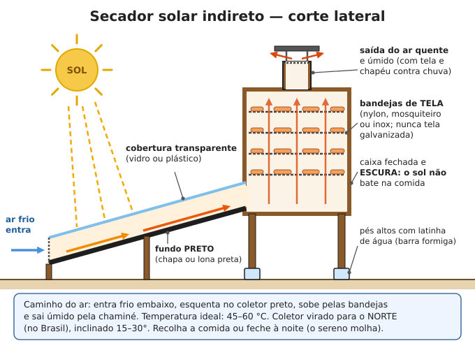
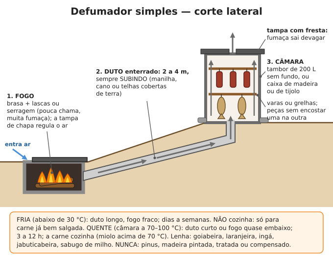
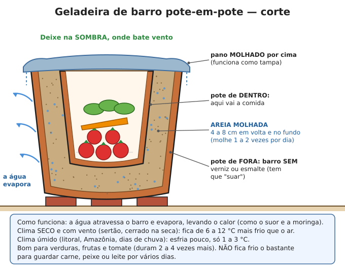

# Conservação de alimentos

**Resumo:** micróbios precisam de **água, calor, ar e pouca acidez** para estragar a comida.
Conservar é tirar um ou mais desses: **secar, salgar, adoçar, acidificar (vinagre ou
fermentação), defumar, cozinhar e fechar sem ar, ou esfriar.** O maior perigo é o
**botulismo**: conserva caseira de alimento pouco ácido (legumes, carne, palmito) feita sem
panela de pressão pode matar.

---

## Qual método para cada alimento

| Princípio | Métodos | Bom para |
|---|---|---|
| Tirar a água | Secagem ao sol, ao ar, no secador, no fumeiro | Frutas, legumes, ervas, carne, peixe, grãos |
| Prender a água com sal | Salga, charque, carne de sol, salmoura | Carne, peixe, toucinho, legumes |
| Prender a água com açúcar | Doces, geleias, compotas, cristalizadas | Frutas |
| Acidez | Vinagre (picles), fermentação lática (chucrute) | Legumes, pimenta, repolho, pepino |
| Fumaça | Defumação fria e quente | Carne, peixe, linguiça, queijo |
| Calor + fechar sem ar | Conserva em vidro (banho-maria ou pressão) | Frutas, tomate, picles; legumes e carne **só na pressão** |
| Isolar do ar com gordura | Carne na banha (carne de lata) | Carne de porco, linguiça |
| Frio | Pote de barro, porão, poço, enterrar | Verduras, frutas, raízes |

## Secagem

### Secador solar indireto (o melhor sem energia)

A comida fica **na sombra**, dentro de uma caixa; o ar é aquecido num coletor separado. Seca mais
rápido que ao sol direto, guarda cor e vitaminas e protege de moscas, poeira e chuva.

**Como construir (para 4 a 6 bandejas):**
1. **Coletor:** caixa rasa de madeira de 1 m de largura × 1,5 a 2 m de comprimento × 10 cm de altura.
   Fundo de chapa de metal (zinco, lata aberta) ou lona **pintada de preto fosco**. Por cima, vidro
   ou plástico transparente grosso, bem preso.
2. Na ponta de baixo do coletor, uma abertura de entrada coberta com **tela fina** (mosquiteiro).
3. **Câmara:** caixa de madeira de 1 m de largura × 0,6 m de fundo × 1 m de altura, fechada e escura,
   com porta para as bandejas. A ponta alta do coletor entra na parte de baixo da câmara.
4. **Bandejas:** molduras de madeira com tela de **nylon, mosquiteiro plástico ou inox**, a cada
   10–15 cm de altura. Não use tela galvanizada (o zinco solta com frutas ácidas).
5. **Chaminé** de 10 × 10 cm a 15 × 15 cm no topo, com tela e um chapéu contra chuva.
6. Vire o coletor para o **norte** (no Brasil, o sol passa pelo norte) e incline de **15 a 30°**.
   Perto do equador (Norte e Nordeste), quase plano também funciona.
7. Pés altos com latinhas de água em volta de cada pé: formiga não sobe.

**Temperatura ideal na câmara: 45–60 °C.** Acima de 70 °C a fruta cozinha por fora e não seca por
dentro. Feche a entrada ou recolha a comida à noite: o sereno devolve a umidade.

### Secador direto simples
Moldura de madeira com tela, apoiada a 80–100 cm do chão sobre cavaletes, coberta com um voal
ou outro pano fino contra moscas. Funciona bem no sertão e no cerrado na seca; no litoral úmido,
prefira o secador indireto ou o fumeiro.

### Frutas

| Fruta | Preparo | Tempo no secador solar | Ponto |
|---|---|---|---|
| Banana (passa) | Bem madura, descascada, cortada ao meio no comprimento | 2–4 dias | Escura, flexível, sem melar |
| Manga, abacaxi, mamão | Fatias de 5–7 mm | 2–3 dias | "Couro": dobra sem quebrar, sem umidade ao apertar |
| Caju, goiaba, jaca | Fatias de 5 mm (goiaba sem miolo) | 2–3 dias | Couro |
| Tomate | Ao meio ou em 4, sem sementes, salpicado de sal | 2–4 dias | Couro seco, ainda flexível |
| Pimenta | Inteira, em réstia (cordão) | 3–4 semanas à sombra ventilada | Seca e quebradiça |

- **Para não escurecer** (maçã, banana, pera): mergulhe 10 minutos em água com suco de limão
  (1 xícara de suco para 1 L de água).
- **Condicionamento:** depois de seca, ponha a fruta num pote fechado por 7–10 dias, agitando todo
  dia. Se aparecer gotinha de água no vidro, volte para o secador.
- **Para matar ovos de inseto** na fruta seca: freezer por 2 dias ou forno a 70 °C por 30 minutos.
- Guarde em pote fechado, no escuro. Dura **6 a 12 meses**.

### Legumes e verduras

1. Lave e corte em fatias ou cubos de **3 a 6 mm**.
2. **Branqueie:** mergulhe em água fervendo e depois em água fria. Isso para as enzimas que estragam
   a cor e o sabor. Tempos: folhas (couve, ora-pro-nóbis) 1–2 min; vagem 2–3 min; cenoura, abóbora,
   chuchu 3–4 min; milho verde (debulhado) 2 min.
3. Seque até ficar **quebradiço** (estala ao dobrar): 1–3 dias no secador.
4. Guarde em vidro ou garrafa PET bem fechados. Dura **6 a 12 meses**. Para usar, deixe de molho
   30–60 minutos ou jogue direto na sopa.

### Ervas e chás
Maços pequenos amarrados, pendurados de cabeça para baixo **à sombra**, em local ventilado, por
1 a 2 semanas. Sol direto destrói o aroma. Prontas quando a folha esfarela. Guarde em vidro escuro.

### Carne seca simples (tiras)
1. Carne **magra**, sem gordura nem nervos (a gordura rancifica), em tiras de **5 mm a 1 cm** de espessura.
2. Esfregue sal: **40 a 60 g por kg** (4–6%). Para mais segurança, mergulhe as tiras 1–2 minutos
   em salmoura fervendo antes de secar (mata bactérias da superfície).
3. Seque no secador solar, no varal com tela contra moscas ou sobre o fogão a lenha, **2 a 4 dias**,
   até ficar dura e escura, quebrando ao dobrar.
4. Guarde em lata ou saco fechado, em local seco. Dura **2 a 6 meses**.

Funciona bem em clima seco e quente. No litoral úmido, use charque, defumação ou carne na banha.

## Salga: carne de sol, charque e peixe salgado

Use **sal grosso ou moído sem mistura**. O sal iodado comum funciona. Para salgar a carne de 1 boi
(200–250 kg de carne limpa) em charque gastam-se uns **60–80 kg de sal**. Veja abate e cortes em
[Abate e carne](../05-animais/12-abate-e-carne.md).

### Carne de sol (Nordeste: salga leve, dura poucos dias)
1. Corte mantas de **3 a 5 cm** de espessura, tirando nervos e excesso de gordura.
2. Esfregue sal: **30 a 50 g por kg** de carne, em toda a superfície.
3. Empilhe as mantas numa bacia ou mesa inclinada por **4 a 8 horas** (a carne solta salmoura).
4. Pendure à **sombra, em local ventilado e coberto**, protegida de moscas, por **12 a 24 horas**,
   até formar uma película seca por fora. Por dentro continua úmida e vermelha.
5. **Dura 3 a 4 dias** fora da geladeira. É para consumo rápido, não para estoque.

### Charque / jabá / carne-seca (salga forte, dura meses)
1. **Mantas** de 2 a 4 cm de espessura, abertas como um livro, sem nervos grossos e sem excesso de
   gordura. Trabalhe no mesmo dia do abate, com a carne fria.
2. **Salga úmida:** mergulhe as mantas por **30 a 60 minutos** em salmoura **saturada** (água com
   sal até não dissolver mais: cerca de 360 g por litro).
3. **Salga seca (pilha):** sobre estrado limpo e levemente inclinado (para escorrer), faça camadas:
   sal grosso, manta, sal grosso, manta... até uns 80 cm de altura. Cubra bem cada manta.
4. **Tombos:** a cada 24 horas, desmanche a pilha e refaça invertendo (o que estava em cima vai
   para baixo), salgando os pontos sem sal. Faça **4 a 5 tombos** (4 a 5 dias).
5. Passe rapidamente as mantas em salmoura para tirar o excesso de sal da superfície.
6. **Seque ao sol** em varais altos, **4 a 6 dias**. À noite e quando ameaçar chuva, recolha e
   empilhe coberto com lona. Proteja de moscas (tela ou fumaça por perto).
7. Pronto quando a carne está **firme, seca ao toque, sem partes moles** e escura por dentro.
8. Guarde em local seco e ventilado, pendurada ou em fardos, protegida de insetos e ratos.
   Dura **3 a 6 meses** ou mais.
9. **Para comer:** dessalgue de molho por **12 a 24 horas**, trocando a água 3 a 4 vezes (ou ferva
   e troque a água 2 a 3 vezes).

### Peixe salgado-seco (como bacalhau e pirarucu seco)
1. Abra o peixe em manta (corte pelas costas ou pela barriga), tire vísceras, guelras e raspe o
   sangue junto à espinha. Lave em água com sal.
2. Peixe grosso (mais de 2–3 cm): faça cortes rasos na carne para o sal penetrar.
3. **Salga seca:** 1 parte de sal para 3 partes de peixe (em peso), em camadas, pele para baixo.
   Deixe escorrer a salmoura. Peixe fino: 2–3 dias; grosso: 5–7 dias.
4. Seque ao sol e vento em varal ou jirau **3 a 7 dias**, recolhendo à noite, até ficar firme
   sem marcar ao apertar.
5. Guarde seco e ventilado. Dura meses. Dessalgue como o charque.

> **ATENÇÃO:** carne ou peixe com cheiro de podre, viscoso, esverdeado ou com bicho (varejeira)
> por dentro: descarte. O sal não conserta carne que começou a estragar antes da salga.

## Defumação

A fumaça seca a superfície, dá sabor e tem substâncias que dificultam fungos e bactérias. **Sozinha
não conserva:** combine com sal e secagem.

| | Defumação FRIA | Defumação QUENTE |
|---|---|---|
| Temperatura na câmara | **Abaixo de 30 °C** | **70–100 °C** |
| Duração | Dias a semanas (algumas horas por dia) | 3 a 12 horas |
| Cozinha a carne? | **Não** | **Sim** (miolo acima de 70 °C) |
| Exige | Carne **já bem salgada** (salmoura ou salga seca) | Salga leve (opcional) |
| Dura | Semanas a meses, se bem seca | Poucos dias; mais se depois secar até endurecer |
| Exemplos | Bacon, toucinho, linguiça e queijo no fumeiro | Peixe e frango defumados, costela |

### Defumador de duto (frio ou quente)
1. **Fornalha:** cova de 40 × 40 × 40 cm forrada de pedras ou tijolos, com tampa de chapa que
   regula a entrada de ar.
2. **Duto:** vala de 2 a 4 m subindo até a câmara, coberta com telhas, manilha ou cano de barro/metal
   e terra por cima. Duto longo e enterrado = fumaça **fria**.
3. **Câmara:** tambor de 200 L sem fundo (nunca tambor que teve combustível, veneno ou tinta;
   queime-o por dentro antes), caixa de madeira ou de tijolos, sobre a ponta alta do duto.
4. Varas ou grelhas atravessadas; pendure as peças **sem encostar** umas nas outras.
5. Tampa com uma fresta (ou saco de estopa úmido): a fumaça deve sair devagar.
6. **Fogo:** brasas cobertas com lascas ou serragem **levemente úmidas**: muita fumaça e pouca
   chama. Para defumação quente, ponha o fogo quase embaixo da câmara (duto curto).

### Fumeiro do fogão a lenha (tradicional)
Varal ou gancho a **1,5 a 2 m acima** do fogão a lenha. Linguiças, toucinho salgado e queijo
pendurados ali secam e defumam devagar por semanas. Mantenha longe da chama.

**Lenha boa:** goiabeira, laranjeira, limoeiro, jabuticabeira, ingá, nogueira-pecã, madeira de
frutíferas em geral, sabugo de milho seco, casca de coco seca, serragem de madeira não tratada.

> **ATENÇÃO:** **nunca** use pinus, cipreste ou outras madeiras com resina, madeira pintada,
> envernizada, **tratada** (de cerca e poste), compensado, MDF, **espirradeira** (fumaça tóxica)
> ou lenha mofada. A fumaça passa veneno para a comida.

## Conservas em vidro e o perigo do botulismo

### O que é o botulismo
A bactéria do botulismo vive no solo e forma **esporos que aguentam a fervura** (100 °C). Dentro
de um vidro ou lata **sem ar**, com alimento **pouco ácido** e úmido, ela cresce e produz a
toxina mais forte que existe. **A comida pode parecer, cheirar e ter gosto normais.**

- **Sintomas** (de 12 horas a alguns dias depois): visão dupla ou embaçada, pálpebras caídas,
  fala enrolada, dificuldade para engolir, boca seca, fraqueza que **desce** dos ombros para
  braços e pernas, falta de ar. Geralmente **sem febre** e com a pessoa lúcida.
- **Tratamento:** só em hospital (soro antibotulínico e respirador). Sem hospital, muitos morrem.
  **Prevenção é tudo.**

### A regra da acidez

| Alimento | Acidez | Como fazer conserva |
|---|---|---|
| A maioria das frutas, geleias, doces, picles com vinagre, chucrute, tomate **com limão** | **Ácido** (pH até 4,6) | **Banho-maria** (100 °C) é suficiente |
| Legumes, milho, feijão, abóbora, **palmito**, cogumelos, carnes, peixes, sopas, caldos | **Pouco ácido** | **Só na panela de pressão** (115–121 °C), ou acidificar como picles |

> **ATENÇÃO:** legume, carne, peixe ou palmito em vidro feito só em banho-maria, por mais tempo que
> ferva, **pode ter botulismo**. No Brasil, as causas mais comuns são **palmito e pequi em conserva
> caseira**, **carne conservada na gordura** e peixe defumado ou salgado artesanal. Palmito só como
> picles (salmoura com **pelo menos metade de vinagre**) e, mesmo assim, fervido 10 minutos antes de
> comer. Na dúvida, coma palmito e pequi **frescos e cozidos** em vez de fazer conserva.

**Regras que salvam vidas:**
1. **Nunca coma** de lata ou vidro **estufado**, com tampa abaulada (que não fica afundada),
   vazando, que **espirra** ou borbulha ao abrir, com cheiro ruim, líquido turvo ou espumando, ou mofo.
   **Não prove** nem para testar. Uma lambida pode matar.
2. Descarte o conteúdo suspeito fervendo-o 30 minutos antes de enterrar fundo, longe de animais.
   Lave as mãos e a pia com água sanitária.
3. **Toda conserva caseira de alimento pouco ácido: ferva 10 minutos** (fervura forte, mexendo)
   **antes de provar.** O calor destrói a toxina (não os esporos). É a última barreira.
4. **Alho, ervas ou pimenta em óleo** em temperatura ambiente também dão botulismo. Faça na hora,
   ou mantenha frio e use em até 4 dias, ou ponha o alho antes em vinagre por 24 horas.
5. **Mel não é para bebê com menos de 1 ano** (botulismo infantil).

### Material
- Vidros próprios para conserva (de palmito, azeitona, maionese), **sem lascas na boca**.
- **Tampas metálicas com vedante de borracha em bom estado.** Tampa nova é o ideal; reaproveitada
  tem que estar perfeita e precisa de conferência rigorosa do vácuo.
- Panela funda com pano dobrado ou grelha no fundo (vidro não pode encostar no fundo: quebra).
- Pegador, funil largo, espátula de madeira ou plástico, pano limpo.

### Passo a passo do banho-maria (alimentos ácidos)
1. **Esterilize** vidros e tampas fervendo-os 10 minutos. Mantenha-os quentes até encher.
2. Prepare o alimento (calda, geleia, molho, picles) e **encha os vidros quentes** deixando espaço
   livre no topo: **0,5 cm** para geleia e doce; **1 cm** para frutas, tomate e picles.
3. Passe a espátula por dentro para soltar bolhas de ar. Limpe a boca do vidro com pano úmido.
4. Feche a tampa firme, sem forçar.
5. Ponha na panela com água **quente** (não fervendo, para não trincar) cobrindo **2–3 cm acima
   das tampas**. Leve à fervura e **conte o tempo a partir da fervura**:

| Produto (vidro de 500 mL) | Tempo em fervura |
|---|---|
| Geleia, doce em pasta (vidro esterilizado) | 5–10 min |
| Picles com vinagre | 10 min (1 L: 15 min) |
| Frutas em calda (goiaba, pêssego, abacaxi, manga) | 20 min (1 L: 25 min) |
| Molho de tomate com limão | 35 min (1 L: 40 min) |
| Tomate em pedaços com limão | 40 min (1 L: 45 min) |

   **Altitude:** de 300 a 900 m some 5 min; de 900 a 1.800 m some 10 min.
   **Tomate:** acrescente **1 colher (sopa) de suco de limão por vidro de 500 mL** (2 por litro).
   O tomate sozinho não é ácido o bastante.
6. Desligue, espere 5 minutos, retire os vidros e deixe esfriar **24 horas** sem mexer, longe de
   vento frio.
7. **Ponto de vácuo:** ao esfriar a tampa faz "plim" e **afunda**. Aperte o centro: **não pode
   subir e descer** (estalar). Se não vedou, guarde no frio e consuma em poucos dias, ou reprocesse.
8. Etiquete com conteúdo e data. Guarde no escuro e fresco. Consuma em **1 ano**.

### Panela de pressão (alimentos pouco ácidos)
O certo é a **autoclave de conserva** (panela de pressão grande com manômetro). A panela de pressão
comum de cozinha chega a 110–120 °C e serve com cuidados:
1. Só **vidros de até 500 mL**, que caibam com a tampa da panela fechada.
2. Pano no fundo, vidros cheios e fechados como no banho-maria (espaço livre de **2,5 cm**),
   água até **um terço** da altura dos vidros.
3. Conte o tempo **só quando a válvula estiver chiando forte e contínuo**. Fogo para manter o chiado.
4. Tempos mínimos (para autoclave; na panela comum **some 15–20 minutos de margem**):

| Alimento (vidro de 500 mL) | Tempo sob pressão |
|---|---|
| Vagem, cenoura | 20–25 min |
| Abóbora em cubos (nunca em purê) | 55 min |
| Milho debulhado | 55 min |
| Feijão cozido | 75 min |
| Carne ou frango em pedaços | 75 min |
| Peixe | 100 min |

5. Desligue e deixe a panela **esfriar sozinha** até sair toda a pressão (não esfrie com água).
6. Confira o vácuo, etiquete e **ferva 10 minutos antes de comer**.

## Fermentação lática (chucrute, picles fermentados)

Bactérias boas do próprio vegetal transformam o açúcar em ácido. O sal certo segura as bactérias
ruins enquanto o ácido se forma. Não precisa de vinagre nem de calor.

### Chucrute (repolho fermentado)
1. Pese o repolho fatiado bem fino (tire as folhas de fora e o talo).
2. Misture **20 a 25 g de sal por kg de repolho** (2–2,5%). Amasse com as mãos 5–10 minutos até
   soltar bastante caldo.
3. Soque num pote de vidro, barro ou balde de grau alimentício até o caldo **cobrir** o repolho.
4. Ponha um peso por cima (prato + pote com água, ou saco plástico com salmoura) para tudo ficar
   **submerso**. Cubra com pano.
5. Deixe no lugar mais fresco da casa (ideal 18–24 °C). Em 2–3 dias começam as bolhas.
   **Pronto em 1 a 2 semanas** no calor brasileiro (3–4 semanas a 20 °C).
6. Depois de pronto, guarde no local mais fresco. Dura meses a 15 °C; no calor, consuma em
   1–2 meses ou faça banho-maria (10 min para 500 mL; perde as bactérias boas, mas conserva).

### Picles fermentados em salmoura (pepino, cenoura, couve-flor, quiabo, pimenta, vagem)
1. Prepare **salmoura de 2 a 5%**: **20 a 50 g de sal por litro de água** (sem cloro: ferva e
   esfrie). Folhas e legumes macios: 2–3%; pepino inteiro e pimenta: 3,5–5%.
2. Arrume os legumes lavados num pote com alho, louro, endro, pimenta a gosto.
3. Cubra com a salmoura, ponha peso para manter tudo **submerso** e cubra com pano.
4. Em 18–28 °C: pronto em **5 a 14 dias** (prove: azedo agradável).

**Sinais:** bolhas, caldo turvo-esbranquiçado e cheiro azedo são **normais**. Película branca e
lisa na superfície (levedura) pode ser retirada. **Descarte** se tiver mofo colorido ou peludo
(rosa, preto, verde), cheiro de podre ou o vegetal ficar **mole e gosmento**.

## Conservar com açúcar

O açúcar em alta concentração "rouba" a água dos micróbios. A conta é **fruta e açúcar meio a meio**,
mais ou menos.

### Geleia
1. **1 kg de fruta** picada (goiaba, jabuticaba, amora, manga, abacaxi, maracujá) + **700 g a 1 kg
   de açúcar** + suco de **1 limão**.
2. Cozinhe mexendo até o **ponto**: uma gota num prato frio, após 1 minuto, **enruga** quando
   empurrada com o dedo (cerca de 104–105 °C).
3. Ponha quente em vidros esterilizados e faça **banho-maria de 5–10 min**. Dura 1 ano fechada.

### Doce de corte (goiabada, bananada, marmelada, doce de leite em barra)
1. **1 kg de polpa** + **700 g a 1 kg de açúcar**. Cozinhe em tacho mexendo **sempre** (1 a 2 horas).
2. Ponto: passando a colher, **aparece o fundo do tacho** e o doce demora a voltar; uma bolinha em
   água fria fica firme.
3. Despeje em forma ou caixa de madeira forrada com papel ou folha de bananeira. Deixe secar 1–2
   dias coberto com pano.
4. Corte, embrulhe e guarde em lata. Dura **6 a 12 meses** em local seco. **Mofou: descarte.**

### Frutas em calda (compota)
- **Calda rala:** 1 parte de açúcar para 3 de água. **Média:** 1 para 2. **Grossa:** 1 para 1.
- Cozinhe a fruta na calda até ficar macia, encha os vidros quentes, cubra com calda e faça
  banho-maria (tabela acima).
- **Frutas pouco ácidas** (mamão verde, figo, banana, abóbora, chuchu, casca de melancia):
  acrescente **1 colher (sopa) de suco de limão por vidro de 500 mL** e use calda grossa. Ao primeiro
  sinal de tampa estufada, descarte.

### Frutas cristalizadas (mamão verde, casca de laranja, cidra, figo, abacaxi)
1. Corte em cubos ou tiras. Cascas cítricas: ferva trocando a água 3 vezes (tira o amargo).
2. Cozinhe em água até ficar macia (10–20 min). Escorra.
3. Ferva 5 minutos numa calda de **1 parte de açúcar para 2 de água** e deixe de molho **24 horas**.
4. Todo dia, durante **5 a 7 dias**: retire a fruta, acrescente à calda mais açúcar (cerca de
   1/4 do que usou no início), ferva, devolva a fruta. A calda vai engrossando até o **ponto de fio**.
5. Escorra e seque à sombra ou no secador por 1–3 dias, até não grudar. Passe no açúcar cristal.
6. Guarde em pote fechado. Dura **6 a 12 meses**.

## Carne na banha (carne de lata)

Tradição do interior de Minas, Goiás, São Paulo e do Sul para guardar carne de porco sem geladeira.

1. Corte a carne de porco (lombo, pernil, costela) em pedaços de **5 a 8 cm** (porção de uma refeição).
2. Tempere com **20 a 30 g de sal por kg** e alho. Deixe descansar 4 a 12 horas no lugar mais fresco.
3. Frite **em bastante banha, em fogo baixo, por 1 a 2 horas**, até cozinhar por dentro, ficar
   dourada e **parar de chiar** (sinal de que a água saiu). Carne mal frita estraga.
4. Lata, pote de barro ou vidro **escaldado e bem seco**. Arrume os pedaços e cubra com a banha
   quente coada, ficando **pelo menos 3 cm de banha acima** da carne. Nenhum pedaço de fora.
5. Esfrie destampado (o vapor sai), depois tampe com pano ou tampa. Local fresco e escuro.
6. **Para usar:** tire com garfo ou escumadeira **limpos e secos**, alise a banha cobrindo o resto
   e **frite de novo até chiar bem** antes de comer. Nunca coma fria direto da lata.
7. Dura **3 a 6 meses** em local fresco. Linguiça faz-se igual.

> **ATENÇÃO:** carne conservada em gordura já causou **botulismo** no Brasil. Os cuidados que
> evitam: fritar até a água sair toda, carne totalmente coberta, utensílio seco e **refritar bem**
> antes de comer. Banha com cheiro estranho, bolhas, espuma ou carne com mofo: jogue fora.

## Ovos

- **Teste da água:** ovo num copo de água. **Deita no fundo** = fresco. **Fica em pé** no fundo =
  mais velho, use logo. **Boia** = estragado, descarte.
- **Não lave ovos que vai guardar:** a casca tem uma película natural que protege. Lave só na hora
  de usar. Ovo muito sujo de fezes: use logo.
- **Ovo limpo, sem lavar, em local fresco e arejado:** 3–4 semanas (menos no calor forte).
- **Untado com óleo ou vaselina líquida:** esfregue uma película fina em toda a casca de ovos
  frescos (até 2 dias), guarde de **ponta fina para baixo** em bandeja, local fresco, e vire uma
  vez por semana. Dura **2 a 3 meses** no calor e até 6 meses em lugar fresco.
- **Água de cal (o que mais dura: 6 a 12 meses):**
  1. Misture **30 g de cal hidratada por litro de água** (cerca de 2 colheres de sopa). Prefira cal
     de grau alimentício; se for cal de construção, a mais pura que houver.
  2. Use só ovos **fresquíssimos, limpos sem lavar e sem trincas** (bata de leve: trinca soa rachado).
  3. Ponha os ovos com cuidado num balde ou pote de vidro, ponta fina para baixo, e cubra com a
     água de cal até **5 cm acima** do último ovo. Tampe.
  4. Local fresco e escuro. Na hora de usar, lave a casca e **quebre cada ovo num copo separado**
     antes de juntar (um estragado perde a receita). A clara fica mais rala; serve para cozinhar e bolo.
- Ovo cozido **não** se guarda: estraga mais rápido que o cru.
- O melhor "estoque" de ovos são **galinhas vivas** ([Galinhas](../05-animais/02-galinhas.md)).

## Leite e queijo

Leite cru **sempre fervido** antes de beber. Sem geladeira, leite dura horas: transforme em
**queijo curado, manteiga de garrafa, requeijão, doce de leite** ou coalhada. Tudo em
[Leite e laticínios](../05-animais/13-leite-e-laticinios.md).

## Refrigeração sem energia

### Geladeira de barro pote-em-pote

Funciona como a **moringa** e como o suor: a água evapora pela parede do barro e leva o calor.
1. Dois potes de barro **sem verniz** por fora: o de fora com 8 a 15 cm a mais de diâmetro que o de dentro.
2. Ponha **4 a 8 cm de areia** no fundo do pote grande, coloque o pequeno dentro e encha o espaço
   em volta com areia.
3. **Molhe a areia** até encharcar (sem formar poça). Ponha a comida no pote de dentro.
4. Cubra com **pano grosso molhado** ou tampa de barro.
5. Lugar com **sombra e vento** (varanda, embaixo de árvore). Molhe a areia **1 a 2 vezes por dia**.

**Resultado:** em clima seco (sertão, cerrado na seca) fica **6 a 12 °C mais frio** que o ar; em
clima úmido (litoral, Amazônia), só 1 a 3 °C. Verduras, frutas e tomate duram **2 a 4 vezes mais**.
**Não** fica frio o bastante para carne, peixe e leite por vários dias (precisam de menos de 5 °C).

**Outra versão (armário de carvão):** armário de tela com paredes duplas de tela de galinheiro
recheadas de **carvão vegetal**, mantido molhado por um cano furado em cima. Mesmo princípio, maior.

### Porão, adega e despensa enterrada
A terra a 1,5–2 m de profundidade fica perto da **temperatura média do ano**: uns **16–20 °C no Sul
e nas serras** e **22–26 °C no Norte e Nordeste**. Não é geladeira, mas foge dos 35 °C da tarde e
fica estável. Bom para grãos, raízes, conservas, ovos, queijo curado.

### Poço, nascente e riacho
Garrafão ou lata **bem fechados**, amarrados numa corda, mergulhados em água de nascente ou riacho
à sombra (água de nascente fica uns 18–22 °C). Bom para manteiga, queijo, bebidas.
**Nunca** no poço de água de beber (contamina e pode cair).

### Enterrar raízes (silo de raízes)
1. Local **alto e bem drenado**. Cova rasa de 20–30 cm forrada com 15 cm de palha seca.
2. Raízes **inteiras, sem lavar, sem machucados** (batata, cenoura, beterraba, cará, inhame), em
   camadas alternadas com palha ou areia seca.
3. Cubra com **20–30 cm de palha** e **15–20 cm de terra**. Deixe uma "chaminé" de palha no topo.
4. Valeta em volta para a chuva escorrer. Abra de um lado, tire o que precisa, feche de novo.

### O que dura sem frio nenhum

| Alimento | Como guardar | Dura |
|---|---|---|
| **Mandioca** | **Deixe na terra** e arranque só o que vai usar no dia. Arrancada, escurece em 2–3 dias | 1–2 anos no pé |
| Batata-doce | "Cura": 5–7 dias em local quente e abafado; depois lugar fresco e escuro | 1–3 meses |
| Abóbora e moranga maduras | Colha com 5 cm de cabo, deixe 1–2 semanas ao sol para a casca endurecer; guarde seca | 3–6 meses |
| Cebola e alho | Seque 1–2 semanas ao sol com as folhas, faça réstias e pendure em local ventilado | 3–6 meses |
| Cará e inhame | Local seco, ventilado e escuro | 2–4 meses |
| Banana | Penca verde pendurada amadurece aos poucos | 1–2 semanas |
| Laranja, limão | **No pé**: colha conforme a necessidade | Semanas a meses |

### Comida pronta sem geladeira
- Coma em até **2 horas** depois de pronta. O resto: tampe e **ferva de novo bem** (3–5 minutos)
  antes de guardar e antes de comer. Feijão fervido de manhã e à noite dura 2–3 dias.
- **Arroz cozido não deve passar a noite fora da geladeira:** produz uma toxina que o reaquecimento
  **não destrói**. Faça só o que vai comer.
- Carne cozida: guarde coberta pela gordura ou em caldo fervente, e ferva de novo antes de servir.

## Quanto tempo dura cada método

| Método | Alimento | Duração aproximada |
|---|---|---|
| Geladeira de barro | Verduras, frutas | 2–4 vezes mais que fora (dias a 2–3 semanas) |
| Carne de sol | Carne | 3–4 dias |
| Defumação quente | Peixe, frango | 2–5 dias (mais, se seco depois) |
| Carne na banha | Porco, linguiça | 3–6 meses |
| Charque / peixe salgado-seco | Carne, peixe | 3–6 meses ou mais |
| Defumação fria + salga | Toucinho, linguiça, presunto | Semanas a meses |
| Fermentação lática | Repolho, legumes | 1–2 meses no calor; meses no fresco |
| Secagem | Frutas, legumes, ervas | 6–12 meses |
| Secagem | Carne em tiras | 2–6 meses |
| Doce de corte, geleia | Frutas | 6–12 meses |
| Frutas cristalizadas | Frutas | 6–12 meses |
| Conserva em vidro (banho-maria ou pressão) | Frutas, picles, tomate, legumes, carne | 1 ano (seguro e com boa qualidade) |
| Ovos em água de cal | Ovos | 6–12 meses |
| Ovos untados | Ovos | 2–6 meses |
| Grãos secos sem oxigênio | Arroz, feijão, milho | 10 anos ou mais |

---

Ver também: [Estoque de alimentos](01-estoque-de-alimentos.md) · [Processamento de alimentos](05-processamento-de-alimentos.md) · [Abate e carne](../05-animais/12-abate-e-carne.md) · [Leite e laticínios](../05-animais/13-leite-e-laticinios.md) · [Peixes](../05-animais/08-peixes.md) · [Lenha, carvão e fogões](../06-energia/02-lenha-carvao-e-fogoes.md) · [Cerâmica](../09-quimica-e-oficios/06-ceramica.md) · [Doenças e infecções](../02-saude/03-doencas-e-infeccoes.md)
