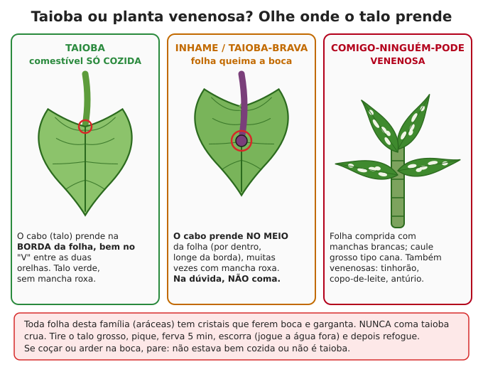

# Plantas silvestres comestíveis (PANC)

**Resumo:** o Brasil tem centenas de plantas comestíveis que nascem sozinhas no quintal, na
beira da estrada e no mato (as **PANC**, plantas alimentícias não convencionais). Aprenda **agora**
a reconhecer com certeza umas 10 a 20 delas e as venenosas parecidas. Regra de ouro: **só coma o
que você identificou com 100% de certeza**. Na dúvida, não coma. Cogumelo silvestre: **não coma**.

---

## Regras antes de colher

1. **Identificação 100% certa**, de preferência confirmada por alguém da região que já come a planta.
   Use várias características juntas (folha, caule, flor, cheiro, látex), nunca uma só.
2. **Comece com pouco:** primeira vez, uma porção pequena, e espere 24 horas.
3. **Não colha** em beira de estrada movimentada, terreno de lixo, lavoura com veneno, beira de
   esgoto ou em canteiro adubado com esterco fresco.
4. **Lave bem**; em água suspeita, desinfete como alface ([Higiene](../02-saude/09-higiene-e-saneamento.md)).
5. Muitas PANC têm **oxalato** (beldroega, caruru, major-gomes, taioba): coma variado, cozinhe,
   e quem tem pedra nos rins deve comer pouco.
6. **Colha com respeito:** deixe sempre parte da planta e das sementes para ela voltar.
7. Melhor ainda: **plante as PANC no quintal** (quase todas pegam de estaca ou semente e não
   precisam de cuidado). Veja [Horta](../04-agricultura/03-horta.md).

## Folhas e verduras

### Ora-pro-nóbis (*Pereskia aculeata*)
- **Como é:** cacto trepador ou arbusto espinhento que vira cerca viva. Folhas **verdes, carnudas,
  lisas**, ovais, de 4 a 7 cm. **Espinhos** curvos nos ramos. Flores branco-creme perfumadas;
  frutinhos amarelos.
- **Valor:** folhas com **cerca de 25% de proteína** (no peso seco), ferro, cálcio e vitamina A.
- **Preparo:** refogada, em sopas, omelete, angu, com frango (prato mineiro). Crua em pouca
  quantidade na salada. **Farinha:** folhas secas à sombra e moídas, 5–10% na massa de pão e bolo.
- **Plantio:** estaca de 20–30 cm. Colha com luva.

### Taioba (*Xanthosoma taioba*): sempre COZIDA

- **Como é:** folha grande em forma de **ponta de flecha** ou coração, verde-clara e fosca, presa
  num talo comprido verde. **O talo prende na BORDA da folha**, no "V" entre as duas orelhas.
- **Preparo:** tire o talo e a nervura central grossa, pique fino, **ferva 5 minutos, escorra
  e jogue a água fora**, depois refogue (com alho, ou no angu e no feijão). O rizoma (batata)
  também se come cozido.
- **Nunca coma crua.** Toda a família das aráceas tem cristais de oxalato que **ferem e incham**
  boca e garganta.

> **ATENÇÃO — confusões perigosas:** **taioba-brava e inhame** (talo preso **no meio** da folha,
> por dentro, muitas vezes com mancha roxa): queimam a boca, não use as folhas como taioba.
> **Comigo-ninguém-pode** (folhas compridas com manchas brancas, caule grosso tipo cana),
> **tinhorão** (folhas coloridas), **copo-de-leite** e **antúrio** são **venenosos**: incham a
> garganta e podem sufocar, principalmente crianças. Se arder ou coçar na boca, **pare** e enxágue.
> (A regra do talo vale só para as aráceas: a capuchinha tem talo no meio da folha e é comestível.)

### Beldroega (*Portulaca oleracea*)
- **Como é:** rasteira, **caule avermelhado, carnudo e liso**; folhas carnudas pequenas (1–3 cm)
  em forma de gota ou remo; florzinhas amarelas que abrem de manhã. **Não tem leite (látex).**
- **Preparo:** folhas e talos crus na salada, refogados, em sopa e omelete. Rica em ômega-3.
- **Confusão:** ervas-de-santa-luzia e quebra-pedras rasteiras (*Euphorbia*) parecem, mas **soltam
  leite branco** ao quebrar: são tóxicas. Quebre um talo: saiu leite, não é beldroega.

### Caruru (*Amaranthus* spp.)
- **Como é:** erva ereta de 30 cm a 1 m, folhas alternadas ovais ou em losango com nervuras bem
  marcadas, caule verde ou avermelhado, flores minúsculas verdes em **espigas densas** na ponta e
  junto às folhas. O **caruru-de-espinho** tem 2 espinhos na base de cada folha.
- **Preparo:** folhas e ramos novos **cozidos ou refogados**. Se for comer muito, ferva e jogue
  fora a primeira água (oxalato e nitrato). Sementes torradas (como pipoca) ou em farinha.
- **Confusão:** **caruru-de-cacho, tintureira ou caruru-bravo** (*Phytolacca*): planta maior,
  caule grosso roxo, folhas grandes lisas e **cachos de bolinhas roxo-pretas** que mancham a mão.
  **Venenosa**, principalmente raiz e sementes.

### Serralha (*Sonchus oleraceus*)
- **Como é:** folhas recortadas, verde-azuladas, com **dentes moles** (não ferem) e base que
  **abraça o caule** com duas "orelhas" pontudas; caule oco; **leite branco**; flores amarelas
  parecidas com as do dente-de-leão, em grupos.
- **Preparo:** folhas novas cruas (amargas) na salada ou refogadas. Folhas velhas: ferva e troque a água.

### Dente-de-leão (*Taraxacum officinale*)
- **Como é:** roseta rente ao chão; folhas recortadas com "dentes" virados para o centro, **sem
  pelos**; leite branco; **uma flor amarela por haste**, haste oca sem folhas; vira bola branca de sementes.
- **Preparo:** folhas novas cruas ou refogadas (ferva e troque a água para tirar o amargo); flores
  cruas; **raiz** lavada, torrada e moída serve de substituto do café. Mais comum no Sul e no Sudeste.

### Bertalha (*Basella alba*)
- **Como é:** trepadeira de caule carnudo verde ou roxo; folhas **grossas, brilhantes**, em forma
  de coração; frutinhos roxo-escuros que tingem.
- **Preparo:** refogada como espinafre, com ovo, no angu, em sopa. Fica um pouco "babenta", como
  quiabo. Pega fácil de estaca.

### Peixinho-da-horta (*Stachys byzantina*)
- **Como é:** planta baixa de folhas grossas **cinza-prateadas, peludas e macias** como feltro
  ("orelha-de-coelho").
- **Preparo:** folhas passadas em massa de farinha, ovo e água, **fritas**: o gosto lembra peixe.
  Prefere clima ameno e solo que não encharca.

### Capuchinha (*Tropaeolum majus*)
- **Como é:** folhas **redondas como guarda-chuva**, com o talo preso no centro; flores laranja,
  amarelas ou vermelhas com um "esporão" atrás.
- **Preparo:** folhas e flores **cruas**, gosto picante de agrião. Sementes verdes em vinagre
  substituem alcaparra.

### Major-gomes (*Talinum paniculatum*)
- **Como é:** erva de 30–80 cm, folhas **carnudas, lisas e brilhantes**; no alto, cachos ralos de
  florzinhas cor-de-rosa que abrem à tarde e frutinhos redondos alaranjados de 3–4 mm.
- **Preparo:** folhas cruas na salada ou refogadas. Tem oxalato: com moderação.

### Picão-preto (*Bidens pilosa*)
- **Como é:** erva de 30 cm a 1 m, folhas divididas em 3 a 5 folíolos serrilhados; flores de miolo
  amarelo com poucas pétalas brancas; sementes **pretas e compridas com ganchinhos** que grudam na roupa.
- **Preparo:** brotos e folhas novas **cozidos ou refogados** (verdura comum na África).

### Outras folhas comestíveis cozidas
- **Folhas de batata-doce, abóbora (cambuquira), chuchu e feijão-de-corda:** refogadas.
- **Folha de mandioca:** só **muito bem cozida** (tem cianeto). A maniçoba do Pará cozinha as folhas
  moídas por **7 dias**. Não arrisque com cozimento curto.
- **Vinagreira (hibisco, *Hibiscus sabdariffa*):** folhas azedas (cuxá do Maranhão) e cálices em suco e geleia.

## Raízes e palmitos

### Inhame e cará: atenção aos nomes
- No **Sudeste e Sul**, "inhame" é o **taro** (*Colocasia*): batata peluda, folha grande com o talo
  no meio. No **Nordeste**, "inhame" é o **cará** (*Dioscorea*): trepadeira de folha em coração.
- Os dois: **sempre cozidos**. Descasque o taro com luva ou mãos untadas de óleo (coça).
- **Cará-moela** (*Dioscorea bulbifera*): trepadeira que dá "batatas" no ar parecidas com moela.
  Só da **variedade cultivada conhecida**: descasque, cozinhe 20–30 minutos e **jogue a água fora**.
  **Amargo = não coma** (as formas do mato são tóxicas para o fígado). Carás silvestres que você
  não conhece: não coma.

### Palmito
- **Pupunha** (*Bactris gasipaes*) e **açaí** (*Euterpe oleracea*) crescem em **touceira**: corte
  uma haste e as outras continuam. São os palmitos certos para colher. O de pupunha pode ser comido cru.
- **Juçara** (*Euterpe edulis*, Mata Atlântica) tem **tronco único**: cortar o palmito **mata a
  palmeira**. Está **ameaçada de extinção** e cortar é crime ambiental. Coma os **frutos** (polpa
  igual à do açaí) e espalhe as sementes.
- **Guariroba** (Goiás) dá palmito amargo, cozido em pratos típicos; **babaçu** e **buriti** também
  têm palmito, mas o corte mata a palmeira: só em necessidade.
- **Preparo:** tire as capas duras até o miolo branco e macio. Cozinhe **15–20 minutos** em água com
  sal e limão (não escurece). Consuma em 1–2 dias.

> **ATENÇÃO:** palmito em conserva caseira é uma das maiores causas de **botulismo** no Brasil.
> Leia [Conservação de alimentos](02-conservacao-de-alimentos.md) antes de pôr palmito em vidro.

## Frutos nativos por bioma

| Fruto | Onde | Época (aprox.) | Como comer e cuidados |
|---|---|---|---|
| Pitanga | Mata Atlântica, quase todo o país | set–dez | Crua, suco, geleia |
| Jabuticaba | Mata Atlântica, Sudeste | ago–nov (e após chuvas) | Crua; fermenta em 2–3 dias: faça geleia ou vinagre |
| Goiaba | Todo o Brasil | jan–mar (varia) | Crua, doce; **campeã de vitamina C** |
| Araçá | Mata Atlântica, Sul | verão–outono | Cru, suco, geleia |
| Guabiroba | Sul, Sudeste, Cerrado | nov–dez | Crua |
| Uvaia | Sul e Sudeste | set–jan | Crua (ácida), suco |
| Cagaita | Cerrado | set–out | Poucas por vez: em quantidade, ou passada e quente do sol, é **laxante** |
| Pequi | Cerrado | nov–fev | Cozido no arroz ou frango; **ROA a polpa, nunca morda**: por baixo há **espinhos finos** que ferem boca e língua |
| Baru | Cerrado | ago–out | Polpa doce crua; **amêndoa só torrada** (15–20 min na panela ou forno): crua faz mal |
| Buriti | Veredas do Cerrado, Amazônia | dez–jun | Amoleça 12–24 h em água morna e raspe a polpa; riquíssimo em vitamina A. Buritizal indica água |
| Mangaba | Cerrado, litoral nordestino | out–jan (varia) | Só **madura** (caída ou mole); verde tem leite |
| Araticum | Cerrado | fev–abr | Polpa crua; **sementes não** (tóxicas, como as de pinha e graviola) |
| Jatobá | Cerrado e matas | ago–out | Farinha da polpa seca para mingau, bolo e pão |
| Castanha-do-pará | Amazônia | dez–mar | **Não fique sob a árvore** na safra: o ouriço (1–2 kg) cai de 30–50 m. No máximo **2 a 3 castanhas por dia** como hábito (excesso de selênio). Mofada: descarte |
| Cupuaçu | Amazônia | jan–abr | Polpa em suco e doce; sementes fermentadas e torradas viram "chocolate" |
| Bacuri | Pará, Maranhão | dez–abr | Polpa branca; casca solta resina amarela pegajosa |
| Açaí | Amazônia | jul–dez | Ver aviso abaixo sobre doença de Chagas |
| Tucumã | Amazônia | jan–jun | Polpa alaranjada crua; palmeira muito espinhenta |
| Pupunha (fruto) | Amazônia | jan–mar | **Sempre cozido** 30–60 min em água com sal; cru irrita a boca |
| Umbu | Caatinga | jan–mar | Cru, umbuzada (com leite), doce. A "batata" da raiz guarda água: só em emergência (prejudica a árvore) |
| Cajá | Norte, Nordeste, matas | jan–mai | Cru, suco |
| Caju | Nordeste, litoral, Cerrado | set–dez | Pedúnculo cru, suco, doce. **Castanha crua queima** (ver abaixo) |
| Licuri | Caatinga (Bahia) | ano todo | Amêndoa crua ou torrada |
| Mandacaru | Caatinga | variável | Fruto vermelho de polpa branca, cru |
| Butiá | Pampa, Sul, litoral | dez–mar | Cru, suco, geleia; amêndoa comestível |
| Pinhão | Sul e serras do Sudeste | abr–jul | **Sempre cozido** (pressão 40–50 min; panela comum 1–2 h) ou assado na brasa. Respeite a data legal de colheita do seu estado |
| Bocaiuva (macaúba) | Cerrado, Pantanal | set–jan | Polpa crua ou em farinha; amêndoa; palmeira espinhenta |
| Jenipapo | Todo o Brasil | variável | Maduro (mole e marrom): cru, doce. Verde **tinge a pele** de preto por semanas |
| Murici | Cerrado, Nordeste, Amazônia | variável | Cru, suco |

**Plantadas que viraram "do mato":** manga, jaca (sementes **cozidas ou assadas** são ótimas),
abacate, banana, laranja-da-terra, limão-cravo, carambola, tamarindo, jambo, fruta-pão (sempre cozida).

**Dica da família da goiaba e da pitanga (mirtáceas):** folhas simples, opostas, com **pontinhos
transparentes** quando vistas contra a luz e **cheiro aromático** ao amassar; frutos com uma
"coroinha" na ponta. Pitanga, goiaba, araçá, jabuticaba, cambuci, uvaia, guabiroba, grumixama e
cagaita são dessa família, e não se conhecem frutos venenosos nela. **Ainda assim, confirme.**

> **ATENÇÃO — açaí e caldo de cana:** o **barbeiro** pode ser moído junto e transmitir a **doença
> de Chagas** pela boca. Lave e escolha os frutos e faça o **branqueamento**: mergulhe o açaí em
> água a **80 °C por 10 segundos** (água bem quente, antes de ferver) e depois em água fria, antes de
> bater. Na cana, lave e raspe bem, longe de onde haja barbeiros.

> **ATENÇÃO — castanha de caju crua:** a casca tem um óleo que **queima a pele, os olhos e a
> boca**. Asse ao ar livre em lata furada sobre o fogo, **de costas para o vento** (a fumaça irrita
> olhos e pulmões), até a casca queimar e ficar quebradiça. Use luvas para quebrar e tire a película.

## Insetos comestíveis (sempre cozidos ou torrados)

Insetos têm 40–70% de proteína (secos) e muita gordura. São comida tradicional em várias regiões do Brasil.

- **Içá ou tanajura** (rainha da saúva): aparecem na **revoada**, nas primeiras chuvas fortes da
  primavera (set–nov), de manhã. Pegue as que pousam (cuidado com as formigas soldado). Tire asas,
  cabeça e pernas, use a "bundinha". **Torre** na panela com pouco sal e gordura, 5–10 minutos, até
  ficar crocante. Farofa de içá é tradicional no Vale do Paraíba e em Minas.
- **Cupins alados (aleluia, siriri):** saem à noite nas primeiras chuvas, atraídos pela luz. Ponha
  uma bacia com água embaixo de uma lâmpada ou lamparina. Abane para tirar as asas e torre.
- **Gongo ou bicho-do-coco:** larva branca que vive dentro de coquinhos (babaçu, licuri, butiá).
  Frite ou torre (solta a própria gordura).
- **Larva da broca-das-palmeiras:** em troncos de palmeira caídos e apodrecendo (Amazônia). Frite.
- **Gafanhotos e grilos:** tire **asas e pernas** (os espinhos das pernas ferem o intestino) e
  cozinhe ou torre bem (podem ter vermes).

**Nunca coma:** inseto de cor viva (vermelho, laranja, amarelo forte), **lagartas peludas**
(**taturana queima e algumas matam**), insetos que fedem forte, que você achou mortos,
carrapatos, moscas, mosquitos, baratas e **barbeiros** (nem toque: Chagas). Quem tem **alergia a
camarão** pode ter alergia a insetos. Evite insetos de lavoura com veneno.

## Cogumelos: NÃO coma sem especialista

- Não existe teste caseiro. **São falsos:** colher de prata que escurece, alho, "se o bicho comeu
  pode", "se descasca é bom", ferver ou secar para tirar o veneno.
- Os mais perigosos (como a *Amanita*, que aparece em plantações de pinus e eucalipto no Sul e no
  Sudeste) só dão sintomas **6 a 24 horas depois**, quando o fígado já está sendo destruído.
- Um cogumelo branco muito comum em gramados no Brasil (*Chlorophyllum*), parecido com comestíveis,
  causa vômitos e diarreia violentos.
- Coma apenas cogumelos **cultivados** por você a partir de semente comprada (shimeji, shiitake,
  champignon, cogumelo-ostra), que você reconhece desde o início do cultivo.

## Plantas venenosas comuns e parecidas

| Comestível | Venenosa parecida | Como diferenciar |
|---|---|---|
| Taioba | Comigo-ninguém-pode, tinhorão, copo-de-leite, antúrio, taioba-brava | Veja a figura: talo na borda do "V", folha verde lisa sem manchas |
| Caruru | Caruru-de-cacho, tintureira (*Phytolacca*) | Cachos de bolinhas roxo-pretas, caule roxo grosso |
| Beldroega | Erva-de-santa-luzia, quebra-pedra (*Euphorbia*) | A venenosa solta leite branco |
| Pinhão (araucária) | **Pinhão-manso e pinhão-roxo** (*Jatropha*) | Arbusto com sementes em cápsulas; 2 a 3 sementes intoxicam gravemente uma criança |
| Feijões e vagens | **Mamona** | Semente rajada parecendo carrapato. Poucas sementes mastigadas podem matar |
| Feijões | **Jequiriti, olho-de-cabra** (*Abrus*) | Sementinha vermelha com mancha preta: mortal mastigada |
| Salsa, coentro, cenoura, erva-doce | **Cicuta** (Sul) e outras da família da cenoura | Caule com **manchas roxas**, cheiro de urina de rato. **Não colha do mato nenhuma planta de flor em "guarda-chuva"** |
| Mandioca mansa (aipim) | **Mandioca brava** | Iguais por fora; brava é amarga. Veja [Processamento](05-processamento-de-alimentos.md) |
| Batata | Batata verde ou brotada | Descasque fundo a parte verde; muito verde, descarte |

**Outras muito venenosas e comuns, para reconhecer e ensinar às crianças:** espirradeira
(oleandro), chapéu-de-napoleão, trombeteira ou saia-branca, estramônio ou figueira-do-inferno,
avelós e coroa-de-cristo (leite cáustico), cinamomo (frutos), mamona, pinhão-roxo,
comigo-ninguém-pode, e sementes de pinha, graviola e araticum. Veja também
[Plantas medicinais](../02-saude/05-plantas-medicinais.md).

**Intoxicação por planta:** se a pessoa está acordada e o veneno foi engolido há pouco, dê água,
guarde um pedaço da planta para identificar e veja [Primeiros socorros](../02-saude/01-primeiros-socorros.md).
**Não** provoque vômito em quem está sonolento ou se engoliu algo cáustico (avelós, castanha de caju).

## Teste universal de comestibilidade (último recurso)

> **ATENÇÃO:** este teste, do manual de sobrevivência militar, **não é seguro**. Não detecta
> venenos que agem devagar (cogumelos, mandioca brava, plantas que atacam fígado e rins), gasta
> 1 a 2 dias por parte de planta e exige jejum. No Brasil é **muito melhor** aprender agora 10 a 20
> plantas seguras. Use só se estiver perdido, há dias sem comida, sem nenhuma planta conhecida.

**Sinais para descartar de cara:** leite ou seiva colorida (exceto as que você conhece), cheiro de
amêndoa amarga, sementes dentro de vagens, folhas em grupos de 3, folhagem tipo salsa ou cenoura,
flores em "guarda-chuva", pelos finos ou espinhos, gosto amargo ou de sabão, frutos brancos.
(Várias plantas boas desobedecem a essas regras, mas no teste é melhor perder uma boa do que comer uma má.)

1. Teste **uma parte** de **uma planta** por vez (folha, ou raiz, ou fruto). Precisa haver bastante dela.
2. Fique **8 horas sem comer** antes.
3. **Pele:** esfregue a parte amassada na parte de dentro do pulso ou do cotovelo e espere pelo
   menos **15 minutos** (melhor ainda: as 8 horas do jejum). Coceira, vermelhidão ou bolha: descarte.
4. Prepare a parte **como vai comer** (de preferência cozida).
5. **Lábio:** encoste no lábio por 3 minutos. Ardeu, formigou: descarte.
6. **Língua:** ponha na língua por 15 minutos, sem mastigar.
7. **Mastigue** bem e segure na boca 15 minutos, **sem engolir**. Ardência, gosto de sabão, amargo
   forte, dormência: cuspa e descarte.
8. **Engula** e espere **8 horas** sem comer mais nada (só água). Enjoo, cólica, diarreia, tontura:
   beba bastante água, tome carvão ativado se tiver, e descarte a planta.
9. Tudo bem? Coma **um quarto de xícara** preparado do mesmo jeito e espere mais 8 horas.
10. Sem nenhum sintoma, aquela **parte**, **preparada daquele jeito**, provavelmente é segura.
    Outra parte da mesma planta precisa de outro teste.

---

Ver também: [Nutrição e racionamento](03-nutricao-e-racionamento.md) · [Processamento de alimentos](05-processamento-de-alimentos.md) · [Frutíferas e agrofloresta](../04-agricultura/08-frutiferas-e-agrofloresta.md) · [Horta](../04-agricultura/03-horta.md) · [Plantas medicinais](../02-saude/05-plantas-medicinais.md) · [Perdido no mato](../11-natureza-e-desastres/01-perdido-no-mato.md) · [Pesca, armadilhas e caça](../11-natureza-e-desastres/02-pesca-armadilhas-caca.md)
