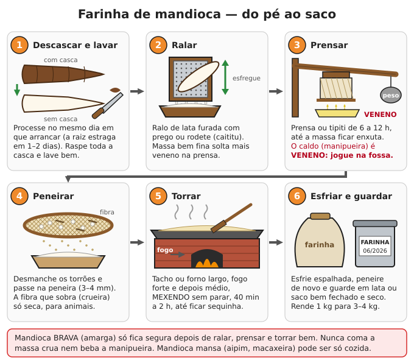

# Processamento de alimentos: farinhas, pão, açúcar, óleo

**Resumo:** colher não basta: é preciso **transformar** a colheita em comida que se guarda.
Mandioca vira farinha e polvilho (e a **brava** só fica segura depois de ralar, prensar e torrar);
milho vira fubá, canjica e massa (cozido com **cal ou cinza** previne a pelagra); arroz é pilado;
cana vira rapadura; amendoim e porco viram óleo e banha. Tudo com ferramentas manuais.

---

## Mandioca: mansa ou brava?

| | Mansa (aipim, macaxeira) | Brava (amarga) |
|---|---|---|
| Veneno (cianeto) | Pouco | Muito (pode matar) |
| Como comer | **Descascada e cozida** em panela destampada, jogando a água fora | **Só como farinha, polvilho, beiju ou tucupi**, depois de ralar, prensar e torrar ou ferver muito |
| Gosto cru | Levemente adocicado | Amargo |

- Por fora são iguais. Teste: prove um pedacinho cru na ponta da língua e **cuspa**. Amargo = brava.
  **Na dúvida, trate como brava.**
- A **casca** concentra veneno: descasque sempre, também a entrecasca rosada.
- **Folha de mandioca** também tem cianeto: só muito bem cozida (a maniçoba cozinha 7 dias).
- Mandioca arrancada **escurece e estraga em 1 a 3 dias**. Deixe no chão e arranque o que for usar.
  Veja o cultivo em [Culturas principais](../04-agricultura/04-culturas-principais.md).

> **ATENÇÃO:** comer mandioca brava mal processada causa intoxicação por cianeto: tontura, dor de
> cabeça, vômito, falta de ar, convulsão e morte. Uso repetido de farinha mal torrada causa bócio e
> paralisia das pernas. **O caldo da prensa (manipueira) mata gado, porco, galinha e peixe.**

## Casa de farinha: farinha de mandioca passo a passo

**Rendimento:** cerca de **1 kg de farinha para cada 3 a 4 kg de raiz**. Raízes com 12 a 18 meses.

1. **Arrancar, descascar e lavar** no mesmo dia (a raiz começa a estragar em 1–2 dias). Raspe
   toda a casca e a entrecasca. Lave em água limpa.
2. **Ralar:**
   - **Ralo de lata:** chapa de lata furada com prego de dentro para fora (as rebarbas é que ralam),
     pregada numa tábua de 20 × 60 cm. Esfregue a raiz para cima e para baixo, sobre um cocho.
   - **Rodete ou caititu:** cilindro de madeira com serrinhas de lata cravadas, girado por roda,
     pedal ou animal. Rala 50–100 kg por hora.
   - Quanto mais fina a massa, mais veneno sai na prensa e melhor a farinha.
3. **Prensar:**
   - **Tipiti:** cesto comprido de palha trançada. Encha de massa, pendure numa trave e puxe a ponta
     de baixo com uma alavanca e peso: ele estica e espreme.
   - **Prensa de alavanca ou de fuso:** a massa vai em sacos de ráfia ou caixa de ripas, sob uma
     tábua; uma viga com pedras na ponta (ou um fuso de madeira) aperta.
   - Prense de **6 a 12 horas** (pode ser de um dia para o outro), até a massa ficar **enxuta**:
     apertada na mão, não pinga e esfarela.
   - A **manipueira** (caldo amarelado) é **veneno**: escorra para uma fossa longe de poço, rio e
     animais. Não use para nada sem saber (o tucupi da Amazônia é manipueira decantada e **fervida
     por horas**). O amido que assenta no fundo do balde é a **goma** (veja polvilho, abaixo).
4. **Esfarelar e peneirar:** desmanche os torrões e passe na **peneira de 3–4 mm** (urupema). A fibra
   que fica (crueira) só vai para os animais depois de **bem seca ao sol ou torrada**.
5. **Torrar:**
   - **Forno de farinha:** chapa de ferro (ou tacho largo) de 1 a 2 m sobre uma fornalha de tijolos.
     Em pequena escala, tacho de ferro ou panela larga no fogão a lenha.
   - Ponha camadas de 3–5 cm. **Fogo forte no começo** (a massa solta vapor) e depois médio.
   - **Mexa sem parar** com rodo ou pá de madeira, raspando o fundo, de **40 minutos a 2 horas**.
   - **Ponto:** farinha **solta, sequinha, crocante**, sem cheiro de massa crua; um punhado apertado
     não forma bolo; cor de creme a levemente dourada. O calor da torra elimina o resto do veneno.
6. **Esfriar, peneirar e guardar:** espalhe para esfriar, peneire de novo (separa fina e grossa) e
   guarde em lata, saco plástico grosso ou garrafa PET bem fechados. Dura **6 a 12 meses** seca.

### Farinha d'água (Norte e Nordeste)
Deixe as raízes inteiras **de molho em água 3 a 5 dias**, até amolecerem e fermentarem ("pubar").
Descasque, amasse, misture com massa ralada fresca, prense e torre como acima. Fica azedinha,
granulada e dura mais. A massa pubada sozinha (puba) faz bolo e mingau.

## Polvilho, tapioca e beiju

### Goma e polvilho doce
1. Rale a mandioca descascada bem fino.
2. **Lave a massa:** num pano sobre um balde (ou peneira fina), despeje água e esprema. Repita 3 vezes.
   A água sai **branca como leite**.
3. Deixe o balde **decantar 2 a 4 horas**. O amido (goma) assenta no fundo.
4. Jogue fora a água de cima (é manipueira: veneno). Acrescente água limpa, mexa, decante de novo.
   Repita **2 a 3 vezes** até a água sair clara.
5. **Goma fresca** (úmida) já serve para tapioca. Para guardar, esfarele e **seque ao sol** sobre
   panos ou bandejas por 1 a 2 dias: é o **polvilho doce**. Guarde seco: dura mais de 1 ano.
- Rende cerca de **20 kg de polvilho para cada 100 kg de raiz**. A massa que sobrou no pano pode ir
  para a farinha.

### Polvilho azedo (para pão de queijo e biscoito)
Deixe a goma **fermentando debaixo de água**, em tanque ou balde coberto, por **15 a 40 dias** (até
ficar com cheiro azedo agradável). Escorra, esfarele e seque **ao sol** (o sol é o que faz o
biscoito crescer no forno). Guarde seco.

### Tapioca
1. **500 g de polvilho doce** seco + **cerca de 200 mL de água** com uma pitada de sal: vá
   esfregando com as mãos até virar uma "farofa úmida" que forma bolo quando apertada e esfarela
   quando solta. Descanse 30 minutos.
2. Passe na **peneira**.
3. Frigideira **quente e sem óleo**: espalhe uma camada de 0,5 cm, aperte de leve. Em 1 minuto
   ela gruda e vira um disco. Vire, recheie (coco, queijo, ovo, banana) e dobre.

### Beiju de massa
Massa de mandioca prensada e peneirada (pode misturar goma), espalhada em camada de 0,5–1 cm sobre
o forno ou chapa quente, apertada com a mão, virada uma vez. Seco e torrado, dura semanas.

## Milho

### Colher, secar e guardar
1. Deixe o milho **secar no pé**. "Dobrar" o pé abaixo da espiga (espiga virada para baixo) protege
   da chuva e dos passarinhos.
2. Colha com o grão **duro** (a unha não marca). Seque as espigas ao sol até **13% de umidade**:
   grão estala ao morder e solta fácil do sabugo.
3. **Paiol:** espigas **com palha** (a palha protege do caruncho) em depósito ventilado, alto, com
   pés protegidos contra ratos ([Estoque](01-estoque-de-alimentos.md)).

### Debulhar
- À mão, esfregando uma espiga contra a outra.
- **Tábua com furo:** furo de 4–5 cm numa tábua grossa; empurre a espiga girando.
- **Bater em saco:** espigas bem secas num saco grosso, bata com um pau.
- Debulhador manual de manivela, se tiver. Abane ao vento para tirar palha e pó.

### Moer: fubá, quirera e canjica
- **Pilão:** pile pequenas quantidades (1–2 kg) e peneire. Trabalhoso, mas funciona.
- **Moinho manual de disco** (de ferro, preso na mesa): ajuste os discos para fino (fubá) ou grosso
  (quirera, xerém). Cerca de 3–5 kg por hora.
- **Moinho de pedra e monjolo** movidos a água: produzem muito sem esforço
  ([Eólica e hidráulica](../06-energia/06-eolica-e-hidraulica.md)).
- **Fubá:** moagem fina, peneirada. **Quirera e xerém:** quebrado grosso (angu, cuscuz grosso,
  pintinhos). **Fubá rancifica em semanas a meses** (por causa do gérmen): guarde milho em grão e
  moa o da semana.
- **Canjica (mungunzá):** milho branco sem pele e sem gérmen. Umedeça o milho 10 minutos, escorra e
  pile com golpes leves até a pele e o gérmen soltarem; abane. Ou use a nixtamalização (abaixo).
  Cozinhe depois de 12 h de molho: 2–3 horas em panela comum ou 40 minutos na pressão.

### Nixtamalização: milho cozido com cal ou cinza
Cozinhar o milho com algo **alcalino** solta a niacina (vitamina B3) e **previne a pelagra**,
melhora a proteína, tira a pele do grão e faz a massa "ligar". Quem vive de milho deve fazer isso
com parte dele ([Nutrição](03-nutricao-e-racionamento.md)).

**Com cal:**
1. **1 kg de milho seco** + **3 litros de água** + **10 a 20 g de cal hidratada** (1 a 2 colheres de
   sopa rasas; 1–2% do peso do milho). Prefira cal de grau alimentício; senão, a mais pura que houver.
2. Dissolva a cal na água, junte o milho lavado. Ferva **30 a 60 minutos**, até a **pele soltar**
   esfregando um grão entre os dedos.
3. Desligue e deixe **de molho 8 a 16 horas** (de um dia para o outro).
4. Escorra e **lave esfregando** em várias águas até tirar a cal e a maior parte das peles
   (o milho fica amarelo-claro e limpo, sem gosto de cal).
5. Use: **canjica** (cozinhe mais até macio), **massa** (moa úmido no moinho ou pilão) para angu,
   broa, tortilha, pamonha de massa e cuscuz; ou **seque ao sol** e moa como fubá nixtamalizado.

**Com cinza (decoada):**
1. Ferva **1 litro de cinza de lenha** peneirada (só madeira limpa, sem tinta, sem carvão de
   churrasco com aditivo) em **4 litros de água** por 30 minutos. Deixe decantar e use a água clara
   de cima (a decoada).
2. Cozinhe 1 kg de milho nessa água até a pele soltar (30–90 minutos), depois siga os passos 3 a 5 acima.

> **ATENÇÃO:** cal e decoada são **cáusticas**: protegem-se olhos e mãos (luvas), crianças longe.
> Cal virgem esquenta muito ao molhar: use cal **hidratada**. **Não use panela de alumínio** (é
> corroída); use ferro, inox, esmaltada ou barro.

## Arroz

1. **Colher** quando **80–90% dos grãos** do cacho estiverem amarelo-palha e firmes. Corte os cachos
   com 20–30 cm de palha.
2. **Secar** os feixes ao sol (ou em terreiro) até **13% de umidade**: o grão estala ao morder.
   Secagem rápida demais trinca o grão: seque em camada fina, revirando.
3. **Trilhar (tirar do cacho):** bata os feixes contra um tambor ou tábua inclinada sobre lona, ou
   pise-os. **Abane** ao vento ou com peneira para separar palha e grão vazio.
4. **Descascar no pilão:** 1–2 kg de arroz em casca por vez, golpes firmes mas não violentos,
   10–20 minutos. Abane para tirar a casca. Repita até sair quase toda.
5. **Não pile demais:** arroz pouco polido (com a película marrom) guarda a **vitamina B1** e evita
   o beribéri. O farelo que sai é ótimo para galinhas e porcos.
- **Rendimento:** 100 kg de arroz em casca dão uns **65–70 kg de arroz integral**.

### Arroz parboilizado caseiro (mais vitamina, menos quebra)
1. Arroz **em casca** de molho em água **quente (60–70 °C, quente na mão)** por 3–4 horas (ou em
   água fria por 24–36 horas).
2. Escorra e cozinhe no **vapor** (ou em pouca água) por 10–20 minutos, até algumas cascas começarem a abrir.
3. Seque **devagar**, à sombra ou sol fraco, em camada fina, até 13% (1–3 dias).
4. Pile normalmente. As vitaminas da película passaram para dentro do grão.

## Feijão

1. Arranque as plantas quando **80–90% das vagens** estiverem secas, cor de palha.
2. Seque sobre lona ou terreiro **2 a 5 dias** ao sol, recolhendo à noite.
3. **Bata** com vara flexível (manguá) sobre lona, ou dentro de sacos. As vagens estouram.
4. **Abane** ao vento para tirar a palha. **Cate** pedras, grãos chochos e furados.
5. Seque mais 1–2 dias, até 12–13% (o grão estala ao morder). Guarde com óleo ou cinza contra o
   caruncho ([Estoque](01-estoque-de-alimentos.md)).

## Pão com fermento natural

### Fazer o fermento ("isca", levain)
1. Pote de vidro limpo. Misture **50 g de farinha de trigo** (integral pega mais rápido) com
   **50 g de água** sem cloro (água fervida e fria, ou deixada 12 horas destampada).
2. Cubra com pano. Deixe em lugar morno (25–28 °C).
3. **Todo dia:** jogue fora metade e alimente com **50 g de farinha + 50 g de água**. Mexa.
4. Em **5 a 7 dias** está pronto: **dobra de volume** em 4–8 horas depois de alimentado, cheio de
   bolhas, cheiro azedo agradável (de iogurte ou vinagre suave).

### Manter vivo
- **No calor, sem geladeira:** alimente **1 a 2 vezes por dia**. Faça o fermento mais **firme**
  (2 partes de farinha para 1 de água): fermenta mais devagar e aguenta mais.
- **Isca tradicional:** guarde um pedaço da massa de cada fornada enterrado num pote de farinha.
- **Líquido escuro por cima** = está com fome: descarte o líquido e alimente.
  **Manchas rosa, laranja ou mofo peludo:** jogue fora e recomece.
- **Reserva seca:** espalhe uma colher de fermento ativo bem fino num papel ou pano, seque à
  sombra, quebre em flocos e guarde em vidro fechado. Dura meses. Para reativar: flocos + farinha +
  água, alimentando por 2–3 dias. **Faça isso já** e guarde junto do estoque.

### Pão de fermento natural (1 pão de ~900 g)
1. **500 g de farinha de trigo + 350 g de água + 100 g de fermento ativo + 10 g de sal** (2 colheres
   de chá rasas).
2. Misture farinha, água e fermento; descanse 30 minutos; junte o sal e sove ou faça **dobras** (puxe
   e dobre a massa sobre ela mesma) a cada 30 minutos por 2 horas.
3. Deixe crescer até aumentar **50–100%**: **3 a 5 horas** a 28–30 °C, 6 a 8 horas a 22 °C.
4. Modele uma bola, ponha num cesto ou tigela forrada com pano enfarinhado e deixe crescer mais
   **1 a 3 horas** (a massa apertada com o dedo volta devagar).
5. Faça um corte em cima e asse a **230–250 °C por 40–45 minutos**. Pronto quando o fundo soa
   **oco** ao bater.
- **Forno de barro:** queime lenha 1–2 horas, retire as brasas e limpe o piso. **Teste:** jogue um
  punhado de farinha no piso: se dourar em **10–15 segundos**, está bom; se queimar na hora, espere.
  Veja fornos em [Lenha, carvão e fogões](../06-energia/02-lenha-carvao-e-fogoes.md).

### Pão de milho (broa) e outros sem muito trigo
- **Broa:** **500 g de fubá** escaldado com **500 mL de água fervente** e 10 g de sal (mexa, esfrie até
  morno) + **200 g de farinha de trigo** (ou polvilho) + **100 g de fermento natural** (ou 10 g de
  fermento biológico) + 1 colher de rapadura ralada. Sove, deixe crescer 2–4 horas, modele bolas e asse
  a 200–220 °C por 40–50 minutos.
- **Cuscuz nordestino:** 2 xícaras de flocão (milho em flocos) + 1 xícara de água + 1 colher (chá) de
  sal; descanse 10 minutos e cozinhe no **vapor** (cuscuzeira) 10–15 minutos.
- **Pão de queijo:** 500 g de polvilho (doce e azedo), 1 xícara de leite e 1/2 de óleo fervidos
  escaldando o polvilho, 2–3 ovos, 200 g de queijo curado ralado, sal. Bolinhas a 200 °C, 25–30 min.
- **Bolo de mandioca, de puba e de fubá**, **pamonha**, **angu** e **mingau** cobrem a falta de trigo.

## Rapadura, melado e açúcar mascavo

1. **Cana madura** (12–18 meses): bem doce, a ponta e o pé com o mesmo gosto. Corte rente ao chão,
   tire as folhas e a ponta. **Moa em até 24 horas** (depois azeda).
2. **Moenda:** de 3 rolos, manual, de tração animal (engenho de boi) ou motor. Rende uns
   **50–60 litros de caldo (garapa) por 100 kg de cana**.
3. **Coe** o caldo num pano ou peneira fina e deixe **decantar** 30 minutos.
4. **Ferva** em tacho de cobre, ferro ou inox, fogo forte. **Tire a espuma** (escuma) sempre que
   subir. Para clarear, junte uma "baba" de quiabo ou mutamba batidos em água: a sujeira sobe com a espuma.
5. Continue fervendo, mexendo cada vez mais, até o **ponto** (temperaturas aproximadas; o teste na
   água fria é o que vale):

| Produto | Temperatura | Teste: pingue um pouco num copo de água fria |
|---|---|---|
| **Melado** | 106–108 °C | Escorre da colher em fio grosso; na água se espalha mole |
| **Rapadura** | 115–118 °C | Forma bola dura que quebra entre os dedos |
| **Açúcar mascavo** | 118–122 °C | Bola dura e quebradiça; em seguida, bater |

6. **Rapadura:** tire do fogo, **bata** com pá de madeira 3–5 minutos (fica mais clara e começa a
   engrossar) e despeje em **formas de madeira molhadas**. Desenforme fria. Embrulhe e guarde em lata.
7. **Mascavo:** despeje num cocho de madeira e **bata sem parar** com pá até virar areia grossa.
   Peneire e esfarele os torrões. Guarde seco e fechado.
8. **Melado:** engarrafe quente em vidros esterilizados. Dura meses.
- **Rendimento:** 100 kg de cana dão cerca de **10 a 15 kg** de rapadura ou mascavo.
- A sobra de bagaço é combustível para a própria fornalha.

> **ATENÇÃO:** a **moenda esmaga mão e braço**. Nunca ponha a mão perto dos rolos: empurre o último
> pedaço com outro pedaço de cana. Cabelo preso, sem manga solta. O melado a 120 °C **gruda na pele
> e queima fundo**: crianças longe do tacho, calçado fechado, balde de água fria por perto.

## Vinagre de frutas

Duas fermentações: o açúcar vira **álcool** (fermentos, sem ar) e o álcool vira **ácido acético**
(bactérias do vinagre, com ar).

1. **1 kg de frutas maduras ou cascas** (abacaxi, banana, caju, jabuticaba, laranja, manga, uva)
   picadas + **1 litro de água** fervida e fria + **100–150 g de açúcar ou rapadura** (se a fruta for
   pouco doce).
2. Pote de boca larga coberto com pano (contra mosquinhas). Mexa todo dia. Em **1–2 semanas**
   cheira a vinho ou licor.
3. **Coe** e volte o líquido para o pote. Junte **1 copo de vinagre não pasteurizado** (caseiro) ou
   um pedaço de "**mãe do vinagre**" (a película gelatinosa que se forma por cima).
4. Deixe coberto com pano, em lugar morno (25–30 °C) e **sem mexer**, por **4 a 8 semanas**, até
   ficar bem azedo e sem cheiro de álcool.
5. Coe e engarrafe. Guarde a "mãe" para o próximo lote.

> **ATENÇÃO:** vinagre caseiro tem acidez **desconhecida** (geralmente 3–5%). Use em tempero,
> salada, limpeza e picles de geladeira. **Para conservas de prateleira** (picles, palmito) use
> vinagre com acidez garantida de pelo menos 4%, ou confirme a acidez antes.

## Banha e óleo

### Derreter banha (porco)
1. Toucinho e gordura de porco em cubos de 2–3 cm. Panela grossa com **meia xícara de água** no
   fundo (evita queimar no início).
2. **Fogo baixo**, mexendo de vez em quando, **1 a 3 horas**. A gordura derrete e os pedaços
   douram (torresmo).
3. **Ponto:** o torresmo fica dourado e a gordura **para de borbulhar** (a água saiu).
4. Coe num pano limpo para latas ou potes **secos**. Deixe esfriar destampado e depois tampe.
5. Local fresco e escuro: dura **6 a 12 meses**. Rende **600–750 g de banha por kg** de toucinho.
- **Sebo** de boi e carneiro derrete igual (vela, sabão e cozinha:
  [Sabão e limpeza](../09-quimica-e-oficios/01-sabao-e-limpeza.md)).

> **ATENÇÃO:** água caindo em gordura quente **espirra e queima**. Gordura muito quente pega fogo:
> **nunca jogue água**; abafe com tampa ou pano úmido e desligue o fogo. Crianças longe.

### Óleo de amendoim, girassol, gergelim
- **Prensa manual de parafuso (expeller)** ou prensa de fuso/macaco hidráulico com cesto.
  Rendimento aproximado em óleo: amendoim **30–35%** do peso das sementes descascadas, gergelim
  35–40%, girassol 25–30%.
- **Preparo:** sementes limpas, secas, **sem mofo**. Amendoim descascado e levemente torrado,
  girassol inteiro (preto, de óleo). Aqueça um pouco antes de prensar (rende mais).
- **Decante** o óleo **1 a 2 semanas** e passe num pano. Guarde em garrafas cheias, escuras, em local
  fresco: dura **6 a 12 meses**.
- **A torta** (o bagaço) é ótima ração para galinhas e porcos, se não estiver mofada.

### Sem prensa: método da água quente
1. Amendoim torrado (ou gergelim) moído até virar **pasta**.
2. Misture com **água quente** (2 partes de água para 1 de pasta) e ferva 30 minutos, mexendo.
3. Desligue e espere: o **óleo sobe**. Recolha com concha. Repita a fervura com o resto.
4. Aqueça o óleo recolhido em fogo baixo até parar de chiar (sai a água) e coe.
Rende menos (metade do que a prensa tira), mas não precisa de máquina.

### Óleo de coco
1. Rale **coco seco** (maduro) e misture com igual volume de **água morna**. Esprema num pano:
   sai o leite de coco. Repita com o bagaço.
2. Deixe o leite descansar **12 a 24 horas**: a nata sobe.
3. Recolha a nata e cozinhe em **fogo baixo**, mexendo, até separar o **óleo transparente** e uma
   borra dourada no fundo (1–2 horas). Coe.
- Rende uns **80–100 mL por coco**. Não rancifica fácil: dura mais de 1 ano.
- Igual se faz com **babaçu** (amêndoas), **pequi** (polpa cozida) e **dendê** (polpa dos cachos cozidos).

## Conservação de farinhas

| Farinha | Dura (seca e fechada) | Cuidados |
|---|---|---|
| Farinha de mandioca torrada | 6–12 meses | Se umedecer, **retorre** no tacho |
| Polvilho doce e azedo | 1 ano ou mais | Bem seco ao sol antes de guardar |
| Fubá caseiro (moído com o gérmen) | 1–3 meses no calor | Rancifica: guarde milho em grão e moa o da semana. Fubá de mercado (sem gérmen): 6–12 meses |
| Farinha de trigo | 6–12 meses | Caruncho e traça: peneire; congele 3 dias se puder |
| Fubá ou massa de milho nixtamalizado | Massa úmida: 1 dia; seco: meses | Seque bem ao sol |

- Guarde em **lata, vidro ou garrafa PET** bem fechados, longe do chão, no escuro.
- **Mofou (pontos verdes, pretos, cheiro de mofo): jogue fora**. Fungo de farinha e milho produz
  toxinas que o cozimento não destrói.
- Farinha com bicho: peneire, torre ou aqueça a 60 °C por 30 minutos e use logo.

---

Ver também: [Estoque de alimentos](01-estoque-de-alimentos.md) · [Conservação de alimentos](02-conservacao-de-alimentos.md) · [Nutrição e racionamento](03-nutricao-e-racionamento.md) · [Culturas principais](../04-agricultura/04-culturas-principais.md) · [Abate e carne](../05-animais/12-abate-e-carne.md) · [Lenha, carvão e fogões](../06-energia/02-lenha-carvao-e-fogoes.md) · [Química prática](../09-quimica-e-oficios/02-quimica-pratica.md) · [Ferramentas manuais](../08-ferramentas-e-mecanica/01-ferramentas-manuais.md)
