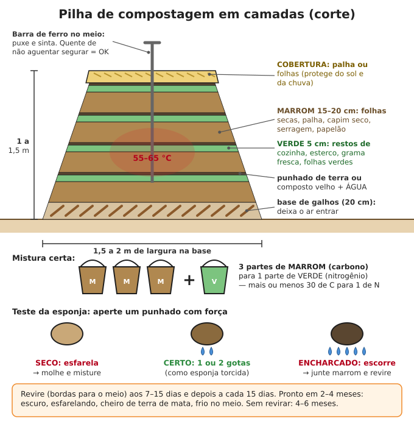

# Solo, adubação e compostagem

**Resumo:** quase todo solo brasileiro é **ácido e pobre**, mas melhora rápido com **matéria
orgânica** (esterco curtido, composto, palha) e **calcário ou cinza**. Regra prática para horta:
**3–5 kg de esterco curtido de gado (ou 1 kg de esterco de galinha curtido) + 150–250 g de
calcário por m²**, solo sempre coberto com palha e nunca pisado. Faça composto com **3 partes
de material seco (marrom) para 1 de verde**, úmido como esponja torcida.

---

## 1. Conheça o seu solo

### Tipos de solo — como reconhecer na mão

Pegue um punhado de terra de 10–20 cm de fundura, molhe até virar massa e aperte.

| Tipo | Na mão, molhado | Comportamento | O que fazer |
|---|---|---|---|
| **Arenoso** | Áspero, range, não forma rolinho | Seca e esquenta rápido, a chuva lava o adubo | Muita matéria orgânica, cobertura morta, adubar pouco e muitas vezes |
| **Argiloso** | Liso, gruda, faz rolinho fino que dobra em anel sem quebrar | Encharca, racha quando seca, fica duro | Canteiro alto, composto, nunca mexer molhado demais |
| **Siltoso (limoso)** | Sedoso como talco, não gruda muito | Forma crosta na superfície | Cobertura morta, composto |
| **Franco (o "barro bom")** | Forma rolinho que quebra ao dobrar | Segura água e drena bem | O ideal: só manter com matéria orgânica |
| **Turfoso / de várzea** | Preto, esponjoso, leve | Muito úmido, ácido | Drenar com valetas, calcário |
| **Pedregoso / raso** | Pedra a menos de 30 cm | Seca rápido | Canteiro elevado, frutíferas em covas grandes |

**Teste do rolinho:** role a massa úmida na palma até virar uma "cobrinha" de 3 mm.
Não forma = arenoso. Forma mas quebra ao fazer um anel = franco. Faz anel sem quebrar = argiloso.

**Teste da garrafa (mostra a proporção):**
1. Encha 1/3 de uma garrafa transparente com terra peneirada (sem pedras e raízes).
2. Complete com água até 3/4 e junte 1 colher de chá de sal ou de detergente (ajuda a soltar).
3. Feche, agite forte por 3 minutos e deixe parada.
4. Depois de **1 minuto**, marque a camada do fundo: **areia**. Depois de **2 horas**: **silte**.
   Depois de **1–2 dias**: **argila** (a água fica clara).
5. Mais de 70% de areia = arenoso; mais de 35% de argila = argiloso; meio a meio = franco.

**Cor e cheiro:** escuro e com cheiro de mata = rico em matéria orgânica. Vermelho = bem drenado
(latossolo, comum no Cerrado), em geral ácido e pobre em fósforo. Cinza-azulado ou com manchas
cinza e laranja = fica encharcado (falta ar para as raízes): plante em canteiro alto ou drene.

**Vida:** tire um bloco de 20 × 20 × 20 cm com a pá e conte as minhocas. **5 ou mais = solo vivo e
bom.** Nenhuma = solo pobre, compactado ou com veneno.

**Camada dura:** enfie um arame grosso ou um facão no solo úmido em vários pontos. Se trava sempre na
mesma fundura (10–30 cm), há uma camada compactada: quebre com garfo ou enxadão (veja
[dupla escavação](03-horta.md)) e plante guandu ou nabo, cujas raízes furam essa camada.

## 2. Acidez (pH) — teste caseiro

O pH vai de 0 (muito ácido) a 14 (muito alcalino); 7 é neutro. A maioria das plantas cresce melhor
com **pH entre 5,5 e 6,5**. A maior parte do Brasil tem pH de 4,5 a 5,5 (ácido demais). O Semiárido
e regiões de calcário podem ter solo neutro ou alcalino.

### Teste do vinagre e do bicarbonato (grosseiro, mas útil)
1. Ponha 2 colheres de sopa de terra em dois copos.
2. **Copo 1:** jogue meia xícara de vinagre. **Chiou e espumou = solo alcalino** (pH acima de 7,5).
   Não precisa de calcário; não use cinza.
3. **Copo 2:** molhe a terra com água de chuva ou fervida até virar lama e jogue meia xícara de
   água com 1 colher de bicarbonato. **Chiou = solo ácido** (pH abaixo de ~5,5): faça calagem.
4. Nada chiou em nenhum = pH mais ou menos neutro (6–7). Bom para quase tudo.

### Teste do repolho roxo (mais preciso)
1. Pique 1 xícara de repolho roxo e ferva 10 minutos em 2 xícaras de água de chuva. Coe.
   O caldo é roxo.
2. Misture 2 colheres de terra com meio copo do caldo. Espere 30 minutos e olhe a cor da água.
3. **Rosa/vermelho** = ácido (abaixo de 6). **Roxo** = neutro (6–7). **Azul/verde** = alcalino.

Se tiver **papel de pH** (farmácia, laboratório, loja de aquário): misture 1 parte de terra com
2 de água de chuva, espere 30 minutos e molhe o papel na água de cima.

### Plantas que indicam o solo (observe o mato que nasce sozinho)

| Planta espontânea | O que indica |
|---|---|
| Samambaia-das-taperas, sapé, barba-de-bode | Solo ácido, pobre, com alumínio tóxico, muito queimado |
| Capim-rabo-de-burro, carqueja | Solo ácido e pobre em cálcio |
| Azedinha (trevo-azedo) | Solo ácido, falta de cálcio |
| Guanxuma, grama-seda | Solo compactado (camada dura) |
| Tiririca | Solo ácido, mal arejado, encharcado às vezes |
| Língua-de-vaca | Solo encharcado ou com excesso de nitrogênio |
| Caruru, beldroega, picão-preto, serralha | **Solo fértil**, rico em matéria orgânica — bom sinal |
| Musgo no chão | Úmido, sombreado e ácido |

## 3. Calagem (corrigir a acidez)

**Calcário dolomítico** (tem cálcio e magnésio) é o melhor. Calcário calcítico também serve.
Sem análise de solo, use se o teste der ácido ou houver plantas de solo ácido:

| Solo ácido | Calcário por m² | Medida caseira | Por hectare |
|---|---|---|---|
| Arenoso | 100–150 g | ~½ copo americano | 1–1,5 t |
| Médio (franco) | 150–250 g | ~1 copo americano | 1,5–2,5 t |
| Argiloso | 200–300 g | 1 a 1¼ copo | 2–3 t |
| Cova de frutífera (40 × 40 × 40 cm) | 200–300 g por cova | 1 copo | — |

(1 copo americano cheio de calcário pesa cerca de 250 g.)

1. Espalhe por igual sobre o solo **úmido** e misture nos 15–20 cm de cima.
2. Faça **30 a 60 dias antes do plantio** (o calcário age devagar). Na pressa, pelo menos 15 dias.
3. **Não misture calcário ou cinza com esterco fresco ou urina** na mesma hora: o nitrogênio
   vira gás (amônia) e se perde. Ponha o calcário, espere 2 semanas, depois o esterco.
4. Repita a cada **2–3 anos**. Não passe de 300 g/m² de uma vez: excesso trava ferro, zinco e
   manganês (folhas novas amarelas).

**Substitutos do calcário:**
- **Cinza de lenha:** corrige acidez e dá potássio. **100–200 g/m² por ano** (1 a 2 copos
  americanos; 1 copo ≈ 100 g). Só cinza de madeira sem tinta, sem verniz, sem plástico. Guarde
  seca e coberta: a chuva lava o potássio.
- **Casca de ovo** seca, torrada no forno e moída fina; **conchas** de mar ou rio queimadas e moídas.
  Agem devagar. 1 punhado por cova.
- **Cal hidratada** (de construção): age rápido; use **metade a 2/3 da dose do calcário**, 30 dias
  antes do plantio.

> **ATENÇÃO:** **cal virgem** queima a pele, os olhos e as raízes (esquenta com água). Não use em
> solo de plantio sem prática. Com qualquer cal: luvas, óculos, não aplicar com vento.

**Gesso agrícola** não corrige o pH, mas leva cálcio para o fundo do solo (bom em solos de Cerrado e
para amendoim). Dose: 100–200 g/m².

## 4. Adubos orgânicos e doses

### Esterco: sempre curtido
Esterco fresco **queima raízes**, traz sementes de mato e **micróbios de doença** (salmonela,
verme). **Curtir:**
1. Amontoe o esterco (pode misturar palha) em lugar sombreado, sobre terra.
2. Molhe até ficar úmido como esponja torcida e cubra com palha ou lona.
3. Revire a cada 15 dias. Fica pronto quando **não esquenta mais, não tem cheiro forte e esfarela**:
   gado e cavalo 60–90 dias; galinha, porco e cabra 45–90 dias. Melhor ainda: ponha na
   [compostagem](#6-compostagem).

### Tabela de doses (adubação de plantio)

| Adubo (curtido) | Por m² de canteiro | Medida caseira por m² | Por cova (tomate, abóbora...) | Observação |
|---|---|---|---|---|
| Esterco de gado ou de cavalo | 3–5 kg | ½ a 1 balde de 10 L | 1–2 kg (2–4 L) | O mais seguro |
| Esterco de cabra ou ovelha | 2–3 kg | ~½ balde | 0,5–1 kg | Mais forte que o de gado |
| Esterco de porco | 2–3 kg | ~½ balde | 0,5–1 kg | Só bem compostado (vermes) |
| Esterco de galinha / cama de frango | 0,5–1,5 kg | 1–3 L | 200–300 g | **Muito forte**: fresco queima |
| Esterco de coelho | 1–2 kg | 2–4 L | 300–500 g | Pode ir quase fresco no chão |
| Composto pronto | 3–6 kg | ~1 balde de 10 L | 1–2 kg | Pode usar à vontade |
| Húmus de minhoca | 1–2 kg | 2–4 L | 100–300 g (1 punhado a 1 copo) | Ótimo para mudas |
| Bokashi | 100–200 g | ½ a 1 copo | 30–50 g | Concentrado: misture à terra |
| Farinha de ossos | 50–100 g | ~½ copo | 30–50 g; frutífera 200–500 g | Fósforo e cálcio |
| Cinza de lenha | 100–200 g/ano | 1–2 copos | 1 colher de sopa | Potássio; corrige acidez |
| Torta de mamona | 100–200 g | ~1 copo | 50 g | Nitrogênio; espanta nematoides |

**Adubação de cobertura** (no meio do ciclo, para folhosas, milho, tomate): 15–30 dias depois de
plantar, jogue em volta das plantas (sem encostar no caule) 200–300 g/m² de esterco de galinha
curtido ou 1–2 L de húmus, ou regue com urina ou biofertilizante diluídos (abaixo). Repita a cada
15–20 dias nas plantas de ciclo longo.

> **ATENÇÃO:** **Fezes humanas, de cão e de gato nunca vão direto na horta.** Só depois de
> compostadas por pelo menos 1 ano (veja [banheiro seco](../02-saude/09-higiene-e-saneamento.md))
> e, mesmo assim, em frutíferas e culturas que se cozinham. Em verduras comidas cruas, use apenas
> esterco **compostado** e pare de adubar com esterco 30 dias antes de colher.

### Urina (adubo de nitrogênio de graça)
- A urina de uma pessoa (~1,5 L/dia) tem nitrogênio suficiente para uns 300–400 m² de roça por ano.
- **Guarde 1 mês** em galão fechado antes de usar (mata micróbios). Use **diluída: 1 parte para
  5 a 10 de água**, regando **no solo, ao pé da planta**, nunca nas folhas.
- Dose: até **1–1,5 L de urina pura por m² por ciclo**, dividida em 2 a 4 aplicações.
- Pare de aplicar **1 mês antes da colheita** de verduras comidas cruas. Ótima para milho,
  capim, banana, frutíferas, couve.

### Farinha de ossos caseira
1. Junte ossos (boi, porco, galinha, peixe). Ferva 1–2 horas para soltar a carne e a gordura.
2. Queime no fogo ou no forno até ficarem **brancos e quebradiços** (cinza de osso: o fósforo
   fica mais fácil para a planta em solo ácido).
3. Soque no pilão até virar pó. Guarde seco.

> **ATENÇÃO:** **torta de mamona** e sementes de mamona são **venenosas** (ricina) para pessoas,
> cães, galinhas e gado. Enterre logo após aplicar e guarde longe de crianças e animais.

### Sinais de fome nas plantas

| O que você vê | Falta provável | O que fazer |
|---|---|---|
| Folhas **velhas** (de baixo) amarelando por inteiro, planta pequena e verde-clara | Nitrogênio | Urina diluída, esterco de galinha, biofertilizante, leguminosas |
| Folhas arroxeadas ou avermelhadas, crescimento parado | Fósforo | Farinha ou cinza de osso; calcário (solo ácido prende o fósforo) |
| Bordas das folhas velhas secas, como queimadas | Potássio | Cinza de lenha, composto, casca de banana |
| Fundo do tomate ou do pimentão preto e podre | Cálcio, ou rega irregular | Calcário ou casca de ovo; regar por igual, com cobertura morta |
| Amarelo entre as nervuras das folhas **velhas** (nervuras verdes) | Magnésio | Calcário dolomítico |
| Amarelo entre as nervuras das folhas **novas** | Ferro/manganês (muitas vezes excesso de calcário) | Composto; não exagere no calcário |

## 5. Adubação verde

Plantas (quase todas leguminosas) que se semeiam **para adubar**: fixam nitrogênio do ar (as
melhores colocam o equivalente a vários sacos de ureia por hectare), soltam o solo com as raízes e
dão palha. Corte **no início da floração** (antes de fazer semente), deixe a massa no chão como
cobertura e plante a cultura seguinte **7 a 15 dias depois**, direto no meio da palha.

| Planta | Época | Semeadura | Corte (dias) | Para quê | Cuidado |
|---|---|---|---|---|---|
| **Crotalária** (*C. juncea*) | Chuvas | Linhas a 50 cm, 20–25 sementes/m | 90–120 | Muito nitrogênio e palha; reduz nematoides | Sementes tóxicas para animais (a *C. spectabilis* mais ainda) |
| **Feijão-de-porco** | Chuvas; aguenta seca e solo fraco | 50 cm × 5–7 sementes/m | 90–120 | Solo pobre; abafa a tiririca | Grãos **tóxicos** — não comer |
| **Mucuna-preta** | Chuvas | 50–100 cm × 5–8 sementes/m; no milho, 30–60 dias depois dele | 130–170 | Cobre tudo, mata o mato, reduz nematoides | Trepa em tudo; grão cru é tóxico |
| **Guandu** | Chuvas | 50 cm × 15–20 sementes/m | 120–150 ou deixe perene | Raiz funda quebra camada dura; grão comestível; forragem | Vive 2–4 anos |
| **Milheto** | Chuvas ou fim delas | Linhas a 20–40 cm, 40–60 sementes/m | 50–70 | Muita palha rápida; raiz funda | Não fixa nitrogênio (é capim) |
| Aveia-preta, nabo forrageiro, ervilhaca, tremoço | Inverno no Sul e serras | A lanço ou linhas de 20 cm | 90–120 | Cobertura de inverno | — |

Misturar uma leguminosa com uma gramínea (ex.: crotalária + milheto) dá nitrogênio **e** palha que
dura mais.

## 6. Compostagem

O composto transforma restos de cozinha, mato, palha e esterco em adubo de primeira, sem cheiro,
sem doença e sem semente de mato (se esquentar bem).

### Os dois tipos de material
- **Marrom (carbono, seco):** folhas secas, palha, capim seco, bagaço de cana seco, sabugo,
  serragem de madeira **não tratada** (em pouca quantidade), papelão e papel picados.
- **Verde (nitrogênio, úmido):** restos de cozinha (cascas, borra de café), grama e mato verdes,
  folhas verdes, restos de horta, **esterco** (de qualquer animal herbívoro e de galinha), urina.
- **Proporção:** **3 partes de marrom para 1 parte de verde, em volume** (3 baldes para 1). Isso dá
  a relação ideal de cerca de **30 partes de carbono para 1 de nitrogênio**.
- **Não ponha:** carne, peixe, gordura, laticínios (atraem rato e cachorro), fezes de cão, gato
  ou gente, plantas com doença ou praga (se a pilha não esquentar bem), mato com semente madura,
  plástico, vidro, madeira tratada, cinza de carvão mineral.

### Montagem da pilha
1. **Local:** sombra, chão de terra (não cimento), plano, perto da água, **a 30 m de poços**.
2. **Tamanho mínimo:** 1 m × 1 m × 1 m (menor não esquenta). Ideal: **1,5–2 m de largura na base,
   1–1,5 m de altura**, comprimento à vontade. Mais alta que 1,5 m abafa.
3. **Base:** 20 cm de galhos finos, bagaço ou sabugo (deixa o ar entrar por baixo).
4. **Camadas:** 15–20 cm de marrom → 5 cm de verde/esterco → um punhado de terra ou de composto
   velho (traz os micróbios) → **molhe** → repita até a altura final.
5. **Cubra** com 10 cm de palha (ou lona na época de chuva forte, para não encharcar).
6. Enfie uma **barra de ferro ou vergalhão** até o meio da pilha: é o seu termômetro.

### Umidade: teste da esponja
Aperte um punhado com força: deve soltar **1 ou 2 gotas**, como esponja torcida (50–60% de água).
Escorre água = muito molhado (cheiro ruim): junte marrom e revire. Esfarela sem gota = seco: molhe
camada por camada ao revirar.

### Temperatura
- Em 2 a 5 dias o meio da pilha chega a **55–65 °C**. Puxe a barra: **quente de não aguentar segurar**
  = está funcionando. Para matar micróbios de doença e sementes de mato, todas as partes precisam
  passar **pelo menos 3 dias seguidos acima de 55 °C** — por isso se revira, trazendo as bordas
  para o meio.
- Acima de 70 °C (fumaça, cinza branca por dentro): revire e molhe.
- Morna logo no começo = falta verde (nitrogênio) ou água.

### Revirar e tempo
- 1ª virada aos **7–15 dias**; depois **a cada 15 dias** ou quando esfriar (3 a 5 viradas no total).
- **Pronto em 60–90 dias** revirando, no calor; **4–6 meses** sem revirar ou no frio.
- **Composto pronto:** escuro, esfarelando, cheiro de terra de mata, frio no meio, não se reconhece
  o que era. O volume cai para 1/3 a 1/2 do inicial.
- **Teste:** semeie feijão ou alface num copo só com composto. Nasceu normal em 5–7 dias = maduro.

| Problema | Causa | Solução |
|---|---|---|
| Cheiro de amônia (xixi) | Verde demais | Junte marrom, revire |
| Cheiro de ovo podre | Encharcado, sem ar | Revire, junte marrom seco, cubra da chuva |
| Não esquenta | Pequena, seca ou só marrom | Aumente a pilha, molhe, junte esterco ou urina |
| Formigas | Seca | Molhe |
| Moscas, ratos | Resto de comida exposto | Enterre a comida no meio e cubra com marrom |

**Em lugar seco (Semiárido):** faça o composto numa **vala** de 50–60 cm de fundo, que perde menos
água. **Composto no lugar:** jogue restos picados direto no canteiro, cubra com palha e deixe
apodrecer (mais lento, mas sem trabalho).

## 7. Minhocário (húmus)

Use **minhoca vermelha-da-califórnia** (*Eisenia*) ou **gigante-africana**. Minhoca comum de quintal
e minhocuçu **não servem** (não vivem em monte de resto orgânico).

1. **Caixas empilhadas:** 3 caixas plásticas iguais (ou baldes). As 2 de cima com furos de 6–8 mm
   no fundo; a de baixo, sem furos, com torneira, recolhe o líquido.
   **Ou canteiro:** 1 m de largura, 40 cm de altura, de tijolo ou tábua, coberto, na sombra.
2. **Cama:** esterco curtido de gado ou cavalo + papelão molhado picado, 10–15 cm.
3. **Comece com 250–500 g de minhocas** (umas 500–1.000) por caixa de 40–60 L.
4. **Alimente** com restos picados (cascas, verduras, borra de café, casca de ovo moída), enterrados
   e cobertos com folhas secas ou serragem. Até metade do peso das minhocas por dia.
   **Evite:** carne, gordura, laticínios, sal, muita cebola, alho ou casca de laranja.
5. Umidade de esponja bem úmida, **15–30 °C**, sempre na sombra. Sol direto mata em minutos.
6. **Colheita (60–90 dias):** ponha comida só em um lado (ou na caixa de cima) por 1–2 semanas;
   as minhocas mudam e você tira o húmus do outro lado.
7. **Chorume do minhocário:** dilua **1 parte em 10 de água** para regar.

A população dobra a cada 2–3 meses: divida com vizinhos e dê o excesso às galinhas.

## 8. Bokashi (farelo fermentado)

Adubo concentrado, pronto em 2–3 semanas. Bom para começar uma horta em solo fraco.

**Microrganismos da mata (para o bokashi e para o biofertilizante):**
1. Cozinhe 700 g de arroz **sem sal**. Ponha numa bandeja coberta com tela fina.
2. Deixe na mata, enterrada sob as folhas caídas, coberta, por **10–15 dias**.
3. Aproveite o arroz com mofos **rosa, azul, amarelo, laranja**; jogue fora partes **pretas,
   cinza-escuras ou podres**.
4. Junte o arroz a **10 L de água sem cloro + 1 L de melaço** (ou 1 kg de açúcar mascavo/rapadura)
   em bombona fechada. Abra a tampa 1 vez por dia para soltar gás. Pronto em **10–20 dias**, quando
   parar de borbulhar e tiver cheiro agridoce.

**Bokashi (proporções em volume):**
- 10 partes de farelo (arroz, trigo, fubá grosso)
- 3 partes de material rico em nitrogênio (torta de mamona, farelo de soja ou esterco de galinha
  seco moído)
- 1 parte de farinha de ossos; 1 parte de cinza (opcional)
- 1 parte de terra de mata peneirada (se não tiver os microrganismos)
- Água com melaço (1 copo de melaço em 10 L) + 1 copo dos microrganismos, aos poucos, até o
  **teste do punho**: aperta, forma torrão que esfarela ao tocar, **sem pingar** (30–40% de água).

**Fermentação sem ar (mais fácil):** encha sacos plásticos grossos ou bombona, aperte para tirar o
ar, feche bem. Pronto em **15–21 dias**: cheiro **agridoce** (de picles), mofo branco. Cheiro de
podre = estragou (vai para a compostagem).
**Com ar:** monte de 30–50 cm de altura na sombra, revirando 2 vezes por dia nos primeiros dias
para não passar de 50 °C. Pronto em 7–15 dias, quando esfriar e secar.

Use 100–200 g/m² misturado à terra, ou 30–50 g por cova, sempre coberto. Guarda meses seco.

## 9. Biofertilizante líquido de esterco

Adubo líquido para regar e pulverizar; também deixa as plantas mais resistentes.

**Balde de 20 L:** 5–6 kg de **esterco fresco de vaca** (meio balde) + 10–12 L de água sem cloro +
1 copo de leite, garapa ou melaço + 1 punhado de cinza. **Tambor de 200 L:** 1 parte de esterco
para 2 de água, 2–4 L de leite ou melaço.
1. Misture bem, deixe 20 cm livres no topo.
2. **Sem ar (melhor):** tampe e passe uma mangueira da tampa até uma garrafa com água (o gás sai,
   o ar não entra). **Com ar:** cubra com pano e mexa 1 vez por dia.
3. Pronto em **30–45 dias** (sem ar) ou **15–30 dias** (com ar): parou de borbulhar, cheiro de
   fermentado, não de podre.
4. Coe em pano.
5. **Uso:** no solo, 1–2 L em 10 L de água (10–20%), ao pé da planta. Nas folhas, **200–500 mL em
   10 L** (2–5%), no fim da tarde, a cada 7–15 dias. **Puro queima as folhas.**

Esterco de gado tratado com vermífugo nos últimos 30 dias prejudica a fermentação e as minhocas.
Não pulverize verduras comidas cruas nas **3 semanas antes da colheita**; lave bem sempre.
O líquido que sai de um [biodigestor](../06-energia/07-biogas.md) é usado do mesmo jeito.

## 10. Cobertura morta (o solo nunca fica pelado)

Solo descoberto perde água, esquenta a mais de 50 °C no sol, endurece com a chuva e perde a terra
fértil na enxurrada. Cubra **sempre**:
- **Material:** palha, capim seco **sem semente**, folhas, bagaço de cana, casca de arroz,
  serragem curtida, rama de adubação verde, folhas de bananeira.
- **Espessura:** **5–10 cm** em hortas e roças; **10–20 cm** em volta de frutíferas, num raio de 1 m.
- Deixe **2–5 cm livres em volta do caule** (encostado, apodrece o colo da planta).
- Reduz a rega pela metade ou mais, segura o mato, alimenta as minhocas. Renove quando afinar.
- Serragem e maravalha cruas **por cima** não fazem mal; **misturadas na terra** roubam nitrogênio
  por meses.
- Na semeadura direta de sementes miúdas (cenoura), afaste a palha da linha até as mudas crescerem.

## Rotina do solo (resumo)

1. Teste o pH e observe o mato. Se ácido, calcário ou cinza **30–60 dias antes** de plantar.
2. Composto ou esterco curtido **no plantio**; cobertura com esterco de galinha, húmus, urina ou
   biofertilizante durante o ciclo.
3. Cobertura morta sempre. Nunca queime a palha nem o mato roçado.
4. Entre uma cultura e outra, adubação verde. Rotacione as famílias de plantas
   ([Horta](03-horta.md)).
5. Faça composto sem parar: todo resto orgânico é adubo.

---

Ver também: [Horta](03-horta.md) · [Culturas principais](04-culturas-principais.md) · [Pragas e doenças](06-pragas-e-doencas.md) · [Higiene e saneamento](../02-saude/09-higiene-e-saneamento.md) · [Biogás](../06-energia/07-biogas.md) · [Princípios da criação de animais](../05-animais/01-principios-gerais.md)
