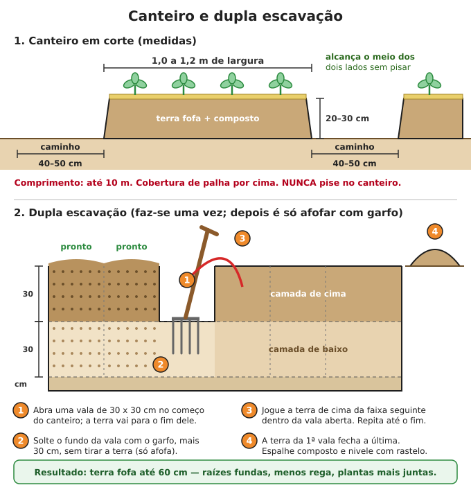

# Horta

**Resumo:** para ter verdura e legume todo dia, conte **20–30 m² de canteiro por pessoa**
(100–120 m² para uma família de 4). Escolha lugar com **6 horas ou mais de sol**, água perto e
**cerca** contra galinhas e bichos. Canteiros de **1,0–1,2 m de largura**, 20–30 cm de altura,
caminhos de 40–50 cm, **nunca pisados**, adubados com composto e cobertos com palha. Plante pouco
e **várias vezes** (a cada 15–30 dias) para colher sem parar, e mude as famílias de lugar a cada
ciclo.

---

## 1. Tamanho e lugar

### Quanto plantar
| Para quê | Área de canteiro |
|---|---|
| Verduras e temperos frescos para 1 pessoa | 10–15 m² |
| Hortaliças variadas (200–300 g/dia) para 1 pessoa | 20–30 m² |
| Família de 4 pessoas | 100–120 m² de canteiro (≈ 180–200 m² com caminhos) |

A horta complementa: as calorias vêm da roça (mandioca, milho, feijão, batata-doce, abóbora —
veja [Culturas principais](04-culturas-principais.md)).

### Escolha do local
- **Sol:** pelo menos **6 horas de sol direto** por dia. Folhosas aguentam 4–5 horas.
  No Brasil o sol passa **ao norte**: árvores e paredes ao **sul** da horta não sombreiam;
  ao norte, sombreiam.
- **Água** a menos de 20–30 m (carregar água cansa e desanima). Veja [Irrigação](07-irrigacao.md).
- **Terreno** plano ou pouco inclinado (em morro, canteiros **em nível**, cortando a descida —
  [curva de nível](07-irrigacao.md)). Sem encharcar na chuva.
- **Longe** de árvores grandes (raízes e sombra), de fossas e esgoto (30 m), de lixo e de beira de
  estrada (chumbo e poeira).
- **Perto de casa:** o que se vê todo dia é cuidado todo dia (e é protegido de ladrão).
- **Cerca:** tela de 1,5 m contra galinhas (corte as penas de uma asa delas), mais 20–30 cm
  enterrados contra tatu, coelho e cachorro; bambu trançado; ou cerca viva de espinho. Galinha solta
  acaba com uma horta em uma manhã.
- **Quebra-vento** do lado do vento forte (cana, capim-elefante, guandu, bananeira).

## 2. Canteiros

- **Largura 1,0–1,2 m:** você alcança o meio pelos dois lados sem pisar. Terra pisada endurece.
- **Altura 20–30 cm** em solo argiloso ou em época de chuva. Em clima seco (Semiárido), faça o
  contrário: **canteiro afundado** 10–15 cm abaixo do caminho, com bordas de terra ou tijolo, que
  segura a água.
- **Comprimento:** até 10 m. **Caminhos:** 40–50 cm (60 cm onde passa carrinho de mão), cobertos
  com palha ou serragem.
- **Orientação:** o comprimento no sentido norte–sul dá sol por igual dos dois lados.
- **Bordas:** tábua, bambu, tijolo, pedra ou garrafas PET cheias de terra seguram a terra no lugar.

### Preparo de um canteiro novo
1. Roce o mato, tire tocos e pedras. Se o solo for ácido, calcário 150–250 g/m²
   ([Solo](01-solo-adubacao-compostagem.md)), de preferência 30 dias antes.
2. Molhe o solo 1–2 dias antes de cavar (úmido, não encharcado).
3. Cave 25–30 cm com enxada ou pá (ou faça a **dupla escavação**, abaixo, uma vez na vida do
   canteiro).
4. Espalhe **3–5 kg de esterco curtido ou composto por m²** e misture nos 10–15 cm de cima.
5. Puxe a terra dos caminhos para cima, formando o canteiro. Nivele com rastelo, quebrando torrões.
6. Cubra com palha até plantar.

### Dupla escavação (solo fofo até 60 cm)
1. No começo do canteiro, abra uma vala de **30 cm de largura × 30 cm de fundo**. Leve a terra
   para o fim do canteiro.
2. **Solte o fundo da vala com garfo (forcado) mais 30 cm, sem tirar a terra.**
3. Abra a faixa seguinte de 30 cm jogando a terra de cima **dentro da vala aberta**.
4. Solte o fundo da nova vala. Repita até o fim.
5. A terra da primeira vala fecha a última. Espalhe composto (2–5 cm) e misture por cima.

Dá trabalho (2–4 horas por canteiro de 10 m²), mas as raízes descem fundo: aguenta mais a seca e
permite plantar mais junto. Depois, só afofe com garfo a cada plantio, sem revirar.

## 3. Sementeira e mudas

**Muda** (sementeira e depois transplante): alface, couve, repolho, brócolis, tomate, pimentão,
berinjela, jiló, cebola, cebolinha.
**Direto no lugar:** cenoura, beterraba (pode ser muda também), rabanete, rúcula, coentro, salsa,
quiabo, abóbora, abobrinha, pepino, maxixe, feijão-vagem, ervilha, milho.

1. **Recipiente:** canteiro de sementeira, caixote de 10 cm de fundo, bandeja de isopor ou copinhos
   de jornal/papel (planta-se com o copo, que apodrece).
2. **Substrato:** 1 parte de terra + 1 parte de composto ou húmus peneirados (+ 1 parte de areia se a
   terra for argilosa).
3. **Profundidade:** 2 a 3 vezes o tamanho da semente (alface e cenoura: 0,5 cm; tomate: 1 cm;
   abóbora e milho: 3–5 cm). Sementeira em sulcos a cada 10 cm.
4. Regue com **crivo fino** (regador de chuveirinho ou lata furada com prego fino) 1–2 vezes por dia.
   Sombra leve (folha de coqueiro, sombrite) até nascer.
5. **Raleie** (tire o excesso) quando tiverem 2 folhas, deixando as mais fortes.
6. **Rustifique:** 5–7 dias antes do transplante, diminua a água e deixe pegar sol cheio.
7. **Ponto de transplante:** 4 a 6 folhas definitivas. Alface 25–30 dias; tomate 25–35; couve
   30–40; pimentão 40–50; cebola 40–60 dias (grossura de um lápis).

### Transplante
1. Faça no **fim da tarde** ou em dia nublado. Molhe a muda e o canteiro antes.
2. Abra a cova, ponha a muda **na mesma altura** em que estava (tomate pode ir mais fundo: solta
   raiz no caule), firme a terra em volta com os dedos.
3. Regue logo. Se o sol estiver forte, sombreie 2–3 dias com folhas ou galhos.
4. No canteiro largo, plante **em triângulo** (desencontrado entre as linhas): cabem uns 15% a mais.

## 4. Tabela das hortaliças

Espaçamento = entre linhas × entre plantas. Dias = da semeadura até a colheita (aproximado; muda
com a variedade e o clima). Datas para cada região: [Calendário](05-calendario-de-plantio.md).

| Hortaliça | Como plantar | Espaçamento | Dias até colher | Clima / época | Dica |
|---|---|---|---|---|---|
| **Alface** | Muda | 25–30 × 25–30 cm | 60–80 | Ameno. No verão: variedades "de verão" + sombrite | Colha antes de espigar (fica amarga) |
| **Couve-manteiga** | Muda ou broto | 80–100 × 50–60 cm | 60–80 até a 1ª, depois colhe por 6–12 meses | Ano todo; melhor no outono-inverno | Colha as folhas de baixo, 1–2 vezes por semana |
| **Repolho** | Muda | 70–80 × 40–50 cm | 90–120 | Ameno a frio (há variedades de verão) | Exige muito adubo |
| **Tomate** | Muda | 100 × 50 cm, estaqueado | 100–130 | Época seca e amena, com rega. Chuva + calor = doença | Estaca de 2 m, 1–2 hastes, tire os brotos do "sovaco" |
| **Pimentão** | Muda | 100 × 50 cm | 100–120 | Quente, sem geada | Amarre num tutor |
| **Cenoura** | Direto | 20–25 × 5–8 cm | 85–120 | Verão: tipo Brasília; inverno: tipo Nantes | Terra fofa, sem pedra e sem esterco fresco (a raiz bifurca) |
| **Beterraba** | Direto ou muda | 20–25 × 8–10 cm | 60–80 | Ameno | Cada "semente" dá 2–4 plantas: raleie |
| **Cebola** | Muda | 25–30 × 8–10 cm | 120–180 | Plantio no outono; use variedade da sua região | Pronta quando 70% das folhas tombam |
| **Alho** | Dente | 20–25 × 8–10 cm | 120–180 | Outono; precisa de frio para formar cabeça | Dente graúdo, ponta para cima, 2–3 cm de terra por cima |
| **Abobrinha** | Direto, 2–3 sementes/cova | 100 × 80–100 cm | 45–60 | Quente, sem geada | Colha com 15–20 cm, a cada 2 dias |
| **Pepino** | Direto | 100 × 50 cm, tutorado | 45–60 | Quente | Cerca, varal ou bambu para subir |
| **Quiabo** | Direto (semente de molho 24 h) | 100 × 30–40 cm | 60–75 | Bem quente | Colha com 8–12 cm, a cada 1–2 dias |
| **Maxixe** | Direto | 150–200 × 50–100 cm, ou na cerca | 50–60 | Quente; muito rústico | Colha novo |
| **Rúcula** | Direto | 20–25 × 5 cm | 30–45 | Ameno; no calor espiga (use sombrite) | Corte a 3 cm do chão: rebrota 1–2 vezes |
| **Salsa** | Direto (semente de molho 24 h) | 20–25 × 10 cm | 60–80 | Ano todo | Demora 15–30 dias para nascer |
| **Cebolinha** | Muda ou touceira | 25 × 15–20 cm | 60–80 (de touceira 30–45) | Ano todo | Corte a 5 cm do chão; divida a touceira por ano |
| **Coentro** | Direto (quebre a semente em duas) | 20–25 × 3–5 cm | 40–60 | Aguenta calor | Semeie de 15 em 15 dias |
| **Batata** | Batata-semente | 70–80 × 30–35 cm | 90–120 | Fresco (15–20 °C): Sul, serras, inverno do Sudeste | Chegue terra ao pé aos 25–30 dias |
| Rabanete | Direto | 20 × 5 cm | 25–35 | Ameno | Ótimo para criança plantar |
| Berinjela, jiló | Muda | 100 × 60–80 cm | 100–120 | Quente | Rústicos, produzem meses |
| Feijão-vagem | Direto | 100 × 50 cm (trepador) | 60–70 | Ameno a quente | Tutor de 2 m |

> **ATENÇÃO:** **batata verde** (que pegou sol) e os **brotos da batata** têm solanina, que é
> tóxica: corte fora toda a parte verde e os brotos antes de cozinhar. Na colheita, cubra as
> batatas do sol. **Folhas e caules de tomate e de batata não se comem.**

## 5. Consórcio (plantas juntas) e rotação

### Consórcio
Plantar espécies diferentes juntas aproveita o espaço, confunde as pragas e protege o solo.
- **Rápida + lenta:** rabanete ou alface entre linhas de cenoura, couve, tomate ou repolho
  (colhe antes de a outra fechar).
- **Alta + baixa:** tomate ou milho com alface, cebolinha ou coentro por baixo.
- **Raiz + folha:** cenoura com alface; beterraba com alface ou cebola.
- **Milho + feijão + abóbora** na roça ([Culturas](04-culturas-principais.md)).
- **Flores e temperos atraem os bichos que comem as pragas:** coentro, endro, erva-doce e
  cenoura florescendo, cravo-de-defunto (tagetes), girassol, manjericão. Deixe uns pés florescerem.
- **Capuchinha** atrai pulgão para si (planta-isca), poupando as couves.
- **Evite** juntar plantas da mesma família lado a lado: dividem as mesmas pragas e doenças.

### Rotação (não repita a família no mesmo lugar)

| Família | Hortaliças |
|---|---|
| Solanáceas | Tomate, batata, pimentão, pimenta, berinjela, jiló |
| Brássicas (crucíferas) | Couve, repolho, brócolis, couve-flor, rúcula, mostarda, rabanete, agrião |
| Cucurbitáceas | Abóbora, abobrinha, pepino, maxixe, melancia, melão, chuchu |
| Apiáceas | Cenoura, salsa, coentro, mandioquinha, erva-doce, aipo |
| Aliáceas | Cebola, alho, cebolinha, alho-poró |
| Asteráceas | Alface, almeirão, chicória |
| Leguminosas | Feijão, vagem, ervilha, amendoim, guandu |
| Amarantáceas | Beterraba, acelga, espinafre, caruru |

**Sequência simples em 4 tempos** (cada canteiro passa por todas):
**Folhas** (pedem nitrogênio) → **Frutos** (solanáceas, cucurbitáceas) → **Raízes e bulbos** →
**Leguminosas ou adubação verde** (devolvem nitrogênio) → volta às folhas.
**Solanáceas: só voltam ao mesmo canteiro depois de 3–4 anos** (murcha bacteriana e nematoides
ficam no solo).

### Exemplo: horta para 4 pessoas (10 canteiros de 1,2 × 10 m)
- 2 canteiros de folhas (alface, couve, rúcula, almeirão)
- 1 de temperos (cebolinha, salsa, coentro) e plantas medicinais
- 2 de raízes (cenoura, beterraba, rabanete)
- 2 de frutos (tomate, pimentão, berinjela ou quiabo)
- 1 de cebola e alho (outono) ou batata
- 1 de leguminosas (vagem, ervilha) ou adubação verde
- 1 de mudas (sementeira) e reserva

A cada ciclo, cada grupo anda **um canteiro** para o lado. Abóbora, pepino e maxixe vão melhor
fora dos canteiros, na cerca ou na roça.

## 6. Manejo do dia a dia

- **Rega:** de manhã cedo ou no fim da tarde, **no pé**, sem molhar as folhas. Hortaliças no calor
  gastam **4–6 L por m² por dia** (meio regador de 10 L por m²). Com cobertura morta, bem menos.
  Teste: enfie o dedo 5 cm na terra; seco = regar.
- **Mato:** arranque pequeno, antes de sementar, e deixe no caminho como cobertura.
- **Cobertura morta:** 5 cm de palha entre as plantas, sem encostar no caule
  ([Solo](01-solo-adubacao-compostagem.md)).
- **Adubação de cobertura** a cada 15–20 dias nas plantas de ciclo longo.
- **Olhe as plantas 2 vezes por semana**, inclusive embaixo das folhas: praga pega no começo é fácil
  de controlar ([Pragas](06-pragas-e-doencas.md)).
- **Tomate:** estaca de 2 m ou varal de arame com fitilho; amarre a cada 30 cm; tire os brotos que
  nascem entre a folha e o caule (desbrota) 1 vez por semana; corte a ponta depois do 6º–8º cacho.

## 7. Horta na cidade

### Vasos e recipientes
| Plantas | Fundura mínima | Volume |
|---|---|---|
| Alface, rúcula, temperos, morango | 15–20 cm | 3–5 L |
| Cenoura, beterraba, rabanete | 25–30 cm | 10 L |
| Pimenta, quiabo | 25–30 cm | 10 L |
| Tomate, pimentão, berinjela | 30–40 cm | 20 L ou mais |
| Abóbora, pepino, maracujá | 40 cm | 40 L ou mais |

1. **Furos** no fundo (5–8 furos de 1 cm num balde de 20 L) e 3–5 cm de brita, cacos ou argila
   expandida, com um pano por cima (a terra não desce).
2. **Substrato:** 1 parte de terra + 1 parte de composto ou húmus + 1 parte de areia ou casca de
   arroz carbonizada, e um punhado de calcário ou cinza por balde.
3. Vaso seca rápido: **regue todo dia** no calor. Prato embaixo só se esvaziado (dengue).
4. Adube a cada 15–30 dias com 1 punhado de húmus ou biofertilizante diluído.

**Baldes, bacias, tambores cortados, caixas de feira forradas com saco de ráfia, sacos de terra
deitados** (fure por cima e plante) — tudo serve, desde que tenha furo embaixo.

**Pneus:** bons para **batata** (comece com 1 pneu e vá empilhando outro com terra conforme a rama
cresce) e para abóbora e temperos. Encha **todo** o oco com terra (água parada no pneu = dengue).
Prefira-os para plantas que não sejam folhas comidas cruas.

**Garrafas PET:** garrafa de 2 L deitada, com uma "janela" recortada em cima e 3–4 furinhos
embaixo, pendurada em fileiras num muro ou grade com arame: alface, rúcula, temperos, morango.
Penduradas uma sobre a outra, a água que sobra de cima rega a de baixo.

**Horta vertical:** paletes, calhas, canos de PVC de 100 mm furados, bolsas de tecido em muro.
Use a **parede virada para o norte** (é a que mais pega sol no Brasil).

> **ATENÇÃO:** **terra molhada pesa muito**: um canteiro de 20 cm de terra sobre laje pesa cerca de
> 350 kg por m². Laje comum de casa pode não aguentar. Use vasos espalhados, apoiados perto de
> vigas e paredes, e confira com quem entende de construção.

**Brotos (sem terra, prontos em 4–7 dias):** feijão-moyashi (feijão-mungo), lentilha, grão-de-bico,
alfafa, trigo, girassol. Deixe de molho 8–12 h, escorra num pote com tela, enxágue 2 vezes por dia
com água tratada, no escuro. Coma em 1–2 dias; jogue fora se tiver cheiro ruim ou limo.

Cuidado com solo urbano: perto de rua movimentada, de oficina ou de entulho pode ter chumbo.
Faça canteiro elevado com terra trazida, lave bem as verduras e descasque as raízes.

## 8. Calor, sol forte e chuva

- **Sombrite 30–50%** sobre folhosas (alface, rúcula, coentro, couve) no verão: baixa 3–6 °C na
  folha e evita espigar. Armação de bambu a 1,5–2 m (para trabalhar embaixo) ou túnel baixo de
  60–80 cm. Sem sombrite: folhas de coqueiro, palha, ripado de bambu com metade aberta, ou um
  renque de milho, guandu ou quiabo **a oeste** (dá sombra na tarde quente).
- Tomate, pimentão, abóbora e quiabo gostam de sol cheio (só no calor extremo do Nordeste use
  sombra leve de 30%).
- **Chuva forte:** canteiros altos, caminhos drenados e, para tomate na época das chuvas, **túnel
  de plástico transparente** aberto dos lados (protege da água nas folhas, que traz doença).
- **Geada (Sul e serras):** cubra à noite com pano, palha ou plástico sem encostar nas folhas;
  regue o solo à tarde (solo úmido perde menos calor); nos meses de geada, plante couve, alface,
  repolho, cenoura, alho, ervilha — que aguentam frio.

---

Ver também: [Solo e compostagem](01-solo-adubacao-compostagem.md) · [Sementes](02-sementes.md) · [Calendário de plantio](05-calendario-de-plantio.md) · [Pragas e doenças](06-pragas-e-doencas.md) · [Irrigação](07-irrigacao.md) · [Plantas medicinais](../02-saude/05-plantas-medicinais.md) · [Plantas silvestres comestíveis](../03-alimentacao/04-plantas-silvestres-comestiveis.md)
