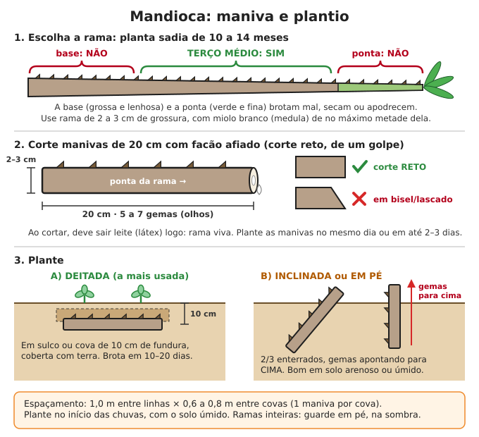
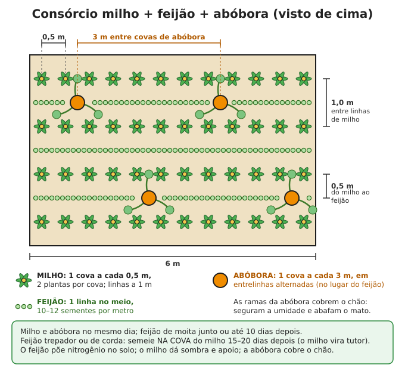

# Culturas principais

**Resumo:** a base calórica no Brasil é **mandioca, milho, feijão, arroz, batata-doce, abóbora,
cará/inhame e banana**. Plante no **início das chuvas**, com semente ou rama da própria região.
A mandioca é a cultura mais segura (aguenta seca, solo fraco e fica guardada viva na terra até
2 anos), mas a **mandioca-brava tem cianeto e mata se não for processada**. Uma família de 4
precisa de cerca de **0,6 ha bem cuidados (≈ 1 ha com margem para perdas)** para comer o ano todo.

---

## Tabela-resumo

| Cultura | Espaçamento | Ciclo | Produção aproximada | Por m² |
|---|---|---|---|---|
| Mandioca | 1,0 × 0,6–0,8 m | 8–24 meses | 15–30 t/ha de raiz | 1,5–3 kg |
| Milho (grão) | 1,0 × 0,5 m, 2 plantas/cova | 120–150 dias (verde: 80–100) | 2–4 t/ha (crioulo) | 0,2–0,4 kg |
| Feijão comum | 0,5 m × 10–15 sementes/m | 80–100 dias | 1–2 t/ha | 0,1–0,2 kg |
| Feijão-de-corda | 0,8–1,0 × 0,25 m, 2 sementes | 60–90 dias | 0,6–1,5 t/ha | 0,06–0,15 kg |
| Arroz de sequeiro | 0,3–0,45 m × 60–80 sementes/m | 100–130 dias | 1,5–3 t/ha | 0,15–0,3 kg |
| Arroz irrigado | 0,2–0,25 × 0,15–0,2 m | 110–140 dias | 5–8 t/ha | 0,5–0,8 kg |
| Batata-doce | leiras a 0,8–1,0 m × 0,3 m | 90–150 dias | 10–25 t/ha | 1–2,5 kg |
| Abóbora | covas a 2–3 × 2–3 m | 90–150 dias | 10–20 t/ha | 1–2 kg |
| Cará / inhame | 1,0–1,2 × 0,4–0,6 m | 7–10 meses | 15–30 t/ha | 1,5–3 kg |
| Banana | 3 × 2–3 m | 1º cacho em 12–18 meses | 15–30 t/ha/ano | 1,5–3 kg/ano |
| Amendoim | 0,5–0,6 m × 10–15 sementes/m | 90–130 dias | 1,5–3,5 t/ha (casca) | 0,15–0,35 kg |
| Cana | sulcos a 1,2–1,5 m | 12–18 meses | 60–100 t/ha | 6–10 kg |
| Sorgo | 0,5–0,8 m × 8–12 plantas/m | 90–130 dias | 1,5–4 t/ha | 0,15–0,4 kg |
| Girassol | 0,7–0,9 × 0,3 m | 90–130 dias | 1,5–2,5 t/ha | 0,15–0,25 kg |
| Gergelim | 0,6–1,0 × 0,1–0,2 m | 90–120 dias | 0,5–1 t/ha | 0,05–0,1 kg |
| Algodão | 0,8–1,0 × 0,1–0,2 m | 130–180 dias | 1,5–4 t/ha em caroço | 0,15–0,4 kg |

Os números de produção são de lavoura bem cuidada, sem adubo químico. Na primeira safra, conte
com **metade**. Datas por região: [Calendário de plantio](05-calendario-de-plantio.md).

## Mandioca (aipim, macaxeira)

### Mansa x brava

| | Mansa (aipim, macaxeira, mandioca-de-mesa) | Brava |
|---|---|---|
| Cianeto na raiz | Baixo | Alto (até 5–10 vezes mais) |
| Uso | Cozida, frita, assada | **Só processada:** farinha, polvilho, puba, tapioca |
| Sabor crua | Pouco ou nada amarga | Geralmente amarga (mas não é regra segura) |

> **ATENÇÃO:** **não dá para saber pela aparência se a mandioca é mansa ou brava.** Use só
> variedades conhecidas, com nome, vindas de quem planta há anos. **Mandioca desconhecida: trate
> como brava.** Intoxicação por cianeto: tontura, dor de cabeça, vômito, falta de ar, pele
> avermelhada, convulsão e morte em poucas horas. Nunca coma mandioca-brava crua ou só cozida,
> nunca beba nem dê a animais a **manipueira** (o líquido amarelo da prensa) e nunca a jogue em rio
> ou açude (mata os peixes). **Folhas de mandioca** também têm muito cianeto: só se comem moídas e
> cozidas por muitos dias (a maniçoba cozinha 4–7 dias).

### Processar a mandioca-brava (farinha)
1. **Descasque** (a casca tem mais veneno) e lave.
2. **Rale** (ralo, cevador ou ralador): romper as células libera o cianeto.
3. **Prense** no tipiti ou na prensa até não escorrer mais líquido. Descarte a manipueira longe de
   água, crianças e animais (ou guarde, diluída, contra formigas — veja
   [Pragas](06-pragas-e-doencas.md)).
4. Esfarele, peneire e **torre no forno ou tacho mexendo sem parar** até a farinha ficar seca,
   solta e crocante (1–2 horas). O calor tira o resto do cianeto.
5. **Polvilho:** a água da lavagem da massa ralada deixa um amido no fundo; troque a água várias
   vezes, seque o amido ao sol. **Puba (carimã):** deixe as raízes de molho 3–7 dias até amolecerem,
   depois prense e seque. Tucupi: só com quem sabe fazer (ferve-se por horas).

Detalhes da farinha: [Processamento de alimentos](../03-alimentacao/05-processamento-de-alimentos.md).

**Mandioca mansa:** descasque, cozinhe em bastante água **destampada** e jogue a água fora.

### Plantio

1. **Época:** início das chuvas, com o solo úmido (ou o ano todo onde houver água e não gear).
2. **Rama:** planta sadia de **10–14 meses**; use o **terço médio** (nem a base lenhosa, nem a ponta
   verde), com **2–3 cm** de grossura.
3. **Maniva:** pedaços de **20 cm com 5–7 gemas**, corte **reto** com facão afiado, num golpe.
   Deve sair leite (látex) logo ao cortar. Plante no mesmo dia ou em até 2–3 dias.
4. **Posição:** **deitada** em sulco ou cova de **10 cm**, coberta de terra (a mais usada); ou
   **inclinada/em pé**, 2/3 enterrada, **gemas para cima**, em solo arenoso ou úmido.
5. **Espaçamento:** **1,0 × 0,6–0,8 m** (12.500–16.600 plantas/ha). Em consórcio, fileiras duplas:
   2,0 m entre pares de linhas, 0,6 m entre as linhas do par — milho e feijão vão no espaço largo.
6. **Capina** nos primeiros **3–5 meses** (o mato nessa fase derruba a produção pela metade).
   Depois a própria mandioca sombreia o chão.
7. Adubo: 1–2 kg de esterco curtido por cova, ou planta após adubação verde. Gosta de potássio
   (cinza).

### Colheita e guarda
- **Mansa: 8–12 meses** (passou de 14–18 meses fica fibrosa e não cozinha bem).
  **Brava: 12–24 meses.**
- Corte a parte de cima a 20–30 cm do chão (guarde as ramas para replantar) e arranque puxando o
  toco; afrouxe a terra com enxadão se estiver duro.
- **A raiz arrancada estraga em 2–3 dias** (risca preta por dentro). O melhor armazém é **o pé
  vivo na terra**: arranque só o que vai usar em 1–2 dias e plante um pouco **todo mês** para ter
  mandioca o ano inteiro.
- Para guardar: **farinha** (dura mais de 1 ano seca e fechada), **raspa** (fatias finas secas ao
  sol, moídas depois), raiz **descascada congelada**, ou raízes enterradas em vala com terra úmida
  (1–2 semanas).

## Milho

- **Época:** início das chuvas. Não aguenta geada; sofre muito com seca **no pendoamento e no
  espigamento** (falta d'água nessas 3–4 semanas pode tirar metade da colheita).
- **Espaçamento:** linhas a **0,8–1,0 m**, covas a cada **0,4–0,5 m** com **2 plantas**
  (ou 1 planta a cada 20–25 cm). 3–5 cm de fundura. Milho crioulo alto: 1,0 × 0,5 m.
- **Adubo:** é o mais exigente em nitrogênio. 2–3 kg de esterco curtido por metro de sulco, ou
  plante depois de adubação verde; urina diluída ou esterco de galinha em cobertura aos 25–35 dias.
- **Capina:** até 40–45 dias. **Amontoa** (chegar terra ao pé) aos 30 dias segura a planta no vento.
- **Ciclo:** **milho verde** em 80–100 dias (cabelo marrom-escuro, grão leitoso que solta leite
  ao apertar); **grão seco** em 120–150 dias.
- **Produção:** crioulo bem cuidado 2–4 t/ha; uma planta dá 1–2 espigas.
- **Colheita do seco:** palha seca e grão duro. A tradicional **dobra do milho** (quebrar o pé
  abaixo da espiga, deixando-a pendurada para baixo) faz secar no campo e protege da chuva e dos
  pássaros.
- **Guarda:** espigas **empalhadas** em paiol alto e protegido de rato (a palha protege do
  caruncho), ou debulhado bem seco (13% de umidade: o grão quebra com estalo) em tambor ou garrafa
  PET fechados. Veja [Sementes](02-sementes.md) e [Pragas](06-pragas-e-doencas.md).
- **Uso:** fubá, cuscuz, canjica, pamonha, angu, pipoca, ração. Para fubá e canjica nutritivos,
  cozinhe o grão com cal ou cinza ([Processamento](../03-alimentacao/05-processamento-de-alimentos.md)).

### Consórcio milho + feijão + abóbora

O milho dá sombra e serve de tutor, o feijão põe nitrogênio no solo, a abóbora cobre o chão e
segura a umidade e o mato. Na mesma área se colhe mais do que com cada um sozinho.

## Feijões

### Feijão comum (carioca, preto, roxinho, jalo...)
- **Épocas:** "das águas" (início das chuvas), "da seca" (fim das chuvas, Jan–Mar no Centro-Sul)
  e "de inverno" irrigado onde não gear. Não aguenta geada nem calor acima de 35 °C na floração
  (as flores caem) nem chuva na colheita.
- **Espaçamento:** linhas a **0,4–0,5 m**, **10–15 sementes por metro**, 3–5 cm de fundura.
- **Ciclo:** 80–100 dias. **Produção:** 1–2 t/ha (0,1–0,2 kg/m²).
- **Colheita:** arranque as plantas quando **80–90% das vagens estiverem secas**, seque 2–3 dias
  em lona ao sol, bata com vara, abane, seque até o grão quebrar ao morder.

### Feijão-de-corda (caupi, macassar, fradinho)
- O feijão do **Norte e Nordeste**: aguenta calor, seca e solo fraco.
- **Espaçamento:** 0,8–1,0 × 0,25 m, 2 sementes por cova. Ramador (de rama longa): 1,0 × 0,5 m.
- **Ciclo:** 60–75 dias (precoce) a 90–120. **Feijão-verde** (grão maduro mas não seco) com 50–60 dias.
- **Produção:** 0,6–1,5 t/ha. Colha as vagens secas em 2–3 passadas.

### Guandu
- Arbusto de 1–3 m, vive **2–4 anos**, aguenta seca, raiz funda. Grão verde cozido como ervilha;
  seco, de molho e cozimento longo. Folhas: forragem e adubo.
- **Espaçamento:** 1,0–1,5 × 0,5 m. **Primeira colheita** em 4–6 meses; produz por 2–3 anos.
- **Produção:** 0,8–2 t/ha de grão. Ótimo em cerca, curva de nível e quebra-vento.

### Fava (feijão-fava, fava-de-lima)
- Trepadeira, comum no Nordeste. Plante junto ao milho, à cerca ou com tutor de 2 m.
- **Espaçamento:** 1,0 × 0,5–1,0 m. **Ciclo:** 90–120 dias até a primeira colheita; algumas
  variedades produzem por vários meses.

> **ATENÇÃO:** algumas favas, principalmente as **coloridas e as do mato**, têm **glicosídeos
> cianogênicos** (como a mandioca). **Nunca coma fava crua.** Deixe de molho 12–24 horas, jogue a
> água fora, cozinhe bem **destampada** em água nova e descarte essa água também.

### Guarda dos feijões
Bem secos, em garrafa PET cheia até a boca, ou com **5 mL de óleo por kg**, ou misturados com
cinza; congelar 4–7 dias mata o caruncho ([Sementes](02-sementes.md)).

## Arroz

### Sequeiro (terras altas — depende da chuva)
- Centro-Oeste, Norte, Maranhão, Piauí. Início das chuvas, chuva bem distribuída (um veranico de
  2 semanas na floração destrói a colheita).
- **Espaçamento:** linhas a 0,30–0,45 m, 60–80 sementes por metro (ou covas de 30 × 30 cm com 5–8
  sementes). 3–5 cm de fundura.
- **Ciclo:** 100–130 dias. **Produção:** 1,5–3 t/ha em casca.

### Irrigado (várzea alagada)
- Sul (RS, SC) e várzeas. Precisa de **terreno plano**, **taipas** (diques de terra de 30–40 cm em
  nível, feitas com o [nível A](07-irrigacao.md)) e água farta: 10–15 mil m³ por hectare por safra.
- Mudas de 20–30 dias transplantadas a **20–25 × 15–20 cm**, 3–4 mudas por cova; ou semeadura
  direta. Lâmina de água de **5–10 cm** a partir de 20–30 dias; **drene 10–15 dias antes da colheita**.
- **Ciclo:** 110–140 dias. **Produção:** 5–8 t/ha.

### Colheita e beneficiamento
1. Colha quando **2/3 dos grãos do cacho estiverem duros e amarelos**. Corte com foice ou faca,
   amarre em feixes.
2. Seque os feixes, bata contra tábua, tambor ou pedra para soltar o grão. Abane.
3. Seque o grão até 13% (quebra ao morder).
4. **Descasque no pilão**, socando de leve, e abane na peneira. Arroz em casca guarda melhor
   (1–2 anos); integral fica rançoso em ~6 meses.

## Batata-doce

- **Época:** chuvas; o ano todo onde houver água e calor. Não aguenta frio abaixo de 10 °C.
- **Leiras (camalhões)** de 30–40 cm de altura, a **0,8–1,0 m** uma da outra; ramas a cada
  **25–35 cm**.
- **Rama:** pontas de **30–40 cm** (6–8 nós), enterre a metade a 2/3 no topo da leira.
- **Ciclo:** 90–150 dias (conforme a variedade). **Produção:** 10–25 t/ha.
- Colha quando as raízes estiverem formadas (cave um pé para ver). Corte as ramas, cave com
  cuidado (raiz ferida apodrece).
- **Cura:** 1 dia ao sol, depois **5–7 dias em lugar quente e abafado** (cicatriza a pele).
  Guarde **2–4 meses** em lugar fresco, ventilado e escuro. **Não na geladeira** (estraga abaixo de
  10 °C). Ou fatie, seque e faça farinha.
- As **folhas e pontas dos ramos** são comestíveis (refogadas). Mantenha sempre um viveiro de ramas.

## Abóbora (jerimum, moranga)

- **Época:** início das chuvas, quente, sem geada.
- **Covas** de 40 × 40 × 40 cm com **10–20 L de esterco curtido**, a **2–3 m × 2–3 m**; 3–4 sementes
  por cova, deixe as 2 melhores plantas.
- **Ciclo:** 90–150 dias (cabotiá 90–110; abóbora-de-pescoço e jerimuns 120–150).
- **Produção:** 10–20 t/ha; 3–6 frutos por planta.
- **Colheita:** casca dura (a unha não entra), cabo seco e cor firme. Colha com **5–10 cm de cabo**.
- **Cura** ao sol 7–10 dias. Guarde em prateleira, sem encostar um no outro, em lugar seco e
  ventilado: **3–6 meses** (as de casca dura, até 12 meses).
- Também se comem as flores, os brotos (cambuquira) e as sementes torradas.

## Inhame e cará

Os nomes mudam de região: no Sudeste e Sul, **inhame** é o taro (*Colocasia*, folha em forma de
coração na ponta de um talo); no Nordeste, **inhame** é o mesmo que **cará** (*Dioscorea*,
trepadeira).

### Taro (inhame do Sudeste)
- Gosta de umidade, aguenta solo encharcado. Plante **filhotes de 50–100 g** a **0,8–1,0 × 0,3–0,4 m**.
- **Ciclo:** 7–9 meses (colha quando as folhas amarelarem). **Produção:** 15–25 t/ha.
- Guarda 2–4 meses em lugar fresco. **Sempre cozido** (cru dá coceira forte na boca e na garganta).

### Cará / inhame-da-costa (*Dioscorea*)
- Trepadeira: precisa de **tutor de 1,5–2 m** (vara, cerca, ou plantado junto ao milho).
- Plante **pedaços de 100–200 g** (com casca) ou carás pequenos, em leiras ou montes, a
  **1,0–1,2 × 0,5–0,6 m**.
- **Ciclo:** 7–10 meses. **Produção:** 15–30 t/ha. **Guarda muito bem**: 4–6 meses em lugar seco,
  sombreado e ventilado.
- Coma sempre cozido. **Só carás cultivados**: alguns carás do mato são tóxicos.

## Banana

- **Muda:** **chifre ou chifrão** (30–150 cm, folhas estreitas, pegada à mãe), de touceira sadia.
  Corte as raízes e raspe a casca do rizoma (tira a broca).
- **Cova** de 40–50 cm com **10–20 L de esterco** e 200 g de calcário. Início das chuvas.
- **Espaçamento:** 3 × 2–3 m (Prata e Terra maiores; Nanica menor: 2 × 2,5 m).
- **Primeiro cacho:** 12–18 meses; depois, cerca de **1 cacho por touceira por ano**.
  Cacho: Prata 10–15 kg; Nanica 20–35 kg; Terra 15–25 kg.
- **Desbaste:** mantenha só **mãe, filha e neta** por touceira; corte os outros brotos rente e
  destrua a gema do centro.
- **Colheita:** cacho com as frutas "cheias" (quinas arredondadas), ainda verde. Amadureça à sombra,
  embrulhado. Corte a mãe depois de colher e pique o tronco por cima do chão (cobertura).
- Corte o **coração (umbigo)** depois da última penca: cozido, é comestível. Banana verde cozida e
  farinha de banana verde também alimentam.
- Gosta de muita água: ótima no **círculo de bananeiras** com água de pia ([Irrigação](07-irrigacao.md)).

## Amendoim

- **Época:** início das chuvas. Solo leve, arenoso, com cálcio (calcário ou gesso).
- **Semente:** descasque só na hora de plantar, **sem tirar a pele vermelha**. 0,5–0,6 m entre
  linhas, 10–15 sementes por metro, 3–5 cm de fundura.
- **Ciclo:** 90–110 dias (ereto) a 120–140 (rasteiro). **Produção:** 1,5–3,5 t/ha com casca.
- **Colheita:** folhas amarelando e **70% das vagens com a parte de dentro da casca escurecida**.
  Arranque, vire as vagens para cima e seque 3–5 dias no campo; depois destaque e seque bem.

> **ATENÇÃO:** amendoim (e milho) mal seco cria **mofo verde-amarelado** que produz
> **aflatoxina**, veneno que causa câncer de fígado e não sai com cozimento. Seque rápido, guarde com
> casca em lugar seco e **jogue fora todo grão mofado, enrugado ou com cor estranha** (não dê a
> animais).

## Cana-de-açúcar

- **Plantio:** início das chuvas (colhe com 12 meses) ou fim do verão (colhe com 15–18 meses).
- **Toletes** de 30–40 cm com **2–3 gemas**, de cana com 8–12 meses, deitados no fundo de **sulcos de
  20–30 cm**, a **1,2–1,5 m** entre sulcos, um encostado no outro. Cubra com 5–10 cm de terra.
- **Produção:** 60–100 t/ha de cana. **Rebrota** (soca) todo ano por 4–6 cortes.
- **Ponto:** na seca, quando a garapa da ponta e a do pé têm o mesmo doce. Corte rente ao chão.
- **Rendimento:** 1 t de cana dá ~600–700 L de garapa e ~100 kg de rapadura ou açúcar mascavo.
- A cana cortada azeda em 1–3 dias: moa logo. **Guarde na touceira.** Usos: garapa, melado,
  rapadura, açúcar mascavo, álcool, forragem, cobertura morta. Ótima como quebra-vento.

## Sorgo

- **Para o Semiárido e a seca:** aguenta muito mais falta d'água que o milho.
- **Espaçamento:** 0,5–0,8 m entre linhas, 8–12 plantas por metro, 2–3 cm de fundura.
- **Ciclo:** 90–130 dias; rebrota depois do corte para uma segunda colheita menor.
- **Produção:** 1,5–4 t/ha de grão. Grão cozido como arroz, em farinha, cuscuz, ração.
  **Sorgo sacarino:** caldo para melado, como a cana. Pássaros adoram: ensaque os cachos.

> **ATENÇÃO:** **sorgo novo** (abaixo de 50–60 cm), **rebrota** e planta murcha por seca ou geada
> têm cianeto: **não solte animais para pastar** nessa fase. Feno e silagem bem feitos são seguros.
> O grão maduro é seguro.

## Girassol

- **Época:** início das chuvas ou fim delas (safrinha). Aguenta alguma seca.
- **Espaçamento:** 0,7–0,9 × 0,3 m. **Ciclo:** 90–130 dias. **Produção:** 1,5–2,5 t/ha de semente.
- **Colheita:** a parte de trás da cabeça fica amarelo-escura e as brácteas secam. Proteja dos
  pássaros com saco de tela ou papel. Corte, seque, bata.
- **Óleo:** a semente tem 40–45% de óleo; uma prensa caseira tira cerca de 1/4 do peso. Torta
  para galinhas e porcos. Ótimo para abelhas.

## Gergelim

- **Época:** chuvas, calor (25–35 °C). Aguenta seca; ótimo no Semiárido.
- **Semente miúda:** misture 1 parte de semente com 10 de areia para semear; 2 cm de fundura.
  Linhas a 0,6–1,0 m; raleie deixando uma planta a cada 10–20 cm.
- **Ciclo:** 90–120 dias. **Produção:** 0,5–1 t/ha (45–50% de óleo).
- **Colheita:** quando as cápsulas de baixo amarelam e as folhas caem. Corte, amarre em feixes
  **em pé, com as cápsulas para cima, sobre lona**: em 1–2 semanas elas abrem; vire e bata.
- As folhas levadas pelas saúvas prejudicam o fungo do formigueiro.

## Algodão (fibra)

- **Herbáceo** (anual) ou **mocó/arbóreo** (perene, do Semiárido, produz por anos).
- **Espaçamento:** 0,8–1,0 m × 8–10 plantas por metro. Início das chuvas.
- **Ciclo:** 130–180 dias. **Produção:** 1,5–4 t/ha de algodão em caroço (35–40% é fibra).
  1.000 m² dão uns 50–150 kg de fibra.
- **Colheita:** capulhos bem abertos, de manhã depois de o orvalho secar, em 2–3 passadas.
- Separe a fibra do caroço à mão ou com descaroçador de dois rolos. Fiação e tecelagem:
  [Tecidos e costura](../09-quimica-e-oficios/04-tecidos-e-costura.md).
- **Bicudo** (besourinho de bico comprido): arranque e queime os restos da planta após a colheita.
- O **caroço** tem gossipol: **tóxico para porcos, aves e pessoas**; só para gado (ruminante) e em
  pouca quantidade.

## Quanto plantar para uma família de 4 pessoas por um ano

Estimativa para comer bem (cerca de 3.000 kcal por pessoa por dia, para quem trabalha na roça),
com produtividade média, sem contar animais:

| Cultura | Para comer no ano | Produção usada no cálculo | Área a plantar |
|---|---|---|---|
| Mandioca | 1.000 kg de raiz (fresca + ~250 kg de farinha) | 2 kg/m² | 500 m², plantados aos poucos todo mês |
| Milho | 200 kg de grão + milho verde | 0,2 kg/m² | 1.000 m² |
| Feijão (comum ou de corda) | 100 kg (~70 g por pessoa/dia) | 0,1 kg/m² | 1.000 m² (ou 500 m² com 2 safras) |
| Arroz (sequeiro) | 200 kg em casca (~130 kg limpo) | 0,2 kg/m² | 1.000 m² (em região seca, troque por mais milho e mandioca) |
| Batata-doce | 300 kg | 1,5 kg/m² | 200 m² |
| Abóbora | 200 kg | 1 kg/m² | 200 m² |
| Cará / inhame | 150 kg | 1,5 kg/m² | 100 m² |
| Banana | 500 kg (~40 cachos) | 1 cacho por touceira/ano | 40 touceiras ≈ 300 m² |
| Amendoim | 40 kg com casca | 0,2 kg/m² | 200 m² |
| Cana | ~140 kg de rapadura/melado + garapa | 7 kg de cana/m² | 200 m² |
| Girassol (óleo) | 15–20 L de óleo (ou use banha) | ~0,05 L de óleo/m² | 300–400 m² |
| Horta | verduras e legumes todo dia | — | 120 m² de canteiro (~200 m² com caminhos) |
| Frutíferas | frutas o ano todo | — | 20–30 árvores (500–1.000 m²) |
| **Total** | | | **≈ 6.000 m² (0,6 ha)** |

- Some **30–50% de margem** para seca, praga e erro: **cerca de 1 hectare** (100 × 100 m).
- **Animais:** 10 galinhas soltas pedem mais 500–1.000 m² de milho, sorgo ou mandioca; um porco,
  outros 1.000 m²; vaca e cabra precisam de pasto ([Animais](../05-animais/01-principios-gerais.md)).
- **Semente:** guarde de 5% a 10% da colheita de grãos para o plantio seguinte, **antes** de comer.
- Em área pequena, priorize o que dá **mais comida por m²**: mandioca, batata-doce, cará, abóbora,
  banana. Grãos (milho, feijão, arroz) pedem mais área, mas **guardam por anos**.

---

Ver também: [Sementes](02-sementes.md) · [Calendário de plantio](05-calendario-de-plantio.md) · [Pragas e doenças](06-pragas-e-doencas.md) · [Irrigação](07-irrigacao.md) · [Processamento de alimentos](../03-alimentacao/05-processamento-de-alimentos.md) · [Conservação de alimentos](../03-alimentacao/02-conservacao-de-alimentos.md) · [Nutrição e racionamento](../03-alimentacao/03-nutricao-e-racionamento.md)
