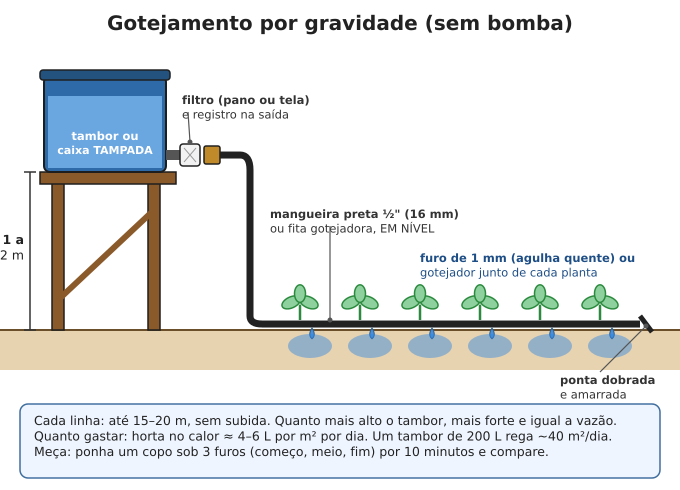
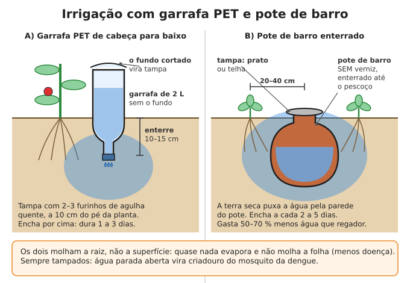
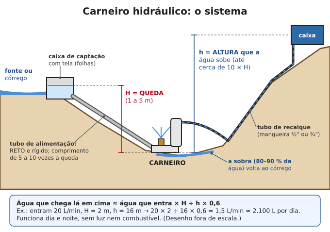
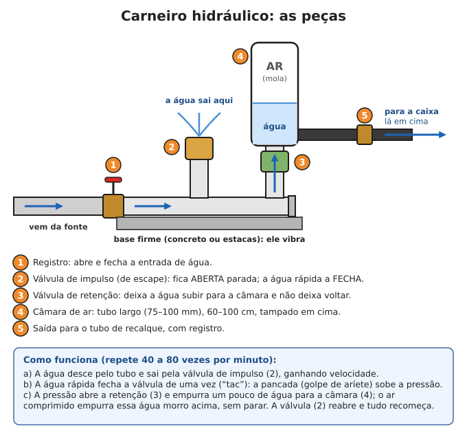
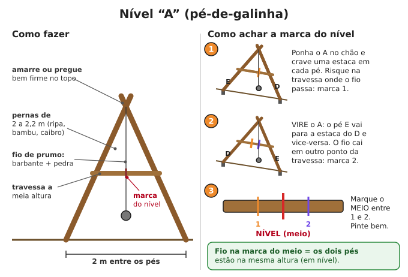
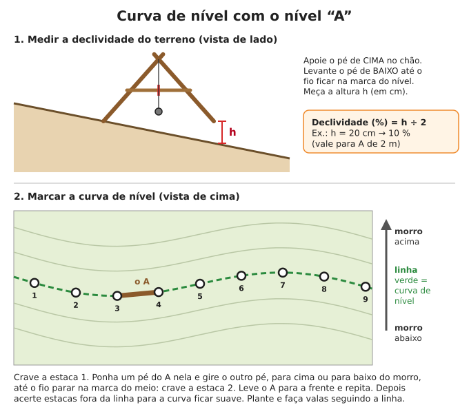

# Irrigação

**Resumo:** **1 mm de chuva = 1 litro por m².** Horta no calor gasta **4–6 L por m² por dia**;
com **cobertura morta**, metade. Regue **no pé**, de manhã cedo ou no fim da tarde. Sem bomba e
sem energia: **gotejamento por gravidade** (tambor a 1–2 m de altura), **garrafa PET e pote de
barro enterrados** (gastam 50–70% menos água) e o **carneiro hidráulico**, que sobe água morro
acima usando só a força de uma pequena queda d'água. Para guardar a chuva no solo: **plantio em
curva de nível** (marcada com o **nível "A"**), valas de infiltração e **barraginhas**.

---

## 1. Quanta água cada cultura pede

| Cultura | Necessidade | Fase crítica (não pode faltar) |
|---|---|---|
| Hortaliças folhosas | 4–6 L/m²/dia no calor; 2–3 no tempo fresco | O ciclo todo (raiz curta) |
| Tomate, pimentão | 1–3 L por planta/dia na produção | Floração e frutos (rega irregular = fundo preto) |
| Abóbora, melancia, pepino | 3–5 L por planta/dia na produção | Floração e frutos |
| Milho | 400–700 mm no ciclo; pico 5–7 mm/dia | Pendoamento e espigamento |
| Feijão comum | 300–400 mm no ciclo | Floração e enchimento das vagens |
| Feijão-de-corda, sorgo | 250–500 mm no ciclo | Floração |
| Arroz irrigado | 1.000–1.500 mm (lâmina de água) | O ciclo todo |
| Mandioca | Ideal 1.000–1.500 mm/ano; aguenta 500 mm | Primeiros 3–5 meses |
| Batata-doce | 400–600 mm no ciclo | Primeiro mês e formação das raízes |
| Banana | 1.200–1.800 mm/ano; 25–40 L por touceira/dia na seca | Sempre |
| Cana | 1.200–1.500 mm/ano | Crescimento |
| Muda de frutífera recém-plantada | 10–20 L por muda, 2 vezes por semana na seca | 1º e 2º ano |
| Frutífera adulta | 50–200 L por árvore por semana na seca | Floração e frutos |

**Quando regar:** enfie o dedo 5 cm na terra da horta (ou 15–20 cm na roça e no pomar); aperte um
punhado: forma bola e úmida = ainda tem água; esfarela seco = regue.
**Regue fundo e menos vezes** nas plantas já firmes (as raízes descem atrás da água) e **leve e
todo dia** nas sementeiras e mudas novas. Água de chuva ou de rio serve; água muito salobra
(Semiárido) salga o solo: use com cobertura e chuva para lavar.

## 2. Métodos sem energia

### Regador
Simples, mas pesado: 100 m² de horta no calor pedem 400–600 L por dia (40–60 regadores de 10 L).
Use regador de **crivo fino** para sementeiras. Lata furada com prego fino faz o mesmo.

### Sulcos (infiltração)
- Sulcos de **15–20 cm de fundo** entre as leiras, com **leve declive: 0,5–1 cm por metro**
  (marcado com o nível A: veja abaixo). Água desviada de rego, bica ou caixa.
- Comprimento: até 50–100 m em solo argiloso; 30–50 m em arenoso (a água some antes de chegar).
- Gasta mais água que gotejamento e, em declive maior que 2%, a água arrasta a terra.

### Gotejamento por gravidade

1. **Reservatório:** tambor ou caixa d'água **tampado** sobre estrado firme de **1 a 2 m** de altura
   (200 L de água pesam 200 kg). Cada metro de altura dá mais pressão.
2. **Saída:** adaptador no fundo + **filtro** (tela ou pano amarrado) + **registro**.
3. **Mangueira principal** e **linhas** ao longo das fileiras: mangueira preta de ½" (16 mm) ou
   fita gotejadora. **Linhas em nível** e de **até 15–20 m**.
4. **Gotejadores:** furo de **1 mm** (agulha ou prego fino quente) **junto de cada planta**, ou
   gotejadores comprados, ou pedaços de "espaguete" (microtubo) enfiados na mangueira.
5. **Ponta fechada:** dobre e amarre, ou tampão.
6. **Ajuste:** ponha copos sob 3 furos (começo, meio e fim) por 10 minutos e compare. Furo que
   pinga demais: tampe com palito e fure de novo menor. Antes de cada uso, abra a ponta e deixe a
   sujeira sair.
7. **Quanto:** um tambor de 200 L molha uns **40 m² de horta por dia** no calor. Encha com a chuva
   do telhado ([Captação](../01-agua/01-encontrar-e-captar-agua.md)) ou com balde/bomba manual.

**Variação "de soro":** garrafa ou balde pendurado acima de cada planta, com fio de pano saindo do
fundo ou mangueirinha fina com nó: pinga devagar.

### Garrafa PET e pote de barro enterrados

**Garrafa PET (2 L):**
1. Faça **2–3 furinhos** na tampa com agulha quente. Corte o fundo da garrafa (vira tampa).
2. Enterre de **cabeça para baixo**, gargalo **10–15 cm** no solo, a **10 cm do pé** da planta.
3. Encha por cima e cubra com o fundo cortado (evita mosquito e sujeira).
4. Dura **1–3 dias**. Para frutíferas novas, 2–3 garrafas por muda. Teste antes no ar: deve
   esvaziar em 6–12 horas; muito rápido = furos menores.

**Pote de barro (irrigação por pote, a mais econômica):**
1. Use pote, moringa ou vaso de barro **cru, sem verniz e sem tinta** (poroso), de 5–20 L.
   Dois vasos de flor de barro colados boca com boca (com o furo de baixo vedado com barro, cimento
   ou rolha) também servem.
2. Enterre **até o pescoço**, deixando 2–5 cm da boca acima do chão. **Tampe** (prato, telha).
3. Plante em volta, a **20–40 cm** do pote: um pote de 10 L serve cerca de 1 m² (4–6 plantas).
4. Encha a cada **2–5 dias**. A terra seca "puxa" a água pela parede do pote; terra molhada puxa
   pouco: a rega se regula sozinha. Economiza **50–70%** da água do regador.
5. Uma vez por estação, desenterre e escove o pote (os poros entopem com o tempo).

Faça os potes em casa: [Cerâmica](../09-quimica-e-oficios/06-ceramica.md).

### Pavio (vasos)
Cordão grosso de algodão com uma ponta no fundo do vaso (enterrada na terra) e a outra num balde
d'água abaixo: a água sobe sozinha. Bom para vasos quando se sai de casa por dias.

## 3. Carneiro hidráulico (bomba sem energia)

Usa a força de um pouco de água que **cai de uma pequena altura** para **empurrar uma parte menor
dessa água morro acima**, dia e noite, sem luz e sem combustível. Funciona onde há um **riacho,
bica ou nascente** com pelo menos **1 m de queda** e água correndo o ano todo.

### Quanto ele bombeia
**Água que chega em cima ≈ água que entra × H ÷ h × 0,6**
- **H** = queda: altura entre a superfície da água na caixa de captação e o carneiro (1 a 5 m).
- **h** = altura que a água deve subir, do carneiro até a caixa lá em cima (até ~10 × H na
  prática; acima disso rende muito pouco).
- **Exemplo:** entram 20 L/min, H = 2 m, h = 16 m → 20 × 2 ÷ 16 × 0,6 = **1,5 L/min ≈ 2.100 L por
  dia**. A sobra (80–90% da água) volta para o córrego.
- **Medir a vazão da fonte:** cronometre quanto tempo leva para encher um balde de 10 L.
  Carneiro de 1" precisa de pelo menos ~10 L/min.
- **Medir as alturas:** com nível de mangueira ou com o nível A (seção 5), somando os degraus.

### As peças

Montagem típica com conexões de **1"** (25–32 mm) — de PVC grosso soldável ou, melhor, de ferro
galvanizado:

1. **Caixa de captação** (tambor ou caixinha de alvenaria) no riacho, com **tela** na entrada e
   nível de água constante.
2. **Tubo de alimentação:** **rígido** (ferro galvanizado é o melhor; PVC grosso funciona), **reto,
   sem curvas**, descendo da caixa até o carneiro, com comprimento de **5 a 10 vezes a queda H**.
   Diâmetro: 1" a 2". Mangueira mole **não serve** (absorve o golpe).
3. **Registro** no fim do tubo, antes do carneiro.
4. **Corpo:** tê ou cruzeta de 1".
5. **Válvula de impulso (de escape):** é o coração. Tem de ficar **ABERTA quando parada** e
   **FECHAR de uma vez** quando a água passa rápido por ela. Duas formas caseiras:
   - **Válvula de retenção de portinhola** (basculante) de 1", montada na saída de cima do tê **de
     cabeça para baixo** (seta apontando para dentro do tê): a portinhola cai aberta pelo próprio
     peso; a água saindo rápido a empurra contra o assento e ela fecha.
   - **Válvula de pé (de poço) sem a mola**, invertida: o pistão cai pelo peso (aberta) e a
     correnteza o empurra para cima (fechada).
   - **Ajuste:** mais peso ou curso maior = batidas mais lentas, mais água por batida; mais leve
     = batidas rápidas. Comece em **40–80 batidas por minuto**.
6. **Válvula de retenção (de recalque):** de mola ou portinhola, montada normal (seta para cima,
   rumo à câmara). Deixa a água entrar na câmara e não deixa voltar.
7. **Câmara de ar:** tubo largo (**75–100 mm**) de **60–100 cm**, tampado em cima, acima da
   retenção. O ar preso funciona como mola e faz a água subir sem trancos.
8. **Saída de recalque:** no pé da câmara, com registro, ligada à **mangueira ou cano de ½"–¾"**
   (metade do diâmetro da alimentação) até a caixa no alto.
9. **Base firme:** chumbe ou amarre bem o carneiro em concreto ou estacas: ele vibra a cada batida.

### Como funciona e como pôr para trabalhar
1. A água desce o tubo e sai pela válvula de impulso, ganhando velocidade.
2. A água rápida fecha a válvula de uma vez ("tac"). A pancada (**golpe de aríete**) sobe a pressão.
3. A pressão abre a retenção e empurra um pouco de água para a câmara; o ar comprimido empurra a
   água morro acima, sem parar. A válvula de impulso reabre e tudo recomeça.
4. **Partida:** abra o registro de entrada; empurre a válvula de impulso com um pau algumas vezes
   até ela bater sozinha.
5. **Manutenção:** limpe a tela da captação; se o carneiro começar a bater muito duro, o ar da
   câmara dissolveu na água: feche o recalque, esvazie a câmara e recomece. Um **furinho de 1 mm**
   no corpo logo abaixo da retenção (que "chupa" uma bolha de ar a cada batida), ou uma câmara de
   pneu cheia de ar dentro da câmara, evitam isso.

> **ATENÇÃO:** o golpe de aríete dá pressões altas: use tubos e conexões fortes (PVC marrom
> soldável de água fria aguenta até uns 60–70 m de altura de recalque; para mais, ferro galvanizado)
> e não fique com o rosto sobre a válvula de impulso ao testar. Trabalhe em riacho só com água baixa
> e cuidado com cobras e pedras escorregadias.

Mais sobre força da água: [Energia eólica e hidráulica](../06-energia/06-eolica-e-hidraulica.md).

## 4. Guardar a chuva no solo e na terra

- **Cobertura morta** de 5–10 cm: corta a evaporação pela metade ou mais. É o "sistema de irrigação"
  mais barato que existe ([Solo](01-solo-adubacao-compostagem.md)).
- **Matéria orgânica:** solo com composto segura muito mais água.
- **Bacia (coroa) em volta das árvores:** anel de terra de 1 m de raio em volta da muda, com palha
  dentro: a chuva e a rega não escorrem.
- **Covas grandes (zaí):** no Semiárido, covas de **30–40 cm de largura e 20–30 cm de fundo** com
  esterco dentro, a cada ~1 m: juntam a enxurrada onde está a planta.
- **Canteiro afundado** (abaixo do caminho) no clima seco.
- **Quebra-vento** e sombra parcial diminuem a perda de água das plantas
  ([Agrofloresta](08-frutiferas-e-agrofloresta.md)).
- **Água cinza** (pia, chuveiro, tanque — sem fezes): para frutíferas, bananeiras e capim, nunca em
  verduras cruas. **Círculo de bananeiras:** buraco de 1,5–2 m de largura e 50–80 cm de fundo,
  cheio de galhos e palha, onde se joga a água cinza; em volta, bananeiras, mamão, taioba,
  batata-doce. Use sabão neutro (sem água sanitária nem soda).

### Barraginhas
Pequenas bacias escavadas no caminho da enxurrada (estradas, grotas, pastos) que seguram a água
da chuva para ela **entrar no solo** em vez de correr. Recarregam o lençol, fazem minas voltarem e
deixam úmida a terra abaixo delas.
1. Onde: no caminho da enxurrada, em terreno de declive suave a médio, **em série** (uma abaixo da
   outra, a cada 30–50 m) e nas saídas de água das estradas ("bigodes").
2. Tamanho: as feitas com máquina têm 10–16 m de diâmetro e 1,5–2 m de fundo. **À mão:** 3–5 m de
   diâmetro e 0,5–1 m de fundo, em forma de meia-lua, com a terra formando a parede do lado de baixo.
3. Faça um **sangradouro** (ladrão) lateral protegido com pedras ou capim, para o excesso sair sem
   romper a parede. Plante capim na parede.
4. Esvaziam em poucos dias (a água vai para o solo): isso é o certo.

**Barragem subterrânea (Semiárido):** no leito de um riacho que seca, cave uma vala atravessada até
a rocha ou a camada impermeável (2–4 m), estenda lona plástica grossa na parede de baixo e tape de
volta. A água da chuva fica presa na areia acima da lona, e ali se planta na seca.
**Cisterna-calçadão:** área cimentada de ~200 m² que leva a chuva a uma cisterna grande, para a
horta ([Água](../01-agua/01-encontrar-e-captar-agua.md)).

## 5. Curvas de nível com o nível "A" (pé-de-galinha)

Plantar e fazer valas **em nível** (cortando a descida) segura a água e a terra. Morro abaixo, a
chuva leva a camada fértil em poucos anos.

### Fazer o nível A
1. Duas varas retas (ripa, bambu, caibro fino) de **2 a 2,2 m** e uma terceira de ~1,2 m.
2. Amarre ou pregue bem as duas maiores no topo, abrindo os pés a **exatamente 2 m**.
3. Pregue a travessa **na metade da altura**, ligando as pernas.
4. Pendure no topo um **barbante com uma pedra** (prumo) que passe na frente da travessa e fique
   um pouco abaixo dela.

### Achar a marca do nível
1. Ponha o A no chão e crave uma estaca junto de cada pé. Risque na travessa onde o fio passa
   (**marca 1**).
2. **Vire o A** (o pé esquerdo vai para a estaca do direito e vice-versa). Risque de novo
   (**marca 2**).
3. O **meio entre as duas marcas é o nível**. Pinte bem. Fio nessa marca = os dois pés estão na
   mesma altura.

### Medir a declividade
Apoie o pé de cima no chão, levante o pé de baixo até o fio ficar na marca e meça a altura **h**
(cm) do pé até o chão: **declividade (%) = h ÷ 2** (só vale para A de 2 m). Ex.: 20 cm → 10%.

### Marcar a curva
1. Comece numa ponta do terreno, crave a **estaca 1**.
2. Ponha um pé do A junto dela e gire o outro pé, morro acima ou abaixo, até o fio parar na marca
   do meio. Crave a **estaca 2** nesse pé.
3. Passe o A para a frente (um pé na estaca 2) e repita até atravessar o terreno.
4. Corrija as estacas que saíram da linha para a curva ficar suave (sem "dentes").
5. Marque a próxima curva mais abaixo, na distância da tabela.

| Declividade | Distância entre curvas | Uso recomendado |
|---|---|---|
| até 3% | 30–40 m | Roça e horta sem problema |
| 5% | 20–30 m | Plantio em nível |
| 10% | 10–15 m | Plantio em nível + cordão de capim ou vala |
| 15% | 7–10 m | Valas de infiltração, cordões vegetados |
| 20% | 5–7 m | Só com terraços ou banquetas manuais |
| mais de 25–30% | — | Não lavrar: frutíferas, agrofloresta, mata |

### O que fazer na curva
- **Plantio em nível:** as linhas de milho, feijão, mandioca seguem as curvas.
- **Cordão vegetado:** na linha da curva, uma faixa densa de capim-vetiver, cana, capim-elefante,
  guandu, abacaxi ou gliricídia: segura a terra e vira terraço sozinho com os anos.
- **Vala de infiltração:** vala de 30–50 cm de fundo e 50 cm de largura **exatamente em nível**,
  terra jogada para baixo formando um camalhão onde se planta. A água para e entra no solo.
- **Canal com leve declive** (para levar água ou drenar): ponha um calço de **1–2 cm** embaixo do
  pé de baixo do A (2 cm em 2 m = 1%).
- Para distâncias grandes, use o **nível de mangueira** (mangueira transparente de 10–20 m cheia de
  água, sem bolhas: a água fica na mesma altura nas duas pontas).

---

Ver também: [Encontrar e captar água](../01-agua/01-encontrar-e-captar-agua.md) · [Armazenamento e cálculos de água](../01-agua/03-armazenamento-e-calculos.md) · [Solo e compostagem](01-solo-adubacao-compostagem.md) · [Horta](03-horta.md) · [Energia eólica e hidráulica](../06-energia/06-eolica-e-hidraulica.md) · [Cerâmica](../09-quimica-e-oficios/06-ceramica.md)
