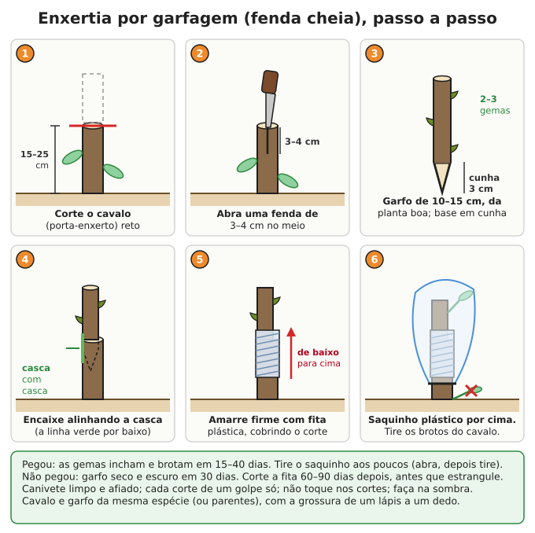
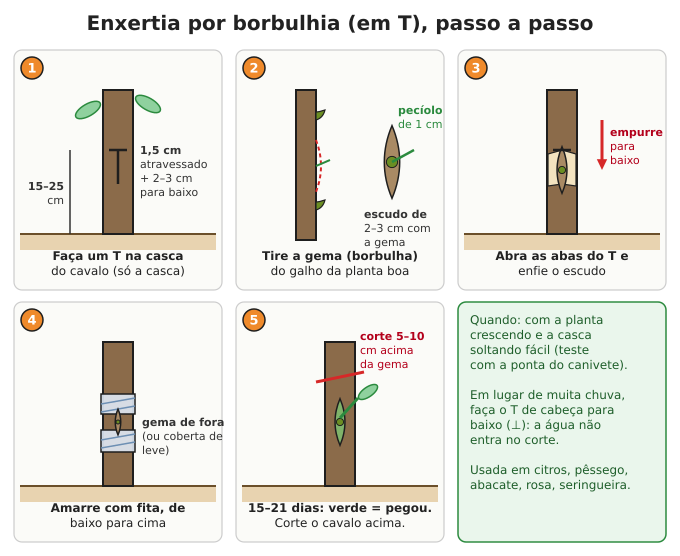
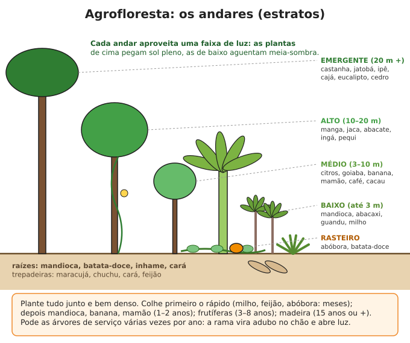

# Frutíferas e agrofloresta

**Resumo:** plante frutíferas **já**: mamão, maracujá e banana produzem em menos de 1–1,5 ano;
a maioria das árvores enxertadas em 2–4 anos; de semente, 5–10 anos. **Enxertia** (garfagem e
borbulhia) faz a árvore dar frutos iguais aos da mãe e mais cedo. Na **agrofloresta**, planta-se
tudo junto em andares — roça, banana, frutíferas, árvores de adubo e de lenha — imitando a mata:
o solo melhora sozinho e a colheita vem o ano todo. No Brasil o sol passa ao **norte**: árvores
altas no lado **sul** do terreno.

---

## 1. Frutíferas por região e tempo até produzir

Regiões: **N** Norte, **NE** Nordeste, **SA** Semiárido, **CO** Centro-Oeste, **SE** Sudeste,
**S** Sul. "Enx." = muda enxertada.

| Fruta | Onde vai bem | Como fazer a muda | Produz em | Espaçamento |
|---|---|---|---|---|
| Mamão | Todas, sem geada | Semente (3 por cova; deixe a de fruto alongado) | 8–12 meses | 3 × 2 m |
| Maracujá | Todas, sem geada | Semente ou estaca | 6–10 meses | 3 × 3–5 m (latada/espaldeira) |
| Banana | Todas, sem geada forte | Muda (rebento) | 12–18 meses | 3 × 2–3 m |
| Abacaxi | N, NE, CO, SE | Coroa, filhote | 14–24 meses | 0,9 × 0,3 m |
| Acerola | Todas, quente | Estaca ou semente | 1–2 anos | 4 × 4 m |
| Goiaba | Todas | Semente (3–4 anos), estaca ou alporquia | 1,5–2 anos | 6 × 5 m |
| Pitanga | Todas | Semente | 2–4 anos | 4–5 m |
| Amora | S, SE, CO | Estaca | 1 ano | 3 × 2 m |
| Figo | S, SE | Estaca | 1–2 anos | 3 × 2–3 m |
| Uva | S, SE, NE (com rega) | Estaca ou enxertia | 2–3 anos | 2,5 × 2 m (latada) |
| Citros (laranja, limão, tangerina) | Todas | Enx. sobre limão-cravo | 2–4 anos (semente 6–8) | 6 × 4 m |
| Manga | N, NE, CO, SE, norte do PR | Enx. (ou semente das poliembriônicas) | 3–4 anos (semente 5–8) | 8–10 m |
| Abacate | SE, CO, S, NE | Enx. | 3–4 anos (semente 5–8) | 8 × 8 m |
| Jaca | N, NE, SE (quente úmido) | Semente | 4–7 anos | 8–10 m |
| Caju | NE, N, CO | Semente ou enx. (anão precoce) | 2–3 anos (anão); 4–6 (comum) | 7 × 7 m |
| Coco | Litoral NE e N, quente | Coco germinado | 2–4 anos (anão); 5–7 (gigante) | 7,5–9 m em triângulo |
| Jabuticaba | SE, S, CO | Semente (repete a mãe), enx., alporquia | 3–5 anos (enx.); 8–15 (semente) | 6–8 m |
| Graviola, pinha (fruta-do-conde) | N, NE, quente | Semente | 2–4 anos | 5 × 5 m |
| Carambola | N, NE, SE, CO | Enx. ou semente | 2–3 anos (enx.) | 6 × 6 m |
| Cajá, seriguela | N, NE | **Estacão** (galho de 1–2 m) | 2–3 anos | 8 m |
| Umbu | SA | Semente (7–10 anos), enx. (3–4) | — | 10 m |
| Tamarindo | NE, quente | Semente | 6–8 anos (enx. 3–4) | 10 m |
| Pequi, baru, mangaba | CO (Cerrado), NE | Semente | 5–8 anos | 7–10 m |
| Açaí, cupuaçu, pupunha | N (pupunha também SE úmido) | Semente | 3–4 anos | 5 × 5 m |
| Castanha-do-pará | N | Semente ou enx. | 8–12 anos (enx.) | 10–20 m |
| Pinhão (araucária) | S, serras do SE | Semente | 12–15 anos | 8 m |
| Pêssego, ameixa, maçã, pera, caqui | S, serras do SE (frio) | Enx. | 3–4 anos | 5–6 × 4 m |
| Macadâmia, noz-pecã | S, SE | Enx. | 4–8 anos | 8–10 m |
| Moringa (folhas) | NE, SA, CO, SE | Semente ou estaca | Folhas em meses | Cerca ou 3 × 3 m |

> **ATENÇÃO:** a **castanha de caju crua** tem um óleo na casca (líquido da castanha) que **queima
> a pele, os olhos e a boca**. Torre ao ar livre, em lata furada, longe do rosto (a fumaça é
> irritante), e só então quebre. **Pequi:** o caroço tem **espinhos finos** — roa só a polpa por
> fora, nunca morda. **Baru:** coma a castanha torrada, não crua.

### Plantar uma muda
1. **Cova de 40 × 40 × 40 cm** (60 × 60 × 60 em solo ruim), de preferência 30 dias antes. Separe a
   terra de cima (mais fértil).
2. Misture à terra de cima: **10–20 L de esterco curtido ou composto + 200–300 g de calcário +
   200–500 g de farinha de ossos** (ou cinza de osso).
3. Plante no **início das chuvas**, com o **colo** (onde a raiz encontra o caule) no nível do chão
   e o **enxerto bem acima** da terra.
4. Tutor (estaca) amarrado em "8", bacia de 1 m de raio em volta, cobertura morta de 10–20 cm sem
   encostar no tronco.
5. Regue **10–20 L duas vezes por semana** sem chuva no 1º ano ([Irrigação](07-irrigacao.md)).
6. Proteja de formigas (cone de plástico no caule) e de animais (cerquinha de bambu).

## 2. Propagação

### Por semente
- Lave a polpa, plante **logo** em saquinho de 15 × 25 cm com terra e composto. Sementes de manga,
  abacate, jaca, jabuticaba, citros, pitanga, cacau e açaí **morrem se secarem**.
- A árvore de semente **pode dar fruto diferente da mãe** e demora mais. Exceções que repetem a mãe
  (poliembriônicas): **manga Ubá, Espada, Rosa e outras "de fiapo"**, quase todos os **citros**
  (limão-cravo, por exemplo) e a **jabuticaba**.
- Mudas de semente são ótimas **porta-enxertos (cavalos)**: rústicas e de raiz funda.

### Por estaca
1. Galho **semimaduro** (nem verde mole nem lenhoso velho), da grossura de um lápis, **15–25 cm**,
   com 3–4 gemas.
2. Corte em bisel logo abaixo de uma gema; tire as folhas, deixando 2 metades de folha no topo.
3. Enterre **2/3** em areia ou terra com areia, úmida, **à sombra** (50%). Cubra com garrafa PET
   cortada (câmara úmida).
4. **Enraizador caseiro:** pique galhos novos de **salgueiro (chorão)**, deixe 24–48 h de molho em
   água e deixe as estacas nessa água 12–24 h antes de plantar.
5. Enraíza em **30–60 dias** (brota e resiste a um puxão leve).
- Pegam fácil: amora, figo, acerola, uva, maracujá, romã, hibisco, moringa, pitaya. **Estacão**
  (galho grosso de 1–2 m enterrado 40–50 cm): seriguela, cajá, gliricídia, amoreira — já vira
  árvore ou mourão vivo.

### Alporquia (alporque)
1. Num galho de **1–2 cm** de grossura, tire um **anel de casca de 2–3 cm** de largura, raspando até
   a madeira (tire a película verde).
2. Envolva com um **punhado de musgo, terra ou serragem com composto úmidos** (bola de ~10 cm).
3. Embrulhe com plástico, amarre as duas pontas; se puder, cubra com jornal ou papel para escurecer.
4. Mantenha úmido (injete água com seringa se secar).
5. Em **30–90 dias** as raízes aparecem pelo plástico: corte o galho abaixo, plante num saco,
   tire metade das folhas e deixe 2–4 semanas à sombra.
- Para lichia, jabuticaba, goiaba, acerola, citros, pitanga, figo, romã.

### Mergulhia
Dobre um galho baixo até o chão, raspe a casca na parte que vai ficar enterrada, enterre
**10–15 cm** prendendo com forquilha ou pedra, com a ponta para fora e para cima. Em **2–3 meses**
enraíza: corte da mãe. Para uva, maracujá, amora, jasmim, café.

## 3. Enxertia

**Por que enxertar:** o fruto sai **igual ao da árvore escolhida**, produz em **2–4 anos** em vez de
5–10, e o porta-enxerto (cavalo) dá raiz forte e resistente.

**Combinações que pegam** (mesma espécie ou parentes próximos): citros sobre **limão-cravo**;
manga sobre manga; abacate sobre abacate; goiaba sobre goiaba; caju sobre caju; jabuticaba sobre
jabuticaba; pêssego e ameixa sobre pessegueiro; caqui sobre caqui; maracujá sobre maracujá;
**cajá, seriguela e umbu-cajá sobre umbuzeiro** (raiz que guarda água: ótimo no Semiárido).

**Ferramenta:** canivete **bem afiado e limpo** (passe álcool), fita plástica de enxertia ou tiras
de saco plástico de 1–2 cm, saquinhos plásticos transparentes.

### Garfagem em fenda cheia

**Época:** fim do inverno e começo da primavera (antes da brotação) nas frutíferas de clima frio;
nas tropicais, com a planta crescendo e tempo úmido (início das chuvas). Evite dias muito quentes.

1. **Cavalo:** muda de 6–18 meses, sadia, com grossura de lápis a dedo (0,8–2 cm). Corte reto a
   **15–25 cm do chão**.
2. **Fenda:** com o canivete, abra uma fenda de **3–4 cm** no meio do toco.
3. **Garfo:** ponta de ramo maduro da planta boa, **mesma grossura**, **10–15 cm** com **2–3
   gemas**, sem folhas (deixe o pezinho da folha). Em manga e abacate, corte as folhas do ramo na
   planta-mãe **10 dias antes** (as gemas incham e pegam melhor). Faça na base uma **cunha** de
   **3 cm**, com dois cortes lisos de um golpe cada.
4. **Encaixe:** enfie a cunha na fenda. **A casca do garfo tem de encostar na casca do cavalo** (é
   a camada verde logo abaixo da casca que solda). Se o garfo for mais fino, encoste num lado só.
5. **Amarre** firme com fita, **de baixo para cima**, cobrindo toda a fenda e o corte do topo.
6. **Saquinho plástico** por cima, amarrado abaixo do enxerto (câmara úmida); sombreie com papel ou
   folha se pegar sol forte.
7. **Brota em 15–40 dias.** Abra o saquinho um dia, tire no outro. Garfo **seco e escuro** em 30 dias
   = não pegou: re-enxerte mais abaixo.
8. **Tire os brotos do cavalo** (abaixo do enxerto) toda semana: eles roubam a força do enxerto.
9. **Corte a fita 60–90 dias depois**, antes que estrangule. Amarre o broto novo num tutor.

Trabalhe rápido (cortes não podem secar), na sombra, sem chuva, e sem tocar com os dedos nas
partes cortadas.

### Borbulhia em T

**Época:** com a planta crescendo e a **casca soltando fácil** (teste com a ponta do canivete).
Gasta só uma gema por muda: com um ramo se fazem dezenas. Usada em citros, pêssego, abacate,
roseira, seringueira.

1. No cavalo (0,8–1,5 cm), a **15–25 cm do chão** (citros: 20 cm ou mais), faça um **T na casca**:
   corte atravessado de **1,5 cm** e corte de **2–3 cm** descendo do meio dele. Só a casca, sem
   ferir a madeira. Em lugar muito chuvoso, faça o **T de cabeça para baixo (⊥)**.
2. No ramo da planta boa, tire a **borbulha**: um **escudo de casca de 2–3 cm com a gema no meio**,
   cortado de baixo para cima com uma lasquinha de madeira. Deixe **1 cm do cabinho da folha** para
   segurar.
3. Abra as abas do T com a espátula do canivete e **empurre o escudo de cima para baixo** até ficar
   todo dentro. Corte o que sobrar em cima.
4. **Amarre** com fita de baixo para cima, apertando (deixe a gema de fora, ou cubra de leve em
   citros e retire depois).
5. **15–21 dias:** escudo **verde** e cabinho que **cai ao toque** = pegou. Escuro e seco = falhou.
   Tire a fita.
6. **Force a gema a brotar:** corte o cavalo **5–10 cm acima** da borbulha (ou dobre-o). Quando o
   broto firmar, corte o toco rente, em bisel, acima do enxerto. Tire os brotos do cavalo.

## 4. Poda

- **Formação (1º e 2º ano):** corte a muda a **50–80 cm** do chão e escolha **3–4 galhos** bem
  distribuídos em volta (a "taça"); tire os galhos abaixo de 40–50 cm.
- **Limpeza (todo ano):** tire galhos **secos, doentes, quebrados, cruzados, voltados para dentro**,
  **ladrões** (ramos verticais muito vigorosos) e brotos do cavalo. A copa deve deixar passar luz.
- **Época:** frutíferas que perdem folha (pêssego, uva, figo, caqui) no **inverno**; tropicais
  (goiaba, acerola, citros, manga) **depois da colheita** ou no início das chuvas. Não pode em
  plena floração nem em frio forte.
- **Como cortar:** tesoura ou serrote afiado e limpo; corte **rente ao "colar"** (a ruga na base do
  galho), sem deixar toco e sem ferir o tronco. Galho grosso em **3 cortes**: um por baixo, a 30 cm
  do tronco; outro por cima, um pouco mais para fora (o galho cai sem lascar); depois o toco, rente
  ao colar. Cortes de mais de 3 cm: cubra com pasta de calda bordalesa ou tinta à base de água.
- **Podas de produção:** **goiaba** produz em ramos novos — podar os ramos que já produziram dá
  nova florada em ~6 meses (dá para escalonar). **Figo:** no inverno, encurte os ramos do ano
  deixando 2–3 gemas. **Uva:** poda curta (2 gemas) ou longa conforme a variedade. **Maracujá:** uma
  haste até o arame, depois 2 ramos laterais formando cortina.
- **Raleio de frutos** (pêssego, goiaba, manga carregada): deixe 1 fruto a cada 10–15 cm — frutos
  maiores e galhos sem quebrar.
- **Bananeira:** veja o desbaste em [Culturas principais](04-culturas-principais.md).

## 5. Agrofloresta (sistema agroflorestal)

Planta-se **muitas espécies juntas, bem adensadas**, que ocupam **andares diferentes** e **tempos
diferentes**, como numa mata. As árvores de serviço são **podadas várias vezes por ano**: a rama
vira adubo e cobertura no chão e abre luz para as de baixo.

### Andares (estratos)
| Andar | Exemplos | Luz |
|---|---|---|
| Emergente (20 m ou +) | Castanha, jatobá, ipê, cajá, cedro, eucalipto | Sol pleno |
| Alto (10–20 m) | Manga, jaca, abacate, ingá, pequi | Muito sol |
| Médio (3–10 m) | Citros, goiaba, banana, mamão, café, cacau | Sol a meia-sombra |
| Baixo (até 3 m) | Mandioca, abacaxi, guandu, milho, quiabo | Meia-sombra a sol |
| Rasteiro | Abóbora, batata-doce, feijão-de-porco, amendoim | O que sobrar |
| Trepadeiras e raízes | Maracujá, chuchu, cará, feijão-fava; mandioca, inhame, batata-doce | — |

### Tempo (sucessão)
- **0–1 ano:** milho, feijão, abóbora, mandioca, mamão, guandu (colheita rápida e sombra para as
  mudinhas).
- **1–5 anos:** banana, mandioca, abacaxi, maracujá, citros e goiaba começando.
- **5–15 anos:** frutíferas grandes (manga, jaca, abacate), café/cacau à sombra.
- **15 anos ou mais:** madeira, castanhas.

### Um módulo para começar (repita a cada 5 m)
1. **Linha de árvores** (1 m de largura, em curva de nível), adubada e coberta de palha:
   - **banana a cada 3 m**;
   - entre as bananas, alternando a cada 1 m: **uma árvore de serviço** (gliricídia, ingá, guandu,
     margaridão, eucalipto) e, a cada 4–6 m, **uma frutífera** (citros, abacate, manga, jaca);
   - **mandioca e abacaxi** preenchendo; **abóbora ou feijão-de-porco** no chão; **maracujá** subindo
     nas árvores de serviço.
2. **Entrelinha de 4 m:** no 1º ano, **milho + feijão + abóbora**; depois mandioca, batata-doce ou
   adubação verde; quando sombrear, capim (mombaça, capim-elefante) **cortado para cobertura**.
3. **Manejo:** pode as árvores de serviço quando sombrearem demais (2–4 vezes por ano), picando os
   galhos sobre o chão; tire bananeiras velhas; replante o que morrer.

**Consórcio clássico do primeiro ano:** banana 3 × 3 m + mandioca 1 × 1 m entre elas + milho em covas
a cada 1 × 0,5 m nas entrelinhas + mudas de frutíferas e gliricídia no meio.

### Quebra-vento
- Fileira de árvores **atravessada ao vento dominante**: protege uma faixa de **até 10–15 vezes a
  sua altura** do lado de baixo, reduzindo o vento pela metade (menos água perdida, menos planta
  quebrada).
- **2–3 fileiras** com plantas de alturas diferentes. Deve ser **meio aberta** (deixar passar ~40%
  do vento): parede fechada cria redemoinho.
- Espécies: bananeira, cana, capim-elefante (rápidos); gliricídia, sansão-do-campo (sabiá), leucena,
  grevílea (Sul/Sudeste), eucalipto, bambu (cuidado: alastra).

### Cerca viva
- **Gliricídia:** **mourão vivo** — estacas de **2–2,5 m** e 5–10 cm de grossura enterradas
  **40–50 cm** no início das chuvas, a cada 1,5–2 m, segurando o arame. Leguminosa (aduba),
  rebrota após poda, folhas para forragem (cabras e vacas, misturada a outros capins). As sementes,
  casca e raiz são tóxicas para ratos (antigo "mata-rato"): não para pessoas comerem.
- **Sansão-do-campo (sabiá):** espinhento, vira cerca fechada contra animais em 2–3 anos; mudas de
  semente (mergulhe as sementes em água quente e deixe esfriar de um dia para o outro) a cada
  0,5–1 m. Dá estacas duráveis e lenha. Nativo do Nordeste.
- No Semiárido: **mandacaru, palma, sisal** (o sisal também dá fibra para corda —
  [Cordas e cestaria](../09-quimica-e-oficios/03-cordas-nos-e-cestaria.md)).
- **Evite** pinhão-roxo/pinhão-manso e aveloz em cerca perto de casa e crianças (venenosos —
  [Plantas medicinais](../02-saude/05-plantas-medicinais.md)).

### Árvores de serviço (adubo, forragem, lenha)

| Árvore | Para quê | Manejo | Cuidado |
|---|---|---|---|
| **Gliricídia** | Adubo verde, forragem, mourão vivo | Corte a 1,5–2 m, 2–4 vezes por ano | — |
| **Leucena** | Forragem rica em proteína, adubo, lenha | Corte a 0,5–1 m a cada 60–90 dias nas chuvas | Mimosina: no máximo 1/3 da comida de ruminantes; **tóxica para cavalo, porco, coelho e aves** em quantidade; **vira praga** se deixar sementar |
| **Guandu** | Grão, forragem, adubo, quebra camada dura | Pode após cada colheita; dura 2–4 anos | — |
| **Ingá** | Fruta, sombra para café/cacau, adubo | Poda forte anual | — |
| **Margaridão** (*Tithonia*) | Muita biomassa rica em nutrientes | Estaca; corte a cada 60–90 dias | — |
| **Moringa** | Folhas comestíveis, sementes que clareiam água | Pode a 1–1,5 m | — |
| **Eucalipto** | Lenha, mourão, madeira (cresce 2–3 m/ano) | Corte com 5–7 anos; rebrota da touça 2–3 vezes | Bebe muita água: **longe de nascentes e da horta** (20 m ou mais) |
| **Bracatinga** | Lenha em 3–5 anos (Sul e serras frias), leguminosa | Corte raso; renasce de semente | — |
| **Sabiá, jurema-preta** | Lenha e estacas no Nordeste e Semiárido | Rebrotam após corte | — |
| **Algaroba** | Vagens para animais, lenha (Semiárido) | — | **Invasora** agressiva: plante pouco e controle |

**Lenha para a família:** cozinhar a lenha gasta uns **5–10 kg por dia** (2–4 toneladas por ano;
metade em fogão eficiente). Um bosque de **1.000–2.000 m²** de eucalipto, bracatinga ou sabiá,
cortado em rodízio (1/5 da área por ano), dá conta ([Lenha e fogões](../06-energia/02-lenha-carvao-e-fogoes.md)).

## 6. Quintal pequeno produtivo (100–300 m²)

Exemplo para um quintal de 10 × 20 m:
1. **Perto da porta da cozinha:** temperos, folhosas e plantas medicinais em canteiros ou vasos
   (o que se usa todo dia, mais perto).
2. **Horta de 30–50 m²** no lado **mais ensolarado (norte)**.
3. **Árvores no lado sul e nos cantos**, de porte pequeno a médio: 1 citros, 1 acerola, 1 pitanga ou
   jabuticaba, 1 goiaba, 2 mamões. Evite mangueira, jaqueira e abacateiro em quintal pequeno (ficam
   enormes) — ou mantenha-os podados baixos.
4. **Círculo de bananeiras** (3–4 touceiras) recebendo a água da pia e do tanque.
5. **Trepadeiras** em muros e cercas: maracujá, chuchu, maxixe, feijão-de-corda, cará.
6. **4–6 galinhas** num galinheiro com piquete, comendo restos e adubando
   ([Galinhas](../05-animais/02-galinhas.md)); **composteira** e **minhocário** num canto sombreado.
7. **Captação** de chuva do telhado para regar ([Irrigação](07-irrigacao.md)).

Um quintal assim dá verduras todo dia, frutas boa parte do ano, ovos e adubo — mas **não
substitui** a roça de calorias ([Culturas principais](04-culturas-principais.md)).

---

Ver também: [Sementes](02-sementes.md) · [Culturas principais](04-culturas-principais.md) · [Pragas e doenças](06-pragas-e-doencas.md) · [Irrigação](07-irrigacao.md) · [Lenha, carvão e fogões](../06-energia/02-lenha-carvao-e-fogoes.md) · [Cabras e ovelhas](../05-animais/05-cabras-e-ovelhas.md) · [Abelhas](../05-animais/09-abelhas.md)
