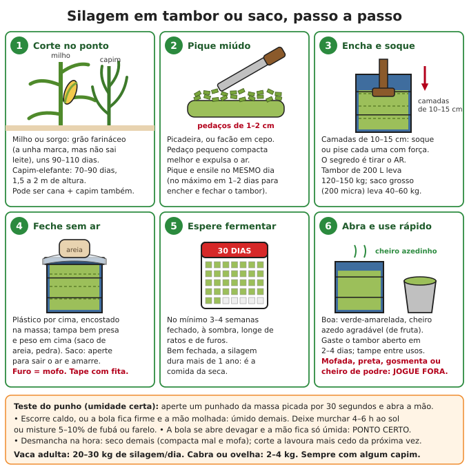

# Princípios gerais da criação de animais

**Resumo:** escolha os animais pelo que você tem de **espaço, água e comida na seca**, não pelo
que gostaria de ter. Comece pelas **galinhas**, depois **coelhos ou peixes**, depois **porcos ou
cabras** e só então **vacas**. Toda criação se apoia em cinco pilares: abrigo seco e sombreado,
água limpa à vontade, comida o ano inteiro (silagem, feno e cana para a seca), prevenção de
doenças (quarentena, limpeza, vacinas) e troca de reprodutores para evitar a consanguinidade.

---

## 1. Como escolher quais animais criar

### Perguntas antes de comprar qualquer animal
1. **Para quê?** Ovos e carne rápida (galinha, codorna, coelho), leite (cabra, vaca), banha e
   carne (porco), força (boi, burro, cavalo), lã (ovelha lanada), mel e polinização (abelhas),
   alarme e guarda (cão, ganso, galinha-d'angola).
2. **Quanto espaço?** Quintal: galinhas, codornas, coelhos. Chácara de 1 ha: some porcos, cabras,
   peixes. Sítio de 5 ha ou mais com pasto formado: vacas.
3. **Quanta água sobra na pior seca?** Uma vaca bebe 40–100 L por dia; dez galinhas, 3 L.
   Pouca água = fique nos animais pequenos.
4. **Que comida você produz na seca?** O gargalo é sempre a seca (maio a setembro no Centro-Oeste
   e Sudeste; 7 a 9 meses por ano no semiárido). Planeje silagem, feno, cana e capineira **antes**
   de aumentar o rebanho.
5. **Clima:** calor úmido favorece zebuínos (Nelore, Gir), cabras e ovelhas deslanadas, galinhas
   de pescoço pelado e porcos de raças locais. O frio do Sul favorece raças europeias e ovelhas lanadas.
6. **Quem cuida todo dia?** Animal não tem feriado. Vaca de leite = ordenha 1 ou 2 vezes por dia,
   todos os dias, no mesmo horário.

### Tabela comparativa (médias de criação caseira bem feita)

| Animal | Espaço | Comida/dia (adulto) | Água/dia | Até produzir | Produção por ano | Dificuldade |
|---|---|---|---|---|---|---|
| Galinha caipira | 0,2–0,3 m² no galinheiro + 3–10 m² de piquete | 100–130 g de ração ou grão + verde | 0,2–0,5 L | ovos aos 5–6 meses; frango aos 3–4 meses | 80–250 ovos (conforme raça); frango de 1,5–2,5 kg | Fácil |
| Codorna | 130–160 cm² de gaiola | 25–30 g de ração | 40–60 mL | ovos aos 40–45 dias | 250–300 ovos (5 valem 1 de galinha) | Fácil, mas exige ração rica |
| Coelho (1 coelha) | gaiola de 80 × 60 cm | 150–350 g de ração ou 0,5–1,5 kg de verde + feno | 0,3–1,5 L | 1ª cria aos 5–6 meses; abate aos 70–90 dias | 25–40 filhotes = 30–50 kg de carcaça | Fácil a média |
| Peixe (tilápia) | 1–2 peixes por m² de viveiro | 1–3% do peso vivo em ração | vive na água | 6–8 meses até 500 g | 0,3–0,6 kg de peixe por m² de viveiro | Média |
| Porco | porca 6–8 m²; engorda 1 m² por cabeça | 2–3 kg (engorda); 5–7 kg (porca amamentando) | 10–20 L (porca amamentando 25–40) | leitoa cobre aos 7–8 meses; engorda 5–10 meses | porca: 12–20 leitões; porco de 100 kg ≈ 75 kg de carcaça | Média |
| Cabra leiteira | 1–1,5 m² de aprisco + ramoneio/pasto | 6–10 kg de forragem verde (+ concentrado se der muito leite) | 4–10 L | 1º leite aos 13–17 meses | 1–3 L/dia por 6–10 meses; 1–2 cabritos | Média |
| Ovelha | 1 m² de aprisco + pasto | 5–8 kg de capim verde | 4–8 L | 1ª cria aos 13–17 meses | 1–2 cordeiros (até 3 partos em 2 anos) | Média |
| Vaca | 1–3 ha de pasto (conforme o pasto) | 40–60 kg de capim verde + 60–100 g de sal mineral | 40–60 L (leiteira 60–100) | 1ª cria aos 2–3 anos | 1 bezerro; 3–12 L de leite/dia por 7–10 meses | Alta |

### Ordem recomendada para começar
1. **Galinhas (mês 0).** Baratas, comem restos e insetos, dão carne em 3 meses e ovos em 5–6.
   Erros custam pouco. Comece com 10–20 galinhas e 1–2 galos. Veja [Galinhas](02-galinhas.md).
2. **Coelhos e/ou peixes (a partir do 3º–6º mês).** Carne frequente com pouca comida: o coelho
   vive de capim e folhas; o viveiro aproveita água de chuva. Veja [Coelhos](06-coelhos.md) e
   [Peixes](08-peixes.md).
3. **Porcos ou cabras (ano 1).** O porco transforma restos, mandioca e soro em carne e banha;
   a cabra dá leite com galhos e capim em área pequena e seca.
4. **Vacas (ano 2 em diante).** Só com pasto formado, cerca, curral, água farta e comida guardada
   para a seca. Uma vaca exige mais que todos os anteriores juntos.
5. **Abelhas** entram a qualquer momento: pouco trabalho, mel, cera e polinização da horta.

**Conta da seca (exemplo):** 2 vacas × 150 dias de seca × 35 kg/dia = **10,5 toneladas** de
volumoso guardado (silagem, cana, capim). Isso pede cerca de **1.000–1.500 m² de cana ou
capineira bem adubada**, ou 3 mil m² de milho para silagem. Faça essa conta para cada espécie.

## 2. Instalações básicas

- **Local:** terreno firme, com leve caimento (a água escorre), **pelo menos 30 m** de poços,
  nascentes e cisternas e, se possível, **abaixo** deles. Perto da casa para ouvir alarme de
  predador e não carregar água longe.
- **Orientação:** construções compridas no sentido **leste-oeste** (o sol entra pouco). Pé-direito
  de 2,5–3 m, telha de barro ou palha, beiral de 50 cm a 1 m. No Brasil, **calor mata mais
  animal do que frio**: sombra de árvore vale ouro.
- **Piso seco:** chão batido elevado com cama de palha, piso de ripas (cabras e ovelhas) ou
  cimento com caimento de 2–5% (porcos). Barro permanente = casco podre, verme e diarreia.
- **Separe:** maternidade; **enfermaria/quarentena** a 50 m ou mais do resto; depósito de ração
  à prova de rato (tambor com tampa); esterqueira ou composteira.
- **Materiais:** bambu, eucalipto, madeira roliça, tijolo, adobe, telha, sapé e tela. Veja
  [Madeira e carpintaria](../07-abrigo-e-construcao/03-madeira-e-carpintaria.md) e
  [Construção com terra](../07-abrigo-e-construcao/02-construcao-com-terra.md).

### Esterco: o subproduto mais valioso

| Animal | Esterco por dia (aprox.) | Uso |
|---|---|---|
| Vaca adulta | 20–30 kg (+ urina) | composto, biogás, horta depois de curtido |
| Porco de engorda | 2–4 kg (+ urina) | biogás, composto (nunca cru na horta) |
| Cabra ou ovelha | 1–2 kg | ótimo, seco (cíbalas), curte rápido |
| Coelho | 0,1–0,2 kg | pode ir quase direto no canteiro; minhocário |
| Galinha | 0,1–0,15 kg | muito forte (nitrogênio): curtir 2–3 meses |

Curtir = compostar até não ter cheiro nem calor. Veja
[Solo, adubação e compostagem](../04-agricultura/01-solo-adubacao-compostagem.md) e
[Biogás](../06-energia/07-biogas.md).

## 3. Cercas

| Tipo | Para quem | Como fazer |
|---|---|---|
| Arame farpado | bovinos (fere cavalos) | 4–5 fios; altura 1,3–1,5 m; 1º fio a 30–40 cm do chão; mourões a cada 2,5–3 m, ou a cada 8–10 m com balancins (separadores de madeira ou arame) a cada 2–2,5 m |
| Arame liso | bovinos e equinos | 5–9 fios bem esticados (catraca/esticador); mourões a cada 10–15 m com balancins; não fere o couro |
| Tela | cabras, ovelhas, porcos, aves | tela campestre (ovelheira) de 1–1,2 m + 1 fio farpado em cima; porco: + 1 fio rente ao chão (15 cm); aves: tela de 1,8–2 m |
| Cerca elétrica | todos (barata e rápida) | eletrificador (pode ser solar 12 V) + aterramento com 3 hastes; bovino: 1 fio a 80–90 cm; porco: fios a 20 e 40 cm; cabra/ovelha: 4–5 fios de 20 a 90 cm |
| Cerca viva | divisas e quebra-vento | sabiá (sansão-do-campo) em mudas a cada 40–50 cm; gliricídia como mourão vivo |

### Como fazer bem
1. **Mourões de canto e de porteira** são os que seguram a cerca: mais grossos (15–20 cm),
   enterrados **1 m**, com escora inclinada. Mourões comuns: 10–15 cm, enterrados 60–80 cm.
2. **Madeira:** eucalipto tratado, aroeira, sabiá, ipê, braúna. Madeira comum enterrada apodrece
   em 2–4 anos; tostar no fogo a parte que vai enterrada (e 20 cm acima) ajuda um pouco.
3. **Mourão vivo de gliricídia:** no começo das chuvas, enterre 40–50 cm estacas de 2–2,5 m e
   5–10 cm de grossura. Elas brotam, viram mourões permanentes e dão folha para o gado.
4. **Contra raposa, gambá e cachorro (aves):** enterre a tela 30–40 cm, ou deite uma "saia" de
   tela de 50 cm no chão, virada para fora, presa com estacas. Veja [Galinhas](02-galinhas.md).
5. **Piquetes:** divida o pasto em várias áreas para fazer rodízio (pastejo rotacionado): o capim
   descansa e rebrota, e o ciclo dos vermes é quebrado. Esquema e alturas de entrada e saída em
   [Bovinos](03-bovinos.md).

> **ATENÇÃO:** cerca elétrica **só com eletrificador próprio** (pulsos curtos). Nunca ligue um
> fio de cerca direto na tomada ou num inversor: **mata gente e animal**. Não use em cerca de
> arame farpado (animal preso no farpado eletrificado se mutila). Avise crianças.

> **ATENÇÃO:** pinhão-manso, avelós (aveloz), mamona e espirradeira são usados como cerca viva,
> mas são **venenosos**. Não plante onde os animais alcançam.

## 4. Alimentação

### Volumoso e concentrado
- **Volumoso:** capim, folhas, palhada, feno, silagem, cana. É a base de vacas, cabras, ovelhas,
  cavalos e coelhos (ruminantes e herbívoros).
- **Concentrado:** grãos (milho, sorgo), farelos (soja, trigo, algodão), raízes (mandioca,
  batata-doce). É a base de galinhas e porcos e o reforço de quem produz muito leite.
- **Mude a dieta devagar, em 7–10 dias.** Grão demais de repente mata ruminante (acidose) e
  provoca diarreia em todos.
- **Proteína é o que mais falta** no fim do mundo: plante leguminosas (abaixo), crie minhocas e
  larvas para as aves e guarde farelos.

### Pasto
| Capim | Onde vai bem | Observação |
|---|---|---|
| Braquiarão (Marandu) | solos médios, Cerrado | resiste à seca e à cigarrinha; o mais usado |
| Braquiária decumbens | solos fracos e ácidos | pode causar fotossensibilização (pele queimada) em ovelhas, cabras e bezerros |
| Humidícola | solos encharcados | pouco valor nutritivo, mas cobre bem o chão |
| Mombaça, Tanzânia | solos férteis ou adubados | muito produtivos; exigem adubo e rodízio |
| Tifton, coastcross, estrela | solos bons | ótimos para feno e para cavalos |
| Aveia e azevém | inverno do Sul | plantados em abril–maio, pastejados no frio |

Formação e adubação: [Solo e adubação](../04-agricultura/01-solo-adubacao-compostagem.md).

### Capineira (capim-elefante ou napier) — comida cortada e levada ao cocho
1. Escolha solo fértil, **perto do curral** (você vai carregar capim todo dia).
2. Abra sulcos de **20 cm** de fundura, com **80 cm a 1 m** entre eles.
3. Ponha **10–20 t de esterco curtido por hectare** (1–2 kg por metro de sulco).
4. Plante **colmos maduros** (canas de 100–120 dias) inteiros, deitados no sulco, **pé com ponta**
   (a base de um ao lado da ponta do outro), cobertos com 5–10 cm de terra, no início das chuvas.
5. Primeiro corte com 90–120 dias. Depois, corte a cada **50–60 dias nas águas** (1,5–1,8 m de
   altura), **rente ao chão** (até 10 cm). Capim novo tem mais proteína; capim velho é só fibra.
6. Pique em pedaços de 1–3 cm (picadeira ou facão em cepo) e dê no mesmo dia.
7. Reponha esterco depois de cada 2–3 cortes.

- Cultivares: napier, cameroon, **BRS Capiaçu** (muito produtiva, ótima para silagem),
  **BRS Kurumi** (baixa, para pastejo).
- **Conta:** cerca de **1.000–1.500 m² por vaca** no cocho, ensilando a sobra das águas para a seca.

### Cana-de-açúcar — a reserva viva da seca
- Produz 80–120 t por hectare e fica "guardada no pé" exatamente na seca (maio–outubro), quando
  está mais doce. Para 1 vaca × 150 dias × 20 kg = 3 t → **300–400 m² de cana**.
- **Pobre em proteína (2–3%) e em minerais:** sempre com mistura mineral e alguma proteína
  (leguminosa, farelo, ou ureia com todo o cuidado — veja [Bovinos](03-bovinos.md)).
- Corte, pique fino (1–2 cm) e dê **no mesmo dia** (azeda em 24–48 h).
- Quantidade: vaca 15–25 kg/dia junto com capim ou leguminosa; cabra ou ovelha 1–2 kg.

### Mandioca
- **Raiz:** energia, substitui parte do milho. Para porcos e aves: **cozida ou seca** (raspa
  picada e seca ao sol 2–3 dias). Para ruminantes: picada, até 1/3 da comida do dia.
- **Rama (parte de cima):** 15–20% de proteína quando seca. Feno de rama: corte o terço de cima
  da planta, pique e seque ao sol 2–3 dias, virando.

> **ATENÇÃO:** mandioca brava (amarga) e folhas frescas de qualquer mandioca têm ácido cianídrico.
> Nunca dê muita folha fresca a animal com fome. **Murche 24 h, seque ao sol ou ensile** (perde
> quase todo o veneno). Intoxicação: respiração rápida, tremores, mucosas vermelho-vivas, morte
> em minutos a horas. Veja [Veterinária básica](14-veterinaria-basica.md).

### Leguminosas forrageiras: o banco de proteína
| Planta | Uso | Cuidados |
|---|---|---|
| Leucena | folhas com 20–25% de proteína; corte a 1 m de altura a cada 60–90 dias | ruminantes: até 30% da dieta. **Não** para cavalos, burros, coelhos e porcos em quantidade (mimosina: perda de pelo e crina) |
| Guandu | folhas para ruminantes; grão para aves e porcos | grão **cozido ou tostado** |
| Gliricídia | folhas para ruminantes; mourão vivo | animais estranham o cheiro: murche e misture no início |
| Amendoim forrageiro | rasteiro, consorciado com o pasto | aceito por todos os animais |
| Estilosantes Campo Grande | consórcio com braquiária no Cerrado | semeie junto com o capim |
| Cunhã | trepadeira do semiárido | ótima em feno |
| Moringa, ora-pro-nóbis | folhas ricas para aves, porcos, coelhos e ruminantes | ora-pro-nóbis tem espinhos: corte com luva |

**Banco de proteína:** separe 10–20% da área para leguminosas; deixe os animais entrarem
1–2 horas por dia, ou corte e leve ao cocho.

**Palma forrageira** (semiárido): reserva de água e energia na seca. Dê **sempre com algo
fibroso** (capim seco, feno, bagaço): palma sozinha dá diarreia. Pode chegar à metade da dieta.

### Silagem em tambor ou saco (passo a passo)
Silagem é capim, milho ou sorgo picado e fechado sem ar: fermenta, fica azedinha e se conserva por
mais de um ano. É a melhor forma de guardar o capim que sobra nas chuvas para a seca.



1. **Corte no ponto:** milho ou sorgo com o grão **farináceo** (a unha marca o grão, mas não
   espirra leite), por volta de 90–110 dias; capim-elefante com 70–90 dias (1,5–2 m).
2. **Pique** em pedaços de 1–2 cm, no mesmo dia do corte.
3. **Teste do punho:** aperte um punhado por 30 segundos. Escorreu caldo ou a mão ficou molhada:
   úmido demais — deixe murchar 4–6 h ao sol ou misture 5–10% de fubá ou farelo. A bola se abre
   devagar e a mão fica só úmida: ponto certo.
4. **Encha em camadas de 10–15 cm**, socando ou pisando cada camada com força. O inimigo é o ar.
   Um tambor de 200 L leva 120–150 kg; um saco plástico grosso (200 micra), 40–60 kg.
5. **Feche:** plástico encostado na massa, tampa bem presa e peso por cima (saco de areia).
   No saco, aperte para sair o ar e amarre bem. Tape qualquer furo com fita.
6. **Espere pelo menos 3–4 semanas** à sombra, longe de ratos. Bem fechada, dura mais de 1 ano.
7. **Abra e use rápido:** gaste o tambor aberto em 2–4 dias, tampando entre os usos.
   Boa silagem: verde-amarelada, cheiro azedo agradável. Vaca come 20–30 kg/dia; cabra 2–4 kg.

**Rendimento:** 1.000 m² de milho bem adubado dão 3–4,5 t de silagem (20–30 tambores) — comida
para 1 vaca por 4–5 meses. Para muita silagem, faça **silo-trincheira** (vala com paredes
inclinadas, compactada e coberta com lona e terra): 1 m³ bem socado ≈ 600 kg.

> **ATENÇÃO:** silagem **mofada** (manchas brancas, azuis ou pretas), gosmenta ou com cheiro de
> podre ou amônia **vai fora** (enterre). Causa aborto, listeriose (cabra e ovelha andando em
> círculos) e botulismo. **Cavalos e burros** são muito sensíveis: dê só silagem perfeita, ou não dê.

### Feno
1. **Plantas:** capins finos (tifton, coastcross, estrela, braquiária nova, aveia), rama de
   mandioca, leucena, guandu, amendoim forrageiro, cunhã.
2. **Corte antes de florescer**, em período de 3 dias de sol firme, depois que o orvalho secar.
3. **Espalhe em camada fina** e vire 2–3 vezes por dia. Leguminosas: vire com cuidado (as folhas,
   que são o melhor, caem quando muito secas).
4. **Ponto (2–3 dias de sol):** torça um feixe com as duas mãos — deve **estalar e quebrar**, sem
   soltar umidade, e os nós dos talos não podem estar verdes e moles.
5. **Enfarde:** caixa de madeira sem fundo de 60 × 40 × 30 cm com 2 cordas passadas por baixo:
   encha, pise, amarre e tire a caixa. Ou faça **meda** (monte em volta de um mastro, sobre estrado,
   com a ponta coberta).
6. **Guarde** em galpão seco e ventilado, sobre estrados, longe do fogo e da casa.

- Consumo, só de feno: vaca 8–12 kg/dia; cabra ou ovelha 1,5–2 kg; cavalo 7–10 kg.

> **ATENÇÃO:** feno guardado úmido esquenta, mofa e pode **pegar fogo sozinho** dias depois
> (combustão espontânea). Se o interior do fardo ou da pilha estiver quente ao enfiar a mão,
> desmanche e espalhe para secar. Nunca guarde feno dentro de casa.

### Sal mineral
Os solos do Brasil são pobres em **fósforo**. Sem mistura mineral, o gado lambe e mastiga ossos,
madeira e terra, quebra ossos, não emprenha e morre de **botulismo** (comendo ossos de carcaças).

| Animal | Mistura mineral por dia | Observação |
|---|---|---|
| Bovino | 50–100 g (60–80 g por vaca de 450 kg) | cocho coberto, sempre com sal |
| Cabra ou ovelha | 10–20 g | ovelha: mineral **próprio para ovinos** (o de bovino tem cobre que pode intoxicar) |
| Cavalo, burro | 50–60 g | |
| Porco e aves | 0,3–0,5% de sal na ração (3–5 g por kg) | excesso mata se faltar água |

- **Cocho coberto** (a chuva dissolve e empedra), longe da água e da sombra onde o gado dorme,
  para ele andar pelo pasto.
- **Improviso sem mistura comprada:** sal comum + **farinha de osso calcinada** em partes iguais.
  Calcinar = queimar os ossos no fogo até ficarem brancos ou cinza e quebradiços, depois moer.
  **Nunca use osso cru ou mal queimado** (transmite botulismo).
- Guarde mistura mineral: seca e fechada, dura anos. Microminerais (cobre, cobalto, zinco,
  selênio) não se improvisam.

## 5. Água

| Animal | Litros por dia | No calor ou produzindo |
|---|---|---|
| Galinha | 0,2–0,3 | até 0,5 |
| Coelho | 0,3–0,5 | coelha com ninhada: 1–2 |
| Cabra ou ovelha | 3–6 | em lactação: 8–15 |
| Porco de engorda | 6–10 | 15–20 |
| Porca amamentando | 25–40 | |
| Cavalo, burro | 30–50 | trabalhando: 60 ou mais |
| Boi, vaca seca | 40–60 | 70 ou mais |
| Vaca leiteira | 60–100 | ≈ 4 L de água por litro de leite, além do básico |

- Água **sempre à vontade**, fresca e à sombra. Animal com pouca água come menos e produz menos.
- Lave bebedouros toda semana. Não deixe o gado entrar na nascente: **cerque** e leve a água por
  cano até um cocho com boia.
- No pasto, a água deve ficar a no máximo 500–800 m de qualquer ponto (o gado não anda mais que isso
  para beber sem perder peso).
- **Não deixe beber** água de açude com espuma ou nata verde-azulada em tempo quente
  (cianobactérias: matam em horas).
- Captação e caixas: [Encontrar e captar água](../01-agua/01-encontrar-e-captar-agua.md) e
  [Armazenamento e cálculos](../01-agua/03-armazenamento-e-calculos.md).

## 6. Sanidade preventiva

1. **Quarentena de 30 dias para todo animal que chega** (inclusive o que volta de feira ou de
   empréstimo): baia ou cercado a **50 m ou mais** do resto, sem dividir bebedouro, cocho ou
   ferramentas. Cuide dele **por último** no dia e lave as botas e as mãos depois. Nesse período:
   observe todo dia, vermifugue, trate carrapatos e piolhos, vacine. Só junte ao rebanho se ficou
   **30 dias sem nenhum sinal** de doença.
2. **Compre de quem você conhece.** Pergunte por vacinas, abortos, mortes e mastite. Nunca compre
   o animal barato e magro "para recuperar".
3. **Limpeza:** retire esterco 1–2 vezes por semana, mantenha a cama seca, lave bebedouros.
   Entre um lote e outro de aves ou porcos: limpe, caie e deixe **vazio 2–4 semanas** (vazio sanitário).
4. **Desinfecção barata:** caiação (1 kg de cal hidratada em 3–4 L de água, com um punhado de sal
   para fixar) nas paredes, poleiros e cochos; sol; água sanitária (1 copo em 10 L de água) em
   superfícies lisas. Pedilúvio com cal hidratada na porta da maternidade.
5. **Vacinas:** calendário em cada arquivo. Vacina precisa de geladeira (2–8 °C): **vacine enquanto
   há energia** e estoque vermífugos e antiparasitários, que duram mais fora da geladeira.
6. **Controle** ratos, moscas, morcegos-vampiros (raiva), cães soltos e aves silvestres no comedouro.
7. **Animal morto:** enterre a **1 m de profundidade** ou mais, com cal por cima, a 30 m ou mais da
   água — ou queime. Não dê carcaça de animal doente a cães e porcos. Use luvas.
8. **Olhe todo dia (o "olho do dono"):** animal isolado, sem comer, de cabeça baixa, pelo arrepiado,
   com diarreia, tosse, manqueira ou febre. Separe e examine logo.

| Temperatura normal (no reto) | °C |
|---|---|
| Bovino | 38,0–39,5 |
| Cabra, ovelha | 38,5–40,0 |
| Porco | 38,0–39,5 |
| Cavalo | 37,5–38,5 |
| Coelho | 38,5–40,0 |
| Galinha | 40,5–42,0 |

Exame, sinais vitais e tratamentos: [Veterinária básica](14-veterinaria-basica.md).

> **ATENÇÃO — doenças que passam para as pessoas (zoonoses):** raiva, brucelose, tuberculose,
> leptospirose, toxoplasmose, teníase/cisticercose, sarna, ectima (boqueira). **Ferva o leite,
> cozinhe bem a carne, use luvas** em partos, abortos e animais mortos, e lave as mãos sempre.
> Morte súbita com **sangue escuro que não coagula** saindo pelo nariz, boca e ânus pode ser
> **carbúnculo (antraz)**: **não abra a carcaça**; queime ou enterre fundo com cal, sem tocar.

## 7. Reprodução e consanguinidade

### Tabela rápida de reprodução

| Espécie | Repete o cio a cada | Cio dura | Gestação / incubação | Crias | 1ª cobertura | 1 macho para |
|---|---|---|---|---|---|---|
| Galinha | — | — | 21 dias | — | 5–6 meses | 8–12 galinhas |
| Coelha | ovulação provocada pelo macho | receptiva com vulva vermelha | 30–31 dias | 6–10 | 5 meses | 8–10 coelhas |
| Porca | 21 dias | 2–3 dias | 114 dias | 8–14 (raças locais 6–10) | 7–8 meses | 15–20 porcas |
| Cabra | 21 dias | 24–48 h | 150 dias | 1–3 | 8–12 meses | 30–40 cabras |
| Ovelha | 17 dias | 24–36 h | 150 dias | 1–2 | 8–12 meses | 30–50 ovelhas |
| Vaca | 21 dias | 12–18 h | 280–295 dias | 1 | 15–36 meses (pelo peso) | 25–30 vacas |
| Égua | 21 dias | 5–7 dias | ~340 dias | 1 | 3 anos | veja [Equinos](10-equinos-e-tracao.md) |

**Regra do peso:** a fêmea só deve ser coberta quando atinge **60–70% do peso adulto** da raça.
Coberta cedo demais, para de crescer, tem parto difícil e cria mal.

### Consanguinidade (cruzamento entre parentes)
Filhos de pais aparentados nascem com **menos fertilidade, mais defeitos** (cegueira, pernas tortas,
hérnias, mandíbula torta), crescem menos e morrem mais. O problema se acumula a cada geração.

1. **Nunca cruze** pai com filha, mãe com filho ou irmãos. Meio-irmãos, só em último caso.
2. **Troque o reprodutor antes de as filhas dele entrarem em reprodução:** galo a cada 1–2 anos;
   cachaço, bode e carneiro a cada 2 anos; touro a cada 2–3 anos.
3. **Quanto mais machos diferentes, melhor:** usando sempre 1 só macho por vez, a consanguinidade
   sobe cerca de **12% por geração**; com 4 machos não aparentados usados ao mesmo tempo, cerca de
   **3%**; com 10–15, cerca de **1%** (aceitável a longo prazo).
4. **Na comunidade:** faça **rodízio de reprodutores** entre sítios (de preferência com quem mora a
   10 km ou mais) e troque ovos férteis e galos. Anote quem é filho de quem.
5. **Seleção:** guarde para reprodução os filhos das **melhores mães** (pariram fácil, criaram bem,
   produziram muito, não adoeceram). Coma os piores: parto difícil, mastite repetida, casco ruim,
   temperamento agressivo, verminose que sempre volta.
6. **Híbridos comerciais** (frango de granja, poedeira de granja, Label Rouge, Embrapa 051, porco
   de granja) produzem muito, mas **os filhos deles não repetem** os pais. Mantenha raças puras ou
   crioulas como base do plantel.

## 8. Registro em caderno

Sem registro, você não sabe quem é parente de quem, quando vai parir, nem qual remédio funcionou.

1. **Identifique cada animal:** nome, número, brinco, coleira, anilha (aves) ou desenho da pelagem.
2. **Anote a lápis** (não borra com água) num caderno guardado em saco plástico:
   - nascimento, mãe e pai;
   - coberturas (data e macho) e **data prevista do parto**;
   - parto (data, crias, vivas, mortas, dificuldade);
   - produção (ovos por dia, litros de leite, peso);
   - doenças, tratamentos (produto, dose, data, **carência** do leite e da carne), vacinas,
     vermífugos e grau FAMACHA;
   - venda, abate ou morte (e a causa).
3. **Datas de parto:** some à data da cobertura: vaca **283 dias** (9 meses e 10 dias), porca **114**,
   cabra e ovelha **150** (5 meses), coelha **31**, égua **340**.

Exemplo:
```
CABRA "Mimosa" (brinco 12) - nasc. 03/2025 - mãe: Pintada (07) - pai: bode Tião
10/08/2026  coberta pelo bode Zé (09)  -> parto previsto 07/01/2027
07/01/2027  pariu 2 cabritos (macho 3,1 kg; fêmea 2,8 kg), parto fácil
15/02/2027  FAMACHA 2. Leite: 1,8 L/dia
```

## 9. Bem-estar animal
Animal calmo e confortável **produz mais, adoece menos e machuca menos gente**.

1. **Sem fome e sem sede:** comida e água todos os dias, inclusive na seca.
2. **Sem desconforto:** abrigo seco, sombra, cama, espaço suficiente.
3. **Sem dor e sem doença:** prevenção, tratamento rápido; animal sem chance de recuperação deve
   ser **sacrificado depressa**, sem sofrimento (veja [Abate](12-abate-e-carne.md)).
4. **Comportamento natural:** galinha cisca e toma banho de areia; porco fuça; vaca pasta; bicho
   de rebanho sofre sozinho — nunca crie um animal de rebanho completamente isolado.
5. **Sem medo:** manejo calmo, sem gritos, pauladas ou cachorro em cima. Gado assustado se machuca,
   derruba cerca e solta menos leite. Não conduza nem transporte no calor do meio-dia.

---

Ver também: [Galinhas](02-galinhas.md) · [Bovinos](03-bovinos.md) · [Veterinária básica](14-veterinaria-basica.md) · [Solo e compostagem](../04-agricultura/01-solo-adubacao-compostagem.md) · [Culturas principais](../04-agricultura/04-culturas-principais.md) · [Biogás](../06-energia/07-biogas.md)
