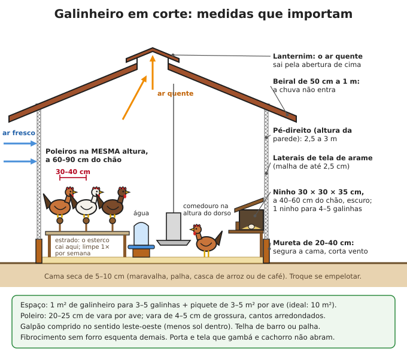
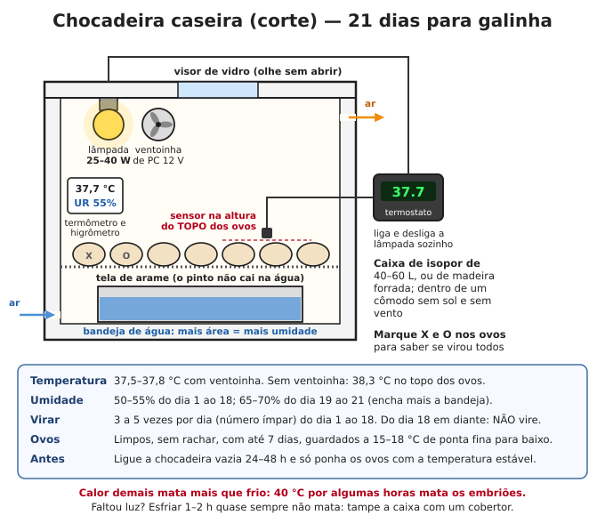
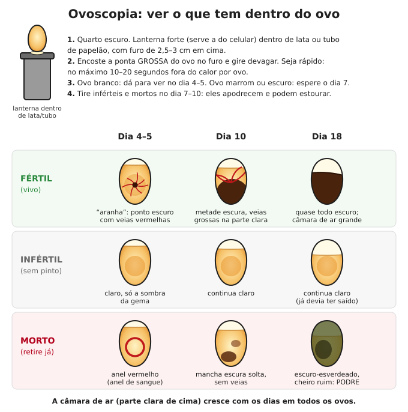
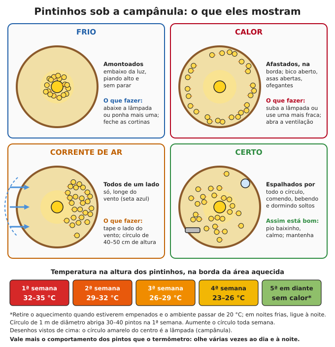

# Galinhas

**Resumo:** a galinha é o primeiro animal a criar: barata, rápida (frango em 3–4 meses, ovos em
5–6) e come restos, insetos e verde. Para ter ovos o ano todo: **galinheiro seco e fechado à noite**,
**ração com proteína e cálcio** (100–130 g por ave por dia), **14–16 horas de luz**, ninhos escuros e
coleta 2 vezes ao dia. Para multiplicar: **1 galo para 8–12 galinhas**, choco natural ou chocadeira
a **37,5–37,8 °C** por **21 dias**, e pintinhos aquecidos a **32–35 °C** na primeira semana.

---

## 1. Quantas galinhas para uma família

- Família de 4 pessoas comendo 1 ovo por pessoa por dia = **~1.460 ovos por ano**.
  - Galinha caipira comum (80–100 ovos/ano): **15–18 galinhas**.
  - Linhagem melhorada (200–250 ovos/ano): **6–8 galinhas**.
- A postura cai a cada ano: **troque 1/3 das galinhas por ano** (as velhas vão para a panela), o
  que pede 1–2 chocas por ano ou uma chocadeira.
- Para carne: cada choco de 12 ovos dá ~10 pintos, metade machos = 5 frangos de 2 kg.

## 2. Raças e linhagens

| Raça / linhagem | Aptidão | Ovos por ano (aprox.) | Peso adulto (galinha / galo) | Choca? | Observações |
|---|---|---|---|---|---|
| Caipira comum ("pé-duro", de quintal) | dupla | 60–120 | 1,5–2 / 2–3 kg | sim, ótima mãe | a mais rústica; acha boa parte da comida sozinha |
| Embrapa 051 | ovos (híbrida) | ~250 em boas condições | ~2 kg | pouco | ovo marrom; filhos não repetem a mãe |
| Rhode Island Red | dupla | 200–250 | 2,9 / 3,9 kg | pouco | vermelha, ovo marrom, aguenta frio e calor |
| Plymouth Rock Barrada (carijó) | dupla | 180–220 | 2,9 / 3,8 kg | às vezes | rústica, mansa |
| New Hampshire, Australorp | dupla | 180–250 | 2,7–3 / 3,5–4 kg | às vezes | boas para clima ameno |
| Pescoço Pelado | dupla | 120–180 | 2–2,5 / 3 kg | sim | **aguenta muito calor** |
| Índio Gigante | carne | 100–150 | 3–4,5 / 4,5–6 kg ou mais | sim | brasileira, grande, lenta; boa para cruzar com caipira |
| Label Rouge (pescoço pelado vermelho) | carne (híbrida) | — | abate com 2,5–3 kg aos 70–90 dias | — | criação a pasto; filhos não repetem |
| Garnisé | pequena | 60–100 (ovo pequeno) | 0,5–0,8 kg | **excelente** | use para chocar ovos de outras raças (6–8 ovos grandes) |

- **Para o longo prazo** (sem loja para comprar pintinhos): mantenha **raças puras ou caipiras**
  que chocam. Híbridos produzem mais, mas os filhos deles saem variados e piores.
- **Cruzamento bom:** galo Índio Gigante ou Rhode Island com galinhas caipiras = frangos maiores e
  galinhas que ainda chocam.

## 3. O galinheiro

### Medidas
| Item | Medida |
|---|---|
| Área interna | 1 m² para cada **3–5 galinhas** (se passam o dia no piquete, até 5–6) |
| Poleiro | **20–25 cm de vara por ave**; vara de 4–5 cm, cantos arredondados; a **60–90 cm** do chão; **30–40 cm** entre varas; todas na mesma altura (se não, brigam pela mais alta) |
| Ninho | **1 para cada 4–5 galinhas**; 30 × 30 × 35 cm (largura × altura × fundo); a 40–60 cm do chão; no canto **mais escuro**; palha ou capim seco; tábua de 10 cm na frente segura a palha |
| Comedouro | tubular (1 para 20–25 aves) ou calha com 10 cm por ave; borda na altura do dorso |
| Bebedouro | 1 de 5 L para 15–20 aves; na sombra; borda na altura do dorso |
| Pé-direito | 2,5–3 m no calor; lanternim (abertura no alto do telhado) para sair o ar quente |
| Paredes | mureta de 20–40 cm + tela até o telhado (calor); no Sul, cortina de lona para fechar no frio |
| Piso | chão batido 20 cm acima do terreno, ou cimento; **cama de 5–10 cm** (maravalha, palha de arroz, casca de café, capim seco) |

**Exemplo para 20 galinhas:** galinheiro de 2 × 3 m (6 m²), 5 m de poleiro, 5 ninhos, 2 piquetes
de 100 m² cada.

### Regras de construção
1. Comprido no sentido leste-oeste; beiral de 50 cm a 1 m; telha de barro ou palha
   (fibrocimento sem forro esquenta demais).
2. **Tela de malha até 2,5 cm** (rato e cobra pequena passam por malha maior). Portinhola para as
   aves (30 × 40 cm) e porta para gente, **com trava que gambá e quati não abrem** (cadeado ou
   ferrolho com pino).
3. Embaixo da tela, enterre 30–40 cm de tela ou faça uma "saia" de 50 cm deitada no chão para fora.
4. Estrado ou bandeja sob o poleiro: concentra o esterco da noite (metade de tudo que a galinha
   produz) e facilita limpar 1 vez por semana.
5. Caie (cal) paredes, poleiros e ninhos 2 vezes por ano: desinfeta e fecha frestas onde o ácaro vive.
6. Troque a cama quando empelotar ou cheirar a amônia (ardência nos olhos = cama vencida). A cama
   velha vai para a composteira.

### Piquete rotativo e "trator de galinhas"
- Ligue o galinheiro a **2–4 piquetes** (pelo menos 3–5 m² por ave cada; ideal 10 m²) e troque a cada
  **2–4 semanas**, deixando cada um descansar pelo menos 4 semanas. O capim volta, os vermes morrem
  e as aves sempre têm verde e insetos.
- Plante capim baixo e resistente (grama-estrela, batatais, amendoim forrageiro) e **árvores**
  (frutíferas, bananeira, amoreira): sombra, frutos e proteção contra gaviões.
- **Trator de galinhas:** gaiola móvel de 1,2 × 2,5 m sem fundo, com abrigo e poleiro, para 4–6
  galinhas. Mude de lugar a cada 1–2 dias sobre canteiros já colhidos: elas comem mato, pragas e
  sementes, e adubam. Veja [Horta](../04-agricultura/03-horta.md).

## 4. Alimentação

### Quanto dar
| Idade | Ração por ave por dia | Proteína da ração |
|---|---|---|
| 1ª semana | 10–15 g | 20–22% |
| 2–4 semanas | 20–40 g | 20% |
| 5–8 semanas | 45–65 g | 18–20% |
| 9–18 semanas (recria) | 65–90 g | 15–16% |
| Galinha botando | **100–130 g** | 16% + cálcio 3,5–4% |
| Frango pesado na engorda | 120–150 g | 17–18% |

Galinha solta no piquete o dia todo pode precisar só de **50–80 g** de complemento. Acerte pelo
resultado: se a postura cai e a galinha emagrece (quilha do peito saltada), aumente.

### Ração caseira (por 10 kg de mistura)
| Ingrediente | Inicial e crescimento (0–8 semanas) | Recria (9–18 semanas) | Postura |
|---|---|---|---|
| Milho moído (fubá grosso ou quirera) | 6,2 kg | 7,0 kg | 6,45 kg |
| Farelo de soja | 3,4 kg | 2,6 kg | 2,4 kg |
| Calcário calcítico (ou casca de ovo moída) | 120 g | 130 g | **900 g** |
| Fosfato bicálcico (ou 2× de farinha de osso calcinada) | 200 g | 150 g | 150 g |
| Sal | 40 g | 40 g | 40 g |
| Premix vitamínico-mineral (núcleo), se houver | 50 g | 50 g | 50 g |

- **Não dê ração de postura a frangas antes de botar** (o excesso de cálcio estraga os rins). Mude
  para a de postura quando aparecer o primeiro ovo (ou com 18–20 semanas).
- Sem premix: dê muito verde, deixe as aves no sol e varie os alimentos.
- Para as aves soltas, ofereça também **casca de ovo moída ou calcário à vontade** num cocho
  separado e **pedrinhas** (cascalho de 2–4 mm) se não tiverem acesso ao chão (a moela precisa).
- Casca de ovo: seque, **asse** (10 min no forno ou na chapa — mata micróbios e evita que as aves
  reconheçam o ovo e aprendam a comê-lo) e moa.

### Proteína sem farelo de soja
| Alimento | Quanto | Observação |
|---|---|---|
| Larva de mosca soldado-negro | 30–50 g frescas por ave/dia (substitui metade a toda a soja) | 40% de proteína; produção abaixo |
| Minhocas | 20–30 g por ave/dia | minhocário com esterco curtido |
| Peixe, vísceras, restos de carne | até 10% da comida | **sempre cozidos**; de animal sadio |
| Soro de leite, coalhada | à vontade, como bebida | ótimo, mas troque a água também |
| Grão de guandu ou feijão | 10–20% da ração | **cozido ou tostado** (cru é tóxico) |
| Folhas secas de mandioca, leucena, moringa | até 5–10% da ração | mandioca sempre seca ou murcha |
| Ora-pro-nóbis, azola, lentilha-d'água | verde à vontade | azola e lentilha-d'água crescem em tanque raso |
| Cupins e insetos | à vontade | quebre um cupinzeiro no piquete |

### Criação de larvas de mosca soldado-negro (proteína de graça)
A mosca soldado-negro (preta, parecida com vespa) **não pica, não entra em casa e não transmite doença**.
1. Use uma caixa ou balde de 50–100 L com furos de dreno no fundo, à sombra e protegido da chuva.
2. Encha com restos de frutas, verduras, borra de café, esterco fresco. Evite muita carne (cheira).
3. Em tempo quente (acima de 20 °C), cole papelão ondulado sobre a borda: as moscas põem ovos ali.
4. Faça uma **rampa inclinada (30–40°)** saindo da caixa até um balde: as larvas maduras (escuras)
   sobem sozinhas e caem no balde — colheita automática.
5. Cada 10 kg de resto rende 1–2 kg de larvas. Dê vivas ou secas ao sol.

### O que NÃO dar
- **Abacate** (casca, caroço e folha), comida **mofada** (milho mofado tem aflatoxina e mata),
  **feijão e soja crus**, batata verde ou brotada crua, **mandioca brava crua**, comida muito salgada,
  chocolate, café, restos podres, **ração de gado com ureia** e plantas tóxicas (espirradeira,
  comigo-ninguém-pode, mamona).

## 5. Postura

- **Começa com 5–6 meses** na caipira (até 7 meses nas pesadas e no inverno); 18–20 semanas nas linhagens
  melhoradas. Os primeiros ovos são pequenos e às vezes sem casca ou com 2 gemas: é normal.
- **Luz:** a galinha precisa de **14–16 horas de luz por dia** para botar o ano todo. No inverno a postura
  cai. Com energia: acenda uma lâmpada fraca (LED de 5–9 W para 10 m², luz suficiente para ler)
  **de madrugada**, completando 15–16 h com a luz do dia. **Nunca diminua** a luz durante a postura.
  Sem energia: aceite a pausa.
- **Muda:** 1 vez por ano (geralmente no fim do verão ou outono) a galinha troca as penas e para de
  botar por 6–12 semanas. Dê mais proteína nessa época.
- A postura cai **15–20% a cada ano**. Depois do 2º ou 3º ano, a galinha que bota pouco vai para a panela.
- **Ovo de casca fina ou sem casca:** falta de cálcio, calor acima de 30 °C, idade ou doença (Newcastle).

### Galinha que bota x galinha que não bota (para descartar)
| Sinal | Botando | Não botando |
|---|---|---|
| Crista e barbela | grandes, vermelhas, macias, quentes | pequenas, pálidas, enrugadas |
| Cloaca | grande, oval, úmida, pálida | pequena, redonda, seca, amarelada |
| Ossos da bacia (púbis, dos lados da cloaca) | afastados **3 dedos** ou mais, finos e flexíveis | 1–2 dedos, duros |
| Barriga (entre a ponta do peito e a bacia) | macia, **3–4 dedos** | dura, estreita, 2 dedos |
| Bico e canelas (raças de pele amarela) | desbotados (o pigmento foi para a gema) | amarelo-vivos |
| Penas | gastas e sujas | bonitas e lisas (não está trabalhando) |

Examine à noite, no poleiro (a galinha fica calma). Descarte também: doentes crônicas, bicadoras de
ovo, galinhas com problema nas pernas e galos agressivos com gente.

## 6. Galo e ovos para chocar

- **1 galo para 8–10 galinhas** (raças pesadas) ou **10–12** (caipiras). Galos demais brigam e deixam as
  galinhas com as costas peladas e feridas.
- Os ovos ficam férteis 3–4 dias depois de juntar o galo e continuam férteis até ~2 semanas depois
  de tirá-lo. Para ovo de comer, galo não é necessário.
- **Ovos para chocar:** de galinhas sadias com mais de 8 meses; tamanho médio (nem os menores nem os
  enormes); casca perfeita; limpos **sem lavar**; com **até 7 dias** (depois disso a eclosão cai a cada dia).
- Guarde a **15–18 °C** (lugar fresco, nunca geladeira), de ponta fina para baixo, inclinando a caixa
  para um lado e para o outro 1 vez por dia. Antes de chocar, deixe 6–8 h na temperatura da casa.

## 7. Choco natural (o jeito mais simples)

1. **Reconheça a choca:** fica no ninho dia e noite, arrepia as penas, faz "cloc-cloc" e bica quem
   mexe. Espere ela ficar **2–3 dias** firme no ninho antes de dar os ovos.
2. **Ninho separado:** caixote no chão, em lugar quieto e escuro, com terra ou areia no fundo e palha
   em cima (a terra mantém a umidade). Mude-a para lá **à noite**, com cuidado.
3. **Ovos:** 12–15 para galinha caipira, 6–8 de galinha grande para a garnisé — todos devem caber
   **cobertos** pelo corpo dela. Marque cada ovo com um X a lápis; retire todo dia os ovos sem
   marca (outras galinhas botam no mesmo ninho).
4. Antes, **polvilhe cinza ou terra de diatomáceas** no ninho e na galinha: ácaros matam chocas.
5. Água, grão e banho de areia perto. Ela sai 1–2 vezes por dia por 10–20 minutos: é normal.
6. **Ovoscopia no dia 7–10** (seção 9): retire os claros.
7. Não mexa nos dias 19–21. Os pintos nascem em **21 dias** (20 a 22). Ovos que não nasceram até o
   dia 23: descarte.
8. Deixe a galinha com os pintos num **cercado protegido** (gatos, ratos, gaviões, chuva) por
   2–3 semanas, com ração inicial em comedouro baixo e bebedouro raso com pedrinhas.
9. **Para cortar um choco indesejado:** 2–4 dias numa gaiola com fundo de tela, suspensa, com luz,
   água e comida.

## 8. Incubação artificial (chocadeira)

### Montagem da chocadeira caseira
- **Caixa** de isopor de 40–60 L (ou madeira forrada), num cômodo sem sol e sem vento.
- **Calor:** lâmpada incandescente ou halógena de 25–40 W, ou resistência. **Lâmpada LED não esquenta.**
- **Termostato** que liga e desliga a lâmpada (termostato digital de 12 V, de aquário ou de chocadeira),
  com o **sensor na altura do topo dos ovos**.
- **Ventoinha** de computador (12 V): espalha o calor por igual. Sem ela, o ar de cima fica mais
  quente que o de baixo.
- **Termômetro e higrômetro** à vista pelo visor de vidro na tampa. Confira o termômetro com um
  termômetro clínico digital (é preciso perto de 37 °C).
- **Bandeja de água** no fundo, coberta por tela onde ficam os ovos. 2–4 furos de 1 cm para ventilação.
- Ligue **24–48 h antes**, vazia, e só ponha os ovos com a temperatura estável.

### Os números
| Item | Valor |
|---|---|
| Temperatura | **37,5–37,8 °C** com ventoinha; sem ventoinha, **38,3 °C** medidos no topo dos ovos. Tolerância: ±0,3 °C |
| Umidade | **50–55%** do dia 1 ao 18; **65–70%** do dia 19 ao 21 |
| Sem higrômetro | termômetro de **bulbo úmido** (bulbo enrolado em gaze com a ponta na água): 28–29 °C nos dias 1–18; 32–33 °C nos dias 19–21 |
| Viragem | **3 a 5 vezes por dia** (número ímpar), do dia 1 ao 18 |
| Duração | **21 dias** (galinha). Outras aves: [Outras aves](07-outras-aves.md) |

### Dia a dia
1. **Dia 1:** ovos deitados (ou de ponta fina para baixo, inclinados), marcados com X de um lado e O
   do outro. Mãos limpas.
2. **Dias 1–18:** vire 3–5 vezes por dia (o lado de cima alterna entre X e O). Mantenha a umidade
   enchendo a bandeja (mais área de água = mais umidade; menos área = menos).
3. **Dia 7–10:** ovoscopia; retire claros e mortos. **Dia 14–18:** segunda ovoscopia.
4. **Dia 18:** **pare de virar**, deite os ovos, aumente a umidade (mais água, esponja molhada) e
   **não abra mais a chocadeira** até o fim (abrir resseca a membrana e o pinto fica grudado).
5. **Dias 19–21:** o pinto bica a casca e leva **12–24 h** para sair. **Não ajude antes de 24 h** da
   bicagem (os vasos ainda sangram). Passado esse tempo sem progresso e com a membrana branca e seca,
   umedeça com água morna e abra um pouco a casca; pare se sangrar.
6. Tire os pintos **quando secos** (6–12 h depois de nascer; eles aguentam 48–72 h sem comer por causa
   da gema absorvida) e leve à campânula já aquecida.
7. Lave e desinfete a chocadeira.

**Faltou energia?** Tampe com cobertor. Esfriar algumas horas raramente mata (pior no fim da
incubação); calor demais mata. Garrafas de água a 40–45 °C enroladas em pano, sem encostar nos ovos,
trocadas a cada hora, seguram a temperatura. Ou passe os ovos para uma galinha choca.

### Quando dá errado
| Sinal | Causa provável |
|---|---|
| Quase todos claros (inférteis) | sem galo, galo velho ou com galinhas demais, ovos velhos ou guardados frios |
| Anel de sangue na 1ª semana | temperatura errada, ovo velho, ovo sacudido |
| Morrem no meio | temperatura instável, falta de viragem, galinhas mal alimentadas |
| Nascem cedo (dia 19–20), pintos pequenos | temperatura alta |
| Nascem tarde (dia 22–23), umbigo mal fechado | temperatura baixa |
| Bicam e morrem no ovo, grudados | umidade baixa no fim, ou abriram a chocadeira na eclosão |
| Barriga molhada, umbigo inflamado, cheiro ruim | umidade alta e sujeira |
| Pernas abertas (espacate) | piso liso: forre com pano ou tela |

## 9. Ovoscopia

1. Quarto escuro; lanterna forte dentro de lata ou tubo de papelão com furo de 2,5–3 cm.
2. Encoste a **ponta grossa** do ovo no furo e gire. Máximo 10–20 segundos por ovo fora do calor.
3. **Dia 4–5 (ovo branco) ou 7 (marrom):** fértil mostra uma "aranha" — ponto escuro com veias vermelhas.
   Claro = infértil. Anel vermelho = morto.
4. **Dia 10:** metade escura com veias grossas. **Dia 18:** quase todo escuro, câmara de ar grande.
5. Retire inférteis e mortos: apodrecem, cheiram e podem **estourar**, contaminando os outros.
   Ovo infértil retirado no dia 7 ainda pode ir para os cães ou porcos, **cozido**.

## 10. Criação de pintinhos

### Preparação (antes dos pintos chegarem)
1. Galinheiro limpo, caiado e vazio há pelo menos 2 semanas.
2. **Círculo de proteção** de papelão, chapa ou tela forrada, com **40–50 cm de altura** (corta o vento
   e evita que se amontoem nos cantos). 1 m de diâmetro serve 30–40 pintos na 1ª semana; aumente toda semana.
3. Cama de 5–10 cm de maravalha, coberta com papel nos 3 primeiros dias. **Não use serragem fina**
   (eles comem).
4. **Aquecimento ligado 12–24 h antes:** lâmpada incandescente de 100–150 W (para ~50 pintos) ou
   infravermelha de 250 W (para 100–150), a 40–60 cm da cama; ou campânula a gás ou a lenha.

### Temperatura (na altura dos pintos, na borda da área aquecida)
| Semana | Temperatura |
|---|---|
| 1ª | 32–35 °C |
| 2ª | 29–32 °C |
| 3ª | 26–29 °C |
| 4ª | 23–26 °C |
| 5ª em diante | sem aquecimento se já empenados e o ambiente passar de 20 °C (em noite fria, ligue à noite) |

**Os pintos mostram a temperatura certa melhor que o termômetro:** amontoados e piando alto = frio
(abaixe a lâmpada); afastados, de bico aberto = calor (suba a lâmpada); todos de um lado = vento;
espalhados e calmos = certo. Deixe uma luz fraca à noite: no escuro eles se amontoam e se sufocam.

### Água e comida
- Bebedouro infantil (de pressão) ou prato raso **com pedrinhas** (não se afogam). Água fresca.
  Nas primeiras horas, molhe o bico de alguns pintos: os outros aprendem.
- Ração inicial (20–22% de proteína) farelada fina, espalhada sobre papel nos 2–3 primeiros dias, depois
  em comedouro baixo. Complemento: **ovo cozido amassado com fubá fino** (1 ovo para 10–15 pintos).
- Verde picado fino a partir da 2ª semana; se comerem grão, areia grossa ou pedrinhas à vontade.
- **Espaço:** 30–40 pintos por m² na 1ª semana; 15–20 com 4 semanas; 10 com 8 semanas.

### Sem eletricidade
- O melhor: **galinha choca** como mãe (cria 15–25 pintos).
- **Mãe artificial:** caixa baixa (10–15 cm de altura) com o teto forrado de tiras de pano ou lã que
  tocam as costas dos pintos, dentro de um cômodo fechado; garrafas de água quente embrulhadas em
  pano, trocadas de 2 em 2 horas, na 1ª semana.

### Problemas comuns
- **Fezes grudadas na cloaca:** limpe com água morna (se secar, entope e o pinto morre). Causa: frio ou calor.
- **Pernas abertas:** piso liso; amarre as pernas com fita na distância certa por 2–3 dias.
- **Mortes por amontoamento:** frio, susto ou escuro à noite.
- Aos **6–8 semanas** vão para o galinheiro de recria; separe os machos (crista maior e mais vermelha,
  penas do pescoço pontudas) para engorda.

## 11. Frangos para carne

| Tipo | Idade de abate | Peso vivo | Observação |
|---|---|---|---|
| Caipira comum | 4–6 meses | 1,8–2,5 kg | carne firme, saborosa |
| Caipira melhorado (Label Rouge, pescoço pelado) | 70–90 dias | 2,5–3 kg | gasta 2,8–3,5 kg de ração por kg de frango |
| Frango de granja (branco) | 42–49 dias | 2,5–3 kg | só com ração boa; fica com pernas fracas se passar do tempo |
| Galinha velha de descarte | — | 1,5–2,5 kg | carne dura: cozinhe 2–3 h ou 40–60 min na pressão |

- **Rendimento:** carcaça limpa (sem penas, vísceras, pés e cabeça) ≈ **70% do peso vivo**; frango de
  2,5 kg → ~1,75 kg. Miúdos (coração, moela, fígado) e pés também são comida.
- Jejum de comida de 8–12 h antes do abate (água à vontade). Abate e limpeza:
  [Abate e carne](12-abate-e-carne.md).

## 12. Doenças

| Doença | Sinais | O que fazer |
|---|---|---|
| **Newcastle** | espirro, tosse, respiração ruidosa, diarreia verde, pescoço torto, paralisia, para de botar; morrem muitas em poucos dias | **sem cura**. Vacina (cepa La Sota/HB1, ocular ou na água). Isole, sacrifique, queime ou enterre. **Notificação obrigatória** ao serviço veterinário |
| Gripe aviária | crista e barbela roxas, inchaço da cabeça, mortes súbitas em massa | **não mexa sem luva e máscara** (passa para gente); isole a área e notifique |
| **Bouba** (varíola aviária) | seca: crostas escuras na crista, barbela e pálpebras; úmida: placas amarelas na boca e garganta | transmitida por mosquito. Vacina na membrana da asa (4–8 semanas). Limpe crostas com iodo; ração em papa; sara em 3–4 semanas |
| **Coriza infecciosa** | cara e olhos inchados, corrimento nasal com mau cheiro, espirros | isole; antibiótico conforme bula (sulfa + trimetoprim, eritromicina). Quem sara fica portadora: o ideal é descartar o lote doente |
| Micoplasmose (doença respiratória crônica) | espirro, chiado, olho espumoso, demora a sarar | antibiótico (tilosina) conforme bula; boa ventilação; aves portadoras |
| Doença de Marek | paralisia (uma perna para frente, outra para trás), olho cinzento; aves de 2–5 meses | sem cura; vacina no 1º dia de vida; descarte |
| Gumboro | pintos de 3–6 semanas prostrados, diarreia esbranquiçada | vacina na água; sem tratamento |
| **Coccidiose** | pintos e frangos de 3–8 semanas: diarreia com sangue ou marrom, arrepiados, encolhidos | amprólio ou sulfa na água por 5–7 dias (bula). Cama seca, bebedouro sem vazamento |
| Pulorose / tifo aviário | pintos com diarreia branca grudada e mortes; adultas com crista pálida e diarreia verde-amarelada | antibiótico só atenua; descarte; não choque ovos dessas aves |
| Verminose | emagrecimento, crista pálida, diarreia, menos ovos, vermes nas fezes | vermífugo para aves na água (levamisol, fenbendazol, albendazol ou piperazina, conforme bula) a cada 3–6 meses; rodízio de piquetes |
| Botulismo | pescoço mole caído, paralisia de pernas e asas | após comer carniça, larvas de carniça ou água podre. Retire a fonte; sombra e água; algumas se recuperam |
| Ovo preso | galinha agachada fazendo força, rabo para baixo | banho morno de 20 min na parte de trás, óleo vegetal na cloaca, lugar quente e escuro |
| Calor | bico aberto, asas afastadas do corpo | sombra, água fresca, ventilação; acima de 35 °C morrem |

### Calendário de vacinas comum (confirme com a loja agropecuária ou o serviço veterinário)
| Idade | Vacina |
|---|---|
| 1 dia | Marek (no incubatório) |
| 7–10 dias | Newcastle (+ bronquite) no olho ou na água; Gumboro |
| 21–30 dias | reforço de Newcastle e Gumboro |
| 4–8 semanas | Bouba (punção na asa) |
| A cada 3 meses (poedeiras) | Newcastle na água |

- Vacina de aves vem em frascos de 500–1.000 doses: **compre em grupo** com os vizinhos e use tudo na hora.
- **Vacina na água:** água sem cloro (misture 2 g de leite em pó desnatado por litro), aves 2 h sem água
  antes, quantidade que bebam em 1–2 h.

## 13. Piolhos, ácaros e o banho de areia

- **Piolhos:** amarelados, correm na pele perto da cloaca; ovinhos grudados na base das penas.
- **Ácaro vermelho:** minúsculo, cinza ou vermelho quando cheio de sangue; esconde-se de dia nas frestas
  do poleiro e do ninho e ataca à noite. **Teste:** passe um pano branco no poleiro à noite — manchas
  vermelhas = ácaro. Causa anemia (crista pálida) e mata chocas.
- **Sarna das canelas:** escamas das pernas levantadas e com crostas. Passe **óleo vegetal ou vaselina**
  nas pernas a cada 3 dias por 2–3 semanas.
- **Pulga-de-galinha:** pontinhos pretos grudados na crista e em volta dos olhos.

**Banho de areia (prevenção principal):** caixa de 1 × 1 m para 10–15 aves, com 20–30 cm de fundo,
**sob telhado**, cheia de **3 partes de terra fina ou areia + 1 parte de cinza de madeira** peneirada
e fria. Renove todo mês. As galinhas se espojam e sufocam os parasitas.

**Infestação forte:** trate **todas as aves e o galinheiro no mesmo dia** (caiação, troca de cama, pó
inseticida para aves conforme bula) e **repita em 7–10 dias** (os ovos dos parasitas eclodem).

## 14. Predadores

| O que você encontra | Predador provável | Defesa |
|---|---|---|
| Ovos sumindo inteiros; pintos sumindo à noite | cobra, rato, gambá | fechar à noite; tela de malha até 2,5 cm |
| Ovos quebrados e comidos de dia | teiú (lagarto), cão, a própria galinha | coleta frequente; tela enterrada |
| 1 ave morta à noite, cabeça ou pescoço comidos | gambá (saruê), irara, furão, coruja | tranca firme; tela também no teto |
| Aves levadas inteiras, penas no caminho | raposa, cachorro-do-mato, gato-do-mato | tela enterrada + fio elétrico baixo por fora; recolher à noite |
| Muitas aves mortas e largadas | cachorro doméstico | cerca alta; prender o cão |
| Pintos levados de dia no campo aberto | gavião, carcará | árvores e arbustos no piquete; tela ou fios por cima do pinteiro |
| Pintos mordidos nos cantos, ovos roídos, ração sumindo | ratos | ração em tambor tampado, piso cimentado, gatos |

Gansos e galinhas-d'angola dão o alarme ([Outras aves](07-outras-aves.md)); um bom cão afasta
predadores ([Cães e gatos](11-caes-e-gatos.md)). Prefira proteger a matar: a maioria dos predadores
silvestres é protegida por lei e também come ratos e cobras.

## 15. Canibalismo e galinha que come ovo

**Causas:** superlotação, calor, luz forte, falta de proteína ou de sal, aves presas sem nada para
ciscar, ferida com sangue à mostra, ninho claro (bicam a cloaca de quem bota).

1. **Separe a ferida**, lave e cubra com violeta de genciana (spray roxo) ou alcatrão vegetal — escondem
   o vermelho e amargam. Só devolva curada.
2. **Ache a agressora** (bico sujo de sangue) e descarte: o vício se espalha.
3. Diminua a lotação, pendure couve ou um feixe de capim, jogue um punhado de grão na cama para ciscar.
4. Corrija a ração: 16% de proteína e 0,4% de sal.
5. Escureça os ninhos (cortina de pano na entrada) e diminua a luz forte.

**Galinha que come ovo:** colete 2–3 vezes por dia; ninhos escuros e com bastante palha; cálcio
suficiente (casca firme não quebra); ponha um **ovo falso** (de gesso, madeira ou ovo vazio cheio de
mostarda ou pimenta). Ave flagrada com gema no bico: descarte.

## 16. Ovos: coleta e conservação

1. **Colete 2 vezes por dia** (3 no calor).
2. **Não lave** ovo que vai ser guardado: a película natural da casca impede a entrada de micróbios.
   Limpe a seco (pano ou lixa fina). Ovo muito sujo: lave em água **mais quente** que o ovo e use logo.
3. Rachados: use no mesmo dia, bem cozidos.

| Como guardar (ovo limpo, não lavado) | Quanto dura |
|---|---|
| Temperatura ambiente (25–30 °C) | 2–3 semanas |
| Lugar fresco (~15 °C) | 4–6 semanas |
| Geladeira (4–7 °C) | 1–3 meses |
| Untado com óleo ou banha, lugar fresco | 2–4 meses |
| **Água de cal**, lugar fresco e escuro | 6–12 meses |

### Ovos em água de cal
1. Ovos **frescos (1–2 dias), limpos, não lavados, sem rachadura**.
2. Dissolva **30 g de cal hidratada por litro** de água fervida e fria (cal pura, sem aditivos). Mexa
   e deixe assentar.
3. Arrume os ovos de ponta fina para baixo num pote de vidro, barro ou balde de alimento e cubra com
   a água de cal, ficando **3–5 cm acima** dos ovos.
4. Tampe e guarde em lugar fresco e escuro, sem mexer.
5. Para usar: enxágue e **quebre cada ovo num copo separado** antes de juntar aos outros. A clara fica
   mais mole e a casca mais frágil (para cozinhar inteiro, fure a ponta grossa com alfinete).

### Teste da água (frescor)
Ovo num copo de água: **deita no fundo** = fresco; **inclina** = 1–2 semanas; **fica em pé no fundo** =
3 semanas ou mais (use bem cozido); **boia** = velho, jogue fora.

> **ATENÇÃO:** ovo de quintal pode ter salmonela. Para crianças, idosos, grávidas e doentes, **cozinhe
> até a gema endurecer**. Gema mole só de ovo fresco, limpo e sem rachadura. Lave as mãos depois de
> mexer com ovos, galinhas e cama.

Mais conservação (ovo em pó, conserva): [Conservação de alimentos](../03-alimentacao/02-conservacao-de-alimentos.md).

---

Ver também: [Princípios gerais](01-principios-gerais.md) · [Outras aves](07-outras-aves.md) · [Abate e carne](12-abate-e-carne.md) · [Veterinária básica](14-veterinaria-basica.md) · [Compostagem](../04-agricultura/01-solo-adubacao-compostagem.md) · [Conservação de alimentos](../03-alimentacao/02-conservacao-de-alimentos.md)
