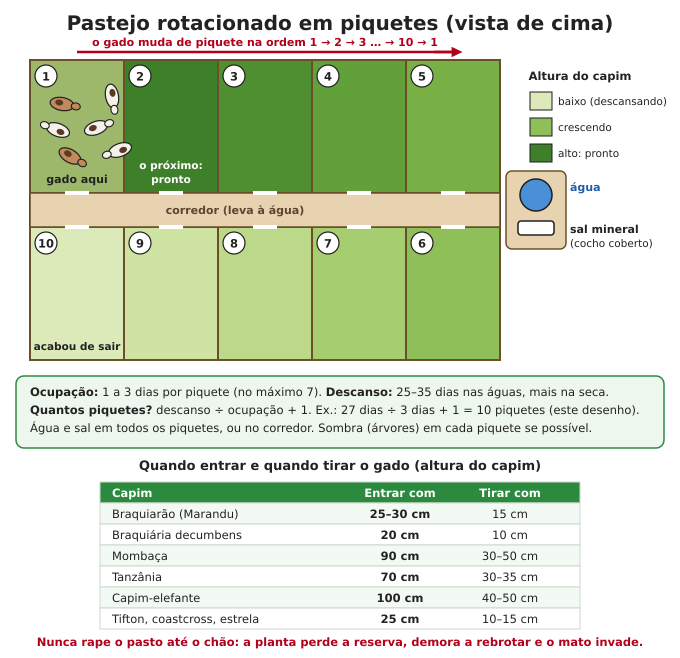

# Bovinos (gado de corte e de leite)

**Resumo:** a vaca dá leite, carne, couro, esterco e força, mas é o animal que mais exige: **1–3 ha de
pasto por cabeça**, 40–100 L de água por dia e **comida guardada para a seca** (cana, silagem,
capineira). Prefira raças rústicas ou mestiças (Gir, Girolando, Guzerá, crioulas). O cio volta a cada
**21 dias**, a gestação dura **~283 dias** (zebuínas até 295) e o bezerro precisa de **colostro nas
primeiras 6 horas** e **iodo 10% no umbigo**. Ferva o leite: brucelose e tuberculose passam para gente.

---

## 1. Raças

| Raça | Aptidão | Onde vai bem | Características |
|---|---|---|---|
| Nelore | corte (zebu) | todo o Brasil, calor | rústico, resiste a calor e carrapato; pouco leite; vaca de 400–500 kg |
| Gir (Gir Leiteiro) | leite (zebu) | calor, Cerrado | rústico; 5–10 L/dia a pasto; costuma só soltar o leite com o bezerro ao pé |
| Girolando (5/8 Holandês + 3/8 Gir) | leite | Sudeste, Centro-Oeste | 10–20 L/dia com boa comida; o leiteiro mais comum do país |
| Guzerá | dupla aptidão (zebu) | semiárido, Cerrado | muito rústico, aguenta seca; ótimo boi de carro |
| Sindi | leite (zebu pequeno) | semiárido | vaca de 300–350 kg, come pouco, 4–8 L/dia |
| Curraleiro Pé-Duro | dupla (crioulo) | Piauí, Nordeste, Cerrado | pequeno (vaca de 250–350 kg), extremamente resistente à seca; raça ameaçada |
| Caracu | dupla (crioulo) | Sudeste, Sul | manso, aguenta calor, boa carne e leite razoável |
| Crioulo Lageano | dupla (crioulo) | planalto de SC, frio | aguenta frio e pasto nativo |
| Pantaneiro | dupla (crioulo) | Pantanal | aguenta alagado e calor |
| Holandês | leite (europeu) | Sul e serras | 20–30 L/dia ou mais, mas exige muita comida e sombra; sofre com calor e carrapato |
| Jersey | leite (europeu, pequeno) | Sul, Sudeste | leite gordo (manteiga, queijo); aguenta calor melhor que o Holandês |

- **Corte:** cresce e engorda (Nelore). **Leite:** produz muito, mas exige mais (Holandês, Girolando).
  **Dupla aptidão:** 4–8 L de leite por dia **e** bezerro bom de carne (Guzerá, Caracu, crioulas, mestiças).
- **Para a família, sem ração comprada:** vaca mestiça ou de dupla aptidão rústica. Vaca de alta
  produção sem comida farta emagrece, para de dar leite e não emprenha.

## 2. Pasto e lotação

**Unidade animal (UA) = 450 kg de peso vivo.** Vaca de 450 kg = 1 UA; bezerro desmamado de 200 kg ≈
0,45 UA; novilha de 300 kg ≈ 0,7 UA; touro de 700 kg ≈ 1,5 UA.

| Tipo de pasto | Lotação nas águas | Lotação na seca |
|---|---|---|
| Caatinga nativa | 0,05–0,2 UA/ha (5–20 ha por vaca) | menos ainda |
| Cerrado nativo, campo nativo do Sul | 0,3–0,8 UA/ha | 0,2–0,4 |
| Braquiária degradada (cupim, mato, chão aparecendo) | 0,3–0,6 UA/ha | 0,2–0,3 |
| Braquiária bem manejada, sem adubo | 1–1,5 UA/ha | 0,5–0,8 |
| Pasto adubado em rodízio (Mombaça, Tanzânia, braquiarão) | 3–6 UA/ha | 1–2 (ou com cocho) |

**Pasto passou do ponto** (capim velho e alto sobrando): pode pôr mais gado ou cortar para silagem.
**Pasto rapado** (chão aparecendo, capim abaixo da altura de saída): tire animais **já**. Pasto
rapado degrada e vira mato e cupinzeiro.

### Pastejo rotacionado

1. Divida o pasto em piquetes iguais, ligados por um **corredor** que leva à água e ao cocho de sal.
   Cerca elétrica de 1 fio a 80–90 cm é a divisão mais barata.
2. **Número de piquetes = dias de descanso ÷ dias de ocupação + 1.** Ex.: 30 ÷ 3 + 1 = 11.
3. **Ocupação:** 1–3 dias por piquete (no máximo 7). **Descanso:** 25–35 dias nas águas, 45–60 na seca.
4. Entre e saia pela **altura do capim** (tabela da figura). Regra geral: entre antes de o capim
   florescer e saia deixando pelo menos metade da altura de entrada.
5. Capim passando da altura de entrada em vários piquetes: pule-os e corte para silagem ou feno.
6. Esparrame o esterco acumulado e reponha adubo (esterco, cinza) depois de algumas rodadas.

## 3. A seca: como não perder o gado

1. **Ajuste o rebanho antes da seca** (março–abril): venda ou abata vacas vazias, velhas, com mastite
   crônica e machos que não serão reprodutores. Boca a menos = comida a mais para quem fica.
2. **Vede pastos (diferimento):** em fevereiro–março, feche 1–2 piquetes (20–30% da área) e só abra na
   seca. O capim acumula em pé ("feno em pé"). Funciona bem com braquiária.
3. **Cana picada** (15–25 kg/vaca/dia), **silagem** (20–30 kg), **capineira** e **feno** —
   produção e passo a passo em [Princípios gerais](01-principios-gerais.md).
4. **Mistura mineral sempre** (60–100 g/dia). Na seca, o **sal proteinado** (mineral + ureia + farelo,
   pronto de loja) faz o gado aproveitar o capim seco: consumo de 1–2 g por kg de peso vivo por dia.
5. **Leguminosas** (leucena, guandu, gliricídia) em banco de proteína: 1–2 h de acesso por dia.

### Cana com ureia (proteína barata) — passo a passo
1. **Mistura:** 9 partes de **ureia** + 1 parte de **sulfato de amônio** (o enxofre é necessário).
2. **Adaptação obrigatória:** 1ª semana **0,5%** (500 g de mistura para cada 100 kg de cana picada);
   da 2ª semana em diante **1%** (1 kg por 100 kg de cana). **Nunca passe de 1%.**
3. Dissolva a mistura em água (cerca de 4 L de água por kg de mistura) e **regue por igual** sobre a
   cana já no cocho, misturando com as mãos ou garfo. Nunca deixe torrões de ureia.
4. Divida em 2 tratos por dia. Cocho com lugar para todos comerem juntos (60–70 cm por vaca adulta),
   para a vaca mandona não comer a parte das outras.
5. Ficou **2 dias ou mais sem receber**: recomece pela adaptação de 0,5%.
6. **Não dê** a bezerros com menos de 6 meses, a animais famintos ou fracos (dê capim antes), nem a
   porcos, aves e cavalos. Guarde a ureia fechada, seca e **fora do alcance** dos animais.

> **ATENÇÃO — intoxicação por ureia mata em 1 a 4 horas.** Sinais 20–60 min depois de comer: inquietação,
> tremores, baba espumosa, ranger de dentes, andar cambaleante, barriga estufada, falta de ar,
> convulsão. **Socorro:** retire o cocho de todos; dê pela boca **2 a 6 litros de vinagre comum
> misturados em água fria** (garrafa no canto da boca, devagar, cabeça pouco levantada para não ir
> para o pulmão); repita em 30–60 min se os sinais continuarem. Água fria à vontade.

## 4. Água
- Boi e vaca seca: **40–60 L/dia**; vaca leiteira: **60–100 L/dia** (cerca de 4 L para cada litro de
  leite, além do básico); bezerro: 5–15 L. No calor, mais.
- Bebedouro limpo, com boia, a no máximo 500–800 m de qualquer ponto do pasto. Cerque nascentes e
  beiras de córrego (o gado pisoteia e contamina). Veja [Água](../01-agua/01-encontrar-e-captar-agua.md).

## 5. Curral e manejo seguro

> **ATENÇÃO:** o **touro** é o animal doméstico que mais mata gente no campo. Nunca entre sozinho no
> pasto ou curral do touro, nunca dê as costas a ele, tenha sempre rota de fuga. **Nunca crie bezerro
> macho "de estimação"** (mimado, empurrando gente com a cabeça): ele vira um touro que não teme
> pessoas. Touros de raças leiteiras são os mais perigosos. Vaca com bezerro recém-nascido também ataca.

### Curral
- Cerca de **1,6–1,8 m** de altura, de tábua ou réguas, com mourões firmes e sem pregos ou arames
  pontudos para fora.
- **Seringa** (funil) → **brete** (corredor estreito, 70–80 cm de largura) → **tronco de contenção**
  (com pescoceira) para vacinar, tratar, casquear e examinar.
- **Vão de fuga:** em alguns pontos, deixe 30–35 cm entre dois mourões — passa uma pessoa, não passa um boi.

### Como lidar com o gado
1. Aproxime-se **pelo lado**, falando baixo. O gado vê quase tudo em volta, menos **logo atrás**: quem
   chega por trás leva coice.
2. **Ponto do ombro:** posicionado atrás do ombro do animal, ele anda para a frente; à frente do ombro,
   ele para ou recua. Use isso em vez de bater.
3. Conduza devagar, com uma vara com pano (bandeira). Gritos, pauladas e cachorro bravo assustam,
   machucam e reduzem o leite.
4. Gado se acalma em grupo: conduza vários juntos, não um isolado.
5. Para conduzir touro: argola no focinho (colocada por quem sabe) e cambão (vara presa à argola).

## 6. Reprodução

### Idade e peso para a primeira cobertura
- Novilhas europeias e mestiças leiteiras entram na puberdade aos **10–15 meses**; zebuínas aos
  **18–24 meses** (mais tarde se mal alimentadas).
- Cubra só com **60–65% do peso adulto**: Nelore ~300–330 kg; Girolando ~330–350 kg; Gir ~280–300 kg.
  Primeira cria ideal com 24–30 meses (mestiças) ou 30–36 (zebuínas a pasto).

### O cio
Repete a cada **21 dias** (18 a 24) e dura **12–18 horas** (zebuínas: menos, muitas vezes à noite).

| Sinal | Importância |
|---|---|
| **Fica parada quando outra vaca ou o touro monta** | o sinal **certo** de cio |
| Monta as outras, inquieta, muge, anda muito, cheira e lambe as outras | sinal de cio chegando |
| Vulva inchada e avermelhada; **muco claro, transparente e elástico** ("baba") pendurado ou na cauda | forte |
| Pelos da base da cauda e da garupa arrepiados ou esfolados (de ser montada) | ajuda a ver no dia seguinte |
| Cai o leite, come menos | ajuda |
| 1–3 dias depois, muco com um pouco de sangue | o cio **já passou**: anote e espere o próximo em ~18–19 dias |

Observe o rebanho **2 vezes por dia (cedo e fim da tarde), 20–30 minutos cada**, e anote no caderno.

### Monta e prenhez
- **Touro adulto: 1 para 25–30 vacas** (touro jovem, de 2 anos: 15–20). Touro sadio, com os 2
  testículos firmes e do mesmo tamanho, sem feridas no pênis, **examinado para brucelose**.
- **Estação de monta** (Brasil Central): novembro a fevereiro → partos de agosto a novembro, no começo
  das chuvas, com capim novo para vaca e bezerro.
- Inseminação artificial (se houver sêmen e nitrogênio): viu o cio de manhã, insemine à tarde; viu à
  tarde, insemine na manhã seguinte.
- **Prenhe:** não volta ao cio em 21 e 42 dias. Palpação pelo reto, por quem é treinado, a partir de
  45–60 dias. No 7º mês dá para sentir o bezerro empurrando o **flanco direito**.
- **Gestação:** 280–285 dias em raças europeias e mestiças; **285–295** em zebuínas. Conta prática:
  data da cobertura + **283 dias** (9 meses e 10 dias).
- **Seque a vaca leiteira 60 dias antes do parto** (ordenhe 1 vez por dia por alguns dias e pare).
  Observe o úbere nas semanas seguintes (mastite).
- **15–30 dias antes do parto:** piquete-maternidade limpo, com sombra e água, perto de casa.

## 7. O parto

### Sinais de que está perto
- 2–3 semanas antes: o úbere enche. 1–2 dias antes: tetos cheios e brilhantes, às vezes pinga leite.
- **12–48 h antes: os ligamentos dos lados da base da cauda amolecem** (o lugar afunda dos dois lados).
- Vulva inchada e frouxa, sai um tampão de muco grosso; a vaca se isola, deita e levanta, levanta a cauda.

### Fases normais
1. **Dilatação:** 2–6 horas (novilha de 1ª cria, até 12 h). Inquieta, sem força visível.
2. **Expulsão:** aparece a **bolsa d'água** e depois as patas. O bezerro deve nascer em **30 min a
   2 h** depois de aparecerem a bolsa ou as patas (novilha: até 3 h), **avançando um pouco a cada
   15–30 minutos**.
3. **Placenta:** sai em 2–12 horas.

### Posição normal e posições erradas

- **Normal:** 2 patas da **frente**, **sola do casco para baixo**, e o **focinho** apoiado sobre elas.
- **De traseiro:** 2 patas de **trás**, sola para cima. Nasce, mas tem de sair **rápido** (o umbigo
  fica apertado e o bezerro tenta respirar ainda dentro).
- **Pata da frente ou de trás?** Na pata da frente, as 2 juntas acima do casco (boleto e joelho)
  dobram para o **mesmo lado**. Na de trás, a 2ª junta (jarrete) dobra para o **lado contrário** e
  tem uma ponta óssea (o "calcanhar").

### Quando examinar e ajudar
- 30 minutos de força forte (vaca) ou 1 hora (novilha) **sem nenhum avanço**.
- Mais de 2 horas desde que a bolsa apareceu.
- Aparece só 1 pata, só a cabeça, só a cauda, patas sem focinho, ou solas para cima com juntas de pata da frente.
- A vaca está exausta, parou de fazer força, ou sai líquido com cheiro podre.

### Como ajudar (passo a passo)
1. **Contenha** a vaca (tronco, ou amarrada; deitada também serve) e chame ajuda.
2. **Lave** vulva, ânus e cauda com água e sabão; amarre a cauda para o lado.
3. Unhas cortadas, braço lavado até o ombro, **luva longa** se houver (brucelose!). **Lubrifique
   muito**: gel obstétrico, vaselina, óleo de cozinha fervido e frio, ou água com sabão neutro.
4. Entre com a mão em forma de cone, **entre uma contração e outra**. Descubra: quantas patas, de
   frente ou de trás, onde está a cabeça. Gêmeos: siga cada perna até o corpo para saber de quem é.
5. **Corrija antes de puxar.** Sempre **empurre o bezerro para dentro primeiro** (no útero há espaço;
   no canal, não), sempre entre as contrações, um problema de cada vez:
   - **Cabeça virada:** empurre pelo peito ou ombro, siga o pescoço até a cabeça, pegue pela mandíbula
     (ou pela boca) e traga o focinho para o canal.
   - **Perna dobrada no joelho:** empurre o bezerro, levante o joelho e traga o casco **protegido na
     sua mão em concha** (o casco rasga o útero), esticando a perna.
   - **Perna dobrada no ombro** (só a cabeça e 1 pata): empurre, desça a mão pelo braço até o joelho,
     transforme em "perna dobrada no joelho" e então estique.
   - **Nádegas:** empurre o bezerro para a frente, pegue o jarrete, dobre-o e traga o casco em concha
     para trás, uma perna de cada vez. Depois tire rápido, como no parto de traseiro.
   - **De costas:** gire o bezerro de lado (90°) ou até ficar de costas para cima (180°), entre as contrações.
6. **Puxe só com a posição corrigida:** corda limpa (ou corrente obstétrica) com **laço acima do boleto
   e meia-volta entre o boleto e o casco** em cada pata. Puxe **só durante a força da vaca**, 1–2
   pessoas, **alternando as patas** (um ombro passa de cada vez). Quando a cabeça sair, puxe **em arco
   para baixo**, em direção aos jarretes da vaca.
7. **Quadril trancado** (o bezerro para com a barriga para fora): gire o bezerro 45–90° e continue
   puxando para baixo.
8. Se 2 pessoas puxando com força moderada não fazem o bezerro avançar em 10–15 minutos, o bezerro é
   grande demais ou a posição não foi corrigida: precisa de veterinário (cesariana).

> **ATENÇÃO:** **nunca puxe com trator, carro, talha ou mais de 2 pessoas**: arranca a perna do bezerro e
> rasga ou vira o útero da vaca. Use luvas: abortos e partos transmitem brucelose e leptospirose.
> Mais sobre partos difíceis: [Veterinária básica](14-veterinaria-basica.md).

### Logo depois do parto
1. **Bezerro:** tire o muco do nariz e da boca com os dedos. Não respira? Esfregue com força com
   palha, ponha um talo de capim no nariz (provoca espirro), jogue água fria no ouvido e deixe-o
   **deitado de peito** (como esfinge). Pendurar de cabeça para baixo: no máximo poucos segundos (o
   líquido que escorre vem do estômago, não do pulmão).
2. **Enfie a mão de novo** para ver se há um segundo bezerro.
3. Água fresca à vontade para a vaca.
4. **Placenta presa** mais de 12–24 h: **não puxe** (hemorragia e infecção). Corte o pedaço pendurado
   na altura do jarrete e mantenha limpo. Febre (acima de 39,5 °C), sem comer, cheiro forte:
   antibiótico (oxitetraciclina, conforme bula).
5. **Útero virado para fora** (prolapso: massa vermelha enorme, com "botões"): **emergência**. Mantenha
   a vaca deitada e quieta, o útero sobre um lençol limpo molhado, na altura da vulva, lavado com água
   fria com açúcar (desincha). Chame quem sabe recolocar; veja [Veterinária básica](14-veterinaria-basica.md).
6. **Febre do leite** (vaca leiteira de 3º parto em diante, 0–3 dias depois do parto): tremores,
   cambaleia, deita de peito com a cabeça virada para o flanco, orelhas frias, para de ruminar.
   Precisa de **cálcio na veia** (borogluconato de cálcio, aplicado devagar por quem sabe) em poucas
   horas, senão morre. Previna evitando muito cálcio (calcário, leguminosa) no fim da gestação.

## 8. O bezerro

### Colostro: a vida do bezerro
- O bezerro nasce **sem defesas**: os anticorpos vêm só do colostro (o primeiro leite, grosso e amarelo),
  e o intestino só absorve bem nas **primeiras 6 horas**; depois de 24 h, quase nada.
- Deve mamar em **1–2 horas**. Quantidade: **10% do peso vivo nas primeiras 12 horas**, sendo **2–4 L**
  na primeira mamada (bezerro de 35 kg: 3–4 L).
- Não mamou em 2 horas: ordenhe a vaca e dê na mamadeira.
- **Banco de colostro:** congele sobras de vacas sadias de 2º parto em diante, em garrafas de 1–2 L.
  Descongele em banho-maria morno (até 50 °C) — **nunca ferva** (destrói os anticorpos). Colostro de
  cabra serve na falta.

### Umbigo
- Logo depois de nascer, **mergulhe o umbigo em iodo 10%** (frasco encostado na barriga) e repita
  **2 vezes por dia até secar** (3–5 dias). Passe repelente em volta contra bicheira.
- Umbigo inchado, quente, com pus ou dor = **onfalite**: antibiótico.

### Aleitamento
- **Bezerro ao pé** (comum nas vacas zebuínas e mestiças): o bezerro fica separado à noite; de manhã
  mama um pouco para a vaca soltar o leite, ordenha-se 3 tetos e ele fica com 1 teto e o resto; à tarde
  ficam juntos.
- **Aleitamento no balde:** 4 L de leite morno por dia (cerca de 10% do peso), em 2 refeições, até
  60–90 dias.
- **Água limpa desde a 1ª semana. Capim novo, feno e um pouco de concentrado desde a 2ª semana** — é
  isso que desenvolve o rúmen.

### Diarreia (a maior causa de morte de bezerros)
1. **Não pare o leite.** Dê **soro entre as mamadas**: 2 L, 2–3 vezes por dia.
2. **Soro caseiro para bezerro, por litro** de água fervida e morna: 1 colher de chá rasa de sal +
   1 colher de chá rasa de bicarbonato de sódio + 1 colher de sopa cheia de glicose (dextrose de
   farmácia) ou mel. (Açúcar comum o bezerro digere mal.)
3. Bezerro que não fica em pé, com boca e orelhas frias, precisa de soro na veia: muito grave.
4. Prevenção: colostro, umbigo curado, bezerreiro limpo e seco, baldes lavados.

### Mochação, castração, desmama e marcação
- **Mochação** (evitar chifres e acidentes): bezerros de 2 semanas a 2 meses, ferro quente de ponta
  oca (2,5 cm) sobre o botão do chifre por 5–10 segundos, até formar um anel cor de cobre. Anestesia
  local (lidocaína) se houver.
- **Castração** (machos de corte; boi de carro com 1–2 anos): faça na **época seca e fria** (menos
  mosca), com **vacina contra clostridioses (tétano)** dada antes. Métodos:
  - **Burdizzo** (alicate emasculador): esmaga cada cordão separadamente, por fora, sem corte. Aperte
    cada lado por ~1 minuto, nunca no meio da bolsa.
  - **Faca:** corte a ponta de baixo da bolsa, puxe cada testículo e rompa o cordão raspando ou torcendo
    (cortar seco sangra muito); iodo e repelente na ferida.
  - **Anel de borracha:** só na 1ª semana de vida; risco maior de tétano.
- **Desmama:** bezerro de corte com 6–8 meses; bezerro leiteiro com 2–3 meses, se já come bem capim e
  concentrado. Separar por uma cerca (eles se veem) diminui o estresse.
- **Marcação:** brinco ou colar com número, tatuagem na orelha ou marca a fogo na perna ou anca (nunca
  na cara). Anote no caderno.

## 9. Ordenha manual higiênica e mastite

1. **Mesmo horário todo dia:** 2 vezes (12 h de intervalo) ou 1 vez com bezerro ao pé.
2. Local limpo e sombreado. Vaca presa pelo pescoço, **peia** nas pernas de trás (corda em "8" acima
   dos jarretes) e cauda presa.
3. Mãos lavadas com sabão, unhas curtas; balde limpo, de preferência de boca semifechada.
4. **Tetos sujos:** lave só os tetos, com pouca água, e seque com papel ou pano individual (um por vaca).
5. **Teste da caneca de fundo escuro:** tire os **3 primeiros jatos de cada teto** numa caneca de fundo
   preto (ou com tela fina). Grumos, pus, sangue ou leite aguado = **mastite** naquele teto: ordenhe-o
   por último e **jogue o leite fora**.
6. **Técnica:** feche o polegar e o indicador na base do teto (prende o leite) e aperte os outros dedos
   em sequência, de cima para baixo; solte e repita em ritmo constante. **Nunca puxe nem estique** o
   teto. Termine em 5–8 minutos (a descida do leite dura uns 7 minutos).
7. **Depois:** mergulhe cada teto em **iodo glicerinado (0,5–1%)** ou clorexidina e mantenha a vaca em
   pé 30–60 min (dê comida): o canal do teto fica aberto e entra sujeira.
8. Coe em pano fervido, esfrie rápido e **ferva antes de beber**. Queijos e derivados:
   [Leite e laticínios](13-leite-e-laticinios.md).

### Mastite
- **Clínica:** quarto inchado, quente, dolorido; leite com grumos, pus ou sangue. **Grave:** vaca com
  febre, sem comer, quarto frio e roxo (gangrena).
- **Subclínica:** leite parece normal, mas a produção cai. Teste CMT (raquete + reagente: o leite vira gel).
- **Tratamento:** esgote o quarto doente a cada 2–3 horas; depois da última ordenha do dia, limpe a ponta
  do teto com álcool e aplique **antibiótico intramamário** (bisnaga) por 3 dias, conforme bula.
  Descarte o leite durante o tratamento e a carência. Caso grave: antibiótico injetável e
  anti-inflamatório.
- **Prevenção:** ordem de ordenha (sadias primeiro), pós-dipping, cama seca, descarte de vacas com
  mastite 3 ou mais vezes na lactação.

## 10. Cascos
- Casco crescido (forma de chinelo ou tesoura) faz o animal mancar e emagrecer. Apare com torquês,
  rineta e grosa, deixando a sola plana; **pare quando aparecer cor rosada** (sangra). Vacas presas:
  1–2 vezes por ano.
- **Frieira** (inchaço entre as unhas com cheiro podre, manqueira): limpe, antibiótico. Prevenção:
  pedilúvio com **sulfato de cobre 5%** ou sulfato de zinco 10%, 1–2 vezes por semana; evite barro.

## 11. Doenças e parasitas

| Problema | Sinais | Prevenção e tratamento |
|---|---|---|
| **Carrapato** | carrapatos grudados (úbere, entre as pernas, orelhas); emagrecimento | 95% vive no pasto. Trate quando houver **20 ou mais carrapatos grandes (mais de 4,5 mm) num lado** do animal. Banho com pulverizador: **4–5 L de calda por animal adulto**, contra o pelo, no corpo todo. Controle estratégico: 4–5 banhos de **21 em 21 dias** no início das chuvas. Rodízio de pasto. Dose da bula, nunca "mais forte". Se o produto falha, troque de grupo químico |
| **Tristeza parasitária** (babesiose e anaplasmose) | febre de 40–42 °C, mucosas brancas ou amarelas, urina cor de café, fraqueza | transmitida pelo carrapato (e por agulha usada: **uma agulha limpa por animal**). Tratamento: diminazeno (babésia) e oxitetraciclina (anaplasma), ou imidocarb, conforme bula. Bezerros em contato com poucos carrapatos desde cedo ficam imunes: não zere o carrapato deles. Gado vindo de região sem carrapato adoece gravemente |
| **Berne** | caroço com furinho que solta líquido | esprema e tire a larva, ou produto conforme bula; controle de moscas e esterco |
| **Bicheira** | larvas em ferida, umbigo, castração; mau cheiro | limpe, tire as larvas com pinça, mata-bicheira e repelente até sarar |
| **Mosca-dos-chifres** | centenas de mosquinhas no lombo, de cabeça para baixo | trate só com mais de 200 moscas por animal; preserve os besouros rola-bosta (vermífugo em excesso os mata) |
| **Verminose** | bezerros e novilhos de 4–24 meses: pelo arrepiado, magreza, barriga grande, diarreia, papeira | vermífugo por peso (fita de pesagem em [Veterinária básica](14-veterinaria-basica.md)) nos jovens em **maio, julho e setembro** (esquema 5-7-9, na seca) e na desmama. Adulto só se precisar |
| **Clostridioses** (manqueira, gangrena, tétano, botulismo) | morte rápida; manqueira: jovem de 6 meses a 2 anos, inchaço que **estala** ao apertar, febre, manca, morre em 1–2 dias | **vacina polivalente** (com botulismo C e D): 3–4 meses, reforço em 30 dias, depois 1 vez por ano |
| **Raiva** | isolado, não come nem bebe, baba, parece **engasgado**, muge rouco, cambaleia de trás, paralisia; morre em 3–7 dias | transmitida pelo **morcego-vampiro** (feridinhas sangrando no pescoço, cernelha, orelhas). **Sempre fatal.** Vacina anual nas áreas de risco. **Notifique** |
| **Brucelose** | aborto no 7º–9º mês, placenta presa, bezerros fracos; touro com testículo inchado | **passa para gente** (leite cru, aborto sem luva). Vacina **B19 nas bezerras de 3 a 8 meses** (obrigatória, por veterinário). Positivos: abate. Ferva o leite; enterre fetos e placentas com luva |
| **Tuberculose** | emagrecimento lento, tosse, gânglios grandes | **passa para gente** (leite cru, ar). Exame de tuberculina; abate dos positivos; ferva o leite |
| Leptospirose | abortos, natimortos, urina com sangue em bezerros | passa para gente (urina de rato e de gado); vacina reprodutiva; controle de ratos |
| Febre aftosa | bolhas na boca, língua, tetos e entre os cascos; baba muito; manca | o Brasil é livre sem vacinação. Se aparecer: **notifique na hora** e não deixe nenhum animal ou pessoa sair da propriedade |
| Timpanismo | barriga estufada do lado **esquerdo**, falta de ar | emergência: veja [Veterinária básica](14-veterinaria-basica.md). Causa: leguminosa molhada ou grão em excesso |

> **ATENÇÃO — raiva:** **nunca enfie a mão na boca de um bovino "engasgado"** sem luva grossa: pode ser
> raiva. Quem teve contato da saliva com ferida ou mucosa: lave 15 minutos com água e sabão e procure a
> vacina. Veja [Doenças e infecções](../02-saude/03-doencas-e-infeccoes.md).

### Plantas tóxicas que mais matam gado no Brasil
- **Erva-de-rato / cafezinho** (*Palicourea marcgravii*): mata de repente, muitas vezes depois de o gado
  andar ou correr. Comum em mata e capoeira.
- **Samambaia** (*Pteridium*): sangue na urina e tumores, com o tempo.
- **Mamona** (folhas e sementes), **mandioca brava** (cianeto), **maria-mole** e **mio-mio** (Sul).
- Gado com fome ou recém-chegado come o que não conhece: não deixe faltar pasto; arranque e queime as
  plantas tóxicas dos piquetes.

## 12. Calendário de vacinas e manejo (Brasil Central; adapte à sua região)

| Vacina | Quem e quando |
|---|---|
| Brucelose (B19) | fêmeas de **3 a 8 meses**, dose única (obrigatória, aplicada por veterinário cadastrado) |
| Clostridioses (polivalente) | **3–4 meses**, reforço 30 dias depois, depois **1 vez por ano**; vacas gestantes 30–60 dias antes do parto (protege o bezerro pelo colostro) |
| Raiva | em áreas de risco: a partir de **3 meses**, reforço em 30 dias, depois **anual** |
| Reprodutiva (IBR, BVD, leptospirose) | vacas e touros: 2 doses com 21–30 dias de intervalo antes da estação de monta; reforço a cada 6–12 meses |
| Febre aftosa | vacinação **suspensa** (Brasil livre sem vacinação); siga o serviço veterinário oficial |
| Carbúnculo hemático | só em áreas com histórico |

| Época | Manejo |
|---|---|
| Fevereiro–março | vedar pastos para a seca; ensilar milho e capim; cuidar da cana |
| Abril–maio | desmama; descarte de vacas vazias e velhas; vermifugação de maio; B19 nas bezerras |
| Junho–julho | seca: cana com ureia, silagem, proteinado; vermifugação de julho |
| Agosto–setembro | começam os partos (umbigo, colostro); vermifugação de setembro; reforço anual de clostridioses; exame dos touros |
| Outubro–novembro | chuvas: banhos estratégicos contra carrapato (de 21 em 21 dias); início da estação de monta |
| Dezembro–janeiro | estação de monta; vigiar bicheira de umbigo e mosca |

Vacinas precisam de geladeira (2–8 °C), agulha limpa por animal e dose da bula. Anote tudo no caderno.

---

Ver também: [Princípios gerais](01-principios-gerais.md) · [Leite e laticínios](13-leite-e-laticinios.md) · [Abate e carne](12-abate-e-carne.md) · [Equinos e tração](10-equinos-e-tracao.md) · [Veterinária básica](14-veterinaria-basica.md) · [Couro](../09-quimica-e-oficios/05-couro.md)
