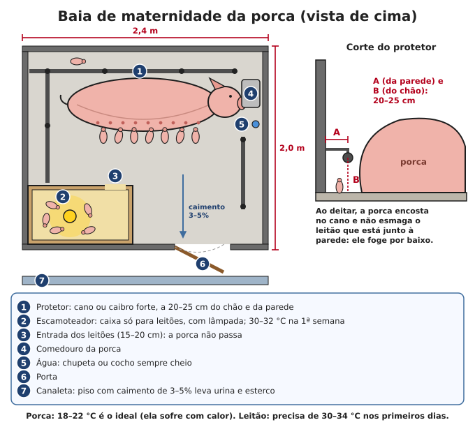

# Suínos (porcos)

**Resumo:** o porco transforma mandioca, abóbora, batata-doce, soro e restos de comida em carne e
**banha** (a gordura que conserva carne e vira sabão). Regras de ouro: **restos de comida SEMPRE
cozidos** (peste suína) e **porco NUNCA com acesso a fezes humanas** (cisticercose). A porca entra no
cio a cada **21 dias**, a gestação dura **114 dias** (3 meses, 3 semanas e 3 dias) e os leitões precisam
de **calor (30–34 °C), colostro, proteção contra esmagamento e ferro no 3º dia**.

---

## 1. Raças

| Raça | Tipo | Características |
|---|---|---|
| **Piau** | local brasileira | malhado (branco com manchas pretas), rústico, carne e banha; aguenta comida grosseira |
| **Moura** | local (PR, SC, RS) | pelagem "mourisca" (pelos pretos e brancos misturados), rústica, carne saborosa, boa mãe |
| **Caruncho** | local (MG, GO) | pequeno, muita banha, engorda com milho e restos |
| Canastra, Nilo, Pirapetinga | locais | rústicas, banha; populações pequenas |
| Large White, Landrace | comerciais | muitos leitões (10–14), crescimento rápido; exigem ração boa e abrigo |
| Duroc, Pietrain, Hampshire | comerciais | carne magra; usados como pais de cruzamento |

- **Raças locais:** 6–10 leitões por parto, engordam em 8–12 meses, muita banha, mas **comem capim,
  raízes e restos**, aguentam calor e doenças. Ideais sem ração comprada.
- **Comerciais:** 10–14 leitões, 100–120 kg em 5–6 meses, carne magra, mas **só com ração balanceada**.
- **Cruzamento** (porca local × cachaço comercial): leitões mais rápidos que os locais e mais rústicos
  que os comerciais.

## 2. Instalações

### Baias
| Categoria | Área |
|---|---|
| Porca gestante | 2,5–3 m² em baia coletiva, ou 6–8 m² individual com solário |
| Porca com leitões (maternidade) | 5–6 m² (ex.: 2,4 × 2,0 m) + escamoteador |
| Cachaço (macho) | 6–9 m², paredes firmes de 1,2 m |
| Leitões desmamados (creche) | 0,3–0,4 m² por leitão |
| Engorda (até 100 kg) | 1 m² por porco |

- Piso de cimento áspero (não escorrega) com **caimento de 3–5%** para uma canaleta de esterco; parte
  coberta e seca para deitar, parte aberta (solário) para esterco e sol.
- Paredes de 1–1,2 m (porco empurra e fuça: tijolo, tábua grossa ou troncos).
- **Comedouro:** cocho pesado de cimento (porco vira cocho leve); 30 cm de cocho por porco na engorda.
- **Bebedouro:** chupeta na altura da paleta do porco (+5 cm), vazão de 1–2 L/min, ou cocho sempre cheio.
- Esterco: canaleta → esterqueira ou **biodigestor** ([Biogás](../06-energia/07-biogas.md)).

### Sombra e calor
O porco **não sua**: acima de 27 °C a porca adulta já sofre (respira rápido, para de comer). Dê
**sombra** (árvores, sombrite, telhado de barro), **lâmina d'água** (tanque raso de 10–20 cm no solário)
ou **chafurdouro** (lamaçal em área sombreada), ou molhe os animais nas horas quentes.

### Criação ao ar livre (piquetes)
- **500–700 m² por porca** em piquetes com abrigo tipo cabana, sombra e água; rodízio de piquetes (o porco
  fuça e vira a terra: depois dele, plante milho ou mandioca — excelente preparo de solo).
- Cerca: elétrica de 2 fios (20 e 40 cm do chão) ou tela com 1 fio farpado rente ao chão.
- Engorda solta: 50–100 m² por porco, com rodízio.
- Leitão criado na terra **raramente tem anemia** (pega ferro do solo).

## 3. Alimentação

### Quanto dar (ração balanceada ou equivalente)
| Fase | Ração por dia | Proteína |
|---|---|---|
| Leitão até o desmame (complemento) | 50–300 g | 20–22% |
| Creche (7–25 kg) | 0,5–1 kg | 18–20% |
| Crescimento (25–60 kg) | 1,5–2,2 kg | 16% |
| Terminação (60–100 kg) | 2,5–3,2 kg | 13–14% |
| Porca gestante | 2–2,5 kg (3 kg nas 3 últimas semanas) | 13–14% |
| Porca amamentando | 2 kg + 0,4 kg por leitão (5–7 kg) ou à vontade | 16–18% |
| Cachaço | 2,5–3 kg | 14% |

**Ração caseira de crescimento/engorda (por 10 kg):** 7,4 kg de milho moído + 2,2 kg de farelo de
soja + 0,15 kg de calcário + 0,15 kg de fosfato bicálcico + 40 g de sal + 50 g de premix (se houver).
Para a terminação, troque 0,5 kg de soja por milho.

### Alimentos alternativos
| Alimento | Como dar | Quanto |
|---|---|---|
| Mandioca (raiz) | **cozida**, ou picada e seca ao sol (raspa); a brava, sempre cozida **sem tampa** ou seca | substitui até metade do milho, com proteína extra |
| Batata-doce | **cozida** (crua é mal digerida) | idem |
| Abóbora, morango, frutas, banana | crua | à vontade como complemento |
| **Soro de leite** | puro ou com a ração, introduzindo aos poucos | até 8–10 L/dia na terminação, com água à vontade |
| Capim novo, rama de batata-doce, folhas de amoreira, amendoim forrageiro | verde | porcas e porcos de raças locais comem muito (até metade da comida das porcas) |
| Restos de cozinha | **SEMPRE FERVIDOS POR 30 MINUTOS** | complemento |
| Feijão, guandu, soja em grão | **cozidos** (crus são tóxicos) | fonte de proteína |
| Peixe, vísceras, sangue | **cozidos** | proteína; até 10% |

> **ATENÇÃO — restos de comida crus espalham peste suína africana e clássica e febre aftosa**, que matam
> rebanhos inteiros e não têm cura. Qualquer resto com carne, embutido, osso ou queijo tem de **ferver
> 30 minutos** antes de ir ao porco. Em tempos normais há regras sanitárias que restringem a "lavagem":
> respeite-as.

> **ATENÇÃO — cisticercose:** o porco que come **fezes humanas** com ovos de tênia fica com "canjiquinha"
> (bolinhas brancas na carne). Quem come essa carne malpassada pega **tênia (solitária)**; quem engole os
> ovos (mãos ou água sujas de fezes) pode ter **cisticercose no cérebro** (convulsões, morte). Porco
> **nunca solto perto de latrina, fossa ou mato usado como banheiro**. Examine língua, coração e
> músculos da bochecha no abate e **cozinhe bem a carne** (sem partes rosadas). Veja
> [Higiene e saneamento](../02-saude/09-higiene-e-saneamento.md) e [Abate e carne](12-abate-e-carne.md).

- **Sal:** 0,4–0,5% da ração. Com soro ou restos salgados, não ponha sal extra. **Água sempre à vontade**:
  sal com pouca água causa intoxicação (convulsões, porco andando em círculos).
- **Não dar:** comida mofada (aflatoxina), mandioca brava crua, batata verde, sementes de mamona,
  restos podres, ração de gado com ureia.

## 4. Reprodução

- **Leitoa:** puberdade aos 5–7 meses; cubra **no 2º ou 3º cio**, com 7–8 meses (comerciais: 130–140 kg;
  locais: 8–10 meses).
- **Cio:** a cada **21 dias** (18–24); dura **2–3 dias**. Sinais: vulva inchada e vermelha, inquieta,
  grunhe, monta as outras, come menos.
- **Teste do cio (reflexo de imobilidade):** aperte com força o lombo da porca com as mãos (ou sente-se
  nas costas dela): no cio ela **fica imóvel, com as orelhas em pé**. É a hora.
- **Cobertura:** leve a **porca à baia do cachaço** (não o contrário). Cubra 12–24 h depois de começar a
  imobilidade e **repita 12–24 h depois** (2 coberturas).
- **Cachaço:** 1 para 15–20 porcas. Jovem (8–10 meses): 1–2 coberturas por semana; adulto: 4–5.
- **Gestação: 114 dias** (112–116) = **3 meses, 3 semanas e 3 dias**. Não voltou ao cio em 21 dias:
  provavelmente prenhe.
- A porca volta ao cio **4–7 dias depois do desmame** → dá para ter **2–2,3 partos por ano**.

## 5. Parto

### Preparação
- Vermifugue a porca 2 semanas antes do parto. Leve-a **limpa** (lavada) para a maternidade limpa e
  caiada **5–7 dias antes**.

- **Protetor contra esmagamento:** cano ou caibro forte preso ao longo das paredes, **20–25 cm do chão e
  20–25 cm da parede**. Ao deitar, a porca encosta no cano e o leitão junto à parede escapa por baixo.
- **Escamoteador:** caixa só para os leitões (entrada de 15–20 cm, a porca não passa), com lâmpada de
  100–250 W ou infravermelha, ou garrafas de água quente sem energia. Temperatura: **30–32 °C na 1ª
  semana**, 28 °C na 2ª, 26 °C na 3ª. A porca prefere **18–22 °C**.
- Cama de palha ou capim seco picado.

### Sinais
- 24–48 h antes: a porca **carrega palha e faz ninho**, fica inquieta, vulva inchada.
- **Leite escorre em jato** ao apertar os tetos: parto em menos de 12 h.

### Durante o parto
- Dura **2–5 horas**; nasce um leitão a cada **15–20 minutos**. Leitões nascem **de cabeça ou de traseiro:
  as duas posições são normais**.
- **Intervenha** se passar de **45–60 minutos** entre leitões com a porca fazendo força, ou 30 min de força
  sem nascer nada: unhas cortadas, mão e braço lavados, luva, muito lubrificante; entre devagar, ache o
  leitão preso e puxe com cuidado, junto com a força da porca.
- A placenta sai 1–4 h depois do último leitão. Conte: placentas e leitões.

### Cuidados com cada leitão
1. Limpe nariz e boca, **seque** com pano ou palha (frio mata leitão).
2. Umbigo: amarre com linha fervida a 3–5 cm da barriga, corte e passe **iodo 10%**.
3. Ponha para **mamar o colostro na 1ª hora** (o leitão nasce sem defesas e com pouca reserva de energia).
   Ajude os menores a pegar os tetos da frente (dão mais leite).
4. Depois, leve ao escamoteador. Leitão fraco e frio: aqueça junto ao corpo e dê umas gotas de colostro.
5. **Dentes:** só desgaste a ponta (lixa ou alicate próprio) se estiverem ferindo a teta ou outros leitões.

## 6. Leitões

- **Esmagamento** é a maior causa de morte nos primeiros 3 dias: protetor, escamoteador quente e porca
  calma. Se a porca deita em cima de um leitão (gritos), faça-a levantar na hora.
- **Ferro no 3º dia (anemia):** o leite da porca quase não tem ferro. Leitão criado em piso de cimento
  precisa de **200 mg de ferro dextrano injetado no músculo do pescoço** entre o 2º e o 3º dia (1 mL da
  apresentação de 200 mg/mL ou 2 mL da de 100 mg/mL). **Sem injeção:** a partir do 3º dia, ponha todo dia
  na baia uma pá de **terra limpa** (de barranco, nunca de onde andaram porcos) — eles fuçam e pegam o ferro.
- **Adoção:** leitões a mais podem passar para outra porca que pariu no mesmo dia ou no dia anterior,
  nas primeiras 24–48 h (passe o cheiro dela neles).
- **Complemento:** ração inicial à vontade num cocho baixo a partir do 7º–10º dia; água limpa sempre.
- **Desmame:** com **35–56 dias** (5–8 semanas) na criação caseira (granjas: 21–28 dias). **Tire a porca**
  e deixe os leitões na baia que conhecem. Reduza a comida da porca 1 dia antes.

### Castração
- Porco macho inteiro adulto tem carne com **cheiro forte** ("cheiro de varrão"). Castre os machos de
  engorda com **7–14 dias** de vida (menos sangue e estresse).
- Mãos e lâmina limpas e fervidas. Faça 2 cortes verticais na bolsa (um sobre cada testículo), puxe o
  testículo, **raspe ou torça o cordão** até romper, aplique iodo. Use anestésico local e analgésico
  quando houver.
- **Hérnia** (bolsa grande e mole, que diminui ao levantar o leitão pelas patas de trás): **não castre**
  com corte aberto — o intestino sai. Engorde e abata mais cedo ou procure quem saiba operar.

## 7. Engorda e abate

- Comerciais: 100–120 kg em 150–170 dias, gastando 2,5–3 kg de ração por kg ganho.
- Locais: 80–100 kg em 8–12 meses, com 4–5 kg de comida (mais barata) por kg ganho.
- **Rendimento:** carcaça ≈ **75% do peso vivo** (porco de 100 kg → ~75 kg de carcaça, sendo 10–20 kg de
  toucinho nas raças locais e 5–8 kg nas comerciais).
- Jejum de comida de 12–18 h antes do abate, água à vontade. Abate, sangria e escaldagem:
  [Abate e carne](12-abate-e-carne.md).

## 8. Doenças

| Doença | Sinais | O que fazer |
|---|---|---|
| **Cisticercose** | sem sinais no porco; bolinhas brancas ("canjiquinha") na língua, coração e músculos | prevenção: porco sem acesso a fezes humanas; carne com cisticercos não deve ser comida; carne sempre bem cozida |
| **Erisipela** | febre alta, manchas vermelhas em forma de **losango** na pele, juntas inchadas, morte súbita | penicilina conforme bula; vacina das porcas; **passa para quem mexe na carne** (ferida vermelha na mão): luvas |
| **Verminose** (lombriga) | tosse, crescimento lento, barriga grande; fígado com manchas brancas no abate | vermífugo (ivermectina, fenbendazol, levamisol, conforme bula) nas porcas 2 semanas antes do parto, nos leitões na creche e no cachaço a cada 6 meses; limpeza das baias |
| **Sarna** | coceira forte, crostas nas orelhas e no pescoço, pele grossa | **ivermectina 0,3 mg/kg** injetável, repetir em 14 dias, ou banho com amitraz conforme bula; trate **todos** e a baia |
| **Diarreia dos leitões** | 1ª semana (amarela, aquosa: colibacilose); 7–15 dias (pastosa: coccidiose); pós-desmame | aquecer, limpar, secar; soro oral; antibiótico ou anticoccidiano conforme bula; vacina das porcas contra colibacilose |
| **Peste suína (clássica e africana)** | febre alta, manchas roxas nas orelhas e barriga, fraqueza, morte de muitos | **sem cura. Notificação obrigatória.** Nunca dê restos crus |
| Pneumonia | tosse, respiração rápida, crescimento lento | ventilação sem corrente de ar, menos lotação, cama seca |
| Intoxicação por sal | sede, convulsões, anda em círculos, encosta a cabeça na parede | água aos poucos (muita de uma vez piora); corrigir a ração |
| Leptospirose | abortos, leitões fracos | **passa para gente**; vacina; controle de ratos |

**Vacinas comuns das porcas:** parvovirose, erisipela e leptospirose (vacina tríplice) antes da cobertura,
com reforço a cada 6 meses; colibacilose 4–6 e 2 semanas antes do parto. Confirme com a loja
agropecuária ou o serviço veterinário.

## 9. Banha e toucinho

A banha conserva carne por meses sem geladeira, frita, faz sabão e vela. Uma porca de raça local dá
**10–20 kg de banha**.

1. Corte o toucinho (sem carne) em cubos de **2–3 cm**.
2. Panela grossa, **½ copo de água no fundo** (evita queimar no início), **fogo baixo**.
3. Mexa de vez em quando por 1–2 horas, até os torresmos ficarem **dourados e boiando** e a água evaporar
   (para de chiar).
4. Coe num pano limpo para latas ou potes **secos** e fervidos. Os torresmos são comida.
5. Tampe quando esfriar. Em lugar fresco e escuro, a banha dura **6–12 meses**.
6. **Carne na lata:** pedaços de carne fritos ou assados até cozinhar por inteiro, guardados cobertos por
   banha derretida, sem bolhas de ar. Veja [Conservação de alimentos](../03-alimentacao/02-conservacao-de-alimentos.md).

> **ATENÇÃO:** banha quente queima gravemente. Crianças longe do fogo. **Nunca jogue água em gordura
> pegando fogo** (explode): tampe a panela e desligue o fogo. Veja [Queimaduras](../02-saude/02-ferimentos-queimaduras-fraturas.md).

Sabão de banha: [Sabão e limpeza](../09-quimica-e-oficios/01-sabao-e-limpeza.md).

---

Ver também: [Princípios gerais](01-principios-gerais.md) · [Abate e carne](12-abate-e-carne.md) · [Veterinária básica](14-veterinaria-basica.md) · [Biogás](../06-energia/07-biogas.md) · [Culturas principais](../04-agricultura/04-culturas-principais.md) · [Conservação de alimentos](../03-alimentacao/02-conservacao-de-alimentos.md)
