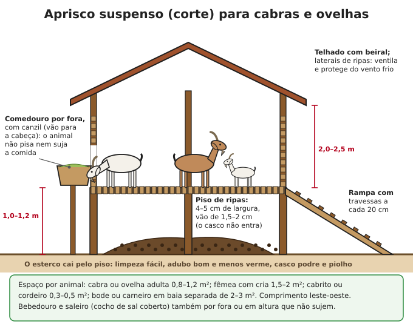
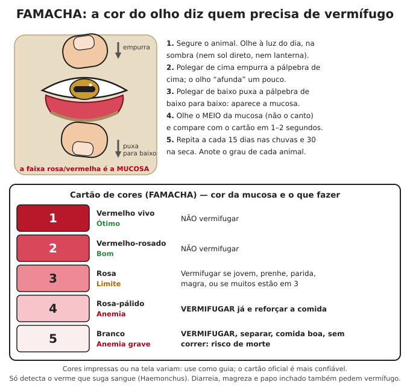

# Cabras e ovelhas

**Resumo:** cabras e ovelhas dão leite, carne, couro e lã em pouca área e aguentam a seca melhor que a
vaca. A cabra **ramoneia** (come folhas e galhos); a ovelha **pasteja** rente ao chão. Abrigue em
**aprisco suspenso** (piso de ripas a 1–1,2 m do chão). A gestação dura **~150 dias** (5 meses). O que
mais mata é a **verminose** (verme que suga sangue): examine a cor do olho pelo método **FAMACHA** a
cada 15–30 dias e vermifugue só quem precisa.

---

## 1. Raças

| Espécie | Raça | Aptidão | Características |
|---|---|---|---|
| Cabra | **Saanen** | leite | branca, 2–4 L/dia; pele clara sofre com sol forte (precisa de sombra) |
| Cabra | **Anglo-Nubiana** | dupla (leite gordo e carne) | orelhas grandes caídas, aguenta calor |
| Cabra | Alpina, Toggenburg | leite | 2–3 L/dia, clima ameno |
| Cabra | **Moxotó** | carne e pele | nativa do Nordeste, listra preta no dorso, muito rústica |
| Cabra | **Canindé** | leite e carne | nativa, preta com barriga e cara amareladas; leite razoável |
| Cabra | Boer | carne | sul-africana, cresce rápido; boa para cruzar |
| Ovelha deslanada (calor) | **Santa Inês** | carne | grande, sem lã, boa mãe, adaptada ao Brasil todo |
| Ovelha deslanada | **Morada Nova** | carne e pele | pequena, muito rústica, Nordeste |
| Ovelha deslanada | **Dorper** | carne | cabeça preta, corpo branco; ótima para cruzar com Santa Inês |
| Ovelha deslanada | Somalis Brasileira | carne | cabeça preta, garupa gorda; semiárido |
| Ovelha lanada (Sul) | **Corriedale** | lã e carne | a mais comum no Rio Grande do Sul |
| Ovelha lanada (Sul) | **Crioula Lanada** | lã grossa e carne | rústica, lã para pelegos e tecelagem |
| Ovelha lanada | Texel, Ideal, Merino | carne (Texel) ou lã fina | exigem bom manejo |

- **Deslanadas não precisam de tosquia** e aguentam calor; lanadas são para o frio do Sul.
- Para leite em casa: cabras Saanen, Anglo-Nubiana ou mestiças com nativas (mais rústicas).

## 2. Aprisco suspenso

| Item | Medida |
|---|---|
| Altura do piso | **1,0–1,2 m** do chão |
| Ripas do piso | **4–5 cm** de largura, **vão de 1,5–2 cm** (o casco não entra, o esterco cai) |
| Área | adulto **0,8–1,2 m²**; fêmea com cria **1,5–2 m²**; cabrito ou cordeiro 0,3–0,5 m²; bode ou carneiro em baia separada de **2–3 m²** |
| Pé-direito | 2,0–2,5 m acima do piso; comprimento leste-oeste |
| Laterais | ripas ou tábuas até 1–1,2 m acima do piso (ventila e corta o vento) |
| Rampa | com travessas a cada 20 cm, inclinação suave |

- **Comedouro por fora com canzil** (vão onde só passa a cabeça): o animal não pisa nem suja a comida.
  Cabras **não comem comida pisada ou suja**.
- **Saleiro coberto** e bebedouro na mesma ideia, em altura que não sujem.
- O esterco cai pelo piso: **menos verme, casco podre e piolho**, e adubo excelente (recolha toda semana).
- Ovelhas também podem ficar em galpão no chão, com cama seca trocada com frequência.
- Separe: baia de parição, baia de cabritos, baia do reprodutor, enfermaria.

## 3. Alimentação

- **Cabra:** prefere folhas, brotos, galhos e arbustos (ramoneio) — come em pé, até 1,5 m de altura.
  Ótima para áreas de capoeira e caatinga. Come 3–5% do peso em matéria seca: cabra de 50 kg ≈
  **6–10 kg de forragem verde** ou 1,5–2,5 kg de feno por dia.
- **Ovelha:** pasteja rente ao chão (por isso pega mais verme). Ovelha de 40–60 kg: **5–8 kg de capim verde**.
- **Plantas boas:** leucena, gliricídia, sabiá, guandu, amoreira, rama de mandioca (murcha ou seca),
  **feno de maniçoba** (venenosa fresca, segura como feno ou silagem), juazeiro, mororó, catingueira,
  capins. No semiárido: **palma forrageira** sempre com algo fibroso (capim seco, feno). Produção de
  feno e silagem em [Princípios gerais](01-principios-gerais.md).
- **Cabra leiteira** produzindo bem: além da forragem, **0,3–0,5 kg de concentrado** (milho, farelo) por
  litro de leite acima do que o pasto sustenta. Introduza grão aos poucos (excesso mata: enterotoxemia).
- **Sal mineral à vontade** (10–20 g/dia). **Ovelha: mineral próprio para ovinos** — o de bovinos tem
  cobre que intoxica ovelhas (cabras toleram mais).
- **Água:** 3–6 L/dia; em lactação, 8–15 L.
- **Pedra na urina** (macho que urina gota a gota, com dor, barriga estufada): evite muito concentrado
  em machos; sal e água à vontade.

## 4. Reprodução

| Item | Cabra | Ovelha |
|---|---|---|
| Puberdade | 5–8 meses | 6–8 meses |
| 1ª cobertura | 8–12 meses, com 60–70% do peso adulto (30–40 kg) | 8–12 meses, 35–40 kg (Santa Inês) |
| Cio repete a cada | 21 dias | 17 dias |
| Cio dura | 24–48 h | 24–36 h |
| Sinais | **abana a cauda sem parar**, berra, vulva inchada, muco, procura o bode, cai o leite | discretos: use o carneiro |
| Gestação | **~150 dias** (145–155) | **~150 dias** (145–155) |
| Crias por parto | 1–3 (gêmeos comuns) | 1–2 |
| 1 macho para | 30–40 cabras (jovem: 15–20) | 30–50 ovelhas (jovem: 15–20) |

- **Carneiro marcador:** passe no peito do carneiro uma mistura de graxa ou óleo com pó colorido (tinta
  em pó, carvão moído, urucum): as ovelhas cobertas ficam marcadas na garupa. Troque a cor a cada 17 dias:
  ovelha marcada de novo não emprenhou.
- **Efeito macho:** deixe o bode ou carneiro longe (sem ver nem cheirar) por 3–4 semanas; ao voltar,
  muitas fêmeas entram no cio juntas em 5–10 dias.
- Raças de clima frio (Saanen, Corriedale) entram no cio principalmente no **outono** (fevereiro a
  junho); raças nativas e tropicais, o ano todo.
- **Cheiro do bode:** mantenha o bode **longe das cabras em lactação e do local de ordenha** — o cheiro
  passa para o leite.

### Parto
- Quase sempre normal; nasce em até 1 hora de força. Ajude se houver **30–60 minutos de força sem
  avanço** ou posição errada (as mesmas posições da vaca: veja a figura em [Bovinos](03-bovinos.md)).
  Mão pequena, lavada e lubrificada. Com gêmeos, as pernas se misturam: siga cada perna até o corpo.
- **Toxemia da prenhez** (fêmea com gêmeos no último mês, magra ou gorda demais): fica parada, cega,
  treme, deita. Dê **60 mL de glicerina ou propilenoglicol pela boca, 2 vezes por dia**, e boa comida.
  Previna com comida boa no último mês de gestação.

## 5. Cabritos e cordeiros

1. **Colostro na 1ª–2ª hora:** 10% do peso nas primeiras 6–12 h (cabrito de 3 kg: 300 mL). Se não mama,
   ordenhe a mãe e dê na mamadeira.
2. **Umbigo:** mergulhe em **iodo 10%** e repita 2 vezes por dia até secar.
3. Crias **órfãs:** leite de cabra ou de vaca morno, 4–5 vezes por dia nas 2 primeiras semanas (total de
   15–20% do peso por dia), depois 3 vezes.
4. Capim novo, feno e um pouco de concentrado **a partir da 2ª semana**; água limpa sempre.
5. **Desmame:** 60–90 dias, quando pesar 2,5–3 vezes o peso de nascer (cabrito: 12–15 kg).
6. **Castração** dos machos que não serão reprodutores: com 2–4 semanas (burdizzo ou faca, como nos
   bovinos) ou anel de borracha na 1ª semana; vacina contra clostridioses (tétano).
7. **Corte de cauda** em cordeiros **lanados** (evita sujeira e bicheira): anel de borracha com 1–3
   semanas, deixando o suficiente para cobrir a vulva. Deslanados não precisam.
8. **Mochação** de cabritos (5–10 dias de vida): ferro quente sobre o botão do chifre por **no máximo
   5–8 segundos** (o crânio é fino) — só por quem já viu fazer.
9. **Rebanho com CAE** (artrite-encefalite caprina, "joelho grande"): separe o cabrito da mãe **ao
   nascer** e dê colostro aquecido a **56 °C por 60 minutos** (banho-maria com termômetro) e leite fervido.

## 6. Verminose e método FAMACHA

O verme ***Haemonchus*** vive no estômago e **suga sangue**. O animal fica anêmico: mucosas pálidas,
fraqueza, **papeira** (inchaço mole embaixo da mandíbula), emagrecimento e morte — às vezes **sem
diarreia**. É a maior causa de morte de cabras e ovelhas no Brasil, principalmente nas chuvas.

### Como examinar
1. Contenha o animal. Luz do dia, à sombra.
2. Com um polegar, empurre a pálpebra de cima; com o outro, puxe a de baixo para baixo.
3. Olhe a cor do **meio da mucosa** da pálpebra de baixo e compare com o cartão em 1–2 segundos.
4. Repita **a cada 15 dias nas chuvas e a cada 30 dias na seca**. Anote o grau de cada animal.

| Grau | Cor | Situação | O que fazer |
|---|---|---|---|
| 1 | vermelho vivo | ótimo | **não** vermifugar |
| 2 | vermelho-rosado | bom | **não** vermifugar |
| 3 | rosa | limite | vermifugar se for jovem, prenhe, recém-parida, em lactação, magra, ou se muitos do rebanho estão em 3 |
| 4 | rosa-pálido | anemia | **vermifugar já** e melhorar a comida |
| 5 | branco | anemia grave | **vermifugar**, separar, comida boa, nada de correr: risco de morte |

- As cores impressas variam; o cartão oficial FAMACHA é mais confiável. O método só detecta o verme que
  suga sangue: **diarreia, magreza e papeira** também pedem vermífugo, mesmo com grau baixo.
- **Animal que vive em grau 4–5** mesmo vermifugado: descarte (e não deixe filhos dele) — a resistência ao
  verme é hereditária.

### Vermifugar do jeito certo
1. **Pese** (ou estime) e dê a **dose pelo peso do mais pesado** do lote. Subdose cria verme resistente.
2. **Cabras metabolizam vermífugo mais rápido:** muitos precisam de **1,5 a 2 vezes** a dose de ovinos —
   siga a bula para caprinos.
3. Dê pela boca, com seringa sem agulha, **no fundo da boca, sobre a língua** (assim vai para o
   estômago certo). Jejum de 12–24 h antes melhora o efeito dos benzimidazóis (albendazol, fenbendazol).
4. **Não troque de produto a cada vez.** Use um até ele falhar (o animal não melhora em 7–14 dias);
   então mude de grupo químico.
5. Vermifugar **só quem precisa** (FAMACHA) deixa vermes sem contato com o remédio, e o remédio dura anos.

### Prevenção sem remédio
- Aprisco suspenso; não deixe pastejar capim rapado (as larvas ficam nos 5–10 cm de baixo).
- **Rodízio de pasto** e pastejo alternado com **bovinos ou cavalos** (que não pegam esses vermes).
- Boa comida com proteína: animal bem nutrido aguenta muito mais verme.
- Separe os animais novos (quarentena de 30 dias) e vermifugue na chegada.

## 7. Outras doenças e cuidados

| Problema | Sinais | O que fazer |
|---|---|---|
| **Casco crescido / casco podre** | casco comprido, virado; manqueira; podre: cheiro fétido entre as unhas | **apare a cada 2–4 meses** com tesoura de casco, rente à sola, sem sangrar; casco podre: limpe, apare, pedilúvio de **sulfato de zinco 10%** (ou de cobre 5%) por 5 min, local seco, antibiótico em spray |
| **Linfadenite caseosa** ("mal do caroço") | caroços (abscessos) atrás da mandíbula, na frente da paleta, na virilha; pus grosso, pastoso, branco-esverdeado | contagiosa. Isole. Quando o caroço amolecer, corte embaixo com lâmina fervida, esprema o pus **num saco ou lata e queime ou enterre**, lave a cavidade com **iodo 10%** todo dia até fechar (10–15 dias). Luvas. Descarte quem repete. Existe vacina |
| **Ectima contagioso** ("boqueira") | crostas nos lábios, focinho e tetas de cabritos e cordeiros | vírus; sara sozinho em 3–4 semanas. Iodo glicerinado nas crostas, ajude a mamar. **Passa para a mão de quem mexe: use luvas** |
| **Mastite** | úbere quente, inchado, leite com grumos; gangrenosa: úbere **frio, roxo ou preto** | teste da caneca, ordenha frequente, antibiótico intramamário (como em [Bovinos](03-bovinos.md)); gangrenosa é emergência |
| Enterotoxemia | morte súbita após excesso de grão ou capim muito novo | **vacina contra clostridioses**: 2 doses com 30 dias, depois anual; fêmeas 30 dias antes do parto |
| Pneumonia | tosse, corrimento, febre | ventilação sem vento direto, menos lotação; antibiótico |
| Bicho da cabeça (ovelhas) | espirros, corrimento no nariz, balança a cabeça | ivermectina ou closantel conforme bula |
| Ceratoconjuntivite | olho lacrimejando, branco, fecha o olho | sombra, afastar moscas, pomada antibiótica no olho |
| Piolhos | coceira, lã ou pelo falhado | produto conforme bula; aprisco limpo |
| CAE (cabras) | joelhos grandes, emagrecimento, úbere duro | sem cura; separar cabritos ao nascer (seção 5) |

## 8. Leite de cabra

- Ordenhe 2 vezes por dia (ou 1 vez com cabrito junto). A cabra tem **2 tetos**: uma mão em cada, mesma
  técnica da vaca (fecha em cima, aperta de cima para baixo, **sem puxar**). Teste da caneca antes,
  iodo nos tetos depois.
- Produção: Saanen e Alpina **2–3 L/dia** por 250–300 dias; cabras mestiças e nativas 0,5–1,5 L.
- Filtre, esfrie rápido e **ferva ou pasteurize** antes de beber.
- **Gosto forte ("de bode"):** bode perto, ordenha suja, leite que demora a esfriar.
- Ótimo para queijo, iogurte e para bebês (com cuidado: veja [Parto, bebês e crianças](../02-saude/07-parto-bebes-e-criancas.md)).
  Veja [Leite e laticínios](13-leite-e-laticinios.md).

## 9. Tosquia (ovelhas lanadas)

1. **1 vez por ano, na primavera** (setembro a novembro no Sul), antes do calor, com a lã **seca**.
2. Animal em jejum de 8–12 h (sujam menos e sofrem menos sentados).
3. Sente a ovelha **sobre a garupa, de costas apoiada nas suas pernas**: ela fica quieta.
4. Tesoura de esquila (ou máquina) **rente à pele, sem cortar**: comece pela barriga, depois pernas,
   pescoço, lados e costas, tirando o velo inteiro. Cuidado com tetas, prepúcio e dobras da pele.
5. Cortes: iodo e repelente (bicheira). Não deixe a ovelha recém-tosquiada na chuva fria por 2 semanas.
6. **Cascarreio:** tosquie em volta da cauda e da vulva antes do parto e se sujar de fezes.
7. A lã: lave, carde e fie — veja [Tecidos e costura](../09-quimica-e-oficios/04-tecidos-e-costura.md).
   Uma ovelha dá 2–5 kg de lã suja por ano.

## 10. Predadores

- **Cães (domésticos e soltos) são o maior matador de ovelhas e cabras** no Brasil; depois onça-parda,
  cachorro-do-mato, raposa (cordeiros), urubu e carcará (recém-nascidos fracos, olhos e umbigo) e javali.
- **Defesa:**
  1. Recolher no aprisco fechado **à noite** e na época de parição.
  2. Parição perto da casa.
  3. **Cão de guarda de rebanho**, criado **junto com as cabras desde filhote** (veja
     [Cães e gatos](11-caes-e-gatos.md)).
  4. **Burro ou jumenta** no rebanho: atacam cães e raposas (1 por rebanho; teste antes, alguns
     maltratam cordeiros).
  5. Cerca de tela com fio elétrico por fora, a 20 cm do chão.
  6. Sino (cincerro) em alguns animais: você ouve o rebanho correr.

---

Ver também: [Princípios gerais](01-principios-gerais.md) · [Bovinos](03-bovinos.md) · [Leite e laticínios](13-leite-e-laticinios.md) · [Abate e carne](12-abate-e-carne.md) · [Veterinária básica](14-veterinaria-basica.md) · [Couro](../09-quimica-e-oficios/05-couro.md)
