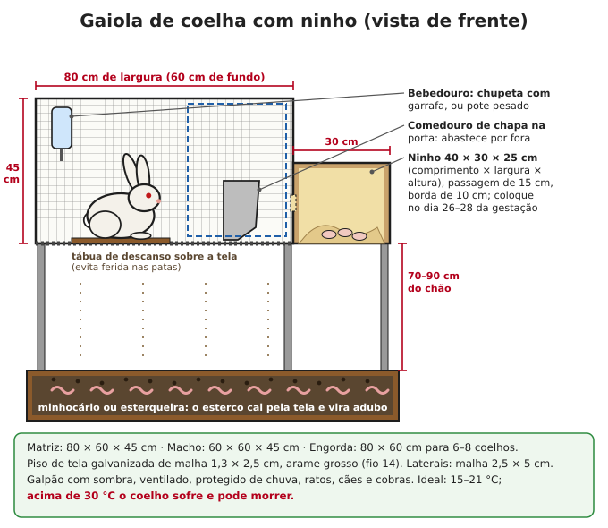

# Coelhos

**Resumo:** o coelho é a carne mais rápida de quem tem pouco espaço: uma coelha pare a cada 1–2 meses
(gestação de **30–31 dias**, 6–10 filhotes) e vive de **capim, feno e folhas**. Três coelhas e um macho
dão **100–150 kg de carne por ano**. Cuidados que decidem tudo: **sombra e frescor** (acima de 30 °C o
coelho morre), **feno à vontade** (fibra), comida sempre seca e sem mofo, gaiolas limpas.

---

## 1. Raças

| Raça | Peso adulto | Uso |
|---|---|---|
| **Nova Zelândia Branco** | 4–5 kg | a melhor para carne: boa mãe, cresce rápido |
| **Califórnia** | 4–4,5 kg | branco com focinho, orelhas e patas pretos; carne |
| **Gigante** (de Flandres, Gigante Branco) | 6–8 kg ou mais | grande, mas cresce devagar e come mais; bom para cruzar |
| Chinchila, Borboleta, mestiços | 3–4,5 kg | rústicos; bons onde não há ração |
| Rex | 3,5–4,5 kg | pele de pelo curto e macio (peles) |

Cruzamento útil: macho Califórnia × fêmea Nova Zelândia.

## 2. Instalações

| Gaiola | Medidas (largura × fundo × altura) |
|---|---|
| Coelha (matriz) | **80 × 60 × 45 cm** + ninho |
| Macho | 60 × 60 × 45 cm |
| Engorda | 80 × 60 cm para **6–8 coelhos** até o abate (ou 12–15 por m²) |
| Ninho | caixa de madeira **40 × 30 × 25 cm** (comprimento × largura × altura), entrada de 15 cm, borda de 10–12 cm |

- **Piso** de tela galvanizada de malha **1,3 × 2,5 cm**, arame grosso (fio 14); laterais de malha 2,5 × 5 cm.
  O esterco cai e a gaiola fica seca (menos coccidiose).
- **Tábua de descanso** sobre parte do piso: evita ferida nas patas (calo), sobretudo nos coelhos pesados.
- Gaiolas suspensas a **70–90 cm do chão**. Embaixo: **minhocário** ou esterqueira.
- **Galpão:** sombra, ventilação, telhado de barro ou palha, protegido de chuva, sol direto, **ratos,
  cães, gatos e cobras**. Ideal **15–21 °C**.
- **Calor:** acima de 30 °C o coelho ofega, as orelhas ficam vermelhas, ele deita esticado e pode morrer.
  Molhe o telhado e o chão, plante árvores, dê garrafa de água gelada se houver, molhe as orelhas com água
  fresca. Machos ficam temporariamente estéreis depois de dias de calor forte.
- **Sem tela:** coelheira de madeira e bambu (proteja as bordas com lata: eles roem tudo) ou cercado no
  chão com piso de cimento ou tela enterrada (coelho cava túneis). No chão há mais coccidiose e verme.

## 3. Alimentação

O coelho é herbívoro: precisa de **muita fibra** (feno, capim) para o intestino funcionar. Ele come de
novo algumas fezes moles da noite (cecotrofia): é normal e necessário.

### O que dar
| Alimento | Como |
|---|---|
| **Feno** (capim seco, rama de amendoim, feno de leguminosa) | **à vontade, sempre** |
| Capim verde (napier novo, braquiária, estrela, grama) | **murcho por 2–4 horas**, nunca molhado de chuva ou orvalho, nunca amontoado e quente |
| Folhas: **amoreira**, **rami**, folha de batata-doce, guandu, folha de bananeira, cenoura com rama | excelentes; introduza devagar |
| Leucena, rama de mandioca | pouco (até 1/5 do verde) e murchas ou secas |
| Cenoura, abóbora, beterraba, batata-doce, chuchu | como complemento |
| Grãos (milho, aveia, trigo) quebrados, ração peletizada | coelha amamentando e engorda |

### Quanto
| Animal | Com ração peletizada | Sem ração |
|---|---|---|
| Adulto em manutenção | 120–150 g + feno | 0,5–1 kg de verde murcho + feno à vontade + punhado de grão |
| Coelha prenhe | 150–200 g + feno | idem + mais grão no fim da gestação |
| Coelha com ninhada | **à vontade** (300–500 g) | o melhor verde + grão + folhas de leguminosa à vontade |
| Engorda | 100–150 g | verde + feno + grão; demora mais (100–120 dias) |

### O que NÃO dar
- **Capim molhado, fermentado, quente de amontoado ou mofado** (diarreia e timpanismo — o coelho
  estufa e morre).
- **Mudança brusca** de comida (faça em 7 dias).
- Plantas tóxicas: **comigo-ninguém-pode, espirradeira, mamona, avelós**, folhas de tomate e batata,
  samambaia, erva-de-rato; **abacate** (folha, casca e caroço), cebola, alho, chocolate.
- Restos de cozinha temperados, salgados ou cozidos; pão e doces (só pouco); feijão cru; mandioca brava fresca.
- Muita couve ou repolho (gases) e muita alface (diarreia).

### Água
- **0,3–0,5 L/dia** o adulto; **coelha com ninhada: 1–2 L/dia**. Sempre limpa e fresca.
- Sem água, a coelha pode **comer os filhotes**. Bebedouro de chupeta ou pote de barro pesado (não vira).

## 4. Reprodução

### Primeiros passos
- **Primeira cobertura:** fêmea com **4,5–5 meses** (Nova Zelândia, ~3,5 kg); macho com 5–6 meses.
- **1 macho para 8–10 coelhas.** Tenha um macho de reserva.
- A coelha **não tem cio regular**: ovula quando é coberta. Está receptiva quando a **vulva está
  vermelha ou arroxeada e úmida**; pálida = provavelmente vai recusar.

### Cobertura
1. **Leve sempre a coelha à gaiola do macho** (na gaiola dela, ela defende o território e briga).
2. A cobertura é rápida: o macho cai de lado depois. Se em 5–10 minutos nada acontecer, tente no dia
   seguinte.
3. Volte com a coelha para a gaiola dela. Anote a data.
4. **Palpação com 10–14 dias:** com a coelha calma sobre uma mesa, apalpe a barriga de leve, de trás
   para a frente: bolinhas do tamanho de azeitonas = prenhe. Vazia: cubra de novo.

### Gestação e parto
- **Gestação: 30–31 dias** (28–33).
- **Dia 26–28:** ponha o **ninho** com feno ou palha seca. A coelha arranca pelo da barriga para forrar
  1–2 dias antes.
- Pare à noite, em 15–30 minutos: **6–10 filhotes** (láparos), pelados e de olhos fechados.
- **No dia seguinte:** confira o ninho com a mão esfregada em feno (para não deixar cheiro), retire os
  mortos e conte. A mãe **amamenta só 1 vez por dia**, de madrugada: é normal ela ficar longe do ninho.
- **Adoção:** até o 3º dia, filhotes de ninhadas grandes podem passar para coelhas que pariram no mesmo
  dia (até 8–9 por coelha). Esfregue-os com o forro do novo ninho.
- Olhos abrem com ~10 dias; saem do ninho com 18–21 dias e começam a comer sólidos. Retire o ninho com
  ~21–25 dias.
- **Desmame com 30–45 dias.** Retire a mãe, deixe os filhotes na gaiola por mais alguns dias.

### Ritmo de partos
| Ritmo | Quando cobrir de novo | Partos por ano | Observação |
|---|---|---|---|
| Extensivo | depois do desmame | 4–5 | para quem tem pouca comida boa |
| **Semi-intensivo (recomendado)** | **10–14 dias depois do parto** | **6–7** | bom equilíbrio |
| Intensivo | 1–2 dias depois do parto | 8–10 | desgasta a coelha; só com ração boa |

- Coelha produz bem por **2–3 anos**. Descarte (para a panela) as que comem filhotes duas vezes,
  abandonam ninhadas, têm ninhadas pequenas ou mastite.
- **Sexagem** (no desmame): aperte de leve dos lados dos genitais. Fêmea: uma fenda em "V" ou "I". Macho:
  um círculo com um tubinho no meio.
- Consanguinidade: troque o macho a cada 1–2 anos ou com vizinhos ([Princípios gerais](01-principios-gerais.md)).

## 5. Produção de carne

- **Abate com 70–90 dias**, pesando **2,2–2,5 kg** (Nova Zelândia com ração). Só com capim e folhas:
  100–120 dias.
- **Rendimento:** carcaça limpa ≈ **50–55% do peso vivo** → 1,2–1,4 kg por coelho. Carne magra, branca,
  rica em proteína.
- **Conta:** coelha semi-intensiva = 6 partos × 6–7 desmamados ≈ **40 coelhos/ano ≈ 50 kg de carcaça**.
  Com comida rústica: 25–30 coelhos ≈ 30–35 kg. **3 coelhas + 1 macho ≈ 100–150 kg de carne por ano.**
- Conversão: 3–4 kg de ração por kg de coelho vivo.
- Abate, esfola e conservação: [Abate e carne](12-abate-e-carne.md).

## 6. Doenças

| Doença | Sinais | O que fazer |
|---|---|---|
| **Coccidiose** | intestinal: filhotes de 4–12 semanas com diarreia, barriga inchada, magros; hepática: manchas brancas no fígado no abate | limpeza, piso de tela, comedouro sem fezes; sulfa (sulfaquinoxalina) ou toltrazuril na água conforme bula, tratando a gaiola toda |
| **Sarna de orelha** | crostas marrons e grossas dentro da orelha, coça e balança a cabeça | **óleo mineral ou vegetal** dentro da orelha (amolece e sufoca o ácaro) a cada 2–3 dias por 3 semanas, ou **ivermectina 0,2–0,4 mg/kg** injetável repetida em 14 dias. **Não arranque as crostas** (dói e sangra) |
| Sarna do corpo | crostas no nariz, olhos, patas | ivermectina como acima; passa levemente para gente: luvas |
| **Pasteurelose** ("coriza") | espirros, corrimento no nariz, **patas da frente sujas e amareladas** (limpa o nariz), abscessos, cabeça torta, pneumonia | contagiosa: isole. Ventilação sem corrente de ar, limpe a amônia. Antibiótico (enrofloxacino ou oxitetraciclina) conforme bula; os crônicos ficam portadores: descarte |
| **Diarreia / enterite** | fezes moles ou com muco, barriga estufada, para de comer; filhotes após o desmame | **feno à vontade**, corte grão e verde molhado; separe; água limpa. A causa quase sempre é pouca fibra ou mudança brusca |
| Timpanismo | barriga estufada e dura, sem fezes | feno, tirar o verde; massagem na barriga; muitas vezes fatal |
| Calo nas patas (pododermatite) | feridas na sola das patas de trás | tábua de descanso, piso limpo; limpe com iodo |
| Mixomatose | inchaço na cabeça, olhos, orelhas e genitais | vírus transmitido por mosquito e pulga: tela contra mosquitos; sem cura; sacrifique e queime |
| Dentes crescidos | baba, não come, dentes da frente compridos ou tortos | corte com alicate afiado; dê galhos para roer; descarte da reprodução (é hereditário) |
| Calor | ofega, orelhas vermelhas, deitado esticado | sombra, molhar as orelhas com água fresca, ventilação |

Prevenção geral: quarentena de 30 dias, gaiolas e comedouros limpos, cama do ninho seca, feno de
qualidade, sem superlotação.

## 7. Pele e esterco

### Pele
1. Logo após a esfola, raspe gordura e carne da parte interna.
2. Estique a pele com o **pelo para dentro** num arame dobrado em "U" ou numa tábua estreita.
3. **Salgue** a parte de dentro com sal fino ou seque à sombra, em lugar ventilado.
4. Curtimento (para virar pelego macio): [Couro](../09-quimica-e-oficios/05-couro.md).
Pele de coelho com mais de 4–5 meses é mais firme (de filhote rasga e solta pelo).

### Esterco: o melhor do sítio para a horta
- Rico em nitrogênio e fósforo e **não queima as plantas**: pode ir **quase direto** ao canteiro ou à
  cova de frutíferas (o de galinha e o de porco precisam curtir).
- **Minhocário embaixo das gaiolas:** o esterco cai, a minhoca transforma em húmus, e as minhocas viram
  proteína para as galinhas. A urina deixa o esterco forte: misture palha.
- Veja [Solo, adubação e compostagem](../04-agricultura/01-solo-adubacao-compostagem.md) e [Horta](../04-agricultura/03-horta.md).

---

Ver também: [Princípios gerais](01-principios-gerais.md) · [Galinhas](02-galinhas.md) · [Abate e carne](12-abate-e-carne.md) · [Veterinária básica](14-veterinaria-basica.md) · [Couro](../09-quimica-e-oficios/05-couro.md) · [Horta](../04-agricultura/03-horta.md)
