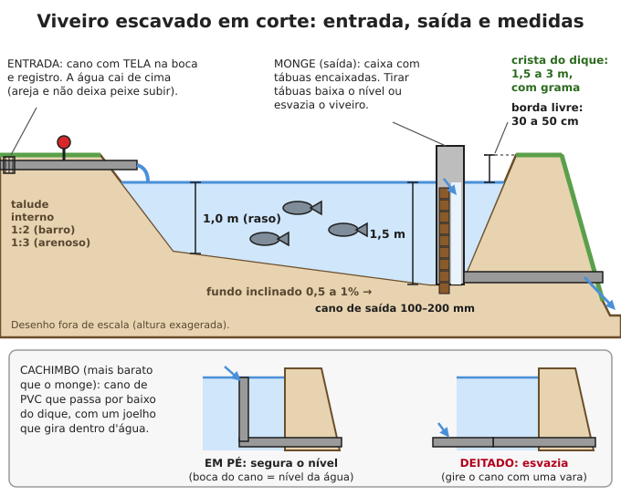

# Peixes (piscicultura)

**Resumo:** um viveiro de 300 m² bem cuidado produz de 150 a 300 kg de peixe por ciclo de 6 a 12
meses, comendo restos, folhas, larvas e "água verde". Escolha espécies que **se reproduzem sozinhas**
(tilápia, carpa comum, lambari) para não depender de alevinos comprados. Os três segredos: **água verde
no ponto certo**, **não exagerar na comida** e **vigiar o oxigênio de madrugada**.

---

## 1. Qual peixe criar

| Espécie | Onde vai bem | O que come | Reproduz no viveiro? | Abate |
|---|---|---|---|---|
| **Tilápia-do-nilo** | Todo o Brasil. No Sul só cresce de outubro a abril; morre abaixo de ~10 °C | Ração, plâncton (água verde), folhas, restos | **Sim, até demais** (veja seção 8) | 500–800 g em 6–8 meses |
| **Tambaqui** | Norte, Nordeste, Centro-Oeste (água acima de 24 °C). Morre no frio (abaixo de ~16 °C) | Ração, frutas, sementes, grãos, folhas | Não (só com hormônio, em laboratório) | 1,5–3 kg em 10–12 meses |
| **Pacu** (e o híbrido tambacu) | Centro-Oeste, Sudeste, Norte do Paraná | Ração, frutas, grãos, folhas | Não | 1–2 kg em 10–12 meses |
| **Carpa comum** | Sul e Sudeste (aguenta frio) | Revira o fundo: larvas, restos, grãos | **Sim** (primavera, água acima de 18 °C) | 1–2 kg em 10–12 meses |
| **Carpa-capim** | Sul e Sudeste | **Capim e folhas** tenras, verduras | Não | 1,5–3 kg em 12 meses |
| **Carpa prateada e cabeça-grande** | Sul e Sudeste | Filtram o plâncton da água verde | Não | 1–2 kg em 12 meses |
| **Jundiá** (nativo) | Sul (aguenta o inverno, cresce de 15 a 30 °C) | Onívoro: minhoca, restos, ração, peixinhos | Às vezes, na primavera | 0,6–1 kg em 10–12 meses |
| **Curimatã / curimbatá** | Nordeste (açudes), Sudeste | Lodo e algas do fundo (limpa o viveiro) | Não (precisa de rio) | 0,5–1 kg em 12 meses |
| **Lambari** | Todo o Brasil | Ração, insetos, restos | **Sim, fácil** | 20–40 g em 3–4 meses (frito inteiro) |
| **Traíra, tucunaré** | Traíra: todo o Brasil. Tucunaré: regiões quentes | Outros peixes (predadores) | Sim | Use para **controlar** filhotes de tilápia |

**Recomendações práticas:**
- **Iniciante, qualquer região quente:** tilápia (ou tilápia + tambaqui no Norte/Nordeste).
- **Sul e serra:** carpas em policultivo + jundiá; tilápia só no verão.
- **Açude do Nordeste:** tilápia + curimatã (a curimatã come o lodo que a tilápia não aproveita).
- **Policultivo** (várias espécies juntas) aproveita melhor o viveiro: cada uma come uma coisa
  diferente. Exemplo de Santa Catarina: carpa comum, capim, prateada e cabeça-grande juntas.
- Depois que acabar o fornecimento de alevinos, o que se mantém sozinho é **tilápia, carpa comum,
  lambari, cará/acará, traíra e tucunaré**. Guarde sempre reprodutores.

> **ATENÇÃO:** nunca solte tilápia, carpa, tucunaré ou bagre-africano em rios e lagoas naturais. Eles
> acabam com os peixes nativos. Proteja a saída do viveiro com tela.

## 2. Viveiro escavado ou açude

### Onde fazer
- **Solo que segura água:** com pelo menos 20–30% de argila. Teste: aperte uma bola de terra úmida;
  se ela fica firme, não esfarela e dá para fazer uma "cobrinha" sem rachar, serve. Melhor ainda: cave
  um buraco de 1 m, encha de água de manhã e veja se ainda há água no dia seguinte.
- **Água por gravidade:** fonte, córrego ou açude **acima** do viveiro, para encher sem bomba.
  Precisa de água só para encher e repor perdas (evaporação e infiltração, 1–2 cm por dia).
- Terreno com declive leve (1–3%), sol pleno, fora do caminho de enxurrada (faça um canal de
  desvio acima do viveiro). Árvores a pelo menos 5 m (folhas apodrecem na água).

### Medidas

| Item | Medida |
|---|---|
| Área para uma família | 200 a 500 m² (ex.: 10 × 30 m). Até 20 m de largura facilita passar a rede |
| Profundidade | **1,0 m na parte rasa e 1,5 m na parte funda** (no Sul, 1,5–2 m na parte funda protege do frio) |
| Fundo | Inclinado 0,5–1% em direção à saída (para esvaziar tudo) |
| Talude (rampa) interno | 1:2 em solo argiloso (2 m na horizontal para 1 m de altura); 1:3 em solo arenoso |
| Crista do dique | 1,5 m (a pé) a 3 m (para carroça) de largura |
| Borda livre | 30–50 cm entre a água e o topo do dique |
| Cano de saída | 100 mm (viveiro até 500 m²) a 200 mm (maior) |

### Construção passo a passo
1. Marque o retângulo com estacas e barbante. Retire a camada de cima (terra com raízes e folhas)
   de toda a área onde vai o dique e guarde-a para a grama.
2. Assente o **cano de saída** no ponto mais baixo **antes** de levantar o dique, com uma ou duas
   "golas" (placas de concreto ou anéis de cimento em volta do cano, no meio do dique) para a água
   não escorrer por fora do cano e furar o dique.
3. Cave e levante o dique em **camadas de 20 cm**, molhando e socando bem cada camada (pilão, pé,
   compactador). A terra mais argilosa vai no centro do dique.
4. Faça a **entrada**: cano com tela fina na boca e registro, terminando **acima** do nível da água
   (a queda areja e impede peixes de fora de subirem).
5. Faça o **ladrão**: um cano ou canal raso com tela, 10–15 cm abaixo da crista, para a chuva forte
   sair sem passar por cima do dique (água por cima **rompe** o dique).
6. Plante grama (batatais, esmeralda) nos diques. Nada de árvores em cima: as raízes abrem vazamentos.

### Monge ou cachimbo (para controlar o nível e esvaziar)
- **Monge:** caixa de tijolo ou concreto, aberta em cima, com duas ranhuras onde se encaixam
  tábuas. A altura da última tábua define o nível da água. Tirando tábuas, o viveiro esvazia aos
  poucos. Coloque tela na frente das tábuas para os peixes não fugirem.
- **Cachimbo:** joelho de PVC no cano de saída, dentro do viveiro, com um pedaço de cano em pé.
  **Em pé**, a boca do cano marca o nível; **deitado** (gire com uma vara ou corda), esvazia. É o
  mais barato e funciona bem em viveiros pequenos.

### Tanque em caixa d'água ou de lona
- Caixa d'água de 500–1.000 L ou tanque de lona (lona de PVC ou geomembrana de 0,5–1 mm; lona preta
  comum dura só 1–2 anos ao sol). Cubra metade com sombrite para não esquentar demais.
- **Sem aerador:** no máximo **5 kg de peixe por 1.000 L** no fim (ex.: 10 tilápias de 500 g).
- **Com aerador 24 h e troca de 10–20% da água por dia:** até 20 kg por 1.000 L.
- Use a água trocada (cheia de adubo) para regar a horta.

## 3. Preparar a água: calagem e adubação

1. Com o viveiro **vazio**, espalhe **calcário** (dolomítico ou calcítico) no fundo e nos taludes:
   **100–200 g/m²** (1–2 toneladas por hectare); em solo muito ácido (cerrado), até 300 g/m².
2. Se o viveiro já teve peixes doentes ou peixes "invasores", jogue **cal virgem** nas poças que
   sobraram (100–200 g/m²) e espere **7–10 dias** antes de encher.
3. Encha com 20–30 cm de água e espalhe o **adubo orgânico**: esterco de galinha **100–200 g/m²** ou
   esterco de gado/porco **200–300 g/m²**. Termine de encher.
4. Em 7–10 dias a água fica **verde** (plâncton = comida natural). Só então solte os peixes.
5. **Manutenção:** se a água clarear demais, aplique 1/4 da dose inicial de esterco por semana.
   Adubo químico também serve: 3 g/m² de ureia + 3 g/m² de superfosfato simples, dissolvidos na
   água, a cada 15 dias.

### Medir a água verde (transparência)
Use um prato branco amarrado numa vara marcada de 10 em 10 cm (ou o próprio braço):

| Some de vista a... | Significa | Faça |
|---|---|---|
| Mais de 60 cm | Água clara, pouca comida natural | Adube |
| **30 a 40 cm** (mais ou menos até o cotovelo) | **Ideal** | Mantenha |
| Menos de 25 cm (some antes do pulso) | Verde demais: risco de faltar oxigênio de madrugada | Pare de adubar, reduza a ração, renove água |

## 4. Quantos peixes soltar

| Sistema | Tilápia | Tambaqui / pacu | Produção esperada |
|---|---|---|---|
| Só adubação, sem ração | 1 peixe a cada 2 m² | 1 a cada 3–4 m² | 1–3 t/ha/ano (100–300 g/m²) |
| Adubação + ração, sem aerador | **2–3 peixes/m²** | 1 peixe/m² | 5–8 t/ha/ciclo (0,5–0,8 kg/m²) |
| Com aerador e renovação de água | 4–6 peixes/m² | 1,5–2/m² | 1–1,5 kg/m² |
| Policultivo de carpas | 0,5–1 peixe/m² no total | — | 2–4 t/ha/ano |

- Solte alevinos de **pelo menos 5–10 g** (menores morrem muito). Faça a aclimatação: deixe o saco
  boiando 15–20 min e misture aos poucos a água do viveiro antes de soltar.
- Conte com 10–20% de perdas.

## 5. Alimentação

### Com ração
| Peso do peixe | Proteína da ração | Quantidade por dia (% do peso dos peixes) | Vezes por dia |
|---|---|---|---|
| até 30 g | 36–40% (farelada ou 1–2 mm) | 6–10% | 4–6 |
| 30–100 g | 32–36% (2–4 mm) | 4–6% | 3–4 |
| 100–300 g | 28–32% (4–6 mm) | 2–3% | 2–3 |
| acima de 300 g | 28% (6–8 mm) | 1–2% | 2 |

- Dê só o que eles comem em **10–15 minutos**. Sobrou ração boiando? Diminua. Ração podre no fundo
  consome oxigênio e mata.
- Para saber o peso total: pesque 20 peixes, pese, tire a média e multiplique pelo número de peixes.
- **Água fria:** tilápia abaixo de 22 °C come metade; abaixo de 18 °C, **pare** de dar ração.
- Dê ração entre 9 h e 16 h, nunca de madrugada nem com os peixes boquejando.
- Conversão: 1,4 a 1,8 kg de ração para cada 1 kg de peixe.

### Sem ração (o que fazer quando ela acabar)
- **Larvas de mosca soldado-negro:** crie num balde ou caixa com restos de comida, fruta e esterco;
  as larvas maduras (pré-pupas) sobem por uma rampa e caem num balde, prontas para dar aos peixes.
  Têm ~40% de proteína. É a melhor ração caseira.
- **Minhocas** do minhocário (veja [compostagem](../04-agricultura/01-solo-adubacao-compostagem.md)).
- **Cupins:** quebre pedaços de cupinzeiro de terra sobre a água. Os peixes adoram.
- **Lentilha-d'água e azola** (plantinhas que boiam): cultive num tanque separado adubado e passe
  para o viveiro. Têm 20–35% de proteína (seca) e dobram de quantidade em poucos dias.
- **Folhas:** amoreira, mandioca (deixe murchar 1–2 dias ao sol antes), leucena (pouca), couve,
  taioba cozida, capim tenro (para carpa-capim e tilápia).
- **Restos de cozinha cozidos:** arroz, milho, mandioca, abóbora, frutas maduras. São pobres em
  proteína; misture com larvas ou minhocas.
- **Lâmpada sobre a água à noite** (se houver energia) atrai insetos que caem e viram comida.
- **Ração caseira úmida:** 40% de farelo de soja ou feijão cozido moído, 30% de milho moído, 20% de
  farelo de arroz ou trigo, 10% de farinha de sangue, de peixe ou larvas secas. Faça bolinhas ou
  "macarrão" na máquina de moer e seque ao sol.

## 6. Oxigênio: o maior assassino de peixes

O oxigênio da água é **mais baixo no fim da madrugada (5–7 h)**, porque à noite as algas também
respiram. Piora em dias **nublados e quentes**, com água muito verde e com excesso de ração.

**Sinais de falta de oxigênio:**
- Peixes na superfície **boquejando** (abrindo a boca para "beber ar") de manhã cedo.
- Peixes parados perto da entrada de água.
- Morrem primeiro os **maiores**. Água com cheiro ruim ou que mudou de cor de repente (verde para
  marrom/cinza = as algas morreram).

**O que fazer (na hora):**
1. **Pare a ração** e o adubo.
2. Abra a entrada de água para cair do alto (cascata).
3. Agite a superfície: remo, bomba jogando água para cima, gente batendo a água. Qualquer motor de
   barco ou bomba ajuda.
4. Renove 20–30% da água pelo fundo (tirando tábuas do monge) e reponha com água nova.

## 7. Saúde e inimigos

- **Inimigos:** garça, biguá, martim-pescador, lontra, cobra, rã-touro e sapos (comem filhotes),
  e gente. Em tanques pequenos, estique fios ou tela por cima.
- **Peixe com pontos brancos, nadando esfregando-se** (ictio, comum no frio): banho de sal, numa
  caixa separada com aeração: **10 g de sal por litro (1%) por 30 minutos**. Se o peixe deitar de
  lado, devolva à água limpa na hora.
- Em caixas pequenas, manter **3–5 g de sal por litro** reduz o estresse e doenças.
- Peixe morto: retire e enterre todo dia. Mortes em massa sem sinal de falta de oxigênio podem ser
  veneno (agrotóxico na água de entrada).

## 8. Tilápia: superpopulação e como controlar

A tilápia começa a se reproduzir com **3–4 meses** e desova a cada **3–6 semanas** no calor. A fêmea
choca os ovos na boca. Sinal: **crateras redondas de 30–60 cm** no fundo raso (ninhos). Sem
controle, o viveiro enche de milhares de peixinhos que comem a comida e **ninguém cresce** (fica tudo
com 100–150 g).

**Formas de controlar (combine duas ou mais):**
1. **Despesque antes:** crie por 4–6 meses e tire tudo; recomece com alevinos.
2. **Só machos:** os machos crescem 30–50% mais. Alevinos "revertidos" (todos machos) vêm de
   fornecedores. Sem eles, **separe à mão** a partir de 50 g (10–12 cm): vire o peixe de barriga para
   cima, seque a região atrás da barriga e olhe: **macho tem 2 aberturas** (ânus + papila com um
   furo); **fêmea tem 3** (ânus, uma fenda no meio e o furo da urina na ponta da papila). Uma gota de
   tinta de caneta ou de azul de metileno ajuda a ver. Erra-se 5–10%: complete com o item 3.
3. **Peixe predador junto:** traíra ou tucunaré, cerca de **1 para cada 20 a 50 tilápias**, menor que
   as tilápias grandes (ele come só os filhotes).
4. **Tanque-rede ou gaiola** dentro do açude: os ovos caem pela tela e a fêmea não consegue chocar.

**Para ter alevinos próprios:** mantenha um tanque pequeno (berçário) com 1 macho para 2–3
fêmeas, bem alimentados. Recolha os filhotes com peneira de tela fina na beira e passe para outro
tanque até ficarem com 5–10 g.

## 9. Despesca e abate

- **Jejum de 1–2 dias** antes. Gosto de barro? Passe os peixes para água limpa e corrente por 3–7
  dias sem comida.
- Despesque de **manhã cedo**, no fresco. Baixe metade da água pelo monge e passe uma **rede de
  arrasto** (malha de 15–25 mm; comprimento 1,5 vez a largura do viveiro; altura 2 vezes a
  profundidade), de uma ponta à outra, com duas pessoas, mantendo o chumbo encostado no fundo.
- Para consumo diário, faça **despesca parcial** com tarrafa ou anzol.
- **Abate humanitário:** mergulhe o peixe em **água com gelo** (metade gelo, metade água) ou dê uma
  pancada forte e seca no topo da cabeça, logo acima dos olhos. Em seguida, corte as guelras de um
  lado para sangrar, em água fria, por 5–10 minutos.

### Limpeza
1. Tire as escamas raspando do rabo para a cabeça (faca ou tampinhas pregadas numa tábua).
2. Corte a barriga do ânus até a cabeça, **raso**, sem furar as vísceras. Puxe tudo. Não estoure a
   **vesícula verde** (fel): amarga a carne.
3. Raspe o "sangue" escuro grudado na espinha (é o rim) e lave em água limpa e fria.
4. Rendimento da tilápia: peixe limpo ≈ 85% do peso vivo; filé ≈ 30–35%.
5. Use cabeça, espinha e restos para caldo, ração (cozidos) ou adubo.

### Conservação
| Método | Duração |
|---|---|
| Na sombra, sem gelo | **poucas horas** (2–4 h no calor) |
| Eviscerado, em gelo (1 kg de gelo para 1 kg de peixe) | 7–12 dias |
| Congelado | 3–6 meses |
| **Salgado e seco ao sol** (abra em manta, cubra com sal = 30–40% do peso, empilhe 24–48 h, seque ao sol 3–7 dias) | meses, em local seco |
| Defumado (salmoura e fumaça) | 1–2 semanas; bem seco, mais |

Detalhes em [Conservação de alimentos](../03-alimentacao/02-conservacao-de-alimentos.md). Peixe
estragado: olhos fundos e opacos, guelras marrons, cheiro forte, carne que afunda ao apertar.
**Cozinhe sempre bem** (parasitas).

## 10. Aquaponia simples (peixe + horta)

A água suja dos peixes é bombeada para um canteiro de pedras onde as plantas "comem" o adubo e
devolvem a água limpa.

1. **Tanque de peixes:** caixa d'água de 1.000 L, com 10–20 kg de peixe no fim (tilápia).
2. **Canteiro:** caixa ou tanque raso de **30 cm de profundidade, com 2–3 m² de área**, cheio de
   brita nº 1 ou argila expandida lavada, colocado **mais alto** que a caixa de peixes.
3. **Bomba** submersa de 500–1.000 L/h (12 V com placa solar serve, veja
   [energia solar](../06-energia/04-energia-solar.md)) levando a água ao canteiro.
4. **Retorno por gravidade:** um cano de saída no canteiro (o ideal é um **sifão de sino**, que enche e
   esvazia o canteiro de 15 em 15 min, arejando as raízes) devolve a água à caixa.
5. **Partida:** ligue só com 2–3 peixes por 4–6 semanas, até as bactérias se estabelecerem (as
   plantas começam a crescer bem). Depois ponha o resto dos peixes.
6. Plantas que vão bem: alface, couve, cebolinha, salsa, manjericão, agrião, depois tomate e pimenta.
7. Reponha só a água que evapora. Nada de sabão, agrotóxico ou remédio na água.

> **ATENÇÃO:** sem energia a bomba para e os peixes morrem em horas (falta de oxigênio). Tenha bateria
> ou um jeito manual de jogar água, ou trabalhe com poucos peixes.

## 11. Peixe integrado com patos, porcos e galinhas

O esterco cai direto na água, aduba o viveiro e vira plâncton (comida dos peixes). Não precisa de
outro adubo.

| Animal | Quantidade por área de água | Como |
|---|---|---|
| **Patos** | 1 pato para cada 35–50 m² (200–300 por hectare) | Abrigo na beira ou sobre a água; os patos também comem caramujos e insetos. Solte os peixes já com 30–50 g (pato come alevino pequeno) |
| **Porcos** | 1 porco para cada 170–250 m² (40–60 por hectare) | Chiqueiro na beira, piso com caimento e canaleta levando a lavagem para o viveiro |
| **Galinhas** | 1 galinha para cada 10–20 m² | Galinheiro de piso ripado sobre a água ou na beira |

- Vigie a transparência (seção 3): se ficar abaixo de 25 cm, desvie o esterco por uns dias.
- Lodo do fundo, ao esvaziar o viveiro, é ótimo adubo para a horta e o pomar.
- Veja [Suínos](04-suinos.md) e [Patos e outras aves](07-outras-aves.md).

---

Ver também: [Princípios gerais](01-principios-gerais.md) · [Pesca e armadilhas](../11-natureza-e-desastres/02-pesca-armadilhas-caca.md) · [Irrigação](../04-agricultura/07-irrigacao.md) · [Conservação de alimentos](../03-alimentacao/02-conservacao-de-alimentos.md) · [Encontrar e captar água](../01-agua/01-encontrar-e-captar-agua.md)
