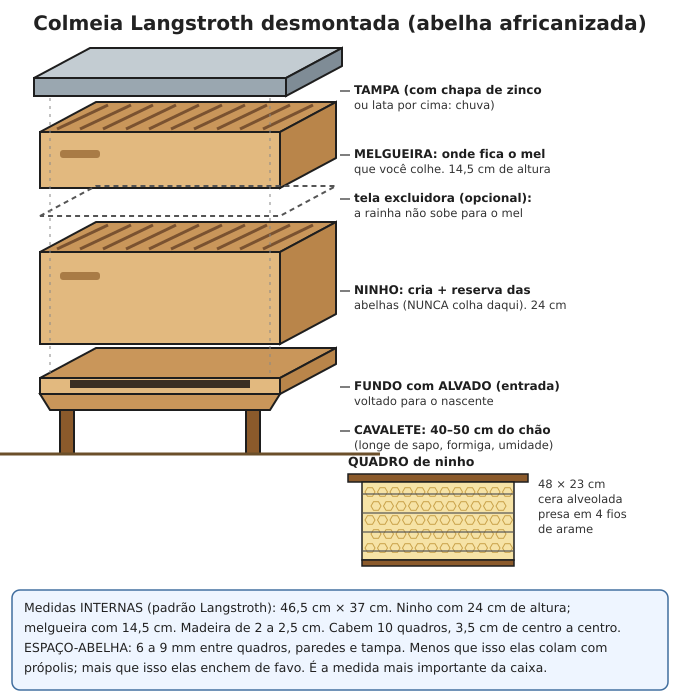
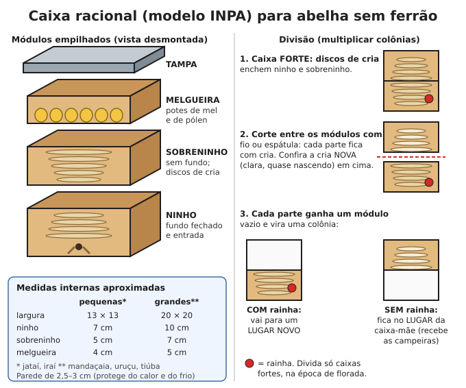

# Abelhas (apicultura e meliponicultura)

**Resumo:** abelhas dão mel (açúcar que não estraga), cera, própolis e, principalmente, **polinização**
(mais fruta, café, feijão, abóbora e semente). A abelha comum do Brasil (*Apis*, africanizada) produz
muito mas é **perigosa**: exige distância de casas e animais, roupa de proteção e fumaça. As
**abelhas sem ferrão** (jataí, mandaçaia, uruçu, tiúba, jandaíra) produzem menos, mas são mansas e
ideais para iniciantes, quintais e cidade.

---

## 1. Qual criar

| | Abelha africanizada (*Apis mellifera*) | Abelhas sem ferrão (nativas) |
|---|---|---|
| Mel por colônia/ano | 15–40 kg | 0,5–5 litros (conforme a espécie) |
| Perigo | **Alto**: ataca em massa, pode matar pessoas e animais | Nenhum ou quase nenhum (algumas mordem e enroscam no cabelo) |
| Onde | Sítio, longe de casas | Quintal, varanda, cidade |
| Equipamento | Macacão, máscara, luvas, botas, fumigador | Quase nenhum |
| Mel | Grosso, dura anos | Mais líquido e ácido; precisa de geladeira ou tratamento |

## 2. Abelha africanizada: segurança em primeiro lugar

> **ATENÇÃO:** um ataque de africanizadas pode ter milhares de ferroadas. Cavalos, bois, cães e
> galinhas **amarrados ou presos** morrem porque não conseguem fugir. Criança e idoso correm risco
> grave. Socorro: [Animais peçonhentos](../02-saude/06-animais-peconhentos.md).

### Distâncias mínimas do apiário
| De quê | Distância |
|---|---|
| Casas, escolas, igrejas, locais de reunião | **400 m** (ideal 500 m) |
| Currais, estábulos, chiqueiros, galinheiros, animais amarrados | **400 m** |
| Estradas e trilhas com movimento | 300 m |
| Água limpa para as abelhas | até 500 m (se não houver, ponha bebedouro) |
| Outro apiário grande | 2–3 km (para não faltar flor) |

- Uma **cerca viva alta** (2–3 m) na frente do apiário faz as abelhas subirem e passarem por cima
  das pessoas.
- Cerque o apiário (5–10 m em volta) para bois e cavalos não esbarrarem nas caixas. Placa:
  "CUIDADO — ABELHAS".

### Local das caixas
- Sombra parcial (sombra de árvore à tarde); sol forte o dia todo derrete favos no Nordeste.
- Terreno seco, protegido de vento forte, com flores num raio de 1,5 km (elas voam até 3 km).
- Uma caixa por cavalete, **40–50 cm do chão**, com 2–3 m entre as caixas.
- Entrada (alvado) voltada para o **nascente** (leste) e sem trilha passando na frente.
- Pés do cavalete dentro de latas com óleo queimado ou com graxa (contra formigas).
- Com boa florada, um apiário comporta 20–30 colmeias.

### Roupa de proteção (EPI)
- **Macacão** inteiro de tecido grosso, **branco ou claro**, com zíper, punhos e tornozelos fechados.
- **Máscara** (véu) com tela preta na frente (enxerga melhor) presa ao macacão.
- **Luvas** de couro ou borracha de cano longo; **botas** brancas de borracha, calça por dentro.
- Nunca: roupa escura ou de lã, perfume, cheiro forte de suor, bebida alcoólica, casca de banana
  por perto (o cheiro parece o do alarme das abelhas).

### Fumigador
- Combustível que faz **fumaça fria e branca**: serragem grossa, maravalha, sabugo de milho, palha
  de coco, estopa, folhas secas. Por cima, um punhado de capim verde (esfria a fumaça).
- Fumaça quente ou com fagulha queima as abelhas e as deixa mais bravas.
- A fumaça encobre o cheiro de alarme e faz as abelhas encherem o papo de mel (ficam mais calmas).

### Manejo calmo
1. Trabalhe em **dia de sol**, sem vento, chuva ou trovoada, das **9 h às 16 h** (as campeiras estão
   fora). Nunca à noite com lanterna.
2. Chegue pelo lado ou por trás da caixa, **nunca na frente do alvado**.
3. Dê 2–3 baforadas de fumaça no alvado, espere 1–2 minutos, abra a tampa devagar e dê mais uma
   baforada por cima.
4. Movimentos **lentos**, sem bater as peças, sem esmagar abelhas (abelha esmagada solta cheiro de
   alarme). Tire os quadros na vertical, devagar.
5. No máximo 10–15 minutos por caixa. Se ficarem muito bravas, feche e volte outro dia.
6. Ao sair, afaste-se andando no meio de mato ou árvores; elas perdem você.
7. Trabalhe em dupla e tenha veículo ou abrigo por perto.

## 3. A caixa Langstroth

| Peça | Medida interna aproximada | Função |
|---|---|---|
| Fundo | — (com alvado de 1,5 × 30 cm, reduzível com tarugo) | Piso e entrada |
| **Ninho** | 46,5 × 37 × **24 cm** de altura, 10 quadros | Rainha, cria e reserva de inverno. **Não se colhe** |
| **Melgueira** | 46,5 × 37 × **14,5 cm**, 10 quadros | Onde as abelhas guardam o mel que você colhe |
| Quadro de ninho | 48 × 23 cm (com as "orelhas") | Moldura com 4 arames esticados e cera alveolada |
| Quadro de melgueira | 48 × 13,7 cm | Idem, mais baixo |
| Tampa | — | Coberta com chapa de zinco ou lata, contra chuva |

- **Espaço-abelha: 6 a 9 mm** entre quadros, paredes e tampa. É a medida mais importante: menor, elas
  colam tudo com própolis; maior, enchem de favo e não dá para tirar os quadros.
- Quadros com **3,5 cm de centro a centro**. Madeira de 2 a 2,5 cm de espessura.
- Sem cera alveolada, cole uma **tira de cera de 2 cm** no meio da travessa de cima do quadro: as
  abelhas seguem a guia e constroem o favo reto.

## 4. Como conseguir abelhas

### Caixa-isca (o jeito mais seguro)
1. Use caixa de papelão grosso, madeira ou uma caixa Langstroth velha, com **30–40 litros** de volume.
2. Dentro: 4–5 quadros com tiras de cera. Passe cera derretida nas paredes internas e esfregue folhas
   de **capim-limão** (ou ponha algumas gotas do óleo) como atrativo.
3. Entrada de 2–3 cm. Pendure a **1,5–3 m de altura**, na sombra, em árvore ou viga, perto de flores e
   água.
4. Época: **primavera e início das chuvas** (quando os enxames se dividem).
5. Olhe a cada 7–10 dias, de longe. Abelhas entrando com pólen nas pernas = caixa ocupada.
6. Depois de 7–15 dias, ao **anoitecer** (todas dentro), feche a entrada com espuma ou pano, leve ao
   apiário e passe os quadros para a Langstroth no dia seguinte.

### Enxame pendurado em galho ("cacho")
- O enxame em mudança é relativamente manso (está de papo cheio). Mesmo assim, use EPI.
- Ponha a caixa com quadros logo embaixo e dê **um golpe seco** no galho: o cacho cai dentro.
  Tampe, deixando o alvado aberto. Se a rainha entrou, as abelhas na entrada ficam "abanando" com o
  traseiro levantado e as outras marcham para dentro.
- Ao anoitecer, feche e leve ao apiário.

### Colmeia em oco de árvore ou parede (mais difícil e brava)
- Ao entardecer, com EPI e muita fumaça, abra o oco, corte os favos de **cria** e amarre-os em
  quadros vazios com barbante ou elástico (na mesma posição, de pé). Ponha na caixa, sacuda as abelhas
  para dentro e procure a rainha. Os favos de mel podem ser colhidos.

## 5. Revisão (a cada 15–30 dias na florada, 30–45 dias na seca)

Verifique, nesta ordem:
1. **Rainha boa:** ovos em pé no fundo das células (um por célula), larvas de todas as idades e cria
   fechada **compacta** (poucas falhas).
2. **Reservas:** mel nos cantos de cima dos quadros e pólen colorido em volta da cria.
3. **Espaço:** com 7–8 dos 10 quadros do ninho ocupados, ponha a melgueira. Sem espaço elas enxameiam
   (metade vai embora).
4. **Realeiras** (células de rainha, parecidas com amendoim): na borda de baixo dos favos = vão
   enxamear (dê espaço ou divida); no meio do favo = estão trocando a rainha.
5. **Colmeia órfã** (sem ovos, zumbido alto, abelhas inquietas, vários ovos por célula postos por
   operárias): dê um quadro com ovos e larvas novas de outra colmeia. Elas criam rainha nova (nasce em
   16 dias e começa a pôr cerca de uma semana depois).
6. **Pragas:** traça (galerias com teia nos favos), formigas, cria salteada ou podre.
7. Troque 2–3 quadros velhos e pretos por ano.

**Dividir para multiplicar (na florada):** de uma colmeia forte, passe para uma caixa nova 3–4 quadros
(2 com ovos e larvas novas, 1 com mel e pólen) **com as abelhas em cima**, sem a rainha, e complete com
quadros vazios. A caixa nova cria rainha sozinha.

## 6. Colheita do mel e da cera

1. Colha só da **melgueira**, com quadros **80–90% operculados** (fechados com cera). Mel verde
   (aberto) tem água demais e fermenta.
2. Fumaça leve, tire o quadro, varra as abelhas com escova macia ou um ramo de folhas para dentro da
   caixa. Ponha os quadros numa caixa vazia coberta com pano úmido.
3. **Nunca deixe mel exposto** no apiário: provoca **pilhagem** (abelhas brigando e matando umas às
   outras) e ataques.
4. Na casa de mel (cômodo limpo e telado): retire os opérculos com garfo ou faca aquecida em água
   quente.
5. Extraia na **centrífuga**; sem ela, corte os favos em pedaços sobre uma peneira e deixe escorrer
   (ou esprema num saco de pano limpo). Não esmague favos com cria.
6. **Coe** em peneira fina ou pano de náilon e deixe **decantar 3–7 dias** num balde tampado; retire
   a espuma de cima e envase em vidro ou balde de alimento, limpo e **seco**.
7. Deixe sempre o ninho com reservas (10–15 kg) para a época sem flores.

- Mel **cristalizado** (açucarado) é normal. Para voltar a líquido: banho-maria a no máximo 40–45 °C.
- Mel puro e fechado dura **anos**. Não dê mel a bebês com menos de 1 ano (risco de botulismo).

### Cera
1. Junte opérculos, favos velhos e raspas. Lave em água fria para tirar o mel.
2. Derreta em **água quente** (banho-maria): a cera derrete a 62–65 °C e boia. Coe num pano e deixe
   esfriar: forma um bloco por cima, com a sujeira grudada embaixo (raspe). Repita para clarear.
3. **Derretedor solar:** caixa de madeira com tampa de vidro e uma chapa inclinada com tela; a cera
   escorre para uma forma. Não gasta lenha e não pega fogo.

> **ATENÇÃO:** cera pega fogo. Nunca derreta direto na chama nem saia de perto. Cera em chamas
> abafa-se com tampa; **nunca jogue água**.

## 7. Alimentação na seca e na entressafra

- **Sinais de fome:** caixa leve (levante a parte de trás), favos sem mel, cria diminuindo, abelhas
  bravas, pilhagem.
- **Xarope de manutenção:** 2 partes de açúcar para 1 de água (1 kg de açúcar + 0,5 L de água quente,
  sem deixar caramelizar: açúcar queimado é tóxico para elas). Dê 1–2 L por semana.
- **Xarope estimulante:** 1 parte de açúcar para 1 de água, 0,5–1 L por semana, 30–45 dias antes da
  florada (a rainha aumenta a postura e a colmeia chega forte na florada).
- Dê **dentro da caixa**, no fim da tarde: alimentador de cobertura (bandeja sob a tampa), cocho no
  lugar de um quadro (com gravetos boiando para não afogar) ou saco plástico com furinhos sobre os
  quadros. Não derrame xarope fora.
- **Sem pólen:** pasta de farelo de soja tostado moído e açúcar (partes iguais) umedecida com
  xarope; 100–200 g por semana sobre os quadros.
- Nunca dê mel de origem desconhecida (pode levar doença). Reduza o alvado na seca.

## 8. Problemas comuns

| Problema | Sinal | O que fazer |
|---|---|---|
| **Abandono** (o enxame vai embora) | Caixa vazia de repente | Evite as causas: fome, sol forte, formiga, traça, revisões demais |
| Traça-da-cera | Galerias com teia, favos destruídos | Mantenha colmeias fortes; tire favos sem abelha; reduza o espaço |
| Formigas | Fila de formigas no cavalete | Óleo ou graxa nos pés do cavalete; capine em volta |
| Sapos | Ficam no alvado à noite | Cavalete com 40–50 cm |
| Cria podre (loque) | Opérculos afundados e furados, larva derretida marrom, cheiro ruim; um palito enfiado puxa um fio elástico | **Queime** caixa, quadros e abelhas num buraco e enterre. É contagiosa |
| Agrotóxico | Muitas abelhas mortas na frente da caixa | Combine com vizinhos; pulverizar no fim da tarde e fora da florada |

## 9. Abelhas sem ferrão (meliponicultura)

São nativas, não ferroam e cabem em caixas pequenas. Crie **só espécies da sua região** (levar para
outro bioma pode matar a colônia e prejudicar as nativas de lá).

| Abelha | Onde ocorre | Jeito | Mel/ano (aprox.) |
|---|---|---|---|
| **Jataí** | Todo o Brasil | Pequena (4–5 mm), mansa; tubinho de cera na entrada | 0,5–1,5 L |
| **Iraí** | Sul, Sudeste, Centro-Oeste | Pequena, mansa, ótima para cidade | 0,3–0,5 L |
| **Mandaçaia** | Sul, Sudeste, Nordeste (Mata Atlântica) | Média, mansa; entrada com raios de barro | 1–3 L |
| **Uruçu** (nordestina e amarela) | Nordeste (Mata Atlântica) e Norte | Grande, mansa | 2–5 L |
| **Tiúba** | Maranhão, Piauí, Pará | Grande, mansa | 2–5 L |
| **Jandaíra** | Caatinga | Média, aguenta seca e calor | 1–2 L |
| Mandaguari / tubuna | Várias regiões | Morde e enrosca no cabelo (não ferroa) | 1–3 L |

- Evite **arapuá/irapuá** (corta flores e brotos, é praga) e **abelha-limão** (saqueia outras colônias;
  cheiro de limão).

### Caixa racional modelo INPA

- Módulos quadrados empilhados: **ninho** (com fundo e furo de entrada de 8–10 mm), **sobreninho**
  (sem fundo, a cria continua subindo), **melgueira** (mais baixa, onde ficam os potes de mel) e tampa.
- Madeira **grossa (2,5–3 cm)**, sem cheiro forte (nada de eucalipto novo ou madeira tratada).
- Medidas (aproximadas; variam entre manuais): jataí e iraí, 13 × 13 cm por dentro; Meliponas
  (mandaçaia, uruçu, tiúba, jandaíra), 20 × 20 cm.
- Vede frestas com fita crepe. Caixas na **sombra**, cobertas, a 1–1,5 m do chão, em prateleira com
  os pés protegidos contra formigas. Acima de 35–38 °C a cria morre.

### Conseguir colônias
- **Isca de garrafa PET** (2 L, coberta com saco preto): passe dentro um pouco de cerume ou própolis
  de jataí dissolvido em álcool, ponha uma mangueirinha de 1 cm como entrada e pendure a 1–2 m, perto
  de colônias que já existem, na primavera e verão. Funciona bem para jataí e iraí.
- **Resgate** de colônias em árvores que vão ser derrubadas: abra o tronco, passe os discos de cria
  (mantendo-os **deitados**, como estavam), os potes inteiros e as abelhas para a caixa; deixe no
  local até a noite para as campeiras entrarem.
- **Divisão** de colônias fortes (o melhor jeito, sem tirar da natureza).

### Divisão de colônias (passo a passo)
1. Só divida colônias **fortes** (ninho e sobreninho cheios de cria), na **florada**, em dia quente.
2. Separe o sobreninho do ninho com faca fina ou fio de náilon. Os discos se partem: tudo bem.
3. Confira que as duas partes têm cria, e que a parte sem rainha tem **cria nova** (discos claros, cor
   de creme, quase nascendo). Na jataí, a parte sem rainha precisa ter **células reais** (maiores, na
   borda dos discos).
4. Complete cada parte com um módulo vazio e vede as frestas.
5. A parte **sem rainha fica no lugar da caixa-mãe** (recebe as abelhas campeiras); a parte **com
   rainha vai para outro lugar**.
6. Dê xarope 1:1 (20–50 mL, num potinho com gravetos) e não abra por 15–30 dias.
7. Cada colônia pode ser dividida 1–2 vezes por ano.

### Mel de abelha sem ferrão
- Colha só da melgueira, com potes **fechados** (maduros), e deixe pelo menos 1/3. Nunca na seca.
- Fure os potes com palito e puxe o mel com **seringa sem agulha** ou bomba de sucção limpa; ou
  incline a melgueira sobre uma peneira e deixe escorrer. Não misture pólen (azeda o mel).
- Esse mel tem **25–35% de água** (o da *Apis* tem menos de 20%) e **fermenta** em dias fora da
  geladeira. Escolha uma forma de conservar:

| Método | Como | Observação |
|---|---|---|
| **Geladeira** | Pote de vidro fechado a 4–8 °C | Mais simples; conserva sabor e aroma |
| **Desidratar** | Banho-maria a no máximo 40 °C, recipiente aberto coberto com pano fino, mexendo, até engrossar | Perde parte do aroma; depois dura fora da geladeira |
| **Maturar** | Pote fechado em temperatura ambiente por semanas, abrindo de vez em quando para soltar gás | Fermentação natural; fica mais ácido e estável (tradição do Nordeste) |
| **Pasteurizar** | Banho-maria a 60–65 °C por 15–30 min e esfriar rápido | Mata leveduras; perde um pouco de aroma |

- Alimentação na seca: xarope 1:1, 10–20 mL por semana (jataí) a 30–50 mL (Meliponas).

### Inimigos das sem ferrão
- **Forídeos** (mosquinhas de 2–3 mm que andam rápido): põem ovos nos **potes de pólen** quebrados e
  as larvas destroem a colônia. Ao manejar, não quebre potes de pólen (se quebrar, retire). Armadilha:
  frasco pequeno com **vinagre** e tampa com furos de 2 mm, dentro do sobreninho ou da melgueira;
  troque a cada 7–15 dias. Vede frestas com fita.
- **Formigas:** pés da prateleira em latas com água ou óleo; nada encostando nas caixas.
- Lagartixa, aranha, sapo: caixas no alto; retire os bichos.
- **Abelha-limão** saqueando (abelhas brigando e cheiro de limão): reduza a entrada.

## 10. Polinização

- **Com abelhas:** café, laranja, maçã, abacate, melancia, melão, abóbora, girassol, feijão, canola.
  Para pomares e roças: 2–4 colmeias de *Apis* por hectare na floração.
- **Sem ferrão:** morango, açaí, urucum; as Meliponas "vibram" as flores e polinizam bem tomate,
  berinjela e pimentão.
- **Maracujá** depende da **mamangava** (abelha grande e preta): deixe troncos secos, bambus e madeira
  mole para ela fazer ninho.
- Plante flores o ano todo (assa-peixe, eucalipto, vassourinha, girassol, feijão-guandu, laranjeira,
  ervas) e **não pulverize** na florada.

## 11. Própolis e cera: usos práticos

### Própolis
- **Coleta:** raspe as bordas dos quadros e a tampa com espátula; ou deixe uma tela plástica com
  frestas sob a tampa (elas a vedam com própolis); congele a tela e torça para soltar.
- **Extrato (tintura):** 30 g de própolis triturada (congelada fica fácil de quebrar) em 100 mL de
  álcool de cereais 70%, em vidro escuro; agite 1 vez por dia por 7–15 dias e coe em pano ou papel.
  Uso externo em pequenas feridas e aftas; algumas gotas em água para garganta. Pode dar alergia:
  teste antes num pouco de pele.

### Cera
- **Velas:** pavio de algodão trançado (ou barbante de algodão) mergulhado 20–30 vezes em cera a
  70–75 °C, esperando esfriar entre um mergulho e outro; ou cera derramada num molde (cano, bambu,
  copo de papel) com o pavio no centro. Queima mais devagar que vela de parafina.
- **Pano encerado** (embrulhar comida, capa contra chuva): 4 partes de cera, 1 de breu (resina de
  pinheiro) e 1 de óleo vegetal, derretidos; espalhe no algodão e passe ferro morno entre papéis.
- **Proteção de madeira e couro:** 1 parte de cera derretida com 3–4 de óleo de linhaça ou vegetal;
  esfregue com pano.
- **Linha encerada** para costurar couro, lubrificar gavetas e roscas, vedar potes, fazer pomadas
  (1 parte de cera para 4–5 de óleo, veja [Plantas medicinais](../02-saude/05-plantas-medicinais.md)).

---

Ver também: [Animais peçonhentos (ferroadas)](../02-saude/06-animais-peconhentos.md) · [Frutíferas e agrofloresta](../04-agricultura/08-frutiferas-e-agrofloresta.md) · [Princípios gerais](01-principios-gerais.md) · [Química prática](../09-quimica-e-oficios/02-quimica-pratica.md) · [Couro](../09-quimica-e-oficios/05-couro.md)
