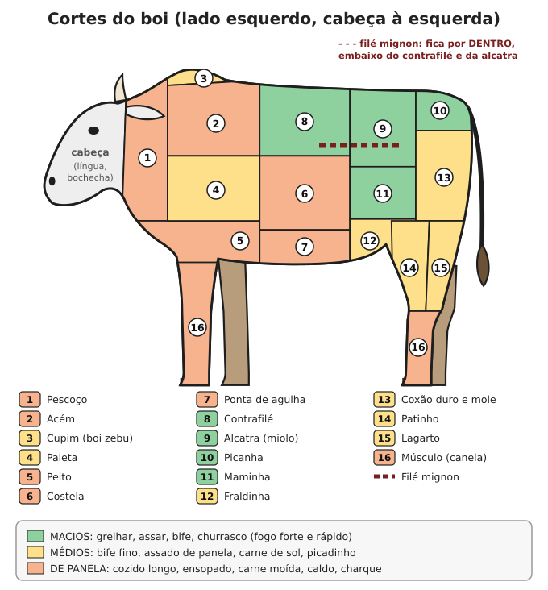

# Abate e aproveitamento da carne

**Resumo:** abater bem é respeito ao animal e segurança para quem come. O animal deve estar **sadio,
calmo e em jejum**; é **insensibilizado** num golpe só, no ponto certo, e **sangrado em até 60
segundos**. Depois: esfola e evisceração **sem furar** intestino, bexiga e vesícula, **inspeção** das
vísceras e da carcaça (na dúvida, descarte), resfriamento rápido e aproveitamento de tudo: carne,
miúdos, sangue, banha, couro e ossos.

---

## 1. Antes do abate

### Quando NÃO abater para comer
- Animal **doente**, com febre, magro sem motivo, com diarreia, tosse ou feridas com pus.
- Animal com **sinais nervosos** (anda em círculo, paralisia, baba, agressividade): pode ser **raiva**.
- Animal **encontrado morto**, ou que morreu de repente sangrando pelo nariz e ânus (veja carbúnculo
  na seção 10).
- Animal tratado com remédio e ainda dentro do **prazo de carência** (veja
  [Veterinária básica](14-veterinaria-basica.md)).

### Idade e rendimento
| Animal | Ponto de abate | Carcaça (% do peso vivo) |
|---|---|---|
| Frango caipira | 70–90 dias, 2–2,5 kg | 70–75% (limpo) |
| Coelho | 70–90 dias, 2–2,5 kg | 50–55% |
| Cabrito, cordeiro | 4–6 meses, 25–35 kg | 40–50% |
| Porco | 5–6 meses com ração (100–120 kg); caipira 8–12 meses | 70–80% |
| Boi, novilho | 18–30 meses, 400–500 kg | 50–55% (carne sem osso ≈ 35–40% do peso vivo) |

Porco macho inteiro adulto (cachaço) tem carne com cheiro forte: **castre os leitões** que vão para a
engorda.

### Jejum e descanso
| Espécie | Jejum de comida | Água |
|---|---|---|
| Boi | 12–24 h | À vontade até a hora |
| Porco | 12–18 h | À vontade |
| Cabra, ovelha | 12–24 h | À vontade |
| Aves | 6–10 h | À vontade |
| Coelho | 6–12 h | À vontade |

- O jejum esvazia o intestino (menos risco de furar e sujar a carne).
- Animal que veio de longe descansa 12–24 h. Estresse deixa a carne escura, dura e que estraga mais
  rápido.

### Materiais
Facas afiadas (sangria pontuda de 15–20 cm, faca curva de esfolar, faca de desossa), chaira ou pedra,
serrote ou machadinha, ganchos, cordas, **tripé ou talha com roldana** (boi e porco), baldes, mesa
lavável, **muita água limpa** (100–300 L para um boi), panela grande e termômetro (escaldar), barbante,
sacos plásticos limpos, sal, tela contra moscas. Tudo pronto **antes** de buscar o animal.

## 2. Princípios do abate humanitário

1. **Calma:** conduza o animal devagar, sem gritos, pancadas ou choques. Não abata na frente de outros
   animais. Um ajudante conhecido do animal ajuda.
2. **Contenção firme e rápida:** cabeça presa (brete, tronco, corda curta), para o golpe ser preciso.
3. **Insensibilização num golpe só,** no ponto certo. O animal deve ficar inconsciente na hora.
4. **Sangria imediata** (em até 60 s), antes que ele possa recobrar a consciência.
5. Quem abate deve estar treinado, calmo e com ferramenta adequada. Aprenda com alguém experiente.

## 3. Insensibilização

| Animal | Ponto | Direção | Ferramenta |
|---|---|---|---|
| **Boi** | Cruzamento de duas linhas, cada uma do olho até a base do chifre do outro lado | Reto, perpendicular à testa | Pistola de dardo cativo; disparo por pessoa treinada e autorizada |
| **Porco** | Linha do meio da testa, 2 cm acima da linha dos olhos (porco grande: 3–4 cm) | Para o rabo, ao longo da coluna | Idem; leitão pequeno (até 5 kg): pancada forte na testa |
| **Ovelha, cabra** | Sem chifre: o ponto mais alto da cabeça. Com chifre: logo atrás dos chifres | Para a garganta | Idem; cordeiro e cabrito pequenos: pancada forte no mesmo ponto |
| **Aves** | Pescoço (deslocamento) ou nuca | — | Mãos ou porrete curto |
| **Coelho** | Nuca, logo atrás das orelhas | — | Porrete curto, golpe seco; ou deslocamento do pescoço |

- **Marreta em boi adulto** é difícil acertar e muitas vezes só atordoa: use só se não houver outro
  meio, por pessoa forte e experiente, e sangre na hora.
- Disparo: só por quem tem treino e autorização, a curta distância, **sem encostar o cano**, com
  ninguém atrás nem dos lados (o projétil pode atravessar ou ricochetear).

**Como saber que está insensível:** cai na hora; para a respiração ritmada; olho parado, aberto, que
**não pisca** ao tocar a córnea com o dedo; língua mole; não tenta erguer a cabeça. Pernas pedalando é
reflexo, não consciência. Piscou, gemeu ou tentou se levantar: **repita na hora**, um pouco ao lado.

## 4. Sangria

| Animal | Como | Tempo |
|---|---|---|
| **Boi** | Abra a pele no meio do pescoço (barbela) por uns 30 cm. Enfie a faca na **entrada do peito**, na frente do osso do peito, inclinada para dentro e em direção ao coração, e corte os grandes vasos | 5–6 min (15–25 L de sangue) |
| **Porco** | Faca de 15 cm na linha do meio do pescoço, 5 cm à frente do osso do peito, apontada para o rabo; corte os vasos e tire a faca, sem furar o coração | 3–5 min |
| **Ovelha, cabra** | Corte atravessado logo atrás da mandíbula, pegando as duas veias e artérias do pescoço | 3–5 min |
| **Aves** | De cabeça para baixo (num cone de lata ou garrafa cortada), corte de lado logo abaixo da mandíbula, sem arrancar a cabeça | 2–3 min |
| **Coelho** | Pendurado pelas patas traseiras, corte do pescoço ou retire a cabeça | 1–2 min |

- Logo depois da sangria do boi, da ovelha e da cabra, **amarre o esôfago** com barbante (o conteúdo do
  estômago não volta e não suja a carne).
- **Sangue para comer** (chouriço, morcela): apare numa bacia limpa e **mexa sem parar** com a mão ou
  um batedor por 5–10 min, retirando os fios (fibrina): assim não coalha. Use no mesmo dia.

## 5. Aves (galinha, pato, peru)

1. **Insensibilizar e matar:** segure as pernas com uma mão e a cabeça com a outra; estique o pescoço
   e dobre a cabeça para trás com força num só puxão (sente-se o "vão" no pescoço). Ou pancada forte na
   nuca com porrete. Sangre logo (tabela acima).
2. **Escaldar:** galinha e frango em água a **55–60 °C** por 1–2 min (galinha velha, 60–65 °C);
   pato e ganso a **65–70 °C**, mais tempo, mexendo para molhar até a pele. Pronto quando as penas da
   asa saem fáceis. Água fervendo cozinha a pele e rasga.
3. **Depenar** à mão, sem rasgar a pele; chamusque a penugem na chama.
4. Corte os pés na junta e a cabeça. Corte fora a **glândula de óleo** em cima da cauda (dá gosto ruim).
5. Solte o papo pelo pescoço sem estourar.
6. **Evisceração:** corte em volta da cloaca e abra um pouco a barriga; com dois dedos, puxe tudo
   inteiro, junto com a cloaca. Raspe os pulmões grudados nas costelas e os rins nas costas.
7. Separe: fígado (tire a **vesícula verde** com um pedaço do fígado, sem estourar), coração, moela
   (abra, esvazie e puxe a pele amarela de dentro).
8. Lave e resfrie em água com gelo por 30–60 min (ou água bem fria trocada várias vezes).

## 6. Coelho

1. Insensibilize com golpe seco na nuca (segure pelas patas traseiras, cabeça para baixo) ou com
   deslocamento do pescoço; sangre.
2. Pendure por uma pata traseira (gancho atrás do tendão). Corte as patas dianteiras e a cabeça.
3. Corte a pele em volta da pata pendurada e de uma pata à outra passando pelo ânus; **puxe a pele para
   baixo como uma meia** (ela sai virada). Guarde-a para curtir.
4. Abra a barriga com cuidado. Retire a **bexiga cheia** sem estourar, depois intestinos e estômago.
5. **Olhe o fígado:** manchas ou caroços brancos-amarelados = coccidiose → descarte o fígado (a carne
   serve).

## 7. Porco: escaldar ou chamuscar

1. Depois da sangria, **escalde**: água a **62–65 °C** (quando começam bolhinhas no fundo, antes de
   ferver), jogada sobre o corpo coberto com saco de estopa, ou mergulhando, por 3–5 min. Teste: os
   pelos saem ao puxar. Água quente demais (acima de 70 °C) "cozinha" a pele e o pelo prende.
2. **Raspe** os pelos com faca, raspador ou tampa de lata; tire os cascos com um gancho.
3. Alternativa: **chamuscar** com palha seca ou maçarico, raspar e lavar. Ou esfolar, se quiser o couro.
4. Pendure pelos tendões das patas traseiras e siga a evisceração (seção 9). Separe a cabeça na
   junta com a coluna.

## 8. Boi, ovelha e cabra: esfola

1. **Pendure** pelas patas traseiras (gancho entre o tendão e o osso, acima do jarrete) numa talha ou
   tripé; ou faça a esfola deitada, sobre o próprio couro ou lona limpa.
2. Retire a **cabeça** na junta com a primeira vértebra; separe língua e bochechas para inspecionar.
3. Esfole as canelas e corte as patas nas juntas (joelho e jarrete).
4. Corte a pele pela **linha do meio** da barriga, do pescoço ao ânus, e por dentro das pernas até essa
   linha.
5. Separe a pele com a **faca curva, lâmina virada para a pele** (não para a carne), puxando a pele
   com a outra mão. Na ovelha e na cabra dá para soltar empurrando com o punho fechado.
6. A parte de fora do couro (pelo, barro, esterco) **não pode encostar na carne**. Troque ou lave a faca
   depois de cortar a pele.

## 9. Evisceração sem sujar a carne

1. **Amarre o reto:** corte em volta do ânus, solte uns 10 cm do reto, amarre com barbante, cubra com
   saco plástico e empurre para dentro.
2. Serre o osso do peito ao meio.
3. **Abra a barriga** pela linha do meio com a faca **de ponta virada para fora**: o cabo dentro da mão,
   dois dedos por dentro da barriga afastando as vísceras e guiando a lâmina. **Nunca aponte a faca
   para dentro.**
4. Puxe as vísceras brancas (estômagos e intestinos) **inteiras** para fora, para uma lona ou carrinho
   limpo. Não corte nem fure intestino ou rúmen.
5. Retire a **bexiga** amarrando o colo e puxando inteira.
6. Corte o diafragma e retire juntos língua, traqueia, pulmões, coração e fígado.
7. Retire a **vesícula biliar** do fígado com uma margem de fígado, sem estourar (bile amarga e
   estraga a carne). No porco, o mesmo.
8. Divida a carcaça ao meio serrando a coluna. Lave com água limpa e fria de cima para baixo. **Não
   use pano** (espalha micróbios).
9. Caiu fezes, conteúdo de rúmen, bile ou urina na carne? **Corte fora** a parte (lavar não basta).

## 10. Inspeção de vísceras e carcaça

Olhe com boa luz, logo depois de tirar as vísceras. **Normal:** fígado marrom-avermelhado, liso, de
bordas finas; pulmão rosado, esponjoso, que boia na água; rins marrons e lisos; baço de bordas finas;
gânglios (ínguas) do tamanho de feijão a azeitona, firmes, cinza-claro por dentro.

**Corte e olhe:** músculo da bochecha (2–3 cortes fundos, paralelos), língua (apalpe), coração (abra),
diafragma, fígado (cortes nos canais grossos), pulmões, e os gânglios da cabeça, do pulmão, do
intestino, da frente do ombro e da virilha.

| Achado | Onde | O que é | Decisão |
|---|---|---|---|
| **"Canjiquinha":** bolinhas brancas de 0,5–1 cm com líquido e um pontinho branco | Bochecha, língua, coração, diafragma, pescoço e peito (porco e boi) | Cisticerco, larva da solitária. No porco, pode causar **neurocisticercose** (convulsões) em quem se contamina | Vários, em vários lugares: **descarte tudo** (enterre fundo ou queime; nunca dê a porcos ou cães). Um ou poucos: retire a região e **congele a −18 °C por 10 dias** ou **cozinhe até o centro passar de 70 °C** (sem nada rosado). Nunca faça linguiça crua ou carne mal passada dessa carcaça |
| **Cisto hidático:** bolsa de líquido claro, de bola de gude a laranja | Fígado e pulmão | Larva da tênia do cão (passa para gente) | Descarte o órgão (queime ou enterre). **Nunca dê ao cão** |
| Fígado duro, canais grossos com vermes chatos tipo folha | Fígado (Sul, áreas alagadas) | Fasciola ("baratinha") | Descarte o fígado |
| Manchas brancas no fígado do porco | Fígado | Passagem de lombriga | Descarte as partes ou o fígado |
| **Abscesso** (bolsa de pus) | Qualquer lugar | Infecção | Um só: retire com margem larga, sem estourar; lave a faca. **Vários, espalhados: descarte tudo** |
| Caroços de pus verde-amarelado grosso, em camadas (ovelha, cabra) | Gânglios do pescoço, ombro, virilha; pulmão | Linfadenite caseosa | Localizada: retire a região. Espalhada ou animal magro: descarte tudo |
| **Tuberculose:** nódulos amarelados com cara de queijo, às vezes com areia ao cortar | Gânglios da cabeça, pulmão e intestino; pulmão, fígado | Passa para pessoas | Sem inspetor: **descarte tudo**; observe e teste o rebanho |
| **Icterícia:** gordura, tendões, cartilagens, branco do olho e parede dos vasos **amarelos** | Toda a carcaça | Doença grave (leptospirose, tristeza, intoxicação) | **Descarte tudo** (gordura amarela só na gordura, em boi velho de pasto, é normal) |
| Carne escura e úmida, sangria ruim, gânglios inchados e vermelhos, baço enorme | Toda a carcaça | Infecção no sangue (septicemia) | **Descarte tudo** |
| Pulmão com áreas escuras e firmes que afundam na água | Pulmão | Pneumonia | Descarte os pulmões |
| Hematoma | Carne | Pancada | Corte fora |

> **ATENÇÃO — carbúnculo (antraz):** animal que morreu de repente, inchado, com **sangue escuro que não
> coagula** saindo pelo nariz, boca e ânus: **NÃO ABRA, NÃO ESFOLE, NÃO COMA.** Os esporos se espalham e
> ficam décadas no solo. Queime no local ou enterre a 2 m de fundo com cal virgem por cima. Quem tocou:
> luvas, lavar muito, procurar tratamento (antibiótico).

**Destino do que foi descartado:** enterre a pelo menos 1 m com cal, queime, ou ponha num biodigestor.
Nunca deixe para cães, porcos ou urubus (eles espalham as doenças).

## 11. Resfriamento e maturação

- A carcaça deve chegar **abaixo de 7 °C** (ideal 0–4 °C) em até 24 horas.
- **Sem geladeira:** abata ao anoitecer ou de madrugada, de preferência na época fria. Pendure em
  quartos ou pedaços, em local **sombreado, ventilado e telado**. Antes do calor do dia seguinte
  (12–24 h no máximo), processe: salgar (carne de sol, charque), cozinhar e guardar na banha, defumar,
  fazer linguiça, ou **dividir com a comunidade** (quem recebe hoje, devolve no próximo abate).
- **Rigidez:** de 6 a 24 h depois do abate os músculos endurecem. Carne cozida nessa fase fica dura:
  coma nas primeiras 2–3 h ou espere a rigidez passar.
- **Maturação** (só com frio de 0–4 °C): boi, 7–14 dias em pedaços grandes, fica bem mais macio.
  Porco, ave e cordeiro: 1–3 dias bastam. **Sem frio não existe maturação: a carne estraga.**
- Separe a carne das vísceras e do couro desde o início.

## 12. Cortes de carne

- O boi é dividido em **dianteiro** (pescoço, acém, cupim, paleta, peito, músculo) e **traseiro**
  (contrafilé, filé mignon, alcatra, picanha, maminha, fraldinha, patinho, coxões, lagarto, músculo),
  separados entre a 5ª e a 6ª costela; a **ponta de agulha** (costela de baixo) fica à parte.
- Cortes **de panela** (pescoço, acém, peito, músculo, costela) são os mais saborosos em cozidos,
  caldos e carne moída, e os melhores para charque.

### Porco
| Corte | Melhor uso |
|---|---|
| Pernil | Assado, presunto, linguiça |
| Lombo e filé mignon | Assado, bisteca, lombo defumado |
| Costela | Assada, defumada, feijoada |
| Paleta | Assada, linguiça, carne moída |
| Copa (sobrepaleta) | Assada, copa curada |
| Barriga (panceta) | Bacon, torresmo |
| Toucinho | Banha, linguiça, torresmo |
| Pés, orelhas, rabo, joelho | Feijoada, mocotó, gelatina |
| Cabeça | Queijo de porco, caldo |

## 13. Aproveitamento total

- **Miúdos:** fígado (coma em 1–2 dias; muito ferro e vitamina A), coração, rins (abra, tire o miolo
  branco e deixe de molho 30 min em água com vinagre), língua (cozinhe e tire a pele), bucho (lave
  muito, escalde e raspe por dentro: dobradinha), mocotó (patas escaldadas e raspadas, cozidas por
  horas: caldo e gelatina), rabada, miolo (sempre bem cozido).
- **Tripas:** viradas, raspadas e lavadas viram envoltório de linguiça (guarde no sal).
- **Sangue:** chouriço (veja abaixo); cozido e seco ao sol vira **farinha de sangue** para ração de
  galinhas, porcos e peixes e adubo rico em nitrogênio.
- **Banha:** corte o toucinho em cubos de 2–3 cm, derreta em panela de ferro em fogo **baixo**, mexendo,
  1–2 h, até os torresmos dourarem. Coe e guarde em latas ou potes limpos e secos. Um porco de 100 kg dá
  8–15 kg de banha. **Carne na banha:** pedaços temperados, bem fritos, cobertos de banha num pote sem
  ar: duram meses em local fresco.
- **Sebo** (boi, carneiro): derreta igual à banha. Serve para sabão
  ([Sabão e limpeza](../09-quimica-e-oficios/01-sabao-e-limpeza.md)), velas, engraxar couro e eixos.
- **Couro:** tire restos de carne e gordura e **salgue no mesmo dia** (cubra todo o lado da carne com
  sal, dobre, deixe escorrer) ou seque esticado à sombra. Curtimento em
  [Couro](../09-quimica-e-oficios/05-couro.md).
- **Ossos:** caldo (6–12 h de cozimento). **Farinha de osso:** cozinhe, seque, queime até ficar
  **branco** e moa: adubo de fósforo e cálcio e mistura para sal mineral.
- Chifres e cascos: cabos, copos, botões; moídos, adubo. Penas: enchimento e composto.
- Conteúdo do rúmen, restos não comestíveis: composto quente ou biodigestor
  ([Biogás](../06-energia/07-biogas.md)). Restos para porcos só **cozidos** (ferver 30 min).

> **ATENÇÃO:** farinha de carne, de sangue ou de osso que não foi queimada até ficar branca **nunca**
> pode ir para bois, vacas, cabras e ovelhas (risco da "doença da vaca louca"). Para porcos, galinhas e
> peixes pode, sempre cozida.

## 14. Linguiça e chouriço

### Linguiça frescal de porco (1,2 kg)
1. **1 kg de carne** de porco (paleta ou pernil) + **200–300 g de toucinho**. Tudo **bem frio** (abaixo
   de 10 °C; use gelo).
2. Moa (disco de 8–10 mm) ou pique na faca em cubinhos de 0,5 cm.
3. Tempere: **sal 18–20 g por kg de massa** (cerca de 1 colher de sopa rasa), 3–4 dentes de alho,
   2–3 g de pimenta-do-reino, cheiro-verde, pimenta calabresa a gosto, **30–50 mL de vinho, cachaça ou
   vinagre**.
4. Amasse 3–5 min até a massa ficar grudenta. Frite um pedacinho para provar o sal.
5. Embuta em tripa fina de porco (ou de carneiro) limpa e de molho em água com sal e limão, sem deixar
   bolhas de ar (fure com agulha). Torça a cada 12–15 cm.
6. Geladeira: 3–5 dias. Congelada: 3–6 meses. **Sempre bem cozida** antes de comer.

- **Para defumar ou secar** (guardar fora da geladeira), use **sal de cura** (nitrito) na dose exata
  do rótulo (em geral 2,5 g por kg). Sem ele há risco de **botulismo**. Sem sal de cura, defume só
  para dar sabor e mantenha no frio, ou cozinhe e guarde na banha. Detalhes em
  [Conservação de alimentos](../03-alimentacao/02-conservacao-de-alimentos.md).

### Chouriço (morcela)
1 L de sangue de porco mexido (sem fibrina) + 200–300 g de toucinho em cubinhos + 1 cebola e
cheiro-verde refogados + 1 xícara de farinha de mandioca ou arroz cozido + 15 g de sal + pimenta, cravo
e canela. Embuta em tripa grossa, amarre e cozinhe em água **quase fervendo (80–85 °C) por 30–40
min**, até que, furando, saia líquido claro. Coma em 2–3 dias ou defume.

## 15. Higiene, EPI e doenças que passam para quem abate

- **EPI:** luvas grossas (de borracha ou nitrílica; luva de malha de aço na mão que segura a carne),
  avental impermeável, botas, manga comprida, **óculos** para serrar e sangrar, touca.
- Não abata com **cortes nas mãos** abertos: cubra bem com curativo e luva.
- Use **uma faca para o couro e outra para a carne**; escalde as facas em água fervente entre as etapas.
- Cães e gatos longe; tela contra moscas; água limpa à vontade.
- No fim: lave tudo com água quente e sabão e desinfete com água sanitária (1 copo em 10 L de água).

| Doença | Animal | Como pega |
|---|---|---|
| **Brucelose** (febre que vai e volta, dores) | Boi, cabra, porco, cão | Sangue, útero, fetos abortados, leite cru |
| **Tuberculose** | Boi, porco | Respirar perto de lesões, leite cru, carne mal cozida |
| **Leptospirose** | Boi, porco, cão, rato | Urina e rins; cortes na pele |
| Toxoplasmose | Porco, ovelha, cabra | Carne crua ou mal passada |
| Carbúnculo | Boi, ovelha, cavalo | Abrir animal morto pela doença |
| Raiva | Todos | Saliva e cérebro de animal com sinais nervosos |
| Erisipela | Porco, peixe | Corte nas mãos: mancha roxa dolorida no dedo |
| Estreptococo do porco | Porco | Corte nas mãos: febre e meningite |
| Teníase / cisticercose, hidatidose | Porco, boi / cão, ovelha | Carne mal cozida / ovos de tênia |

Sentiu febre, dor no corpo ou feridas nas mãos nas semanas depois de abater: veja
[Doenças e infecções](../02-saude/03-doencas-e-infeccoes.md) e conte que mexeu com abate.

---

Ver também: [Conservação de alimentos](../03-alimentacao/02-conservacao-de-alimentos.md) · [Couro](../09-quimica-e-oficios/05-couro.md) · [Sabão e limpeza](../09-quimica-e-oficios/01-sabao-e-limpeza.md) · [Veterinária básica](14-veterinaria-basica.md) · [Bovinos](03-bovinos.md) · [Suínos](04-suinos.md) · [Galinhas](02-galinhas.md) · [Coelhos](06-coelhos.md)
