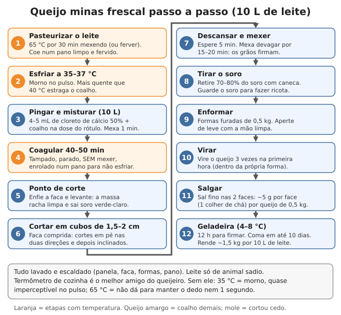

# Leite e laticínios

**Resumo:** leite é alimento completo, mas estraga em horas e pode transmitir **brucelose e
tuberculose**. Regra de ouro: **ordenha limpa, coar, pasteurizar (ou ferver) e esfriar rápido**.
Sem geladeira, transforme o leite no mesmo dia em produtos que duram: coalhada, queijo, manteiga de
garrafa, requeijão, doce de leite. Coalho dá para fazer em casa com o estômago de um bezerro ou
cabrito.

---

## 1. Ordenha higiênica

1. Local limpo, sem poeira e sem esterco fresco; animal calmo, preso e com comida no cocho.
2. **Lave as mãos** com água e sabão e corte as unhas. Balde de inox, alumínio ou plástico de alimento,
   escaldado; o de **boca estreita** (meio fechado) deixa cair menos sujeira.
3. **Teste da caneca de fundo escuro:** tire os 3 primeiros jatos de cada teto numa caneca escura.
   Grumos, pus, sangue ou leite aguado = **mastite** naquele quarto: separe esse leite (não é para
   gente nem para queijo) e ordenhe esse teto por último.
4. Tetos sujos: lave só os tetos (não o úbere todo) e **seque com papel ou pano individual** (um por
   animal). Melhor ainda: mergulhe os tetos em **iodo diluído** (1 parte de povidine 10% para 3 de água
   fervida) por 30 segundos e seque.
5. Ordenhe com a **mão inteira**, apertando de cima para baixo (primeiro polegar e indicador fecham o
   alto do teto, depois os outros dedos espremem). Não puxe nem "belisque" o teto. Ordenhe até o fim,
   rápido e sem parar (5–8 min por vaca).
6. **Depois:** mergulhe cada teto em iodo mais forte (povidine 10% e água fervida meio a meio, com
   1 colher de glicerina por copo) para o canal não pegar infecção.
7. Deixe o animal **de pé comendo por 30–60 min** (o canal do teto demora para fechar).
8. Ordem: animais sadios primeiro, os com mastite por último. Lave e escalde o balde logo depois.

- **Mastite sem sinais:** o teste CMT (raquete com reagente) mostra gel no leite. Sem reagente: leite
  que coalha estranho, animal que dá menos leite num quarto.
- O bezerro ou cabrito mamando junto ajuda a esvaziar o úbere e reduz mastite.

## 2. Coar e esfriar

- Coe **na hora** em pano de algodão fervido dobrado ou coador de náilon/inox.
- Leite tirado a 37 °C multiplica bactérias muito rápido: **esfrie em até 1–2 horas** para menos de
  10 °C (ideal 4 °C). Sem geladeira: latão dentro de tanque ou córrego de água fria corrente, mexendo.
- Leite cru fora da geladeira azeda em 4–8 horas no calor.

## 3. Pasteurização caseira

| Método | Temperatura e tempo | Observação |
|---|---|---|
| **Lenta** | **65 °C por 30 minutos**, mexendo | Melhor para queijos (preserva a coagulação) |
| **Rápida** | **72–75 °C por 15–20 segundos** | Difícil acertar em panela sem termômetro |
| **Ferver** | Levantar fervura (o leite sobe) e manter 1 min | A mais simples e segura **sem termômetro**. Ruim para queijo de coalho (coalha mole) |

**Passo a passo (lenta):**
1. Aqueça em **banho-maria** (panela dentro de outra com água) para não queimar, mexendo.
2. Ao chegar a 65 °C, mantenha **30 minutos** entre 63 e 66 °C, mexendo de vez em quando. Tampado.
3. **Esfrie rápido:** coloque a panela dentro de água fria (troque a água ou use gelo), mexendo, até
   ficar abaixo de 10 °C. Esfriar devagar estraga o efeito.
4. Guarde tampado, na geladeira (3–5 dias) ou use logo.

- Um termômetro culinário (de espeto, até 100–120 °C) é um item de estoque muito valioso.

## 4. Leite cru: riscos

> **ATENÇÃO:** leite cru pode transmitir **brucelose** (febre que vai e volta, dor nas juntas e
> costas, cansaço por meses; aborto em vacas e cabras), **tuberculose** (principalmente em crianças:
> ínguas no pescoço e intestino), **listeriose** (aborto e morte do bebê em grávidas) e diarreias
> graves. Crianças, grávidas, idosos e doentes **nunca** devem tomar leite cru nem comer queijo fresco
> de leite cru.

- Uma toxina de estafilococo (de mastite e de mãos com feridas) **não é destruída pela fervura**: por
  isso a ordenha limpa e o resfriamento importam mesmo quando se ferve.
- **Previna no rebanho:** vacine as bezerras contra brucelose entre 3 e 8 meses (vacina B19, onde
  houver); separe e descarte animais que abortam sem motivo; teste de tuberculina quando possível; enterre
  fetos e placentas com luvas.
- Queijo de leite cru só é mais seguro depois de **maturado por pelo menos 60 dias**.

## 5. Nata e creme de leite

- Deixe o leite (de vaca) **pasteurizado** em repouso 12–24 h na geladeira ou em lugar fresco, em
  vasilha larga. A **nata** sobe; recolha com concha ou escumadeira.
- Leite de **cabra** quase não separa nata sozinho (gordura em gotas muito pequenas): precisa de
  desnatadeira.
- 10 L de leite de vaca dão cerca de 1 L de nata (35–40% de gordura).

## 6. Iogurte

1. Aqueça 1 L de leite a **85–90 °C** (quase fervendo) por 5 min (o iogurte fica mais firme).
2. Esfrie a **42–45 °C** (dá para manter o dedo, quente mas sem queimar).
3. Misture **2 colheres (sopa) de iogurte natural** com cultura viva (sem sabor, sem açúcar) ou do seu
   iogurte anterior.
4. Mantenha **quente (40–45 °C) por 4–8 horas** sem mexer: garrafa térmica, caixa de isopor com uma
   garrafa de água quente, panela enrolada em cobertor ou forno desligado com a luz acesa.
5. Pronto quando firme. Geladeira: **7–10 dias**. Guarde 2 colheres para a próxima vez.
6. A cada 5–10 "repiques" o fermento enfraquece (fica mole ou azedo demais): renove se puder.

- **Kefir:** se tiver grãos de kefir, guarde como tesouro. Ponha os grãos em leite e deixe 18–24 h em
  temperatura ambiente; coe e passe os grãos para leite novo. Eles se multiplicam para sempre.

## 7. Coalhada

- Leite **fervido** e esfriado a 25–30 °C + 2–3 colheres de coalhada anterior ou iogurte por litro.
  Deixe tampado em temperatura ambiente **12–24 h** até firmar. Geladeira: 5–7 dias.
- **Coalhada seca** (tipo labne): ponha 1% de sal (10 g por litro), pendure num pano por 12–24 h na
  geladeira ou lugar fresco, até ficar pastosa.
- Não deixe leite **cru** coalhar sozinho para comer: quem coalha é qualquer bactéria que estiver lá.

## 8. Manteiga

1. Deixe a nata **amadurecer** 12–24 h em lugar fresco (fica levemente ácida: mais sabor e rende mais).
2. Esfrie a nata a **10–14 °C**. Nata quente não vira manteiga; fria demais demora.
3. **Bata:** batedeira, liquidificador em velocidade baixa, batedor de manteiga ou pote fechado
   chacoalhado. Em 10–30 min ela engrossa, depois "quebra" em **grãos amarelos** e soro (leitelho).
4. Escorra o leitelho (bom para bolo e pão) e **lave os grãos com água gelada**, amassando, até a água
   sair clara. Leitelho que fica dentro azeda a manteiga em poucos dias.
5. Amasse com colher de pau para tirar a água. Salgue com **10–20 g de sal por kg** (1–2%).
6. Rende cerca de **400 g por litro de nata** (300–400 g para cada 10 L de leite de vaca).

## 9. Manteiga de garrafa e ghee (duram meses)

1. Derreta a manteiga (ghee) ou cozinhe direto a **nata** (manteiga de garrafa nordestina) em fogo
   **baixo**, num tacho ou panela grossa, mexendo de vez em quando.
2. Primeiro espuma e borbulha (é a água saindo). Continue por 20–60 min até **parar de borbulhar**, a
   gordura ficar dourada e transparente e a borra, no fundo, dourada (não preta).
3. Coe num pano limpo para garrafas ou potes **escaldados e bem secos**.
4. Sem água e sem borra, dura **6–12 meses** fechada, longe da luz, sem geladeira. Nunca ponha colher
   molhada dentro.

## 10. Requeijão

### Requeijão cremoso caseiro
1. Aqueça 2 L de leite até quase ferver e junte **1/2 xícara (100 mL) de vinagre ou suco de limão**.
   Mexa: separa em massa e soro.
2. Coe num pano e esprema. Lave a massa com um pouco de água morna (tira o azedo).
3. Bata no liquidificador a massa com **1 colher (chá) rasa de bicarbonato de sódio**, **1 colher
   (sopa) de manteiga**, **1 xícara de leite** e sal a gosto, até ficar liso.
4. Leve ao fogo baixo mexendo por 3–5 min. Ponha em pote escaldado. Geladeira: 5–7 dias.

### Requeijão do sertão (de corte)
1. Deixe leite desnatado coalhar (azedar) 24–36 h; aqueça até a massa separar do soro; escorra.
2. Lave a massa 2–3 vezes com água ou leite quente para tirar o azedo; escorra bem.
3. Num tacho, derreta **manteiga de garrafa** (10–15% do peso da massa) com sal (1–2%), junte a massa e
   cozinhe em fogo baixo **mexendo forte** por 30–60 min, até virar uma massa lisa, elástica e
   brilhante.
4. Despeje em forma untada. Cozido com gordura, dura semanas em lugar fresco.

## 11. Ricota (do soro do queijo)

1. Aqueça o **soro** que sobrou do queijo até **85–90 °C** (quase fervendo). Para render mais,
   junte 10–20% de leite.
2. Junte **20 mL de vinagre por litro** de soro e mexa devagar uma vez. Apague o fogo.
3. Em 10–15 min, os flocos brancos sobem. Recolha com escumadeira para forma ou pano.
4. Escorra 2–4 h. Geladeira: **3–5 dias**. Rende pouco (2–4% do soro), mas não se joga nada fora.
5. O soro que sobra vai para porcos e galinhas, ou para o pão.

## 12. Queijo minas frescal

**Para 10 L de leite (rende cerca de 1,5 kg):**
1. **Pasteurize** (65 °C por 30 min) e coe.
2. **Esfrie a 35–37 °C.** Acima de 40 °C o coalho perde a força.
3. Junte **4–5 mL de cloreto de cálcio a 50%** (leite pasteurizado coalha mal sem ele), opcionalmente
   1 xícara de iogurte natural ou de "pingo" (fermento, veja abaixo), e o **coalho** na dose do rótulo
   (ou o caseiro, seção 13). Mexa bem por 1 minuto e pare.
4. **Coagule 40–50 min** tampado, sem mexer, mantendo o calor (panela enrolada em pano).
5. **Ponto de corte:** enfie uma faca e levante: a massa deve **rachar limpa**, com soro claro
   esverdeado. Mole e leitoso = espere mais 10 min.
6. **Corte em cubos de 1,5–2 cm**: cortes em pé num sentido, depois no outro, depois inclinados.
7. Descanse 5 min e **mexa devagar por 15–20 min** (os grãos firmam e soltam soro).
8. **Retire 70–80% do soro** com uma caneca (guarde para ricota).
9. **Enforme** em formas furadas de 0,5 kg, apertando de leve.
10. **Vire** o queijo 3 vezes na primeira hora.
11. **Salgue:** sal fino nas duas faces, cerca de **5 g por face** (1 colher de chá) num queijo de 0,5 kg;
    ou salmoura com 200 g de sal por litro, por 1 hora.
12. **Geladeira (4–8 °C)** 12 h para firmar. Coma em até **10 dias**.

- **Problemas:** queijo amargo = coalho demais; muito mole = cortou cedo ou leite quente demais;
  esfarelando = mexeu forte; azedo e estufado = leite ou utensílios sujos.
- **"Pingo":** soro do queijo do dia, deixado em temperatura ambiente até o dia seguinte. Usado como
  fermento (1–2% do leite), dá sabor e ajuda a conservar. É a tradição dos queijos de Minas.

## 13. Coalho caseiro

### Do estômago de bezerro, cabrito ou cordeiro
1. Use o **coagulador** (abomaso: o quarto estômago, o que liga ao intestino) de um filhote **sadio que
   ainda só mamava** (até 3–4 semanas, antes de comer capim).
2. Retire-o, amarre as duas pontas, esvazie o leite coalhado de dentro e enxágue **de leve** por fora.
   Não esfregue nem lave forte por dentro (a "força" do coalho está na parede).
3. Esfregue bastante **sal** por dentro e por fora. Encha de ar (sopre e amarre) ou estique numa
   vareta. Seque **à sombra**, em lugar ventilado e telado, por **2–4 semanas**, até ficar como couro
   seco. Guardado em pote com sal, dura 1 ano.
4. **Coalho líquido:** corte 10–20 g do coagulador seco em tiras e deixe em **1 L de água fervida e
   fria** (ou soro) com **50–100 g de sal** e 1 colher (sopa) de vinagre, por **3–5 dias** em lugar fresco,
   mexendo 1 vez por dia. Coe e guarde em vidro escuro, na geladeira, por 1–2 meses.
5. **Teste a força:** aqueça 1 L de leite a 35 °C, pingue 5 mL do coalho, mexa 1 minuto e marque o
   tempo até coalhar (forma flocos na parede de um copo inclinado). O ideal é 40 minutos.
   **Dose por litro = 5 mL × (minutos que levou ÷ 40).** Ex.: levou 20 min → use 2,5 mL por litro.

### Sem estômago de bezerro
- **Flor do cardo** (alcachofra-brava): os estames secos, em infusão, coalham o leite (tradição de
  Portugal). **Seiva de figueira** (gotas do talo do figo verde) também. Ambos amargam com o tempo:
  bons para queijos frescos de comer logo.
- **Ácido a quente** (limão ou vinagre, como no requeijão e na ricota) faz **queijo branco de
  cozinhar** (tipo paneer): 2 L de leite fervendo + 60 mL de limão ou vinagre, coe, prense 1 h.
  Firme, ótimo frito ou no feijão. Não serve para curar.

## 14. Queijo curado básico (meia-cura)

1. 10 L de leite **pasteurizado** a 32–35 °C + cloreto de cálcio + **fermento** (1–2% de iogurte ou
   pingo). Espere 30 min.
2. Coalho; coagule 40 min; corte em **grãos pequenos (1 cm, tamanho de grão de milho)**; mexa 20 min.
3. **Cozinhe a massa:** aqueça devagar (1 °C a cada 3–5 min) até **38–40 °C**, mexendo, e mantenha
   20–30 min. Ponto: aperte um punhado; ao abrir a mão, os grãos se soltam uns dos outros.
4. Tire o soro, ponha a massa em forma forrada com pano e **prense**: peso de 5 vezes o queijo por
   30 min, vire, depois 10 vezes por 6–12 h, virando 2–3 vezes.
5. **Salmoura** com 200 g de sal por litro de água fervida e fria (10–15 °C): 12–24 h por kg de queijo.
6. **Cure** em prateleira de madeira limpa, em lugar **fresco (10–18 °C) e úmido**, telado contra
   moscas e protegido de ratos, por **3–8 semanas** (60 dias ou mais se o leite for cru).
7. Vire todo dia na 1ª semana, depois 2–3 vezes por semana. Mofo branco ou azul na casca: limpe com
   pano molhado em salmoura ou vinagre. Casca rachando: unte com óleo, manteiga ou cera.

> **ATENÇÃO:** descarte o queijo **estufado** (inchado, cheio de buracos, cheiro azedo ou podre nos
> primeiros dias), com **mofo vermelho, rosa ou preto** que entra na massa, pegajoso ou com cheiro forte
> de amônia.

- Rende cerca de 1 kg de queijo para cada **8–10 L** de leite.

## 15. Doce de leite

1. Panela grossa e larga: **2 L de leite + 500 g de açúcar + 1/2 colher (chá) de bicarbonato de sódio**
   (evita talhar e dá a cor).
2. Fogo médio, **mexendo sempre** com colher de pau de cabo longo, 1,5–2 h.
3. **Ponto de colher:** ao passar a colher, aparece o fundo da panela por um instante. **De corte:**
   continue até desgrudar da panela, bata fora do fogo e despeje em tábua untada.
4. Envase quente em vidro escaldado, tampe e vire de boca para baixo por 10 min.
5. Rende 0,8–1 kg. Fechado, em lugar fresco: 2–3 meses. Aberto: geladeira, 2–4 semanas.

> **ATENÇÃO:** doce de leite e calda **espirram** e grudam na pele como queimadura profunda. Cabo longo,
> manga comprida, crianças longe do fogão.

## 16. Quanto dura cada produto

| Produto | Sem geladeira (lugar fresco) | Na geladeira (4–8 °C) |
|---|---|---|
| Leite cru | 4–8 h | 2 dias |
| Leite pasteurizado/fervido | 6–12 h | 3–5 dias |
| Iogurte, coalhada | 1 dia | 7–10 / 5–7 dias |
| Manteiga lavada e salgada | 1–2 semanas | 3–4 semanas (congelada: meses) |
| **Manteiga de garrafa, ghee** | **6–12 meses** | mais |
| Requeijão cremoso | — | 5–7 dias |
| Requeijão do sertão | 2–3 semanas | mais |
| Ricota | — | 3–5 dias |
| Queijo minas frescal | 1 dia | até 10 dias |
| Queijo curado | meses (em cura) | meses |
| **Doce de leite** (fechado) | 2–3 meses | aberto: 2–4 semanas |

- **Leite de cabra:** serve para tudo acima (coalha mais mole; rende menos queijo). Mantenha o **bode
  longe** das cabras em lactação: o cheiro passa para o leite.
- Mais formas de guardar alimentos em [Conservação de alimentos](../03-alimentacao/02-conservacao-de-alimentos.md).

---

Ver também: [Bovinos](03-bovinos.md) · [Cabras e ovelhas](05-cabras-e-ovelhas.md) · [Conservação de alimentos](../03-alimentacao/02-conservacao-de-alimentos.md) · [Processamento de alimentos](../03-alimentacao/05-processamento-de-alimentos.md) · [Veterinária básica](14-veterinaria-basica.md) · [Abate e carne (coagulador)](12-abate-e-carne.md)
