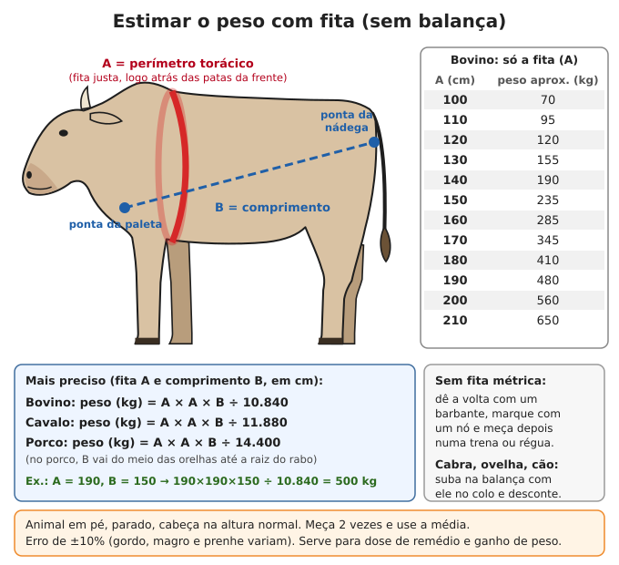
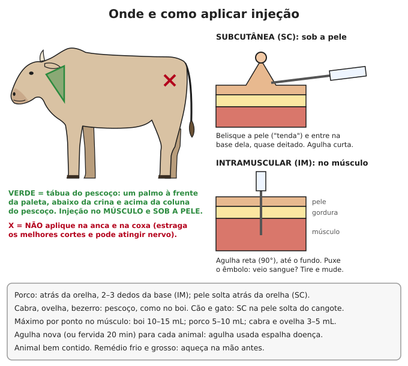
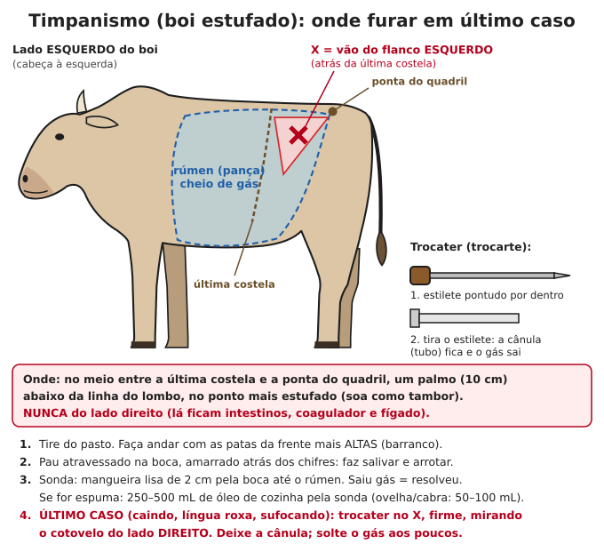

# Veterinária básica

**Resumo:** examine o animal todo dia de longe (apetite, ruminação, postura, fezes) e, se algo
estiver errado, de perto: **temperatura, pulso, respiração e mucosas**. Tenha uma farmácia básica
(ivermectina, oxitetraciclina, penicilina, anti-inflamatório, iodo, spray para bicheira, cálcio),
calcule a dose **pelo peso** (use a fita) e **respeite a carência** antes de comer carne, leite ou ovos.
Emergências que você precisa saber resolver: **timpanismo, bicheira, febre do leite, prolapso e
intoxicação por plantas**.

---

## 1. Exame do animal

### Olhe de longe primeiro
Animal sadio: come, rumina deitado e tranquilo, fica junto do grupo, orelhas e olhos atentos, pelo
liso, fezes normais para a espécie. **Sinais de alerta:** isolado, cabeça baixa, sem comer, não
rumina, barriga inchada, pelo arrepiado, magro, mancando, gemendo, ranger de dentes, respiração
pela boca, diarreia, sangue na urina.

### Sinais vitais (animal em repouso, na sombra)

| Espécie | Temperatura retal (°C) | Pulso (batimentos/min) | Respiração (por min) |
|---|---|---|---|
| Boi, vaca | 38,0–39,0 (bezerro até 39,5) | 60–80 (bezerro 100–120) | 10–30 |
| Ovelha | 38,5–40,0 | 70–90 | 12–30 |
| Cabra | 38,5–40,0 | 70–90 | 15–30 |
| Porco | 38,0–39,5 | 70–100 | 10–20 |
| Cavalo, burro | 37,5–38,5 | 28–44 | 8–16 |
| Cão | 38,0–39,2 | 70–120 (pequeno até 160) | 10–30 |
| Gato | 38,0–39,2 | 140–220 | 20–30 |
| Coelho | 38,5–40,0 | 130–300 | 30–60 |
| Galinha | 40,5–42,0 | 250–350 | 15–30 |

- **Temperatura:** termômetro digital untado com óleo, no ânus, encostado na parede, por 1 min (ou
  até apitar). Amarre um barbante com prendedor no termômetro (ele pode ser "sugado"). Com sol,
  exercício e calor a temperatura sobe 0,5–1 °C: meça de novo após 1 h na sombra.
- **Febre:** acima do máximo da tabela. **Temperatura baixa** (abaixo do mínimo) em animal doente é
  pior que febre: choque, febre do leite, fim de vida.
- **Pulso:** boi na artéria embaixo da base do rabo ou na face interna da mandíbula; cavalo na face
  interna da mandíbula; pequenos animais na parte interna da coxa. Ou escute o coração do lado
  esquerdo, atrás do cotovelo. Conte 15 s e multiplique por 4.
- **Respiração:** conte os movimentos do flanco por 1 minuto.

### Ruminação (boi, cabra, ovelha)
- Animal sadio rumina **6–8 horas por dia**, em períodos, mastigando 40–70 vezes cada bolo.
- **Movimentos do rúmen:** feche a mão e aperte o **flanco esquerdo** (vão atrás da última costela):
  sente-se o rúmen "empurrar" a mão **7 a 12 vezes em 5 minutos** no boi. Rúmen parado = doença grave
  (timpanismo, acidose, febre do leite, corpo estranho, intoxicação).

### Mucosas e hidratação
Puxe a pálpebra de baixo ou levante o lábio:

| Cor | Significa |
|---|---|
| Rosada, úmida | Normal |
| **Pálida, branca** | Anemia: vermes (cabra e ovelha: veja o cartão FAMACHA em [Cabras e ovelhas](05-cabras-e-ovelhas.md)), carrapato, tristeza parasitária, hemorragia |
| **Amarela** | Icterícia: tristeza parasitária, leptospirose, intoxicação do fígado |
| Arroxeada, azulada | Falta de oxigênio, choque, intoxicação |
| Vermelho-escura, "tijolo" | Infecção grave, febre alta, intoxicação |

- **Tempo de preenchimento:** aperte a gengiva com o dedo; a cor volta em **menos de 2 segundos**.
  Mais que isso: choque ou desidratação.
- **Desidratação:** belisque a pele do pescoço (ou a pálpebra de cima no bezerro). Volta na hora =
  normal; 2–4 s = moderada (6–8%); mais de 6 s, olhos fundos = grave (soro na veia ou pela boca, já).

## 2. Estimar o peso para calcular a dose

- **Bovino (só a fita):** use a tabela da figura (erro de ±10%).
- **Mais preciso:** peso (kg) = **A × A × B ÷ 10.840** (boi); ÷ 11.880 (cavalo); ÷ 14.400 (porco),
  com A = perímetro do peito e B = comprimento, em cm.
- Animais pequenos: pese-se na balança com o animal no colo e desconte o seu peso.
- **Na dúvida entre dois pesos, use o maior** para vermífugos e antibióticos (subdose cria resistência);
  para anti-inflamatórios e cálcio, nunca passe da dose.

## 3. Farmácia veterinária básica

> **ATENÇÃO — CARÊNCIA:** é o tempo, depois do último remédio, em que **carne, leite e ovos não podem
> ser consumidos** (o remédio ainda está no corpo). Está na bula e varia por marca. **Se perdeu a bula,
> espere 60 dias para carne e 15 dias para leite e ovos**; produtos de **longa ação (LA) e ivermectina
> 3,15%: 120 dias para carne e nunca em vaca ou cabra de leite**. O leite descartado pode ir para
> porcos e cães, fervido.

| Remédio | Para quê | Dose | Via | Carência aproximada |
|---|---|---|---|---|
| **Ivermectina 1%** (10 mg/mL) | Vermes, carrapato (ajuda), bicheira, berne, sarna, piolho | Boi, ovelha, cabra: **1 mL por 50 kg**. Porco: 1 mL por 33 kg | SC | Carne 35 dias (veja bula). **Não usar em vaca e cabra em lactação** |
| **Oxitetraciclina LA** (200 mg/mL) | Pneumonia, infecção de casco, umbigo, tristeza (anaplasma), olho ("ceratite"), metrite | **1 mL por 10 kg** (20 mg/kg), dose única; repita em 3–4 dias se preciso | IM fundo, no pescoço | Carne 28–35 dias; leite 7–10 dias |
| **Penicilina** (benzatina, procaína; "pentabiótico") | Feridas infectadas, castração, garrotilho, pneumonia, umbigo, pós-parto | 20.000–40.000 UI por kg (veja a bula do frasco); ex.: produto de 300.000 UI/mL → 1 mL por 10–15 kg | IM | Carne 14–30 dias; leite 3–5 dias |
| **Anti-inflamatório:** flunixina meglumina (50 mg/mL) | Dor, febre, cólica, inflamação | **2,2 mL por 100 kg** (1,1 mg/kg), 1 vez ao dia, até 3 dias | Na veia (cavalo); veia ou músculo (boi, conforme bula) | Carne 4–10 dias; leite 1–2 dias |
| Meloxicam (20 mg/mL) | Dor (castração, mastite, pneumonia) | 2,5 mL por 100 kg (0,5 mg/kg), dose única | SC ou veia | Carne 15 dias; leite 5 dias |
| Dipirona (500 mg/mL) | Dor, febre, cólica | 5 mL por 100 kg (25 mg/kg) | Veia ou músculo | Veja bula |
| **Iodo 10%** (tintura ou povidine) | **Umbigo** de recém-nascido; diluído, feridas e tetos | Puro no umbigo; 1 parte em 9 de água fervida nas feridas | Local | — |
| **Spray ou pó para bicheira** (larvicida + repelente + cicatrizante) | Bicheira, feridas com moscas, castração | Cobrir a ferida | Local | Veja bula (muitos têm carência de carne) |
| **Borogluconato de cálcio** 20–25% (com ou sem magnésio e fósforo) | Febre do leite, tremores pós-parto | Vaca: **500 mL na veia, devagar (10–15 min)**; cabra e ovelha: 50–100 mL | Veia (lento) ou SC dividido em vários pontos | Nenhuma |
| **Vermífugos orais:** albendazol 10%, levamisol, closantel | Vermes (closantel também a "baratinha do fígado") | Albendazol: 7,5–10 mg/kg (bula); levamisol 7,5 mg/kg (**não exceder**, margem pequena) | Oral ou SC | Veja bula. **Albendazol não em fêmea no 1º terço da gestação** |
| Óleo vegetal ou antitimpânico | Timpanismo espumoso | Boi 250–500 mL; cabra/ovelha 50–100 mL | Sonda ou pela boca, devagar | — |
| **Carvão ativado** | Intoxicações (planta, veneno) recentes | 1–3 g por kg, misturado em água | Sonda ou pela boca | — |
| Ocitocina (10 UI/mL) | Descida do leite, útero após recolocar prolapso | Vaca 20–40 UI; cabra 5–10 UI | IM | — |

**Também tenha:** termômetro digital, seringas de 5, 10, 20 e 60 mL, agulhas (curtas e finas para SC;
longas e grossas para IM; 40×12 ou mais grossa para veia de boi), luvas de procedimento e de palpação
(longas), tesoura, bisturi, fio de sutura e agulha curva, gaze, algodão, esparadrapo, sabão neutro,
água oxigenada, soro fisiológico, **sonda** (mangueira lisa de 2–2,5 cm × 2–3 m e um cano curto como
abre-boca), **trocater**, cordas, cabresto, cachimbo (para conter cavalo), formão e grosa de casco.

- Guarde na sombra, fresco e seco. Vacinas na geladeira (2–8 °C), nunca congeladas.
- Remédio vencido perde força (antibiótico em pó vencido costuma manter parte do efeito; líquidos
  turvos, com cor mudada ou grumos: descarte).
- **Rotacione** os vermífugos por grupo químico e vermifugue só quem precisa (mucosas pálidas, magros):
  vermes resistentes são hoje o maior problema de cabras e ovelhas.

## 4. Como aplicar injeção

**Antes:** animal bem contido; leia a bula; agite o frasco; limpe a tampa com álcool; use agulha nova
(ou fervida por 20 minutos) **para cada animal**; tire o ar da seringa.

**Subcutânea (SC) — sob a pele**
1. Local: pele solta do pescoço, na frente da paleta (boi, cabra, ovelha); atrás da orelha (porco);
   "cangote" (cão, gato).
2. Belisque e levante a pele formando uma **tenda**.
3. Entre com a agulha na **base da tenda**, quase paralela ao corpo, sem atravessar a pele do outro lado.
4. Injete: forma-se uma bolinha sob a pele. Massageie.

**Intramuscular (IM) — no músculo**
1. Local: **tábua do pescoço** (triângulo um palmo à frente da paleta, abaixo da crina e acima das
   vértebras do pescoço) no boi, cabra, ovelha e cavalo; 2–3 dedos atrás da base da orelha no porco.
   **Nunca** na anca ou na coxa de animal de corte (abscesso nos cortes nobres e risco de lesar o nervo).
2. Bata 2–3 vezes com a mão no local e enfie a agulha **reta (90°), de uma vez**, até o fundo.
3. **Puxe o êmbolo:** se vier sangue, tire e mude de lugar.
4. Injete devagar. Máximo por ponto: boi 10–15 mL, porco 5–10 mL, cabra e ovelha 3–5 mL.

**Na veia (IV) — só para cálcio, soro e remédios que exigem**
1. Pressione a base do pescoço (sulco da jugular) com a mão ou uma corda: a veia incha.
2. Agulha grossa, inclinada a 30°, apontada para a cabeça; sai sangue escuro gotejando → conecte o equipo.
3. Corra **devagar**, soltando a pressão. Remédio oleoso ou "IM" **nunca** na veia. Cavalo: um erro na
   carótida (sangue vermelho vivo em jato) causa convulsão: tire na hora.

## 5. Bicheira (miíase)

As larvas da **mosca-varejeira** comem carne viva. Começam em umbigo de recém-nascido, castração,
descorna, parto, pisadura, carrapato e qualquer ferida. **Em 3–5 dias** uma bicheira pequena vira um
buraco enorme.

1. Contenha o animal. Corte o pelo em volta.
2. Aplique **spray ou pó larvicida** dentro da ferida: as larvas saem ou morrem em minutos.
3. Retire **todas** as larvas com pinça, inclusive as escondidas nos túneis.
4. Lave com água limpa e sabão (ou iodo diluído). Seque.
5. Cubra com **repelente e cicatrizante** (spray prata, pomada).
6. **Ivermectina 1%** SC (1 mL por 50 kg) ajuda a matar larvas escondidas e protege por alguns dias.
7. Repita o curativo **todo dia** até cicatrizar. Bicheira grande: antibiótico (oxitetraciclina LA).

**Prevenção:** **iodo 10% no umbigo** ao nascer (mergulhe 2 vezes no 1º dia e 1 vez por dia até
secar); castrar, descornar e marcar na **época seca e fria**; repelente em toda ferida; olhar o rebanho
**todo dia**. Berne (caroço com furinho que mexe): esprema ou use ivermectina.

## 6. TIMPANISMO (boi, cabra, ovelha estufados) — emergência

O rúmen enche de gás ou espuma, aperta os pulmões e o coração, e o animal **morre em 1–3 horas**.

**Causas:** pasto de **leguminosa** novo e molhado (alfafa, trevo, soja, feijão, amendoim forrageiro),
excesso de grão ou cana, ou algo **entalado na garganta** (manga, mandioca, laranja inteira) que
impede o arroto.

**Sinais:** **flanco ESQUERDO estufado** e alto (soa como tambor ao bater), desconforto, coices na
barriga, respiração pela boca, língua para fora, baba, depois cai.

**O que fazer (na ordem):**
1. **Tire do pasto.** Faça andar. Ponha com as **patas da frente mais altas** (barranco, rampa) para o
   gás sair pela boca. Não deixe deitar de lado.
2. **Mordaça:** um pau de 3–4 cm de grossura atravessado na boca, amarrado atrás dos chifres: o animal
   mastiga, saliva e arrota.
3. **Sonda:** com um cano curto na boca como protetor (para ele não morder a mangueira), passe uma
   **mangueira lisa de 2–2,5 cm** pela boca até o rúmen (boi: cerca de 1,5–2 m). Saiu gás com cheiro
   forte = resolveu. Mexa a mangueira para frente e para trás. Se entalou algo na garganta, sinta pelo
   lado de fora e empurre com cuidado com a mangueira.
4. **Espuma** (a sonda não solta gás, sai espuma): **250–500 mL de óleo de cozinha** (boi) ou 50–100 mL
   (cabra, ovelha) pela sonda, ou antitimpânico comercial. Massageie o flanco esquerdo.
5. **ÚLTIMO CASO** (caindo, língua roxa, sufocando): **trocater no flanco ESQUERDO**, no meio entre a
   última costela e a ponta do quadril, um palmo abaixo da linha do lombo. Corte o pelo, ponha iodo,
   faça um corte de 1 cm na pele com bisturi e enfie o trocater com um golpe firme, **mirando o cotovelo
   do lado direito**. Tire o estilete e deixe a cânula; solte o gás **aos poucos**. Sem trocater: faca
   fina e limpa, e um tubo (bambu, caneta sem carga) para manter o furo aberto.
6. **Depois:** cânula presa no lugar por algumas horas (até 1–2 dias se voltar a estufar); antibiótico
   (oxitetraciclina LA), curativo e repelente no furo; volta ao pasto aos poucos.

**Prevenção:** dê capim seco ou feno antes de soltar em pasto de leguminosa; nunca solte animal
**com fome** em pasto molhado de orvalho; comece com 1 h por dia; leguminosas sempre misturadas com
capim; mude a alimentação devagar.

## 7. Intoxicação por plantas

| Planta | Quem | Sinais | O que fazer |
|---|---|---|---|
| **Cafezinho / erva-de-rato** (*Palicourea*), tingui, gibata | Boi (principal causa de morte por planta no Brasil) | **Morte súbita**: o animal parece normal e cai morto ao ser tocado, correr ou beber água | **Não movimente** o rebanho; tire calmamente da área. Arranque a planta e cerque |
| **Samambaia** (*Pteridium*) | Boi, cavalo | Boi: **sangue na urina** (crônico), sangramentos, febre; cavalo: anda cambaleando | Tire da área; roçar e calcário reduzem a samambaia; cavalo: tiamina (vitamina B1). Leite de vaca que come samambaia não é seguro |
| **Mandioca brava** (folhas e raízes frescas), sorgo e capim-sudão novos ou rebrotando após seca | Todos | Falta de ar, tremores, sangue vermelho-vivo, morte rápida (cianeto) | Dê só **murcha 1–2 dias ao sol**, fenada ou ensilada; nunca mandioca crua picada em quantidade. Tiossulfato de sódio na veia (veterinário) |
| **Caroço e torta de algodão** | Porco, galinha, bezerro, touro | Fraqueza, falta de ar, morte; infertilidade do touro | Nunca para porco, ave e bezerro; vaca adulta só em pouca quantidade |
| **Leucena** em excesso | Boi, cabra; cavalo, porco e coelho são sensíveis | Queda dos pelos da cauda e crina, baba, emagrecimento | Máximo **1/3 da comida** para ruminantes; evite para cavalos |
| **Mamona** (sementes e torta) | Todos | Diarreia com sangue, cólica, morte | Nunca dê torta de mamona como ração |
| **Espirradeira** (oleandro) | Todos (e pessoas) | Coração, morte | Não plante perto de pastos |
| Braquiária (*decumbens*) | Ovelha, bezerro, cabrito | Pele do rosto e orelhas vermelha e descascando no sol, icterícia | Tire do pasto, sombra |
| **Cebola e alho** | Cão e gato | Anemia, urina escura | Veja [Cães e gatos](11-caes-e-gatos.md) |
| **Ureia** em excesso (na cana) | Boi | Tremores, baba, dor, cai e morre em 1–4 h | **2–4 L de vinagre** pela boca (boi) e água fria. Introduza ureia aos poucos (0,5% da cana na 1ª semana, até 1%) |

**Regra geral:** tire o animal da fonte, dê **carvão ativado** (1–3 g/kg em água) se foi recente,
sombra, água e calma. Animal com fome come planta que nunca comeria: **cuide do pasto na seca** e
vistorie a pastagem antes de soltar animais novos.

## 8. Problemas do parto e pós-parto

### Febre do leite (hipocalcemia)
Vaca leiteira (mais na 3ª cria em diante) de **1 dia antes a 3 dias depois do parto**; também cabra e
ovelha.
- **Fase 1:** tremores, agitação, andar rígido.
- **Fase 2:** deitada de peito, **cabeça virada para o flanco**, orelhas frias, focinho seco, olhar
  parado, **temperatura baixa** (abaixo de 38 °C), sem ruminar.
- **Fase 3:** deitada de lado, estufando, inconsciente → morte em horas.

**Tratamento:** **borogluconato de cálcio, 500 mL na veia, devagar (10–15 min)**, com a mão ou o
ouvido no coração: se ficar muito rápido ou irregular, **pare** e espere. Pode pôr mais 250 mL
SC em vários pontos. Em 30 min a 4 h ela arrota, defeca, treme e levanta. Até levantar: mantenha
**deitada de peito**, apoiada com fardos, virando de lado a cada 3–4 h, em cama macia (deitada de lado
ela estufa e pode aspirar). Cerca de 1 em cada 4 volta a cair: repita.
**Prevenção:** no último mês de gestação evite excesso de leguminosa e de cálcio; no parto, cálcio
oral (gel) se houver.

**Cabra e ovelha no fim da gestação** (gêmeos), andando em círculo, cega, tremendo, hálito de
acetona: **toxemia da prenhez**. Dê **60 mL de propilenoglicol** (ou 100 mL de melado/xarope) pela boca,
2 vezes por dia, e cálcio. Prevenção: comida boa no último mês.

### Retenção de placenta
A placenta deve sair em até **12 h** (vaca) — na **égua, até 3 h** (passou disso, é urgência).
- **Não puxe com força** (rasga, sangra, infecciona). Corte a parte pendurada na altura do jarrete para
  ela não pisar. Na vaca, costuma soltar sozinha em 5–10 dias.
- Lave a cauda e o traseiro, repelente contra moscas.
- Meça a temperatura todo dia: **febre, corrimento fétido, sem comer = infecção do útero** →
  oxitetraciclina LA (1 mL/10 kg) e anti-inflamatório.

### Prolapso
- **Vaginal** (bola rosada saindo da vulva antes do parto, ao deitar): lave com água limpa e fria,
  empurre de volta e segure com uma **sutura larga em bolsa** (fita ou cadarço) na vulva, ou com
  retentor. **Tire a sutura no início do parto.** Animal que teve prolapso repete: descarte-o depois
  de desmamar a cria.
- **Uterino** (logo após o parto, sai uma massa grande vermelha com "botões"): **EMERGÊNCIA**.
  1. Mantenha a vaca quieta, de peito, com as **patas traseiras esticadas para trás** (posição de rã);
     ou levante o traseiro.
  2. Envolva o útero num pano ou saco plástico limpo e molhado; dois ajudantes o seguram na
     **altura da vulva** (diminui o inchaço e a hemorragia).
  3. Lave com água morna limpa. Açúcar espalhado sobre o útero reduz o inchaço em 10–15 min.
  4. Solte a placenta se sair fácil. Empurre o útero de volta **começando pela parte mais perto da
     vulva**, com a palma das mãos (nunca com as pontas dos dedos), entre os esforços da vaca.
  5. No fim, enfie o braço inteiro para desvirar os cornos completamente.
  6. Ocitocina (20–40 UI IM), cálcio (ela costuma estar com febre do leite) e antibiótico.

## 9. Feridas, abscessos e castração

### Feridas
1. Lave com bastante água limpa (fervida e morna) e sabão neutro; corte o pelo em volta; tire sujeira.
2. Iodo diluído (1 parte de povidine em 9 de água).
3. **Feche com pontos só se for recente (menos de 6 h), limpa e sem tensão.** Suja ou antiga: deixe
   aberta e faça curativo todo dia. Açúcar ou mel no fundo da ferida infectada ajudam a limpar.
4. Sempre **repelente** contra moscas. Antibiótico se profunda, perto de articulação ou infectada.
5. Cavalo, cabra e ovelha pegam **tétano** fácil: vacine (ou soro antitetânico se houver).
Mais técnicas em [Ferimentos](../02-saude/02-ferimentos-queimaduras-fraturas.md).

### Abscessos
- Espere **amolecer** (mole, flutuante ao apertar). Antes, compressa morna 2–3 vezes ao dia.
- **Teste com agulha:** saiu pus → é abscesso. Saiu sangue ou nada → pode ser hérnia ou vaso:
  **não corte** (principalmente no umbigo e no pescoço).
- Corte no **ponto mais baixo** (para drenar), esprema, lave com iodo diluído ou água oxigenada e
  deixe aberto.
- **Luvas sempre**; queime ou enterre o pus e as gazes. Em cabra e ovelha, caroços com pus grosso
  verde-amarelado são **linfadenite caseosa**: muito contagiosa, isole o animal.

### Castração
- **Anel de borracha (elastrador):** cordeiros e cabritos até 7 dias, bezerros nas primeiras
  semanas. Os **dois testículos** precisam estar no saco. O saco cai em 2–3 semanas. Risco de tétano.
- **Burdizzo** (alicate que esmaga os cordões, sem corte): 2–6 meses. Esmague cada cordão
  separadamente, por 10 s, acima do testículo.
- **Cirúrgica** (bezerro e cabrito de 2–6 meses; leitão até 7 dias):
  1. Faça na **época seca e fria** (menos moscas). Contenha bem. Anestesia local (lidocaína 2%) se
     houver.
  2. Lave e passe iodo no saco. Corte o **terço de baixo** do saco (ou um corte vertical em cada lado).
  3. Puxe o testículo para fora, raspe ou torça o cordão até romper (animais maiores: amarre o cordão
     com fio antes de cortar).
  4. Deixe aberto para drenar. Spray larvicida e repelente.
  5. Observe por 10 dias: sangramento, inchaço, bicheira.
- Anti-inflamatório (meloxicam) reduz muito a dor. **Cavalos: só com veterinário** (risco de as
  vísceras saírem pelo corte).

## 10. Zoonoses e proteção de quem cuida

| Doença | De quem | Proteção |
|---|---|---|
| **Raiva** | Boi, cavalo (morcego), cão, gato | **Nunca ponha a mão na boca** de animal "engasgado", babando ou com paralisia. Vacine os animais |
| **Brucelose** | Vaca, cabra, porco, cão | Luvas em partos e abortos; enterre fetos e placentas; ferva o leite; vacine as bezerras |
| **Tuberculose** | Vaca, porco | Ferva o leite; descarte animais tossindo e magros |
| **Leptospirose** | Boi, porco, cão, ratos | Botas e luvas em lama, urina e partos; controle de ratos |
| Carbúnculo | Boi, ovelha, cavalo | Não abra animal morto de repente com sangue escuro pelos orifícios |
| Ectima (boqueira) | Cabra, ovelha | Luvas ao tratar feridas da boca dos cordeiros |
| Micose, esporotricose, sarna | Vários, gato | Luvas, lavar as mãos |
| Toxoplasmose, verminoses | Gato, cão, porco | Higiene, carne bem cozida |

**EPI:** luvas de procedimento (e luva longa de palpação em partos), botas de borracha, avental ou
macacão, óculos em partos e ao abrir abscessos, máscara em lugares fechados com animais tossindo.
Cubra os cortes das mãos. **Lave as mãos** com água e sabão depois de mexer em qualquer animal doente.
Separe roupa e botas de curral da roupa de casa.

---

Ver também: [Princípios gerais](01-principios-gerais.md) · [Bovinos](03-bovinos.md) · [Cabras e ovelhas](05-cabras-e-ovelhas.md) · [Suínos](04-suinos.md) · [Cavalos e tração](10-equinos-e-tracao.md) · [Cães e gatos](11-caes-e-gatos.md) · [Abate e carne](12-abate-e-carne.md) · [Medicamentos (humanos)](../02-saude/04-medicamentos-e-doses.md)
