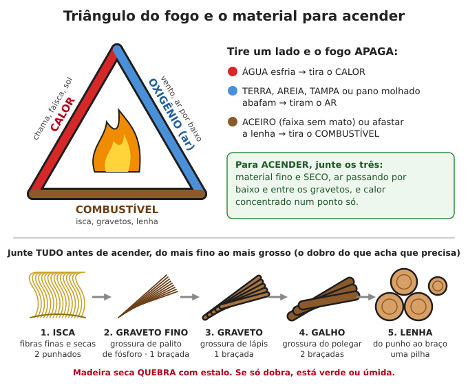
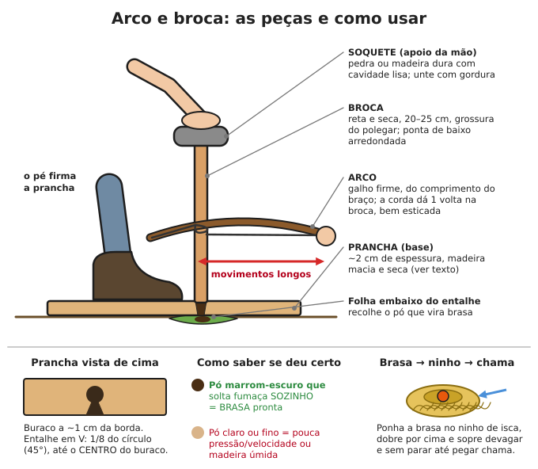
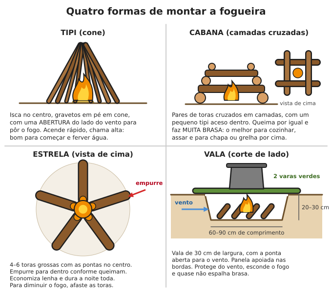

# Fogo

**Resumo:** fogo precisa de três coisas ao mesmo tempo: **combustível, calor e ar**. Quase
toda fogueira que falha falhou por **material úmido ou grosso demais cedo demais**. Junte tudo
antes (isca, graveto fino, graveto, galho, lenha), tenha sempre **dois jeitos de acender** no
bolso (isqueiro + ferrocério) e aprenda a guardar a brasa para não precisar acender de novo.

---

## O triângulo do fogo

| Lado | O que é | Como tirar (para apagar) |
|---|---|---|
| **Combustível** | isca, gravetos, lenha, carvão, gás | aceiro (faixa sem mato), afastar a lenha |
| **Calor** | chama, faísca, brasa, sol concentrado | água (esfria) |
| **Oxigênio (ar)** | o ar que entra por baixo e pelos lados | terra, areia, tampa, pano molhado (abafam) |

Consequências práticas:
- Fogueira **apertada demais** apaga (falta ar). **Espalhada demais** também (falta calor).
- Soprar e abanar dá ar. Sopre **por baixo**, devagar e contínuo, não com força.
- Lenha grossa só pega quando já há **brasa** embaixo. Isca e graveto fino são a "ponte".

## O material: do mais fino ao mais grosso

Junte **antes** de acender (o dobro do que acha que precisa) e deixe ao alcance da mão,
separado por tamanho:

| Tamanho | Grossura | Quanto juntar | Exemplos |
|---|---|---|---|
| 1. Isca | fios e fibras | 2 punhados | capim seco, paina, barba-de-velho seca, fibra de coco seca, casca fina de eucalipto desfiada, raspa de bambu seco, algodão, papel |
| 2. Graveto fino | palito de fósforo | 1 braçada | ramos mortos e secos, lascas finas |
| 3. Graveto | lápis | 1 braçada | galhinhos secos |
| 4. Galho | polegar | 2 braçadas | galhos mortos |
| 5. Lenha | punho a braço | pilha | lenha rachada |

- **Teste de secura:** madeira seca **quebra com estalo**. Se dobra, está verde ou úmida.
- **Onde achar seco:** galhos mortos **ainda presos na árvore** (não os do chão), embaixo de
  árvores copadas, debaixo de pedras e barrancos, dentro de troncos mortos em pé.
- **Graveto de penas:** com a faca, tire lascas finas de um pau seco **sem soltar as lascas**
  (fica parecendo uma pena). O miolo de madeira molhada por fora costuma estar seco.

## Acendedores (o que faz o fogo pegar fácil)

| Acendedor | Como fazer / onde achar | Observação |
|---|---|---|
| **Algodão com vaselina** | Esfregue 1 colher de chá de vaselina em cada bola de algodão; guarde num pote ou tubo fechado | Pega com uma faísca; cada bola queima 2–4 min. O melhor para o kit |
| **Nó de pinho / pinho resinoso** | Nós e tocos de araucária (pinheiro-do-paraná) ou de pinus mortos, cheios de resina | Tradicional no Sul; queima mesmo úmido, com fumaça preta |
| **Resina (breu)** | Breu-branco (almécega) na Amazônia; resina escorrida de pinus; jatobá | Raspe em lascas ou bolinhas sobre a isca |
| **Palha de aço fina (tipo Bombril)** | De supermercado, guardada seca | Pega com faísca, com pilha e até molhada (depois de sacudir) |
| **Casca de eucalipto** | Tiras secas que soltam do tronco | Tem óleo; queima bem |
| **Candeia** | Madeira de candeia (Minas Gerais e cerrado) | Queima como vela |
| **Serragem + parafina** | Serragem em forminha de ovo coberta com vela derretida | Faça em casa, dura anos |
| **Câmara de pneu (borracha)** | Tiras de 2 × 10 cm | Só em último caso: fumaça tóxica, mas acende na chuva |
| **Álcool em gel, querosene** | Uma colher de sopa sobre a isca, **antes** de acender | Nunca jogue em fogo aceso |

> **ATENÇÃO:** **nunca use gasolina** para acender fogo. O vapor explode e causa queimaduras
> graves no rosto e no corpo. Também nunca jogue álcool ou querosene em brasa ou fogo que parece
> apagado: a chama volta pelo jato até a garrafa na sua mão.

## Formas de acender

Tenha sempre **pelo menos dois métodos** no bolso e um terceiro na mochila.

### 1. Isqueiro
- O melhor que existe: dura milhares de acendimentos. Guarde **vários** (barato e leve).
- Molhado: sopre e seque a pedra e a roda com a roupa; espere uns minutos.
- No frio ou na altitude, aqueça no bolso junto ao corpo.
- **Isqueiro sem gás ainda faz faísca:** use essa faísca em algodão com vaselina ou palha de aço.

### 2. Fósforo
1. Proteja do vento com o corpo e as mãos em concha.
2. Risque e **incline o palito para baixo** para a chama subir pelo palito.
3. Leve a chama **por baixo** da isca, não por cima.
- **À prova d'água:** mergulhe a cabeça do fósforo em parafina de vela derretida ou passe
  esmalte de unha. Guarde num pote de remédio com um **pedaço da lixa da caixa** (fósforo de
  segurança só acende na lixa).

### 3. Ferrocério (pederneira moderna, "bastão de magnésio")
Solta faíscas a cerca de **3.000 °C**. Funciona molhado e dura milhares de usos.
1. Prepare a isca bem fina (algodão com vaselina, palha de aço, paina, capim desfiado).
2. Apoie a ponta do bastão **encostada na isca**.
3. Encoste o raspador (ou as **costas** da faca, em ângulo de ~45–90°) no bastão.
4. **Segure o raspador parado e puxe o bastão para trás** com força: assim você não chuta e
   espalha a isca.
- Bloco de magnésio: raspe um montinho de lascas do tamanho de uma moeda sobre a isca e faísque
  nele. Queima muito quente por poucos segundos.

### 4. Lupa, lente ou fundo de garrafa (só com sol forte)
1. Horário: **10 h às 14 h**, sem nuvem no sol.
2. Isca **escura** pega muito mais rápido: carvão de pano (ver adiante), fungo seco, papel
   pintado de preto com carvão.
3. Ajuste a distância até o ponto de luz ficar **o menor e mais brilhante possível**; segure
   **parado**. Leva de 10 segundos a 1 minuto para sair fumaça. Sopre de leve.
- Servem: lupa (5 cm ou mais), **óculos de leitura de quem tem "vista cansada"** (óculos de
  míope não servem), lente de binóculo, garrafa PET transparente **cheia de água** (use a parte
  arredondada), saco plástico transparente cheio de água bem redondo.
- **Fundo de lata de refrigerante:** polido por 1 hora com pasta de dente vira espelho côncavo;
  o foco fica a 2–3 cm do fundo. Lento, mas funciona com carvão de pano.

> **ATENÇÃO:** garrafas cheias de água e vidros deixados ao sol já causaram incêndios. Nunca
> olhe para o ponto de luz por muito tempo sem óculos escuros.

### 5. Pilha + palha de aço
- **Bateria de 9 V:** esfregue os dois polos dela num chumaço de palha de aço fina: os fios ficam
  em brasa na hora.
- **2 pilhas AA ou D:** junte em fila (+ de uma no − da outra) com fita; estique um fio fino de
  palha de aço de uma ponta à outra.
- Ponha a palha em brasa **dentro da isca** e sopre.
- **Guarde palha de aço e bateria de 9 V separadas** no kit: o contato no bolso pega fogo sozinho.

> **ATENÇÃO:** não faça isso com bateria de celular ou de lítio (pode incendiar e explodir).
> Com bateria de carro, use cabos longos e faça a faísca **longe da bateria** (ela solta
> hidrogênio, que explode).

### 6. Arco e broca (fricção)

O método mais difícil: **treine antes da emergência**, com madeira bem seca. Em clima úmido
(boa parte do Brasil), guarde um kit pronto (broca + prancha) em saco plástico.

**As peças:**

| Peça | Medidas e material |
|---|---|
| **Broca** | 20–25 cm de comprimento, grossura do polegar (~2 cm), **reta e seca**. Ponta de baixo arredondada (larga), ponta de cima mais fina |
| **Prancha** | ~2 cm de espessura, 5–8 cm de largura, 30 cm de comprimento. Pode ser da mesma madeira da broca |
| **Soquete** (apoio da mão) | Pedra com cavidade, pedaço de madeira **dura** com um buraco raso, osso, ou o fundo de uma garrafa de vidro. Unte com gordura, sabão, cera ou folha verde para deslizar |
| **Arco** | Galho firme, levemente curvo, do comprimento do braço (60–80 cm) |
| **Corda** | Cadarço, cordão de nylon, tira de couro. Bem esticada |
| **Folha ou lasca** | Embaixo do entalhe, para recolher o pó em brasa |

**Madeiras boas no Brasil:** leves e macias a médias, **secas, mortas, mas não podres**, sem
resina. Teste: a unha marca a madeira com pouca força. Experimente: **embaúba (imbaúba)**,
**mulungu**, **paineira**, **gameleira/figueira**, **sabugueiro**, **salgueiro (salseiro)**,
**algodoeiro-da-praia** (hibisco-do-mangue), **cedro**, **álamo**. Evite madeira podre (esfarela),
resinosa (pinus, eucalipto) e muito dura (ipê, aroeira, angico).

**Passo a passo (para destro):**
1. Com a faca, faça uma covinha na prancha a **~1 cm da borda**.
2. Encaixe a broca: dê **uma volta da corda** na broca (a broca fica do lado de fora da corda,
   para não bater no arco).
3. Ajoelhe: **pé esquerdo** firme sobre a prancha, perto da covinha; joelho direito no chão.
   Mão esquerda segura o soquete com o **pulso travado contra a canela** (fica firme).
4. Gire com **movimentos longos**, usando o arco inteiro, pressão moderada, até a covinha ficar
   **preta** e sair fumaça. Pare.
5. Corte o **entalhe em V**: uma "fatia de pizza" de **1/8 do círculo (45°)**, da borda até o
   **centro** da covinha. Ponha a folha embaixo.
6. Recomece: devagar no início; quando sair fumaça, **aumente velocidade e pressão** por mais
   20–30 movimentos.
7. O pó **marrom-escuro** enche o entalhe. Se, ao parar, ele **continua soltando fumaça sozinho**,
   é brasa. Espere 10–20 segundos para ela firmar.
8. Leve a brasa (na folha) para o **ninho de isca**, dobre a isca por cima e sopre devagar e sem
   parar até virar chama.

| Problema | Causa e solução |
|---|---|
| Muita fumaça, nenhuma brasa | Pó claro: falta pressão/velocidade, ou madeira úmida |
| Broca pula para fora | Covinha rasa ou soquete torto; segure o soquete travado na canela |
| Corda escorrega | Pouca tensão: estique a corda ou passe resina/terra nela |
| Soquete queima e prende | Falta lubrificante: unte com gordura ou cera |
| Pó grosso e brilhante | Muita pressão e pouca velocidade |

### 7. Pedra e aço (o antigo "fuzil" ou binga)
- **Aço:** aço-carbono duro (lima velha quebrada, "fuzil" de binga). Aço inox e alumínio não
  servem.
- **Pedra:** dura e com aresta afiada: **quartzo** (comum em todo o Brasil), sílex, ágata,
  calcedônia, jaspe. Teste: deve riscar vidro.
- **Isca que pega faísca fraca:** carvão de pano, fungo orelha-de-pau bem seco, paina queimada.
1. Segure a pedra com a aresta para fora e o carvão de pano **em cima da pedra**, preso pelo
   polegar, junto da aresta.
2. Bata o aço **de raspão para baixo** na aresta. As faíscas (lasquinhas de aço em brasa) caem no
   carvão de pano e fazem um ponto vermelho.
3. Ponha o pano em brasa no ninho e sopre.

**Carvão de pano (faça com antecedência):**
1. Corte pano **100% algodão** (camiseta velha, jeans) em quadrados de 5 × 5 cm.
2. Ponha numa lata pequena com tampa (lata de pomada, de balas) com **um furo de prego** na tampa.
3. Coloque a lata no fogo ou na brasa. Sai fumaça (que pode pegar fogo) pelo furo.
4. Quando **parar de sair fumaça** (10–15 min), tire do fogo e deixe **esfriar fechada** (se abrir
   quente, o pano pega fogo).
5. Bom carvão de pano é **preto, inteiro e flexível**. Guarde seco. Pega com qualquer faísca.

## Estruturas de fogueira

| Estrutura | Como montar | Melhor para |
|---|---|---|
| **Tipi (cone)** | Isca no centro, gravetos em pé em cone, abertura do lado do vento | Começar qualquer fogo; ferver água rápido |
| **Cabana** | Pares de toras cruzados em camadas, com um tipi aceso dentro | Brasa para cozinhar, grelhar, assar |
| **Estrela** | 4–6 toras com as pontas no centro; empurrar conforme queimam | Fogo da noite inteira com pouca lenha |
| **Vala** | Vala de 30 cm de largura × 20–30 cm de fundo × 60–90 cm de comprimento, aberta para o vento | Vento forte; panela apoiada nas bordas; pouco risco de espalhar |
| **Três pedras** | Três pedras do mesmo tamanho em triângulo, fogo no meio | Apoio simples de panela (gasta muita lenha — veja o [fogão foguete](02-lenha-carvao-e-fogoes.md)) |

> **ATENÇÃO:** **nunca use pedras de rio ou molhadas** em volta ou dentro do fogo: a água dentro
> delas vira vapor e elas podem **estourar** e lançar lascas.

## Fogo na chuva

1. **Abrigo primeiro:** lona ou telhado a pelo menos **1,5 m** acima do fogo (mais alto se for
   plástico), aberto dos lados para a fumaça sair.
2. **Base seca:** uma camada de galhos lado a lado, casca ou pedra chata, para isolar do chão
   encharcado.
3. **Material seco:** galhos mortos presos nas árvores; **rache** a lenha para usar o miolo;
   faça gravetos de penas; bambu seco tem o interior seco.
4. **Acendedor forte:** algodão com vaselina, nó de pinho, palha de aço, vela acesa embaixo dos
   gravetos por alguns minutos.
5. **O dobro de graveto fino.** Vá secando a próxima lenha encostada perto do fogo.
6. Mantenha o kit de fogo (isqueiro, ferrocério, algodão) em **saco plástico fechado**, junto ao
   corpo.

## Guardar e carregar a brasa

Acender de novo gasta material e esforço. Na roça se dizia "não deixar o fogo morrer".
- **À noite:** junte as brasas no centro e **cubra com 3–5 cm de cinza**. Brasa de madeira dura
  dura 8–12 horas assim. De manhã, descubra, junte, ponha graveto fino e sopre.
- **Tição:** pau grosso com a ponta em brasa; leve com a ponta acesa para baixo e gire de vez em
  quando.
- **Lata de brasa:** lata com furinhos na tampa e nos lados, com brasa enterrada em cinza e um
  pouco de carvão. Abra e sopre de vez em quando.
- **Fungo orelha-de-pau** seco (os duros, de tronco) aceso numa ponta segura brasa por horas.

## Segurança e prevenção de incêndio

**Antes de acender:**
1. Raspe um círculo de **3 m de diâmetro** até a terra (sem folhas nem capim).
2. Longe pelo menos **5 m** de barracas, casas, palha, cercas e lenha empilhada; **nunca embaixo
   de galhos baixos** ou dentro de mato seco.
3. Deixe **balde de água ou de terra** e uma pá ao lado.
4. **Vento forte ou época seca** (no Centro-Oeste e Sudeste, de junho a outubro): fogo só em vala,
   fogão ou de jeito nenhum. Brasa levada pelo vento atravessa 100 m e começa queimada.

**Durante:** alguém sempre acordado e perto. Crianças a pelo menos 1 m. Roupa de náilon e
poliéster derrete e gruda na pele: prefira algodão perto do fogo. Cabelo comprido preso.

**Apagar de verdade:**
1. Jogue água devagar, mexa as brasas com um pau, jogue água de novo.
2. Repita até **não sair vapor nem chiado**.
3. Passe o **dorso da mão** perto da cinza: se ainda está quente, não está apagado.
4. Sem água: abafe com terra, mexa, abafe de novo. Terra sozinha pode deixar brasa viva embaixo
   por horas.

**Queimada fora de controle:** afaste-se para o lado **de onde vem o vento** ou para área já
queimada, terra nua, rio. Nunca suba morro à frente do fogo (fogo sobe morro muito rápido).
Fazer **aceiro** (faixa de 3 m ou mais limpa até a terra) em volta da casa e das plantações na
época seca é a melhor proteção.

> **ATENÇÃO:** em tempos normais, colocar fogo em mata é **crime ambiental** e queima de roçado
> exige autorização do órgão ambiental. Queimaduras: resfrie com água corrente por 20 minutos e
> veja [Ferimentos e queimaduras](../02-saude/02-ferimentos-queimaduras-fraturas.md).

---

Ver também: [Lenha, carvão e fogões](02-lenha-carvao-e-fogoes.md) · [Iluminação](08-iluminacao.md) · [Perdido no mato](../11-natureza-e-desastres/01-perdido-no-mato.md) · [Queimaduras](../02-saude/02-ferimentos-queimaduras-fraturas.md) · [Kits e estoques](../00-emergencia/03-kits-e-estoques.md)
