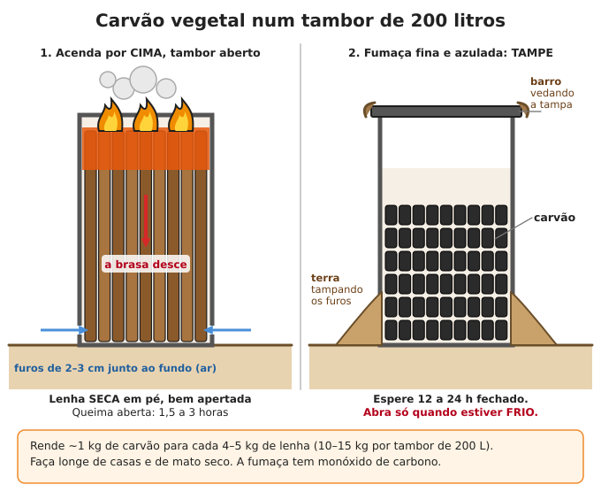
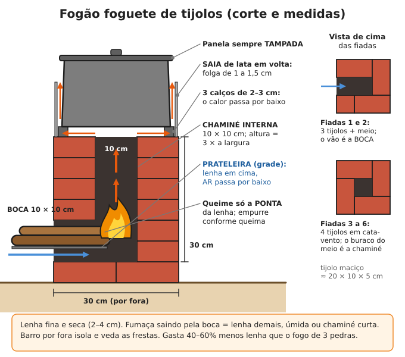
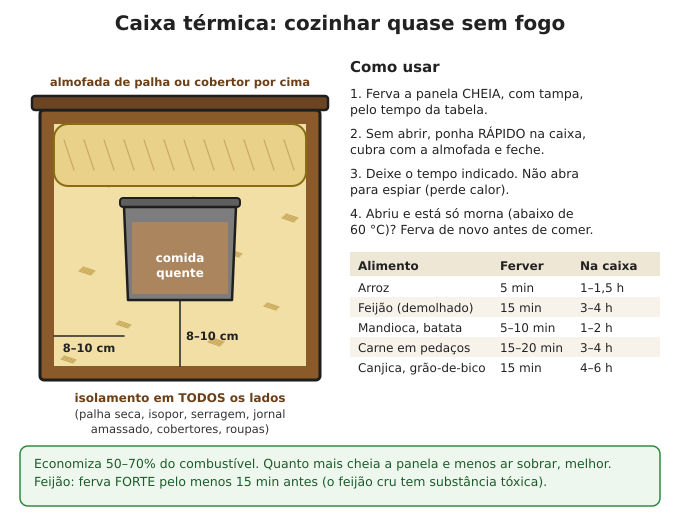

# Lenha, carvão e fogões

**Resumo:** **lenha seca** (6–12 meses secando) dá quase o dobro de calor útil da verde e
muito menos fumaça. Um **fogão foguete** gasta metade da lenha do fogo de três pedras, e a
**caixa térmica** termina o cozimento sem fogo. Plante e maneje suas árvores de lenha: meio
hectare em rotação abastece uma família. Nunca queime carvão ou lenha em lugar fechado sem
chaminé: o **monóxido de carbono** mata dormindo.

---

## Lenha

### Espécies boas para lenha no Brasil

| Espécie | Região | Observação |
|---|---|---|
| **Eucalipto** | todo o país | Cresce rápido (corte com 5–7 anos), rebrota do toco; racha fácil |
| **Bracatinga** | Sul (planalto) | Lenha tradicional do Paraná e SC; cresce rápido; fixa nitrogênio |
| **Acácia-negra** | Sul (RS) | Ótima lenha e carvão; rebrota pouco; espalha sementes |
| **Sabiá** | Nordeste | Lenha e estaca de cerca; rebrota bem; tem espinhos |
| **Jurema-preta, angico** | Nordeste, Caatinga | Lenha muito boa e densa |
| **Algaroba** | Nordeste | Excelente lenha e carvão; invasora — use para limpar áreas tomadas |
| **Leucena, gliricídia** | todo o país | Poda dos galhos a cada 1–2 anos; também forragem e adubo verde |
| **Podas de frutíferas** (manga, goiaba, laranja, café) | todo o país | Boa lenha, aproveita o que já seria cortado |

**Não queime:**
- **Madeira tratada** (mourão e tábua esverdeados ou com "CCA"): solta **arsênio e cromo**.
- Madeira pintada, envernizada, compensado, MDF, aglomerado (colas e tintas tóxicas).
- **Espirradeira** (oleandro) e **aroeira-brava** (bugreiro): a fumaça irrita e intoxica.
- Plástico, borracha, isopor (fumaça tóxica, entope chaminé).

### Secar a lenha (o mais importante)

Lenha verde tem **40–60% de água**. Boa parte do calor se gasta fervendo essa água, o fogo
fumaça e a chaminé se enche de piche (creosoto).

1. Corte em toras de **30–50 cm** (cabe no fogão) e **rache** ao meio ou em quatro: rachada seca
   duas a três vezes mais rápido que roliça.
2. Empilhe **fora do chão** (sobre paus, pedras ou pallets), em pilhas soltas, com espaço para
   o ar passar.
3. **Cubra só o topo** (telha, lona, telhado); os lados ficam abertos ao sol e ao vento.
4. Tempo: **6 a 12 meses** (mais para madeira densa ou em lugar úmido). Corte a lenha deste ano
   para queimar no ano que vem.

**Como saber se está seca:** pontas com **rachaduras** em raio, cor acinzentada, mais leve,
casca soltando, e duas toras batidas uma na outra fazem **"toc" oco** (verde faz som abafado).

### Quanto uma família gasta

| Situação (família de 4–5 pessoas, só cozinhando) | Por dia | Por ano |
|---|---|---|
| Fogo aberto, três pedras ou fogão rústico aceso o dia todo | 8–15 kg | 3–5,5 toneladas (≈ 8–14 m³ empilhados) |
| Fogão foguete ou fogão a lenha bem feito, aceso só na hora, lenha seca | 3–6 kg | 1–2 toneladas (≈ 3–6 m³ empilhados) |
| + aquecer a casa no inverno do Sul | +30% a +100% | |

- Um **metro estéreo** (pilha de 1 × 1 × 1 m) de eucalipto seco pesa **300–450 kg**.
- Para comparar: 1 kg de lenha seca ≈ 4 kWh de calor; 1 botijão de 13 kg de gás equivale a
  **60–100 kg de lenha seca** num fogão eficiente (150–250 kg em fogo aberto).

### Manejo de árvores para lenha (talhadia)

Muitas árvores **rebrotam do toco** (eucalipto, sabiá, leucena, gliricídia, algaroba, bracatinga
por semente). Assim a mesma área dá lenha para sempre:
1. Divida a área de lenha em **5 a 7 talhões** e corte **um por ano** (no último ano, o primeiro
   já cresceu de novo).
2. Corte na **época seca/inverno**, a **10–20 cm do chão**, com o corte **inclinado** (a água da
   chuva escorre e o toco não apodrece).
3. Depois de 6–12 meses, deixe os **2–3 brotos mais fortes** de cada toco e corte o resto.
4. Área: **0,2 a 0,3 hectare** de eucalipto ou bracatinga em rotação abastecem uma família com
   fogão eficiente (0,5–0,7 ha com fogo aberto ou com aquecimento no inverno). Cercas vivas de
   gliricídia e leucena completam.
5. Mantenha a lenha de árvores nativas para o que só elas dão (madeira de lei, frutas, sombra).

> **ATENÇÃO:** derrubar árvore mata gente todo ano. Veja direção de queda, rota de fuga em 45°
> para trás e ninguém num raio de **2 vezes a altura** da árvore. Detalhes em
> [Madeira e carpintaria](../07-abrigo-e-construcao/03-madeira-e-carpintaria.md).

## Carvão vegetal

Carvão é lenha aquecida **quase sem ar**: a água e os gases saem como fumaça e sobra o carbono.
Pesa ~1/4 da lenha, não faz fumaça, dá **o dobro de calor por quilo** (≈ 8 kWh/kg) e serve para
forja, fogareiro, filtro de água e adubo (biocarvão).

**Rendimento:** 1 kg de carvão para cada **4 a 7 kg de lenha seca** (15–25%). Com lenha úmida,
rende bem menos.

### No tambor de 200 litros (pequena quantidade)

1. Tambor de aço de 200 L **sem a tampa de cima** (guarde a tampa ou uma chapa que cubra a boca).
   Faça **6 a 8 furos de 2–3 cm** em volta, junto ao fundo.
2. Encha com lenha **seca**, de **2 a 8 cm de grossura**, cortada da altura do tambor, **em pé e
   bem apertada**, até a boca.
3. Ponha gravetos e isca **por cima** e acenda por cima. O fogo vai descendo; os gases que sobem
   de baixo passam pela chama e queimam (menos fumaça).
4. Deixe queimar aberto **1,5 a 3 horas**. A fumaça começa **branca e grossa** (água), fica
   **amarelada** e depois **fina e azulada/transparente**.
5. Quando a fumaça ficar fina e a brasa chegar perto do fundo (o fundo do tambor fica muito
   quente; gota de água chia), **tampe** a boca e **vede a tampa e os furos com terra ou barro**.
6. Deixe fechado **12 a 24 horas**. Abra só **frio**. Se tiver brasa, feche de novo.
- Um tambor dá **10–15 kg** de carvão.
- **Retorta (melhor rendimento, ~30%):** um tambor menor ou lata de 18 L cheio de lenha, fechado,
  com um furo pequeno virado para baixo, colocado **dentro** de uma fogueira ou de outro tambor. Os
  gases saem pelo furo e queimam no fogo de fora. Quando parar de sair chama do furo, está pronto.

### Na meda de terra (caieira — grande quantidade)

1. Terreno plano e limpo, **longe 50 m de casas e mato seco**, com terra para cobrir.
2. No centro, finque 3–4 estacas formando uma **chaminé de 20–30 cm** de largura; encha-a de
   gravetos e isca.
3. Encoste a lenha seca **em pé, inclinada para o centro**, bem apertada, as toras grossas perto da
   chaminé e as finas na borda. Forma um monte de **2–4 m de diâmetro e 1–1,5 m de altura**.
4. Cubra com **10 cm de capim ou folhas** e depois **10–20 cm de terra** batida. Deixe **6–8
   respiros** (buracos do tamanho de um punho) na base, em volta.
5. Acenda jogando brasas pela chaminé. Quando o fogo pegar bem, **tampe a chaminé**.
6. Vigie **dia e noite**: onde a fumaça muda de branca para azulada, aquela parte está pronta —
   feche os respiros daquele lado. Se aparecer **chama ou buraco afundando**, tampe com terra na
   hora (está queimando em vez de carbonizar).
7. Leva **3 a 10 dias**, conforme o tamanho. Quando toda a fumaça ficar azulada e rala, feche tudo
   e deixe esfriar **2 a 4 dias**.
8. Abra aos poucos, **de manhã**, com água à mão. Espalhe o carvão em camada fina e vigie até o
   dia seguinte antes de ensacar.

> **ATENÇÃO:** carvão recém-feito pode **reacender sozinho** horas depois. Nunca ensaque nem
> guarde carvão que ainda está morno. A fumaça da carvoaria tem monóxido e irrita os pulmões:
> fique do lado de onde vem o vento e nunca durma perto.

## Fogão foguete (rocket stove)

Câmara de queima em "L", com paredes que guardam o calor e uma chaminé interna curta: a lenha
queima quente e completa, com **pouca fumaça e 40–60% menos lenha** que o fogo de três pedras.
Usa graveto e galho fino, que qualquer quintal tem.

### Versão de tijolo maciço (~28 tijolos de ~20 × 10 × 5 cm)
1. **Base:** chão firme e nivelado ou um piso de tijolos/pedra chata de 30 × 30 cm.
2. **Fiadas 1 e 2 (a boca):** 3 tijolos inteiros + meio tijolo em "cata-vento", deixando um vão
   de **10 × 10 cm** de um lado até o centro.
3. **Fiadas 3 a 6 (a chaminé):** 4 tijolos inteiros em cata-vento; o buraco do meio
   (**10 × 10 cm**) sobe até **30 cm** de altura (3 vezes a largura).
4. **Prateleira:** um pedaço de grade, tela grossa ou chapa furada na boca, a ~1/3 da altura: a
   lenha fica **em cima** e o ar entra **por baixo**.
5. **Calços:** 3 pedaços de tijolo ou ferro de **2–3 cm** em cima, para a panela não tampar a saída.
6. **Saia:** uma tira de lata em volta da panela, com **1–1,5 cm de folga**, obriga o gás quente a
   lamber os lados da panela (economiza mais 20–30%).
7. Reboque por fora com **barro + areia + palha** (veda as frestas e segura o calor).

### Versão de lata (para levar)
- Lata de **18 L** (de tinta ou óleo) + **3 latas de leite em pó** (~10 cm de diâmetro) sem fundo.
- Duas latas emendadas em pé formam a chaminé (~30 cm); a terceira, deitada, entra por um furo na
  lateral da lata grande a ~5 cm do fundo e forma a boca.
- Encha o espaço entre as latas com **cinza de madeira peneirada**, vermiculita ou perlita
  (isolante). Tampa com furo para a chaminé e 3 apoios para a panela.
- As latas internas queimam em alguns meses: troque ou faça o tubo interno de barro.

> **ATENÇÃO:** não use chapa **galvanizada** (zincada, brilhante "manchada") na parte que pega
> fogo: o zinco quente solta fumaça tóxica (febre, tremores).

**Como usar:** lenha **fina e seca (2–4 cm)**, 3–5 pedaços de cada vez; **só a ponta queima**;
vá empurrando para dentro. Fumaça saindo pela boca = lenha demais, úmida, ou chaminé curta.

## Fogão a lenha com chapa e chaminé

O fogão a lenha de tijolo da roça brasileira, bem feito, cozinha, esquenta água, assa e aquece a
casa, sem fumaça dentro.

| Parte | Medida típica |
|---|---|
| Altura da chapa | 80–90 cm do chão (altura de trabalho) |
| Fornalha (câmara do fogo) | 30–35 cm de largura × 25–30 cm de altura × 50–70 cm de comprimento |
| Grelha | barras de ferro a ~10 cm do fundo; embaixo, o **cinzeiro** com portinhola (regula o ar) |
| Chapa | ferro fundido com bocas e anéis; o fogo passa por baixo dela até a chaminé |
| Saída para a chaminé | no fundo, do lado oposto à boca, depois de passar sob toda a chapa |
| Chaminé | tubo de 12–15 cm (chapa de aço, manilha de barro ou alvenaria), **pelo menos 3–4 m** de altura total |
| Topo da chaminé | **1 m acima do telhado** e 60 cm acima de qualquer ponto a menos de 3 m; com chapéu contra chuva |

**Tiragem (puxar a fumaça):** quanto **mais alta e mais quente** a chaminé, mais ela puxa.
- Evite trechos horizontais e curvas (no máximo 2 curvas de 45°). Vede bem as juntas.
- Coloque um **registro (borboleta)** na chaminé para controlar o fogo.
- Chaminé fria não puxa: acenda com papel e graveto fino para esquentá-la primeiro.
- Fumaça voltando para dentro: chaminé baixa, entupida, vento batendo (ponha chapéu) ou casa
  muito fechada (abra uma janela: o fogo precisa de ar entrando).

**Segurança da chaminé:**
- Onde ela atravessa forro ou telhado de madeira: **5–10 cm de folga** preenchida com material que
  não queima (lã de rocha, tijolo, chapa) e nada de madeira encostada.
- **Limpe a fuligem a cada 3–6 meses** (escovão, corrente puxada por corda, ou saco com pedras):
  fuligem e creosoto acumulados **pegam fogo**. Lenha úmida e pinus sujam mais.
- **Fogo na chaminé** (ronco forte e fagulhas saindo): feche o cinzeiro e o registro, tire as
  pessoas, molhe o telhado em volta.

**Serpentina de água quente:** tubo de cobre ou inox de 1/2"–3/4" passando pela fornalha e ligado
a uma caixa d'água **mais alta** que o fogão (a água circula sozinha, como no
[aquecedor solar](04-energia-solar.md)).

> **ATENÇÃO:** a serpentina **nunca pode ficar fechada**: sem registro entre ela e a caixa, e com
> **respiro aberto** na caixa. Nunca acenda o fogão com a serpentina vazia. Água presa e aquecida
> vira vapor e a serpentina **explode**.

## Forno de barro

1. **Base:** mesa de tijolo ou pedra de **80–100 cm de altura**, ~1,2 × 1,2 m.
2. **Isolamento do piso:** camada de **garrafas de vidro deitadas** (ou cacos) cobertas de barro
   com serragem, ~10 cm. Por cima, o **piso de tijolos maciços** assentados com barro e areia.
3. **Molde:** monte uma cúpula de **areia úmida** do tamanho de dentro do forno: **60–80 cm de
   diâmetro e 40–45 cm de altura**. Cubra com jornal molhado.
4. **Massa:** barro argiloso + areia (comece com 1 de barro : 2 de areia). Teste: faça uma bola e
   deixe secar; se trincar muito, ponha mais areia.
5. **Primeira camada:** 8–10 cm de barro + areia, socado sobre o molde. **Segunda:** 5–10 cm de
   barro com palha ou serragem (isolante). Reboco fino por fora.
6. **Porta:** altura de **~63% da altura interna** (ex.: 28 cm para 45 cm), largura ~35 cm. Faça
   uma tampa de madeira grossa (molhe antes de usar) ou de chapa.
7. Em 2–3 dias, tire a areia pela porta. Seque **1–2 semanas à sombra** e faça **3–5 fogos
   pequenos** antes do primeiro fogo forte (senão racha).

**Uso:** queime lenha fina e seca **1 a 2 horas**, até a fuligem preta das paredes **ficar
clara**. Puxe as brasas para fora (ou para um lado), passe um pano úmido no piso e feche 10–15 min
para o calor igualar. Teste: um punhado de farinha no piso **doura em ~10–15 s** (bom para pão;
se queimar na hora, espere). Ordem: **pão** (20–40 min), depois bolos e biscoitos, depois feijão
ou carne em panela de barro **a noite toda** no calor que sobra.

## Caixa térmica de cozimento ("cozinhar sem fogo")

O alimento ferve pouco tempo e termina de cozinhar no próprio calor, dentro de uma caixa bem
isolada. **Economiza 50–70% do combustível** e não queima a comida.

**Como fazer:** caixa de madeira, papelão grosso, cesto, balde grande ou isopor. Forre **todos os
lados, o fundo e a tampa** com **8–10 cm** de isolante seco: palha, isopor, serragem em sacos,
jornal amassado, cobertores, roupas velhas. Deixe um "ninho" do tamanho da panela e faça uma
**almofada** de palha ou um cobertor dobrado para pôr por cima.

1. Ferva a panela **cheia** (quanto mais cheia, mais calor guarda) e **tampada** pelo tempo da
   tabela.
2. Sem destampar, ponha **rápido** na caixa, cubra com a almofada e feche.
3. Deixe o tempo indicado. Não abra para espiar.
4. Ao abrir, a comida deve estar **bem quente**. Se estiver só morna (abaixo de ~60 °C), ferva de
   novo antes de comer.

| Alimento | Ferver antes | Na caixa |
|---|---|---|
| Arroz | 5 min | 1–1,5 h |
| Feijão demolhado (8–12 h na água) | **15 min, fervura forte** | 3–4 h |
| Mandioca, batata, abóbora | 5–10 min | 1–2 h |
| Carne em pedaços, ensopado | 15–20 min | 3–4 h |
| Canjica, grão-de-bico (demolhados) | 15 min | 4–6 h |
| Mingau de fubá ou aveia | 2–3 min | 30–60 min |

> **ATENÇÃO:** **feijão cru ou mal fervido** (principalmente feijão-vermelho e carioca) tem uma
> substância que causa vômito e diarreia fortes: sempre ferva **forte por pelo menos 10–15
> minutos** antes de pôr na caixa. Não deixe comida morna na caixa por mais de 4–6 horas
> (bactérias crescem entre 10 e 60 °C).

## Fogão solar

Funciona com **sol forte, das 10 h às 15 h**. Não dá chama, não queima a comida e não gasta nada.

**Fogão de caixa (o mais prático):**
1. Caixa interna de ~**50 × 50 × 20 cm**, pintada de **preto fosco** por dentro (ou forrada com
   chapa pintada de preto).
2. Caixa externa **5–8 cm maior** de cada lado; preencha o vão com isolante (papel amassado, lã,
   palha, isopor sem encostar nas partes que esquentam).
3. Tampa de **vidro** (dois vidros com 1–2 cm de ar entre eles é melhor), bem vedada.
4. **Refletor:** uma aba forrada com papel-alumínio ou espelhos, presa na borda, inclinada para
   jogar sol para dentro.
5. Aponte para o sol e reajuste a cada 30–60 minutos. Chega a **100–150 °C**.
- Panelas **escuras, finas e tampadas**. Arroz e legumes em 2–3 h; feijão demolhado em 3–4 h.
- **Pasteurizar água:** a **65 °C por 6 minutos** (ou 70 °C por 1 minuto) mata os micróbios que
  causam diarreia. Um pedaço de cera de abelha num potinho de vidro dentro da água: quando a cera
  derrete (~62–65 °C), espere mais alguns minutos. Veja [Tratamento de água](../01-agua/02-tratamento-e-purificacao.md).

**Fogão de painel:** papelão forrado com alumínio dobrado em funil, panela preta dentro de um saco
plástico de forno (ou sob uma bacia de vidro virada). Simples, mais lento.

**Parabólico:** antena parabólica velha forrada com espelhinhos ou alumínio; panela no foco.
Passa de 200 °C e frita.

> **ATENÇÃO:** o foco do refletor parabólico **queima a pele e cega** em segundos. Use óculos
> escuros, nunca olhe para o ponto de luz e mantenha crianças longe.

## Economia de combustível

| Medida | Economia aproximada |
|---|---|
| Panela **sempre tampada** | 20–30% |
| Lenha seca em vez de verde | 30–50% |
| Fogão foguete ou fogão fechado em vez de fogo aberto | 40–60% |
| **Panela de pressão** | 50–70% (feijão em 30–40 min em vez de 2 h) |
| **Caixa térmica** | 50–70% |
| **Demolhar** feijão e grãos 8–12 h | 20–30% do tempo |
| Proteger do vento (paravento de pedra, chapa ou barro) | 10–30% |

Também: cozinhe **várias coisas no mesmo fogo** (água do café na beira, panela de baixo no forno),
corte os alimentos em pedaços menores, use panela do tamanho da chama, apague o fogo **antes**
de acabar (o fogão quente termina o serviço) e aproveite o calor que sobra para esquentar água de
banho.

## Fumaça e monóxido de carbono

- **Fumaça de lenha dentro de casa** causa pneumonia em crianças, bronquite crônica, asma e
  problemas nos olhos. Cozinhe com **chaminé**, em fogão fechado, ou do lado de fora/varanda.
  Lenha seca e fogo bem aceso fazem pouca fumaça.
- **Monóxido de carbono (CO)** não tem cheiro nem cor e vem de qualquer queima com pouco ar:
  **braseiro, churrasqueira, fogareiro, fogão sem tiragem, motores e geradores**.
- **Nunca** leve braseiro ou churrasqueira para dentro do quarto para esquentar (mata famílias
  inteiras todo inverno no Sul), nem durma com fogo aceso em barraca ou cômodo fechado.
- Sinais: dor de cabeça, tontura, enjoo, sono, **várias pessoas e animais passando mal ao mesmo
  tempo**. Leve todos para o ar livre na hora. Veja
  [Fumaça e monóxido](../02-saude/10-calor-frio-e-ambiente.md).
- Se tiver, instale um **detector de monóxido** a pilha perto de onde se dorme.

---

Ver também: [Fogo](01-fogo.md) · [Combustíveis](09-combustiveis.md) · [Biogás](07-biogas.md) · [Energia solar](04-energia-solar.md) · [Conservação de alimentos](../03-alimentacao/02-conservacao-de-alimentos.md) · [Construção com terra](../07-abrigo-e-construcao/02-construcao-com-terra.md)
