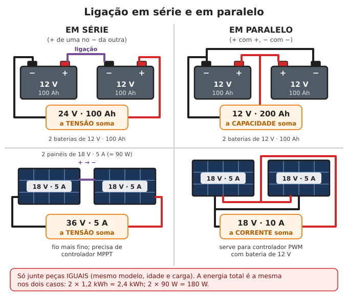

# Eletricidade básica

**Resumo:** **volts** são a pressão, **ampères** a vazão, **watts** a força do trabalho e
**watt-hora** a quantidade de energia gasta. Conta que resolve quase tudo: **watts = volts ×
ampères**. Em 12 V as correntes são altas: fio **grosso e curto**, e **fusível perto da
bateria** em todo fio positivo. Tomada de 127/220 V e painéis solares em série **matam**;
desligue e meça antes de mexer.

---

## As grandezas, comparadas com água num cano

| Grandeza | Símbolo / unidade | Na água | Exemplo |
|---|---|---|---|
| **Tensão** | V (volt) | **Pressão** da água (altura da caixa d'água) | Bateria de carro: 12 V; tomada: 127 ou 220 V; USB: 5 V |
| **Corrente** | A (ampère) | **Vazão** (litros por segundo passando) | Lâmpada LED 12 V: 0,5 A; motor de arranque: 150–300 A |
| **Resistência** | Ω (ohm) | **Cano estreito** ou registro meio fechado | Fio fino tem mais resistência que fio grosso |
| **Potência** | W (watt) | Força da água saindo = pressão × vazão | Lâmpada 9 W; chuveiro 5.500 W |
| **Energia** | Wh (watt-hora), kWh | **Volume total** de água gasto no dia | Lâmpada de 9 W acesa 5 h = 45 Wh |
| **Carga da bateria** | Ah (ampère-hora) | Tamanho da caixa d'água, contado em "litros" | Bateria 100 Ah dá 5 A por 20 h |

- **kWh** = 1.000 Wh. É o que a conta de luz cobra. Uma casa brasileira gasta 100–200 kWh por mês.
- **Ah não diz a energia sozinho:** multiplique pela tensão. Bateria de **12 V × 100 Ah = 1.200 Wh**.
  Power bank de 10.000 mAh (10 Ah) a 3,7 V = **37 Wh**.
- **mAh** = miliampère-hora (1.000 mAh = 1 Ah).

## As contas

**Lei de Ohm:** V = R × I (tensão = resistência × corrente)
**Potência:** P = V × I (watts = volts × ampères) → I = P ÷ V
**Energia:** Wh = W × horas

| Pergunta | Conta | Resposta |
|---|---|---|
| Quanto de corrente puxa uma lâmpada LED de 6 W em 12 V? | 6 ÷ 12 | **0,5 A** |
| E um inversor fornecendo 1.000 W, tirando de bateria de 12 V? | 1.000 ÷ 12 (+ ~10% de perdas) | **~92 A** |
| E o mesmo em bateria de 24 V? | 1.000 ÷ 24 (+10%) | **~46 A** |
| Chuveiro de 5.500 W em 220 V? | 5.500 ÷ 220 | **25 A** |
| Quanto dura uma bateria de 12 V 100 Ah ligando um ventilador 12 V de 24 W, usando só metade da carga? | 1.200 Wh × 0,5 = 600 Wh ÷ 24 W | **25 horas** |

**Por que 12 V exige fio grosso:** a mesma potência em 12 V passa **10 a 18 vezes mais corrente**
que em 127/220 V. Corrente alta esquenta o fio e perde energia nele (perda = I² × R): **o dobro de
corrente dá quatro vezes a perda**. Por isso sistemas maiores usam **24 V ou 48 V**.

## Corrente contínua (CC) e corrente alternada (CA)

| | CC (contínua, DC) | CA (alternada, AC) |
|---|---|---|
| O que é | Corre sempre no mesmo sentido; tem **+** e **−** | Troca de sentido 60 vezes por segundo (60 Hz no Brasil) |
| De onde vem | Pilhas, baterias, painel solar, USB, dínamo | Tomada da rua, gerador, **inversor** |
| Tensões comuns | 1,2–1,5 V (pilha), 3,7 V (celular), 5 V (USB), 12/24/48 V | **127 V ou 220 V** (depende da cidade/estado) |
| Liga invertido? | **Polaridade importa**: LED não acende, aparelho pode queimar | Não tem polaridade fixa |

- **Inversor** transforma CC da bateria em CA para tomada. **Fonte/carregador** faz o contrário.
- Aparelhos "bivolt" aceitam 127 e 220 V. Ligar aparelho de 127 V em 220 V **queima na hora**.

## Série e paralelo

| Ligação | Como | Tensão | Corrente / Ah | Uso |
|---|---|---|---|---|
| **Série** | + de um no − do próximo | **soma** | igual à de um só | Fazer 24 V com duas baterias de 12 V; painéis para controlador MPPT |
| **Paralelo** | + com +, − com − | igual à de um só | **soma** | Aumentar a autonomia; painéis em controlador PWM |

- **Só junte peças iguais** (mesmo modelo, mesma idade, mesma carga). Uma bateria fraca puxa as
  outras para baixo e todas estragam.
- Em paralelo, pegue o fio + numa ponta do banco e o − **na outra ponta** (equilibra as baterias).
- As tomadas de uma casa estão em **paralelo** (cada aparelho recebe os 127/220 V inteiros).
  Lâmpadas em série dividem a tensão (pisca-pisca de Natal antigo).

## Bitola do fio (seção em mm²)

O fio precisa ser grosso o bastante para **não esquentar** e para **não perder tensão** no caminho.
Em 12 V, a perda manda mais que o aquecimento.

**Tabela para 12 V, perda máxima de 3% (0,36 V), fio de cobre.**
"Distância" = comprimento de **um** fio, da bateria até o aparelho (o caminho de ida).

| Corrente | até 2 m | 5 m | 10 m | 15 m |
|---|---|---|---|---|
| 2 A (2–3 lâmpadas LED) | 1,5 mm² | 1,5 mm² | 2,5 mm² | 4 mm² |
| 5 A (60 W) | 1,5 mm² | 2,5 mm² | 6 mm² | 10 mm² |
| 10 A (120 W) | 2,5 mm² | 6 mm² | 10 mm² | 16 mm² |
| 20 A (240 W) | 4 mm² | 10 mm² | 25 mm² | 35 mm² |
| 30 A (360 W) | 6 mm² | 16 mm² | 35 mm² | 50 mm² |
| 50 A (600 W) | 16 mm² | 25 mm² | 50 mm² | use 24 V |
| 100 A (inversor de ~1.000 W) | 35 mm² | use 24 V | — | — |

- **Em 24 V** o fio pode ter **1/4** da seção da tabela; **em 48 V**, 1/16 (pela perda; confira o
  aquecimento abaixo).
- Para luz, aceita-se até 5% de perda; para carregar bateria e motores, 3% ou menos.
- Fórmula: seção (mm²) = 2 × distância (m) × corrente (A) × 0,0175 ÷ perda aceitável (V).
- Muito longe? Ponha a bateria perto das cargas, ou o inversor perto da bateria e leve **220 V**
  pela distância (fio fino serve).

**Corrente máxima pelo aquecimento** (cobre, isolamento de PVC, valores com folga):

| Seção | 1,5 | 2,5 | 4 | 6 | 10 | 16 | 25 | 35 | 50 mm² |
|---|---|---|---|---|---|---|---|---|---|
| Corrente máx. | 15 A | 20 A | 27 A | 35 A | 50 A | 65 A | 85 A | 105 A | 130 A |
| AWG aproximado | 16 | 14 | 12 | 10 | 8 | 6 | 4 | 2 | 1/0 |

Fio **flexível** (cabinho) é melhor para baterias e coisas que mexem. Cabo de bateria de carro
costuma ter 16–25 mm²; fio de extensão comum tem 0,75–1,5 mm².

## Fusíveis e disjuntores

**Para que servem:** proteger o **fio** (e a casa) num curto-circuito. Sem fusível, um curto numa
bateria faz o fio ficar **vermelho em segundos** e pegar fogo.

**Onde:**
1. No **fio positivo**, o **mais perto possível da bateria** (até 20–30 cm do borne).
2. Um fusível para **cada circuito** que sai da bateria (controlador, inversor, luzes, tomadas 12 V).
3. Entre painéis e controlador quando há **3 ou mais fileiras de painéis em paralelo** ou cabo longo
   (um fusível por fileira).

**Valor:** maior que a corrente normal do circuito (≈ **1,25 ×**) e **menor ou igual** ao que o
fio aguenta. Exemplo: luzes que puxam 6 A com fio de 2,5 mm² (20 A) → fusível de **10 A**.

| Tipo | Faixa | Uso |
|---|---|---|
| Fusível de lâmina (de carro) | 1–40 A | Circuitos de luz, rádio, USB, ventilador 12 V |
| Fusível MIDI, MEGA, ANL | 40–300 A | Inversor, banco de baterias |
| Disjuntor CC ("DC") | 1–125 A | Painéis, controlador, bateria; serve de chave liga/desliga |
| Disjuntor comum de casa (CA) | — | **Só para CA**. Em CC acima de ~24–48 V pode não apagar o arco |

> **ATENÇÃO:** **nunca** troque fusível por arame, papel-alumínio, clipe ou moeda, nem ponha um de
> valor maior "porque vive queimando". Fusível queimado é aviso: procure o curto, o fio descascado
> ou o aparelho com defeito antes de trocar.

## Multímetro (o instrumento mais útil)

| O que medir | Onde pôr as pontas | Botão | Cuidado |
|---|---|---|---|
| **Tensão de bateria/painel** (CC) | preta no COM, vermelha no V; vermelha no **+** | V⎓ (DCV), escala 20 V ou 200 V | Número negativo = pontas invertidas (ajuda a achar o +) |
| **Tensão da tomada** (CA) | COM e V | V~ (ACV), escala 750 V | Segure só pelo cabo isolado, uma mão só |
| **Continuidade** (fio partido, fusível bom) | COM e V/Ω | símbolo de som ou Ω | **Circuito desligado**. Apita = passa corrente |
| **Resistência** | COM e V/Ω | Ω | Circuito desligado |
| **Corrente** (até 10 A) | COM e **10A** | A⎓ | Abra o circuito e ponha o multímetro **no meio** (em série) |

> **ATENÇÃO:** depois de medir corrente, **volte a ponta vermelha para o V**. Medir tensão com a
> ponta no borne de 10 A é um **curto-circuito**: queima o multímetro e pode explodir na mão.
> Correntes acima de 10 A: use **alicate amperímetro** (que meça CC, se for bateria).

Usos práticos: ver quanto de carga tem a bateria (tabela em [Baterias](05-baterias.md)), achar o
fio partido de uma extensão, testar fusível e lâmpada, conferir se o painel está gerando, descobrir
se a tomada é 127 ou 220 V antes de ligar um aparelho.

## Quanto gastam os aparelhos

Veja a potência na etiqueta (W) ou no selo Procel (kWh/mês ÷ 30 = kWh por dia).

| Aparelho | Potência típica | Uso por dia | Energia por dia |
|---|---|---|---|
| Lâmpada LED de casa | 7–12 W | 5 h | 35–60 Wh |
| Lâmpada LED 12 V | 3–7 W | 5 h | 15–35 Wh |
| Celular (uma carga completa) | 5–20 W carregando | 1 carga | 15–25 Wh |
| Rádio pequeno | 2–5 W | 6 h | 12–30 Wh |
| Notebook | 30–65 W | 3 h | 90–200 Wh |
| Modem/roteador | 6–12 W | 24 h | 150–290 Wh |
| TV LED 32" | 40–60 W | 4 h | 160–240 Wh |
| Ventilador de mesa (127/220 V) | 40–80 W | 8 h | 320–640 Wh |
| Ventilador 12 V | 10–25 W | 8 h | 80–200 Wh |
| Geladeira 1 porta, eficiente | 80–150 W ligada (**partida 600–1.000 W**) | liga e desliga | 800–1.200 Wh |
| Geladeira duplex frost-free | 100–200 W | liga e desliga | 1.300–1.800 Wh |
| Freezer horizontal | 100–200 W | liga e desliga | 1.000–2.000 Wh |
| Bomba d'água 1/2 cv | 400–600 W (**partida 3×**) | 30 min | 200–300 Wh |
| Máquina de lavar (sem aquecer) | 300–600 W | 1 ciclo | 200–500 Wh |
| Liquidificador | 300–800 W | 5 min | 25–70 Wh |
| Furadeira | 500–800 W | 15 min | 125–200 Wh |
| Máquina de costura | 70–100 W | 1 h | 70–100 Wh |
| Ferro de passar | 1.000–1.200 W | 30 min | 500–600 Wh |
| Micro-ondas | 1.200–1.500 W | 15 min | 300–375 Wh |
| **Chuveiro elétrico** | 4.500–7.500 W | 30 min | 2.250–3.750 Wh |
| CPAP (sem umidificador aquecido) | 30–60 W | 8 h | 240–480 Wh |
| Concentrador de oxigênio | 300–600 W | 24 h | 7.000–14.000 Wh |

**Como calcular o seu consumo:**
1. Liste cada aparelho, sua potência (W) e as horas de uso por dia.
2. Multiplique W × horas = Wh por dia de cada um. Some tudo.
3. Some **20–30%** de perdas (inversor, bateria, fios).
4. Guarde também a **maior potência ligada ao mesmo tempo** e as **partidas de motor**
   (geladeira, bomba, freezer): elas decidem o tamanho do inversor.

Exemplo: 4 LED de 9 W × 5 h (180) + 3 celulares (60) + rádio 3 W × 6 h (18) + TV 50 W × 3 h (150)
= **408 Wh**; com 25% de perdas ≈ **510 Wh por dia**.

> Para sobreviver com pouca energia: **chuveiro, ferro, micro-ondas, aquecedor e ar-condicionado
> ficam de fora**. Esquente água com sol ou lenha, cozinhe a gás, lenha ou biogás.

## Segurança

### Choque elétrico
- Corrente de **0,01 A (10 mA)** pela mão já "gruda" (os músculos travam e a pessoa não solta);
  **30–100 mA** pelo peito pode parar a respiração e o coração.
- **127/220 V CA mata.** A saída do **inversor** é igual à tomada da rua.
- **12 V CC** quase nunca dá choque na pele seca, mas painéis em série passam de **60–600 V CC**,
  que matam e fazem **arco** (faísca que não apaga sozinha).
- Regras:
  1. **Desligue** (disjuntor, fusível, tirar da tomada) e **meça** com o multímetro antes de tocar.
  2. Trabalhe com **uma mão só** sempre que puder (a outra longe de metal), em lugar **seco**,
     de chinelo ou bota de borracha.
  3. Nunca trabalhe molhado, na chuva ou descalço em chão molhado.
  4. Ferramentas com cabo isolado. Avise todo mundo e trave/sinalize o disjuntor desligado.
- Socorro: **desligue antes de tocar na vítima**; se não der, afaste o fio com madeira seca. Veja
  [Choque elétrico](../02-saude/10-calor-frio-e-ambiente.md) e [RCP](../02-saude/01-primeiros-socorros.md).

### Curto-circuito de bateria
Uma bateria de carro solta **500–1.000 A** num curto: a chave de boca fica vermelha, solda no
borne, espirra metal derretido e a bateria pode **explodir** e jogar ácido.
- **Tire anel, relógio, pulseira e corrente** antes de mexer em bateria.
- Enrole o cabo das ferramentas com fita isolante; nunca deixe ferramenta em cima da bateria.
- **Desligue primeiro o negativo, ligue por último o negativo** (se a chave encostar na lataria
  enquanto mexe no +, não dá curto).
- Proteja os bornes com tampa ou capa de borracha.

### Incêndio elétrico
- Causas: fio fino demais, **emenda frouxa** (mau contato esquenta muito), benjamim e régua
  sobrecarregados, falta de fusível, rato roendo fio.
- Sinais: **cheiro de plástico queimado**, fio ou tomada quente, terminal escurecido, luz piscando.
- Fogo em aparelho ligado: **desligue a energia** e use extintor de pó (ABC) ou CO₂, ou abafe.
  **Nunca jogue água** em coisa energizada.

### Gerador e a rede da casa
> **ATENÇÃO:** **nunca** ligue gerador ou inversor na tomada da casa com um cabo "macho-macho".
> Os pinos do outro plugue ficam **energizados** (choque mortal) e a energia volta pelo poste,
> podendo **matar o eletricista** que conserta a rede. Para ligar gerador no quadro da casa, é
> preciso uma **chave reversora** instalada por eletricista, que desliga a casa da rua.
> Gerador sempre **fora de casa**, a 6 m de portas e janelas (monóxido de carbono).

## Emendas e isolamento

**Cores:** em CC, **vermelho = positivo, preto = negativo**. Na casa (norma brasileira): **azul-claro
= neutro**, **verde ou verde-amarelo = terra**, outras cores = fase. **Nunca confie só na cor**: meça.

**Emenda em prolongamento (fio rígido ou cabinho de até 4 mm²):**
1. Desligue o circuito.
2. Descasque **3–4 cm** de cada ponta, sem cortar os fios de cobre (estilete inclinado, girando).
3. Cruze as pontas em "X" no meio da parte descascada.
4. Enrole cada ponta **apertado** em volta do outro fio, 5–6 voltas, com alicate.
5. **Estanhe** se puder: aqueça a emenda com ferro de solda (40–60 W) e encoste o estanho no
   **fio quente** (não no ferro) até ele escorrer para dentro.
6. Isole: fita isolante começando **2 cm antes**, esticada, cada volta cobrindo **metade** da
   anterior, ida e volta (**2 camadas** no mínimo). Melhor ainda: **tubo termorretrátil** passado
   antes de emendar e encolhido com calor.

**Outras ligações:**
- **Emenda em derivação** ("rabo de rato") para juntar vários fios na caixa: torça juntos e cubra
  com conector de mola ou fita.
- **Conectores de alavanca ou borne (sindal)** são rápidos e seguros: aperte bem e confira puxando.
- **Cabos de bateria:** terminal tipo olhal **prensado** (alicate de crimpar) e, se puder, soldado.
  Mau contato no borne da bateria é a falha mais comum de sistema 12 V.
- **Ao ar livre:** emendas dentro de caixa vedada ou com termorretrátil com cola; pingadeira (o fio
  faz uma "barriga" para baixo antes de entrar na caixa, para a água não escorrer para dentro).
- Nunca emende fio dentro de parede ou forro sem caixa de passagem.

---

Ver também: [Energia solar](04-energia-solar.md) · [Baterias](05-baterias.md) · [Iluminação](08-iluminacao.md) · [Motores e geradores](../08-ferramentas-e-mecanica/03-motores-pequenos-e-geradores.md) · [Choque elétrico](../02-saude/10-calor-frio-e-ambiente.md)
