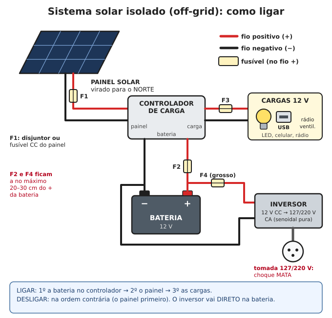
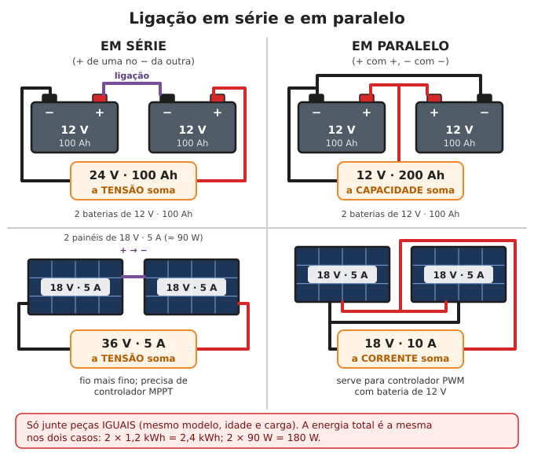
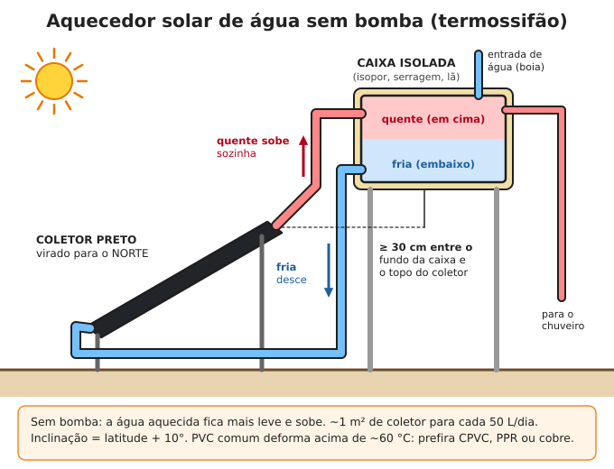

# Energia solar

**Resumo:** um sistema isolado (off-grid) tem quatro peças: **painel → controlador de carga →
bateria → cargas** (direto em 12 V, ou por um **inversor** para 127/220 V). Calcule o consumo
em Wh por dia, divida pelas horas de sol (3–5 no Brasil) e pelas perdas, e ache o tamanho do
painel. No Brasil o painel fica virado para o **NORTE**, inclinado mais ou menos igual à
latitude. **O solar ligado à rede (on-grid) desliga sozinho no apagão**: sem bateria e
inversor híbrido, ele não serve para nada sem a rede.

---

## As peças

### Painel (módulo fotovoltaico)
Gera corrente contínua sempre que há luz. Na etiqueta atrás:

| Dado | O que é | Painel "de 12 V" (36 células) | Painel de telhado (60–144 células) |
|---|---|---|---|
| Pmax (Wp) | Potência no sol forte de laboratório | 50–200 W | 330–700 W |
| Vmp | Tensão trabalhando | 17–19 V | 31–42 V |
| Voc | Tensão sem nada ligado (a maior) | 21–23 V | 37–50 V |
| Imp / Isc | Corrente trabalhando / em curto | até ~11 A | 10–18 A |

- No sol real, o painel quente (50–65 °C) dá **10–20% menos** que a etiqueta.
- Painel **"de 12 V"** pode ir em controlador PWM com bateria de 12 V. Painel **de telhado**
  (os grandes, de casas e usinas) **precisa de controlador MPPT**.
- Vida útil: **25 anos ou mais**, perdendo ~0,5% por ano.

### Controlador de carga
Fica entre o painel e a bateria. Corta a carga quando a bateria enche e, na saída de carga
(LOAD), desliga as luzes quando a bateria está quase vazia. **Sem ele, o painel ferve e estraga
a bateria.**

| | **PWM** | **MPPT** |
|---|---|---|
| Preço | Barato | 2 a 5 vezes mais caro |
| Painel aceito | Só tensão "casada" (painel de 36 células para bateria 12 V) | Tensão bem mais alta que a bateria (painéis em série, painéis de telhado) |
| Aproveitamento | Perde 20–30% (e até 60% com painel de telhado) | Ganha 10–30% a mais de energia |
| Quando usar | Kit pequeno, até ~200 W | Acima de ~200 W ou com painéis grandes |

- Corrente do controlador: **(watts do painel ÷ tensão da bateria) × 1,25**. Ex.: 150 W em 12 V →
  12,5 × 1,25 ≈ 16 A → controlador de **20 A**.
- MPPT: confira a **tensão máxima de entrada** (ex.: "100 V" ou "150 V"). A soma das Voc dos painéis
  em série **× 1,15** (frio da manhã aumenta a tensão) tem de ficar abaixo dela, senão queima.

### Bateria
Guarda a energia para a noite e para os dias nublados. Detalhes em [Baterias](05-baterias.md).
- **Chumbo-ácido** (estacionária, ciclo profundo): barata, pesada; use só **metade** da carga.
- **LiFePO4** (lítio-ferro-fosfato): cara, leve, dura 5–10 vezes mais; usa **80–90%** da carga.

### Inversor
Transforma 12/24/48 V da bateria em **127 ou 220 V** para aparelhos comuns.
- **Onda senoidal pura:** serve para tudo (geladeira, motores, CPAP, notebook). **Prefira este.**
- **Onda modificada (quadrada):** mais barato; motor esquenta e zune, alguns aparelhos estragam.
- **Potência contínua** = soma do que fica ligado junto, + 25%. **Pico (partida)**: geladeira e
  bomba puxam 3–5 vezes a potência por um instante.
- Gasta **5–30 W só de estar ligado**, mesmo sem nada conectado: **desligue quando não usar**.
- Liga **direto na bateria** com cabo grosso e curto e fusível, nunca na saída LOAD do controlador.

## Ordem de ligação

1. Ligue a **bateria** no controlador (ele "lê" se é 12, 24 ou 48 V).
2. Ligue o **painel** no controlador (de preferência coberto com lona ou à noite).
3. Ligue as **cargas** e o inversor.
- Para desligar, faça **ao contrário**: painel primeiro, bateria por último. Controlador ligado ao
  painel sem bateria pode queimar.

**Fusíveis (veja o desenho):** F1 entre painel e controlador (obrigatório com 3 ou mais fileiras
em paralelo ou cabo longo; disjuntor CC serve de chave); **F2** entre controlador e bateria;
**F3** nas cargas 12 V; **F4** (grosso) entre bateria e inversor. F2 e F4 a no máximo 20–30 cm
do + da bateria. Valores e fios em [Eletricidade básica](03-eletricidade-basica.md).

## Dimensionamento passo a passo

1. **Consumo:** liste os aparelhos e calcule os **Wh por dia** (tabela em
   [Eletricidade básica](03-eletricidade-basica.md)).
2. **Perdas:** some 20% (só 12 V) a 30% (com inversor).
3. **Horas de sol pleno (HSP)** do **pior mês** (inverno):

   | Região | HSP para calcular |
   |---|---|
   | Nordeste e interior do Centro-Oeste | 4,5–5 |
   | Sudeste, Centro-Oeste, Norte (época de chuva) | 4 |
   | Sul (inverno) | 3–3,5 |

4. **Painel (Wp)** = Wh por dia ÷ HSP ÷ 0,75. Arredonde para cima.
5. **Bateria (Ah)** = Wh por dia × **dias de reserva** (2–3) ÷ **fração usável** (0,5 para
   chumbo-ácido, 0,8 para LiFePO4) ÷ **tensão** do banco.
6. **Controlador** = Wp ÷ tensão da bateria × 1,25 (A).
7. **Inversor** = potência de tudo que liga junto × 1,25, aguentando as partidas.

### Exemplo 1 — kit 12 V para o básico (sem inversor)

| Aparelho | Conta | Wh/dia |
|---|---|---|
| 4 lâmpadas LED 12 V de 5 W | 4 × 5 W × 5 h | 100 |
| 3 celulares | 3 × 20 Wh | 60 |
| Rádio | 3 W × 6 h | 18 |
| Ventilador 12 V | 15 W × 8 h | 120 |
| **Total** | | **≈ 300** |

- Com 20% de perdas: **360 Wh/dia**.
- Painel: 360 ÷ 4 ÷ 0,75 = **120 Wp → um painel de 150 W** (36 células).
- Bateria, 2 dias de reserva: chumbo-ácido 360 × 2 ÷ 0,5 ÷ 12 = **120 Ah → uma estacionária de
  150 Ah**; ou LiFePO4 360 × 2 ÷ 0,8 ÷ 12,8 = **70 Ah → uma de 100 Ah**.
- Controlador: PWM ou MPPT de **20 A**.
- Fios: painel–controlador 4–6 mm² (até 10 m); controlador–bateria 6 mm² (curto, fusível 20 A);
  circuito das luzes 2,5 mm² (fusível 10 A). Celular por **carregador USB de carro (12 V)**.

### Exemplo 2 — casa com geladeira (inversor 24 V)

| Aparelho | Conta | Wh/dia |
|---|---|---|
| Geladeira 1 porta eficiente | etiqueta: 30 kWh/mês | 1.000 |
| 6 lâmpadas LED | 6 × 9 W × 5 h | 270 |
| TV | 50 W × 4 h | 200 |
| 4 celulares | 4 × 20 Wh | 80 |
| Notebook | 50 W × 3 h | 150 |
| Ventilador | 60 W × 8 h | 480 |
| Bomba d'água 1/2 cv | 500 W × 15 min | 125 |
| **Total** | | **≈ 2.300** |

- Com 25% de perdas: **≈ 2.900 Wh/dia**.
- Painéis: 2.900 ÷ 4 ÷ 0,75 ≈ 970 Wp → **2 painéis de 550 W** (no Sul, com HSP 3: **3 painéis**).
- Bateria **24 V**, 2 dias: LiFePO4 2.900 × 2 ÷ 0,8 = 7.250 Wh → **25,6 V × 280 Ah**; chumbo-ácido
  2.900 × 2 ÷ 0,5 = 11.600 Wh → **24 V × ~480 Ah** (ex.: 4 estacionárias de 12 V 240 Ah, 2 em série
  × 2 em paralelo, ~240 kg).
- Controlador: 1.100 ÷ 24 × 1,25 ≈ 57 A → **MPPT 60 A**; 2 painéis em série dão ~100 V de Voc
  (× 1,15 = 115 V) → MPPT com entrada de **150 V**.
- Inversor **senoidal puro 24 V de 2.000 W** (geladeira + bomba partindo juntas).
- Inversor–bateria: ~90 A → cabo **35 mm²**, até 1,5 m, fusível **125 A**.

> Economia vale mais que painel: trocar uma geladeira velha (2.000 Wh/dia) por uma eficiente
> (1.000 Wh/dia) economiza o equivalente a 2 painéis e metade das baterias.

## Instalação: norte, inclinação e sombra

**Orientação: face do painel para o NORTE** (no hemisfério sul o sol passa pelo norte).
- **Bússola:** no Brasil, o norte verdadeiro fica cerca de **15–23° à direita (para leste)** de
  onde a agulha aponta. Errar 20° perde só 2–3%: não precisa ser perfeito.
- **Sem bússola (método da sombra):** finque uma vara reta; marque a ponta da sombra; espere
  **20–30 minutos** e marque de novo. A linha da 1ª para a 2ª marca vai de **oeste para leste**.
  Fique de pé com a 1ª marca à sua esquerda e a 2ª à sua direita: você está de frente para o
  **norte**.
  Veja [Orientação e navegação](../10-comunicacao-e-navegacao/03-orientacao-e-navegacao.md).

**Inclinação ≈ latitude do lugar** (mínimo **10–15°**, para a chuva lavar a sujeira). Para
render mais no inverno, latitude + 10°.

| Cidade | Latitude ≈ inclinação | Cidade | Latitude ≈ inclinação |
|---|---|---|---|
| Belém, Macapá, Manaus | 0–3° → use 10° | Brasília, Goiânia | 16–17° |
| Fortaleza, Natal | 4–6° → use 10° | Belo Horizonte, Vitória | 20° |
| Recife, Maceió | 8–10° | Rio de Janeiro, São Paulo | 23° |
| Salvador, Cuiabá, Porto Velho | 9–16° | Curitiba, Florianópolis | 25–28° |
| Palmas, Aracaju | 10–11° | Porto Alegre | 30° |

**Sombra:** uma sombra pequena (galho, antena, poste) sobre **uma** célula derruba a geração de
todo o painel em 30–80%, porque as células estão em série.
- O painel precisa de sol **sem sombra das 9 h às 15 h** o ano todo. Confira em **junho/julho**,
  quando o sol fica mais baixo e as sombras mais compridas.
- Árvores crescem: pode em volta todo ano.
- Fixe bem (vento de tempestade arranca painel). Deixe 10 cm de ar embaixo para ventilar.
- Painéis em série ou paralelo: veja a figura abaixo e [Eletricidade básica](03-eletricidade-basica.md).

## O solar da rede (on-grid) desliga no apagão

A maioria dos painéis em telhados brasileiros é **on-grid**: o inversor só funciona **com a rede
ligada**. Quando a energia da rua cai, ele **desliga em menos de 1 segundo** — é uma proteção
obrigatória (anti-ilhamento) para não eletrocutar quem conserta a rede. **Painel no telhado não
garante luz no apagão.**

Soluções:
1. **Inversor híbrido com bateria** e saída de emergência ("backup"/"EPS") para os circuitos
   importantes (geladeira, luz, tomadas de celular). É a melhor opção para quem vai instalar.
2. Alguns inversores on-grid têm uma **tomada de emergência** que funciona só com sol (500–2.000 W,
   cai quando passa nuvem). Veja no manual do seu.
3. **Sistema isolado separado** (os exemplos acima), mesmo pequeno.
4. **Colapso longo:** os painéis do telhado podem ser **reaproveitados** num sistema isolado: em
   grupos de 2–3 painéis em série num **controlador MPPT** (respeitando a tensão máxima dele) com
   banco de baterias.

> **ATENÇÃO:** as fileiras de painéis de telhado têm **300 a 1.000 V em corrente contínua** —
> **mata** e faz arco que não apaga. Antes de mexer: desligue a **chave seccionadora CC**, cubra os
> painéis com lona grossa e meça. Painel gera sempre que há luz; não dá para "desligar" o painel.
> Desconecte os plugues (MC4) só sem corrente passando. Se não souber, não mexa.

## Manutenção

- **Limpeza** a cada 1–3 meses (ou quando ver poeira, folhas, cocô de passarinho): água limpa e
  pano macio ou rodo de espuma, **sem** sabão abrasivo, sem escova dura, sem pisar no painel.
  Faça **de manhã cedo ou no fim da tarde** (água fria em vidro muito quente pode trincar).
- **Mensal:** aperte e olhe conectores e bornes (oxidação, aquecimento), fios roídos por rato, ninhos,
  fixação da estrutura.
- **Todo dia, de manhã antes do sol:** anote a tensão da bateria (mostra se o sistema está dando
  conta). Bateria baixa vários dias seguidos = consumo maior que a geração: corte cargas.
- **Testar painel:** ao sol, a tensão sem nada ligado deve ficar perto da Voc da etiqueta. Painel
  pequeno (Isc menor que 10 A): a corrente em curto, medida no borne de 10 A do multímetro por
  2–3 segundos, deve ficar perto da Isc.
- **Raio:** aterre a estrutura metálica (haste de cobre de 2,4 m no chão, cabo de 6–10 mm²).

## Aquecedor solar de água caseiro

Água quente para banho é o maior gasto de energia de uma casa (chuveiro elétrico: 2–4 kWh por
dia). O sol faz isso de graça, sem eletricidade.

### 1. Saco ou balde preto (o mais simples)
Galão, balde ou saco plástico **preto** de 20 L, ao sol, em cima do telhado ou de uma chapa: chega a
**40–50 °C em 3–4 horas** de sol forte. Pendure alto com uma mangueira e um chuveirinho na ponta.

### 2. Caixa preta com vidro
Caixa rasa de madeira (10–15 cm de água), forrada com lona preta, tampa de vidro, isolamento no
fundo: aquece **50–100 L a 40–60 °C** num dia de sol.

### 3. Serpentina de mangueira preta
**50 m de mangueira preta de 3/4"** (guarda ~14 L) enrolada em espiral sobre o telhado ou sobre uma
chapa escura: aquece rápido; use durante o dia, ligada direto ao chuveiro.

### 4. Coletor de garrafas PET (sem bomba, com reservatório)
Modelo de baixo custo muito divulgado no Brasil: **canos de PVC de 20 mm pintados de preto fosco**
passam por dentro de **garrafas PET de 2 L** encaixadas umas nas outras, com uma **caixinha de leite
longa vida aberta e pintada de preto** atrás do cano, dentro de cada garrafa. As colunas ligam-se em
cima e embaixo a canos mais grossos. Para uma caixa de **200 L**: cerca de **100 garrafas e 100
caixinhas** (2–3 m² de coletor).

### Como a água circula sozinha (termossifão)

1. Coletor virado para o **norte**, inclinação = latitude + 10°.
2. Caixa d'água **isolada** (isopor, serragem, lã) com o fundo **pelo menos 30 cm acima** do
   topo do coletor.
3. Cano **frio**: do fundo da caixa até a entrada **de baixo** do coletor.
4. Cano **quente**: da saída **de cima** do coletor até a parte **de cima** da caixa, sempre
   subindo, sem "barrigas" (prendem ar e param a circulação).
5. A saída para o chuveiro sai **do alto** da caixa (onde está a água quente). Isole os canos.
- Tamanho: ~**1 m² de coletor para cada 50 L/dia** (casa de 4 pessoas: 2–4 m² e caixa de 150–200 L).

> **ATENÇÃO:** água do coletor pode passar de **60 °C** e queimar em segundos, principalmente
> crianças e idosos: misture com água fria e teste com a mão. **PVC comum deforma acima de ~60 °C**:
> para água muito quente use CPVC, PPR ou cobre. Na serra do Sul, esvazie o coletor nas noites de
> geada forte (a água congela e racha os canos).

---

Ver também: [Eletricidade básica](03-eletricidade-basica.md) · [Baterias](05-baterias.md) · [Iluminação](08-iluminacao.md) · [Lenha e fogões (fogão solar)](02-lenha-carvao-e-fogoes.md) · [Kits e estoques](../00-emergencia/03-kits-e-estoques.md)
