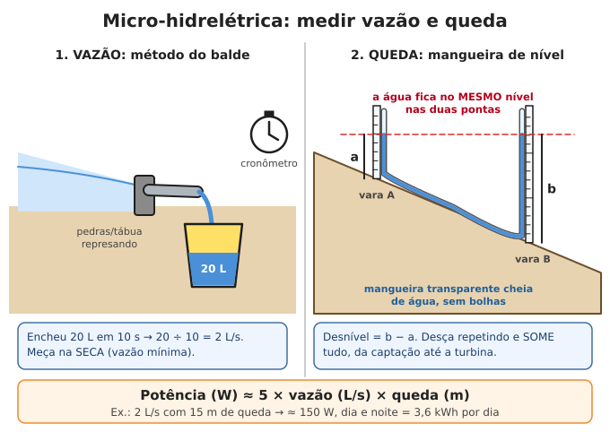

# Energia eólica e hidráulica

**Resumo:** água que cai é a energia mais constante que existe: **2 L/s descendo 15 m dão
~150 W dia e noite**, o mesmo que cerca de 1.000 W de painel solar. Meça a **vazão na seca** e a
**queda** antes de tudo. Vento só compensa onde venta forte e sempre (média acima de
**4–5 m/s**, como no litoral do Nordeste e do Sul). Moer grão, pilar arroz e bombear água
**mecanicamente**, sem passar por eletricidade, é muito mais eficiente.

---

## Micro-eólica

### Quanto o vento dá

Potência ≈ 0,5 × 1,2 × área do rotor (m²) × velocidade³ × 0,25 (rendimento de turbina caseira).
A velocidade está **ao cubo**: o dobro de vento dá **8 vezes** mais energia.

| Vento | Rotor de 1,2 m | Rotor de 2 m | Rotor de 3 m |
|---|---|---|---|
| 4 m/s (14 km/h) | 11 W | 30 W | 68 W |
| 5 m/s (18 km/h) | 21 W | 59 W | 133 W |
| 6 m/s (22 km/h) | 37 W | 102 W | 229 W |
| 8 m/s (29 km/h) | 87 W | 241 W | 543 W |
| 10 m/s (36 km/h) | 170 W | 471 W | 1.060 W |

- Abaixo de **3 m/s** quase nada; a maioria das turbinas só começa a carregar com 3–3,5 m/s.
- Com vento **médio de 5 m/s**, um rotor caseiro de 2 m dá algo como **0,5–1,5 kWh por dia**.
- **Onde vale a pena no Brasil:** litoral e serras do Nordeste (CE, RN, PI, BA, PE), litoral do
  RS e SC, topos de serra e chapadas abertas. No interior do Sudeste, Centro-Oeste e Amazônia o
  vento costuma ser fraco: prefira solar.

**Avaliar sem anemômetro (escala de Beaufort):**

| Força | Vento | Sinais |
|---|---|---|
| 2 | 1,6–3,3 m/s | Sente o vento no rosto; folhas farfalham |
| 3 | 3,4–5,4 m/s | Folhas e galhinhos em movimento **constante**; bandeira estendida |
| 4 | 5,5–7,9 m/s | Levanta poeira e papel; galhos pequenos balançam |
| 5 | 8,0–10,7 m/s | Árvores pequenas balançam; marolas em lagoas |

Se na maior parte dos dias o vento fica na **força 3 ou mais**, vale testar. Árvores **tortas
para um lado** ("bandeira") indicam vento forte e constante. Observe pelo menos um mês, de dia e
de noite, e na altura onde ficará o rotor.

### Torre
- Vento perto do chão é fraco e turbulento. O rotor deve ficar **pelo menos 9 m acima** de
  qualquer obstáculo (casa, árvore) num raio de ~90 m. Torres de **12–18 m** são comuns.
- **Torre basculante** (que deita para manutenção): cano galvanizado de 2–3", articulado na base,
  com **4 estais** (cabos de aço) ancorados a uma distância de **1/2 a 2/3 da altura** da torre,
  em estacas enterradas ou blocos de concreto. Levante e abaixe com talha ou guincho, nunca no braço.

### Gerador
| Opção | Prós | Contras |
|---|---|---|
| **Motor CC de ímã permanente** (de esteira ergométrica, 90–260 V) | Simples, já sai CC, não precisa de excitação | Escovas gastam; precisa de **diodo de bloqueio** (30–50 A, em dissipador) para a bateria não girar o motor |
| **Alternador de ímãs feito em casa** (discos com ímãs de neodímio e bobinas em resina) | O melhor para vento; gira devagar | Trabalhoso; precisa de ímãs e fio esmaltado |
| **Motor de lavadora de acionamento direto** (sem correia) | Já é de ímãs, gira devagar | Sai CA trifásica: precisa de ponte retificadora |
| **Alternador de carro** | Fácil de achar | Só carrega acima de ~1.500–2.000 rpm e gasta 2–4 A da bateria para excitar: ruim para vento, melhor para roda d'água ou bicicleta com polias |

**Teste antes de montar:** gire o motor com uma furadeira em baixa rotação (**250–300 rpm**) e meça
com o multímetro: precisa passar de **14 V** para carregar bateria de 12 V nessa rotação (um rotor
de 2 m gira ~200–400 rpm com vento de 5–8 m/s).

### Pás de cano PVC (rotor de 1,6–2,2 m)
1. Cano de PVC de **150–200 mm** (6–8"), de parede grossa, em pedaços de **70–100 cm**.
2. Risque linhas retas ao longo do cano e corte cada pá: **~1/4 da volta do cano** de largura na
   raiz (base) e **~5 cm** na ponta. Saem 4 pás por pedaço; use 3.
3. Lixe: borda que corta o vento **arredondada**, borda de trás **fina**.
4. **Pese** as 3 pás e lixe até ficarem iguais (diferença de poucos gramas).
5. Parafuse cada pá (2 parafusos de 8 mm) num **disco de aço** de 6 mm (cubo), a 120° uma da outra,
   com o **lado côncavo (de dentro do cano) virado para o vento**.
6. **Balanceie:** com o rotor montado no eixo na horizontal, ele deve ficar parado em qualquer
   posição. Se uma pá sempre desce, lixe a ponta dela ou ponha arruelas nas outras.
7. Pinte (o sol resseca o PVC) e confira rachaduras todo mês.

### Freio e regulagem (obrigatórios)
- **Cauda (leme)** mantém o rotor de frente para o vento. Turbinas caseiras boas têm cauda
  **articulada e inclinada** que dobra em vento forte e tira o rotor do vento.
- **Controlador com carga de desvio:** quando a bateria enche, o controlador desvia a energia para
  uma **resistência** (aquecedor de água 12/24 V, lâmpadas halógenas, resistores de potência).
  **Nunca desligue a turbina da bateria**: sem carga ela **dispara**, as pás voam e o gerador queima.
- **Chave de freio:** curto-circuitar os fios do gerador de ímã freia o rotor. Use com vento
  fraco ou moderado, antes da tempestade.

> **ATENÇÃO:** uma pá solta voa dezenas de metros com força para matar. **Nunca fique na linha
> de giro** do rotor (de lado para a turbina). Em tempestade, freie e, se possível, abaixe a torre.
> Subir em torre só com cinto preso. Aterre a torre (raio).

## Micro-hidrelétrica

### Quanto a água dá

**Potência (kW) ≈ 9,8 × vazão (m³/s) × queda (m) × 0,5**
ou, mais fácil: **Potência (W) ≈ 5 × vazão (L/s) × queda (m)**

| Vazão \ Queda | 5 m | 10 m | 20 m | 50 m |
|---|---|---|---|---|
| 1 L/s | 25 W | 50 W | 100 W | 250 W |
| 2 L/s | 50 W | 100 W | 200 W | 500 W |
| 5 L/s | 125 W | 250 W | 500 W | 1,25 kW |
| 10 L/s | 250 W | 500 W | 1 kW | 2,5 kW |

Funciona **24 horas**: 100 W contínuos = **2,4 kWh por dia** (mais que uma casa simples precisa).

### Medir a vazão (na época SECA)
- **Método do balde** (córrego pequeno): represe com pedras/tábua, faça toda a água passar por um
  cano ou calha e cronometre quanto tempo leva para encher um balde de volume conhecido.
  **Vazão (L/s) = litros ÷ segundos.** Repita 3 vezes e tire a média.
- **Método do flutuador** (riacho maior):
  1. Escolha um trecho **reto de 10 m**.
  2. Meça a largura e a profundidade em 5 pontos; área (m²) = largura × profundidade média.
  3. Solte uma laranja ou garrafinha meio cheia no início e cronometre até o fim do trecho.
     Velocidade = 10 ÷ segundos.
  4. **Vazão (m³/s) = área × velocidade × 0,8** (a água do fundo é mais lenta). × 1.000 = L/s.
- Projete pela vazão da **seca** e **use no máximo metade**: deixe água para o riacho, para os
  animais e para quem mora abaixo.

### Medir a queda
- **Mangueira de nível** (mangueira transparente de 10–20 m cheia de água, sem bolhas) e **duas
  varas marcadas em centímetros**: uma pessoa em cima, outra mais abaixo. A água fica no **mesmo
  nível** nas duas pontas. Leia a altura da água em cada vara: **desnível = leitura de baixo −
  leitura de cima**. Desça repetindo e **some** todos os trechos, da captação até a turbina.
- **Manômetro:** se já existe um cano cheio de água da captação até embaixo, feche a ponta e meça
  a pressão parada: **1 bar (1 kgf/cm²) ≈ 10 m** de queda; 1 psi ≈ 0,7 m.
- Altímetro de celular erra 5–10 m: só para ter ideia.

### As partes
1. **Captação:** pequena barragem ou desvio, com **grade** contra folhas e peixes.
2. **Caixa de areia:** caixa onde a água fica parada um pouco e a areia assenta (areia destrói a
   turbina).
3. **Tubulação forçada:** do alto até a turbina. Diâmetro (até ~100 m de comprimento):

   | Vazão | 1 L/s | 2 L/s | 5 L/s | 10 L/s | 20 L/s |
   |---|---|---|---|---|---|
   | Cano | 40–50 mm | 50–60 mm | 75 mm | 100 mm | 150 mm |

   **Pressão:** cada 10 m de queda = 1 bar. Escolha cano que aguente **1,5 vez** a pressão da queda
   (PVC classe 12 aguenta 60 m de coluna d'água; classe 15, 75 m; classe 20, 100 m).
4. **Turbina + gerador**, numa casinha protegida de enchente.
5. **Regulador:** carregando bateria, controlador com carga de desvio; gerando 127/220 V direto,
   regulador eletrônico de carga (desvia a sobra para uma resistência e mantém a rotação).
6. **Canal de saída** de volta ao riacho.

> **ATENÇÃO:** feche registros **devagar**. Fechar de uma vez causa **golpe de aríete**: a pressão
> sobe muitas vezes e **estoura o cano**. Barragens de terra e pedra rompem em enchente: não more
> nem trabalhe logo abaixo delas. Cerque canais e caixas (afogamento de crianças).

### Tipos de roda e turbina

| Tipo | Queda | Rendimento | Uso |
|---|---|---|---|
| **Roda d'água de cima** (a água cai nos baldes do alto) | 2–10 m (diâmetro um pouco menor que a queda) | 60–80% | Gira devagar (5–15 rpm): ótima para moinho, monjolo, serra, bomba; para gerar precisa multiplicar muito (polias, engrenagens) |
| **Roda de peito** (água na altura do eixo) | 1–3 m | 40–60% | Igual à anterior, com queda menor |
| **Roda de baixo** (pás no fluxo do rio) | sem queda, só correnteza | 20–30% | Rio largo e constante; bombas de roda |
| **Turbina Pelton** (jato numa roda de conchas) | **acima de ~10 m**, pouca água | 60–85% | A melhor para gerar eletricidade em sítio de serra |
| **Bomba centrífuga ao contrário** | 10–60 m | 40–60% | Barata e fácil de achar; precisa vazão certa para a bomba |

### Turbina Pelton simples
- **Jato** sai de um **bico** na ponta da tubulação e bate em **conchas** presas num disco (conchas
  de cozinha de inox, metades de cano de PVC cortadas em ângulo, ou conchas fundidas).
- Diâmetro do bico (1 jato):

  | Queda | 1 L/s | 2 L/s | 5 L/s |
  |---|---|---|---|
  | 10 m | 9,5 mm | 13,5 mm | 21 mm |
  | 20 m | 8 mm | 11,5 mm | 18 mm |
  | 30 m | 7 mm | 10 mm | 16 mm |
  | 50 m | 6,5 mm | 9 mm | 14 mm |

  Com mais água, use 2 a 4 jatos.
- **Conchas:** 16–20, largura ~**3 vezes o diâmetro do jato**; o jato deve bater no "divisor" do
  meio e a água sair pelos dois lados, para trás.
- **Rotação:** as conchas devem andar com metade da velocidade do jato:
  **rpm ≈ 40 × √queda ÷ diâmetro da roda (m)**. Ex.: queda 30 m, roda de 0,2 m →
  40 × 5,5 ÷ 0,2 ≈ **1.100 rpm** (gira direto um alternador ou motor de ímã, com polia).
- Monte o rotor numa caixa fechada (a água espirra muito) e deixe a saída livre embaixo.

## Carneiro hidráulico

Bomba que **usa a força da própria água** (golpe de aríete) para mandar parte dela morro acima,
**sem eletricidade nem combustível**, dia e noite. Eleva cerca de **1/10 da água** a uma altura de
até ~10 vezes a queda que recebe. Montagem e medidas em [Irrigação](../04-agricultura/07-irrigacao.md).

## Moinhos e máquinas sem eletricidade

Converter movimento em eletricidade e depois de volta em movimento perde mais da metade. Quando
o trabalho é mecânico, **use a roda d'água, o vento ou o animal direto**.

- **Monjolo:** pilão movido a água, tradicional no Brasil. Uma viga de madeira apoiada num eixo tem,
  numa ponta, um **cocho** que enche de água; na outra, a **mão de pilão**. O cocho enche, pesa, a
  viga levanta o pilão, a água derrama, o pilão cai no grão. Pila **arroz, café e milho** sozinho,
  dia e noite, com um fio de água e alguns metros de queda.
- **Moinho de pedra (moinho colonial):** duas mós (pedras redondas de granito ou basalto), a de cima
  girada por roda d'água ou turbina por eixo vertical. Faz **fubá, farinha de trigo, canjica**.
  Ainda existem muitos no interior do Sul: aprenda com quem opera.
- **Bomba de roda d'água:** roda movida pelo riacho aciona uma **bomba de pistão** que leva água a
  dezenas de metros de altura até a casa ou a caixa d'água. Vende-se pronta no Brasil.
- **Cata-vento de bombear água** (o multipás de fazenda): roda de 1,8–3 m com bomba de pistão no
  poço. Funciona com vento fraco (2–3 m/s) e tira **milhares de litros por dia** de poços rasos.
- **Engenho e moinho de tração animal:** boi ou cavalo girando a almanjarra move moenda de cana,
  moinho e bomba. Veja [Tração animal](../05-animais/10-equinos-e-tracao.md).
- **Força humana:** uma pessoa saudável aguenta **50–100 W** por uma hora pedalando. Uma bicicleta
  ligada a um alternador dá ~50–75 Wh por hora de pedal: serve para rádio e celular, não para
  geladeira. Para moer grão, debulhar milho ou bombear água, ligue a bicicleta **direto** na máquina.

---

Ver também: [Eletricidade básica](03-eletricidade-basica.md) · [Baterias](05-baterias.md) · [Irrigação e carneiro hidráulico](../04-agricultura/07-irrigacao.md) · [Encontrar e captar água](../01-agua/01-encontrar-e-captar-agua.md) · [Ferramentas e mecânica](../08-ferramentas-e-mecanica/03-motores-pequenos-e-geradores.md)
