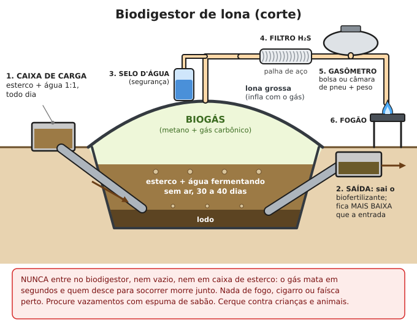

# Biogás

**Resumo:** esterco com água, fechado **sem ar**, fermenta e solta **biogás** (60% metano), que
queima no fogão como gás de cozinha, e sobra um **biofertilizante** líquido. Precisa de calor
(funciona melhor entre **25 e 38 °C**), carga **todo dia** (esterco + água 1:1) e **30–40 dias**
dentro do biodigestor. **3–4 vacas presas à noite ou 8–12 porcos** dão gás para cozinhar para
uma família. O gás **explode** e o **H₂S mata**: ninguém entra no biodigestor, nunca.

---

## Como funciona

- Bactérias que vivem **sem ar** comem a matéria orgânica e soltam **metano (CH₄, 50–70%)**,
  **gás carbônico (30–45%)**, um pouco de **gás sulfídrico (H₂S**, cheiro de ovo podre) e vapor.
- **Temperatura:** ótimo de 30 a 38 °C; bom acima de 25 °C; abaixo de 15 °C quase para. O clima
  brasileiro ajuda muito; no inverno do Sul, enterre, isole ou cubra com estufa plástica.
- **pH** perto de neutro (6,8–7,5). Comida demais de uma vez **azeda** o biodigestor e o gás para.

**Quanto gás vale:**
- 1 m³ de biogás ≈ 6 kWh de calor ≈ **0,45 kg de gás de botijão**.
- **1 botijão de 13 kg ≈ 25–30 m³ de biogás.**
- Uma boca de fogão gasta **0,2–0,4 m³ por hora**. Cozinhar para 4–5 pessoas: **1–1,5 m³ por dia**.
- Lampião a biogás: 0,07–0,1 m³/h. Motor-gerador: 0,6–0,8 m³ por kWh (só para quem tem muito gás).

## Quanto esterco dá quanto gás

| Matéria-prima | Gás por kg de esterco fresco | Por animal por dia (esterco recolhido) |
|---|---|---|
| Vaca/boi (preso no curral ou estábulo) | 0,03–0,04 m³ | 10–15 kg → **0,3–0,5 m³** |
| Porco adulto | 0,05–0,07 m³ | 2–3 kg → **0,1–0,2 m³** |
| Galinhas (100 aves) | 0,05–0,07 m³ | 10–12 kg → **0,5–0,7 m³** |
| Pessoa (fezes) | 0,03–0,05 m³ | **0,02–0,03 m³** (banheiro ligado ao biodigestor) |
| Restos de comida, folhas verdes picadas | variável | Complemento; nunca a base |

Só conta o esterco que você **consegue juntar**: gado solto no pasto não alimenta biodigestor.
Animais presos à noite já rendem metade do esterco do dia.

## Carga, tempo e tamanho

**Carga diária:**
- **Esterco fresco + água na proporção 1:1** (um balde de esterco, um balde de água), bem misturado,
  sem pedras, areia, palha grossa ou serragem.
- Esterco de galinha: **1 de esterco para 3–4 de água** (é forte; em excesso, a amônia mata as
  bactérias). Chorume de pocilga lavada já vem diluído: não precisa de mais água.
- Mesma quantidade **todo dia**, de preferência no mesmo horário.

**Tempo de retenção (quantos dias a carga fica lá dentro):**

| Temperatura média | Dias |
|---|---|
| Acima de 28 °C (Norte, Nordeste) | 25–30 |
| 22–28 °C (maior parte do Brasil) | 30–40 |
| 15–22 °C (inverno do Sul, serras) | 50–60 |

**Tamanho do biodigestor:** volume de líquido (L) = **carga diária (L) × dias de retenção**.

Exemplo: 3 vacas presas à noite, ~12 kg de esterco cada = 36 kg + 36 L de água = **72 L por dia**
× 40 dias = **~2.900 L (3 m³) de líquido**. Gás: 3 × 0,4 ≈ **1,2 m³ por dia** — dá para cozinhar.

## Modelos

### 1. Tambor ou bombona de 200 L (para aprender)
Rende pouco (0,05–0,1 m³ por dia, 10–20 min de fogo), mas ensina o processo antes de investir no
grande.
1. Tambor plástico de 200 L com tampa rosqueada. Na tampa, um **registro de gás** com mangueira.
2. Encha 2/3 com esterco de vaca fresco + água (1:1). Feche bem (teste vazamento com espuma).
3. Ligue a mangueira numa **câmara de pneu** (gasômetro). Em 2–4 semanas ela começa a encher.
4. Versão contínua: cano de carga de 50–75 mm descendo até perto do fundo e cano de saída do lado,
   mais baixo; alimente com ~5 L de mistura por dia.

### 2. Caixa d'água com campânula (modelo indiano simplificado)
- Uma caixa d'água ou tanque de alvenaria de **1.000 a 5.000 L**, enterrado, recebe a carga por um
  cano que desce até perto do fundo; a saída fica do outro lado, mais baixa que a entrada.
- Um tambor ou caixa **menor, de boca para baixo**, flutua sobre o líquido: é o **gasômetro**. Sobe
  quando enche de gás e desce quando você usa. Canos-guia nos lados o mantêm no prumo.
- **Peso** (tijolos) sobre a campânula dá a pressão do gás. Saída de gás no topo da campânula, com
  mangueira flexível.
- Campânula de metal enferruja: pinte com tinta betuminosa todo ano.

### 3. Biodigestor de lona (modelo canadense simplificado / tubular)

O mais barato por m³. A lona de cima infla com o gás.
1. **Local:** perto e **abaixo** do curral ou pocilga (a carga desce por gravidade), a **30 m de
   poços e nascentes**, longe de árvores (galho cai e fura), em terreno firme.
2. **Vala:** comprimento de **3 a 5 vezes a largura**, paredes inclinadas, fundo plano e liso. Para
   ~2 m³: **3 m de comprimento × 1,2 m de largura em cima × 0,6 m no fundo × 0,8 m de fundura**
   (dobre o comprimento para 4 m³). Tire pedras e raízes; forre com areia fina, papelão ou lona
   velha.
3. **Lonas:** geomembrana ou lona de PVC/PEAD de **0,5–1 mm** (lona de cisterna/biodigestor) para o
   fundo e outra para a cobertura. Alternativa barata: **tubo de plástico polietileno** (manga) de
   200–300 µm em **duas camadas**, deitado na vala, amarrado nas pontas em volta dos canos.
4. **Entrada:** cano de PVC de **100 mm** saindo da caixa de carga e descendo inclinado até **2/3
   da profundidade** (a carga entra no meio e o gás não escapa por ali).
5. **Saída:** cano de 100 mm do lado oposto, partindo de perto do fundo e subindo até a caixa de
   saída, com a boca **10–20 cm mais baixa que a da entrada**. É ela que define o nível do líquido.
6. **Vedação:** prenda as bordas das lonas juntas numa **canaleta de 30 cm** em volta da vala
   (dobre, encha de terra e soque) ou com sarrafos parafusados. Nos canos, tiras de **câmara de
   pneu** enroladas e abraçadeiras.
7. **Saída de gás:** um **adaptador com flange** (de caixa d'água) de 3/4" a 1" no ponto mais alto
   da lona, com arruelas de borracha dos dois lados.
8. **Proteção:** cerca contra animais e crianças; telhado ou sombrite para a lona durar mais (no
   Sul, uma estufa de plástico transparente por cima aquece e aumenta o gás).

**Partida:**
1. Encha até o nível da saída com **esterco de vaca fresco + água** (ou lodo de outro biodigestor:
   "semente" de bactérias).
2. Espere **2–4 semanas** sem carga nova (ou com pouca) até sair gás.
3. **O primeiro gás é quase só ar e gás carbônico.** Encha e **esvazie ao ar livre** o gasômetro
   2–3 vezes antes de usar (mistura com ar pode explodir).
4. Teste a chama no fogão, longe do biodigestor. Chama azul firme: comece a alimentação diária,
   aumentando aos poucos durante 2–3 semanas.

**Não coloque:** desinfetante, água sanitária, sabão em quantidade, esterco de animal tratado com
antibiótico nos últimos dias, terra, areia, serragem, palha inteira, óleo, plástico. Crosta grossa
em cima: mexa (por fora, com a lona) ou reduza a fibra.

**Gás parou e o cheiro ficou azedo:** comida demais (acidificou). **Pare de alimentar 1–2 semanas**
e depois volte com metade da carga, com esterco de vaca fresco.

## Do biodigestor ao fogão

Ordem da tubulação: **biodigestor → registro → dreno de água → selo d'água → filtro de H₂S →
gasômetro → registro → fogão**.

- **Mangueira:** mangueira de gás ou de jardim reforçada de 3/4" a 1", presa com abraçadeiras, o
  mais curta possível, longe do sol e de ratos.
- **Dreno de água:** o gás sai úmido e a água condensa na mangueira, bloqueando o gás. No **ponto
  mais baixo** da linha, ponha um "T" com uma garrafa ou registro para drenar toda semana.
- **Selo d'água (segurança):** um "T" na linha com um cano que **mergulha 15–20 cm** numa garrafa ou
  tubo com água. Se a pressão passar disso, o gás borbulha e escapa (a lona não estoura). Também
  impede que a chama volte pela mangueira.
- **Medidor de pressão de mangueira:** um "U" de mangueira transparente com água, preso numa tábua
  com régua: a diferença de nível em cm é a pressão. Para o fogão: **5–15 cm**.
- **Gasômetro:** bolsa de lona ou **câmara de pneu de caminhão/trator**, com uma tábua e tijolos por
  cima para dar pressão. Quanto mais peso, mais forte a chama.

### Filtro de H₂S (gás sulfídrico)
O H₂S corrói o fogão e os metais e é tóxico.
- Cano de PVC de **50–75 mm × 30–50 cm**, com tampas e conexões nas pontas, cheio de **palha de aço**
  (ou limalha de ferro enferrujada misturada com serragem). O gás passa por dentro.
- A palha **escurece** (vira sulfeto de ferro). Troque a cada **1–3 meses**, ou quando voltar o
  cheiro de ovo podre na chama.
- **Regenerar:** espalhe a palha usada ao ar livre, úmida, por 1–2 dias; ela enferruja de novo e
  volta a servir algumas vezes.

> **ATENÇÃO:** a palha de aço regenerando **esquenta sozinha e pode pegar fogo**. Espalhe sobre
> terra, longe de palha, madeira e da casa.

### Fogão (adaptar um fogão de gás de botijão)
O biogás tem menos energia e menos pressão que o gás de botijão: precisa de **furo maior** no bico.
1. Tire o **injetor** (o bico de latão com um furinho, na entrada de cada queimador).
2. Alargue o furo com broca: comece com **1,5 mm**, teste e aumente de 0,5 em 0,5 mm até a chama
   ficar boa (normalmente **2–3 mm**).
3. Ajuste a **entrada de ar** (janelinha ou anel no tubo do queimador):
   - Chama **azul e firme**: certo.
   - Chama **amarela, que suja a panela**: falta ar — abra a entrada de ar.
   - Chama que **descola** do queimador e apaga: ar demais ou pressão alta — feche um pouco.
4. **Não use o regulador de botijão** (a pressão do biogás é baixa demais): ligue direto pelo
   registro.
5. Panela perto da chama (2–3 cm): o biogás esquenta menos que o GLP.

## Biofertilizante

O líquido que sai é um **adubo pronto**, com nitrogênio, fósforo e potássio fáceis para a planta,
e quase sem cheiro.
- **No solo:** diluído **1 parte para 1 de água**, no pé das plantas ou na irrigação.
- **Nas folhas (pulverização):** **1 parte para 10–20 de água** (5–10%), coado, de manhã cedo ou à
  tarde.
- O **lodo do fundo** acumula: retire a cada 1–3 anos **por fora** (bomba ou balde com cabo), nunca
  entrando. É ótimo adubo depois de curtido.
- O biodigestor **reduz muito, mas não elimina** vermes e bactérias. Com **fezes humanas** ou de
  porco: use em árvores, capineiras, milho, cana e culturas cozidas; **pare 30 dias antes da
  colheita** e **nunca** use em verduras comidas cruas. Veja
  [Adubação e compostagem](../04-agricultura/01-solo-adubacao-compostagem.md).

## Segurança

> **ATENÇÃO — NUNCA ENTRE NO BIODIGESTOR**, nem vazio, nem em caixa de carga, fossa, esterqueira ou
> tanque de chorume. O gás carbônico e o **H₂S** se acumulam no fundo e matam **em segundos ou
> minutos**. O H₂S em alta quantidade **para de ter cheiro** (o nariz "desliga"), então não confie
> no olfato. Muitas mortes são de quem **desceu para socorrer** o primeiro. Se alguém cair: **não
> desça**; chame ajuda, jogue corda, ventile (ventilador, lona abanando) e tire a vítima por fora.

- **Metano explode** quando misturado com o ar (5–15%). Nada de fogo, cigarro, solda ou faísca
  perto do biodigestor e do gasômetro.
- **Procure vazamentos com espuma de sabão** (bolhas = vazamento), nunca com chama.
- Mangueira e gasômetro em lugar **ventilado**; nunca guarde gás dentro de casa.
- Registro geral perto do biodigestor e outro antes do fogão. Feche os dois quando não usar por
  muito tempo.
- Caixa de carga e caixa de saída **tampadas** (criança e animal podem cair e se afogar no esterco).
- Lave as mãos depois de mexer com esterco e biofertilizante (verminoses, leptospirose).

---

Ver também: [Lenha e fogões](02-lenha-carvao-e-fogoes.md) · [Combustíveis](09-combustiveis.md) · [Suínos](../05-animais/04-suinos.md) · [Bovinos](../05-animais/03-bovinos.md) · [Higiene e saneamento](../02-saude/09-higiene-e-saneamento.md) · [Adubação](../04-agricultura/01-solo-adubacao-compostagem.md)
