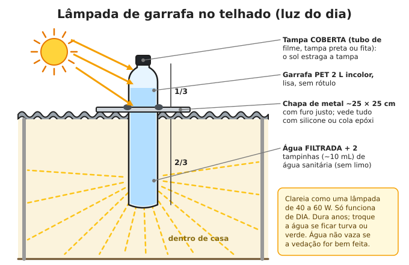

# Iluminação

**Resumo:** a melhor luz de emergência é **LED de 12 V ou USB**: uma lâmpada de 5 W ilumina como
uma incandescente de 40–50 W e uma bateria de carro a mantém acesa por semanas. De dia, a
**lâmpada de garrafa** no telhado ilumina cômodos escuros de graça. Chama (vela, lamparina,
lampião) é o plano B: dá pouca luz, fumaça e é a **maior causa de incêndio em casa** durante
apagões. Ilumine a tarefa, não o cômodo.

---

## Quanto ilumina cada coisa

| Fonte | Luz (lúmens, aprox.) | Gasto |
|---|---|---|
| Vela comum | 10–15 lm | 7–10 g de cera/sebo por hora |
| Lamparina de óleo, pavio pequeno | 5–20 lm | 5–10 mL de óleo por hora |
| Lampião de querosene de pavio | 20–80 lm | 1 L dura 20–40 h |
| Lampião de camisa (gás ou querosene pressurizado) | 500–1.000 lm | botijão de 2 kg: 8–15 h; querosene: 1 L em 8–12 h |
| **LED 1 W** | **100 lm** (≈ 8 velas) | 1 Wh por hora |
| **LED 5 W** | **400–500 lm** (≈ incandescente de 40–50 W) | 5 Wh por hora |
| Lâmpada de garrafa ao sol | equivale a 40–60 W | nada |

- Para **ler ou costurar**, basta um LED de **3–5 W a 50 cm** do que se faz.
- LED gasta **10 vezes menos** que lâmpada incandescente e dura 15.000–50.000 horas.

## LED de 12 V e USB

- **O que serve:** lâmpadas LED 12 V (vendidas para energia solar, motorhome, barco), lâmpadas de
  carro e caminhão (luz de teto, de ré), **fitas de LED 12 V** (5–15 W por metro), luminárias USB
  (5 V, ~1 W) que ligam em power bank ou carregador de carro.
- **Não serve:** lâmpada LED comum de casa (127/220 V) ligada direto em 12 V — não acende ou pisca.
  Para essas, só com inversor.
- **Polaridade:** LED só acende num sentido. Não acendeu? Inverta os fios (vermelho no +).
- **Fusível** de 5–10 A no positivo, perto da bateria; fio de 1,5–2,5 mm² (tabela de bitola em
  [Eletricidade básica](03-eletricidade-basica.md)).
- **Quanto dura:** bateria de 12 V 100 Ah de chumbo, usada até a metade (600 Wh): uma lâmpada de
  5 W, 5 h por noite = 25 Wh/dia → **~24 noites** sem recarregar. Bateria de no-break 12 V 7 Ah
  (~40 Wh úteis): uma lâmpada de 3 W por ~12 horas.
- Um painel de **10–20 W** com controlador pequeno mantém 2–3 lâmpadas LED todas as noites
  (veja [Energia solar](04-energia-solar.md)).

**Montar um circuito de luz 12 V:**
1. Bateria → fusível de 10 A no + → interruptor → lâmpadas **em paralelo** (todas ligadas nos
   mesmos dois fios: + com +, − com −).
2. Luminária no teto do cômodo principal, outra móvel (com garra jacaré ou plugue de acendedor)
   para levar à mesa, à cozinha e ao banheiro.
3. Use a saída LOAD do controlador solar: ela desliga sozinha quando a bateria está baixa.

## Lâmpada de garrafa (luz de Moser)

Inventada em 2002 por **Alfredo Moser**, mecânico de Uberaba (MG), e hoje usada no mundo todo.
A garrafa de água atravessa o telhado: a parte de fora recebe o sol e a água espalha a luz para
dentro, como uma lâmpada de **40–60 W**, só durante o dia.

**Material:** garrafa PET de 2 L **incolor e lisa** (sem rótulo, sem arranhões), água filtrada,
**água sanitária**, um pedaço de chapa de metal (zinco, alumínio, lata aberta) de ~25 × 25 cm,
silicone, cola epóxi ou massa de calafetar, e algo para cobrir a tampa.

1. Lave bem a garrafa. Encha com **água filtrada** e ponha **2 tampinhas (~10 mL) de água
   sanitária** (impede limo e algas). Feche bem.
2. Cubra a **tampa** com um tubo de filme, uma tampinha preta ou fita isolante: o sol estraga a
   tampa e ela vaza.
3. Faça na chapa um furo **justo** do diâmetro da garrafa (~10 cm). Enfie a garrafa até ficar
   **1/3 para fora e 2/3 para dentro** da chapa. Vede a junta garrafa–chapa com silicone ou epóxi.
4. Corte um furo do mesmo tamanho na telha (fibrocimento, zinco) num ponto que pega sol direto boa
   parte do dia, no meio do cômodo.
5. Encaixe a garrafa no furo, com a chapa por cima da telha. Prenda a chapa com rebites ou
   parafusos de telha e **vede toda a volta** com silicone ou massa. Em telha ondulada, molde a chapa
   nas ondas ou encaixe a parte de cima da chapa **por baixo** da fileira de telhas de cima (para a
   chuva escorrer por cima).
6. Teste com uma mangueira antes da próxima chuva.
- Dura **anos**. Troque a água se ficar turva ou verde.

> **ATENÇÃO:** cuidado ao andar sobre telha de fibrocimento: ela **quebra** e causa quedas graves.
> Pise só sobre as linhas de parafusos (onde há madeira embaixo), com uma tábua atravessada. Ao
> cortar fibrocimento antigo, molhe antes e use máscara (pode conter amianto).

## Lamparina de óleo (candeeiro)

Queima **óleo de cozinha** (inclusive usado e coado), azeite, óleo de mamona, de babaçu, dendê,
banha ou sebo derretido.

**Lamparina de pote:**
1. Pote de vidro baixo ou lata, com 2–3 cm de óleo.
2. **Pavio de algodão 100%** (barbante, cadarço de algodão, tira de pano torcida). Fibra sintética
   derrete e não sobe o óleo.
3. Suporte para o pavio: tampinha de metal ou pedaço de lata com um furo no meio, apoiada em
   arame dobrado, de modo que o pavio fique **1–2 cm acima do óleo** e saia só **3–5 mm** para fora.
4. Óleo vegetal sobe pior que querosene: mantenha o nível alto e o pavio curto.
- Chama alta e fumacenta = pavio comprido. Corte a parte queimada e abaixe.

**Lamparina flutuante (mais segura):** copo com **água no fundo** e uma camada de **2–3 cm de óleo**
por cima; o pavio passa por um pedaço de rolha ou de tampinha que flutua no óleo. Se virar, a água
ajuda a abafar, e o copo nunca esquenta demais.

## Velas de sebo e de cera

**Purificar o sebo** (gordura de boi ou carneiro): derreta em **água** (metade água, metade sebo),
ferva 20–30 min, coe num pano e deixe esfriar. O sebo endurece por cima; tire, raspe a sujeira de
baixo e **repita 2–3 vezes**. Fica mais branco, duro e com menos cheiro.

**Pavio:** 3 fios de barbante de algodão **trançados**, mergulhados uma vez no sebo ou cera e
esticados para secar. Vela de 2–3 cm de diâmetro: pavio de ~2–3 mm; mais grossa, pavio mais grosso
(pavio fino demais afoga; grosso demais faz fumaça).

**Por mergulho:**
1. Derreta o sebo ou cera em **banho-maria** (lata dentro de panela com água), a ~70–80 °C.
2. Mergulhe o pavio, tire, deixe esfriar 1–2 min. Repita **20–40 vezes** até a grossura desejada.
   Faça vários de uma vez pendurados num pau.

**Por molde:** cano de PVC, gomo de bambu, caixinha de leite ou copo de papel; pavio preso no centro
com um palito atravessado em cima e um nó ou peso embaixo. Despeje, deixe esfriar 12 h e desenforme.

| Material | Derrete a | Observação |
|---|---|---|
| Sebo | 40–50 °C | Mole, escorre, cheira e atrai ratos e formigas. Guarde em lata fechada |
| **Cera de abelha** | 62–64 °C | A melhor: dura mais, pouca fumaça, cheiro bom. Veja [Abelhas](../05-animais/09-abelhas.md) |
| Sebo + cera 1:1 | — | Bom meio-termo |
| Parafina (vela comprada) | 50–65 °C | Derreta tocos velhos e faça velas novas |

Uma vela de **100 g dura ~10–14 horas**.

> **ATENÇÃO:** **nunca** derreta gordura ou cera direto no fogo — ela passa do ponto e **pega
> fogo**. Fogo em gordura: **nunca jogue água** (explode e espalha). Desligue o fogo e **abafe com
> tampa** ou pano úmido bem torcido.

## Lampião

- **Lampião de pavio (querosene):** use **só querosene** (ou óleo próprio para lampião). Corte o pavio
  reto e com as pontas arredondadas; suba só até a chama não fazer fumaça; vidro limpo dá muito mais
  luz.
- **Lampião de camisa** (a gás de botijão ou querosene pressurizado): dá muita luz. A camisa nova
  deve ser **queimada antes**, sem gás, até virar uma "teia" branca; depois fica muito frágil (não
  encoste). Tenha camisas de reserva.
- Encha e regule **com o lampião apagado e frio**, do lado de fora.
- Lampião esquenta muito em cima: pelo menos **1 m** abaixo de teto, telha de palha, cortina ou rede.

> **ATENÇÃO:** **nunca ponha gasolina ou álcool** em lampião ou lamparina de querosene: o vapor
> explode e espalha fogo. Toda chama dentro de casa consome ar e solta **monóxido de carbono**:
> deixe sempre uma janela entreaberta e nunca durma com lampião aceso em cômodo fechado.

## Lanterna de dínamo, manivela e solar

- **1 minuto de manivela** dá cerca de **10–30 minutos** de luz LED (varia muito). Muitas também
  carregam celular (devagar) e têm rádio.
- Por dentro têm uma pequena bateria recarregável que envelhece: gire uma vez por mês e troque a
  bateria se não segurar carga.
- **Lâmpada solar de jardim:** de dia no sol, de noite dentro de casa como luz de corredor e
  banheiro. Barata e útil.
- **Dínamo de bicicleta** (de roda ou de cubo) acende farol LED e, com um carregador próprio, carrega
  celular pedalando.
- Tenha **lanterna de cabeça** para cada pessoa da casa: deixa as mãos livres.

## Economia de luz

1. **Ilumine a tarefa, não o cômodo:** um LED de 3 W em cima da mesa vale mais que 20 W no teto.
2. **Paredes e teto claros:** caiação com cal branca reflete ~80% da luz (parede escura, ~10%).
3. Ponha **papel-alumínio, lata polida ou espelho** atrás da vela ou lamparina: dobra a luz útil.
4. **Viva com o sol:** trabalhos de precisão, costura, leitura e cozinha de dia; jante cedo; durma
   cedo e acorde cedo.
5. Janelas limpas, telhas translúcidas e lâmpadas de garrafa para cômodos escuros de dia.
6. Uma luz fraca e fixa no **caminho do banheiro** à noite evita quedas (crianças e idosos).

## Segurança contra incêndio

Velas e lamparinas causam muitos incêndios e queimaduras em apagões.
- Vela sempre num **prato com areia ou água**, em base larga, firme e que não queima.
- Longe pelo menos **30 cm** de cortinas, roupas, papel e **mosquiteiro/rede** (pegam fogo num
  segundo); nunca embaixo de prateleira.
- **Nunca durma** com vela ou lamparina acesa. Apague antes de sair do cômodo.
- Fora do alcance de **crianças e animais**; nada de vela no quarto das crianças.
- Não carregue lampião ou vela andando rápido, nem perto do rosto e do cabelo.
- Deixe um **balde de areia** ou de água e um pano grosso perto; saiba onde está o extintor.
- Queimaduras: água corrente fria por 20 minutos. Veja
  [Queimaduras](../02-saude/02-ferimentos-queimaduras-fraturas.md).

---

Ver também: [Baterias](05-baterias.md) · [Energia solar](04-energia-solar.md) · [Fogo](01-fogo.md) · [Combustíveis](09-combustiveis.md) · [Kits e estoques](../00-emergencia/03-kits-e-estoques.md)
