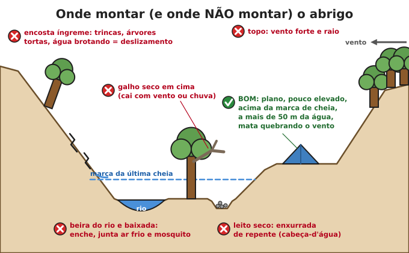
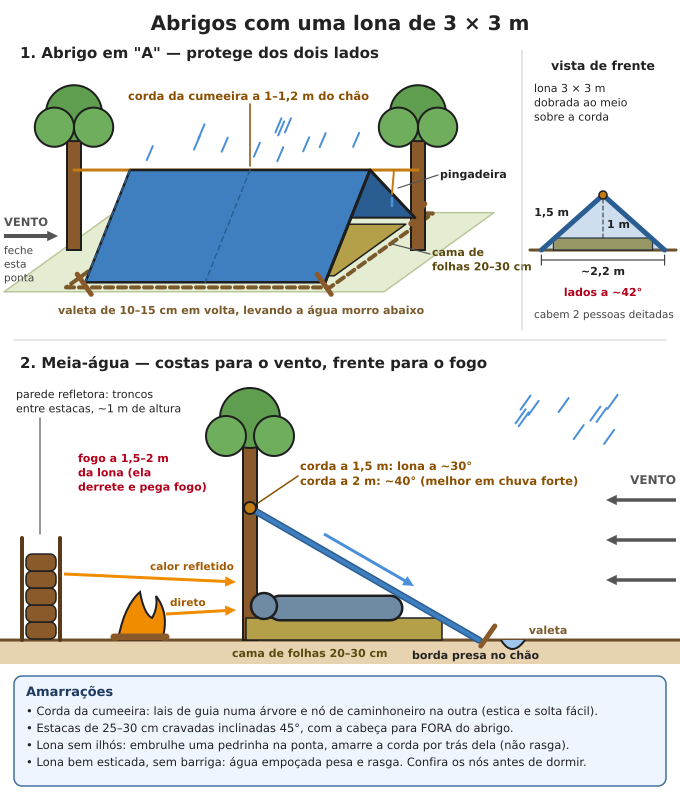

# Abrigo emergencial

**Resumo:** um abrigo existe para manter você **seco, fora do vento e isolado do chão**. Nessa
ordem de importância: **(1) o lugar certo** (enxurrada, deslizamento e galho caindo matam mais
que o frio), **(2) isolamento do chão** (cama de 20–30 cm de folhas), **(3) teto contra chuva e
vento**. Com uma lona de 3 × 3 m, 10–15 m de corda e 6 estacas, duas pessoas montam um abrigo em
20–30 minutos. Comece com pelo menos **1–2 horas de luz** pela frente.

---

## O que o abrigo precisa resolver

| Perigo | O que fazer |
|---|---|
| Chuva + vento + noite (hipotermia mesmo a 15–20 °C) | Teto inclinado, costas para o vento, roupa seca |
| Chão frio e úmido (rouba calor a noite toda) | Cama de folhas, papelão ou colchonete de 20–30 cm |
| Sol forte (insolação, desidratação) | Sombra dupla com ar entre as camadas, lados abertos para a brisa |
| Enxurrada, deslizamento, galho caindo, raio | Escolher bem o lugar (abaixo) |
| Mosquitos (dengue, malária, leishmaniose) e barbeiro | Mosquiteiro, roupas, sem água parada |
| Cobras, escorpiões, formigas | Cama elevada, sacudir roupas e calçados, lanterna à noite |

Sinais e tratamento da hipotermia e da insolação: [Calor, frio e ambiente](../02-saude/10-calor-frio-e-ambiente.md).

## 1. Escolha do local

Antes de tirar a lona da mochila, confira:

1. **Olhe para cima.** Galhos secos (os mais perigosos — caem sem aviso com vento ou chuva),
   árvores mortas ou inclinadas, cachos de coco, pedras soltas. Fique longe pelo menos a
   **altura da árvore** suspeita. Nada de árvore isolada (raio).
2. **Olhe o chão e em volta.** Formigueiro, cupinzeiro, tocas, trilha de animais, casa de
   marimbondo ou abelha, espinhos, fezes de animais grandes.
3. **Nunca em leito seco de rio, grota ou valeta.** Chuva forte na cabeceira, mesmo longe e sem
   chover no local, traz **cabeça-d'água** em minutos.
4. **Acima da marca da última cheia.** Procure lixo preso em galhos, linha de barro nos troncos,
   capim deitado na mesma direção. Na dúvida, fique **3 m ou mais acima** do nível da água.
5. **Perto, mas não junto da água: 50 a 100 m.** Junto da água há mais umidade, neblina,
   mosquito, animais que vêm beber, risco de cheia — e você suja a fonte que vai beber.
6. **Fora de baixadas.** O ar frio desce e se acumula nas partes baixas à noite (fica alguns
   graus mais frio), e é ali que a água da chuva junta.
7. **Longe de encostas íngremes e barrancos.** Sinais de deslizamento: trincas no chão, árvores,
   postes e cercas tortos, água brotando no barranco, estalos, água do córrego ficando barrenta de
   repente. Fique afastado da base pelo menos a **altura do barranco** (melhor o dobro) e nunca
   na beirada de cima.
8. **Protegido do vento.** Atrás de mata, barranco firme, pedra grande ou muro. Descubra de onde
   vem o vento (fumaça, folhas, poeira) e vire as **costas do abrigo para o vento**.
9. **Chão firme, levemente inclinado** (para a água escorrer), plano no lugar de deitar, sem
   pedras e raízes. Cabeça do lado mais alto.
10. **Lenha seca por perto** e espaço para fogo seguro (3 m limpos em volta).
11. **Topo de morro e campo aberto:** muito vento e raio. Evite.

## 2. Abrigos com lona

### Kit mínimo
- **Lona de 3 × 3 m** (ou maior) com ilhós. A de polietileno trançado (tipo "lona de caminhão
  leve") dura anos; a lona preta fina de obra (100–150 micras) serve, mas rasga fácil.
- **Corda:** 10–15 m para a cumeeira (4–6 mm: varal de náilon, paracord) + 6 a 8 pedaços de 2 m.
- **6 a 8 estacas** de 25–30 cm (galho firme com ponta afiada a facão), facão ou canivete.
- Nós usados: **lais de guia** (laço que não corre), **nó de caminhoneiro** (para esticar),
  **volta do fiel** e **nó tensor** (ajustável) — veja [Cordas e nós](../09-quimica-e-oficios/03-cordas-nos-e-cestaria.md).

### Abrigo em "A" (o melhor na chuva)
1. Ache 2 árvores (ou postes) a **4–5 m** uma da outra.
2. Amarre a corda na primeira árvore com **lais de guia**, a **1 a 1,2 m do chão** (altura do
   quadril). Passe na outra árvore e estique com **nó de caminhoneiro**: a corda tem de ficar dura
   como varal de roupa.
3. **Pingadeira:** amarre um barbante de ~20 cm na corda, entre cada árvore e a lona, deixando a
   ponta pendurada. A água que escorre pela corda pinga ali e não entra no abrigo.
4. Jogue a lona sobre a corda, dobrada ao meio: **1,5 m para cada lado**.
5. Estique os 4 cantos **em diagonal para fora** e crave as estacas inclinadas 45°, com a cabeça
   para fora do abrigo. Depois prenda os ilhós do meio.
6. Medidas que resultam:
   - corda a **1 m**: lados a ~42°, base de ~2,2 m, cabem **2 adultos deitados**;
   - corda a **1,2 m**: lados a ~53°, base de ~1,8 m, escorre melhor, cabe 1 adulto folgado.
7. **Ponta virada para o vento:** amarre a corda mais baixa desse lado (60–70 cm) ou feche com
   mochila, galhos e folhas.
8. **Valeta:** cave um rego de **10–15 cm** de largura e fundura logo **fora da linha onde a água
   pinga**, ligado a um rego de saída morro abaixo.
9. Faça a **cama de folhas** (seção 4) antes de escurecer.

Com rede: a mesma montagem, com a corda **30–40 cm acima** da corda da rede e a lona descendo
abaixo das laterais da rede.

### Meia-água (lean-to)
Rápida, aberta na frente, ótima com fogueira. Protege menos se o vento mudar de direção.
1. Corda entre 2 árvores a **1,5 m** de altura (ou **2 m** em chuva forte).
2. Prenda uma borda da lona (o lado de 3 m) na corda, pelos ilhós, com pedaços curtos de corda.
3. Leve a outra borda até o chão **do lado de onde vem o vento** e estaque.
4. Resultado com lona de 3 m: corda a 1,5 m → inclinação de ~30° e 2,6 m de fundo; corda a
   2 m → ~40° e 2,2 m de fundo (escorre melhor).
5. Feche as laterais com galhos e folhas, mochilas ou outra lona.
6. Fogueira **a 1,5–2 m da frente**, com parede refletora atrás dela (seção 6).

### Outras montagens rápidas
- **Toldo plano:** os 4 cantos amarrados em 4 árvores, um lado pelo menos 50 cm mais baixo que o
  outro. Bom para sombra e chuva fraca; ruim no vento.
- **Saco de lixo grande (100 L) resistente:** faça um furo para a cabeça e vira capa de chuva;
  serve para cobrir o saco de dormir ou como parede.
- **Manta térmica aluminizada:** enrole no corpo por baixo de outra camada (guarda o calor).
  Rasga fácil: não serve de teto.

### Erros comuns
- Lona frouxa: faz barriga, junta água, pesa e rasga. Estique de novo antes de dormir.
- Lona encostando no corpo ou no saco de dormir: a água passa por contato.
- Abrigo grande demais no frio: mais ar para esquentar. Pequeno e baixo é mais quente.
- Fogueira perto da lona: polietileno derrete e pega fogo.
- Montar no escuro, com pressa, no primeiro lugar que aparece.

## 3. Abrigos naturais e de galhos e folhas

### Abrigos naturais
- Barranco seco, laje de pedra (lapa, loca), tronco caído grande, raízes grandes de árvore.
- **Antes de entrar:** bata com um pau, ilumine, procure cobras, escorpiões, aranhas, abelhas,
  marimbondos. Veja [Animais peçonhentos](../02-saude/06-animais-peconhentos.md).
- **Cavernas e locas com morcegos ou muitas fezes de aves:** risco de **raiva** (morcego) e de
  **histoplasmose** (fungo da poeira das fezes que dá doença no pulmão). Não durma ali e não
  levante poeira.
- Lapa de pedra: confira se há blocos soltos no teto e se a entrada não é caminho de enxurrada.

### Cabana de folhas (para noite fria, sem lona)
É o abrigo mais quente sem equipamento: funciona como um saco de dormir de folhas.
1. **Viga:** um galho firme com o seu tamanho + 1 m (cerca de 3 m), grosso como o punho.
2. Apoie uma ponta numa **forquilha, toco ou pedra a ~90 cm** de altura; a outra ponta no chão.
3. **Costelas:** encoste galhos dos dois lados da viga, a cada 10–20 cm, bem inclinados. Por
   dentro só deve caber você deitado, com um palmo de folga. Deite dentro para testar.
4. **Trama:** galhos finos e ramos atravessados por cima das costelas, para segurar as folhas.
5. **Cobertura:** folhas secas, capim, palha. Pelo menos **30 cm** de espessura contra chuva e
   **60 cm a 1 m** para frio forte (ela abaixa muito com o tempo). Galhos por cima para o vento
   não levar.
6. **Encha o interior** com folhas secas fofas: você entra nelas como num saco.
7. Feche a entrada com um feixe de folhas ou a mochila.

Leva **2 a 4 horas** para um adulto. Útil nas noites frias do Sul e das serras.

### Cobertura com folhas de palmeira, bananeira e capim
- Bons materiais: folhas de bananeira e de helicônia (caeté), palmeiras (babaçu, buriti,
  coqueiro, indaiá, açaí), capim sapé.
- Coloque **como telhas, de baixo para cima**: cada fileira cobre pelo menos **metade** da de
  baixo. Inclinação de **45° ou mais**, senão pinga.
- Folha de coqueiro: rache ao meio pelo talo e trance os folíolos, ou sobreponha várias.

### Jirau (cama elevada)
Para chão encharcado, várzea, mangue ou mata com muita formiga: 4 forquilhas (ou estacas)
cravadas, 2 travessas amarradas a **40–60 cm do chão**, varas lado a lado por cima e uma camada de
folhas. Cubra com um "A" de lona ou de folhas.

## 4. Isolamento do chão

O chão úmido rouba calor muito mais rápido que o ar. Sem isolamento, uma noite de 10–15 °C já
pode causar hipotermia, mesmo com boa cobertura.

1. **Espessura:** **20–30 cm** de material fofo (ele amassa para uns 10 cm com o peso do corpo).
2. **Camadas:** ramos finos e flexíveis embaixo (deixam o ar circular), folhas secas, capim seco
   ou palha por cima. Sacuda o material antes (bichos).
3. **Borda:** um tronco de cada lado segura a cama no lugar.
4. **Teste:** ajoelhe em cima. Se sentir o frio ou a umidade do chão, ponha mais.
5. Seque a cama ao sol de manhã e troque as folhas a cada poucos dias (fungos e insetos).

**Na cidade:** papelão em várias camadas (ótimo isolante), colchonete, tapete, roupas, palete de
madeira (tira do chão molhado), mochila vazia embaixo das pernas.

**Rede:** é fria porque o ar passa por baixo. Em noite fria, ponha cobertor, papelão ou manta
**dentro** da rede, por baixo do corpo.

## 5. Abrigo na cidade

Na maioria das situações, **ficar em casa é melhor** do que sair (veja
[Prioridades e decisão](../00-emergencia/02-prioridades-e-decisao.md)).

### O cômodo mais seguro

| Situação | Onde ficar | Evitar |
|---|---|---|
| Vendaval, granizo, destelhamento | Cômodo interno, sem janela, no térreo (banheiro, corredor, despensa). Abaixe-se e proteja a cabeça | Janelas, vidros, telhado leve, perto de muro alto |
| Enchente | Andar mais alto, com saída para fora | Térreo, porão, garagem subterrânea, sótão sem saída |
| Frio | Um cômodo só, pequeno e interno, todos juntos; frestas vedadas; janelas cobertas à noite com cobertor, plástico ou papelão | Cômodos grandes, piso frio sem tapete |
| Calor | Térreo, lado sul (menos sol na maior parte do Brasil) ou que fique na sombra à tarde; janelas fechadas e sombreadas de dia, abertas à noite | Último andar sob laje, quarto virado para o oeste |
| Chuva forte em morro | **Sair** para o ponto seguro da Defesa Civil antes de escurecer | Ficar "para ver" |
| Prédio com trincas grandes, inclinado ou com cheiro de gás | Fora, a uma distância maior que a altura do prédio | Voltar para buscar coisas |

### Telhado danificado: lona provisória
1. Use uma lona maior que o buraco: ela deve **passar por cima da cumeeira** (o alto do telhado)
   e descer até pelo menos 1 m além do estrago. Assim a água corre por cima, não por baixo.
2. Prenda com **ripas pregadas sobre a lona** (a ripa prende a lona; prego direto na lona rasga)
   ou com cordas amarradas na estrutura. Sacos de areia como peso; nunca tijolo solto (voa).
3. Mais detalhes de manutenção em [Telhados e conforto](05-telhados-e-conforto.md).

### Carro como abrigo
- Bom contra chuva, vento e **raio** (carro fechado de lataria metálica). Ruim no calor e em
  enchente (**60 cm de água correndo arrastam um carro**).
- Estacione em lugar plano e alto, longe de árvores, postes, barrancos e beira de rio.
- Deixe **2 janelas com uma fresta de 1–2 cm** (renova o ar e diminui o vapor nos vidros).
- No frio: papelão ou cobertor nos vidros, todos juntos, cobertores por cima e por baixo.
  Ligue o motor por no máximo **10 minutos a cada hora**, **só** com o escapamento livre (sem
  lama, mato ou água em volta) e janela entreaberta.

> **ATENÇÃO:** monóxido de carbono (CO) não tem cheiro e mata dormindo. **Nunca** durma com o
> motor ligado em lugar fechado ou com o escapamento obstruído. **Nunca** use braseiro,
> churrasqueira, fogareiro ou gerador dentro de carro, barraca, trailer ou casa fechada. Carro
> parado ao sol passa de 50–60 °C em pouco tempo: nunca deixe criança, idoso ou animal dentro.

## 6. Aquecer com segurança

**Primeiro guarde o calor que você já tem:** roupa seca, camadas, gorro, meias secas, comer antes
de dormir (gordura e carboidrato), bebida morna, abrigo pequeno, dormir 2 ou 3 juntos.

### Fogo com refletor
1. Faça a fogueira **comprida e baixa**, paralela à abertura do abrigo, a **1,5–2 m** da frente.
2. Atrás do fogo, levante uma **parede refletora**: crave 2 pares de estacas e empilhe troncos
   entre elas até **~1 m** de altura. Pedra grande, barranco ou muro servem. Ela devolve o calor
   para o abrigo e protege a chama do vento.
3. Limpe **3 m** em volta da fogueira até a terra nua. Separe lenha para a noite toda antes de
   escurecer (veja [Fogo](../06-energia/01-fogo.md)).
4. Se todos forem dormir, deixe só brasa pequena. Em mato seco (cerrado, caatinga, inverno do
   Sul), apague com água e terra.

### Pedras quentes
1. Use pedras **secas, de lugar alto**, do tamanho de um punho a um tijolo.
2. Aqueça na beira do fogo por 1–2 horas. Tire com pau ou pá.
3. Embrulhe em pano grosso (ou ponha numa lata) e coloque aos pés ou entre as pernas. Teste com a
   mão: tem que dar para segurar sem queimar.

> **ATENÇÃO:** **nunca** aqueça pedras de rio, de beira d'água, molhadas ou que soltam lascas
> (arenito, ardósia, xisto). A água presa dentro vira vapor e a pedra **pode explodir**,
> jogando estilhaços quentes.

### Cama sobre brasas (aquece a noite inteira)
1. Cave uma vala do tamanho da cama e **30 cm** de fundura.
2. Encha de brasas (ou pedras quentes) e mantenha fogo ali por 1–2 horas.
3. Cubra com **10–15 cm de terra** sem raízes e sem folhas. Pise para firmar.
4. Espere 10 minutos e teste com a mão em vários pontos: deve estar morno, não quente.
5. Cubra com a cama de folhas e deite. Não faça em solo cheio de raízes ou turfa (o fogo pode
   continuar queimando por baixo).

### Garrafa quente
Garrafa **de metal** ou bolsa térmica de borracha com água quente, bem fechada e enrolada em pano,
no peito, axilas ou virilha. Garrafa PET amolece e vaza com água muito quente: só água morna.

### Dentro de casa
Fogão a lenha e lareira **com chaminé** funcionando: sim. Velas: pouco calor e risco de incêndio.
Aquecedor a gás ou querosene: só os próprios para ambiente interno, com janela entreaberta, nunca
dormindo. Braseiro, carvão, churrasqueira, fogareiro ou gerador em ambiente fechado: **nunca**.

## 7. Barracas

- **Tipos:** iglu (domo) fica em pé sozinha e aguenta vento; túnel tem mais espaço mas depende das
  estacas; canadense (em "A") é simples e resistente.
- **Impermeabilidade ("coluna d'água"):** sobreteto de **1.500 a 3.000 mm** aguenta chuva forte;
  abaixo de ~1.000 mm, só garoa. O piso deve ter mais.
- **Montagem:**
  1. Chão plano e alto. Porta virada para o lado contrário do vento; lado mais estreito para o
     vento.
  2. Estacas a 45°. Use todos os **estais** (cordas de tensão) se houver vento.
  3. Sobreteto bem esticado, **sem encostar** na barraca de dentro (se encostar, a água passa).
  4. Lona de chão **menor que a barraca**. Se sobrar para fora, ela junta a chuva e leva para
     baixo de você: dobre a sobra para baixo.
- **Condensação:** a respiração molha a barraca por dentro. Abra as janelas de ventilação.
- **Calor:** uma lona em "A" esticada **30 cm acima** da barraca dá sombra e deixa tudo bem mais
  fresco; também protege o tecido do sol (que estraga a barraca).
- **Nunca** fogo, vela ou fogareiro dentro: o tecido queima em segundos, e há o monóxido.
- **Cuidados:** seque antes de guardar (mofo), tire areia dos zíperes, tenha kit de reparo:
  fita adesiva larga (silver tape), agulha e linha, tubinho de reparo de vareta.

## 8. Mosquiteiro

| Inseto | Doença | Quando pica |
|---|---|---|
| *Aedes* (mosquito da dengue) | Dengue, zika, chikungunya, febre amarela urbana | **De dia** |
| *Anopheles* (mosquito-prego) | Malária (Amazônia) | Fim da tarde e noite |
| *Haemagogus* e *Sabethes* | Febre amarela silvestre | De dia, na mata |
| Mosquito-palha (birigui) | Leishmaniose | Entardecer e noite; é **muito pequeno** |
| Barbeiro | Doença de Chagas | Noite, na cama |

1. **Malha fina** (padrão de mosquiteiro, furos de ~1,5 mm ou menos). Para mosquito-palha, prefira
   malha mais fina ou **mosquiteiro impregnado com inseticida** (os distribuídos em áreas de
   malária duram cerca de 3 anos ou 20 lavagens; lave pouco, com sabão neutro, e seque à sombra).
2. Arme **antes de escurecer**. Prenda as bordas **embaixo do colchão ou da esteira**, não
   arrastando no chão.
3. Entre rápido, ilumine por dentro e mate os que entraram.
4. Não encoste o corpo na tela: eles picam através dela.
5. Remende furos no mesmo dia (linha, fita, um nó apertando o tecido em volta do furo).
6. Para rede: mosquiteiro que envolve a rede inteira. Improviso: tule ou voil costurado.

Sem mosquiteiro: manga comprida e calça, repelente (DEET ou icaridina), tela nas janelas, nenhuma
água parada perto do abrigo (veja [Armazenamento de água](../01-agua/03-armazenamento-e-calculos.md)
e [Doenças e infecções](../02-saude/03-doencas-e-infeccoes.md)).

## 9. Abrigo para grupos

### Medidas mínimas (padrões usados em ajuda humanitária)

| Item | Mínimo |
|---|---|
| Área coberta por pessoa, clima quente | **3,5 m²** |
| Área coberta por pessoa, clima frio (cozinha dentro, mais tempo fechado) | **4,5–5,5 m²** |
| Altura no ponto mais alto | 2 m |
| Terreno do acampamento por pessoa | 30 m² (45 m² com hortas) |
| Distância entre abrigos | 2 m, ideal **o dobro da altura** do abrigo (o fogo não pula) |
| Aceiro (faixa sem nada) | **30 m** de largura a cada ~300 m de acampamento |
| Latrinas | a **30 m** de poços e rios, a no máximo **50 m** dos abrigos |
| Ponto de água | a no máximo 500 m de cada abrigo |

### Barracão de lona
1. Esteios (eucalipto, bambu grosso) a cada **2,5–3 m**, enterrados **50–60 cm** e socados.
2. Cumeeira e terças amarradas ou pregadas; telhado com pelo menos **30% de inclinação** para lona.
3. Lona grande (4 × 6, 6 × 8, 8 × 10 m) amarrada **a cada 50 cm** na estrutura. Lona solta vira
   vela no vendaval e arranca tudo.
4. Laterais com lona, esteira de taquara, folhas de palmeira ou pau-a-pique
   (veja [Construção com terra](02-construcao-com-terra.md)).

### Organização
- Separe por famílias, com divisórias (pano, esteira). Caminhos iluminados até os banheiros,
  banheiros separados por sexo e com tranca por dentro.
- **Cozinha coletiva fora dos abrigos**, do lado para onde o vento sopra (a fumaça vai embora).
- Lugar separado para doentes com diarreia ou febre. Lixo longe e fechado
  (veja [Higiene e saneamento](../02-saude/09-higiene-e-saneamento.md)).
- Idosos, bebês e doentes no lugar mais protegido, longe da porta e do vento.
- Escala de vigia para fogo e segurança (veja [Organização comunitária](../12-comunidade-e-seguranca/01-organizacao-comunitaria.md)).

---

Ver também: [Perdido no mato](../11-natureza-e-desastres/01-perdido-no-mato.md) · [Calor, frio e ambiente](../02-saude/10-calor-frio-e-ambiente.md) · [Fogo](../06-energia/01-fogo.md) · [Cordas e nós](../09-quimica-e-oficios/03-cordas-nos-e-cestaria.md) · [Desastres](../11-natureza-e-desastres/03-desastres.md) · [Kits e estoques](../00-emergencia/03-kits-e-estoques.md)
