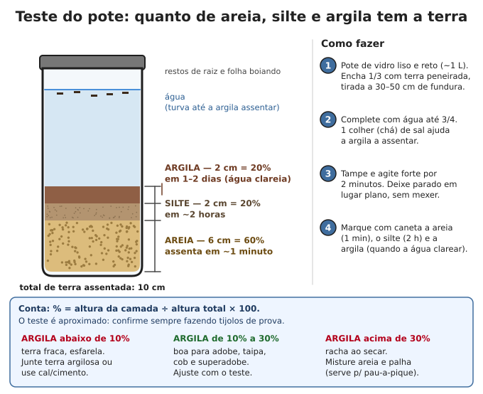
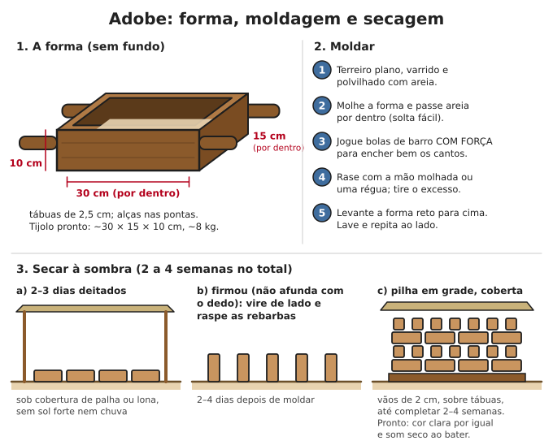
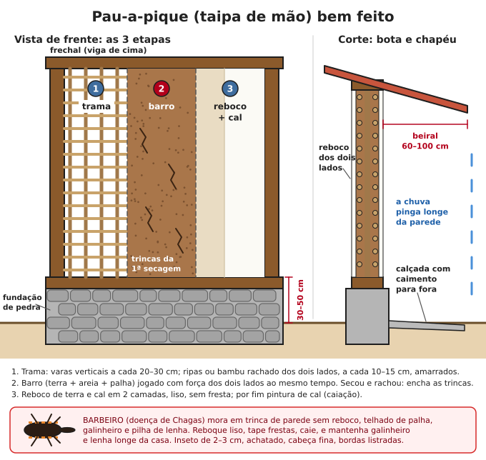

# Construção com terra

**Resumo:** terra do subsolo (sem raízes), com a mistura certa de argila e areia, faz paredes
fortes, frescas e quase de graça: adobe, taipa de pilão, pau-a-pique, superadobe, cob e tijolo
de solo-cimento. Três regras valem para todas: **(1) teste a terra antes**; **(2) "boa bota e bom
chapéu"**: fundação de pedra subindo **30–50 cm acima do chão** e beiral de **60–100 cm**;
**(3) reboco liso e manutenção** — parede de terra só se estraga com água.

---

## Prós, contras e onde tirar a terra

- **Prós:** material local e barato; parede grossa segura o calor do dia e solta à noite (casa
  fresca); não queima; pode ser desmanchada e reaproveitada. Há casas coloniais de taipa e
  adobe com mais de 200 anos em Minas, Goiás e São Paulo.
- **Contras:** amolece com água (de baixo, da chuva de lado e de goteira); aguenta bem peso mas
  pouco puxão; dá muito trabalho braçal; demora para secar.
- **Onde tirar:** raspe a camada de cima (terra escura com raízes, 20–40 cm) e guarde para a
  horta ([Solo e compostagem](../04-agricultura/01-solo-adubacao-compostagem.md)). Use o
  **subsolo** (barro amarelo, vermelho, cinza), sem folhas, lixo ou pedras grandes.
- **Quanto:** 1 m² de parede de 30 cm gasta 0,3 m³ de terra compactada. Uma casa de 6 × 7 m
  com paredes de 30 cm e 2,7 m de altura gasta da ordem de **25–35 m³** de terra solta.

> **ATENÇÃO:** o buraco de onde sai a terra junta água (mosquito da dengue) e é perigoso para
> crianças e animais. Cerque, aterre depois, ou transforme num tanque bem feito.

## Testes de solo (sem laboratório)

### 1. Teste do pote

1. Pote de vidro liso, de lados retos, de ~1 L.
2. Encha **1/3 com terra peneirada** (tirada a 30–50 cm de fundura), complete com água até
   **3/4**. Uma colher (chá) de sal ajuda a argila a assentar.
3. Tampe e **agite forte por 2 minutos**. Deixe parado em lugar plano.
4. Marque: **areia** depois de ~1 minuto, **silte** depois de ~2 horas, **argila** quando a água
   clarear (1–2 dias).
5. **% de cada camada = altura da camada ÷ altura total × 100.**

O resultado é aproximado (a argila incha e parece mais do que é). Use para escolher a técnica e
confirme com tijolos de prova.

### 2. Teste do rolinho (charuto)
1. Molhe terra peneirada até virar massa de modelar (sem grudar na mão).
2. Role um cilindro de **2,5 cm de grossura** e ~20 cm de comprimento.
3. Empurre devagar para fora da borda de uma tábua até o pedaço no ar quebrar.
4. Meça o pedaço que caiu (faça 3 vezes e tire a média):

| Pedaço que caiu | Terra |
|---|---|
| Menos de 5 cm | Arenosa, pouca argila |
| 5 a 15 cm | Boa para a maioria das técnicas |
| Mais de 15 cm | Muito argilosa: vai rachar, junte areia |

Complemento: se dá para rolar uma **cobrinha de 3 mm** sem partir, a terra tem bastante argila;
se esfarela antes, é arenosa ou siltosa.

### 3. Teste da bolinha
Faça bolas de **4 cm** com a terra úmida (massa de modelar) e deixe cair de **1,5 m** sobre
chão duro e liso:
- **Espatifa em muitos pedaços:** pouca argila (pouca liga).
- **Achata e trinca um pouco:** boa.
- **Achata sem trincar nada:** muita argila (confirme com o rolinho).

### 4. Teste da umidade (taipa, superadobe e solo-cimento)
Aperte um punhado da mistura na mão:
1. Tem que formar uma bola firme, com a **marca dos dedos**, sem molhar a mão.
2. Deixe a bola cair da altura da **cintura (~1 m)**:
   - quebra em **alguns pedaços** → umidade certa;
   - esfarela em pó → seca, ponha água;
   - amassa sem quebrar ou suja a mão → molhada, espere secar ou junte terra seca.

### 5. Caixa de retração
Caixa de madeira com **60 × 4 × 4 cm** por dentro, untada com óleo. Encha com terra úmida
(massa de modelar), alise, deixe **7 dias à sombra**. Empurre a barra seca para uma ponta e meça
a folga:
- **até ~2 cm**, sem trincas: ótima (taipa, adobe, solo-cimento);
- **2 a 4 cm**: aceitável com mais areia ou palha (adobe, cob, pau-a-pique);
- **mais de 4 cm** ou muitas trincas: argila demais, misture areia.

### 6. Tijolos de prova (o teste que decide)
1. Faça 4 misturas em volume: terra pura; 3 terra + 1 areia; 2 terra + 1 areia; 1 terra + 1 areia
   (e as mesmas com palha, se for adobe ou cob).
2. Molde 2 tijolinhos (ou bolas de 5 cm) de cada e seque **1–2 semanas** à sombra.
3. Escolha a mistura **com menos areia que não trincou**, que a unha não risca fácil e que não
   solta pó quando esfregada.

### Faixas aproximadas por técnica (pelo teste do pote)

| Técnica | Argila | O resto |
|---|---|---|
| Taipa de pilão | 10–20% | Areia e cascalho miúdo, pouco silte |
| Superadobe | 10–30% | Aceita terra arenosa (estabilize se precisar) |
| Adobe | 15–30% | Areia + palha |
| Cob | 15–25% | Muita areia + muita palha comprida |
| Pau-a-pique (barro) | 20–40% | Areia + palha (a trama segura) |
| Solo-cimento prensado | Silte + argila 10–35% | Terra arenosa (areia 60% ou mais) |

## Adobe

### Mistura
- Terra com **15–30% de argila**, corrigida com areia (se racha) ou terra argilosa (se esfarela).
- **Palha picada** de 5–10 cm (capim seco, palha de arroz, milho, feijão, sapé): cerca de
  **1 balde de palha para 4–6 baldes de terra**. Um pouco de esterco fresco de vaca (até 1 parte
  para 10) é tradicional e melhora a liga.
- Água até virar massa mole de modelar: jogada no chão, a bola **mantém a forma** e não esparrama.

### Preparo do barro
1. Cave um amassador raso (2 × 2 m, 30 cm de fundo) ou use uma lona grande.
2. Terra peneirada (malha de ~1 cm) + água. **Deixe "curtir" 1 a 3 dias**: a argila hidrata e
   o barro fica mais liguento.
3. Junte areia e palha e amasse com os pés, a enxada ou um animal andando em roda.

### A forma
- Medida interna **30 × 15 × 10 cm** (tijolo molhado de ~8 kg). Outras comuns: 40 × 20 × 10 cm
  (~14 kg, pesado) e 25 × 12 × 8 cm.
- Tábuas de 2,5 cm, lisas por dentro, **sem fundo**, com alças nas pontas. Forma dupla (dois
  tijolos lado a lado) rende quase o dobro.

### Moldar
1. Terreiro plano, varrido e polvilhado com areia.
2. Molhe a forma e passe areia por dentro (o tijolo solta fácil).
3. Jogue bolas de barro **com força**, enchendo bem os cantos.
4. Rase com a mão molhada ou uma régua.
5. Levante a forma **reto para cima**. Lave a forma num balde e repita ao lado.

Uma pessoa com prática molda cerca de **200 a 400 adobes por dia**.

### Secar à sombra (2 a 4 semanas no total)
1. **2–3 dias deitados**, protegidos do sol forte e da chuva (palha, folhas ou lona por cima,
   sem encostar). Sol direto nos primeiros dias racha o adobe.
2. Quando firmar (o dedo não afunda), **vire de lado** e raspe as rebarbas com uma faca.
3. Depois de mais alguns dias, monte **pilhas em grade**, com **2 cm** entre os tijolos, sobre
   tábuas, cobertas por cima, até completar **2–4 semanas** (mais em tempo úmido).
4. **Pronto:** cor clara por igual, som seco quando batido, e um adobe partido ao meio está seco
   por dentro.

**Teste de qualidade tradicional:** um adobe seco, deitado com as pontas apoiadas em outros dois,
deve aguentar um adulto em pé em cima por 1 minuto sem quebrar.

### Quantos adobes (30 × 15 × 10 cm, junta de 1,5 cm)
- Parede de **15 cm** (adobe ao comprido): **~28 por m²**.
- Parede de **30 cm** (adobe atravessado): **~53 por m²**.
- Some 5–10% de perda.

### Assentar
1. Embasamento pronto (veja "Bota e chapéu" abaixo).
2. **Argamassa:** o mesmo barro, peneirado, sem palha grossa, com um pouco mais de areia, na
   consistência de creme grosso. Juntas de **1,5–2 cm**.
3. Umedeça a face do adobe antes de assentar (sem encharcar).
4. Comece pelos cantos. Linha esticada entre eles; confira **prumo e nível** a cada fiada
   (veja [Alvenaria](04-alvenaria-cal-argamassas.md)).
5. **Amarração:** juntas verticais desencontradas (meio tijolo) e, nos cantos e encontros de
   paredes, uma fiada passa de um lado e a seguinte do outro.
6. Suba **no máximo 1 m de parede por dia** (a argamassa de baixo precisa firmar).
7. No topo, uma **cinta de amarração** contínua em volta da casa (viga de madeira de lei ou de
   concreto armado) espalha o peso do telhado e segura as paredes juntas.

### Regras de projeto para paredes que sustentam telhado
- Espessura: **30 cm ou mais** nas paredes externas; 15 cm só para divisórias.
- Altura até cerca de **8 a 10 vezes a espessura** (parede de 30 cm: até 2,4–3 m).
- Parede reta comprida: a cada **3,5–4 m**, um encontro com outra parede ou um contraforte
  (pilastra de adobe).
- Portas e janelas: largura até **1,2 m**; no total, no máximo **1/3** do comprimento da parede;
  pelo menos **1 m** de parede cheia entre a abertura e o canto. Verga de madeira de lei apoiada
  **30–40 cm** em cada lado.

## Taipa de pilão

### As formas (taipal)
- Dois painéis de tábua (2,5–3 cm) ou compensado naval de 18–20 mm, com **1,5–3 m** de
  comprimento e **50–90 cm** de altura, reforçados por fora com sarrafos a cada 50–60 cm.
- **Agulhas** (barras de madeira ou ferro roscado) atravessam embaixo e em cima, apertadas com
  cunhas ou porcas. A distância entre os painéis é a **espessura da parede: 30–50 cm**.
- Uma tábua de ponta (testeira) fecha o fim de cada bloco. Confira o prumo das formas.

### A terra
- Mais arenosa: **10–20% de argila**, com areia e até cascalho miúdo (peneira de 1–2 cm).
- **Úmida como farofa** (teste da umidade). Misture só a quantidade que vai usar logo.
- Em parede muito exposta ou região chuvosa, pode-se estabilizar com cimento: **1 parte de
  cimento para 10 a 15 de terra** (em volume), usando a mistura em até 1 hora.

### Pilar (socar)
1. Forma montada sobre o embasamento, no prumo.
2. Jogue uma camada de **10–15 cm** de terra solta e espalhe por igual.
3. Soque com o **pilão**: madeira dura ou ferro, **5–9 kg**, base de 10 × 10 a 15 × 15 cm,
   cabo de 1,2–1,5 m. Primeiro junto às formas e nos cantos, depois o meio, em fileiras.
4. **Ponto:** o som muda de abafado para **seco**, o pilão começa a quicar e a camada baixa para
   cerca de **2/3** da altura solta.
5. Arranhe levemente a superfície e jogue a próxima camada. Repita até o topo da forma.
6. **Desforme na hora** (a taipa bem socada já fica em pé), passe a forma para o lado e continue.
   Na fiada de cima, desencontre as juntas, como em tijolo.
7. Deixe portas e janelas com caixilho ou verga já no lugar durante a socagem.
8. Seca devagar (semanas), protegida da chuva. Com bom beiral, pode ficar sem reboco.

## Pau-a-pique (taipa de mão, taipa de sopapo)

### Estrutura
- Faça primeiro a **estrutura e o telhado**: esteios de madeira durável (aroeira, candeia,
  eucalipto tratado, 12–15 cm), sobre base de pedra ou concreto; baldrame embaixo e frechal em
  cima. O barro seca melhor à sombra e protegido da chuva.

### Trama
- **Varas verticais** de 3–5 cm a cada **20–30 cm**, encaixadas em furos no baldrame e no
  frechal (ou pregadas).
- **Ripas horizontais** (varas finas, bambu rachado, taquara) **dos dois lados**, a cada
  **10–15 cm**, amarradas com arame recozido, cipó ou embira, ou pregadas. Vão interno de
  8–12 cm; parede pronta com 12–20 cm.
- Use varas sem casca e trate bambu e madeira com boro (veja [Madeira e carpintaria](03-madeira-e-carpintaria.md)):
  caruncho dentro da parede vira buraco e esconderijo.

### Barreamento
1. Barro de terra argilosa + areia (se precisar) + capim ou palha picada, bem amassado.
2. Duas pessoas, **uma de cada lado**, jogam bolas de barro com força no mesmo ponto ao mesmo
   tempo, de baixo para cima, até encher a trama.
3. Deixe secar **1–4 semanas**. Vai rachar: é normal.
4. Encha as trincas com barro mais arenoso e palha fina, apertando com os dedos.

### Reboco: obrigatório
1. **1ª camada:** terra + areia (1:2 a 1:3) + fibra fina, **1–2 cm**, jogada e apertada.
2. **2ª camada:** **~5 mm**, mais fina (terra peneirada, areia fina e cal, ou cal e areia),
   alisada com a desempenadeira ou a colher molhada.
3. **Caiação:** 2–3 demãos.
4. Confira: **nenhuma fresta**, inclusive entre parede e telhado, no forro, em volta de portas,
   janelas e esteios.

> **ATENÇÃO — barbeiro e doença de Chagas:** o barbeiro se esconde de dia em trincas de parede
> sem reboco, telhado de palha, galinheiro, chiqueiro e pilhas de lenha ou telha, e pica à noite
> (muitas vezes no rosto). A doença pode ficar escondida por anos e depois atacar o coração e o
> intestino. **Previna:** reboco liso, frestas tapadas, caiação, forro, galinheiro e lenha
> **longe da casa**. **Achou um:** não esmague com a mão; pegue com saco plástico, guarde num pote
> fechado e leve ao posto de saúde. Veja [Doenças e infecções](../02-saude/03-doencas-e-infeccoes.md).

## Superadobe

Sacos de ráfia cheios de terra úmida e socados, em fiadas, com arame farpado entre elas.

**Material:** saco tubular de ráfia em rolo (40–50 cm de largura) ou sacos de 50–60 kg
(arroz, ração) cheios até 3/4 com a boca dobrada; arame farpado; um funil (balde ou lata sem
fundo) para encher; pilão.

1. **Fundação:** vala de **30–50 cm** de fundo, fundo socado. As fiadas até acima do chão com
   **brita ou cascalho** nos sacos, ou terra com **10% de cimento** (a umidade não sobe).
2. Encha o saco **já no lugar**, deitado sobre a linha da parede.
3. **Soque a fiada inteira** até ficar firme e plana (fica com ~12–15 cm de altura).
4. Estique **2 fios de arame farpado** por cima (seguros com tijolos enquanto não vem a fiada
   seguinte). Eles travam uma fiada na outra como velcro.
5. Juntas desencontradas. Paredes **curvas ou redondas** são mais estáveis; parede reta comprida
   pede contrafortes.
6. Portas e janelas: formas de madeira no lugar durante a obra, e verga de madeira ou concreto.
7. **Reboque em até 2–3 meses:** o sol destrói a ráfia. Em saco liso, pregue tela de galinheiro
   antes, para o reboco agarrar.

Terra: **10–30% de argila**, na umidade do teste. Muito arenosa: 5–10% de cimento ou cal.
Cúpulas (domos) de superadobe exigem experiência e reboco perfeito; em clima chuvoso, prefira
paredes com telhado e beiral.

## Cob

Barro de terra argilosa + areia + **muita palha comprida (15–30 cm)**, moldado à mão, sem forma.
1. Traço inicial: **1 de terra argilosa para 1 a 2 de areia**, palha à vontade. Ajuste pelos
   testes.
2. Misture com os pés sobre uma lona, dobrando a lona para virar a massa.
3. Levante a parede em **camadas de 30–50 cm** de altura. Aperte cada bolo no de baixo com os
   dedos ou um pau ("costurar"), para a palha atravessar as camadas.
4. Espere **1–3 dias** entre camadas (mais em tempo úmido).
5. Paredes de **40–60 cm** na base, afinando para cima. Apare a face com facão quando estiver
   firme mas ainda úmida.

Permite curvas, bancos, nichos e fogões. Seca devagar em clima úmido.

## Tijolo de solo-cimento prensado (tijolo ecológico)

- **Prensa manual** de alavanca (tipo CINVA-Ram ou similares nacionais); uma equipe de 3 faz
  várias centenas por dia.
- **Terra:** arenosa (veja a tabela), sem matéria orgânica, peneirada em malha de **4–5 mm**.
- **Traço em volume: 1 cimento : 8 a 12 de terra** (o mais comum é 1:10). Terra mais argilosa pede
  mais cimento.

1. Misture terra e cimento **a seco** até a cor ficar uniforme.
2. Junte água aos poucos até o ponto do teste da umidade. Use em até **1 hora**.
3. Prense, tire com cuidado e empilhe à sombra.
4. **Cura:** molhe **3 vezes por dia por pelo menos 7 dias**, cobertos com lona. Use depois de
   **14 dias** (ideal 28).
5. O tijolo modular de **25 × 12,5 × 6,25 cm** com 2 furos gasta **64 por m²**. Assente com
   argamassa fina; os furos alinhados formam canais para colocar **ferro e graute** (concreto
   fino) nos cantos e junto das aberturas.

## Bota e chapéu (vale para todas as técnicas)

1. **Fundação:** vala até chegar em terra firme (40–60 cm), com largura de pelo menos **1,5 vez**
   a parede. Pedra com argamassa de cal ou cimento, ou concreto ciclópico
   (veja [Alvenaria](04-alvenaria-cal-argamassas.md)).
2. **Embasamento (a bota):** sobe **30–50 cm acima do chão** (mínimo 20 cm em lugar seco). No
   topo, uma barreira contra a umidade que sobe: manta asfáltica, 2 demãos de piche ou argamassa
   com impermeabilizante.
3. **Beiral (o chapéu):** **60–100 cm**. Varanda em volta é melhor ainda. Calhas ajudam.
4. **Calçada** de 60–100 cm em volta, com caimento de 2–3% para fora; terreno inclinado
   afastando a água; nada de canteiro regado encostado na parede.
5. **Barra:** os primeiros 50–80 cm da parede com reboco mais forte (cal, ou cal com um pouco
   de cimento), onde a chuva respinga.

## Rebocos e pintura

### Reboco de terra
- **1 terra argilosa peneirada (malha 3–5 mm) : 2 a 3 de areia** + fibra fina (palha picada de
  1–2 cm ou esterco de cavalo ou vaca peneirado).
1. Parede limpa, trincas grandes cheias, superfície áspera, **umedecida**.
2. 1ª camada de **1–2 cm**, jogada e apertada. Deixe firmar.
3. 2ª camada de **3–5 mm**, mais fina, desempenada. Se trincar ao secar, borrife água e alise de
   novo.
4. Antes, teste 3 traços em quadrados de 50 × 50 cm na parede e escolha o que não trinca nem
   solta pó.

### Reboco de cal (aguenta melhor a chuva)
- **1 cal : 3 areia** (em volume). Pode trocar parte da areia por terra peneirada.
- Camadas finas (**5–10 mm**) sobre parede umedecida. Molhe **2–3 vezes por dia por 3–7 dias**.
  Não aplique em sol forte nem vento.
- Como fazer e curtir a cal: [Alvenaria, cal e argamassas](04-alvenaria-cal-argamassas.md).

> **ATENÇÃO:** **não** reboque parede de terra com **cimento puro**. Ele é duro e não deixa a
> parede "respirar": a umidade fica presa atrás, a terra amolece, o reboco trinca e cai em
> placas. Use terra ou cal.

### Caiação (pintura de cal)
1. Misture **1 kg de cal hidratada em 2,5–3 L de água** (leite grosso). Para fixar melhor,
   junte por balde de 10 L **meio copo (~100 g) de sal** ou **1 copo (200 mL) de cola branca**.
2. Deixe descansar 1 dia. Mexa bem antes de usar.
3. Parede umedecida, à sombra: **3 demãos finas** com brocha.
4. Refaça a cada **1–2 anos**. Para cor, junte terra colorida peneirada bem fina.

## Manutenção

| Quando | O que fazer |
|---|---|
| Antes de cada estação de chuva | Calhas, beiral, telhas; trincas no reboco; base das paredes |
| Depois de chuva forte com vento | Procure manchas de umidade e reboco estufado ou solto embaixo |
| A cada 1–2 anos | Caiação |
| Sempre | Tapar trinca e fresta no mesmo dia (barbeiro); olhar cupim nos esteios e madeiras |

- **Reparo:** raspe o que está solto, umedeça e encha com o mesmo material. Reboco de terra velho
  pode ser molhado, amassado e reusado.
- **Base molhada:** descubra a causa (respingo, goteira, calha, terreno inclinado para a casa,
  umidade do chão) e corrija **antes** de rebocar de novo.

> **ATENÇÃO:** parede de terra é pesada (1,6–2 toneladas por m³). **Parede encharcada pode
> desabar** — depois de enchente ou goteira longa, não fique encostado nela até secar e ser
> conferida. Nunca cave junto à base de uma parede. Use botas, luvas e cuidado com as costas
> (barro molhado pesa muito; levante com as pernas).

---

Ver também: [Alvenaria, cal e argamassas](04-alvenaria-cal-argamassas.md) · [Madeira e carpintaria](03-madeira-e-carpintaria.md) · [Telhados e conforto](05-telhados-e-conforto.md) · [Cerâmica](../09-quimica-e-oficios/06-ceramica.md) · [Doenças e infecções](../02-saude/03-doencas-e-infeccoes.md)
