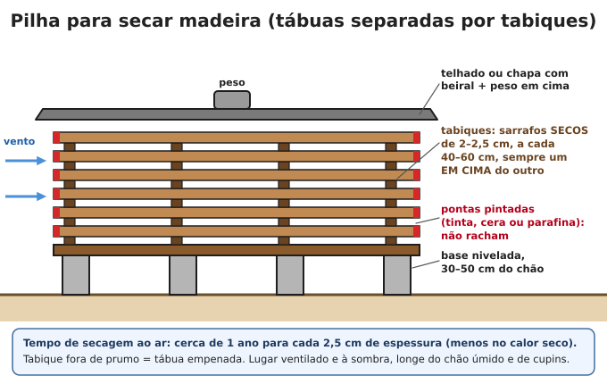
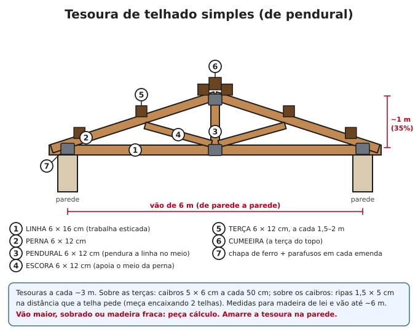
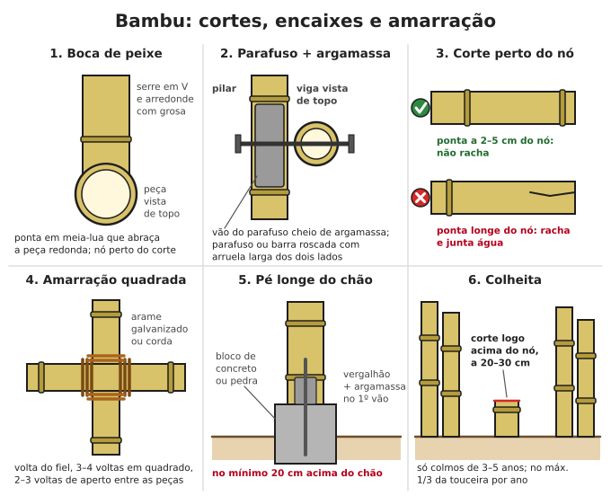

# Madeira e carpintaria

**Resumo:** use a madeira certa no lugar certo: **madeira de lei** (aroeira, ipê, angico, sabiá)
ou **eucalipto tratado** para o que fica no chão e na chuva; pinus e cedro só cobertos. Corte na
**estação seca**, descasque, seque em **pilha com tabiques** (~1 ano para cada 2,5 cm de
espessura) e trate com **boro**. Nunca use óleo queimado. Prego com **2,5 a 3 vezes** a espessura
da peça; pré-fure madeira dura e bambu.

---

## Madeiras boas no Brasil

| Madeira | Onde há mais | Uso | No chão / na chuva |
|---|---|---|---|
| **Aroeira**-do-sertão | Caatinga, cerrado, Sudeste | Mourão, esteio, viga | Excelente (décadas) |
| **Candeia** | Serras de MG, SP, RJ | Mourão, esteio | Excelente |
| **Ipê** (roxo, amarelo) | Todo o país | Viga, piso, deck, cabo | Muito boa; muito dura (pré-furar) |
| **Angico** | Cerrado, caatinga, mata | Esteio, mourão, viga | Boa a muito boa |
| **Sabiá** | Nordeste (plantado no país todo) | Estaca, mourão, cerca viva, lenha | Muito boa; cresce rápido |
| Maçaranduba, jatobá, cumaru, peroba | Norte, Mata Atlântica | Viga, tesoura, piso | Boa a muito boa |
| **Eucalipto tratado** (autoclave) | Plantios no país todo | Mourão, poste, esteio, tesoura | Boa: 15 anos ou mais |
| Eucalipto sem tratamento | Plantios | Estrutura coberta, escora, lenha | Ruim: poucos anos (citriodora dura mais) |
| **Cedro** | Sul, Sudeste, Centro-Oeste | Portas, janelas, móveis, forro | Ruim no chão; leve, fácil de trabalhar |
| **Pinus** | Sul (plantios) | Forro, móveis, caixas, formas, estrutura interna | Péssima sem tratamento (1–3 anos) |
| Guatambu, goiabeira, ipê, eucalipto | — | **Cabos de ferramenta** (enxada, machado) | — |

- **O que dura é o cerne** (miolo escuro e pesado). O **alburno** (parte clara junto da casca)
  apodrece e caruncha em qualquer espécie: tire ou trate.
- **Lei:** cortar árvore nativa, mesmo no seu terreno, exige autorização do órgão ambiental, e
  várias espécies (aroeira, ipês, candeia em muitos lugares) são protegidas. Prefira madeira de
  demolição, árvore já caída e **plantio próprio**: eucalipto dá mourão em 5–7 anos, sabiá em
  poucos anos, bambu em 3–5 anos.

## Corte e secagem

### Quando cortar
Na **estação seca** (no inverno, na maior parte do Brasil): a árvore tem menos seiva e amido,
caruncha menos e racha menos. A tradição manda cortar na lua minguante; o que mais pesa,
comprovadamente, é a estação seca.

> **ATENÇÃO:** derrubar árvore é uma das tarefas que mais matam no campo. Nunca sozinho, nunca
> com vento. Veja para onde ela pende, os galhos presos em cima e as árvores vizinhas. Abra uma
> **rota de fuga** em diagonal para trás (45°). Faça a **boca** (entalhe em cunha) do lado da
> queda, com 1/4 a 1/3 do diâmetro; o **corte de abate** do lado oposto, um pouco mais alto,
> deixando uma **dobradiça** de ~1/10 do diâmetro sem cortar. Quando ela começar a cair, saia pela
> rota de fuga sem dar as costas. Ferramentas: [Ferramentas manuais](../08-ferramentas-e-mecanica/01-ferramentas-manuais.md).

### Depois do corte
1. **Descasque logo:** a broca entra pela casca e a madeira seca mais rápido.
2. Serre as toras em tábuas e vigas em **poucas semanas** (antes de rachar e mofar).
3. **Pinte as pontas** no mesmo dia (tinta, cera, parafina ou cola): a ponta seca rápido demais e
   racha.

### Secagem ao ar

1. Lugar **ventilado e coberto**, com o chão limpo de mato e longe de cupinzeiro.
2. Base nivelada a **30–50 cm do chão** (blocos ou tocos + travessas).
3. Tábuas lado a lado com **1–2 cm** de folga.
4. **Tabiques** (separadores) de **2–2,5 cm** de madeira **seca**, a cada **40–60 cm** (40 cm para
   tábuas finas), **sempre um em cima do outro**. Tabique desalinhado = tábua empenada.
5. Telhado e **peso** por cima.
6. **Tempo:** cerca de **1 ano para cada 2,5 cm** de espessura (menos no calor seco). Madeira seca
   ao ar no Brasil fica com 12–18% de umidade.
7. **Está seca?** Corte um pedaço de amostra de 50 cm, pese toda semana: quando parar de perder
   peso por 2–3 semanas, a pilha está seca.

**Madeira verde** serve para estrutura rústica (cerca, galpão, curral), mas encolhe ao secar:
pregos afrouxam e frestas abrem. Prefira parafusos e cavilhas que dá para reapertar. Para portas,
janelas e móveis, só madeira seca.

## Tratamento caseiro com boro

Bórax (tetraborato de sódio) + ácido bórico protegem contra **cupim, caruncho e fungos**, com
toxicidade baixa para pessoas e animais (comparado a outros preservativos). Vendem em
agropecuárias (são adubos de boro), casas de produtos químicos e farmácias de manipulação.

**Limite:** o boro **sai com água**. Serve para madeira e bambu **cobertos** (dentro de casa,
sob telhado) ou protegidos com tinta, verniz ou óleo. **Não** serve para mourão enterrado.

### Receita (solução a 5%)
| Água | Bórax | Ácido bórico |
|---|---|---|
| 10 L | 300 g | 200 g |
| 100 L | 3 kg | 2 kg |
| 200 L (tambor) | 6 kg | 4 kg |

Os dois juntos dissolvem melhor do que separados. Água morna dissolve mais rápido.

### Como aplicar
- **Imersão (o melhor):** em peças ainda **úmidas** (recém-serradas) o boro entra sozinho. Deixe
  de molho **pelo menos 1 dia para cada 1 cm** de espessura (tábua de 2,5 cm: 3 dias), com peso
  em cima. Depois empilhe coberto com lona por **2 semanas** (o boro se espalha por dentro) e só
  então seque na pilha.
- **Pincel** (madeira seca ou já montada): **3 demãos** da solução morna, com algumas horas entre
  elas. Penetra pouco: reaplique em todo corte e furo novo.
- Tanque: tambor, caixa de alvenaria ou vala forrada com lona, tampado. A solução pode ser
  reusada várias vezes.

> **ATENÇÃO:** use luvas e óculos. A solução **não** pode ser bebida: guarde longe de crianças e
> animais, nunca em vasilha de comida. **Grávidas não devem manipular** ácido bórico. Boro em
> excesso **mata plantas**: não jogue a sobra na horta, em rio ou perto de poço.

### NÃO use óleo queimado
Óleo de motor usado tem metais pesados e substâncias que **causam câncer**, contamina o solo e a
água por muito tempo, suja as mãos e as roupas de quem encosta e **protege pouco** a madeira. No
Brasil, a lei obriga a entregar o óleo usado para rerrefino. Também evite creosoto (cancerígeno)
e venenos agrícolas.

### O que protege de graça
- Madeira **longe do chão** (sobre pedra ou bloco, pelo menos 20 cm), **coberta** (beiral) e
  **ventilada** dura muitas vezes mais.
- Nada de madeira encostada em terra, em parede úmida ou com água empoçando em cima: corte as
  pontas expostas em bisel e cubra os topos de vigas e postes com chapa ou tábua inclinada.

## Medidas e marcação

**1 polegada = 2,54 cm.** Peças serradas comuns no Brasil:

| Nome | Medida (cm) | Uso |
|---|---|---|
| Ripa | 1,5 × 5 | Segurar as telhas |
| Sarrafo | 2,5 × 5 a 2,5 × 10 | Travamentos, gabarito, formas |
| Caibro | 5 × 6 ou 5 × 7 | Apoio das ripas no telhado |
| Viga | 6 × 12 ou 6 × 16 | Terças, tesouras, vigas |
| Pontalete | 7,5 × 7,5 | Escoras, pilares leves |
| Tábua | 2,5 × 15 a 2,5 × 30 | Forro, piso, formas, portas |

1. **Meça duas vezes, corte uma.**
2. Risque com esquadro em todas as faces que serão cortadas.
3. Serre **do lado de fora da linha** (do lado da sobra): o serrote come 2–3 mm.
4. Para cortes repetidos, faça uma **peça-modelo** e risque todas por ela.
5. Quadro, porta ou estrutura no esquadro: as **duas diagonais iguais**, ou a regra **3-4-5**
   (veja [Alvenaria](04-alvenaria-cal-argamassas.md)).

## Encaixes básicos

### Meia-madeira (cruzamento, canto em L ou em T)
1. Sobreponha as peças e risque a largura de uma na outra.
2. Risque **metade da espessura** nas laterais (com gramil ou régua).
3. Serre até a linha da metade, com vários cortes paralelos a cada ~1 cm. Quebre com formão e
   aplaine o fundo.
4. O encaixe deve entrar justo, sem martelar forte. Cole (se houver cola) e trave com 2 pregos,
   parafusos ou 1–2 cavilhas.

Usos: quadros, travessas de cerca e porteira, cruzamento de caibros, pés de mesa.

### Espiga e furo (macho e fêmea)
1. **Espiga** (macho) com **1/3 da espessura** da peça (peça de 6 cm → espiga de 2 cm) e
   comprimento de 2/3 da largura da outra peça (ou atravessando).
2. **Furo** (fêmea): fure em linha com broca da largura da espiga e acerte com formão, deixando
   1/3 de madeira de cada lado.
3. Trave com **cavilha** atravessando as duas peças. Truque: o furo da espiga fica **1–2 mm mais
   perto do ombro** que o das outras faces; ao bater a cavilha, ela puxa e aperta a junta.

Usos: portas, janelas, porteiras, bancos, cadeiras, carroça, estrutura pilar-viga.

### Cavilha (pino de madeira)
- Madeira **dura e seca** (ipê, eucalipto, goiabeira, bambu maduro).
- Diâmetro de **~1/3 da espessura** da peça mais fina (6 a 20 mm). Furo do mesmo diâmetro.
- Chanfre a ponta e faça um risco ao longo (sai o ar e a cola). Bata e corte o excesso.
- Fabricar: lasque um pedaço reto, desbaste com faca e passe à força num furo de chapa de ferro
  do diâmetro certo.

### Outras uniões
- **Emenda com talas:** duas talas, uma de cada lado, pregadas ou parafusadas, para prolongar uma
  viga. Faça sempre sobre um apoio ou perto dele.
- **Forquilha:** esteio roliço com forquilha natural recebendo a viga (galpão, curral).

## Pregos e parafusos

### Regra do prego
**Comprimento = 2,5 a 3 vezes a espessura da peça de cima** (a que está sendo pregada).
O nome brasileiro "17 × 27" quer dizer: **17** = grossura (quanto maior, mais grosso);
**27** = comprimento em "linhas" (1 linha ≈ 2,3 mm → 27 × 2,3 ≈ 62 mm).

| Peça de cima | Prego | Comprimento |
|---|---|---|
| Ripa 1,5 cm | 13 × 18 | ~41 mm |
| Tábua 2,5 cm | 17 × 27 ou 18 × 30 | ~62 ou ~69 mm |
| Peça de 3,5 cm | 19 × 36 ou 19 × 39 | ~83 ou ~90 mm |
| Caibro 5 cm | 22 × 48 (mínimo) ou 24 × 60 | ~110 ou ~138 mm |
| Peça de 6–7,5 cm | 26 × 72 ou parafuso passante | ~165 mm |

1. **Pregos inclinados**, alternando o ângulo, seguram mais que retos.
2. **Desencontre** os pregos: na mesma fibra a madeira racha.
3. Longe da ponta da peça (pelo menos ~3–4 cm) e da borda (~1,5 cm).
4. **Madeira dura** (ipê, aroeira, eucalipto seco): pré-fure com broca de ~3/4 da grossura do
   prego.
5. Bata de leve na ponta do prego antes (ponta "cega" racha menos).
6. Prego que atravessa: dobre a ponta deitada contra a madeira (rebite), de través à fibra.
7. Na chuva: prego **galvanizado** (o comum enferruja e mancha).

### Parafusos
- **Parafuso de rosca soberba** (para madeira): mesmo comprimento do prego. Furo-guia na peça de
  baixo com ~2/3 do diâmetro do parafuso; na peça de cima, furo do diâmetro da rosca (assim ela é
  puxada). Sabão ou cera na rosca ajuda a entrar.
- **Parafuso passante** (francês) ou **barra roscada**, com porca e **arruela larga** dos dois
  lados: para tesoura, pilar-viga, bambu. Furo do mesmo diâmetro. **Reaperte depois de 3–6
  meses** (a madeira seca e encolhe).
- Fora de casa: galvanizado ou inox.

## Tesoura de telhado simples

- A **linha** trabalha esticada (segura as pernas para não abrirem): não emende no meio sem talas
  fortes. As **pernas** trabalham apertadas; o **pendural** segura o meio da linha; as **escoras**
  apoiam o meio das pernas.
- Medidas da figura: madeira de lei, vão até ~6 m, telha cerâmica. Vão maior, sobrado ou
  madeira mais fraca pedem cálculo de quem entende.

### Montagem
1. Desenhe a tesoura em **tamanho real** num chão plano ou tablado (linha esticada e esquadro).
2. Corte e monte a primeira; confira; use-a como **molde** para todas (ficam iguais).
3. Una com **chapas de aço e parafusos passantes**, ou talas de madeira dos dois lados.
4. Levante e apoie sobre a **cinta** ou frechal, no prumo, a cada **~3 m**. Trave as tesouras
   entre si com diagonais (contraventamento).
5. **Amarre cada tesoura na parede** (ferro chato ou arame grosso chumbado na cinta): vendaval
   arranca telhado solto (veja [Telhados](05-telhados-e-conforto.md)).
6. Terças a cada 1,5–2 m, caibros 5 × 6 a cada 50 cm, ripas na distância da telha.

**Sem tesoura:** em casa pequena com paredes internas, as terças podem apoiar direto nas paredes
(oitões). Com madeira de lei, uma terça **6 × 12** vence uns **2,5–3 m** entre apoios e uma
**6 × 16**, uns **3,5–4 m** (aproximado, para telha cerâmica).

## Bambu

### Espécies úteis

| Espécie | Diâmetro | Uso |
|---|---|---|
| Bambu-gigante ou bambu-balde (*Dendrocalamus giganteus*) | 15–30 cm | Pilar, viga pesada, calha |
| Bambu-asper (*Dendrocalamus asper*) | 10–20 cm | Estrutura; broto comestível |
| Guadua e taquaruçus nativos (*Guadua* spp.) | 10–20 cm | Estrutura (das melhores), pontes |
| Bambu-mossô (*Phyllostachys edulis*), mais no Sul | 8–15 cm | Estrutura, broto |
| Bambu-comum, bambu-imperial (*Bambusa vulgaris*) | 5–10 cm | Estrutura leve, cerca. **Caruncha muito: trate sempre** |
| Bambu-crioulo, taquara (*Bambusa tuldoides*) | 3–6 cm | Varas, esteiras, trama de pau-a-pique |
| Cana-da-índia, bambu-mirim (*Phyllostachys aurea*) | 2–4 cm | Varas, cerca, tutores, ripas |

Bambus alastrantes (como o mirim) invadem tudo: plante longe de casas e lavouras ou com barreira
enterrada.

### Colheita
1. Só colmos de **3 a 5 anos**: cor mais fosca, manchas de líquen, sem as "palhas" (bainhas) que
   cobrem os brotos. Colmo novo é verde brilhante, com pó branco. **Marque com tinta o ano** de
   cada colmo novo.
2. Na **estação seca** (menos amido, menos caruncho).
3. Corte **logo acima de um nó, a 20–30 cm do chão** (o toco não junta água nem apodrece a
   touceira).
4. No máximo **1/3 dos colmos maduros** por ano; deixe os novos.

### Cura (tira o amido que atrai o caruncho)
- **Na touceira:** deixe o colmo cortado em pé, com galhos e folhas, apoiado na touceira e sobre
  uma pedra, por **3–4 semanas**. As folhas continuam puxando a seiva.
- **No fogo:** gire sobre brasas (sem chama) até a casca "suar" e brilhar. Também serve para
  desempenar.
- **Na água:** submerso em água corrente por algumas semanas (método tradicional, mais fraco).

### Tratamento com boro
1. Mesma solução de 5% (3 kg de bórax + 2 kg de ácido bórico em 100 L).
2. Bambu cortado há no máximo 1–2 semanas (ainda úmido) ou já curado.
3. **Fure todos os nós internos** com um vergalhão de 3/8" ou 1/2" de ponta afiada, empurrado por
   dentro (ou faça um furo de ~1 cm em cada gomo).
4. **Mergulhe por 5 a 7 dias**, com peso em cima.
5. Escorra a solução de volta no tanque e **seque à sombra por 1 a 3 meses**, deitado em apoios
   ou em pé, girando de vez em quando, até ficar cor de palha.

**Durabilidade:** tratado e protegido de chuva e chão, **15–25 anos ou mais**; sem tratamento ao
tempo, 1–3 anos; enterrado, alguns meses.

### Cortes e uniões
1. **Deixe sempre um nó a 2–5 cm da ponta** e perto de cada encaixe: ponta longe do nó racha.
2. **Boca de peixe:** corte em meia-lua para a peça abraçar a outra, redonda. Serre em V e
   arredonde com grosa ou use uma serra-copo do diâmetro da outra peça.
3. **Bico de flauta:** corte inclinado para diagonais e escoras.
4. **Não pregue** (racha). Fure com broca e use **parafuso ou barra roscada com arruela larga**.
   Encha o gomo por onde passa o parafuso com **argamassa fluida de cimento e areia 1:3**,
   por um furinho com funil.
5. **Pé longe do chão:** sobre bloco de concreto ou pedra, **20 cm ou mais** acima do chão, com
   vergalhão e argamassa no primeiro gomo. Beiral largo por cima.

### Amarração quadrada (peças em cruz)
Com arame galvanizado recozido (nº 16–18), corda, sisal ou tiras de câmara de pneu:
1. **Volta do fiel** no poste em pé, logo abaixo da travessa.
2. **3–4 voltas em quadrado:** pela frente da travessa, por trás do poste, pela frente da
   travessa do outro lado, por trás do poste embaixo.
3. **2–3 voltas de aperto** entre as duas peças, em volta das voltas anteriores, puxando forte.
4. Termine com volta do fiel na travessa.

Para peças cruzadas em X, use a amarração diagonal; para tripés e cavaletes, voltas em oito
entre as pernas. Veja [Cordas e nós](../09-quimica-e-oficios/03-cordas-nos-e-cestaria.md).

## Ferramentas

Kit básico de carpintaria: serrote, arco de serra, formões (6, 12 e 25 mm), martelo, macete de
madeira, plaina, grosa e lima, arco de pua (furadeira manual) com brocas, trena, esquadro, nível,
prumo, gramil, grampos (sargentos), machado, enxó, facão e **pedra de afiar** (ferramenta cega
machuca mais que afiada). Como usar e conservar: [Ferramentas manuais](../08-ferramentas-e-mecanica/01-ferramentas-manuais.md).
Fazer e consertar ferragens: [Ferraria e metais](../08-ferramentas-e-mecanica/05-ferraria-e-metais.md).

---

Ver também: [Construção com terra](02-construcao-com-terra.md) · [Telhados e conforto](05-telhados-e-conforto.md) · [Ferramentas manuais](../08-ferramentas-e-mecanica/01-ferramentas-manuais.md) · [Lenha e carvão](../06-energia/02-lenha-carvao-e-fogoes.md) · [Frutíferas e agrofloresta](../04-agricultura/08-frutiferas-e-agrofloresta.md)
