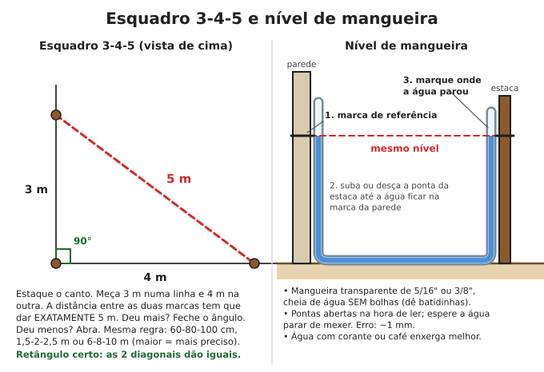

# Alvenaria, cal e argamassas

**Resumo:** traços em **volume**, medidos em lata de 18 L: **concreto estrutural 1:2:3**
(cimento : areia : brita), **contrapiso 1:3**, **assentamento e reboco 1:2:8** (cimento : cal :
areia), **argamassa de cal 1:3**. A cal se faz queimando calcário ou conchas a **~900 °C**; a cal
virgem **queima pele e olhos** e ferve em contato com água. Parede boa nasce de **gabarito,
esquadro 3-4-5, nível de mangueira e prumo**. Toda porta e janela leva **verga**.

---

## Materiais

- **Cimento:** o comum é o CP-II. Saco de 50 kg ≈ 36 L ≈ **2 latas de 18 L**. Guarde em lugar
  seco, sobre tábuas, longe da parede, pilhas de até 10 sacos; use em até ~3 meses. Cimento com
  torrões que não esfarelam entre os dedos não serve para estrutura.
- **Cal hidratada:** sacos de 20 kg (tipos CH-I, CH-II, CH-III). Ou faça a sua (abaixo).
- **Areia:** grossa (concreto, chapisco), média (assentamento, emboço), fina (reboco fino).
  Tem de ser **limpa**: esfregue areia úmida na palma; se a mão fica suja de barro, lave a areia.
  Teste do copo: areia + água, agite, espere; se a lama em cima passar de 1/10 da areia, lave.
- **Areia de praia: não.** O sal enferruja o ferro e mancha a parede. Só em último caso, lavada
  muitas vezes com água doce, e nunca em concreto armado.
- **Brita:** brita 1 (até ~19 mm) para concreto comum; pedrisco para peças finas; pedra-de-mão
  para concreto ciclópico.
- **Água:** limpa, sem óleo e sem sal. Se dá para beber, serve.
- **Medidas:** lata de 18 L (de tinta) ou **padiola**: caixa sem fundo de 35 × 45 × 23 cm = 36 L
  (= 1 saco de cimento).

> **A regra de ouro do concreto:** **água demais é o erro nº 1.** Cada balde a mais deixa o
> concreto mais fraco e mais trincado. Use só o suficiente para trabalhar.

## Traços em volume

| Uso | Traço | Por saco de cimento (em latas de 18 L) | Água (aprox.) |
|---|---|---|---|
| **Concreto estrutural** (sapata, viga, pilar, laje, verga) | 1 : 2 : 3 (cim. : areia : brita) | 4 areia + 6 brita | ~1,5 lata |
| Concreto de piso e calçada | 1 : 2,5 : 3,5 | 5 areia + 7 brita | ~1,75 lata |
| Concreto magro (lastro de 5 cm sob fundação e piso) | 1 : 4 : 6 | 8 areia + 12 brita | ~2 latas |
| Concreto ciclópico (fundação) | concreto 1 : 3 : 5 + até 30% de pedra-de-mão | 6 areia + 10 brita | ~2 latas |
| **Contrapiso** (farofa úmida, 3–5 cm) | 1 : 3 a 1 : 4 (cim. : areia média) | 6–8 areia | pouca |
| Chapisco (faz o reboco agarrar) | 1 : 3 (cim. : areia grossa), mole | 6 areia | até ficar fluido |
| **Assentamento e emboço/reboco** | 1 : 2 : 8 (cim. : cal : areia média) | 4 cal + 16 areia | até "creme" |
| Assentamento forte (fundação, umidade) | 1 : 1 : 6 | 2 cal + 12 areia | até "creme" |
| Reboco fino (3–5 mm) | 1 : 2 : 9 com areia fina peneirada | 4 cal + 18 areia fina | até "creme" |
| Reboco impermeável (cisterna, caixa) | 1 : 3 (cim. : areia média) + impermeabilizante (dose do rótulo) | 6 areia | pouca |
| Graute (encher furo de bloco) | 1 : 2 : 2 (cim. : areia : pedrisco), mole | 4 areia + 4 pedrisco | até escorrer |
| **Argamassa de cal** (sem cimento) | 1 cal em pasta : 3 areia | — | — |
| Cal pozolânica (lugar úmido) | 1 cal : 1 pó de telha moída : 2 areia | — | — |

- **Rendimento:** concreto 1:2:3 gasta cerca de **6,5–7 sacos por m³** (1 saco ≈ 0,15 m³). Um
  saco no traço 1:2:8 assenta da ordem de **10–15 m²** de parede de tijolo maciço de meia vez.
- **Argamassa de terra** (para adobe) e **reboco de terra**: veja [Construção com terra](02-construcao-com-terra.md).
  Para dar mais resistência à água em barro argiloso, junte 1 parte de cal para cada 6–8 de barro
  e teste antes.

### Como misturar à mão
1. Chão limpo e firme (ou caixote de madeira, a masseira).
2. Areia + cimento (+ cal) **a seco**, virando com a enxada até a cor ficar uniforme, sem riscos.
3. Junte a brita (no concreto) e misture de novo.
4. Abra uma cratera no meio, ponha **parte da água**, puxe a massa das bordas para dentro. Junte
   o resto da água aos poucos.
5. Use o que tem cimento em até **2 horas**. Massa que começou a endurecer **não** se salva com
   mais água: descarte.
6. Argamassa só de cal e areia pode descansar coberta por dias (ela só endurece com o ar); junte
   o cimento na hora de usar.

### Concreto: lançar e curar
1. Forma firme, molhada por dentro; ferro limpo (sem barro, óleo ou ferrugem solta).
2. **Cobrimento:** o ferro fica sempre dentro do concreto: **3 cm** em vigas e pilares, **5 cm**
   em contato com a terra. Use calços (pastilhas) de argamassa.
3. Lance em camadas e **soque** com um vergalhão e batendo na forma, para sair o ar.
4. **Cura:** mantenha molhado por **7 dias** (molhe 3–4 vezes por dia, cubra com sacos, lona ou
   areia molhada). Concreto que seca rápido trinca e fica fraco.
5. Laterais de forma de viga e pilar: tirar com 3 dias. **Escoras de laje e de viga: só com
   21–28 dias.**

> **ATENÇÃO:** cimento e cal são **cáusticos**: queimam a pele molhada em contato por horas (bota,
> luva e calça comprida) e cegam. Respingo no olho: lave com muita água corrente por 15 minutos.
> **Vala com mais de 1,25 m** de fundura pode desabar e soterrar: escore as paredes ou faça a
> vala com as laterais inclinadas.

## Cal: fazer, queimar e usar

### O ciclo da cal
- **Calcário** (ou conchas, mármore) queimado a **~900 °C** solta gás carbônico e vira **cal
  virgem**. 100 kg de calcário puro dão ~56 kg de cal virgem.
- Cal virgem + água = **cal hidratada** (e muito calor). Dá ~74 kg.
- Na parede, a cal hidratada **puxa gás carbônico do ar** devagar e volta a ser "pedra".

### Matéria-prima
- **Calcário:** pedra clara (branca, cinza), a faca risca, e **faz espuma com vinagre ou ácido
  muriático**. Granito não reage e não serve.
- **Conchas** de ostra, marisco, sururu, berbigão: lavadas (sem carne e sem sal).
- **Sambaquis** (montes antigos de conchas no litoral) são sítios arqueológicos protegidos por
  lei: **não mexa**.

### Forno de cal (caieira)

> **ATENÇÃO:** forno de cal passa de 900 °C e solta **monóxido e gás carbônico**: trabalhe ao ar
> livre, longe de casas e de mato seco, nunca dentro de buraco fechado. Pedra úmida pode estourar
> no começo da queima. Não deixe crianças por perto.

- **Pilha simples (pouca quantidade):** camadas alternadas de lenha e pedra quebrada em pedaços
  de **5–10 cm**, coberta de barro com alguns respiros. Queima de 1 a 3 dias. Rende pouco e
  irregular.
- **Forno vertical (melhor):**
  1. Torre de pedra ou tijolo de **1,5–2,5 m** de altura e **1–1,5 m** de diâmetro por dentro,
     encostada num barranco (carrega-se por cima), forrada por dentro com tijolo e barro.
  2. Embaixo, uma **boca de fogo** com arco de pedras grandes; por cima, as pedras do maior
     para o menor (pedaços de 5–15 cm).
  3. **Fogo brando por 6–12 horas** (seca a carga), depois **fogo forte e contínuo por 2–3
     dias**, até as pedras de cima ficarem **vermelho-alaranjadas**.
  4. Gasta **muita lenha seca** (em geral mais peso de lenha do que de pedra). Separe antes.
  5. Feche e deixe **esfriar 1–2 dias**.
- **Ponto:** a pedra bem queimada fica **~40% mais leve**, mais clara, e um pingo de água faz
  chiar, esquentar e esfarelar. Miolo duro que não reage volta para a próxima fornada.
- **Conchas** queimam mais fácil: fogo forte num buraco ou tambor, com lenha ou carvão, por
  várias horas, até ficarem brancas e quebradiças.

### Hidratar ("queimar" ou "extinguir") a cal virgem

> **ATENÇÃO:** cal virgem **queima pele e olhos** e, com água, **ferve, espirra e pode chegar a
> temperatura de pegar fogo em madeira, papel ou palha**. Use óculos fechados, luvas, bota,
> manga comprida e pano no nariz e boca. Guarde cal virgem **seca**, em vasilha de metal
> tampada, longe de madeira, combustível e crianças; nunca dentro de carro ou casa. Olho
> atingido: tire o pó com pano seco e lave com água corrente por 15–30 minutos; procure ajuda.
> Pele: escove o pó a seco e depois lave muito.

**Cal em pasta (a melhor para reboco e pintura):**
1. Caixa de alvenaria, de madeira ou tambor de metal, ao ar livre.
2. Ponha **a água primeiro** (cerca de **3 volumes de água para 1 de cal virgem**).
3. Junte a cal virgem **aos poucos**, sempre dentro da água. **Nunca** jogue água em cima de um
   monte de cal virgem.
4. Mexa com enxada de **cabo longo**, de rosto afastado. Junte água se a massa ficar à mostra.
5. Passe por peneira fina (tira pedaços crus e pedras).
6. Guarde **coberta por 2–5 cm de água**, tampada, por **pelo menos 2 semanas** (melhor 1–3
   meses). Grãos que não hidrataram estufam depois e fazem "pipocas" no reboco.

**Cal em pó:** borrifar pouca água (uns 0,5 L por kg, em várias vezes) sobre camada fina de cal
virgem até virar pó. Levanta poeira cáustica: prefira a pasta.

**Cal hidratada de saco:** misture com água até virar pasta e deixe descansar **1–2 dias** antes
de usar (fica mais macia). Pintura de cal: veja [Construção com terra](02-construcao-com-terra.md).

### Argamassa de cal
- **1 cal em pasta : 3 areia.** Bata bem a massa: quanto mais batida, melhor.
- **Endurece devagar**, puxando o ar: firma em dias, ganha força por meses. Por isso: camadas
  finas, superfície **umedecida 2–3 vezes por dia por 3–7 dias**, sem encharcar; proteja de sol
  forte, vento e chuva nos primeiros dias.
- **Vantagens:** é flexível, deixa a parede "respirar", fecha sozinha fissuras finas e combina
  com terra, pedra, adobe e madeira.
- **Lugar úmido:** use **cal pozolânica**, trocando parte da areia por **pó de telha ou tijolo
  moído e peneirado fino** (ou cinza clara de casca de arroz bem queimada). Assim ela endurece
  até em contato com água.

## Tijolos queimados

1. **Barro:** mais argiloso que o do adobe (barro de olaria, bem liguento), sem pedrinhas
   brancas de calcário (estouram o tijolo depois de queimado). Areia corrige se racha demais.
2. **Forma** cerca de **10% maior** que o tijolo desejado (o barro encolhe ao secar e ao queimar):
   ex.: 24 × 12 × 6 cm para sair um tijolo de ~22 × 11 × 5,5 cm.
3. Moldar como o adobe e **secar à sombra 2–4 semanas**, até ficar seco por dentro. Tijolo úmido
   **estoura** no forno.
4. **Forno de campanha (caieira):** os próprios tijolos crus formam o forno. Na base, túneis
   (fornalhas) de 30–40 cm de largura atravessando a pilha, a cada ~1 m; por cima, tijolos em
   grade com 1–2 cm de folga para o fogo passar, até 2–3 m de altura; por fora, uma camada de
   barro, com respiros em cima.
5. **Queima:**
   - **esquente:** fogo baixo por **1–2 dias** (sai fumaça branca: é a água);
   - **fogo forte** por **1–3 dias**, até os tijolos de cima ficarem **vermelho-vivo**
     (~900–1.000 °C);
   - feche bocas e respiros com barro e deixe **esfriar devagar por 2–4 dias**.
6. **Qualidade:** bem queimado tem **som metálico** ao bater um no outro, cor uniforme e não
   desmancha após 24 h na água. Mal queimado (som surdo, mole): só parede interna, ou requeime.

Mais sobre barro e fornos: [Cerâmica](../09-quimica-e-oficios/06-ceramica.md).

## Fundação

### Ler o solo
Cave até a **terra firme**: sem raiz, sem terra preta, sem entulho ou aterro. Um vergalhão de
10 mm empurrado com o peso do corpo não deve afundar mais que poucos centímetros. Argila mole,
aterro, brejo ou solo que racha muito na seca pedem fundação mais larga e funda e ajuda técnica.

### Fundação corrida (embaixo de todas as paredes, casa térrea)
1. Gabarito e esquadro prontos (abaixo).
2. Vala de **40–60 cm de largura** e **50–80 cm** de fundura, até a terra firme.
3. Soque o fundo e lance **5 cm de concreto magro** (ou brita socada).
4. Encha com **pedra assentada** na argamassa 1:1:6 ou com **concreto ciclópico** (pedras molhadas,
   sem encostar umas nas outras nem na terra).
5. Por cima, uma **viga baldrame** de concreto armado (ex.: 15 × 30 cm, 4 barras de 10 mm e
   estribos de 5 mm a cada 15–20 cm) ou, para paredes de terra, o embasamento de pedra subindo
   **30–50 cm acima do chão**.
6. **Impermeabilize** o topo e as laterais do baldrame (2–3 demãos de emulsão asfáltica ou piche)
   e assente as 2 primeiras fiadas com argamassa com impermeabilizante.

### Sapata isolada (embaixo de pilar)
- Para pilar de **casa térrea em terra firme**: bloco de **60 × 60 cm** e **25–30 cm** de altura,
  com o fundo a **80–100 cm** de profundidade, malha de ferro de **10 mm a cada 15 cm** nas duas
  direções, 5 cm acima do fundo. Os 4 ferros do pilar descem e dobram sobre a malha. Concreto
  1:2:3.
- Sobrado, caixa d'água grande no alto, terreno fraco ou inclinado: **cálculo profissional**.

## Gabarito, esquadro, nível e prumo

### Gabarito
Tábuas corridas pregadas em estacas em volta da obra, a **~1 m** das futuras paredes, todas no
mesmo nível. Pregos nas tábuas marcam os eixos e as faces das paredes; **linhas de náilon**
esticadas entre os pregos mostram onde vai cada parede. Tira-se a linha para cavar e põe-se de
volta para conferir.

### Esquadro 3-4-5
1. Crave uma estaca no canto.
2. Meça **3 m** numa linha e marque; meça **4 m** na outra linha e marque.
3. A distância entre as duas marcas tem que dar **exatamente 5 m**. Deu mais: o ângulo está
   aberto, feche. Deu menos: abra.
4. Funciona com qualquer múltiplo: **60-80-100 cm**, **1,5-2-2,5 m**, **6-8-10 m** (quanto maior,
   mais preciso).
5. Retângulo: confira também se **as duas diagonais dão iguais**.

### Nível de mangueira
1. Mangueira **transparente** de 5/16" ou 3/8" (8–10 mm), comprida o bastante (10–20 m).
2. Encha por uma ponta, com a outra mais baixa, até a água sair **sem bolhas**. Dê batidinhas
   para soltar bolhas. Água com corante ou café enxerga melhor.
3. Faça uma **marca de referência** na parede ou estaca (é comum marcar **1,00 m acima do piso
   pronto**: o "nível de 1 metro").
4. Uma pessoa segura a ponta junto à marca. A outra, no ponto novo, **sobe ou desce a sua ponta**
   até a água da primeira parar **exatamente na marca**.
5. **Espere a água parar** e risque, no ponto novo, a altura da água. Os dois riscos estão no
   mesmo nível (erro de ~1 mm).
6. Pontas **abertas** na hora de ler (tampe com o dedo só para carregar), mangueira sem dobra,
   longe do sol forte (forma bolhas).

### Prumo
- **Prumo de linha:** peso (chumbo, porca grande, pedra) amarrado numa linha. Encoste no topo da
  parede um taco de 2–3 cm e deixe a linha pendurada dele: embaixo, um taco igual tem que passar
  justo entre a linha e a parede.
- Levante **os cantos primeiro** (a cada 3–4 fiadas, confira prumo e nível) e encha o meio com a
  linha esticada de canto a canto.
- **Nível de bolha:** confira o próprio nível — leia, gire 180° no mesmo lugar e leia de novo:
  a bolha tem que ficar no mesmo ponto.

### Assentar tijolo e bloco
1. Tijolo cerâmico: **molhe antes** (sem encharcar), senão ele chupa a água da argamassa e ela
   não pega. Bloco de concreto: não molhe.
2. Primeira fiada sobre o baldrame impermeabilizado, no nível.
3. Juntas de **~1 cm**, cheias. Juntas verticais **desencontradas** (meio tijolo). Encontros de
   parede amarrados (uma fiada entra numa parede, a seguinte na outra).
4. Suba no máximo **~1,5 m de parede por dia**.
5. No topo das paredes, **cinta de amarração** de concreto armado em volta da casa toda (pode ser
   feita em bloco canaleta com 2 barras de 10 mm e graute).

## Vergas e contravergas

A **verga** vai **em cima** de portas e janelas; a **contraverga**, **embaixo** das janelas. Sem
elas aparecem as trincas inclinadas nos cantos das aberturas, as mais comuns em casa de tijolo.

| Vão da abertura | Verga de concreto armado (1:2:3) |
|---|---|
| Até 1,5 m | 10–15 cm de altura, 2 barras de 10 mm |
| 1,5 a 2,5 m | 20 cm de altura, 2 barras de 10 mm embaixo + 2 de 8 mm em cima, estribos de 5 mm a cada 15 cm |
| Mais de 2,5 m | Cálculo profissional |

- Entra **30 cm para cada lado** da abertura (mínimo 20 cm). Contraverga igual, embaixo da janela.
- Pode ser moldada no chão (forma de tábua), curada 7 dias e assentada.
- Em parede de terra: **madeira de lei tratada** de 10 × 15 cm ou mais, apoiada **30–40 cm** de
  cada lado.
- **Arco de tijolo** (sem ferro): monte sobre uma forma de madeira em arco (cimbre) e só tire a
  forma depois que a argamassa endurecer (1–2 semanas, mais com cal pura).

## Cisterna e caixa d'água de alvenaria

Captação e cisterna de placas: [Encontrar e captar água](../01-agua/01-encontrar-e-captar-agua.md).
Volume e tamanho: [Armazenamento e cálculos](../01-agua/03-armazenamento-e-calculos.md).

- **Redonda é melhor:** a água empurra a parede para fora por igual e ela trabalha como um aro;
  caixa quadrada precisa de muito mais ferro. Cada **1 m de altura de água** empurra **1 tonelada
  por m²** no fundo.
- Exemplo: **3,4 m de diâmetro × 1,8 m de altura ≈ 16.000 L**.
- Enterrada ou semi-enterrada, a terra em volta ajuda a segurar a parede.

1. **Fundo:** lastro de brita socada + laje de concreto armado de 8–10 cm.
2. **Parede:** tijolo maciço (ou placas de argamassa) em círculo; **arame galvanizado grosso**
   enrolado por fora em espiral, mais junto embaixo, onde a pressão é maior.
3. **Reboco interno:** chapisco 1:3; depois **2 camadas** de reboco 1:3 com impermeabilizante
   (total ~2–2,5 cm); cantos entre fundo e parede **arredondados** (meia-cana); por fim, **nata
   de cimento** (cimento + água) alisada.
4. **Cura úmida por 7 dias:** um palmo de água no fundo e paredes molhadas.
5. **Teste:** encha devagar (em alguns dias), marque o nível e veja se baixa em 24–48 horas.
6. Antes de beber: lave, encha, espere 1–2 semanas e descarte essa água (cimento novo deixa a
   água com gosto e alcalina). Depois, trate como em [Tratamento e purificação](../01-agua/02-tratamento-e-purificacao.md).
7. **Tampa vedada**, ladrão com tela, saída 10 cm acima do fundo, nenhuma fresta (mosquito).

> **ATENÇÃO:** cisterna, poço e caixa fechados são **espaço confinado**: pode faltar oxigênio ou
> juntar gás (de motor, gerador ou bomba a combustão por perto). Ventile antes, entre com corda
> amarrada no corpo e uma pessoa do lado de fora. Se alguém desmaiar lá dentro, **não desça sem
> proteção**: é assim que morrem duas pessoas em vez de uma.

---

Ver também: [Construção com terra](02-construcao-com-terra.md) · [Madeira e carpintaria](03-madeira-e-carpintaria.md) · [Telhados e conforto](05-telhados-e-conforto.md) · [Encontrar e captar água](../01-agua/01-encontrar-e-captar-agua.md) · [Química prática](../09-quimica-e-oficios/02-quimica-pratica.md) · [Cerâmica](../09-quimica-e-oficios/06-ceramica.md)
