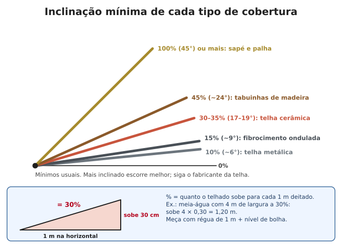

# Telhados, conforto térmico e casa

**Resumo:** o telhado é a parte da casa que mais apanha sol e chuva. Cada cobertura pede uma
**inclinação mínima** (metálica 10%, fibrocimento 15%, cerâmica 30–35%, tabuinha 45%, sapé 100%),
**beiral largo** (60–100 cm) e **amarração contra vendaval**. Casa fresca no Brasil: **ventilação
cruzada**, saída de ar quente **no alto**, telhado e paredes **claros**, sombra de árvore e
varanda; no frio, janelas para o **norte**. Não construa em encosta íngreme, beira de rio ou aterro.

---

## Tipos de cobertura

**Porcentagem = quanto o telhado sobe para cada 1 m na horizontal.** Ex.: meia-água com 4 m de
largura a 30% sobe 4 × 0,30 = **1,20 m**. Meça com régua de 1 m e nível de bolha.

| Cobertura | Inclinação mínima | Peso aprox. | Prós | Contras |
|---|---|---|---|---|
| Telha cerâmica (francesa, romana, colonial) | **30–35%** (colonial a partir de ~25%) | Pesada (estrutura forte) | Fresca, dura décadas, faz-se em olaria | Quebra, precisa de madeira boa |
| Fibrocimento ondulada | **15%** (10% só com sobreposição maior, conforme fabricante) | Média | Barata, vence vãos grandes | Esquenta muito; quebra se pisada |
| Metálica (zinco, aço galvanizado) | **10%** (algumas trapezoidais 5%) | Leve | Leve, rápida, ótima para captar chuva | Muito quente e barulhenta sem forro |
| Tabuinhas de madeira | **~45%** | Média | Feita à mão com madeira local | Pega fogo; troca em 15–30 anos |
| Sapé ou palha de palmeira | **100% (45°) ou mais** | Leve | Fresca, de graça | Pega fogo; esconde barbeiro e ratos; troca frequente |

Siga sempre o que o fabricante da telha indica. **Mais inclinado escorre melhor**; abaixo do
mínimo, o vento empurra a água para baixo das telhas e aparecem goteiras.

Consumo aproximado de telha cerâmica: **francesa ~16 por m²**, **colonial ~25 por m²**
(capa e canal), medida na água do telhado (inclinada).

### Telha cerâmica
1. Ripas na **galga** (distância) que a telha pede: encaixe 2 telhas no chão e meça de ponta a
   ponta de encaixe.
2. Comece **de baixo para cima** e de um lado para o outro, contra o vento dominante.
3. Na cumeeira, telhas próprias assentadas com argamassa de cal e areia (1:3) ou 1:2:8.
4. Amarre com arame (cobre ou galvanizado) as telhas da **beirada, da cumeeira e das fiadas da
   ponta**: são as primeiras a voar.

### Fibrocimento e metálica
- Apoio (terças) na distância indicada pelo fabricante (em geral **1,1–1,7 m** para fibrocimento
  de 6 mm). Sobreposição lateral de **1/4 de onda** e longitudinal de **14–20 cm**.
- Fixe **na crista da onda**, nunca no vale, com parafuso ou gancho com **arruela de vedação**,
  em todos os apoios. Fure com broca, nunca com prego.
- Metálica: forro, manta ou sapé por cima reduzem muito o calor e o barulho.

> **ATENÇÃO — telhas antigas de amianto:** fibrocimento velho pode ter **amianto** (proibido no
> Brasil desde 2017), que causa câncer de pulmão. **Não** serre, lixe, fure a seco nem quebre.
> Molhe antes de mexer, use máscara PFF2 ou PFF3 e não reaproveite como caixa de água.

### Sapé e palha
1. Capim sapé maduro e seco, em feixes de **10–15 cm** de diâmetro.
2. Estrutura de varas ou ripas a cada **20–30 cm**, inclinação de **45° ou mais**.
3. Amarre os feixes **de baixo para cima**, cada fileira cobrindo **2/3** da de baixo, até uma
   espessura de **15–30 cm**. Reforce a cumeeira com uma capa dobrada e bem amarrada.
4. Palha de palmeira (babaçu, buriti, coqueiro): folhas rachadas e trançadas ou sobrepostas do
   mesmo jeito.
- Palha de palmeira dura poucos anos (reforço a cada 2–5 anos); sapé grosso e bem inclinado,
  bem mais (10 anos ou mais). Por baixo, forro ou tela fina ajuda contra barbeiro (veja
  [Construção com terra](02-construcao-com-terra.md)).

### Tabuinhas
Lascas de madeira resistente (araucária de demolição, cedro, eucalipto tratado) de **~1 cm** de
espessura, **10–15 cm** de largura e **40–60 cm** de comprimento, pregadas com **2 pregos
galvanizados** cada nas ripas, em **3 camadas** (só ~1/3 de cada uma fica à mostra), com as
juntas desencontradas. Inclinação de ~45% ou mais.

## Beiral, calhas e água da chuva

- **Beiral de 60–100 cm** protege paredes, janelas e o pé da casa. Em parede de terra, o mínimo é
  60 cm; varanda em volta é melhor ainda. Beiral acima de ~1 m precisa de mão-francesa ou apoio e
  amarração extra (o vento levanta).
- **Calha:** caimento de **0,5–1 cm por metro** em direção ao cano de descida. Tela ou grade na
  entrada do cano (folhas).
- **Cano de descida:** regra prática de **1 cm² de cano para cada 1 m² de telhado** (75 mm serve
  até ~40–45 m²; 100 mm até ~75–80 m²).
- Calhas improvisadas: cano de PVC de 100–150 mm cortado ao meio, chapa galvanizada dobrada,
  bambu grosso rachado ao meio com os nós retirados.
- Aproveite a água: telhado de 60 m² com 20 mm de chuva dá quase 1.000 L. Montagem completa,
  com descarte da primeira água, em [Encontrar e captar água](../01-agua/01-encontrar-e-captar-agua.md).
- Sem calha: faça um **canteiro de brita ou calçada** sob a linha de pingo e uma valeta levando a
  água para longe da casa.

## Conforto térmico no Brasil

### O caminho do sol
- **Do Sudeste para o Sul** (e no Centro-Oeste na maior parte do ano), o sol fica **ao NORTE**:
  alto no verão, baixo no inverno.
- **Perto do Equador** (Norte e Nordeste), o sol passa quase **a pino**, ora um pouco ao norte,
  ora um pouco ao sul. Ali, o que mais esquenta é o **telhado** e as paredes **leste e oeste**.
- Em todo o país, o **sol da tarde (oeste)** é o mais quente: parede oeste com poucas janelas,
  sombreada por árvore, varanda ou um cômodo de serviço (depósito, banheiro).

### Orientação da casa
1. Comprimento maior da casa no sentido **leste–oeste**: as fachadas grandes ficam para **norte e
   sul**, fáceis de sombrear com beiral.
2. **Clima com inverno frio:** salas e quartos com janelas para o **norte**. O beiral (60–80 cm
   sobre janela comum) faz sombra no sol alto do verão e deixa entrar o sol baixo do inverno.
   Poucas janelas para o sul (vento frio).
3. **Clima quente:** janelas grandes **para o lado do vento dominante** e janelas do lado oposto
   para a saída. Descubra o vento observando fumaça, uma tira de pano num pau e árvores tortas,
   em várias épocas do ano. (No litoral, de dia a brisa vem do mar.)

### Ventilação cruzada e efeito chaminé
- Aberturas em **paredes opostas**: entrada **baixa** do lado do vento, saída **alta** do outro.
  Portas internas abertas ou com **bandeira** (janelinha em cima da porta) para o ar passar.
- **Efeito chaminé:** o ar quente sobe. Deixe uma saída **no ponto mais alto**: **lanternim** (um
  telhadinho elevado sobre uma abertura na cumeeira), janelas altas, aberturas com tela nos
  oitões, **cobogós** (elementos vazados).
- Janelas somando pelo menos **1/6 a 1/8 da área do piso**; no calor, mais é melhor, desde que
  sombreadas.
- **Pé-direito alto** (2,8–3 m) no calor: o ar quente fica acima das pessoas.
- No calor: **feche e sombreie de dia, abra à noite** (o ar da noite esfria a casa).

### Telhado, forro e isolamento
1. **Telhado e paredes claros:** pintura branca ou caiação reflete grande parte do sol. Refaça
   quando escurecer de sujeira.
2. **Forro** (madeira, bambu, esteira, gesso) com um **colchão de ar ventilado** entre a telha e
   o forro: o ar entra pelo beiral e sai pela cumeeira ou lanternim.
3. **Manta refletora** (aluminizada) logo abaixo das telhas, sempre com um **espaço de ar** junto
   à face de alumínio. Improviso conhecido: **caixas de leite longa vida** abertas, lavadas e
   grampeadas lado a lado, com o lado prateado virado para o espaço de ar.
4. Telha metálica ou de fibrocimento: forro é quase obrigatório. Capim, sapé ou palha por cima
   da telha também refresca muito (mas pega fogo).
5. **No frio:** forro com isolante por cima (serragem seca, palha, lã, isopor), frestas de portas
   e janelas vedadas, cortina grossa à noite.

### Sombra
- **Varanda** em volta da casa (como nas casas de fazenda): sombra, chuva longe das paredes e
  lugar fresco para trabalhar.
- **Árvores:** a oeste e a leste, as que dão mais sombra. Em clima com inverno frio, ao norte,
  prefira árvores que **perdem folha no inverno** (ipês, amoreira): sombra no verão, sol no
  inverno. Pérgola com trepadeira comestível (maracujá, chuchu, uva) faz sombra e dá comida.
- Árvore grande a pelo menos **metade da altura adulta** dela longe da casa (raízes, galhos,
  queda no vendaval). Eucalipto e árvores de madeira quebradiça: longe.

### Massa térmica: quando paredes grossas ajudam

| Clima | Casa ideal |
|---|---|
| Quente e úmido o ano todo (litoral, Amazônia) | **Leve, aberta, elevada do chão**, sombreada; pouca diferença entre dia e noite, parede grossa ajuda pouco |
| Calor de dia e frio à noite (sertão, cerrado, serras) | **Paredes grossas** de adobe, taipa ou pedra (30–50 cm): seguram o calor por 8–12 horas; casa fresca de dia e morna à noite |
| Inverno frio (Sul, serras) | Janelas ao norte, piso e parede grossa **que recebem sol** por dentro, forro isolado, fogão a lenha no centro da casa |

Fogão, chaminé e aquecimento: [Lenha, carvão e fogões](../06-energia/02-lenha-carvao-e-fogoes.md).

## Casa contra riscos

### Onde não construir
- **Encosta íngreme:** terreno com **30% de inclinação ou mais** só com projeto de engenharia
  (a lei proíbe loteamento assim sem exigências técnicas); encostas acima de **45°** e topos de
  morro são área de preservação. Nem no pé, nem na beira de cima de barranco alto.
- **Beira de rio:** a lei manda deixar **pelo menos 30 m** de mata na margem de rio com até 10 m
  de largura (mais para rios maiores). Além da lei: é onde a enchente chega. Construa **acima da
  maior cheia conhecida** (pergunte aos mais velhos, procure marcas nas árvores e nas casas).
- **Aterro, lixão antigo, várzea, brejo:** o chão afunda e a casa trinca.
- **Sinais de perigo numa casa que já existe:** trincas que aumentam, portas e janelas que
  emperram de repente, muro "embarrigando", água brotando no terreno, degraus no chão, árvores e
  postes inclinando. Saia na chuva forte e chame a Defesa Civil
  (veja [Desastres](../11-natureza-e-desastres/03-desastres.md)).

### Telhado contra vendaval
O vento **suga o telhado para cima**, principalmente nos beirais, cantos e cumeeira.
1. **Amarre a estrutura na parede:** cada tesoura ou terça presa à cinta de concreto por **ferro
   chato ou arame galvanizado grosso** chumbado (não só pregada no frechal).
2. Caibros presos às terças com prego inclinado dos dois lados ou abraçadeira de chapa.
3. **Telhas da beirada, da cumeeira e das pontas amarradas** com arame às ripas; telha metálica e
   de fibrocimento parafusadas em **todos** os apoios.
4. Beiral muito longo e sem forro é por onde o vento entra: feche com forro ou reforce.
5. Na hora do vendaval: **portas e janelas fechadas**, fique no cômodo interno e longe dos vidros
   (veja [Abrigo emergencial](01-abrigo-emergencial.md)).

### Fogo
- Casa de sapé, palha ou tabuinha: chaminé **com tela fina** no topo (segura fagulhas) e pelo
  menos **1 m** acima da palha; fogo de cozinha longe das paredes de palha.
- **Aceiro** de **3–5 m** em volta da casa, sem mato seco, na estação seca (cerrado, caatinga,
  campos do Sul).
- Raio: não construa em topo de morro isolado; árvore alta junto da casa atrai raio e cai.

## Manutenção do telhado e goteiras

### Calendário
| Quando | O que fazer |
|---|---|
| Antes da estação das chuvas | Limpar calhas e canos; trocar telhas quebradas; conferir cumeeira, rufos e amarrações |
| Depois de vendaval ou granizo | Olhar o telhado de baixo e de dentro (forro, sótão) procurando luz e manchas |
| A cada 1–2 anos | Reapertar parafusos, repintar telhado claro, conferir cupim e madeira podre |

### Achar a goteira
1. Suba no forro ou sótão **durante a chuva** (ou com alguém jogando água de mangueira em cima,
   começando de baixo e subindo aos poucos).
2. A água **escorre pelas ripas e caibros**: o furo quase sempre fica **acima** (morro acima) de
   onde pinga.
3. Procure luz entrando, madeira escura e molhada, telha trincada ou fora do lugar.

### Consertar
- **Telha cerâmica:** levante as telhas de cima, tire a quebrada, encaixe a nova. Telha que só
  escorregou: recoloque e amarre.
- **Trinca pequena:** manta asfáltica autoadesiva ou massa de vedação, por cima e com folga.
- **Fibrocimento e metálica:** troque o parafuso sem vedação; furo de prego enferrujado: parafuso
  maior com arruela de vedação, ou rebite com vedante.
- **Emergência:** lona por cima da área, passando pela cumeeira, presa com ripas pregadas na
  estrutura (veja [Abrigo emergencial](01-abrigo-emergencial.md)).
- **Cumeeira com argamassa rachada:** refaça com argamassa de cal (1:3) ou 1:2:8.

> **ATENÇÃO:** queda de telhado mata e aleija. **Nunca** suba com chuva, vento ou telha molhada,
> nem sozinho. **Fibrocimento não aguenta o peso de uma pessoa entre os apoios:** pise só em
> tábua larga apoiada em duas terças. Pise sempre sobre a estrutura, use corda amarrada na
> cintura e presa num ponto firme, calçado de sola de borracha. Escada firme, passando 1 m acima
> da beirada e amarrada no topo. Evite as horas de sol forte (telha queima e tonteia).

---

Ver também: [Madeira e carpintaria](03-madeira-e-carpintaria.md) · [Construção com terra](02-construcao-com-terra.md) · [Alvenaria, cal e argamassas](04-alvenaria-cal-argamassas.md) · [Encontrar e captar água](../01-agua/01-encontrar-e-captar-agua.md) · [Calor, frio e ambiente](../02-saude/10-calor-frio-e-ambiente.md) · [Desastres](../11-natureza-e-desastres/03-desastres.md)
