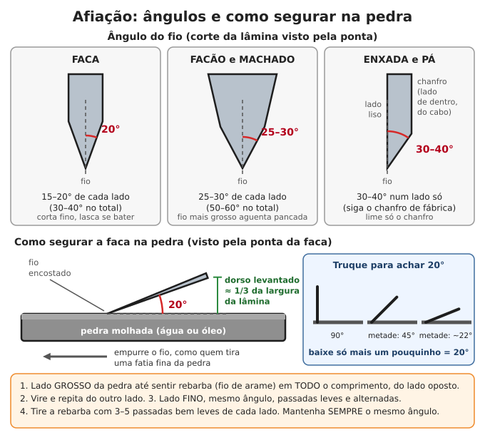

# Ferramentas manuais

**Resumo:** com uma dúzia de ferramentas boas, **afiadas** e **bem guardadas**, uma família planta,
constrói, conserta e corta lenha por décadas, sem energia. Comece por: enxada, enxadão, pá, facão,
foice, machado, serrote, martelo, alicate, chaves, lima e pedra de amolar. Ferramenta cega cansa e
machuca mais do que ferramenta afiada. Aço bom + cabo bom + óleo + lugar seco = ferramenta para a vida toda.

---

## Lista essencial por prioridade

**Prioridade 1** = essencial (tenha antes de tudo; se puder, em dobro). **2** = muito importante.
**3** = útil, consiga quando puder.

### Roça e terra

| Ferramenta | Para que serve | Prior. | Dica |
|---|---|---|---|
| Enxada | Capinar, chegar terra, abrir sulco, misturar massa | 1 | Uma por adulto que trabalha na roça |
| Enxadão | Cavar terra dura, abrir covas, cortar raízes | 1 | Lâmina estreita e grossa |
| Pá de bico e pá quadrada | Cavar (bico); mover terra, areia, esterco (quadrada) | 1 | |
| Foice | Roçar mato e capoeira, galhos finos | 1 | Afie todo dia de uso |
| Facão (40–50 cm de lâmina) | Roçar, cortar galhos, cana, abrir trilha | 1 | O mais versátil de todos |
| Machado (cabeça de 1,5–2,5 kg) | Derrubar árvore, cortar e rachar lenha | 1 | Tenha também uma machadinha (0,6–0,9 kg) |
| Serrote de poda / serra de arco para madeira | Galhos, toras finas, poda | 1 | Lâminas de reserva |
| Carrinho de mão | Terra, esterco, lenha, água, colheita | 1 | Câmara de reserva para o pneu |
| Lima chata + pedra de amolar | Manter TUDO afiado | 1 | Sem isso, o resto perde metade do valor |
| Cavadeira articulada | Buracos fundos e estreitos (mourões, postes, covas) | 2 | Cavadeira reta para terra dura |
| Picareta / chibanca | Solo duro, pedregoso, cascalho | 2 | |
| Cunhas de rachar + marreta de 3–5 kg | Rachar toras grossas | 2 | Cunha de madeira dura serve |
| Alavanca de ferro (1,5 m) | Mover pedras, arrancar tocos | 2 | |
| Ancinho (rastelo) | Juntar mato, nivelar canteiro | 2 | |
| Tesoura de poda | Frutíferas, enxertia, horta | 2 | Óleo na articulação |
| Traçador (serra de 2 pessoas) | Toras grossas sem combustível | 3 | Vale ouro sem motosserra |
| Pulverizador costal, regador | Horta, caldas | 3 | Peças de reposição (vedações) |

### Oficina e casa

| Ferramenta | Para que serve | Prior. | Dica |
|---|---|---|---|
| Martelo de unha (500–700 g) | Pregar, arrancar pregos | 1 | |
| Alicate universal (8") | Cortar e dobrar arame, segurar | 1 | |
| Chaves de fenda e Phillips (jogo) | Parafusos em geral | 1 | Pontas de vários tamanhos |
| Chaves combinadas 8 a 22 mm (boca + estrela) | Máquinas, carro, bicicleta | 1 | Prefira aço Cr-V (cromo-vanádio) |
| Chave ajustável (inglesa) 10–12" | Porcas de qualquer tamanho | 1 | |
| Serra de arco (para metal) + lâminas | Cortar cano, ferro, parafuso | 1 | 10+ lâminas de 18 e 24 dentes/pol |
| Limas: chata, meia-cana, redonda, triangular | Afiar, ajustar metal, serrote, corrente | 1 | Sempre com cabo |
| Trena de 5 m | Medir | 1 | Metro dobrável de madeira não quebra |
| Torquês (turquesa) | Arrancar pregos, cortar arame | 2 | |
| Alicates de bico, de corte e de pressão | Peças pequenas, porca travada | 2 | |
| Chave de grifo (cano) | Canos e conexões | 2 | |
| Chaves Allen 2–10 mm | Bicicleta, máquinas | 2 | |
| Jogo de soquetes com catraca | Mecânica | 2 | |
| Arco de pua + brocas, ou furadeira de manivela | Furar madeira sem energia | 2 | Brocas de reserva |
| Grosa e formões (12, 19 e 25 mm) + macete | Desbastar madeira, encaixes | 2 | Grosa também serve para casco de animal |
| Esquadro, nível de bolha, prumo | Construção, móveis | 2 | |
| Morsa (torno de bancada) | Prender peça para limar, serrar, dobrar | 2 | Parafusada em bancada pesada |
| Talhadeira, ponteiro, punção | Cortar chapa e rebite, furar parede | 2 | |
| Marreta de 1 kg | Talhadeira, ponteiro, estaca | 2 | |
| Pé de cabra | Desmontar, alavancar | 2 | |
| Multímetro | Testar bateria, fusível, fio | 2 | Veja [Eletricidade básica](../06-energia/03-eletricidade-basica.md) |
| Plaina manual | Aplainar tábuas | 3 | |
| Grampos (sargentos) | Colar e prender madeira | 3 | |
| Rebitadeira (pop) + rebites | Chapas, lonas, calhas | 3 | |

### Costura e reparo (o kit de "remendar tudo")

| Item | Uso | Prior. |
|---|---|---|
| Agulhas sortidas, incluindo agulha de saco (grande e curva) | Roupa, sacaria, lona | 1 |
| Linha forte: nylon encerado, linha de pesca, barbante de algodão | Costura pesada, amarração | 1 |
| Fita isolante, fita "silver tape", fita veda-rosca | Remendos rápidos, elétrica, encanamento | 1 |
| Arame recozido (rolo de 1 kg) e arame galvanizado | Amarrar, consertar cerca, prender | 1 |
| Abraçadeiras de nylon e de metal (rosca sem fim) | Mangueiras, fixações | 1 |
| Pregos, parafusos, porcas e arruelas sortidos (compre por quilo) | Tudo | 1 |
| Óleo fino de máquina, graxa, desengripante | Lubrificar e soltar | 1 |
| Kit de remendo de câmara | Bicicleta, carrinho de mão, moto | 1 |
| Sovela (furador) | Couro, lona, arreio | 2 |
| Colas: epóxi (massa e líquida), contato (sapateiro), branca (PVA), PVC | Consertos diversos | 2 |
| Lixas 80, 120, 220 e lixa d'água | Madeira, metal, afiação | 2 |
| Lona, plástico grosso, cordas | Cobertura, transporte | 1 |

Veja também [Tecidos e costura](../09-quimica-e-oficios/04-tecidos-e-costura.md) e [Couro](../09-quimica-e-oficios/05-couro.md).

### Se só der para ter 12

Enxada · enxadão · pá · facão · foice · machado · serrote de poda · martelo · alicate universal ·
chave de fenda/Phillips · lima chata 8–10" · pedra de amolar dupla face.

### Como escolher (e onde achar) ferramenta boa

1. **Peso e firmeza:** ferramenta boa é forjada, pesada para o tamanho, sem folga entre cabeça e cabo.
2. **Som:** bata de leve com outro metal. Som limpo e longo ("tiiiim") = aço inteiro. Som chocho = trinca
   ou ferro fundido (quebra).
3. **Teste da lima:** a lima mal "morde" o fio = aço temperado (segura fio). Morde fácil = aço mole
   (amassa e perde o fio logo).
4. **Ferro-velho, feiras e herança:** ferramentas antigas costumam ter aço melhor que as novas baratas.
   Ferrugem por fora sai; trinca no olho ou na lâmina não tem conserto seguro.
5. **Chaves:** prefira marcadas "Cr-V". Chave barata espanada estraga a porca.

## Afiação

O **fio** é o encontro de duas faces. A face afiada se chama **chanfro** (ou bisel). **Ângulo menor corta
melhor, mas lasca e amassa mais fácil**; ângulo maior aguenta pancada, mas corta menos.

| Ferramenta | Ângulo de cada lado | Afiar com | Observação |
|---|---|---|---|
| Faca de cozinha, canivete | 15–20° | Pedra grossa → fina; chaira | Faca de lida no campo: 20° |
| Facão | 20–25° | Lima + pedra | Fio que aguenta bater em galho |
| Machado de derrubada | 25–30° | Lima + pedra de mão | Fio levemente abaulado (bochecha) |
| Machado de rachar, cunha | 30–35° ou mais | Lima | Só precisa abrir a madeira |
| Foice | siga o chanfro de fábrica (20–30°) | Lima e pedra de foice (de bolso) | Afie de hora em hora no serviço |
| Enxada, enxadão, pá | 30–40°, **um lado só** | Lima chata | Lime o chanfro; do outro lado só tire a rebarba |
| Formão, ferro de plaina | 25° (chanfro único) + 30° só na pontinha | Pedras até a mais fina | As costas devem ficar planas e polidas |
| Tesoura | não mude o ângulo de fábrica | Pedra fina, só no chanfro | Nunca afie a face interna |

### Rebarba: o sinal de que chegou no fio

Quando você desgasta um lado até o fio, forma-se do outro lado uma **rebarba** (um "fio de arame"
finíssimo). Passe o dedo **do dorso em direção ao fio, nunca ao longo dele**: sentiu a aspereza em todo
o comprimento? Esse lado está pronto. Sem rebarba = ainda não chegou no fio, continue.

**Truque do marcador:** pinte o chanfro com caneta permanente e dê 3 passadas. Se a tinta saiu só perto
do dorso, você está baixo demais; se saiu só no fio, alto demais. Ajuste até a tinta sair por igual.

### Pedra de amolar

- **Grão:** lado grosso (grão 100–240) para formar fio novo ou tirar dente; lado fino (400–1000 ou mais)
  para acabamento. A pedra dupla face de carborundum vendida em ferragem resolve quase tudo.
- **Água ou óleo:** pedra de água: deixe de molho 10 minutos (até parar de soltar bolhas) e mantenha
  molhada. Pedra de óleo: algumas gotas de óleo fino (de máquina). **Depois de usar óleo, nunca mais use
  água** naquela pedra. Não use óleo de cozinha (empasta). A lama que se forma ajuda a cortar.
- **Pedra plana:** pedra "embarrigada" (funda no meio) arredonda o fio. Aplaine esfregando-a sobre lixa
  d'água grão 120 colada em vidro ou piso liso, ou numa calçada de cimento com água.

**Passo a passo (faca):**
1. Firme a pedra sobre um pano molhado, lado grosso para cima.
2. Encontre o ângulo (truque da figura: 90° → metade → metade → um pouco menos = ~20°; o dorso fica
   levantado cerca de 1/3 da largura da lâmina).
3. Empurre a faca com o **fio para a frente**, como quem tira uma fatia fina da pedra, varrendo da base
   até a ponta numa só passada. Pressão leve a média.
4. 10–20 passadas de um lado, até sentir rebarba em todo o comprimento.
5. Mesmo número de passadas do outro lado.
6. Lado fino: 10 passadas de cada lado, depois alternando (uma de cada lado), cada vez mais leves.
7. Tire a rebarba: 3–5 passadas bem leves alternadas, ou corte um pedaço de madeira mole.
8. Lave e seque a faca e a pedra.

### Lima (enxada, foice, facão, machado, pá)

1. Use lima chata bastarda de 8 a 10" (20–25 cm) **com cabo** (a espiga sem cabo fura a mão).
2. Prenda a ferramenta: na morsa, ou com a lâmina apoiada num toco e o pé sobre o cabo.
3. Use luva. Empurre a lima **em direção ao fio**, em diagonal, mantendo o ângulo do chanfro.
4. **A lima só corta para a frente.** Levante-a na volta (arrastar para trás cega os dentes).
5. Lime até sumir a linha brilhante do fio. Tire a rebarba do outro lado com 2–3 passadas planas e leves.
6. Termine com pedra de mão molhada, em pequenos círculos, se quiser fio mais fino.

- **Machado:** lime uma faixa de 2–3 cm a partir do fio, deixando as "bochechas" levemente abauladas.
  Fio côncavo (cavado) prende na madeira e lasca.
- **Enxada:** 5 minutos de lima no começo do dia. Enxada afiada corta o mato rente; cega arranca com terra
  e cansa o dobro.
- **Limas:** guarde separadas (uma raspando na outra estraga os dentes); limpe com escova de aço.
  Lima gasta não se afia: troque. Lima velha vira faca (veja [Ferraria](05-ferraria-e-metais.md)).

### Esmeril e rebolo

- O esmeril elétrico esquenta o fio. Se o aço ficar **azul ou roxo, perdeu a têmpera** naquela parte
  (fica mole). Mergulhe na água a cada 2–3 segundos de esmeril. Use **óculos**.
- Antes de montar um rebolo, bata nele de leve: som de sino = bom; som chocho = trincado, **pode explodir**.
- Sem energia, o ideal é o **rebolo de pedra girado à manivela ou pedal**, devagar e molhado: não esquenta
  o aço. Vale montar um (veja [Bicicleta](04-bicicleta.md) para acionar com pedal).

### Chaira e couro

- A **chaira** desentorta o fio dobrado; não afia faca cega. 5–10 passadas alternadas, leves, no mesmo
  ângulo da afiação. Se o corte não volta, vá para a pedra.
- **Couro** (cinto velho colado numa tábua), com pasta de polir ou cinza fina peneirada: puxe a lâmina com
  o **dorso na frente** (fio "arrastando"), 10–20 vezes de cada lado. Dá fio de navalha.

### Como saber se está afiado

1. **Luz:** olhe o fio de frente, contra a luz. Fio cego reflete uma linha ou pontinhos brilhantes.
   Afiado não reflete nada.
2. **Papel:** segure uma folha pela ponta e corte de cima para baixo. Afiada corta limpo, sem rasgar.
3. **Unha:** apoie o fio inclinado sobre a unha do polegar, sem empurrar. Afiado "agarra"; cego escorrega.
4. **No serviço:** o facão corta galho fino num golpe só em diagonal; o machado entra fundo e não quica.

### Serrote

- Serrote **trava** (dentes dobrados alternadamente para os lados) e **lima** (dentes afiados). A largura
  total do corte deve ficar em torno de 1,5 vez a espessura da lâmina. Se o serrote prende, falta trava.
- Para limar: passe a lima chata por cima dos dentes para igualar a altura; depois, com **lima triangular**
  do tamanho do dente, 2–3 passadas iguais em cada dente, respeitando o ângulo de fábrica.
- **Lâmina de serra de arco não se afia**: troque. Monte com os dentes para a frente (corta empurrando).

## Cabos de ferramenta

### Madeiras boas para cabo

| Madeira | Melhor para | Observação |
|---|---|---|
| Guatambu / pau-marfim | Enxada, machado, martelo, foice | A clássica: dura, elástica, não lasca |
| Goiabeira | Cabos curtos: martelo, facão, machadinha | Muito resistente; galho reto é raro |
| Eucalipto (de preferência citriodora) | Enxada, pá, ancinho | Fácil de achar; escolha peça de veio reto |
| Ipê, jatobá, angico, aroeira | Marreta, malho, cunhas | Duras e pesadas |
| Bambu grosso maduro | Ancinho, rodo, cabos leves | Não serve para pancada |

**Evite:** madeira com nó, veio torto, rachada, carunchada ou podre, e madeira mole (pinus, embaúba) em
ferramenta de pancada.

### Fazer um cabo

1. Escolha uma tora reta, sem nós. **Rache** no sentido do veio (com cunha), não serre: o cabo rachado
   segue a fibra e não quebra.
2. Olhando a ponta do cabo, as **linhas dos anéis** devem ficar no mesmo sentido da lâmina (do golpe),
   não atravessadas.
3. Desbaste com facão, enxó ou grosa, deixando sobra de 3–5 mm.
4. **Seque à sombra** em lugar ventilado por 2–3 meses. Madeira verde encolhe e afrouxa no olho.
5. Ajuste final: o cabo deve entrar **justo, batendo**, e sobrar ~1 cm para fora do olho.
6. Lixe. **Não pinte nem envernize** a pega (faz bolha e escorrega): passe 2–3 demãos de óleo de linhaça
   cru ou óleo vegetal.

| Ferramenta | Comprimento típico do cabo |
|---|---|
| Enxada / enxadão | 1,30–1,50 m (até a altura do queixo de quem usa) |
| Pá | 1,10–1,30 m |
| Machado | 75–90 cm |
| Machadinha | 35–45 cm |
| Marreta de 5 kg | 80–90 cm |
| Picareta | 85–95 cm |
| Martelo | 30–35 cm |

### Encunhar (machado, martelo, marreta, picareta)

1. Antes de encaixar, serre uma **fenda** no topo do cabo, no sentido do comprimento da lâmina, com
   profundidade de **2/3 da altura do olho**.
2. Encaixe a cabeça. Segure o cabo de pé (cabeça para cima) e bata a ponta de baixo do cabo num toco: a
   cabeça desce e se firma. Repita até não descer mais.
3. Faça uma **cunha de madeira dura e seca**, da largura do olho, com 4–6 mm na parte grossa.
   Passe cola (PVA ou epóxi) se tiver. Bata até parar de entrar e serre o excesso rente.
4. Se tiver, crave uma **cunha de aço** atravessada sobre a de madeira.
5. Sacuda com força: não pode haver folga nenhuma.

- **Enxada e enxadão:** ajuste a ponta do cabo ao olho, encaixe batendo e trave com uma cunha de madeira
  (ou chapa dobrada) entre cabo e olho. Um prego atravessado na ponta que sobra impede a enxada de sair.
- **Pá e cavadeira:** o cabo entra no alvado (tubo) e é preso com prego, rebite ou parafuso.
- **Cabo frouxo: não deixe de molho na água.** A madeira incha, depois seca, encolhe e fica mais frouxa
  que antes. Recunhe.
- **Tirar toco quebrado de dentro do olho:** serre rente, faça vários furos com broca ou pua e empurre
  o resto com um punção. **Não ponha a cabeça no fogo:** o fio perde a têmpera.

> **ATENÇÃO:** cabeça de machado ou marreta que se solta no golpe voa como um projétil. Confira o aperto
> antes de cada uso e pare na primeira folga.

## Manutenção e ferrugem

**Rotina no fim do dia (2 minutos):**
1. Raspe a terra com um pau ou espátula.
2. Lave se precisar e **seque bem**.
3. Passe um pano com óleo nas partes de aço.
4. Guarde pendurada, em lugar seco e coberto, longe do chão.

- **Balde de areia com óleo:** balde com areia grossa e seca misturada com 0,5–1 L de óleo (óleo queimado
  de motor serve aqui). Enfie pás, enxadas e enxadões depois do uso: a areia limpa e o óleo protege.
  Use luva (óleo queimado é tóxico) e não use em ferramentas de cozinha.
- **Protetores:** óleo de máquina; vaselina; **cera derretida** (de abelha ou parafina) para estoque
  longo; graxa para guardar por anos, embrulhada em papel e plástico. Em faca de cozinha use óleo
  mineral (vaselina líquida) ou um fio de óleo de cozinha.
- **Ferrugem leve:** palha de aço ou lixa com um pouco de óleo.
- **Ferrugem pesada:**
  1. Deixe de molho em **vinagre** comum de 12 a 24 horas (confira a cada poucas horas: o vinagre
     também come o aço).
  2. Esfregue com escova de aço.
  3. Enxágue em água com bicarbonato (1 colher de sopa por litro) para parar o ácido.
  4. **Seque na hora** (sol ou perto do fogo) e passe óleo.
- **Estoque:** ferramentas limpas e oleadas, embrulhadas, em caixa fechada com saquinhos de sílica-gel.
- **Cabos:** óleo de linhaça 1–2 vezes por ano; guarde fora do sol e da chuva.
- **Articulações** (alicate, tesoura de poda, cadeado): 1 gota de óleo e abra e feche algumas vezes.
- **Facas:** em bainha ou bloco, nunca soltas na gaveta.

## Segurança no uso

> **ATENÇÃO:** mantenha a **vacina antitetânica** em dia (reforço a cada 10 anos; ferimento sujo ou
> profundo: reforço se a última dose foi há mais de 5 anos). Veja [Doenças e infecções](../02-saude/03-doencas-e-infeccoes.md)
> e [Ferimentos](../02-saude/02-ferimentos-queimaduras-fraturas.md).

- **Óculos** ao martelar aço contra aço, usar talhadeira, esmeril ou rachar lenha com cunha.
- **Cabeça "cogumelada"** (rebarba amassada na cabeça de talhadeira, cunha, ponteiro ou marreta) solta
  lascas como bala. Esmerilhe a rebarba e chanfre a borda.
- **Machado:**
  - Ninguém num raio de 3 m. Olhe para cima: galho ou varal enganchando o machado na volta é acidente certo.
  - Pernas afastadas. Rache **sobre um cepo** (toco), nunca com a lenha no chão: se errar, o machado
    acerta o cepo, não a canela.
  - Ao desgalhar, mantenha o tronco entre você e o machado.
- **Facão e foice:**
  - Corte sempre para longe do corpo e das pernas, em golpe diagonal (~45°).
  - A outra mão fica fora da linha de corte: segure o galho com uma forquilha, não com a mão.
  - Botina e perneira (protegem também de cobra).
- **Ferramenta cega é mais perigosa:** exige força e escorrega.
- **Transporte:** fio para baixo e para fora, em bainha. Enxada, ancinho e pá deitados com a parte
  cortante para baixo (pisar num ancinho virado para cima joga o cabo no rosto).
- **Faca que cai não se pega.** Afaste o pé e deixe cair.
- **Cansaço:** a maioria dos acidentes acontece no fim do dia. Pare antes de ficar exausto.
- **Postura:** cabo no comprimento certo evita dor nas costas. Levante peso com as pernas, coluna reta.
- **Crianças:** ferramentas de corte guardadas no alto ou trancadas. Ensine o uso com supervisão.

## Ferramentas improvisadas

| Precisa de | Improviso |
|---|---|
| Martelo | Pedra dura e arredondada amarrada num cabo rachado; **malho** de madeira dura (pedaço de tronco de goiabeira ou ipê com cabo) |
| Alavanca | Cano grosso, vergalhão de 20 mm ou mais, tronco verde |
| Cunha | Madeira dura e seca (ipê, aroeira) batida com malho |
| Nível | **Mangueira transparente cheia de água**: a água fica na mesma altura nas duas pontas, mesmo a dezenas de metros (sem bolhas de ar) |
| Prumo | Pedra ou porca amarrada num barbante |
| Esquadro | **Regra 3-4-5:** 3 m num lado, 4 m no outro; quando a diagonal der 5 m, o canto tem 90° (ou 60-80-100 cm) |
| Compasso | Barbante com um prego no centro |
| Pedra de amolar | Fundo áspero (sem esmalte) de caneca ou prato de louça; pedra de rio de grão fino; meio-fio de cimento (desbaste grosso); lixa d'água colada numa tábua plana |
| Serra | Lâmina de serra montada num **arco de galho verde** ou bambu, tensionada com corda |
| Furadeira | Broca girada por **arco de corda** (como o arco de fazer fogo) |
| Morsa | Duas tábuas e cunhas; ou peça presa num toco com cunhas |
| Faca, raspador | Lâmina de serra velha, mola de carro, lima velha (veja [Ferraria e metais](05-ferraria-e-metais.md)) |
| Pá | Chapa de tambor de 200 L recortada e pregada num cabo |
| Carrinho | Tambor de 200 L cortado ao meio, eixo e roda de bicicleta |

### Bancada e organização

- **Bancada:** tampo grosso (5 cm ou mais) sobre pernas firmes, altura do quadril (85–95 cm), com a morsa
  num canto, sobre um pé da bancada.
- **Painel de parede** com o contorno de cada ferramenta pintado: você vê na hora o que falta.
- Em grupo, **anote empréstimos** (quem, o quê, quando). Ferramenta some mais do que quebra. Veja
  [Organização comunitária](../12-comunidade-e-seguranca/01-organizacao-comunitaria.md).

---

Ver também: [Ferraria e metais](05-ferraria-e-metais.md) · [Madeira e carpintaria](../07-abrigo-e-construcao/03-madeira-e-carpintaria.md) · [Kits e estoques](../00-emergencia/03-kits-e-estoques.md) · [Rotinas de manutenção](../anexos/03-rotinas-de-manutencao.md)
