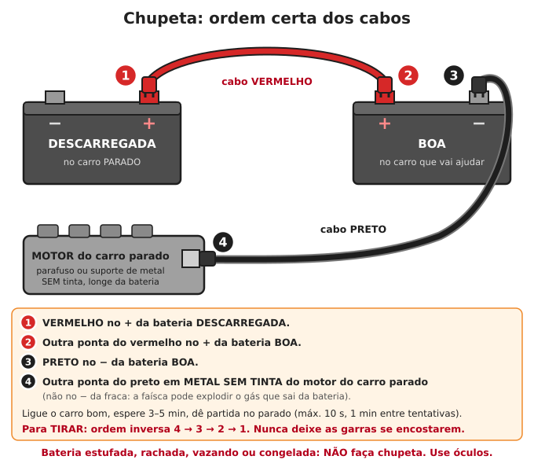
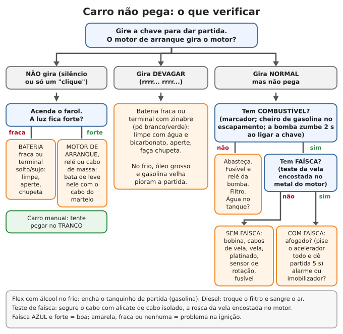

# Mecânica automotiva

**Resumo:** quase toda pane comum se resolve com 5 verificações (óleo, água, freio, correia, pneus) e
3 perguntas quando o carro não pega (**bateria? combustível? faísca?**). Aprenda agora a fazer chupeta na
ordem certa, trocar pneu e óleo. Carro parado por meses precisa de preparo (bateria, combustível, pneus).
Carros antigos, a carburador e platinado, são os mais fáceis de manter sem oficina. **Nunca** deixe motor
ligado em lugar fechado: o monóxido de carbono mata sem cheiro.

---

## Ferramentas e estoque para o carro

| Item | Para quê |
|---|---|
| Chaves combinadas 8–19 mm, soquetes, chave de vela, chave de roda em cruz | Quase todo serviço |
| Macaco + calços de madeira | Trocar pneu, olhar embaixo |
| Cabos de chupeta (mínimo 16 mm², 3 m) | Partida com bateria fraca |
| Calibrador de pneu, compressor 12 V ou bomba de pé | Pneus |
| Kit de reparo de pneu sem câmara (macarrão) + remendos a frio | Furos |
| Multímetro | Bateria, fusíveis, fios |
| Fusíveis sortidos, relés iguais aos do carro, lâmpadas | Elétrica |
| Óleo do motor (1 troca), filtro de óleo, filtro de ar, filtro de combustível | Manutenção |
| Fluido de freio (DOT 3 ou 4, conforme a tampa), aditivo de radiador | Fluidos |
| Correia(s) do motor de reserva | A correia arrebenta sem avisar |
| Fita "silver tape", fita isolante, arame, abraçadeiras, massa epóxi | Gambiarras que salvam a viagem |
| Funil, mangueira de 1,5 m (sifão), galão | Combustível |
| Manual do proprietário **impresso** | Capacidades, pressões, fusíveis |

## Verificações básicas (faça toda semana ou antes de viagem)

### 1. Óleo do motor
1. Carro em lugar plano, motor desligado há 5–10 minutos.
2. Puxe a vareta, limpe com pano, enfie até o fim, puxe de novo.
3. O nível deve estar **entre MIN e MAX**. De MIN a MAX costuma ser cerca de 1 litro.
4. Complete pelo bocal (tampa com o desenho da almotolia), aos poucos, conferindo.

| O que você vê | Significa |
|---|---|
| Óleo cor de mel a marrom | Normal |
| Preto | Normal em diesel; em carro a gasolina, troca atrasada |
| **Leitoso, cor de café com leite** | **Água no óleo** (junta do cabeçote). Não rode |
| Cheiro forte de gasolina, nível subindo | Combustível passando para o óleo. Procure o defeito |
| Nível baixando rápido | Vazamento (manchas no chão) ou motor queimando óleo (fumaça azul) |

### 2. Arrefecimento (água do radiador)

> **ATENÇÃO:** **nunca abra a tampa do radiador ou do reservatório com o motor quente.** O líquido está
> acima de 100 °C e sob pressão: sai um jato que causa queimadura grave. Espere esfriar (30–60 min) e
> abra devagar, com um pano grosso, aliviando a pressão.

- Com o motor frio, o nível do reservatório deve estar **entre MIN e MAX**.
- Use **água limpa + aditivo** na proporção do manual (normalmente 30% a 50% de aditivo). O aditivo
  evita ferrugem e ferver. Sem aditivo, água limpa (de chuva filtrada ou destilada) serve por um tempo.
- Nível baixando sempre = vazamento (mangueira, radiador, bomba d'água) ou junta do cabeçote.

### 3. Freio
- Fluido entre MIN e MAX. **Baixa aos poucos** conforme as pastilhas gastam; baixa rápido = vazamento:
  **não rode**.
- Pedal baixo, mole ("esponjoso") ou que afunda devagar = ar ou vazamento no sistema.
- Chiado metálico ao frear = pastilha no fim, raspando ferro no disco.
- O fluido de freio absorve umidade do ar: troque a cada 2 anos. Use o tipo da tampa; não misture com
  DOT 5 (silicone).

### 4. Correias
- Olhe trincas, desfiados e brilho (correia "vitrificada" patina e chia).
- Aperte com o polegar no meio do trecho mais longo: deve ceder **cerca de 1 a 1,5 cm**.
- Chiado ao ligar ou ao virar a direção = correia frouxa ou gasta.
- **Correia dentada** (fica escondida, comanda as válvulas): troque no prazo do manual (em geral
  40.000–60.000 km ou 4 anos). Em muitos motores, se arrebentar, entorta as válvulas.

### 5. Pneus
- Calibre **com o pneu frio** (rodou menos de 3 km). Pressão certa: etiqueta na porta do motorista, na
  tampa do tanque ou no manual. Carros de passeio: geralmente **28 a 35 psi** (1 bar = 14,5 psi).
- Profundidade mínima legal do sulco: **1,6 mm** (quando o sulco nivela com os "TWI", ressaltos dentro
  dos sulcos). Abaixo disso o carro aquaplana na chuva.
- Bolha na lateral = lona rompida: o pneu pode estourar. Troque.
- Faça rodízio a cada 10.000 km. Desgaste só nas bordas = pressão baixa; só no meio = pressão alta;
  só de um lado = alinhamento.

### 6. Bateria, luzes e o resto
- Terminais com pó branco, verde ou azulado (zinabre): limpe com água + bicarbonato e escova, enxágue,
  seque, aperte e passe vaselina.
- Teste farol, lanterna, setas, luz de freio (peça para alguém olhar, ou veja o reflexo numa parede).
- Água do limpador, palhetas.

| Tensão da bateria (motor desligado há 1 h) | Carga aproximada |
|---|---|
| 12,6 V ou mais | 100% |
| 12,4 V | ~75% |
| 12,2 V | ~50% (recarregue logo) |
| 12,0 V | ~25% |
| abaixo de 11,9 V | Descarregada |
| **Motor ligado: 13,8–14,4 V** | Alternador carregando bem. Abaixo de 13 V = alternador fraco |

## Trocar óleo e filtro

**Quando:** siga o manual. Em geral a cada **5.000–10.000 km ou 6–12 meses**. Em uso severo (poeira,
estrada de terra, trechos curtos, carga pesada), na metade do intervalo. Use a viscosidade do manual
(ex.: 5W30, 15W40; carros antigos 20W50). Em emergência, qualquer óleo de motor é melhor do que nenhum.

1. Rode 5 minutos para o óleo amornar (escorre melhor). Desligue, freio de mão, calços nas rodas.
2. Coloque uma bacia de 5 L ou mais sob o bujão (parafuso no fundo do cárter).
3. Abra a tampa de cima do motor (ajuda a escoar). Solte o bujão com a chave certa, segurando para não
   cair na bacia. **Cuidado: óleo morno queima.**
4. Deixe escorrer 10–15 minutos.
5. Recoloque o bujão com **arruela nova** (cobre ou alumínio). Aperte firme, **sem exagero**: o cárter
   de alumínio espana a rosca.
6. Solte o filtro (à mão ou com chave de cinta). Passe óleo novo no anel de borracha do filtro novo,
   rosqueie à mão até encostar e dê **mais 3/4 de volta à mão**.
7. Ponha o óleo novo: a quantidade do manual (motores 1.0 a 1.6 levam em geral 3 a 4,5 L com filtro).
   Coloque um pouco menos, confira a vareta e complete.
8. Ligue 1 minuto. Confira vazamento no bujão e no filtro. Desligue, espere 5 min, confira a vareta.

**Óleo usado:** guarde em galão fechado. Serve para proteger mourões e ferramentas pesadas. Não jogue no
solo nem na água (1 L contamina milhares de litros). Não queime dentro de casa.

## Bateria e chupeta

1. Os dois carros **desligados**, chaves fora, sem encostar um no outro. Mesma tensão (12 V com 12 V).
2. **1:** garra vermelha no **+** da bateria **descarregada**.
3. **2:** outra garra vermelha no **+** da bateria **boa**.
4. **3:** garra preta no **−** da bateria **boa**.
5. **4:** outra garra preta num **metal sem tinta do motor do carro parado** (parafuso, suporte),
   **longe da bateria**. Não no − da bateria fraca: a faísca pode explodir o gás que sai dela.
6. Ligue o carro bom e deixe em marcha lenta 3–5 minutos.
7. Dê partida no carro parado, **no máximo 10 segundos**. Não pegou: espere 1 minuto e tente de novo.
8. Pegou: **retire na ordem inversa: 4, 3, 2, 1.** Não deixe as garras se tocarem.
9. Deixe o carro ligado 20–30 minutos (ou rode) para recarregar um pouco.

> **ATENÇÃO:** bateria estufada, rachada, vazando ou congelada: **não faça chupeta** (pode explodir).
> Use óculos. A bateria tem ácido sulfúrico e solta hidrogênio: nada de chama ou cigarro perto.
> Caminhões e ônibus de 24 V usam duas baterias ligadas em série: só faça chupeta com outro veículo
> de 24 V, ligado do mesmo jeito.

Veja também [Baterias](../06-energia/05-baterias.md) para recarregar com painel solar e cuidar da bateria.

### Pegar no tranco (só carro de câmbio manual)

1. Chave ligada (painel aceso). **2ª marcha engatada, embreagem pisada até o fundo.**
2. Empurrem o carro (ou deixe descer uma ladeira) até uns **10 km/h** (passo de corrida).
3. **Solte a embreagem de uma vez.** O motor gira.
4. Pegou: pise na embreagem na hora e acelere de leve para não morrer. Deixe ligado 20–30 minutos.

- **Câmbio automático não pega no tranco.**
- Carro com injeção eletrônica precisa de alguma carga na bateria para a central e a bomba funcionarem.
  Bateria totalmente morta (abaixo de ~9–10 V) pode impedir o tranco.

## Trocar pneu

1. Pare em lugar plano e firme, longe da pista. Pisca-alerta. **Triângulo a pelo menos 30 m** atrás
   (mais longe em curva e rodovia rápida). Todos para fora do carro, longe da pista.
2. Freio de mão, marcha engatada (ou P), calço na roda do lado oposto.
3. Com a roda ainda no chão, **afrouxe os parafusos meia volta** (sentido anti-horário).
4. Macaco no **ponto de apoio** indicado no manual (reforço sob a soleira). Nunca entre embaixo de
   carro só no macaco.
5. Levante até o pneu sair do chão 3–5 cm. Tire os parafusos e a roda.
6. Ponha o estepe, rosqueie os parafusos à mão.
7. Aperte em **cruz (estrela)**, sem força total. Abaixe o carro, tire o macaco.
8. Aperto final em cruz, firme. **Reaperte depois de 50 km.**
9. Estepe fino ("temporário"): no máximo 80 km/h e só até consertar o pneu.

### Remendo de pneu sem câmara (macarrão)

Serve para furos de prego ou parafuso **na banda de rodagem** (parte que toca o chão), de até ~6 mm.
**Não** serve para corte na lateral ou no ombro.

1. Ache o furo: água com sabão no pneu cheio faz bolhas.
2. Tire o objeto com alicate.
3. Enfie e tire várias vezes a **lima espiral** (escareador) do kit, para limpar e alargar o furo.
4. Passe o macarrão no olho da agulha até a metade. Passe cola (se o kit tiver) no macarrão.
5. Empurre a agulha no furo até sobrarem ~2 cm de macarrão para fora.
6. Puxe a agulha **de uma vez, sem girar**. O macarrão fica.
7. Corte o excesso a 3–5 mm da borracha. Calibre e confira com água e sabão.

O macarrão é um reparo **provisório** seguro para rodar devagar; o certo depois é remendo por dentro
(vulcanizado). Pneu **com câmara** (carros antigos, moto, trator, carrinho): remende a câmara como na
[bicicleta](04-bicicleta.md), com remendo maior.

## Diagnóstico simples

### Carro não pega

**Três coisas para um motor a gasolina funcionar: (1) girar com força, (2) combustível, (3) faísca na hora
certa.** Siga a ordem:

1. **Não gira, só clica ou silêncio:** acenda o farol.
   - Luz fraca ou apaga = **bateria** descarregada ou terminal solto/sujo. Limpe, aperte, chupeta, tranco.
   - Luz forte = **motor de arranque**, relé ou cabo de massa. Bata de leve no motor de arranque com o
     cabo de um martelo enquanto alguém dá partida (escovas presas às vezes soltam). Carro manual: tranco.
2. **Gira devagar:** bateria fraca, terminal ruim ou cabo de massa ruim. No frio, óleo grosso piora.
3. **Gira normal e não pega:**
   - **Combustível:** tem no tanque? Ao ligar a chave, a bomba elétrica faz um zumbido de 1–2 segundos
     (carro com injeção)? Sem zumbido: fusível ou relé da bomba. Cheiro de gasolina no escapamento
     depois de tentar = combustível está chegando.
   - **Faísca:** tire um cabo de vela, encaixe uma vela, encoste a rosca dela num metal do motor e dê
     partida (segure o cabo com **alicate de cabo isolado**). Faísca azul e forte = boa. Amarela, fraca
     ou nenhuma = bobina, cabos, platinado e condensador (carro antigo), sensor de rotação, fusível.
   - **Com combustível e faísca:** motor afogado (pise o acelerador até o fundo e dê partida por 5 s,
     sem bombear), alarme ou imobilizador, filtro de ar entupido, gasolina com água.
4. **Carro flex com álcool, de manhã fria (abaixo de ~15 °C):** encha o tanquinho de partida a frio
   (reservatório de gasolina no motor), quando o carro tiver.
5. **Diesel:** não tem faísca. Não pega = ar na linha (depois de acabar o diesel ou trocar filtro: sangre
   pela bombinha manual do filtro), filtro entupido, água no diesel, velas aquecedoras (no frio).

### Superaquecimento (ponteiro subindo ou luz vermelha)

1. Desligue o ar-condicionado. Ligue o **ar quente no máximo** com ventilador no máximo (tira calor do motor).
2. Ponteiro no vermelho: encoste e **desligue o motor**.
3. Espere esfriar (30–60 min). **Não abra a tampa quente. Não jogue água fria no motor quente** (racha
   o cabeçote).
4. Com o motor frio, complete com água e ligue em marcha lenta, olhando vazamentos.

| Causa comum | Como identificar |
|---|---|
| Falta de água / vazamento | Nível baixo, poça, mangueira molhada |
| Ventoinha não liga | Motor quente parado e a ventoinha parada. Fusível, relé, sensor. Ligar o ar-condicionado costuma forçar a ventoinha |
| Válvula termostática travada | Mangueira de cima do radiador quente e a de baixo fria |
| Radiador entupido | Colmeia suja de barro/folhas; lave com água de dentro para fora |
| Correia da bomba d'água solta | Correia frouxa ou partida |
| Junta do cabeçote | Bolhas no reservatório, óleo leitoso, fumaça branca constante |

Mangueira furada: seque, enrole **silver tape** bem apertada por 10 cm além do furo, prenda com
abraçadeiras e **deixe a tampa do reservatório um pouco folgada** (sem pressão), rodando devagar até
consertar.

### Fumaça no escapamento

| Cor | Significado |
|---|---|
| Branca fina que some, só com motor frio | Vapor d'água normal |
| **Branca grossa, constante, cheiro adocicado** | Água do radiador queimando: junta do cabeçote. Pare |
| **Azul / acinzentada, cheiro de óleo queimado** | Motor queimando óleo: anéis, retentores de válvula, turbo |
| **Preta** | Combustível demais: filtro de ar entupido, bico injetor, afogador, carburador desregulado; em diesel, excesso de carga ou bomba injetora |

### Ruídos

| Ruído | Provável causa | O que fazer |
|---|---|---|
| Chiado agudo ao ligar ou virar a direção | Correia frouxa ou gasta | Esticar ou trocar |
| **Batida metálica forte que acompanha a rotação** | Biela ou mancal (falta de óleo) | **Pare o motor já** |
| "Tec-tec-tec" leve no alto do motor | Tucho ou válvula; óleo baixo | Confira o óleo |
| Ronco que aumenta com a velocidade e muda em curva | Rolamento de roda | Trocar logo |
| Chiado metálico ao frear | Pastilha no fim | Trocar pastilha |
| Estalo em curva fechada | Junta homocinética (coifa rasgada) | Trocar coifa/junta |
| Ronco alto, cheiro de fumaça na cabine | Escapamento furado | **Risco de monóxido**: janelas abertas e conserte |

### Fusíveis e relés

- Caixas de fusíveis: no painel (lateral ou sob o volante) e no cofre do motor. A tampa ou o manual
  mostra o mapa.
- Fusível queimado tem o filamento partido (olhe contra a luz) ou dá "aberto" no multímetro.
- **Troque sempre por um de mesma amperagem (mesma cor).** Nunca use fio, papel-alumínio ou
  fusível maior: o fio esquenta e o carro pega fogo.
- Queimou de novo na hora = curto-circuito. Procure fio descascado encostando no metal.
- **Relé:** troque por outro idêntico da mesma caixa (ex.: o da buzina) para testar. Relé bom estala
  ("clique") quando acionado.

| Cor do fusível (tipo lâmina) | bege | marrom | vermelho | azul | amarelo | branco | verde |
|---|---|---|---|---|---|---|---|
| Amperes | 5 | 7,5 | 10 | 15 | 20 | 25 | 30 |

## Carro parado por meses

**Antes de guardar:**
1. Troque o óleo (óleo usado tem ácidos que atacam o motor parado).
2. **Tanque cheio** (menos ar = menos umidade) com **estabilizador de combustível**; rode 10 minutos
   para ele chegar ao motor.
3. **Bateria:** desligue o cabo **negativo** (−). Recarregue a cada 1–2 meses, ou deixe num carregador de
   manutenção ou painel solar pequeno com controlador. Bateria de chumbo descarregada estraga de vez.
4. **Pneus:** calibre 5–10 psi acima do normal (sem passar do máximo escrito no pneu), ou apoie o carro
   em cavaletes. Volte à pressão normal antes de rodar.
5. **Sem freio de mão** (a lona gruda): deixe engatado e com calços.
6. Feche entradas de ar e escapamento com tela (ratos fazem ninho e roem fios); coloque iscas e
   armadilhas em volta. Lona que respire, em lugar seco e coberto.

**Ligar de vez em quando?** Ligar 5 minutos e desligar **faz mal** (forma água no motor e no escapamento).
Ou roda 20–30 minutos até esquentar bem, ou não liga.

**Antes de voltar a rodar:** óleo, água, fluido de freio, pressão dos pneus, ninho de rato no filtro de
ar e no cofre, fios roídos, freio (pode estar preso: rode devagar e teste). Bateria carregada.

## Combustível velho ou contaminado

- **Gasolina brasileira tem cerca de 30% de etanol**, que puxa água do ar. Guardada em galão bem fechado,
  dura cerca de **3 a 6 meses**; com estabilizador, até **1 ano**. Etanol hidratado (álcool) bem fechado
  dura mais. **Diesel S10** (tem biodiesel) cria borra e micróbios: use em **6 a 12 meses**, filtre e
  drene a água. Veja [Combustíveis](../06-energia/09-combustiveis.md).
- **Teste da garrafa:** ponha uma amostra numa garrafa PET transparente e deixe em pé 30 minutos.
  - Camada de água ou turva no fundo = **contaminado**.
  - Muito escuro, cheiro azedo ou de verniz = **velho**.
- **Velho mas sem água:** misture 1 parte para 3–4 de combustível novo e use em motor de carro (não em
  motores pequenos).
- **Com água:** drene o tanque (bujão ou mangueira até o fundo), troque o filtro de combustível, esvazie
  a cuba do carburador. **Diesel:** drene o copo do filtro separador de água toda semana.

> **ATENÇÃO:** sifonar combustível com a boca leva gasolina ao pulmão (pneumonia química, pode matar).
> Use bomba manual ou mangueira cheia de água. Trabalhe ao ar livre, sem chama, sem celular tocando perto
> de vapor, e com extintor ou areia por perto.

## Carros antigos: os mais fáceis de manter

Carros a **carburador e platinado** (Fusca, Brasília, Kombi antiga, Chevette, Opala, Corcel, Passat,
Gol e Uno dos anos 80 até o começo dos 90) e **diesel com bomba injetora mecânica** (picapes e tratores
antigos) não dependem de central eletrônica nem de sensores. Com chave de fenda, lixa, calibre de
lâminas e paciência, quase tudo se ajusta na roça.

- **Platinado:** os contatos abrem e fecham a corrente da bobina. Com o motor parado, gire até o
  platinado abrir ao máximo e meça a folga com calibre de lâminas: **em geral 0,4–0,5 mm** (confirme no
  manual). Contatos com cratera: lixe com lixa fina ou troque. **Condensador** ruim queima o platinado
  rápido e enfraquece a faísca: tenha um de reserva.
- **Ponto de ignição:** ajustado girando o distribuidor, com lâmpada de ponto ou a 12 V (no manual).
- **Carburador:** veja limpeza em [Motores pequenos](03-motores-pequenos-e-geradores.md); o princípio é o mesmo.
- **Diesel mecânico:** depois de ligado, funciona **sem eletricidade nenhuma**. O mais robusto que existe.
- **Peças para guardar:** platinado, condensador, tampa e rotor do distribuidor, cabos e velas, bobina,
  bomba de gasolina mecânica (ou reparo), correias, juntas do carburador, filtros.

## O carro como fonte de energia 12 V

- **Motor desligado:** uma bateria de 60 Ah só deve fornecer cerca de 30 Ah sem estragar, e você precisa
  de carga para dar partida. Na prática: **uns 100 W por 2 horas**, no máximo. Não deixe a tensão cair
  abaixo de **12,2 V**.
- **Motor ligado:** o alternador fornece com folga **300 a 500 W** contínuos para um inversor.
- **Consumo em marcha lenta:** cerca de **0,6 a 1,0 L de combustível por hora** (motores 1.0 a 2.0).
  É caro: use para tarefas curtas (carregar baterias, celulares, rádio, bomba pequena).
- **Inversor** (12 V → 127/220 V): até ~150 W pode ir no acendedor de cigarro (fusível de 10–15 A).
  Acima disso, ligue **direto na bateria** com cabo grosso e fusível perto da bateria.
- O carro também é rádio, lanterna e carregador. Um **alternador** retirado de sucata pode virar gerador
  eólico ou hidráulico (veja [Energia eólica e hidráulica](../06-energia/06-eolica-e-hidraulica.md)).

> **ATENÇÃO — MONÓXIDO DE CARBONO:** nunca deixe o motor ligado em garagem, mesmo com a porta aberta,
> nem dormir dentro do carro ligado (principalmente com escapamento furado ou carro atolado em barro/neve
> que tampe o escapamento). Dor de cabeça, tontura e sono = saia para o ar livre na hora. Veja
> [Calor, frio e ambiente](../02-saude/10-calor-frio-e-ambiente.md).

## Motos

A moto gasta pouco (25–40 km/L nas de 125–160 cc), anda em estrada ruim e é simples de consertar.

- **Óleo:** cerca de **1 litro** nas de 125–160 cc. Confira toda semana; troque no prazo do manual (motor
  pequeno gira alto e tem pouco óleo: não atrase).
- **Corrente:**
  - Lubrifique a cada **500 km** e depois de chuva (óleo de corrente; em falta, óleo de motor).
  - Folga: **2 a 3,5 cm** de sobe e desce no meio, conferida com a moto no cavalete (veja o manual).
  - Para ajustar: solte a porca do eixo traseiro e gire os esticadores **igualmente** dos dois lados
    (as marcas devem coincidir); reaperte a porca.
  - Troque corrente, coroa e pinhão juntos: dentes da coroa em forma de gancho = gastos.
- **Pneus:** a pressão do manual (cerca de 25 psi na dianteira e 29–33 psi na traseira em motos 150–160).
  Pneu com câmara: remende como na [bicicleta](04-bicicleta.md).
- **Partida:** muitas motos a carburador pegam **no pedal** (kick) mesmo com bateria fraca; motos com
  injeção precisam de bateria. **Tranco:** 2ª marcha, embreagem apertada, empurre correndo, solte a
  embreagem e aperte de novo quando pegar.
- **Freio a tambor:** ajuste pela porca borboleta na ponta da vareta até o pedal ter 2–3 cm de folga
  antes de frear. A roda deve girar livre.
- **Vela e carburador:** igual aos motores pequenos (veja [Motores pequenos e geradores](03-motores-pequenos-e-geradores.md)).

---

Ver também: [Motores pequenos e geradores](03-motores-pequenos-e-geradores.md) · [Combustíveis](../06-energia/09-combustiveis.md) · [Baterias](../06-energia/05-baterias.md) · [Eletricidade básica](../06-energia/03-eletricidade-basica.md) · [Rotinas de manutenção](../anexos/03-rotinas-de-manutencao.md)
