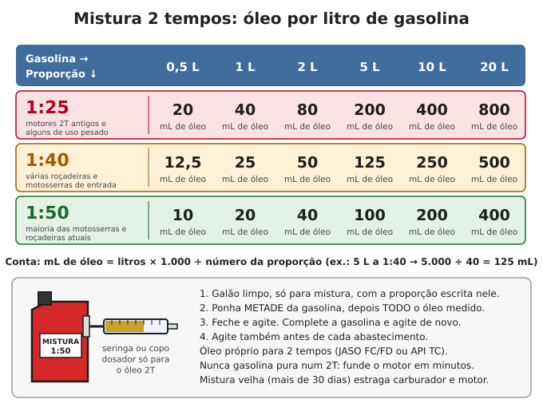
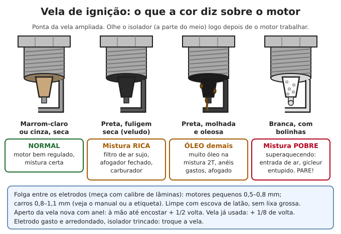
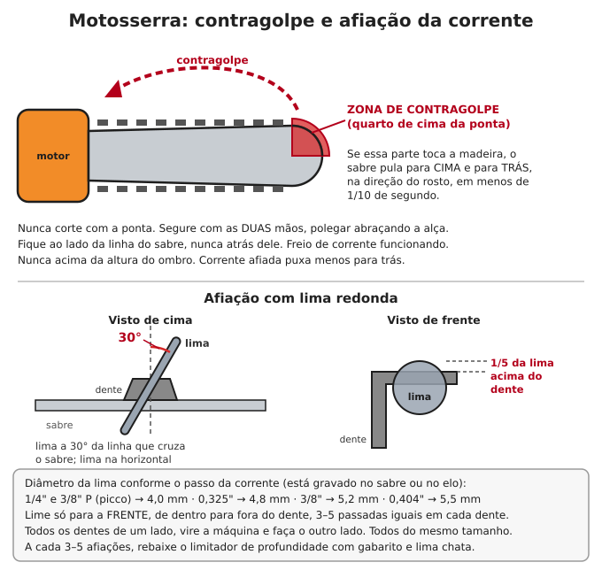
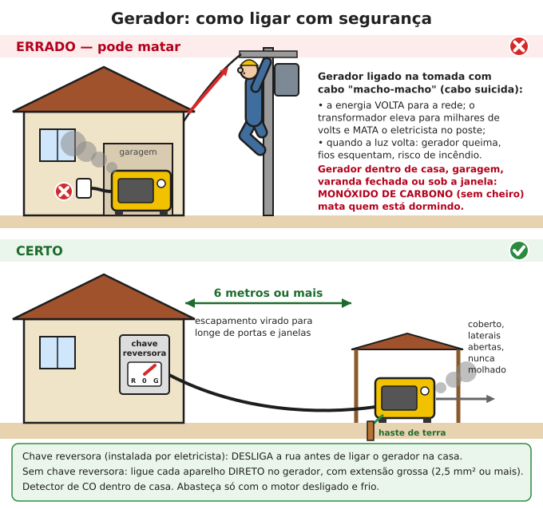

# Motores pequenos e geradores

**Resumo:** motosserra, roçadeira, motobomba, gerador e rabeta funcionam com o mesmo princípio:
**combustível limpo + ar filtrado + faísca + óleo certo**. Em motor **2 tempos** o óleo vai **misturado
na gasolina** (1:25, 1:40 ou 1:50, conforme o fabricante); em motor **4 tempos** o óleo fica no cárter.
Gerador: **sempre ao ar livre, a 6 m ou mais da casa**, e **nunca ligado na tomada sem chave reversora**:
isso mata o eletricista na rede e intoxica quem dorme.

---

## Motor 2 tempos x 4 tempos

| | **2 tempos (2T)** | **4 tempos (4T)** |
|---|---|---|
| Onde aparece | Motosserra, roçadeira, soprador, motor de popa antigo, mobilete | Gerador, motobomba, rabeta, cortador de grama, motos, carros |
| Óleo | **Misturado na gasolina**, queima junto | Fica no **cárter**, como no carro |
| Abastece com | **Mistura** (gasolina + óleo 2T) | **Gasolina pura** |
| Peso e força | Leve, forte para o tamanho, funciona em qualquer posição | Mais pesado, mais econômico, mais durável |
| Barulho e fumaça | Mais | Menos |

> **ATENÇÃO:** **gasolina pura num motor 2T funde o motor em minutos** (fica sem lubrificação).
> Mistura num 4T não funde, mas faz fumaça, suja a vela e carboniza: evite.

O motor estacionário 4T de 5,5 a 7 cv (o mesmo que vem em gerador, motobomba, rabeta, triturador,
debulhador e moinho) é quase igual em todas as marcas. **Aprender um é aprender todos.** Tenha peças
desse motor: vela, filtro de ar, cordão de partida, juntas e reparo do carburador.

## Mistura 2 tempos

**A proporção certa é a do fabricante** (manual ou adesivo no tanque). Na dúvida, em máquina moderna com
óleo 2T de boa qualidade, **1:50** é o mais comum; em motor antigo ou com óleo comum, **1:25**.

| Proporção | Óleo por litro | Óleo em 5 L | Óleo em 20 L |
|---|---|---|---|
| 1:20 | 50 mL | 250 mL | 1.000 mL |
| 1:25 | 40 mL | 200 mL | 800 mL |
| 1:32 | 31 mL | 156 mL | 625 mL |
| 1:40 | 25 mL | 125 mL | 500 mL |
| 1:50 | 20 mL | 100 mL | 400 mL |

**Conta:** mL de óleo = litros de gasolina × 1.000 ÷ número da proporção.

1. Use **galão limpo, só para mistura**, com a proporção escrita nele.
2. Coloque **metade da gasolina**, depois **todo o óleo** medido (seringa ou copo dosador).
3. Feche, agite, complete a gasolina e agite de novo.
4. Agite antes de cada abastecimento.

- **Óleo:** próprio para 2 tempos (JASO FC/FD, API TC ou ISO EGD). Motor de popa: óleo náutico TC-W3.
  **Não use óleo de motor de carro** (carboniza vela e anéis); só em último caso, por pouco tempo.
- **Validade da mistura:** use em até **30 dias**. Mistura velha separa, perde octanagem e gruda no
  carburador.
- As máquinas vendidas no Brasil já trabalham com a gasolina daqui (que tem etanol). **Não use etanol
  puro (álcool)** em motor feito para gasolina.

## Vela de ignição

1. Tire o cachimbo puxando pelo próprio cachimbo, não pelo fio.
2. Sopre a sujeira em volta (para não cair no cilindro) e solte a vela com chave de vela.
3. **Leia a cor** (figura acima).
4. Limpe com escova de latão (ou escova de dentes velha com gasolina). Evite lixa grossa e areia.
5. **Folga:** meça com calibre de lâminas. Motores pequenos: **0,5–0,8 mm** (motosserra, roçadeira:
   ~0,5 mm; motor estacionário 4T: 0,7–0,8 mm). Carros: 0,8–1,1 mm. Ajuste dobrando de leve o eletrodo
   em L.
6. Rosqueie **à mão** até encostar (rosca cruzada estraga o cabeçote). Vela nova com anel: mais
   **1/2 volta**; vela usada: mais **1/8 de volta**.

**Teste de faísca:** vela ligada no cachimbo, rosca encostada no metal do motor (longe do furo da vela),
puxe o cordão. Faísca azul e forte = boa. Segure o cachimbo com alicate de cabo isolado. Faça longe de
gasolina derramada.

## Carburador

O carburador mistura ar e gasolina. Os furinhos calibrados (**gicleurs**) entopem com gasolina velha,
que vira verniz. É a causa nº 1 de motor pequeno que não pega depois de ficar parado.

**Sintomas de carburador sujo:** só pega com afogador; morre quando abre o afogador; falha ao acelerar;
marcha lenta irregular; vaza gasolina (agulha da boia presa aberta).

### Carburador de boia (motor 4T de gerador, motobomba, rabeta, moto, carro antigo)

1. Feche a torneira de combustível. Tire o filtro de ar. **Fotografe ou desenhe** cada etapa da desmontagem.
2. Solte a **cuba** (o copo de baixo). Em muitos motores, o parafuso da cuba tem um furo que faz parte do
   circuito: limpe-o também.
3. Tire o pino da **boia**, a boia e a **agulha**. Ponta da agulha com sulco = troque (vai vazar).
4. Desrosqueie o **gicleur principal** (peça de latão com um furinho no centro) e o **gicleur de lenta**
   (mais fino; em alguns modelos sai pela parte de cima).
5. Deixe as peças de metal de molho 1 hora em limpa-carburador ou gasolina limpa. **Borrachas e
   plásticos não** (incham).
6. Desentupa os furos com **cerda de piaçava, fio de nylon ou fio de cobre fino**. **Nunca broca nem
   arame de aço** (alarga o furo e desregula o motor para sempre). Contra a luz, o furo deve aparecer
   redondo e limpo.
7. Sopre todos os canais (bomba de bicicleta com canudo fino serve).
8. Monte com as juntas inteiras. **Boia:** com o carburador de cabeça para baixo, a boia deve ficar
   paralela à base (ou na altura do manual); ajuste dobrando de leve a lingueta de metal que toca a agulha.
9. Abra a torneira: não pode transbordar.

### Carburador de diafragma (motosserra, roçadeira, soprador)

- Funciona em qualquer posição porque usa **membranas de borracha** em vez de boia. Com combustível
  velho, as membranas endurecem: troque com o **kit de reparo** do carburador (barato; tenha um).
- O **filtro "pescador"** dentro do tanque entope: troque 1 vez por ano.
- **Parafusos de regulagem:** **T** (ou LA) = marcha lenta (a corrente **não pode girar** em marcha
  lenta); **L** = mistura em baixa; **H** = mistura em alta.

> **ATENÇÃO:** mexa no **H** o mínimo. Mistura pobre demais (H muito fechado) faz o motor "gritar" em
> rotação altíssima e **funde em segundos**. Ponto de partida comum: feche o parafuso com delicadeza e
> abra cerca de **1 volta**; depois ajuste pelo manual. Melhor um pouco rico (fumaça leve) do que pobre.

## Filtro de ar

| Tipo | Como limpar |
|---|---|
| **Espuma** | Lave em água morna com sabão, enxágue, **esprema sem torcer**, seque. Pingue algumas gotas de óleo de motor e esprema para espalhar |
| **Papel** | Bata de leve numa superfície; sopre **de dentro para fora**. **Não lave.** Rasgado ou muito sujo: troque |
| **Feltro / tela de nylon** (motosserra) | Escove ou lave em água com sabão neutro; seque bem |
| **Banho de óleo** (motores antigos, diesel) | Troque o óleo do copo; lave a malha em diesel ou querosene |

**Nunca funcione sem filtro.** Poeira gasta pistão e anéis em poucas horas. Em serviço com muita poeira,
limpe todo dia.

## Óleo do motor 4T

- **Confira o nível antes de cada uso**, com o motor nivelado. Em muitos motores estacionários o nível
  certo é **até a borda do bocal**. Muitos têm sensor que desliga o motor com pouco óleo (e ele "não
  pega").
- **Capacidade:** motores de 5,5–7 cv levam cerca de **0,6 L**. Óleo **SAE 30** (calor) ou **10W30 / 15W40**.
- **Troca:** a primeira com **20 horas** (amaciamento); depois a cada **50–100 horas ou 6 meses**.
  Em poeira ou carga pesada, a cada 50 horas.
- Troque com o motor morno: solte o bujão, deixe escorrer, recoloque, complete.

## Partida difícil: lista rápida (motor pequeno)

1. Combustível novo? Torneira aberta? (Mistura certa, no 2T?)
2. Interruptor em **liga** (ON)? Óleo no nível (4T)?
3. Motor frio: **afogador fechado**; deu o primeiro "pipoco", abra o afogador pela metade.
4. Puxe o cordão **devagar até sentir a compressão**, volte um pouco e então puxe firme. Não solte o
   cordão batendo.
5. **Afogado** (cheiro forte de gasolina, vela molhada): tire a vela, seque, puxe o cordão 5 vezes com
   acelerador todo aberto e **sem** afogador; recoloque e tente.
6. Ainda nada: teste de faísca, depois carburador.

## Motosserra

> **ATENÇÃO:** a motosserra é a máquina mais perigosa da roça. **EPI obrigatório:** capacete com viseira,
> protetor auricular, luvas, **calça ou perneira anticorte**, botina com biqueira. **Nunca trabalhe
> sozinho**, nunca acima da altura do ombro, nunca com uma mão só, nunca subido em escada.

### Contragolpe (o acidente que corta rosto e pescoço)

Se o **quarto de cima da ponta do sabre** toca a madeira, a corrente "agarra" e joga o sabre para
**cima e para trás** em menos de 1/10 de segundo. Para evitar:
- Nunca corte com a ponta. Cuidado com galhos escondidos na frente da ponta.
- Duas mãos, **polegar abraçando a alça** da frente, braço esquerdo esticado.
- Corpo ao **lado** da linha do sabre, nunca atrás dele.
- **Freio de corrente** funcionando: teste antes de começar (empurre a alavanca com o motor acelerado:
  a corrente tem que parar na hora).
- Corrente afiada e limitadores de profundidade na altura certa.

### Tensão da corrente

1. Motor **desligado**, de luvas. Afrouxe as porcas da tampa do sabre.
2. Levante a ponta do sabre e gire o parafuso esticador até a corrente encostar embaixo do sabre.
3. **Certo:** puxando a corrente no meio do sabre, os elos saem um pouco, mas os "dentes de arrasto" de
   baixo **não saem todos** da canaleta; e a corrente gira à mão com facilidade.
4. Aperte as porcas **segurando a ponta do sabre levantada**.
5. Corrente nova estica muito nas primeiras horas: confira a cada abastecimento.
6. Se esticar com a corrente **quente**, afrouxe um pouco quando esfriar (ela encolhe e pode danificar
   o sabre e o eixo).

### Afiar a corrente (lima redonda)

| Passo da corrente (gravado no sabre ou no elo) | Lima redonda |
|---|---|
| 1/4" e 3/8" P (picco, perfil baixo) | 4,0 mm |
| 0,325" | 4,8 mm |
| 3/8" | 5,2 mm |
| 0,404" | 5,5 mm |

1. Prenda o sabre (morsa ou um corte num toco). Freio de corrente acionado ou motor desligado.
2. Lima a **30°** em relação à linha que cruza o sabre, na horizontal, com **1/5 do diâmetro da lima acima
   do dente** (o suporte de lima com guia faz isso sozinho; vale comprar).
3. Lime **só para a frente**, de dentro para fora do dente, **3–5 passadas iguais** em cada dente.
4. Todos os dentes de um lado; vire a máquina e faça o outro lado. **Todos do mesmo tamanho** (dente
   maior puxa a corrente para um lado e o corte sai torto).
5. A cada 3–5 afiações, passe o **gabarito** e rebaixe com lima chata o **limitador de profundidade**
   (a "orelhinha" na frente de cada dente) até a altura do gabarito (geralmente 0,65 mm). Arredonde
   a frente dele.

**Corrente cega:** faz pó em vez de lascas, precisa forçar, corta torto, esquenta. Afie a cada
abastecimento em madeira limpa; na hora, se tocou terra ou pedra.

### Óleo da corrente e abastecimento

- Encha o **óleo da corrente toda vez que abastecer**. Teste: acelere apontando o sabre para um toco
  claro: deve aparecer uma linha de óleo.
- Óleo próprio para corrente (é "pegajoso"). Em falta, **óleo vegetal** (soja, canola) funciona e é
  biodegradável, mas não deixe na máquina parada por meses (gruda). **Não use óleo queimado** (tem
  limalha que gasta sabre e corrente, e é tóxico).
- Abasteça **com o motor desligado**, a 3 m de onde vai ligar, longe de fogo. Ligue com a máquina no chão,
  freio acionado.

### Derrubada de árvore: o mínimo

> **ATENÇÃO:** derrubar árvore mata todo ano. Sem experiência, comece por árvores finas, sem vento, sem
> galhos podres ou presos em outras árvores, e longe de casas e fios. Árvore grande, oca, inclinada sobre
> a casa ou com cipós: chame quem sabe.

1. Veja a inclinação, o peso da copa e o vento. Escolha a direção de queda e **duas rotas de fuga**,
   em diagonal para trás (45°). Limpe o mato dessas rotas.
2. Ninguém a menos de **2 vezes a altura da árvore**.
3. **Boca (entalhe direcional)** do lado em que ela vai cair: profundidade de **1/4 a 1/3 do diâmetro**,
   abertura de 45° ou mais.
4. **Corte de abate** do outro lado, um pouco acima da base da boca (2–5 cm), deixando uma
   **dobradiça** (filete) de cerca de **1/10 do diâmetro**. **Nunca corte a dobradiça**: ela guia a queda.
5. Começou a cair: tire o sabre, **saia pela rota de fuga** olhando para cima (galhos voam).

## Roçadeira

- **EPI:** viseira ou óculos (pedras voam como tiros), protetor auricular, perneira, botina.
- Ninguém a menos de **15 m** (pessoas e animais).
- **Fio de nylon** (2,0 a 3,0 mm, conforme o carretel) para grama e mato fino; **lâmina de 3 pontas**
  para mato grosso e capoeira. Nunca tire o protetor.
- Graxa no **cabeçote de engrenagens** a cada 25–50 horas (conforme o manual).
- Mistura e filtro de ar: como na motosserra.

## Motobomba

- **Altura de sucção máxima prática: cerca de 7 m** (ao nível do mar; perde ~1 m a cada 1.000 m de
  altitude). Coloque a bomba **o mais perto possível da água**.
- **Escorve:** encha o corpo da bomba de água antes de ligar. **Nunca funcione a seco** (queima o selo
  mecânico em segundos).
- Na ponta da mangueira de sucção: **válvula de pé com crivo** (segura a água e barra sujeira), longe do
  fundo (30 cm) para não puxar lama.
- Mangueira de sucção **aramada** (não amassa) e com o diâmetro da entrada da bomba. **Qualquer entrada de
  ar na sucção** (abraçadeira frouxa, furo) e a bomba não puxa.
- Quanto mais alto se bombeia, menos água sai. Água com areia ou barro: use bomba para água suja.
- Depois de usar água suja, bombeie água limpa por 1 minuto. Drene a bomba se for ficar parada.

Veja também [Irrigação](../04-agricultura/07-irrigacao.md).

## Gerador

### Que tamanho de gerador?

1. Liste os aparelhos que vão funcionar **ao mesmo tempo** e some a potência de funcionamento.
2. Some a **partida** do maior motor: motores elétricos puxam **cerca de 3 vezes** a potência normal ao
   ligar (bomba e compressor, até 5–7 vezes).
3. Use o gerador a **50–80%** da potência nominal (contínua), nunca no máximo o tempo todo.
4. **kVA x W:** gerador comum informa kVA; potência útil em W ≈ **kVA × 0,8**. Gerador inverter já
   informa em W. Use a potência **nominal**, não a "máxima".

| Aparelho | Funcionando (W) | Na partida (W) |
|---|---|---|
| Lâmpada LED | 7–15 | — |
| Celular, rádio | 5–20 | — |
| Notebook | 45–90 | — |
| TV LED 32–43" | 50–120 | — |
| Ventilador | 50–130 | — |
| Geladeira | 100–250 | 600–1.200 |
| Freezer | 150–300 | 800–1.500 |
| Bomba d'água 1/2 cv | 600–900 | 1.800–2.700 |
| Furadeira | 500–800 | ~1.000 |
| Micro-ondas | 1.200–1.500 | — |
| Ferro de passar | 1.000–1.200 | — |
| Chuveiro elétrico | 4.500–7.500 | — (**evite**: aqueça água no fogão ou no sol) |

**Exemplo:** geladeira (200 W) + freezer (250 W) + 10 lâmpadas LED (100 W) + TV (100 W) + celulares e
rádio (50 W) = **700 W**. Pior momento: tudo ligado e o freezer partindo (1.200 W no lugar de 250 W) =
**1.650 W**. Escolha um gerador de **2.000 W úteis (2,5 kVA)**. Ligue um aparelho de cada vez, o maior
primeiro.

### Economizar combustível

- Um gerador de 2–3 kVA gasta cerca de **0,6 L/h em meia carga** e **1,2 L/h em carga cheia**.
  Um inverter de 2 kW em carga leve gasta 0,3–0,5 L/h.
- **Não deixe o gerador ligado o dia todo.** Rode 2 a 3 vezes por dia, 1–2 horas: a geladeira fechada
  segura o frio umas 4 horas; o freezer cheio e fechado, 24–48 horas.
- Junte as tarefas no horário do gerador: bomba d'água, máquina de lavar, carregar baterias e ferramentas.
- À noite, use **baterias + inversor** carregados pelo gerador ou pelo sol (veja [Baterias](../06-energia/05-baterias.md)
  e [Energia solar](../06-energia/04-energia-solar.md)).

### Instalar com segurança

> **ATENÇÃO — MONÓXIDO DE CARBONO:** gerador **só ao ar livre**, a **6 m ou mais** de portas, janelas e
> entradas de ar, com o escapamento virado para longe da casa. **Nunca** dentro de casa, garagem
> (mesmo com porta aberta), porão, varanda fechada ou embaixo de janela. O gás não tem cheiro: mata
> quem está dormindo. Tenha **detector de CO** dentro de casa. Dor de cabeça, tontura, enjoo e sono
> em várias pessoas ao mesmo tempo: todos para o ar livre já. Veja [Calor, frio e ambiente](../02-saude/10-calor-frio-e-ambiente.md).

> **ATENÇÃO — NUNCA LIGUE O GERADOR NA TOMADA DA CASA** com cabo "macho-macho" (o "cabo suicida").
> A energia volta pelo medidor para a rede, o transformador do poste eleva para **milhares de volts
> (13.800 V na maioria das redes)** e **mata o eletricista** que está consertando a linha, mesmo
> quilômetros longe. Os pinos do cabo ficam energizados (choque em quem pegar) e, quando a energia volta,
> o gerador queima e a fiação pode pegar fogo.

**Os dois jeitos certos:**
1. **Chave reversora** (chave de transferência) instalada por eletricista no quadro: na posição GERADOR,
   ela **desliga a rua** antes de ligar o gerador na casa. É impossível os dois ficarem ligados juntos.
2. **Sem chave reversora:** ligue cada aparelho **direto no gerador**, com extensões.

- **Extensões:** cabo PP com fio de **2,5 mm² até ~20 m** para até 2.000 W em 127 V; **4 mm²** para mais
  potência ou distância maior. Nunca enrolada (esquenta). Sem emendas no chão molhado.
- **Aterramento:** ligue o borne de terra do gerador a uma **haste de aterramento** (haste cobreada de
  1,5–2,4 m cravada em solo úmido) com fio verde de 6 mm² ou mais, principalmente quando alimentar a
  instalação da casa. Siga o manual.
- **Chuva:** cobertura com as **laterais abertas**. Nunca opere molhado nem com as mãos molhadas.
- **Abastecer:** motor **desligado e frio** (espere 5–10 minutos). Gasolina no escapamento quente pega
  fogo. Guarde o combustível longe do gerador e da casa. Veja [Eletricidade básica](../06-energia/03-eletricidade-basica.md).

### Manutenção do gerador (e de qualquer motor 4T pequeno)

| Quando | O que fazer |
|---|---|
| **Antes de cada uso** | Nível de óleo, combustível, olhar o filtro de ar, vazamentos, cabos |
| **Primeiras 20 horas** | Trocar o óleo (amaciamento) |
| **A cada 50 horas ou 3 meses** | Limpar o filtro de ar (toda semana em lugar com poeira) |
| **A cada 100 horas ou 6 meses** | Trocar o óleo; limpar e ajustar a vela; limpar o copo de sedimentação do combustível |
| **A cada 300 horas ou 1 ano** | Trocar vela e filtro de ar; limpar tanque e filtro de combustível; folga de válvulas (se souber) |
| **Gerador parado** | Ligar **1 vez por mês por 15–30 min com carga** (uns 50%) |

### Guardar motores por mais de 1 mês

1. Para 4T: **feche a torneira e deixe o motor funcionar até morrer** (esvazia a cuba) ou drene a cuba
   pelo parafuso de dreno. Para 2T: esvazie o tanque e ligue até morrer.
2. Ou deixe tanque cheio com **estabilizador** (menos ar, menos umidade).
3. Troque o óleo do 4T antes de guardar.
4. Tire a vela, pingue **1 colher de chá de óleo** no cilindro, puxe o cordão devagar 2–3 vezes e
   recoloque a vela. Deixe o pistão na compressão (puxe até sentir resistência).
5. Limpe por fora, cubra, guarde em lugar seco e ventilado, longe de chama.

---

Ver também: [Mecânica automotiva](02-mecanica-automotiva.md) · [Combustíveis](../06-energia/09-combustiveis.md) · [Eletricidade básica](../06-energia/03-eletricidade-basica.md) · [Baterias](../06-energia/05-baterias.md) · [Rotinas de manutenção](../anexos/03-rotinas-de-manutencao.md)
