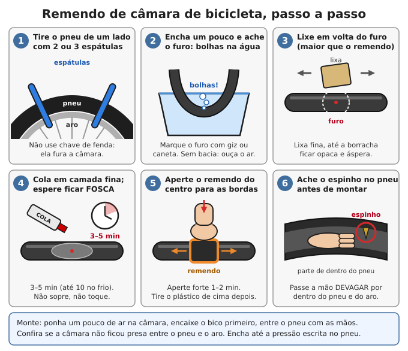
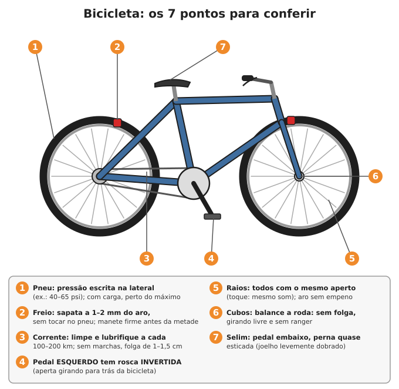

# Bicicleta

**Resumo:** sem combustível, a bicicleta é o melhor transporte que existe: anda **3 a 4 vezes mais rápido
que a pé** com o mesmo esforço, carrega 20–40 kg (ou mais de 100 kg empurrada), passa por trilha e é
consertada com meia dúzia de ferramentas. Tenha **câmaras, remendos, cola, cabos, sapatas e corrente
de reserva**. Saiba remendar câmara, ajustar freio, lubrificar e emendar corrente e desempenar roda.
A bicicleta também move bomba d'água, moinho, rebolo e gerador.

---

## Por que a bicicleta é o melhor transporte pós-colapso

| | A pé | Bicicleta |
|---|---|---|
| Velocidade de cruzeiro | 4–5 km/h | 12–20 km/h |
| Distância por dia (adulto saudável) | 20–30 km | 50–100 km |
| Energia por km | 1 | cerca de 3 vezes menos |
| Carga | 15–25 kg nas costas | 20–40 kg na bicicleta; 100 kg ou mais empurrando |

- Não precisa de combustível: o "combustível" é comida.
- Peças pequenas, baratas e comuns; conserto com poucas ferramentas.
- Silenciosa. Passa onde carro não passa; em ponte caída, se carrega no ombro.

### Que bicicleta ter

- **Quadro de aço:** aguenta pancada, entorta antes de quebrar e pode ser soldado. Alumínio trinca sem
  aviso; carbono não tem conserto.
- **Aro 26** é o mais comum no Brasil (peças em qualquer bicicletaria). A tipo "barra forte"
  (aro 26 × 1.1/2) é robusta e boa cargueira.
- **Freio:** V-brake ou ferradura (com cabo), ou **contrapedal** (freio no cubo traseiro, quase sem
  manutenção). Evite freio a disco hidráulico (precisa de fluido e sangria).
- **Marchas:** menos é mais robusto. 1 marcha ou câmbio interno no cubo duram muito; câmbio externo
  ajuda nas subidas, mas exige ajuste.
- **Pneu largo com câmara** (1,75–2,1") para terra. **Bico tipo carro (Schrader)** enche em qualquer bomba.
- **Cubos de esferas soltas** (cone e cubeta): abrem, engraxam e ajustam com chave comum.
- **Evite:** suspensão barata (pesada, quebra), pneu sem câmara (tubeless), peças "especiais".
  Bicicleta elétrica é ótima enquanto houver carga solar e peças, mas a bateria de lítio dura 3–5 anos.

## Ferramentas mínimas

- 3 espátulas de pneu (plástico) · bomba com manômetro e bicos para os dois tipos de válvula.
- Kit de remendo: lixa, cola, remendos.
- Chaves Allen 4, 5 e 6 mm · chaves de boca 8, 10, 13, 14, 15 mm (15 mm = porca de roda).
- Chave de raio · extrator de corrente (saca-pino) · chave de cone (13–17 mm, fina).
- Chave de fenda e Phillips · alicate · óleo de corrente · graxa · panos.

### Estoque de peças (por bicicleta, para alguns anos)

| Item | Quantidade | Observação |
|---|---|---|
| Câmaras de ar | 2–4 | Do tamanho e bico certos (está escrito no pneu: ex. 26 × 1.95) |
| Remendos | 50 | Baratos, duram anos fechados |
| Cola de remendo | 3–5 tubos pequenos | **Seca depois de aberta**: vários pequenos é melhor que um grande |
| Pneus | 1–2 | Dobráveis ocupam pouco espaço |
| Cabos de freio e de câmbio + conduítes | 2 de cada | |
| Sapatas de freio | 2–3 pares | |
| Corrente + elos rápidos | 1 + 2 | Da largura certa (1, ou 6 a 8 marchas, ou mais) |
| Raios com niples | 6–10 | Do comprimento certo para cada roda (leve um para comparar) |
| Esferas soltas 3/16" e 1/4" | 1 pacote de cada | |
| Fita de aro | 2 | |
| Graxa e óleo | 1 pote / 1 frasco | |

## Remendo de câmara

1. **Solte a roda:** abra o freio V (solte o "cachimbo" do cabo). Traseira: passe para a marcha mais
   pesada (pinhão menor) antes. Solte as porcas (15 mm) ou a blocagem rápida.
2. **Esvazie** toda a câmara. Aperte o pneu em volta toda, empurrando o talão (a borda do pneu) para o
   canal do meio do aro: isso dá folga.
3. **Espátulas:** enfie a primeira do lado oposto ao bico, alavanque o talão para fora e prenda a
   espátula num raio. Enfie a segunda a 10 cm e deslize em volta. Tire a câmara, o bico por último.
   **Não use chave de fenda** (fura a câmara e corta o pneu).
4. **Ache o furo:** encha um pouco a câmara. Escute, passe perto do rosto ou dos lábios (sente o ar),
   ou mergulhe numa bacia com água e veja as bolhas. **Marque** com giz ou caneta.
5. Anote **onde estava o furo em relação ao bico**: o espinho estará no mesmo ponto do pneu.
6. **Lixe** uma área do dobro do tamanho do remendo, até a borracha ficar opaca e áspera.
7. **Cola:** camada **fina**, um pouco maior que o remendo. **Espere secar** até ficar **fosca**: 3–5 minutos
   (até 10 no frio ou na umidade). A cola de remendo funciona **seca**; remendo posto com cola molhada solta.
8. **Remendo:** tire o papel de baixo sem tocar no lado da cola, ponha centrado no furo e **aperte forte do
   centro para as bordas por 1–2 minutos** (role o cabo de uma chave por cima).
9. O plástico de cima pode ficar; se tirar, rasgue do meio para fora, sem levantar a borda do remendo.
10. **Ache a causa:** passe a mão **devagar** por dentro do pneu (espinho e caco de vidro cortam), olhe por
    fora. Confira se a **fita de aro** cobre todas as pontas dos raios.
11. **Monte:** encha a câmara só até ficar redonda. Bico primeiro no furo do aro, câmara dentro do pneu,
    e encaixe o talão **com os polegares**, terminando no bico. Empurre o bico para dentro um pouco para
    o talão não ficar preso sobre a câmara. Evite espátula na montagem (belisca a câmara).
12. Encha até a metade, gire a roda e confira se a linha da borda do pneu está igual em toda a volta.
    Depois encha até a pressão certa.

### O tipo de furo diz a causa

| Furo | Causa | Prevenção |
|---|---|---|
| Um furinho do lado de fora | Espinho, arame, vidro | Procure o objeto no pneu |
| **Dois furos lado a lado** ("mordida de cobra") | Pneu murcho batendo em buraco ou meio-fio | Calibre mais |
| Furo do lado de dentro (do aro) | Ponta de raio, fita de aro torta | Troque ou ajeite a fita de aro |
| Rasgo junto do bico | Rodou murcho, a câmara girou e puxou o bico | Calibre; aperte a porca do bico só de leve |

### Quebra-galhos

- **Sem remendo:** pedaço de câmara velha + **cola de contato (de sapateiro)**: lixe os dois, cola fina
  nos dois, espere secar, junte e aperte.
- **Câmara sem conserto:** corte no furo e **dê um nó** em cada ponta, ou um nó só apertando a área do
  furo. Roda devagar até casa.
- **Pneu rasgado:** ponha uma "bota" por dentro, entre o pneu e a câmara: pedaço de pneu velho, de
  embalagem longa vida ou uma cédula dobrada.
- **Sem câmara nenhuma:** encha o pneu com **capim ou palha bem socados** ou pedaços de mangueira de
  jardim. Anda devagar, mas anda.

### Pressão dos pneus

A faixa certa vem **escrita na lateral do pneu** (ex.: "40–65 psi"). Com carga, perto do máximo; em areia
e lama, mais perto do mínimo.

| Tipo de pneu | Faixa típica |
|---|---|
| Mountain bike (aro 26–29, largo) | 30–50 psi |
| Urbana, aro 26 × 1.5–1.75 | 40–65 psi |
| Estrada (speed), fino | 80–120 psi |

## Freios

### Freio de aro (V-brake e ferradura)
1. A **sapata** encosta **só no aro** (nunca no pneu, nem abaixo do aro), reta, a **1–2 mm** dele.
2. A frente da sapata deve encostar um pouquinho antes da traseira (cerca de 1 mm): evita chiado.
3. O freio deve ficar firme **antes** de o manete chegar à metade do curso.
4. **Ajuste fino:** o parafuso esticador (tambor) no manete: desrosqueie (anti-horário) para esticar o
   cabo e aproximar as sapatas. **Ajuste grosso:** solte o parafuso que prende o cabo no braço do freio,
   puxe o cabo com alicate e aperte de novo.
5. Uma sapata encosta antes da outra: gire os parafusinhos de mola na base de cada braço.
6. Troque a sapata quando as **ranhuras sumirem**. Aro sujo de óleo = sem freio: limpe com álcool.
7. Na chuva, o freio de aro perde força: freie antes e com mais distância.

### Contrapedal
- Freia pedalando para trás. É quase eterno.
- O **braço de reação** (haste presa ao quadro por uma abraçadeira) tem que estar **preso**. Solto, o freio
  não funciona e pode quebrar o quadro.
- Graxa no cubo a cada 1–2 anos.

### Cabos
Cabo desfiado na ponta ou perto do manete: **troque já** (arrebenta na descida). Uma gota de óleo
dentro do conduíte deixa o freio leve.

## Corrente

### Limpar e lubrificar (a cada 100–200 km, e depois de chuva ou lama)
1. Limpe com pano (ou escova com querosene, ou água e sabão; depois seque).
2. **Uma gota de óleo em cada rolete**, por dentro da corrente.
3. Gire o pedal para trás 10 voltas.
4. **Tire o excesso** com pano: óleo sobrando junta areia e vira lixa.

Óleo de corrente ou óleo de máquina; em falta, óleo de motor ou óleo vegetal (gruda mais, limpe mais
vezes). Desengripante sozinho não lubrifica.

### Corrente gasta (esticada)
A corrente "estica" com o uso e passa a comer os dentes das coroas e dos pinhões.
1. Com uma trena, ponha o zero no **centro de um pino**.
2. Conte **24 pinos** adiante. Corrente nova: **305 mm** (12 polegadas).
3. **306,5 mm ou mais: troque a corrente.** 308 mm ou mais: provavelmente pinhões e coroas também
   estão gastos (a corrente nova vai pular).

### Emendar, encurtar, trocar
1. **Extrator (saca-pino):** encaixe a corrente, gire até o pino **quase sair**, deixando a pontinha presa
   na placa de fora (corrente de 1 marcha e antigas). Dobre e separe.
2. Para fechar: encaixe, gire até o pino ficar igual dos dois lados. Elo duro: flexione-o para os lados
   com os dedos até soltar.
3. Correntes de marchas modernas: use **elo rápido** (fecha à mão) ou o pino especial da marca.
4. **Tamanho:**
   - Igual à antiga (conte os elos).
   - Sem marchas: folga de **1 a 1,5 cm** no meio; para esticar, puxe a roda traseira para trás nas
     gancheiras e reaperte as porcas.
   - Com câmbio: passe a corrente na coroa maior e no pinhão maior **sem passar pelo câmbio** e some
     2 elos (1 elo interno + 1 externo).
- **Corrente pulando:** corrente ou pinhão gastos, elo duro ou câmbio desregulado.

## Marchas (câmbio traseiro)

- **Parafusos de limite H e L:** impedem a corrente de cair para fora (H) ou para dentro dos raios (L).
  Corrente caiu nos raios: aperte o **L**. Caiu para fora do pinhão menor: aperte o **H**.
- **Tensão do cabo** (esticador no câmbio ou no trocador), de 1/4 em 1/4 de volta, testando:
  - Demora a subir para os pinhões **maiores**: desrosqueie o esticador (anti-horário), mais tensão.
  - Demora a descer para os **menores**: rosqueie (horário), menos tensão.
- **Gancheira torta** (depois de queda): olhando por trás, as roldanas do câmbio devem ficar alinhadas
  na vertical com o pinhão. Endireite devagar. Torta, o câmbio pode entrar nos raios e destruir a roda.
- **Câmbio quebrado no caminho:** tire-o, escolha uma coroa e um pinhão alinhados (corrente reta),
  encurte a corrente até ficar esticada e emende: virou bicicleta de 1 marcha.
- Óleo nas roldanas e nas articulações do câmbio.

## Raios e roda empenada

Metade dos raios vai para o lado esquerdo do cubo e metade para o direito, alternando. **Apertar um raio
puxa o aro para o lado do cubo onde ele está preso.**

1. Gire a roda devagar usando a **sapata do freio** como referência (ou um arame preso no garfo).
2. Ache o trecho em que o aro encosta, por exemplo, do lado **direito**.
3. Nesse trecho, **aperte 1/4 de volta** os raios que vão para o lado **esquerdo** do cubo e **afrouxe 1/4**
   os que vão para o direito. O aro vem para a esquerda.
4. Mexa em 2–4 raios por vez, 1/4 de volta, gire e confira. Repita até o aro passar reto.
5. **Sentido:** o niple tem rosca comum. Olhando o niple **pelo lado do pneu**, aperta no horário;
   trabalhando por baixo, olhando do cubo para o aro, aperta no **anti-horário**. Na dúvida, dê 1/4 de
   volta e toque o raio: som mais agudo = mais apertado.
6. Todos os raios devem ter tensão parecida (tocados, o som é parecido).

**Raio quebrado:** troque por um do mesmo comprimento (leve o quebrado para comparar). No lado da
catraca é preciso tirar a catraca (extrator). **Emergência:** tire o pedaço, enrole a ponta solta no raio
vizinho, solte o freio se o aro bater e ande devagar.

## Rolamentos (cubos, movimento central, direção)

**Teste:** segure o aro e balance a roda para os lados: "tec-tec" = folga. Gire com a roda no ar:
áspero ou rangendo = falta de graxa ou peças gastas.

**Cubo de cone e esferas:**
1. Tire a roda. Do lado sem catraca, segure o **cone** com a chave de cone e solte a **contraporca**.
2. Desmonte e **conte as esferas** de cada lado (é comum: dianteiro 10 de 3/16" por lado; traseiro 9 de
   1/4" por lado; confira as suas).
3. Limpe com querosene ou diesel. Cone com crateras ou trilha marcada: troque o cone.
4. Graxa nova nas cubetas, esferas assentadas na graxa, monte.
5. Aperte o cone até **sumir a folga** com o eixo ainda girando **livre**. Trave a contraporca
   segurando o cone com a chave. Roda de blocagem rápida: deixe uma folga mínima (a blocagem aperta um pouco).

- **Movimento central (pedivela):** folga ou estalo a cada pedalada = ajustar ou trocar.
- **Caixa de direção:** freio da frente apertado, balance a bicicleta para a frente e para trás:
  "toc" = folga; aperte a porca da caixa.
- **Pedais:** o **pedal esquerdo tem rosca invertida**. Os dois **soltam girando para trás da bicicleta**.
  Graxa na rosca ao montar.
- Graxa em todos os rolamentos a cada 1–2 anos, ou depois de rodar com água acima do cubo (enchente).

## Carregar peso

| Jeito | Carga | Dica |
|---|---|---|
| **Bagageiro traseiro de aço** | 20–25 kg (reforçado: até 40 kg) | Peso baixo; prefira alforjes laterais a pilha alta |
| **Cesta dianteira** | até 5–10 kg | Mais que isso deixa a direção pesada e perigosa |
| **Bolsa no quadro** | 3–8 kg | Muito estável |
| **Reboque de 1 roda** | 20–30 kg | Bom em trilha estreita |
| **Reboque de 2 rodas** | 30–50 kg | Estável; feito com rodas de bicicleta velha e tubo, madeira ou bambu |
| **Bicicleta cargueira / triciclo** | 80–150 kg | Plataforma ou cesto na frente |
| **Bicicleta "burro de carga"** (empurrada) | 100 kg ou mais | Sacos pendurados no quadro; empurre a pé com uma vara amarrada no guidão |

- **Reboque:** engate articulado (tem que virar e inclinar) no eixo traseiro ou no canote do selim.
- Pneus no máximo da pressão, raios firmes (roda de **36 raios** aguenta mais), freios perfeitos.
- **Descidas com carga:** use os dois freios alternando (o aro esquenta); muito peso, desça empurrando.

## Bicicleta como máquina e gerador

**Potência humana:** um adulto saudável sustenta **50–100 W por uma hora** (use 75 W nas contas).
É pouco para eletricidade, mas muito bom como **força mecânica direta**.

### Máquinas a pedal (o melhor uso)
- Moinho de grãos, debulhador de milho, descascador, **bomba d'água**, rebolo de afiar, ventilador de
  forja, serra leve, máquina de lavar roupa.
- **Transmissão:** levante a roda traseira num cavalete, tire o pneu e use o **aro como polia**, com
  correia ou corda até a polia da máquina; ou corrente até uma coroa no eixo da máquina.
- **Bomba d'água:** com 75 W e 50% de eficiência, a pedal se elevam cerca de **1.300 litros por hora a
  10 m de altura** (cerca de 650 L/h a 20 m). Bomba de pistão, de diafragma ou de corda. Veja
  [Irrigação](../04-agricultura/07-irrigacao.md).
- Uma **bicicleta ergométrica velha** já é uma base pronta (tem volante e estrutura).

### Gerador a pedal
1. Cavalete que levanta a roda traseira.
2. **Motor de corrente contínua de ímã permanente** (de esteira ergométrica, patinete elétrico) acionado
   por rolete encostado no pneu, ou por correia no aro.
3. Do motor: **diodo** (impede a bateria de girar o motor) → **controlador de carga** → **bateria 12 V** →
   conversor USB 5 V para celulares e lâmpadas 12 V.
4. **Rende uns 40–50 Wh por hora de pedal**: 2 a 3 celulares, ou uma lâmpada LED de 5 W por 8 horas.
- **Nunca ligue o motor direto no celular** (a tensão varia e queima).
- **Dínamo** de cubo ou de pneu (6 V, 3 W) acende farol e carrega celular devagar com conversor USB.
- Veja [Eletricidade básica](../06-energia/03-eletricidade-basica.md) e [Baterias](../06-energia/05-baterias.md).

## Manutenção periódica

| Quando | O que fazer |
|---|---|
| **Antes de sair** | Pressão; freios firmes; rodas bem presas (porcas ou blocagem); barulhos estranhos |
| **Toda semana ou a cada 100–200 km** | Limpar e lubrificar a corrente |
| **Todo mês** | Cabos e sapatas; raios frouxos; folga nos cubos, pedivela e direção; parafusos |
| **Todo ano** | Graxa nos rolamentos; medir a corrente; trocar cabos e conduítes ruins |

---

Ver também: [Ferramentas manuais](01-ferramentas-manuais.md) · [Orientação e navegação](../10-comunicacao-e-navegacao/03-orientacao-e-navegacao.md) · [Cavalos, burros e tração animal](../05-animais/10-equinos-e-tracao.md) · [Troca e economia](../12-comunidade-e-seguranca/03-troca-e-economia.md)
