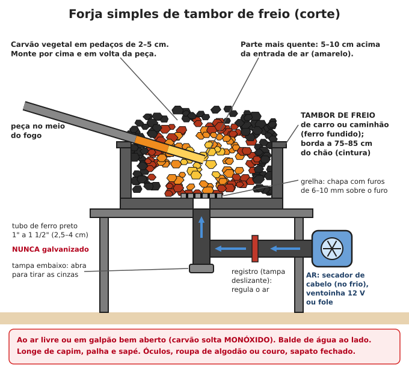
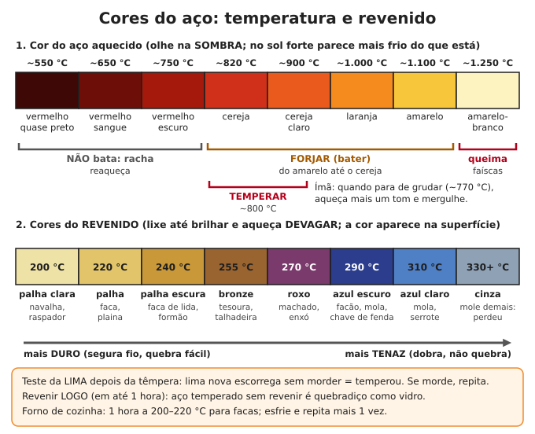

# Ferraria e metais

**Resumo:** com um **tambor de freio**, carvão vegetal, um soprador e um pedaço de **trilho de trem** como
bigorna, dá para forjar pontas, ganchos, cunhas, pregos, ferramentas e facas. A sucata é a sua mina:
**mola de carro e lima velha** são aço bom que pega têmpera; **vergalhão** é aço macio para ganchos e
ferragens. **Têmpera** (aquecer ao cereja e mergulhar em óleo) endurece; **revenido** (reaquecer até a
cor palha, bronze ou azul) tira a fragilidade. Proteja os olhos, trabalhe ao ar livre e **nunca aqueça
peça galvanizada (zincada)**.

---

> **ATENÇÃO:** ferraria e solda queimam pele e olhos, soltam fumos tóxicos e iniciam incêndios.
> Óculos sempre; roupa de algodão ou couro (sintético derrete e gruda na pele); sapato fechado; cabelo
> preso; balde de água ao lado. Leia a seção **Segurança**, no fim deste arquivo, antes de acender a forja.

## Montar uma forja simples (tambor de freio)

**Material:**
- **Tambor de freio** (de caminhão é o melhor: grande e grosso; de carro serve para peças pequenas).
  É de ferro fundido e aguenta o calor. O furo do centro vira a entrada de ar.
- **Tubo de ferro preto** de 1" a 1 1/2" (2,5–4 cm), uma conexão **T** e um tampão.
  **Nunca tubo galvanizado** (o zinco solta fumo tóxico).
- **Grelha** sobre o furo: chapa de 5–6 mm com furos de 6–10 mm, ou 3–4 parafusos grossos cruzados.
- **Ar:** secador de cabelo (só no ar frio), ventoinha 12 V (de carro ou de computador, ligada a uma
  bateria), fole de couro ou soprador de manivela. Um **registro** (tampa deslizante na entrada de ar)
  regula o fogo.
- **Base:** mesa de ferro, pilha de tijolos ou outro tambor. **Borda a 75–85 cm do chão** (cintura).
- **Opcional:** forre o fundo com mistura de **argila e areia (1:1)**, deixando o furo livre: concentra
  o calor e protege o tambor.

**Ferramentas de apoio:** balde de água, atiçador ou pazinha, regador pequeno (molhar a borda do monte de
carvão concentra o fogo no meio), lata de 18 L **com tampa de metal** cheia até 2/3 de óleo para têmpera.

**Sem tambor:** cave um buraco de 30 × 30 cm e 15 cm de fundo, forre com tijolos ou argila, e traga o ar
por um cano enterrado até o fundo (forja de chão).

### Acender e manejar o fogo

1. Papel e gravetos sobre a grelha. Acenda com **pouco ar**.
2. Vá colocando carvão até formar um **monte de 10–15 cm** acima da grelha. Aumente o ar.
3. **A peça vai no meio do fogo**, com 5–8 cm de brasa por baixo e brasa por cima. A parte mais quente
   fica 5–10 cm acima da entrada de ar.
4. Peça perto demais do jato de ar = muita **carepa** (casca de óxido) e risco de queimar o aço. Enterre-a
   mais no meio do monte.
5. Gire a peça para aquecer por igual. Barra de 10–12 mm chega ao amarelo em 2–5 minutos.
6. **Nunca esqueça a peça no fogo com o ar ligado**: o aço queima.
7. Para apagar: corte o ar. Separe o carvão que sobrou para a próxima vez.

**Combustível:** **carvão vegetal** em pedaços de 2–5 cm (quebre os maiores). Uma forja pequena queima
cerca de **1 a 3 kg por hora**. Carvão de **casca de coco babaçu** é denso e ótimo. Lenha não serve
direto (só depois de virar brasa). Veja [Lenha, carvão e fogões](../06-energia/02-lenha-carvao-e-fogoes.md).

## Bigorna, martelos e tenazes

### Bigorna improvisada
- **Trilho de trem**, pedaço de 40–60 cm: **em pé** (vertical) põe mais massa debaixo do martelo;
  deitado, use o topo (boleto) como mesa e a ponta afinada como bico. Esmerilhe o topo bem plano.
- **Bloco de aço maciço:** eixo grosso, pedaço de viga, cabeça de marreta grande, contrapeso de máquina.
- **Massa:** pelo menos **20 vezes**, de preferência **50 vezes**, o peso do martelo.
- **Ferro fundido** (tampa de bueiro, bloco de motor) racha e "morre" no golpe: evite.
- **Pedra dura e plana** (granito): último recurso, só para peças leves.
- **Base:** tronco de madeira dura, enterrado ou bem firme; prenda a bigorna com grampos ou corrente.
- **Altura:** topo da bigorna na altura do **nó dos dedos** com o braço caído ao lado do corpo.

### Martelos e tenazes
- **Martelo de forja:** 0,8–1,5 kg (martelo de bola ou de pena serve). Marreta de 2–4 kg para um ajudante.
- **Tenazes:** um **alicate de pressão grande** segura bem peças pequenas. Tenaz de boca chata feita de
  vergalhão de 12–16 mm é um ótimo primeiro projeto.
- **Barra comprida** (40–50 cm) dispensa tenaz: segure a ponta fria de luva de raspa. O calor sobe pela
  barra: esfrie no balde quando começar a esquentar.

## Cores do aço e temperaturas

| Cor (olhando na sombra) | Temperatura aproximada | O que fazer |
|---|---|---|
| Vermelho quase preto, sangue | 550–650 °C | **Não bata** (racha); reaqueça |
| Vermelho escuro | ~750 °C | Último momento para bater em aço doce; aço de mola: pare |
| **Cereja** | ~800–850 °C | **Temperatura de têmpera** da maioria dos aços de ferramenta |
| Cereja claro, laranja | 900–1.000 °C | Forjar |
| **Amarelo** | ~1.100 °C | Forjar pesado (afinar, engrossar) |
| Amarelo-branco, soltando faíscas | 1.250 °C ou mais | **Aço queimando**: corte fora a parte queimada |

- **Teste do ímã:** quando o aço para de ser atraído pelo ímã (~770 °C), está quase na temperatura de
  têmpera. Aqueça **mais um tom** e tempere.
- **Sol forte engana:** o aço parece mais frio do que está. Trabalhe na sombra ou num galpão escuro.
- Aço de alto carbono (mola, lima, rolamento) queima mais fácil: não passe do amarelo.

## Técnicas básicas

- **Afinar (estirar):** bata com a face do martelo, girando a peça **90° a cada 2–3 golpes** para manter
  quadrado. Depois faça 8 lados (octogonal) e arredonde.
- **Engrossar (recalcar):** aqueça só a ponta e bata no topo, com a outra ponta apoiada.
- **Dobrar:** sobre a quina ou o bico da bigorna, ou na morsa, sempre quente.
- **Furar a quente:** punção sobre um furo na bigorna, ou sobre uma porca grande apoiada.
- **Cortar a quente:** talhadeira sobre a peça quente, golpes até quase atravessar; vire, termine e
  quebre. **A ponta cortada voa quente**: aponte para o chão, longe de pessoas.
- **Caldear (soldar na forja):** aqueça as duas peças até o amarelo-claro (~1.250 °C), espalhe **bórax**
  nelas no laranja, junte e bata rápido, leve no começo. Funciona bem em aço doce; exige prática.

## Projetos para começar

### 1. Ponta (estaca, ponteiro, cravo)
1. Aqueça 5–8 cm da ponta da barra ao amarelo.
2. Bata nos 4 lados, girando 90° a cada 2–3 golpes, inclinando o martelo para formar uma pirâmide
   comprida (ponta 3–4 vezes mais longa que a grossura da barra).
3. Reaqueça sempre que cair para o vermelho. Acerte as quinas no final.

### 2. Gancho (de parede, de corrente, em S)
1. Afine uma ponta como acima, mais curta.
2. Dobre a ponta afinada sobre o bico da bigorna para formar o gancho.
3. Na outra ponta, achate e fure (para prego ou parafuso), ou faça um olhal enrolando sobre o bico.
4. Para gancho em S, faça o mesmo nas duas pontas em sentidos opostos.

### 3. Cunha de rachar lenha
1. Barra de 20–25 mm de aço médio (eixo velho).
2. Afine uma ponta em cunha (só dos dois lados), 10–12 cm de comprimento.
3. Chanfre a borda da cabeça (não fica "cogumelada" tão cedo).
4. **Não tempere**: deixe esfriar ao ar. Cunha mole amassa; cunha dura demais estilhaça.

### 4. Prego e cravo
1. Vergalhão de 6–8 mm. Afine a ponta nos 4 lados (3–4 cm).
2. Marque o comprimento do prego e corte até a metade com talhadeira, deixando 1 cm a mais para a cabeça.
3. Reaqueça e enfie na **pregadeira** (chapa de aço de 10–12 mm com um furo do diâmetro do prego).
   Quebre a sobra torcendo e bata a cabeça com 4–6 golpes.
4. Bata a pregadeira de lado para soltar o prego.

### 5. Faca de mola ou de lima
1. **Teste o aço** (faísca, mais abaixo). Lima: esmerilhe todos os dentes primeiro (os sulcos viram trincas).
2. **Recoza** se precisar limar ou furar: aqueça ao cereja e deixe esfriar **devagar**, enterrado na
   cinza ou no carvão apagando, por várias horas. Fica mole.
3. **Forje** o formato e o bisel, no laranja-amarelo. Deixe o fio com **1–1,5 mm** de espessura antes da
   têmpera (fino demais empena e trinca).
4. **Normalize 3 vezes:** aqueça até o ímã não grudar e deixe esfriar ao ar até ficar preto. Alivia
   tensões e afina o grão.
5. Acerte o formato com lima e esmeril. **Fure o cabo agora** (depois de temperado, a broca não entra).
6. **Tempere** e **revenha** (abaixo).
7. **Cabo:** duas talas de madeira dura com 2–3 pinos (latão, cobre ou prego) rebitados, e cola epóxi.
8. Afie (veja [Ferramentas manuais](01-ferramentas-manuais.md)).

## Têmpera e revenido

### Têmpera (endurecer)
1. Aqueça **por igual** até o cereja (o ímã não gruda mais + um tom). Peça fina aquece rápido; vá devagar.
2. Mergulhe **de ponta, na vertical**, movendo para **cima e para baixo** (de lado, a peça empena),
   até parar de chiar. Depois deixe esfriar no líquido.

| Meio | Para que aço | Observação |
|---|---|---|
| **Óleo vegetal** (soja, canola) aquecido a ~50 °C | **Mola, lima, rolamento, serra** (alto carbono) | O mais seguro; use 4–5 L ou mais para uma faca. Lata com tampa de metal ao lado |
| **Água** (ou salmoura) morna | Aço de médio carbono simples (eixo, ponteiro, talhadeira) | Muito violenta: **trinca** aço de alto carbono |
| Ar | Aço-liga especial | Não é o caso da sucata comum |

- **Aço macio (vergalhão, chapa, arame, prego) não pega têmpera útil.**
- **Teste da lima:** passe uma lima nova no fio. Se **escorrega sem morder**, temperou. Se morde,
  aqueça e tempere de novo.

### Revenido (tirar a fragilidade): faça em até 1 hora

> **ATENÇÃO:** aço temperado e não revenido é **quebradiço como vidro**: pode estilhaçar ao cair ou ao
> receber um golpe. Revenha logo depois da têmpera.

- **No forno de cozinha (o mais fácil e preciso):** 1 hora a **200–220 °C** para facas; esfrie ao ar e
  repita mais 1 vez.
- **No fogo:** lixe a peça até brilhar. Aqueça **devagar** pelo dorso (sobre uma barra em brasa ou chapa
  quente) e veja as cores "andando" até o fio. Quando o fio chegar na cor desejada, mergulhe na água.
- **Revenido diferencial (facão, machado):** dorso azul (tenaz, não quebra) e fio palha ou bronze (segura
  o corte).

| Cor do revenido | Temperatura | Uso |
|---|---|---|
| Palha clara | ~200 °C | Navalha, raspador, ferramenta de cortar metal |
| Palha | ~220 °C | Faca de cozinha, ferro de plaina |
| Palha escura | ~240 °C | Faca de lida, formão |
| Bronze / marrom | ~255 °C | Tesoura, talhadeira |
| Roxo | ~270 °C | Machado, enxó |
| Azul escuro | ~290 °C | Facão, mola, chave de fenda |
| Azul claro | ~310 °C | Mola, serrote |
| Cinza | acima de 330 °C | Mole demais: perdeu a têmpera |

## Teste da faísca (no esmeril)

Encoste a sucata de leve no esmeril, no escuro, e compare com um aço conhecido.

| Faíscas | Aço | Serve para |
|---|---|---|
| Longas, amarelas, poucas "estrelinhas" | **Baixo carbono** (macio) | Ganchos, pregos, ferragens, dobradiças |
| Médias, algumas estrelinhas | **Médio carbono** | Ponteiro, talhadeira, cunha, martelo |
| Curtas, brilhantes, **muitas estrelinhas ramificadas** | **Alto carbono** | Facas, formões, molas, ferramentas de corte |
| Curtas, **vermelho-alaranjadas**, poucas | **Ferro fundido** | Não forja (esfarela). Peso, base, panela |

## Reaproveitamento de sucata

| Sucata | Tipo de aço | Bom para |
|---|---|---|
| **Mola de feixe** (caminhão, carro) | Aço-mola (~0,6% de carbono) | Facas, facões, talhadeiras, ferramentas, molas. Tempera em óleo |
| Mola espiral de suspensão | Aço-mola | Ponteiros, punções, facas pequenas (precisa endireitar) |
| **Lima velha** | Alto carbono (~1%) | Facas, raspadores, formões. Confira na faísca: algumas são de aço mole só endurecido por fora |
| Serra circular, serrote velho | Alto carbono, fino | Lâminas de faca (corte com esmeril molhando sempre) |
| Disco de arado ou de grade | Médio a alto carbono | Facões, lâminas de enxada, panela de disco |
| Rolamento (pistas e esferas) | Alto carbono com cromo | Facas excelentes; difícil de forjar (exige muito calor e força) |
| Eixos, semieixos | Médio carbono | Ferramentas de bater: ponteiro, talhadeira, punção, martelo, cunha |
| **Vergalhão** (CA-50, CA-60) | Aço macio, composição variável | Ganchos, pregos, tenazes, grelhas, ferragens. Não espere boa têmpera |
| Chapa de carro, latas | Aço macio fino | Funilaria: calhas, funis, baldes |
| Tambor de freio, bloco de motor, tampões | Ferro fundido | Forja (tambor), contrapeso, base. **Não forja** |
| Fio de cobre | Cobre | Rebites, juntas, arame. Cobre amolece aquecido e esfriado na água (ao contrário do aço) |
| Arame de cerca, telha e tubo galvanizados | Aço zincado | **Não aqueça** sem tirar o zinco antes (lixa ou esmeril ao ar livre) |

## Rebites

- **Comprimento do rebite = espessura das peças + 1,5 × o diâmetro** do rebite (a sobra forma a cabeça).
- **A frio** (cobre, alumínio, aço macio até ~5 mm): furo justo; apoie a cabeça pronta na bigorna (ou num
  contra-estampo com cavidade); bata primeiro no centro da ponta (engrossa dentro do furo), depois nas
  bordas, arredondando a cabeça.
- **A quente** (6 mm ou mais, estruturas, ferragens de porteira): aqueça o rebite ao laranja, ponha no
  furo, aperte as peças juntas e bata rápido. Ao esfriar, ele encolhe e aperta com muita força.
- **Prego como pino:** corte e rebite as duas pontas (cabo de faca, dobradiça de tesoura).
- **Rebite pop** (rebitadeira): chapa fina, calha, lona com ilhós.

## Soldagem: princípios e riscos

### Solda elétrica com eletrodo revestido
O **arco elétrico** entre o eletrodo e a peça passa de milhares de graus e funde os dois; o revestimento
vira gás e **escória**, que protegem a solda do ar.

- **Máquina:** inversora (leve, 127/220 V) ou transformadora. Num gerador, a inversora pede pelo menos
  **4–5 kVA** para eletrodo de 2,5 mm.
- **Eletrodos:** **E6013** (fácil, uso geral, chapas finas e médias); **E7018** (estrutural, mais forte,
  precisa ser guardado **seco**).
- **Corrente:** cerca de **30–40 A por mm** de diâmetro do eletrodo: 2,5 mm → 60–90 A; 3,25 mm → 90–130 A.
- **Técnica:**
  1. Limpe a peça até o metal brilhar. Garra terra perto da solda, em metal limpo.
  2. Eletrodo inclinado 10–20° para o lado em que avança. Arco curto (do tamanho do diâmetro do eletrodo),
     com som de "fritura" constante.
  3. Avance devagar e sem parar.
  4. Tire a escória com picadeira **de óculos** (ela pula quente).

> **ATENÇÃO — OLHOS:** a luz do arco tem **ultravioleta que queima a córnea** ("olho de soldador": dor
> forte e sensação de areia nos olhos 6–12 horas depois) e pode **lesar a retina para sempre**. Use
> **máscara de solda com filtro tonalidade 10 a 13** (10–11 até ~100 A; 12–13 acima). **Óculos escuros
> não protegem.** Nunca olhe o arco "só um pouquinho". Proteja quem está perto com biombo (lona, chapa)
> e mande as crianças para longe.

> **ATENÇÃO — CHOQUE E QUEIMADURA:** luvas de raspa **secas**, chão seco, nunca molhado ou suado
> encostado na peça. Cabos sem emendas descascadas. Mangas compridas de algodão grosso ou couro,
> gola fechada (o arco queima a pele como sol forte). Trabalhar dentro de tanque ou lugar apertado e
> úmido é muito perigoso.

> **ATENÇÃO — FUMOS E EXPLOSÃO:** trabalhe ventilado, com a fumaça indo para longe do rosto.
> **Galvanizado:** o fumo de zinco causa a "febre dos fumos metálicos" (calafrios, febre, dor no corpo
> horas depois): tire o zinco com esmeril ao ar livre antes. **Parafuso dourado ou amarelado (cádmio):
> nunca solde nem aqueça**: o fumo pode matar. Tinta velha pode ter chumbo: lixe antes, de máscara.
> Peças lavadas com solvente clorado formam gás tóxico. **Nunca solde nem corte tambor, tanque, galão
> ou botijão que teve combustível, óleo ou tinta**: mesmo "vazio", explode. Faíscas voam 10 m: tire
> palha, serragem e combustível de perto e vigie o local por 30 minutos depois.

### Solda e corte a gás (oxiacetileno)
- Chama de cerca de **3.100 °C**: solda, corta (oxicorte), aquece para dobrar, faz brasagem.
- **Acetileno acima de 1 bar (15 psi) pode explodir sozinho**: nunca regule acima disso.
- Cilindros **em pé e acorrentados**, longe de calor. **Válvulas corta-chama** (antirretrocesso) nas duas
  mangueiras. Teste vazamentos com água e sabão, nunca com fogo.
- **Nunca óleo ou graxa nas conexões de oxigênio** (pega fogo sozinho). Nada de mãos ou luvas engorduradas.
- Óculos de solda a gás: tonalidade **4 a 6** (a luz é diferente da solda elétrica).
- Siga a sequência de acender e apagar do fabricante do equipamento.

### Brasagem e solda branda
- **Brasagem (solda forte com latão):** maçarico, **vareta de latão e bórax** como fluxo. Une aço, cobre e
  **ferro fundido** sem derreter a peça (~900 °C). Ótima para consertar peça de máquina de ferro fundido.
  Ventile (o latão solta zinco).
- **Solda branda (estanho):** lata, calha, cobre, eletrônica. Sem energia, use **ferro de soldar a fogo**
  (bloco de cobre num cabo de ferro, aquecido no carvão). Peça limpa e brilhante + pasta de solda (ou breu
  para eletrônica). Solda com chumbo: **nunca** em vasilha de comida ou água.

## Funilaria simples

- **Desamassar:** apoie um contra-estampo liso (bloco de aço, ferro de passar velho) **por dentro** e bata
  por fora com martelo liso, golpes leves, **da borda do amassado para o centro**.
- **Cortar chapa:** tesoura de funileiro (até ~1 mm), talhadeira sobre a bigorna, serra de arco.
- **Dobrar:** prenda a chapa na morsa entre duas cantoneiras (ou entre tábuas grossas) e bata com macete
  de madeira ao longo da dobra, aos poucos.
- **Juntar sem solda (agrafagem):** dobre a borda das duas chapas em gancho (6–10 mm), encaixe um gancho
  no outro e martele fechado. Rebite e vede com epóxi, silicone ou solda branda.
- **Dá para fazer:** funil (chapa em cone), calha (dobra em U), balde, regador, chaminé, fogão e forno de
  tambor (veja [Lenha, carvão e fogões](../06-energia/02-lenha-carvao-e-fogoes.md)).
- **Remendar panela, tanque, balde:** rebite com arruela de borracha ou cobre; solda branda; massa epóxi
  (não vai ao fogo).
- **Proteger da ferrugem:** lixe, passe fundo anticorrosivo e tinta; ou óleo e cera.

### Fundir alumínio (para quem já domina a forja)

Alumínio funde a ~660 °C: uma forja forte derrete pistões, rodas e perfis num **cadinho de aço grosso**
(pedaço de tubo de parede grossa com fundo soldado). Despeje em molde de areia **seca**. Latas rendem
pouco (muita escória); prefira peças grossas.

> **ATENÇÃO:** **qualquer umidade em contato com metal derretido explode** e espirra metal a 700 °C:
> sucata, ferramentas e molde **secos e pré-aquecidos**, nada de chão de cimento (a umidade do concreto
> explode), botas, avental de couro, viseira. Nunca em dia de chuva.

## Segurança

- **Queimaduras:** todo metal na oficina **está quente até prova em contrário**: o aço a 300 °C parece
  frio (não brilha). Pegue com tenaz ou passe a mão perto antes. Ponha peça quente sempre no mesmo lugar,
  longe de onde se passa. Queimou: água corrente fria por 20 minutos (veja [Ferimentos e queimaduras](../02-saude/02-ferimentos-queimaduras-fraturas.md)).
- **Olhos:** óculos ao martelar, esmerilhar, cortar e soldar. Carepa quente pula da bigorna.
- **Roupa:** algodão ou couro, avental de couro, sapato fechado, calça por cima da bota (para fagulha não
  cair dentro), cabelo preso. Nada de sintético.
- **Galvanizado (zincado):** brilho prateado com manchas "cristalizadas" (arame de cerca, telha de zinco,
  tubo galvanizado, parafusos de cerca). **Nunca aqueça na forja.** O fumo branco de zinco dá febre e
  intoxica.
- **Monóxido de carbono:** carvão aceso solta CO. Forje **ao ar livre ou em galpão bem aberto**. Veja
  [Calor, frio e ambiente](../02-saude/10-calor-frio-e-ambiente.md).
- **Óleo de têmpera:** mergulhe a peça **inteira de uma vez** (só a ponta dentro faz o óleo pegar fogo).
  Se pegar fogo, **abafe com a tampa de metal**. **Nunca jogue água em óleo em chamas.**
- **Incêndio:** forja longe de capim, palha, serragem e telhado de sapé. Balde de água e de areia ao lado.
- **Ouvidos:** martelar na bigorna passa de 100 dB: protetor auricular. Corrente ou ímã preso embaixo da
  bigorna abafa o toque.
- **Esmeril:** óculos, proteção no lugar, apoio a 2–3 mm do rebolo, nunca use a lateral do rebolo.
- **Crianças e animais** longe da forja e da área de solda.

---

Ver também: [Ferramentas manuais](01-ferramentas-manuais.md) · [Lenha, carvão e fogões](../06-energia/02-lenha-carvao-e-fogoes.md) · [Química prática](../09-quimica-e-oficios/02-quimica-pratica.md) · [Madeira e carpintaria](../07-abrigo-e-construcao/03-madeira-e-carpintaria.md) · [Ferimentos e queimaduras](../02-saude/02-ferimentos-queimaduras-fraturas.md)
