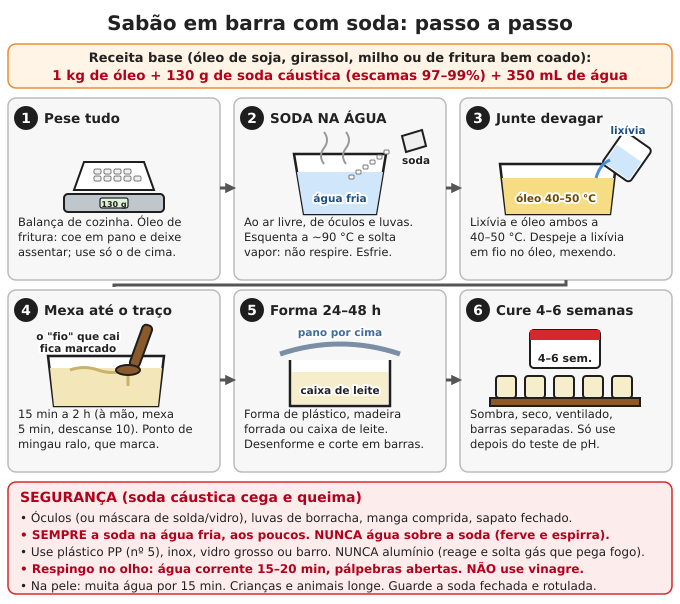
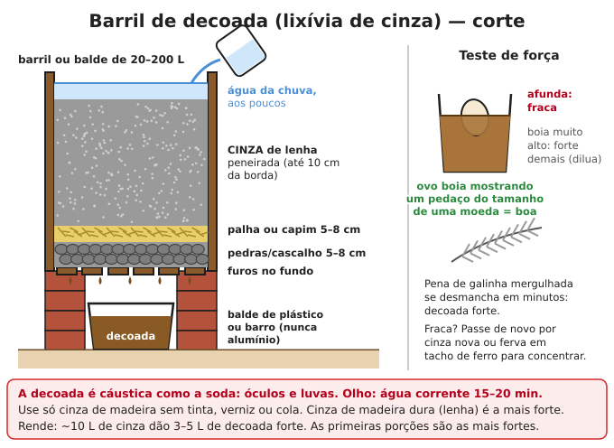

# Sabão e limpeza

**Resumo:** sabão é gordura + álcali (soda cáustica ou lixívia de cinza). Com **1 kg de óleo
(até de fritura, coado), 130 g de soda cáustica e 350 mL de água** sai cerca de 1,4 kg de sabão
em barra, pronto para uso após **4 a 6 semanas de cura**. Sem soda, a **decoada** (água de cinza)
faz sabão mole. A soda cega e queima: óculos, luvas e **sempre a soda na água, nunca a água na soda**.

---

## Por que sabão é prioridade

- Lavar as mãos com sabão corta pela metade as diarreias e muitas infecções respiratórias
  (veja [Higiene e saneamento](../02-saude/09-higiene-e-saneamento.md)).
- Roupa, louça, feridas, partos, abate de animais: tudo exige sabão.
- Sabão é ótima **moeda de troca**: não estraga, todo mundo precisa.
- Guarde agora: **soda cáustica em escamas** (pote plástico bem fechado dura anos), barras de sabão
  comum (duram anos em lugar seco) e água sanitária (perde força em meses).

## Como funciona (o mínimo de química)

Gordura + soda → **sabão + glicerina**. Cada óleo precisa de uma quantidade certa de soda,
o **índice de saponificação (IS)**: gramas de soda (NaOH) para transformar 1 g de gordura.

- **Soda de menos:** sobra gordura → sabão mole, oleoso, que rança mais cedo (mas não queima).
- **Soda de mais:** sobra soda livre → sabão cáustico, que **queima a pele** e estraga tecido.
- Por segurança, usa-se **menos soda do que a conta** (5% de "sobra de gordura"). É melhor sobrar
  gordura do que sobrar soda.

### Tabela de índice de saponificação (soda cáustica, NaOH)

| Gordura | IS (g de NaOH por g) | Soda por 1 kg (5% de sobra, soda 98%) | Característica do sabão |
|---|---|---|---|
| Óleo de soja | 0,135 | **130 g** | Mole no começo, endurece na cura; pouca espuma |
| Óleo de fritura (coado) | ~0,135 | **125–130 g** (use 6–8% de sobra) | Igual ao de soja; cheiro some na cura |
| Girassol / milho | 0,134–0,136 | 130 g | Mole; misture com sebo ou coco |
| Canola | 0,124–0,132 | 125 g | Mole |
| Algodão / amendoim | 0,136–0,138 | 132 g | Médio |
| Azeite de oliva | 0,135 | 130 g | Suave, ótimo para pele, demora a endurecer |
| Dendê (palma) | 0,141 | 137 g | Duro, boa barra |
| Banha de porco | 0,138 | 134 g | Duro, branco, suave |
| Sebo de boi | 0,140–0,143 | 137 g | Muito duro, dura muito |
| Óleo de coco | 0,183 | 177 g | Muito duro, muita espuma; resseca a pele |
| Babaçu | 0,175 | 170 g | Igual ao coco |
| Mamona | 0,128 | 124 g | Pegajoso; só 5–10% da receita |

**Conta:** soda (g) = peso da gordura (g) × IS × 0,95 ÷ pureza da soda.
Exemplo: 1.000 g de soja × 0,135 × 0,95 ÷ 0,98 = **131 g → use 130 g**.

**Mistura de gorduras:** some a soda de cada uma. Exemplo de barra boa: 700 g de soja (94,5 g)
+ 300 g de coco (54,9 g) = 149,4 g × 0,95 ÷ 0,98 = **145 g de soda** e 400 mL de água.

**Água:** de **2,5 a 3 vezes o peso da soda** (130 g de soda → 325 a 390 mL; use 350 mL).
Menos água = sabão que endurece mais rápido, mas a lixívia fica mais perigosa e o traço vem
rápido demais.

**Sem balança:** 1 kg de óleo de soja ≈ **1,1 L** (cerca de 4 xícaras e meia). A soda em escamas
varia muito por colher; meça a soda **sempre pesando**. Balança de cozinha é item de estoque.

> **ATENÇÃO:** muitas receitas populares usam **1 kg de soda para 4 ou 5 litros de óleo** — isso é
> 60% a 100% de soda a mais do que o necessário. O sabão sai cáustico: serve para chão e quintal,
> **nunca para pele, louça ou roupa de bebê**. Siga a conta acima.

## Segurança com soda cáustica

1. **Equipamento:** óculos (ou máscara de solda transparente, viseira), luvas de borracha,
   manga comprida, calça, sapato fechado, avental.
2. **Local:** ao ar livre ou com janela aberta e vento levando o vapor para longe. Crianças e
   animais **longe**. Nada de comida por perto.
3. **SEMPRE a soda NA água fria**, aos poucos, mexendo. Nunca jogue água sobre a soda: ferve na
   hora e espirra. A lixívia passa de 80–90 °C e solta vapor irritante: não debruce sobre o balde.
4. **Recipientes:** plástico PP (número 5 no fundo), inox, vidro grosso ou barro esmaltado sem
   lascas. **Nunca alumínio** (a soda corrói e solta hidrogênio, gás que pega fogo), nem zinco,
   lata galvanizada ou estanho. Colher de pau serve (ela "come" devagar), melhor inox ou silicone.
5. Separe os utensílios do sabão: **não voltam para a cozinha**.
6. **Guarde** a soda em pote fechado, rotulado "VENENO — SODA CÁUSTICA", fora do alcance de
   crianças. Ela puxa umidade do ar e empedra.

### Acidentes

| Acidente | O que fazer |
|---|---|
| Respingo no **olho** | Água corrente limpa **15–20 minutos**, pálpebras bem abertas, sem esfregar. Tire lente de contato. **NÃO use vinagre** nem outro "neutralizante" no olho. Procure ajuda: soda cega em minutos |
| Na **pele** | Tire a roupa atingida. Água corrente por **15 minutos**. A pele fica "escorregadia" até sair toda a soda. Depois, trate como queimadura ([queimaduras](../02-saude/02-ferimentos-queimaduras-fraturas.md)) |
| **Engoliu** | NÃO provoque vômito. Enxágue a boca, dê pequenos goles de água ou leite. Procure socorro |
| Derramou no chão | Cubra com muita água; depois um pouco de vinagre **no chão** (não em gente) |

> **ATENÇÃO:** vinagre no olho ou na pele queimada piora: a reação gera calor e atrasa a lavagem.
> O único tratamento de emergência é **água em quantidade**.

## Sabão em barra com soda — passo a passo

**Material:** balança, 2 baldes ou panelas (PP ou inox), termômetro (ou o teste da mão no lado de
fora do vidro), colher longa, forma, pano de algodão para coar, papel/plástico para forrar.

1. **Prepare o óleo.** Óleo de fritura: aqueça um pouco, coe num pano, deixe descansar 1 dia e use
   só a parte de cima (sem borra). Óleo muito escuro e com cheiro forte: lave-o fervendo com o
   mesmo volume de água e um punhado de sal, deixe esfriar e tire o óleo de cima. Pese **1 kg**.
2. **Faça a lixívia.** Pese **350 mL (350 g) de água fria** no balde PP. Pese **130 g de soda**.
   Despeje a soda na água aos poucos, mexendo até dissolver (fica transparente). Deixe esfriar
   ao ar livre, tampado frouxamente, até **40–50 °C** (morno; leva 30–60 min, mais rápido com o
   balde dentro de uma bacia de água fria).
3. **Aqueça o óleo** a **40–50 °C** (morno na mão). Temperaturas parecidas (diferença de até 10 °C)
   evitam que o sabão "corte".
4. **Junte:** despeje a lixívia **no óleo**, em fio fino, mexendo sempre. Raspe o fundo e os lados.
5. **Mexa até o traço.** No começo parece óleo turvo; depois engrossa. **Ponto de traço:** levante a
   colher e deixe pingar — o fio que cai **fica marcado na superfície** por alguns segundos, como
   mingau ralo. À mão leva de 15 minutos a 2 horas (óleo de soja puro demora mais; coco, sebo e
   calor aceleram). Pode mexer 5 minutos e descansar 10, repetindo. Mixer elétrico: 3–10 minutos.
6. **Coloque na forma.** Caixa de leite aberta, forma de plástico, caixa de madeira forrada com
   plástico ou papel manteiga, cano de PVC tampado, potes de margarina. Bata a forma para soltar
   bolhas. Cubra com papelão e um pano para guardar calor.
7. **Espere 24–48 h.** Desenforme quando estiver firme como queijo. Se ainda estiver mole, espere
   mais 1–3 dias. **Use luvas**: o sabão novo ainda queima.
8. **Corte** em barras (fio de nylon ou faca) de 2–3 cm de espessura.
9. **Cure 4–6 semanas** em prateleira à sombra, seca e ventilada, barras afastadas 1–2 cm, virando
   uma vez por semana. Na cura a reação termina, a água evapora e a barra endurece e fica mais suave.
   Sabão de sebo ou coco: 4 semanas; de soja ou azeite: 6 semanas ou mais.

**Rendimento:** 1 kg de óleo + 130 g de soda + 350 mL de água dão ~1,45 kg de sabão fresco e
~1,3 kg depois de curado (cerca de 13 barras de 100 g).

**Extras (opcionais), no traço:** 1–2 colheres de sopa de **açúcar** dissolvido na água (mais
espuma), **sal** (1 colher de chá por kg de óleo, endurece), argila, fubá ou borra de café (esfoliante),
ervas secas. Óleo essencial só se houver sobra.

### Problemas comuns

| Problema | Causa provável | Solução |
|---|---|---|
| Não chega ao traço depois de horas | Óleo mole, frio, pouca agitação | Aqueça a 50 °C, mexa mais; deixe descansar a noite e mexa de novo |
| Endureceu na panela em segundos | Temperatura alta, óleo velho ou com aditivos | Coloque rápido na forma; vai ficar rústico mas serve |
| Óleo ou líquido separado na forma | Mistura mal feita ou conta errada | Rale tudo, derreta em banho-maria com um pouco de água e mexa até homogêneo ("sabão refeito") |
| Pó branco na superfície | Soda reagindo com o ar (carbonato) | Inofensivo: raspe ou lave |
| Bolsas de líquido ou pontos brancos duros que ardem | Soda não misturada | Não use na pele: refaça o sabão |
| Sabão mole e oleoso mesmo após 6 semanas | Pouca soda ou soda velha (fraca) | Use para roupa ou refaça com um pouco mais de soda |

### Teste de pH (antes de usar na pele)

- **Fita de pH** (loja de piscina/aquário): dissolva um pedaço de sabão em água; o normal é
  **pH 9–10**. Acima de 10,5: cáustico.
- **Indicador de repolho roxo:** ferva 2–3 folhas picadas em 1 copo de água por 10 min e coe (dura 2–3
  dias na geladeira). Pingue no sabão dissolvido: **verde-azulado = bom (9–10)**; **verde-amarelado ou
  amarelo = soda demais**; roxo = neutro (não é sabão pronto). Guarde o chá para outros testes.
- **Teste tradicional da língua** (só em sabão já curado): encoste de leve a ponta da língua. Se der
  um "choque" ou ardor, ainda tem soda livre — espere mais ou refaça.

## Sabão de cinza (decoada) — sem soda comprada

A **decoada** (lixívia de cinza) é água que passou por cinza de madeira e dissolveu os sais de
**potássio**. Com ela se fazia todo o sabão do interior do Brasil. Dá um **sabão mole, escuro e
pastoso**, ótimo para roupa e chão.

### Fazer a decoada

1. **Cinza:** só de lenha (madeira dura dá a decoada mais forte: angico, aroeira, eucalipto, sabiá,
   jurema). Peneire. **Não use** cinza de carvão de churrasco com aditivo, papel colorido, plástico,
   madeira pintada ou tratada (veneno).
2. **Barril ou balde** de 20 a 200 L com **furos no fundo**, sobre tijolos. De baixo para cima:
   pedras ou cascalho 5–8 cm, palha ou capim 5–8 cm (filtro), cinza até 10 cm da borda (aperte um pouco).
3. Despeje **água da chuva** (água "mole"; quente é melhor) aos poucos, sem encharcar de uma vez,
   e recolha o que pinga num balde de plástico ou barro (**nunca alumínio**). Leva horas a 1–2 dias.
4. **Teste de força:** um **ovo fresco** (ou batata) deve **boiar mostrando um pedaço do tamanho de
   uma moeda**. Se afunda, está fraca: passe de novo por cinza nova ou ferva em tacho de ferro para
   concentrar. Uma **pena de galinha** mergulhada deve se desmanchar em minutos.
5. **Mais forte (cáustica):** misturar **1 parte de cal hidratada para 5 a 10 partes de cinza**
   (em volume) no barril transforma parte do carbonato em potassa cáustica — sabão sai melhor e
   mais rápido, mas a decoada queima mais. Óculos e luvas.

**Rendimento:** ~10 L de cinza → 3 a 5 L de decoada forte. As primeiras porções são as mais fortes.

### Fazer o sabão mole

1. Derreta e coe a gordura (banha, sebo, óleo usado, restos de gordura de cozinha). Pese.
2. Num **tacho de ferro ou panela grande de inox** (nunca alumínio), aqueça 1 kg de gordura com
   **1 L de decoada forte**. Ferva em fogo baixo, mexendo, **3 a 6 horas**.
3. Vá juntando decoada aos poucos (no total, **2 a 3 L por kg de gordura**, conforme a força) sempre
   que a massa parecer oleosa. Reponha a água que evapora.
4. **Ponto:** pingue um pouco num prato frio. Pronto = **geleia firme, clara, sem gordura solta**
   por cima. Se aparece gordura: falta decoada. Se arde muito na pele: sobrou decoada → junte um
   pouco de gordura e ferva mais.
5. Guarde a pasta em potes ou cuias. Use em 1–2 semanas de cura.

**Endurecer com sal:** no fim, jogue **1 a 2 punhados de sal por kg de gordura** e ferva mais
10 minutos. O sabão "talha": sobe em grumos e a água salgada fica embaixo. Deixe esfriar, retire o
bolo de cima (mais duro e mais limpo) e descarte o líquido de baixo.

## Sabão de banha ou sebo

1. **Derreta a gordura:** pique o toucinho ou sebo em cubos, cozinhe com 1 copo de água em fogo
   baixo até sair toda a gordura (torresmos dourados). Coe em pano.
2. **Limpe:** ferva a gordura com o mesmo volume de água e 1 colher de sopa de sal por litro;
   deixe esfriar. A gordura limpa endurece por cima; raspe a sujeira de baixo do bloco.
3. Faça como o sabão de soda: **sebo 137 g** ou **banha 134 g de soda por kg**, 2,5–3× de água.
   Trabalhe a **45–55 °C** (sebo endurece se esfriar). Traço vem rápido.
4. Sebo dá barra dura, branca e durável; ótimo para roupa. Banha dá barra suave para a pele.

## Sabão de coco ou babaçu

- **177 g de soda por kg de óleo de coco** (5% de sobra) para roupa e louça. Faz muita espuma
  **até em água salgada** (útil no litoral).
- Para pele, use **15–20% de sobra** (cerca de **150 g de soda por kg**), porque coco puro resseca.
- Babaçu: 170 g por kg (5%). Coco ou babaçu misturado (20–30%) com soja ou sebo dá a melhor barra.
- Óleo de coco caseiro: rale a polpa de 4–5 cocos secos, bata com água morna, esprema num pano, deixe
  o leite descansar 1 dia (a nata sobe), ferva a nata devagar até sair o óleo claro e coe.

## Sabão líquido e em pó

- **Líquido:** rale 100 g de sabão em barra, dissolva em 1–1,5 L de água quente, mexa e deixe
  esfriar. Se ficar duro, junte água quente.
- **Em pó/lascas para roupa:** rale o sabão curado e seco. 1–2 colheres de sopa por balde.

## Plantas que fazem espuma (sem sabão)

- **Saboneteira** (*Sapindus saponaria*, também chamada sabão-de-soldado): 5–10 frutos (só a casca)
  em 1 L de água quente, esfregue até fazer espuma. Lava roupa e cabelo.
- **Juá** (*Ziziphus joazeiro*, Caatinga): raspas da casca em água fazem espuma; uso tradicional para
  cabelo e dentes.
- Essas espumas são tóxicas para peixes: **não jogue em açudes**.

## Produtos de limpeza simples

| Produto | Para que serve | Como usar |
|---|---|---|
| **Vinagre** (4% de acidez) | Tirar crosta de calcário (chaleira, chuveiro), vidros, mau cheiro, amaciante | Puro no calcário (deixe agir 1 h); 1:1 com água para vidro; ½ xícara no último enxágue da roupa. Não use em mármore |
| **Bicarbonato** | Abrasivo leve, tirar gordura e cheiro | Pasta com água em panelas, pias; 1 colher no fundo da geladeira, sapato, lixeira |
| **Cinza peneirada** | Arear panela, tirar gordura | Com bucha e um pouco de água. Ou água de cinza (decoada fraca) na "barrela" da roupa muito suja. Não use em lã ou seda |
| **Areia fina** | Arear panela de ferro e alumínio | Com bucha ou palha |
| **Álcool 70%** | Desinfetar superfície, mãos, termômetro | Puro; deixe secar sozinho. Álcool 92,8°: 3 partes + 1 de água fervida ≈ 70% |
| **Água sanitária** (2–2,5%) | Desinfetar banheiro, chão, roupa de doente, verduras | Diluições em [Higiene e saneamento](../02-saude/09-higiene-e-saneamento.md) |
| **Sol** | Desinfetar roupa, colchão, tábua, potes | 4–6 h de sol forte, virando |
| **Água fervente** | Panos de prato, mamadeiras, utensílios | Ferver 5–10 min |

> **ATENÇÃO:** **nunca misture água sanitária (cloro) com:** amônia (alguns limpa-vidros, desinfetantes
> e a própria **urina** — cuidado ao clorar vaso sanitário sujo), **vinagre ou qualquer ácido**
> (limpa-pedra, ácido muriático, removedores) ou **álcool**. Formam gases tóxicos (cloro, cloraminas,
> clorofórmio) que queimam pulmões e olhos. Use um produto, enxágue, e só depois outro.
> Também não junte soda cáustica com alumínio.

## Higiene com pouca coisa

- **Escova de roupa e bucha:** bucha vegetal (*Luffa*) é fácil de plantar; o fruto seco e descascado
  vira esponja que dura meses.
- **Sabão + sol** resolvem quase tudo. Roupa de doente com diarreia: ferver 10 min ou molho em
  água sanitária diluída.
- **Pasta de dente:** bicarbonato puro ou com uma pitada de sal; veja [Saúde bucal](../02-saude/08-saude-bucal.md).

---

Ver também: [Química prática (soda, potassa, cal)](02-quimica-pratica.md) · [Higiene e saneamento](../02-saude/09-higiene-e-saneamento.md) · [Abate e aproveitamento (sebo, banha)](../05-animais/12-abate-e-carne.md) · [Troca e economia](../12-comunidade-e-seguranca/03-troca-e-economia.md)
