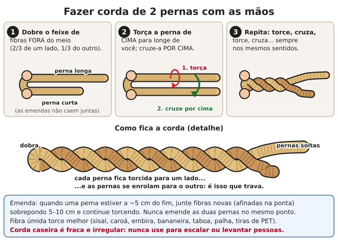
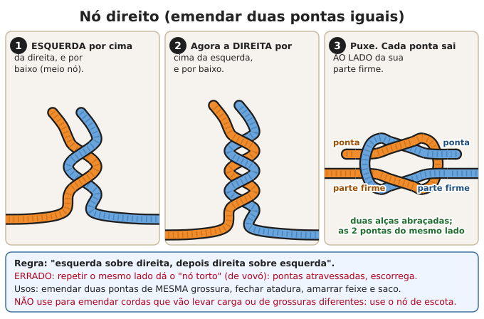
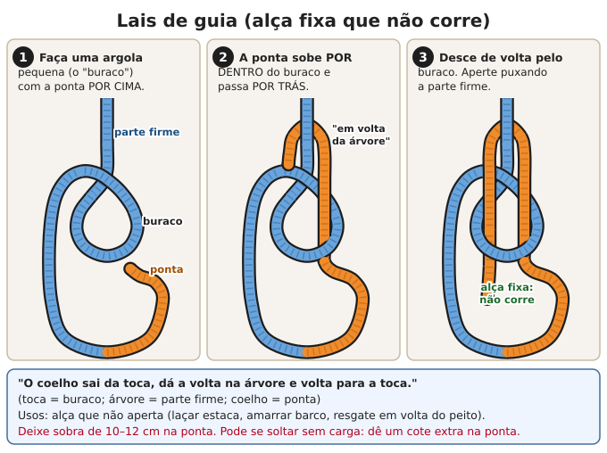
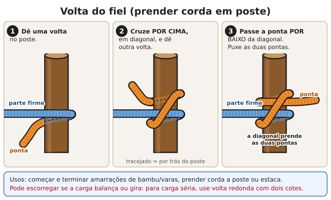
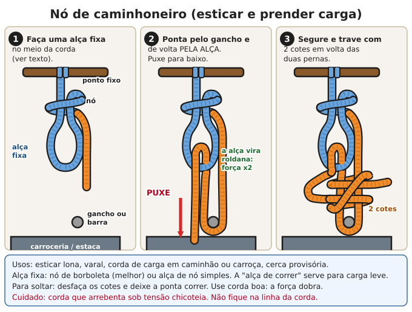

# Cordas, nós e cestaria

**Resumo:** corda se faz torcendo fibras (sisal, caroá, coco, bananeira, embira, taboa, buriti,
piaçava, algodão, tiras de PET) em **duas ou três pernas**: cada perna torcida para um lado, as
pernas enroladas para o outro. Saiba de cor **8 nós** (direito, lais de guia, volta do fiel, volta
redonda com dois cotes, escota, oito, prusik, caminhoneiro) e as **amarrações** de varas. Com as
mesmas fibras e talas de taquara se fazem cestos, peneiras e esteiras.

---

## Fibras do Brasil

| Fibra | Onde | Como tirar | Bom para |
|---|---|---|---|
| **Sisal** (*Agave sisalana*) | Semiárido (BA, PB, RN) | Corte folhas maduras; raspe a polpa sobre uma tábua com faca cega ou lâmina de madeira até sobrar a fibra; lave e seque ao sol 1 dia | Corda forte, barbante, sacos. Endurece e apodrece se ficar molhado muito tempo |
| **Caroá** (*Neoglaziovia variegata*) | Caatinga | Folhas de molho em água 3–8 dias, depois batidas e raspadas | Cordas finas, redes, bolsas |
| **Coco** (cairo) | Litoral | Casca do coco seco de molho 2–6 semanas (ou mais), batida com pau até soltar a fibra | Corda que **resiste à água salgada** e a apodrecer; capacho, escova |
| **Bananeira** | Todo o país | Separe as bainhas do tronco (pseudocaule), raspe a polpa com colher ou faca, seque à sombra | Amarrios, cordas leves, artesanato |
| **Embira / envira** | Matas (várias árvores: envira-preta, embiruçu, mutamba, jangadeira) | Tire tiras da casca de galhos de 2–5 cm; separe a **entrecasca** (parte branca de dentro) | **Amarração imediata** (verde) ou fibra fina após 1–2 semanas de molho |
| **Taboa** (*Typha*) | Brejos | Folhas colhidas no verão, secas 1–2 semanas à sombra; molhar 10 min antes de usar | Esteiras, assento de cadeira, cesto, corda grossa |
| **Buriti** | Veredas (Cerrado, MA, PI) | A "seda": película das folhas novas (olho), seca | Corda, rede de dormir, bolsas |
| **Piaçava** | BA (litoral) e Amazonas | Fibras duras da base das folhas da palmeira | Vassoura, corda resistente à água |
| **Tucum, curauá** | Norte e Nordeste | Folhas novas raspadas | Linha de pesca e rede: das mais fortes |
| **Algodão** | Todo o país | Fiado ([Tecidos](04-tecidos-e-costura.md)) | Barbante, linha, rede |
| **Reciclados** | Lixo | **Garrafa PET cortada em tira** de 5–10 mm (faca presa numa tábua com guia), sacos de ráfia desfiados, **câmara de ar** em tiras (elástico forte), roupa de malha em tiras | PET e ráfia: amarração muito forte e que não apodrece |

> **ATENÇÃO:** não descasque a árvore em volta do tronco inteiro (anelamento): ela morre. Tire de
> galhos, de árvores caídas ou em faixas estreitas. A máquina de desfibrar sisal ("paraibana")
> causou milhares de mutilações: nunca empurre a folha com a mão perto do rotor.

## Corda de 2 pernas (à mão, sem ferramenta)

1. **Prepare a fibra:** úmida torce melhor. Separe feixes com a grossura de um lápis (para barbante,
   de um palito).
2. **Dobre o feixe fora do meio** (2/3 de um lado, 1/3 do outro), para que as emendas das duas pernas
   não caiam no mesmo lugar. Segure a dobra entre o polegar e o indicador da mão esquerda.
3. Com a mão direita, **torça a perna de cima para longe de você** (sentido horário), 2–3 voltas, até
   ficar firme.
4. **Cruze essa perna torcida POR CIMA da outra**, em sua direção (anti-horário). Agora a outra perna
   ficou em cima.
5. Repita: **torce para longe, cruza para perto**. Avance a mão esquerda segurando o trecho pronto.
   A corda se trava sozinha porque a torção de cada perna é contrária à do enrolamento.
6. **Emenda:** quando uma perna estiver a ~5 cm do fim, junte um feixe novo afinado na ponta,
   sobrepondo **5–10 cm**, e continue torcendo os dois juntos. Corte as pontinhas soltas no fim.
7. **Acabamento:** dê um nó simples na ponta ou amarre com linha (falcaça).

Para corda mais grossa, faça 2 ou 3 cordas finas e **torça-as juntas no sentido contrário** ao
último enrolamento.

## Corda de 3 pernas (com manivela)

1. **Material:** uma tábua com 3 ganchos de arame que giram juntos (manivela ligada a uma placa,
   ou 3 ganchos de furadeira manual), e na outra ponta um único gancho que gira solto (girador).
   Um **"taco"**: pedaço de madeira em cone com 3 sulcos.
2. Estique 3 fios (ou cordões de 2 pernas) iguais, **30% mais longos** que a corda pronta (ela encolhe).
3. Gire a manivela: os 3 fios torcem **no mesmo sentido** até, se afrouxados, se enrolarem sozinhos.
4. Prenda os 3 fios ao girador e coloque o taco entre eles, junto do girador.
5. Solte o girador: ele gira ao contrário e **enrola as 3 pernas** entre si. Vá andando com o taco
   em direção à manivela, devagar, **continuando a girar a manivela** no mesmo sentido.
6. Amarre as pontas (falcaça). Corda de 3 pernas é a única que aceita **emenda** (ver abaixo).

## Resistência e cuidados

| Corda (10 mm, nova) | Ruptura aproximada | Carga de trabalho segura (1/5 a 1/10) |
|---|---|---|
| Sisal | ~600 kg | 60–120 kg |
| Manilha / coco | 400–750 kg | 40–150 kg |
| Polipropileno (de varal, ráfia) | ~1.400 kg | 140–280 kg |
| Poliéster | ~1.800 kg | 180–360 kg |
| Náilon (poliamida) | ~2.000 kg | 200–400 kg |
| Corda caseira de fibra | muito variável | **teste com o dobro da carga antes** |

- **Nós enfraquecem a corda em 30–50%**; emendas, só 5–15%.
- Fibra natural: secar antes de guardar (apodrece), não deixar no chão úmido. Sintética: longe do sol
  (o UV estraga em meses) e de calor.
- Não pise, não arraste na areia (a areia entra e corta por dentro). Corda que levou um tranco
  violento ou tem trecho duro, mole ou desfiado: aposente.

> **ATENÇÃO:** corda caseira **nunca** para escalar, descer gente ou levantar carga sobre pessoas.
> Corda que arrebenta sob tensão chicoteia e mata: ninguém na linha da corda ao esticar.

## Os nós essenciais

**Termos:** *parte firme* = o lado que fica preso ou vai para a carga; *ponta* = a extremidade com que
você trabalha; *alça* = dobra da corda; *cote* = meia volta em volta de algo.

| Nó | Para que serve | Atenção |
|---|---|---|
| Nó direito | Emendar duas pontas de mesma grossura, atadura, amarrar feixe | Não para carga nem cordas diferentes |
| Lais de guia | Alça fixa que não corre nem aperta | Afrouxa sem carga: deixe sobra de 10 cm |
| Volta do fiel | Começar amarrações, prender em poste | Escorrega com carga que gira |
| Volta redonda com dois cotes | Prender corda com carga em poste, argola, árvore, barco | Fácil de soltar mesmo após carga |
| Nó de escota | Emendar cordas de grossuras diferentes | Use o duplo em corda lisa |
| Nó oito | Trava na ponta (não deixa escapar da roldana); alça em oito (escalada) | — |
| Prusik | Nó que trava em outra corda e desliza quando solto | Cordelete fino em corda grossa |
| Caminhoneiro | Esticar e prender carga com força dobrada | Corda boa: a força dobra |

### Nó direito

1. Ponta da **esquerda por cima** da direita, dê a volta por baixo (meio nó).
2. Agora a ponta que está à **direita por cima** da esquerda, e por baixo.
3. Aperte. Certo: **cada ponta sai ao lado da sua parte firme** e as duas pontas ficam do mesmo lado.
   Se repetir o mesmo lado nas duas vezes sai o **nó torto (de vovó)**, que escorrega.
- Desatar: puxe uma ponta para trás sobre o nó; ele vira e solta.

### Lais de guia

1. Na parte firme, faça uma **argola pequena** (o "buraco") com a parte da ponta **por cima**.
2. A ponta **sobe por dentro do buraco** (de baixo para cima)...
3. ...passa **por trás da parte firme**...
4. ...e **desce de volta pelo buraco**, ao lado de si mesma. Aperte puxando a parte firme contra as
   duas pernas da alça. "O coelho sai da toca, dá a volta na árvore e volta para a toca."
- Usos: laçar estaca, amarrar barco, **resgate** (alça em volta do peito, sob os braços).
- Com um cote extra na ponta (ou ponta presa com fita) fica seguro mesmo sem carga.

### Volta do fiel

1. Dê uma volta no poste.
2. Cruze **por cima** da primeira volta, em diagonal, e dê outra volta.
3. Passe a ponta **por baixo da diagonal**. As duas pontas saem em sentidos opostos.
- **Na ponta de uma estaca** (mais rápido): faça duas argolas iguais na corda, ponha a segunda atrás
  da primeira e enfie as duas na estaca.

### Volta redonda com dois cotes

1. Dê **duas voltas completas** no poste, argola ou galho (a volta redonda aguenta a carga enquanto
   você trabalha).
2. Com a ponta, dê **um cote** em volta da parte firme (passe por trás e por dentro da alça formada).
3. Dê **um segundo cote igual**, na mesma direção. Encoste os cotes nas voltas.
- É o nó de **amarrar barco, rede de dormir, animal e carga pesada**: não aperta demais e solta fácil.

### Nó de escota (emendar cordas diferentes)

1. Faça uma **alça (dobra) na corda mais grossa** e segure.
2. Passe a ponta da corda fina **por dentro da alça, de baixo para cima**.
3. Dê a volta **por trás das duas pernas** da alça.
4. Passe a ponta fina **por baixo dela mesma** (entre ela e a alça), **sem** entrar na alça.
5. Aperte. As duas pontas soltas devem ficar **do mesmo lado**.
- **Escota dupla:** no passo 3, dê duas voltas antes do passo 4. Use em corda lisa (náilon) ou muito
  diferente de grossura. É também o nó de **fazer rede** de pesca.

### Nó oito

- **Trava:** faça uma argola, passe a ponta por trás da parte firme e enfie de volta pela argola, de
  cima para baixo. Fica um "8". Impede que a corda escape de roldana, furo ou mão.
- **Alça em oito (oito duplo):** faça um oito frouxo a 1 m da ponta, passe a ponta em volta da árvore
  ou do cinto e **refaça o oito seguindo o mesmo caminho por dentro**. Muito seguro, difícil de soltar
  depois de carga.

### Prusik (nó autoblocante)

1. Faça um **anel** com um cordelete de **5–7 mm** (para corda principal de 10–12 mm), fechado com nó de
   pescador duplo ou de escota dupla.
2. Envolva a corda principal com o anel e passe o anel **por dentro de si mesmo, 3 vezes**, com as
   voltas lado a lado, sem cruzar.
3. Puxado, **trava**; sem carga, empurrando o nó, **desliza**.
- Usos: subir em corda (dois prusiks: um para o pé, um para o cinto), travar carga, tensionar varal,
  segurança em descida. **Pratique antes**; exige corda e cordelete adequados.

### Nó de caminhoneiro (esticar)

1. A uns 2/3 do caminho entre o ponto fixo e o gancho, faça uma **alça fixa** na corda: **nó de
   borboleta** (o melhor) ou alça de nó simples. Para carga leve, a "alça de correr" (uma argola com
   uma dobra puxada por dentro) serve.
2. Passe a ponta **pelo gancho** (barra, argola, estaca) e **de volta pela alça**.
3. **Puxe para baixo**: a alça funciona como roldana e dobra a força.
4. Segure a tensão apertando a corda contra a alça e **trave com 2 cotes** em volta das duas pernas
   logo abaixo da alça.
- Usos: lona, varal, carga em caminhão ou carroça, cerca provisória, esticar arame liso.

**Nó de borboleta (alça no meio da corda):** faça uma dobra (alça) com uns 30 cm; **torça-a duas
vezes no mesmo sentido**, formando duas argolas uma sobre a outra, como um "8". Dobre a argola de
cima para baixo e passe-a pela **abertura de baixo** (entre as duas pernas da corda). Aperte puxando
as duas pontas. **Teste:** puxe as pontas com força; se a alça não correr, está certo. Se o nó
desmanchar ou correr, refaça torcendo no outro sentido. Aprenda e treine antes de precisar.

## Amarrações (varas, bambu, estruturas)

Começam e terminam com **volta do fiel**. Use corda fina (4–6 mm), 3–5 m por amarração de varas de
5–8 cm. Molhe corda de fibra natural antes: ao secar ela aperta.

### Amarração quadrada (varas em cruz, a 90°)

1. Volta do fiel na vara vertical, **logo abaixo** da horizontal; enrole a ponta curta na parte firme.
2. Passe a corda **por cima da horizontal, por trás da vertical, por cima da horizontal do outro lado,
   por trás da vertical**. Repita **3–4 voltas**, cada volta **por fora** da anterior na horizontal e
   **por dentro** na vertical, bem apertadas.
3. **Arrocho:** 2–3 voltas **entre as varas**, por cima das voltas anteriores, puxando forte. É isso
   que trava.
4. Termine com volta do fiel na vara horizontal.

### Amarração diagonal (varas que tendem a se separar: travessas em X)

1. Comece com **nó de lenhador** (volta na corda em torno das duas varas, na diagonal, com a ponta
   enrolada 3–5 vezes nela mesma) e puxe até as varas encostarem.
2. **3–4 voltas** numa diagonal, depois **3–4 voltas** na outra diagonal.
3. 2–3 voltas de **arrocho** entre as varas. Termine com volta do fiel.

### Amarração paralela (tesoura, para cavalete e "A")

Duas varas lado a lado: volta do fiel numa delas, **8–10 voltas frouxas** em volta das duas, 2 voltas
de arrocho entre elas, volta do fiel. Abra as pernas em "A": a amarração aperta.
Usos em construção: [Madeira e carpintaria](../07-abrigo-e-construcao/03-madeira-e-carpintaria.md).

## Emendas (corda de 3 pernas)

**Emenda curta (unir duas cordas):**
1. Desfaça **15–20 cm** de cada ponta; amarre as pontinhas de cada perna com linha para não desfiar
   e amarre um barbante onde parou de desfazer.
2. Encaixe as pontas uma na outra: cada perna de uma corda entre duas pernas da outra.
3. Tire o barbante de um lado. Com cada perna, passe **por cima de uma perna e por baixo da
   seguinte** da outra corda, contra a torção. Faça uma rodada com as 3 pernas.
4. Repita **3 rodadas** (fibra natural: 4–5; sintética lisa: 5). Faça o mesmo do outro lado.
5. Role a emenda sob o pé e corte as sobras deixando 1 cm (em sintético, queime a ponta).

**Emenda de alça (olhal):** desfaça 15 cm, dobre formando a alça do tamanho desejado e trance as
pernas na própria corda, como acima. Mais forte que qualquer nó de alça.

**Falcaça:** para a ponta não desfiar, enrole linha bem apertada 2–3 cm e prenda a ponta da linha por
baixo das voltas. Corda sintética: derreta a ponta com fogo.

Nós de pesca (anzol, emenda de linha): [Pesca, armadilhas e caça](../11-natureza-e-desastres/02-pesca-armadilhas-caca.md).

## Cestaria

### Preparar o material

| Material | Preparo |
|---|---|
| **Taquara / bambu** | Varas de 3+ anos, cortadas na seca. Rache com facão em **talas de 1–2 cm**; tire o miolo branco, deixando a casca e 1–2 mm; raspe para afinar. **Molho 1–2 h** antes de trançar |
| **Cipó** (imbé, titica e outros) | Descasque, rache ao meio se grosso, deixe de molho 1 h. Corte só o necessário: rebrota |
| **Palha de milho** | Palhas internas (mais finas), secas à sombra. Umedeça antes. Trance em tranças de 3 e costure |
| **Palha de bananeira** | Bainhas secas cortadas em tiras; umedeça |
| **Taboa, junco, piri** | Folhas/hastes secas à sombra 1–2 semanas; molho 10 min |
| **Palmeiras** (ouricuri, carnaúba, buriti, coqueiro) | Folíolos abertos e secos à sombra; tiras de 0,5–2 cm |

### Cesto de raios (taquara, cipó, vime)

1. **Base:** cruze **2 grupos de 4 raios** (talas grossas de 40–60 cm). Com 2 fios finos, faça 2–3
   voltas de **trança torcida** (um fio por cima, outro por baixo de cada grupo, torcendo entre os
   grupos) para prender o cruzamento.
2. Abra os raios em pares e depois um a um, como raios de roda. **Acrescente 1 raio extra** (total
   ímpar: 9 ou 17) para que o trançado por cima e por baixo alterne sozinho a cada volta.
3. **Fundo:** trance em espiral, **por cima de um raio, por baixo do próximo**, batendo bem as voltas,
   até o diâmetro do fundo (15–25 cm).
4. **Laterais:** molhe os raios e dobre-os para cima. Continue trançando, mantendo os raios na
   inclinação desejada. Emende fios novos sobrepondo 5 cm atrás de um raio.
5. **Borda:** deixe **10–15 cm** de raio acima da trama; molhe; dobre cada raio e enfie-o ao lado do
   **segundo raio à frente**, por dentro. Corte sobras por dentro.
6. **Alça:** 2–3 talas grossas enfiadas ao lado de raios opostos, até o fundo da trama, e enroladas com
   fio fino.

### Trançado em xadrez (esteira, peneira, caixa)

1. Disponha talas lado a lado e trance outras atravessadas: **por cima de uma, por baixo da outra**,
   alternando a cada fileira. Empurre para ficar fechado.
2. Para **caixa ou cesto quadrado**: faça a base quadrada, dobre as talas para cima e trance talas em
   volta para formar as laterais; na borda, dobre as talas para dentro e prenda-as sob a trama.
3. Trançado **sarja** (2 por cima, 2 por baixo, deslocando 1 a cada fileira) fica mais firme.
4. **Peneira (urupema):** talas bem finas em xadrez fechado, presas num aro de taquara costurado com cipó.

### Cestaria em espiral (rolo costurado)

Feixe de palha, taboa ou capim da grossura de um dedo, enrolado em espiral; cada volta é **costurada à
volta anterior** com fio ou tira de palha (agulha grossa ou furador de osso/arame), um ponto a cada
1–2 cm. Muito firme e quase fechado: cestos, bandejas, **chapéus** e potes para grãos.

### Esteiras

- **Esteira de amarração:** hastes de taboa, junco ou capim lado a lado, presas por **2 cordões
  torcidos** (trança torcida) a cada **10–15 cm**. Rápida: dormir, parede, porta, sombreamento,
  forro de chão.
- **Esteira trançada:** folhas largas (buriti, carnaúba, bananeira) em xadrez, ou tranças de palha
  costuradas lado a lado.
- Esteira no chão isola do frio e da umidade: coloque sempre algo entre o corpo e a terra.

---

Ver também: [Tecidos e costura](04-tecidos-e-costura.md) · [Couro (tentos e trançados)](05-couro.md) · [Madeira e carpintaria](../07-abrigo-e-construcao/03-madeira-e-carpintaria.md) · [Abrigo emergencial](../07-abrigo-e-construcao/01-abrigo-emergencial.md) · [Pesca, armadilhas e caça](../11-natureza-e-desastres/02-pesca-armadilhas-caca.md)
