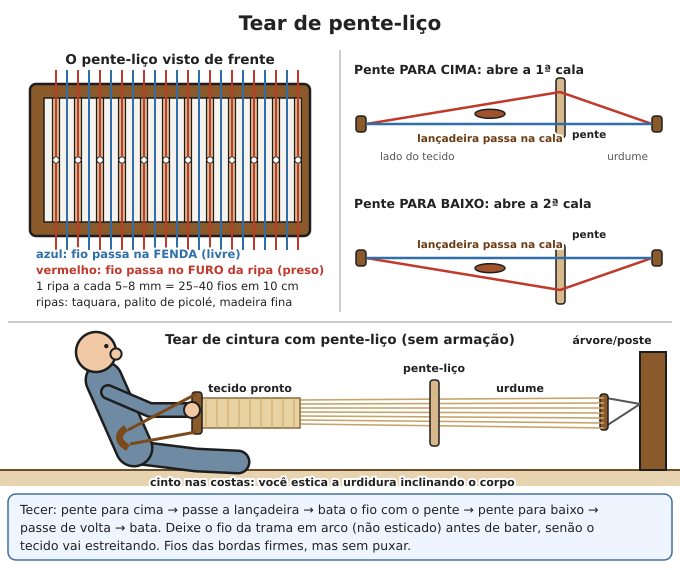
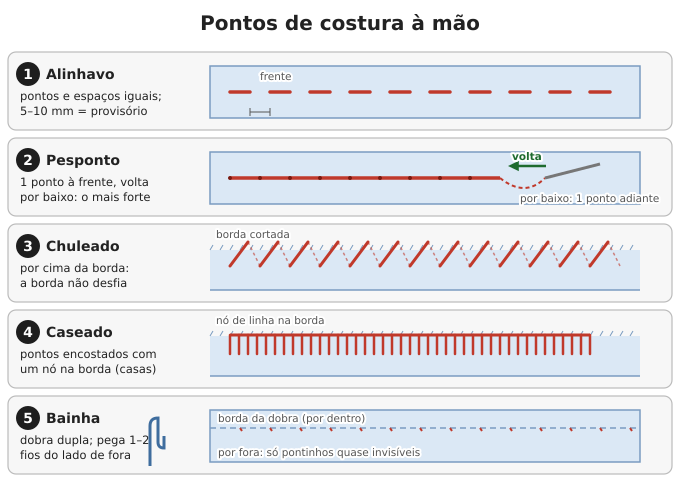

# Tecidos e costura

**Resumo:** fazer tecido do zero é **muito lento** (fiar uma roupa leva dezenas de horas), por isso
a primeira regra é **conservar, remendar e reaproveitar** o que existe. Guarde agulhas, linhas,
tesoura e dedal. Para produzir: algodão descaroçado e cardado → **fio no fuso** → **tecido no tear de
pente-liço** (um tear de cintura sem armação). Tinja com urucum, açafrão, casca de cebola, jenipapo,
anil e casca de cajueiro, usando **pedra-ume** como mordente.

---

## Estoque de costura (vale ouro)

- **Agulhas** de vários tamanhos (finas, grossas, de colchoeiro/saco curvas, de couro); alfinetes.
- **Linha** de poliéster (dura mais que algodão), linha grossa encerada, **fio dental** (fortíssimo
  para remendo de mochila, lona, sapato).
- Tesoura boa (só para tecido), fita métrica, dedal, giz, abridor de casas, botões, elástico, zíper,
  velcro, retalhos, uma **máquina de costura manual ou de pedal** (sem energia) se possível.
- **Improviso:** agulha de espinho (mandacaru e outros cactos), osso fino de ave lixado com furo, arame
  de aço com olho dobrado; linha tirada da borda do próprio tecido; passe cera de abelha ou vela na
  linha para não embolar.

## Fibras

| Fibra | Origem no Brasil | Observações |
|---|---|---|
| **Algodão** | Todo o país; algodão **mocó/arbóreo** (perene, Nordeste) dura anos no pé; algodões **coloridos** da Embrapa (marrom, verde) dispensam tingimento | Fibra curta: fiar com fuso apoiado. ~35–40% do peso colhido é pluma, o resto é caroço |
| **Lã** | Ovelhas lanadas do Sul (Corriedale, Merino, Ideal, Crioula) | Tosquia 1×/ano (primavera): 3–5 kg de lã suja por ovelha. Ver [Cabras e ovelhas](../05-animais/05-cabras-e-ovelhas.md) |
| **Rami** | Paraná e Sul | Fibra longa e forte como o linho |
| **Sisal, juta, malva, caroá** | Nordeste e Amazônia | Grossas: sacos, tapetes, cordas ([Cordas](03-cordas-nos-e-cestaria.md)) |

## Do algodão ao fio

### 1. Colher e descaroçar
1. Colha os capulhos **abertos e secos**, em tempo seco. Tire folhas e sujeira. Seque ao sol 1 dia.
2. **À mão:** puxe a pluma do caroço — lento (algumas centenas de gramas por dia).
3. **Descaroçador de rolos** (10× mais rápido): dois rolinhos de madeira dura de **2–3 cm** de diâmetro,
   encostados e paralelos, girando em sentidos opostos por uma manivela (com engrenagem ou um cruzado
   de corda). A pluma passa entre os rolos; o caroço não passa e cai para trás.
4. Guarde caroços: semente para plantar e ração (com moderação: o caroço cru tem gossipol, tóxico
   para porcos e aves em excesso).

### 2. Abrir e cardar
- **Bater com arco:** uma vara curva com uma corda bem esticada; puxe e solte a corda dentro do monte
  de algodão — a vibração abre e afofa as fibras (método tradicional do Nordeste).
- **Cardas:** duas escovas de dentes de arame. Coloque um pouco de fibra numa, escove com a outra
  até as fibras ficarem paralelas, sem bolinhas. **Improviso:** escovas de tirar pelo de cachorro.
- Enrole a manta cardada num **rolinho** (pavio) de 1–2 cm de grossura e 20–30 cm de comprimento.
- **Lã:** antes, lave em água morna com sabão, **sem esfregar e sem mudar a temperatura de repente**
  (senão feltra). Seque à sombra e carde igual.

### 3. Fiar com fuso

O **fuso** é uma vareta de 25–35 cm com um peso (cossoiro) de 4–8 cm de diâmetro: rodela de madeira,
cerâmica, cabaça, batata dura, um CD. A **roca** é a vara que segura o monte de fibra.

- **Algodão:** fuso **leve (10–30 g) e apoiado** numa cuia ou prato (fibra curta não aguenta o peso do
  fuso pendurado). **Lã:** fuso **pendurado** de 30–80 g.

1. Amarre um **fio-guia** de 40 cm na haste, logo acima do peso; suba até a ponta e dê um meio-cote
   no topo.
2. Abra um pouco as fibras da ponta do rolinho e sobreponha-as ao fio-guia.
3. Gire o fuso **no sentido horário** com os dedos (torção "Z").
4. **Estire:** com a mão de trás segure o rolinho e puxe as fibras para trás devagar; a mão da frente
   segura a torção para ela não subir antes da hora. Solte a torção para o trecho estirado. As fibras
   viram fio.
5. Quando o fio tiver um braço de comprimento (ou o fuso chegar ao chão), desfaça o meio-cote,
   **enrole o fio na haste** acima do peso, refaça o meio-cote e continue.
6. **Emenda:** encoste as fibras de um rolinho novo nas do fim do anterior, na zona de estiramento.
7. **Torção certa:** um pedaço de 30 cm afrouxado deve se enrolar sobre si mesmo um pouco. Algodão
   precisa de mais torção que lã. Fio que desmancha ao puxar: falta torção.

**Retorcer (dobrar o fio):** junte 2 fios simples e gire o fuso **no sentido contrário** (anti-horário).
O fio dobrado fica equilibrado, mais forte e não se enrosca — use-o no urdume do tear.
**Fixar a torção:** lave a meada em água quente e seque pendurada com um peso leve.

**Quanto fio:** 1 m² de pano médio leva **1 a 2 km de fio**. Fiar é a etapa mais lenta: divida a tarefa
entre muitas pessoas (bom trabalho para idosos e para as noites).

## Tear de pente-liço

O **pente-liço** separa os fios do urdume em dois grupos: os que passam nas **fendas** (livres) e os
que passam nos **furos** das ripas (presos). Subindo o pente, os fios dos furos sobem e abre-se a
**cala** (passagem) para a lançadeira; descendo, abre a outra cala. É o tear mais simples que faz
pano de verdade.

### Fazer o pente
1. Duas réguas de madeira (em cima e embaixo) de **40–60 cm**.
2. **Ripas** de 10–15 cm de altura e 2–3 mm de espessura: palito de picolé, taquara, madeira fina.
   Faça um **furo de 2–3 mm** bem no meio de cada uma (prego quente ou broca fina).
3. Prenda as ripas entre as réguas (cola, amarração ou ranhuras), **igualmente espaçadas**: uma a
   cada **5–8 mm** dá 25–40 fios a cada 10 cm. Lixe tudo: nada pode enganchar o fio.

### Urdir (preparar os fios esticados)
1. **Comprimento de cada fio** = tamanho do pano pronto + 20% (encolhimento) + 50–70 cm (perda nas
   pontas). Ex.: pano de 2 m → 3 m por fio.
2. **Número de fios** = largura × densidade. Ex.: 30 cm × 3 fios/cm = 90 fios (270 m de fio de
   urdume, que deve ser **retorcido e forte**).
3. Passe os fios **alternando: um na fenda, um no furo**. Amarre-os em grupos de 6–8 numa vara (a da
   frente) com tensão igual; a outra ponta numa segunda vara (a de trás).

### Montar o tear de cintura
- A vara de trás vai amarrada numa **árvore ou poste**, na altura da cintura de quem está sentado.
- A vara da frente vai presa a um **cinto largo** (couro ou pano de 10 cm) nas costas do tecelão.
- **Você dá a tensão inclinando o corpo para trás.** Sentado no chão ou num banquinho.

### Tecer
1. **Pente para cima** → passe a **lançadeira** (vareta chata com o fio da trama enrolado) pela cala.
2. **Bata** o fio da trama contra o tecido com o próprio pente.
3. **Pente para baixo** → passe a lançadeira de volta → bata.
4. Antes de bater, deixe o fio da trama **em arco** (frouxo, ~30°), senão o pano vai estreitando.
   Bordas (ourelas) firmes, mas sem puxar.
5. Conforme cresce, enrole o pano pronto na vara da frente.
6. **Acabamento:** amarre os fios do urdume em grupos de 4–6 (franja) ou dobre e costure uma bainha.

Para pano largo, costure faixas lado a lado (como as redes e mantas tradicionais).

## Costura à mão

**Começo e fim:** nó na ponta da linha (ou 2–3 pontinhos no mesmo lugar); termine com 3 pontos
sobrepostos no avesso. Linha **dupla** para costura de força.

| Ponto | Como | Tamanho | Para quê |
|---|---|---|---|
| **Alinhavo** | Agulha entra e sai em linha reta, pontos e espaços iguais | 5–10 mm (provisório); 2–4 mm (costura leve, franzido) | Segurar antes de costurar, franzir, costura que não leva força |
| **Pesponto** (ponto atrás) | Dê um ponto para a frente, volte metade (ou até o fim do ponto anterior) e saia um ponto à frente | 2–3 mm | **A costura à mão mais forte**: calça, bolsa, mochila, lona |
| **Chuleado** | Pontos inclinados passando **por cima da borda** do tecido | 3–5 mm de fundo, 3–5 mm entre pontos | Impedir que o tecido desfie |
| **Caseado** | Pontos encostados com a linha passando por baixo da agulha, formando um "nó" na borda | 2–3 mm de fundo, encostados | Casa de botão, borda de cobertor, reforço |
| **Bainha** (ponto invisível) | Dobre a borda 2 vezes; pegue **1–2 fios** do tecido de fora e corra 5–8 mm dentro da dobra | Dobras: 0,5–1 cm + 2–3 cm | Barra de calça, saia, cortina |

### Remendo
1. Corte um retalho de tecido parecido, **2–3 cm maior** que o rasgo em cada lado.
2. Dobre as bordas do remendo 0,5–1 cm para dentro (ou chuleie).
3. Alfinete por dentro (discreto) ou por fora (mais resistente; joelho, cotovelo).
4. Costure em volta com ponto de bainha ou pesponto. Em rasgo grande, junte antes as bordas do rasgo
   com pontos em "zigue-zague".

### Cerzido (furo em meia, malha, tecido fino)
1. Coloque um **ovo de cerzir** por trás (ovo de madeira, lâmpada queimada, cabaça pequena).
2. Faça **fios verticais** atravessando o furo, 1–2 mm um do outro, começando e terminando **1 cm além**
   do furo, pegando um pouco do tecido bom.
3. Faça os **fios horizontais tecendo**: por cima de um, por baixo do outro; na fileira seguinte, ao
   contrário. Fica um "tecidinho" novo.

### Botão
1. Linha dupla. Ponha um **palito de fósforo** sobre o botão, entre os furos.
2. Dê **4–6 passadas** por cada par de furos, passando por cima do palito.
3. Tire o palito, puxe o botão para cima e **enrole a linha 5–6 vezes** por baixo dele (forma o "pé").
4. Arremate no avesso com 3 pontos. **Botões caseiros:** madeira, osso, chifre, casca de coco, com
   2 furos; ou presilha de cordão com um pauzinho (alamar).

## Reaproveitar roupas

- Roupa rasgada → remendos, panos de limpeza, **fraldas e absorventes de pano** (camiseta de algodão
  em 4–6 camadas), ataduras limpas (fervidas), bolsas.
- Camiseta de malha cortada em **espiral** (tira de 2 cm) vira **fio de malha** para tricô, crochê,
  tapete e amarração.
- Blusa de tricô desmanchada → lã de novo (lave a meada para alisar).
- Jeans e lona → remendos de joelho, bolsas, aventais, alças, capa de ferramentas.
- Tire **zíperes, botões, elásticos e linhas** antes de jogar qualquer roupa fora.

## Tingimento natural

### 1. Lavar e preparar (purga)
- **Algodão:** ferva 1 h com sabão e um pouco de barrilha ou decoada fraca; enxágue.
- **Lã:** água morna com sabão neutro, sem esfregar, sem choque de temperatura.
- Pese a fibra **seca**: as doses abaixo são em % desse peso (100 g de fibra × 10% = 10 g).

### 2. Mordente (fixa a cor)
- **Lã:** **pedra-ume** (alúmen de potássio, farmácia) **10–15%**. Dissolva em água quente, ponha a
  fibra molhada, aqueça a **80–90 °C** (sem ferver) por 1 h, deixe esfriar no banho.
- **Algodão:** primeiro **tanino** — chá forte de casca de cajueiro, barbatimão ou chá-preto
  (10–20% do peso), 1 h quente e 12 h de molho; depois **pedra-ume 15–20%** como acima (pode ferver).
- **Ferro** (escurece e "entristece" as cores): "água de ferrugem" = pregos enferrujados no vinagre por
  1–2 semanas. Mergulhe a peça já tingida 5–10 min. Em excesso enfraquece a fibra.

### 3. Banho de cor

| Planta | Parte e dose (% do peso da fibra) | Cor | Dica |
|---|---|---|---|
| **Urucum** | Sementes 20–50% | Laranja a vermelho-alaranjado | Ferva as sementes 30 min com **1 colher de chá de bicarbonato (ou decoada) por litro**: o corante só solta em água alcalina. Desbota ao sol |
| **Açafrão-da-terra** (cúrcuma) | Raiz fresca ralada 50–100% (pó 10–25%) | Amarelo vivo | Muito fácil; desbota com luz |
| **Casca de cebola** (amarela ou roxa) | 50–100% | Amarelo-ouro a ferrugem | **A melhor para começar**: firme e fácil |
| **Casca de cajueiro** | 50–100% | Bege, castanho; cinza/preto com ferro | Também serve de tanino |
| **Jenipapo verde** | Fruto verde ralado, suco puro | Azul-escuro a preto | Suco incolor que escurece ao ar; age em **pele, lã e seda** (proteína). Em algodão, só com pré-tratamento em leite de soja. Mergulhe e deixe oxidar ao ar, várias vezes |
| **Anil** (*Indigofera*, anileira) | Folhas frescas | Azul | Processo especial, abaixo |
| Barbatimão, aroeira | Casca 50–100% | Castanhos | Ricas em tanino |

**Como tingir:** ferva (ou deixe 1–2 dias de molho) o material da cor em água, coe, ponha a fibra
**molhada e já mordentada**, aqueça devagar até 80–90 °C, mantenha **1 h**, mexendo com cuidado, deixe
esfriar no banho (cor mais forte), enxágue em água fria até sair limpa, **seque à sombra**.
Use panela que não volte para a comida.

**Anil (azul), resumido:**
1. **Extrair:** encha um tambor com folhas e galhos frescos de anileira, cubra com água, ponha peso por
   cima, 12–48 h até a água ficar verde-amarelada com brilho acobreado. Tire as folhas.
2. Junte **cal hidratada** (1–2 colheres de sopa por 10 L) e **bata/areje** 10–20 min (despejando de um
   balde para outro) até a espuma ficar azul. Deixe assentar 12–24 h: a **pasta azul** fica no fundo.
   Escorra a água; guarde a pasta (ou seque).
3. **Tina de tingir:** água morna (30–40 °C) + pasta de anil + cal + algo que fermente (farelo de trigo,
   banana madura, caldo de cana). Espere **3–10 dias** em lugar quente até o líquido ficar
   verde-amarelado com uma "flor" azul de espuma em cima.
4. Mergulhe a fibra molhada **5–10 min sem fazer bolhas**; ela sai **verde** e fica **azul em 10–20 min**
   ao ar. Repita para escurecer.

> **ATENÇÃO:** não corte **pau-brasil** (espécie ameaçada). Panelas e baldes de tingimento não voltam
> para a cozinha. Cal e decoada: óculos e luvas.

## Moldes simples (sem papel especial)

**Teste sempre o molde num pano velho (lençol) antes de cortar tecido bom.**
Some **1,5 cm de costura** em todas as bordas e **3–4 cm de bainha**.

### Túnica / camisa de retângulos (não desperdiça pano)
1. **Corpo:** 1 retângulo dobrado no ombro (frente + costas numa peça só).
   Largura = (tórax ÷ 2) + 10 cm de folga. Comprimento = 2 × (do ombro até onde quiser).
2. **Gola:** corte um oval de ~20 × 14 cm no centro da dobra + uma fenda de 12–15 cm na frente para a
   cabeça passar. Arremate com tira de viés ou bainha estreita.
3. **Mangas:** 2 retângulos. Largura = volta do braço + 10–15 cm; comprimento = o desejado.
4. **Pala da axila:** 2 quadrados de 10–12 cm costurados na axila (em losango): dão movimento sem rasgar.
5. Costure as mangas no corpo (centro da manga no ombro), depois as laterais e baixo das mangas de uma
   vez, com a pala. Bainhas.

### Calça de cordão
- **Mais fácil e seguro:** desmonte (ou dobre ao meio) uma calça velha que sirva, contorne **frente e
  costas separadamente** sobre o tecido dobrado (as costas têm o gancho mais fundo e mais longo).
- **Sem calça velha** (4 peças: 2 frentes e 2 costas espelhadas):
  - Largura de cada peça = (quadril ÷ 4) + 3 cm (frente) ou + 5 cm (costas).
  - **Altura do gancho:** sente numa cadeira e meça de lado, da cintura ao assento, + 2 cm.
  - **Extensão do gancho** (curva no alto da perna, lado de dentro): frente ~6 cm, costas ~10 cm
    (adulto de quadril ~100 cm); costas 3 cm mais altas no centro.
  - Comprimento = da cintura ao tornozelo + **4 cm de cós** (dobra para o cordão ou elástico) + 3 cm de barra.
- Costure: centro da frente, centro das costas, laterais, entreperna; dobre o cós e passe o cordão.

### Sandália de pneu
1. Use pneu **sem cinta de aço** (moto, carroça, carriola) ou parte da banda sem arame; se aparecer
   arame, lixe e cubra.
2. Contorne o pé no pneu + **0,5–1 cm** em volta. Corte com faca afiada molhada em água com sabão.
3. Tiras de **câmara de ar** (2 cm), couro ou fita de mochila. Faça fendas com formão ou faca quente:
   uma **entre o dedão e o segundo dedo** e duas de cada lado, na altura do tornozelo.
4. Passe a tira: dedo → laterais → em volta do calcanhar. Prenda as pontas por baixo com nó ou arruela
   **embutidos num rebaixo** (para não gastar no chão).

### Chapéu de palha
1. Trance tiras de palha (carnaúba, ouricuri, buriti, taboa, palha de milho larga) em **trança chata de
   3, 5 ou 7 fios**, com metros de comprimento. Mantenha a palha úmida.
2. Comece no **centro da copa**: enrole a trança em espiral e costure cada volta sobre a borda da
   anterior.
3. Com **15–18 cm** de diâmetro (topo), aperte as voltas para descer as paredes da copa (10–12 cm de
   altura; a volta da cabeça adulta tem 55–60 cm).
4. Depois volte a abrir para a **aba (7–10 cm** dá boa sombra). Molde úmido sobre uma panela e seque.

## Conservar roupas e tecidos

- **Guarde limpo e seco:** suor e sujeira atraem traças e baratas; umidade faz mofo.
- **Traças:** lascas de cedro, folhas de louro, cravo-da-índia, lavanda, eucalipto ou nim em saquinhos;
  caixas e sacos bem fechados. Naftalina é tóxica (crianças): evite.
- **Mofo:** areje e ponha ao sol com frequência; um pote com **cal virgem, giz ou carvão** no armário
  puxa umidade (troque quando empedrar). Mancha de mofo: vinagre ou limão + sol; em algodão branco,
  água sanitária diluída.
- **Lã:** lave pouco, seque deitada à sombra; traça adora lã.
- **Sapatos e couro:** ver [Couro](05-couro.md) (engraxar).
- Inspecione e remende cedo: um furo pequeno hoje é um remendo grande amanhã.

---

Ver também: [Cordas, nós e cestaria](03-cordas-nos-e-cestaria.md) · [Couro](05-couro.md) · [Cabras e ovelhas (lã)](../05-animais/05-cabras-e-ovelhas.md) · [Higiene e saneamento](../02-saude/09-higiene-e-saneamento.md) · [Calor, frio e ambiente](../02-saude/10-calor-frio-e-ambiente.md)
