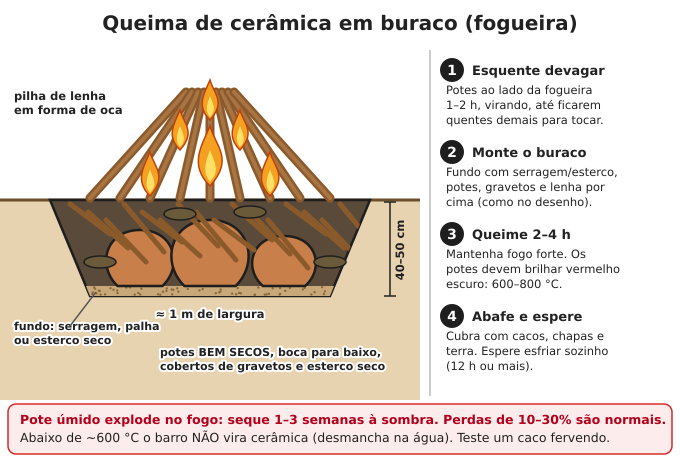
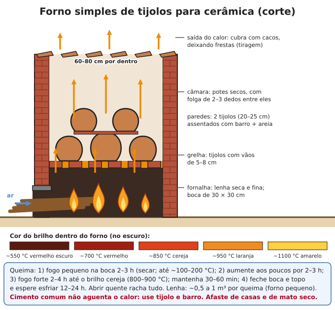

# Cerâmica

**Resumo:** argila boa faz um rolinho de 1 cm que dobra sem rachar muito. Limpe (seque, quebre,
hidrate, peneire), misture **areia ou chamote** (20–40%), modele com **rolinhos**, **seque devagar à
sombra (1–3 semanas)** e queime acima de **600 °C** — numa fogueira em buraco (600–800 °C) ou num
forno de tijolos (800–1.000 °C), sempre **esquentando e esfriando devagar**. Com isso se fazem potes
de água, panelas, pratos, telhas, tijolos e potes de irrigação. **Nunca use vidrado com chumbo.**

---

## 1. Achar argila

- **Onde:** barrancos de rio e córrego, margens de lagoa e várzea, fundo de açude seco, cortes de
  estrada, perto de olarias antigas. Argila é a terra que gruda nas botas, fica lisa e brilhante
  quando cortada com faca e racha em placas ao secar.
- **Cores:** cinza, azulada, amarela, vermelha, branca (tabatinga). Quase todas servem; a vermelha
  tem ferro e queima a temperaturas mais baixas.
- **Evite** terra com muita matéria orgânica (preta, cheiro de mato), muita areia ou **pedrinhas de
  calcário** (brancas, que fazem espuma no vinagre): depois da queima elas incham e estouram a peça.

## 2. Testar a argila

| Teste | Como | Resultado bom |
|---|---|---|
| **Rolinho** | Faça um rolinho de **1 cm de grossura e 15 cm**, úmido, e enrole num cabo de vassoura (~2,5 cm) | Poucas rachaduras finas. Rachou todo = pouca argila (magra). Muito grudento e mole = muita argila (gorda) |
| **Retração** | Faça uma barrinha de 15 × 3 × 1 cm, marque 2 riscos a **10 cm**. Meça seca e depois queimada | Seca: 5–8% menor. Queimada: **8–12%** no total. Acima de 15%: misture areia/chamote |
| **Pote de vidro** | Terra + água num vidro, agite e deixe 1 dia | Camadas: areia (embaixo), silte, argila (em cima, demora a assentar). Bom: 25–50% de argila |
| **Queima** | Queime algumas plaquinhas e barrinhas na fogueira | Soam como "sino" ao bater; não amolecem depois de **ferver 30 min** em água; sem bolhas ou estouros |

## 3. Preparar

1. **Seque** a argila em torrões (argila seca desmancha melhor na água).
2. **Quebre** os torrões com pilão ou porrete.
3. **Hidrate:** jogue na água (num tambor ou cocho), dois dedos de água acima. Em 1 dia vira lama.
4. **Mexa e peneire** a lama (barbotina) por peneira fina, tela de mosquiteiro ou pano ralo: saem
   pedras, raízes e calcário.
5. **Deixe assentar** 1–2 dias e retire a água de cima.
6. **Seque até o ponto de massa** sobre pano, tábuas ou dentro de sacos de pano pendurados, ou num
   buraco forrado com tijolos secos. Pronta quando não gruda na mão.
7. **Sove** (como pão) 50–100 vezes, dobrando e apertando, para tirar o ar. Corte o bloco com um fio:
   não pode ter furinhos. **Bolha de ar estoura na queima.**
8. Guarde em saco plástico fechado; argila "descansada" algumas semanas fica mais plástica.

## 4. Tempero (antiplástico)

Argila pura encolhe muito, racha secando e estoura no fogo. Misture na massa:

| Tempero | Quantidade (em volume) | Observação |
|---|---|---|
| **Areia fina** peneirada (1 mm) | 20–30% | O mais fácil |
| **Chamote** (caco de cerâmica velha moído e peneirado) | 15–30% | O melhor: resiste a choque de calor |
| **Cinza** de madeira, ou **cariapé** (casca queimada da árvore caraipé, usado na Amazônia) | 10–30% | Deixa a peça leve |
| Conchas moídas | 10–20% | Só para queima baixa (até ~750 °C): acima disso estouram |

- **Panelas (vão ao fogo):** mais tempero, **25–40%**, e de grão um pouco mais grosso.
- **Potes de água e pratos:** 15–25%, mais fino.

## 5. Modelar

### Beliscão (peças pequenas)
Faça uma bola do tamanho de uma laranja, enfie o polegar no meio e vá beliscando e girando, afinando as
paredes por igual até **6–8 mm**. Copos, tigelas, lamparinas, cadinhos.

### Placas
Abra a massa com rolo entre duas ripas de **8–10 mm** sobre pano. Corte e junte as partes riscando as
bordas e passando **barbotina** (argila líquida) como cola. Caixas, pratos, ladrilhos, telhas.

### Acordelado (rolinhos) — o método dos potes e panelas

1. **Base:** um disco de **1 cm** de espessura sobre uma tábua, folha ou caco (para poder girar).
2. Faça rolinhos de **1–1,5 cm** de grossura, rolando a massa com as mãos espalmadas.
3. Coloque um rolinho na borda da base e **una por dentro e por fora**, puxando a argila de um para o
   outro com o dedo (não basta encostar: tem que "costurar").
4. Suba rolinho por rolinho. Para **abrir** o pote, ponha o rolinho um pouco para fora; para
   **fechar**, um pouco para dentro.
5. A cada **3–4 rolinhos**, espere a parte de baixo firmar um pouco (30–60 min, na sombra) para não
   desabar.
6. **Alise** com uma lasca de cabaça (cuia), casca de coco ou colher molhada, deixando a parede com
   **6–10 mm**, igual em todo lugar. Parede desigual racha.
7. Faça bordas arredondadas e **fundos redondos ou bem curvos** em panelas (cantos racham no fogo).

### Ponto de couro, raspar e brunir
- **Ponto de couro:** 1–3 dias depois, a peça está firme, mas ainda um pouco úmida e escura. Agora
  dá para **raspar** (afinar paredes, acertar o fundo) com lata ou casca de coco.
- **Brunir:** esfregue toda a superfície com uma **pedra lisa** (seixo de rio) ou costas de colher, em
  movimentos curtos. A superfície fica lisa e brilhante e **absorve menos água**.
- **Engobe:** pinte com barbotina de argila colorida peneirada (tauá vermelho/amarelo, tabatinga
  branca) antes de brunir, para decorar e fechar poros.

## 6. Secagem lenta (a causa nº 1 de perdas)

- **Sempre à sombra**, sem vento, longe do sol e do fogo. Nos primeiros 1–2 dias cubra com plástico
  ou pano úmido (a borda seca antes do fundo e racha).
- Vire a peça de boca para baixo quando firme, para o fundo secar também.
- **Tempo:** peças pequenas 1 semana; potes e panelas **2–3 semanas**; mais em tempo úmido.
- **Seca de verdade** quando a cor clareou toda e a peça **não está fria** encostada no rosto. Fria =
  ainda tem água = vai estourar.
- No dia da queima, deixe as peças algumas horas ao sol ou perto (não dentro) do fogo.

## 7. Queima

### O que acontece no fogo

| Temperatura | O que ocorre | Cuidado |
|---|---|---|
| Até ~200 °C | Sai a água que restou | **Muito devagar**: vapor estoura a peça |
| ~573 °C | O quartzo da areia muda de tamanho | Não acelere nem esfrie de repente nessa faixa |
| **600–700 °C** | A argila vira cerâmica (não desmancha mais na água) | Mínimo para qualquer peça |
| 800–1.000 °C | Peça mais forte, menos porosa | Ideal para telha, tijolo e panela |

**Cor do brilho** (olhe no escuro): vermelho escuro ~550–650 °C; vermelho ~700 °C; cereja
~800–850 °C; laranja ~950 °C; amarelo ~1.100 °C.

### Queima em buraco (fogueira)

1. **Buraco** de ~1 m de largura e **40–50 cm** de fundo, em lugar abrigado do vento.
2. **Esquente** as peças secas ao lado de uma fogueira por **1–2 h**, virando, até ficarem quentes
   demais para segurar. Esquente também o buraco com um fogo.
3. Retire as brasas, forre o fundo com **serragem, palha ou esterco seco** de vaca.
4. Arrume as peças **de boca para baixo**, umas encostadas nas outras (as grandes embaixo).
5. Cubra com **gravetos, cascas e esterco seco** e, por cima, uma **pilha de lenha** em forma de oca.
6. Acenda por cima e por todos os lados. Mantenha **fogo forte por 2–4 h**, juntando lenha: as peças
   devem brilhar em **vermelho escuro (600–800 °C)**.
7. Quando a lenha virar brasa, **abafe**: cubra com cacos, chapas de zinco e terra. **Espere esfriar
   sozinho, 12 h ou mais.** Abrir quente racha tudo.
- **Perdas de 10–30%** são normais. Peças com manchas pretas são normais (falta de ar). Guarde os cacos:
  viram chamote.

### Forno simples de tijolos

Forno de **chama ascendente**: o fogo fica embaixo, o calor sobe pela grelha, passa pelas peças e sai
pelo alto (tiragem). Chega a **800–1.000 °C** e perde muito menos peças que a fogueira.

1. **Fornalha:** caixa de tijolos de ~70 × 70 cm, 40–50 cm de altura, com **boca de 30 × 30 cm** de um
   lado (lenha e ar).
2. **Grelha:** tijolos atravessados sobre a fornalha com **vãos de 5–8 cm**.
3. **Câmara:** paredes de **2 tijolos (20–25 cm)** subindo 80–100 cm, interior de **60–80 cm**,
   assentados com **barro + areia** (cimento comum se esfarela no calor). Reboque por fora com barro e
   palha para isolar.
4. **Topo:** aberto, coberto com **cacos e telhas velhas deixando frestas**: é a saída do calor. Uma
   chaminé curta (50–100 cm) melhora a tiragem.
5. Peças secas empilhadas com **folga de 2–3 dedos** entre elas; as grandes embaixo.

**Queima no forno:**
1. **Esquente:** fogo pequeno na boca por **2–3 h** (até ~100–200 °C; sai vapor pelo topo).
2. **Suba** aos poucos por **2–3 h**, com lenha fina e seca.
3. **Fogo forte** por **2–4 h** até o brilho **cereja (800–900 °C)**; mantenha **30–60 min**.
4. **Feche** a boca e o topo (tijolos e barro) e deixe esfriar **12–24 h**. Só abra quando der para pôr a
   mão dentro.
- Lenha: ~0,5 a 1 m³ por queima num forno pequeno. Afaste o forno **10 m** de casas e de mato seco.

## 8. Impermeabilizar e "curar"

Cerâmica sem vidrado é **porosa**: bom para pote de água (resfria), ruim para guardar óleo e leite.

| Método | Como | Para |
|---|---|---|
| **Brunido** | Antes da queima (acima) | Tudo |
| **Tanino** ("panela preta") | Peça ainda **muito quente**, tirada do fogo: borrife ou passe com vassourinha um chá forte de **casca de mangue-vermelho** (ou angico, barbatimão). Fica preta e muito menos porosa | Panelas. É o método das **paneleiras de Goiabeiras** (Vitória, ES), patrimônio cultural do Brasil |
| **Leite ou angu** | Ferva leite ou cozinhe um angu ralo de fubá na panela nova, deixe esfriar dentro, lave. Ou unte com óleo e aqueça 1 h em fogo baixo | "Curar" panela antes do primeiro uso |
| **Cera de abelha** | Aqueça a peça, esfregue cera, aqueça de novo para absorver | Potes de guardar (não vão ao fogo) |

**Uso da panela de barro:** aqueça devagar, sempre com algo dentro; não ponha água fria em panela quente
nem panela quente em chão molhado.

> **ATENÇÃO:** **nunca use vidrado com chumbo** (zarcão, litargírio, "óxido de chumbo", chumbo de
> bateria, solda) nem esmalte de origem desconhecida em peças de comida ou bebida. O chumbo sai para
> alimentos ácidos (vinagre, tomate, frutas, café) e envenena devagar, principalmente **crianças e
> grávidas** (anemia, dano no cérebro). Peça antiga com vidrado brilhante de origem incerta: só para
> enfeite ou plantas. Pigmentos amarelos e vermelhos de tinta podem ter **cádmio**: também não.

## 9. O que fazer

### Pote de água (talha, moringa)
- Sem vidrado, paredes de 8–10 mm, tempero fino, bem brunido por fora só até a metade. A água que
  transpira e evapora **resfria a água 5–10 °C** em tempo seco. Tampa, boca estreita, caneca de cabo
  longo (ninguém enfia a mão).

### Filtro de pote (cerâmica que filtra)
1. Misture **partes iguais (em volume) de argila em pó e serragem fina peneirada** (ou casca de arroz
   moída). Molhe, sove e modele um pote de ~**30 cm de diâmetro e 25 cm de fundo**, paredes de 1,5 cm.
2. Seque bem e queime a **860–900 °C** (forno): a serragem queima e deixa poros finíssimos.
3. **Teste de vazão:** cheio de água, deve filtrar **1–3 L por hora**. Mais rápido = trinca ou poros
   grandes: descarte. Sem rachaduras visíveis.
4. Coloque dentro de um balde com torneira e tampa. Limpe a superfície com escova macia e água filtrada.
- Retém a maior parte das bactérias e parasitas, mas **não é garantido**: ferva ou clore em surtos e
  para bebês. Ver [Tratamento de água](../01-agua/02-tratamento-e-purificacao.md).

### Panelas, pratos, lamparinas
- Panela: tempero grosso 25–40%, fundo redondo, paredes de 6–8 mm iguais, curada com tanino ou angu.
- Lamparina de barro: tigelinha com bico para o pavio de algodão e óleo/sebo ([Iluminação](../06-energia/08-iluminacao.md)).

### Telhas e tijolos
- **Telha capa-canal:** placa de barro de **45–50 cm × 1,5 cm**, trapézio (20 cm numa ponta, 15 cm na
  outra), moldada sobre forma de madeira em meia-cana; desenforme, seque 1–2 semanas. Precisa de
  **900 °C ou mais**: telha mal queimada absorve água e quebra. Ver [Telhados](../07-abrigo-e-construcao/05-telhados-e-conforto.md).
- **Tijolo queimado:** forma de madeira de **22 × 11 × 6 cm** (encolhe ~10%), terra com 25–40% de
  argila e areia; seque 2–4 semanas em pé, de lado; queime na **caieira**: pilha de tijolos crus com
  túneis de fogo na base, rebocada por fora com barro, **2–4 dias** de fogo. Tijolo cru (adobe):
  [Construção com terra](../07-abrigo-e-construcao/02-construcao-com-terra.md).

### Pote de irrigação (gotejador de barro)
- Pote **sem vidrado** de 5–10 L, enterrado até o pescoço entre as plantas, tampado. Encha a cada
  **2–7 dias**: a água sai pelos poros direto nas raízes, num raio de 40–60 cm, gastando **50–70% menos
  água** que regador. Ver [Irrigação](../04-agricultura/07-irrigacao.md).

## Segurança

- **Poeira de argila seca** tem sílica e, respirada por anos, causa **silicose**: varra molhado, não
  lixe peças a seco, use máscara ao moer chamote.
- Fogueira e forno: longe de casas e mato seco, água e terra por perto, roupa de algodão (não sintética),
  luvas grossas ou pano molhado para mexer em peças quentes, crianças longe.
- Peça úmida pode **estourar** no fogo e lançar cacos quentes: fique afastado no início da queima.

---

Ver também: [Química prática (cal)](02-quimica-pratica.md) · [Construção com terra](../07-abrigo-e-construcao/02-construcao-com-terra.md) · [Tratamento de água](../01-agua/02-tratamento-e-purificacao.md) · [Irrigação](../04-agricultura/07-irrigacao.md) · [Lenha, carvão e fogões](../06-energia/02-lenha-carvao-e-fogoes.md)
