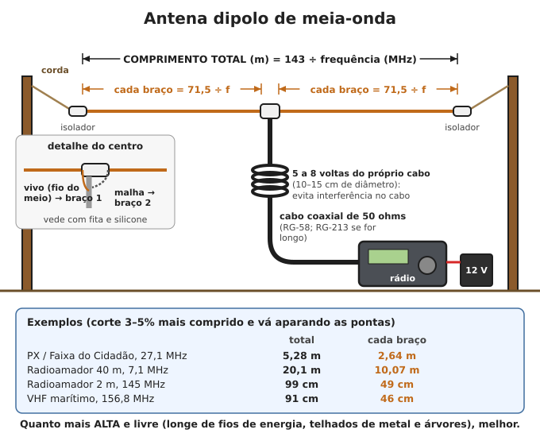
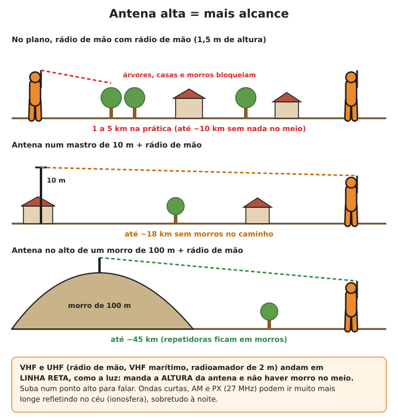
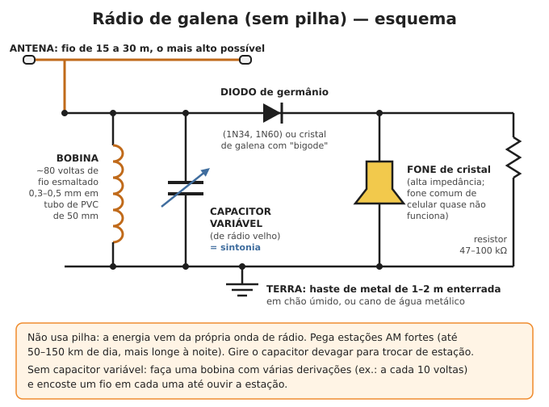

# Rádio: receber notícias e falar à distância

**Resumo:** sem internet e sem celular, o rádio é o que resta para saber o que acontece e para
pedir ajuda. **Receber** é fácil e barato: um rádio AM/FM/ondas curtas a pilha, manivela ou sol,
ouvido à noite, pega notícias de centenas a milhares de km. **Transmitir** exige equipamento,
antena e, em tempos normais, regras da Anatel: rádio comunicador de uso livre (1–5 km), PX
(dezenas de km) e radioamador (o país inteiro). Combine horários fixos e fale pouco: todo mundo escuta.

---

## 1. Receber notícias (o mais importante)

### Que rádio ter
- **Rádio portátil AM/FM com ondas curtas (OC, SW, "multibanda")**, de preferência com sintonia
  digital. Funciona com **2 a 4 pilhas AA**: um rádio pequeno gasta de 50 a 150 mA, ou seja,
  um par de pilhas dura **15 a 40 horas** de escuta em volume baixo.
- **Rádio de manivela (dínamo) com painel solar:** 1 minuto de manivela costuma dar 5 a 15
  minutos de rádio. Muitos também carregam celular e têm lanterna. Compre um de boa marca: os
  muito baratos quebram a manivela.
- **Rádio do carro:** bom receptor com boa antena. O rádio gasta 1 a 3 A. Uma bateria de 60 Ah
  aguenta horas, mas **não passe de 2–3 horas sem ligar o motor**, ou o carro não pega mais.
  Melhor: retire o rádio do painel e ligue numa bateria separada carregada por painel solar
  (fio vermelho e amarelo no positivo, preto no negativo; confira o esquema do aparelho).
- **Estoque:** pilhas para 6 meses de escuta (cerca de 20 pares), ou pilhas recarregáveis NiMH
  com carregador solar. Tire as pilhas do rádio guardado (elas vazam e corroem os contatos).

### As faixas e o que esperar delas

| Faixa | Frequências | Alcance típico | Para quê |
|---|---|---|---|
| FM | 87,5–108 MHz (FM estendido: 76–108) | 50–100 km | Rádios locais e regionais, som limpo |
| AM (ondas médias, OM) | 530–1.700 kHz | De dia 100–300 km; **à noite 500 a mais de 1.500 km** | Notícias de outras cidades e estados |
| Ondas curtas (OC) | 2,3–26 MHz | Milhares de km | Emissoras nacionais e de outros países |

- **AM à noite vai muito mais longe:** depois do pôr do sol a camada baixa da atmosfera que
  absorve o sinal desaparece, e as ondas refletem no céu (ionosfera). Faça a escuta principal
  **das 19 h às 6 h**.
- **Migração AM → FM:** muitas rádios AM do Brasil passaram para o FM, inclusive para a faixa
  "FM estendido" (76 a 87,5 MHz), que **rádios antigos não sintonizam**. Ao comprar, prefira um
  aparelho que chegue a 76 MHz.
- **Ondas curtas:** de dia use as faixas mais altas; à noite, as mais baixas.

| Faixa de OC | Frequências | Melhor horário |
|---|---|---|
| 60 m e 49 m | 4,75–5,06 MHz e 5,9–6,2 MHz | noite |
| 41 m e 31 m | 7,2–7,45 MHz e 9,4–9,9 MHz | fim de tarde e noite |
| 25 m e 19 m | 11,6–12,1 MHz e 15,1–15,8 MHz | dia |
| 16 m e 13 m | 17,48–17,9 MHz e 21,45–21,85 MHz | meio do dia |

- **Emissora pública brasileira em ondas curtas:** Rádio Nacional da Amazônia, de Brasília, em
  **6.180 kHz** (à noite) e **11.780 kHz** (de dia). Os horários mudam: confira e anote agora.
  Emissoras de outros países também transmitem em OC e noticiam grandes catástrofes.
- Enquanto houver internet, **faça uma lista impressa** das rádios AM, FM e OC que você
  consegue ouvir em casa, com frequência e horário dos noticiários. Guarde com o rádio.

### Como ouvir melhor
1. Ouça perto de uma janela ou fora de casa. Concreto e telhado de metal bloqueiam o sinal.
2. **AM:** a antena fica dentro do rádio (bastão de ferrite) e é direcional. Gire o aparelho
   devagar até o som ficar mais forte e limpo.
3. **FM e OC:** estique a antena telescópica toda. Para OC, prenda nela com um jacaré **um fio
   comum de 5 a 10 m** esticado para fora, no alto: o ganho é enorme.
4. Desligue **lâmpadas LED, carregadores, inversores e controladores solares** durante a escuta
   de estações fracas: eles geram chiado.
5. Escute **no horário cheio** (notícias costumam abrir a hora) e **anote** tudo num caderno:
   data, hora, emissora, o que foi dito. Repasse à comunidade num quadro de avisos e marque o
   que é **confirmado** e o que é **boato**.

### Outros sinais que dá para escutar
- **Alertas da Defesa Civil:** chegam por SMS (cadastre o seu CEP enviando-o para **40199**) e
  por alerta direto no celular, mas só enquanto a rede de celular funcionar.
- **Rádio de mão VHF/UHF que recebe faixa larga** (do tipo vendido em lojas de eletrônicos)
  ouve radioamadores (144–148 MHz), VHF marítimo (156–162 MHz) e, em alguns modelos, aviação
  (118–137 MHz, em AM). Muitos serviços públicos hoje são digitais e não dá para ouvir.

---

## 2. Transmitir: as opções

| Tipo | Licença no Brasil | Alcance real | Observação |
|---|---|---|---|
| Rádio comunicador de uso livre (462–467 MHz, 0,5 W) | Dispensada (aparelho homologado) | 1–3 km na cidade; 3–5 km no plano aberto; 10+ km de morro a morro | Barato, simples, ideal para a vizinhança |
| PX / Faixa do Cidadão (27 MHz, 40 canais) | Cadastro simples e gratuito na Anatel (confira) | 5–15 km móvel; 20–50 km com antena alta; às vezes muito mais | Canal 9 = emergência |
| Radioamador (HF, VHF, UHF) | Exame da Anatel (COER) + licença | Bairro a país inteiro (HF) | O mais poderoso; aprenda **agora** |
| VHF marítimo (canal 16) | Licença de estação e de operador | 20–40 km (mais até estações costeiras) | Litoral, lagos e rios navegáveis |
| Aviação (121,5 MHz) | Só aeronaves e estações autorizadas | 100–200 km até aviões em altitude | Use **apenas** em emergência real |

> **ATENÇÃO:** em tempos normais, transmitir sem autorização em faixas que não são de uso livre
> é crime. Mas pelo Regulamento de Radiocomunicações internacional, que o Brasil segue, **quem
> está em perigo de vida pode usar qualquer meio e qualquer frequência para pedir socorro**.
> Passado o perigo, pare.

### 2.1 Rádio comunicador de uso livre ("walkie-talkie" de loja)
- Opera em **462,5625 a 467,7125 MHz**, com **0,5 W**, homologado pela Anatel, **sem licença**.
- Alcance real: o da caixa ("até 30 km") é teórico, de topo de morro a topo de morro. Conte com
  **1 a 3 km** entre casas e prédios. Para ir mais longe, **suba**: laje, caixa d'água, morro.
- "Códigos de privacidade" (CTCSS/DCS) **não dão privacidade**: só escondem as conversas dos
  outros. Qualquer rádio no mesmo canal ouve você.
- Economize bateria: desligue a função "varredura" (scan), use o canal combinado e deixe ligado
  só nos horários marcados. Prefira modelos que usam pilha AAA comum.
- Rádios de mão de 5 W que transmitem em toda a faixa VHF/UHF são vendidos livremente, mas
  **só podem transmitir em faixas autorizadas** (radioamador licenciado, por exemplo). Servem
  muito bem para **escutar**.

### 2.2 PX — Faixa do Cidadão (Serviço Rádio do Cidadão)
- Faixa de **26,965 a 27,405 MHz**, **40 canais**, em AM (alguns aparelhos têm também SSB, que
  alcança mais).
- **Canal 9 (27,065 MHz) = emergência e socorro.** Combine com seu grupo um **canal de trabalho**
  fixo e um **canal reserva** para quando o primeiro estiver ocupado.
- Hoje o PX é dispensado de autorização: basta um **cadastro simples e gratuito** na Anatel,
  com equipamento homologado. As regras mudam: **confira no site da Anatel** enquanto houver internet.
- O rádio é de 12 V (carro, base em casa com bateria). Antenas: vertical de 1/4 de onda
  (**2,64 m**), dipolo (**5,28 m** no total) ou antena de carro com bobina (1–1,5 m).
- **Ajuste a antena com um medidor de ROE** (estacionária): o ideal é abaixo de 1,5 para 1.
  **Nunca transmita sem antena ligada**: queima o transistor de saída.
- Às vezes, com o sol ativo, o sinal de 27 MHz "pula" e se ouvem estações de outros estados e
  países (propagação). Não conte com isso para falar com a cidade vizinha.

### 2.3 Radioamador
- É o serviço que faz a ligação entre cidades e estados quando tudo cai. No Brasil é preciso o
  **COER** (Certificado de Operador de Estação de Radioamador), obtido em **prova da Anatel**
  (legislação e técnica básica), nas classes **C** (iniciante), **B** e **A**. Procure a
  **LABRE** (Liga de Amadores Brasileiros de Rádio Emissão) ou um radioclube da sua cidade.
- **Faça isso antes da crise.** Equipamento sem prática não serve de nada.

| Faixa | Frequência | Uso típico |
|---|---|---|
| 80 m | ~3,5 MHz | Regional (0–500 km) à noite |
| 40 m | 7,0–7,3 MHz | **A faixa da emergência:** regional de dia, o país à noite |
| 20 m | 14,0–14,35 MHz | Longa distância de dia |
| 2 m | 144–148 MHz (FM) | Local, 10–50 km; muito mais por repetidoras em morros |
| 70 cm | 430–440 MHz (FM) | Local, rádios de mão |

- **Antena para a região (técnica NVIS):** um **dipolo de 40 m (20 m de comprimento) baixo,
  a 4–8 m do chão**, joga o sinal para cima e ele volta cobrindo **0 a 500 km sem zona morta**.
  É a melhor configuração para uma rede de emergência estadual.
- **RENER** (Rede Nacional de Emergência de Radioamadores), criada junto à Defesa Civil
  (Portaria 302/2001), reúne radioamadores voluntários. Descubra **agora** os horários e
  frequências da rede no seu estado e anote no plano de comunicação.
- Um rádio de HF de 100 W gasta **~20 A transmitindo** e 1–2 A ouvindo. Reduza para 10–25 W
  sempre que der: o alcance cai menos do que parece e a bateria dura muito mais.

### 2.4 VHF marítimo e aviação
- **VHF marítimo, canal 16 (156,800 MHz):** canal de socorro e chamada, escutado por navios e
  estações costeiras. Depois do contato, mude para um canal de trabalho.
- **Aviação, 121,5 MHz (AM):** frequência internacional de emergência, escutada por muitos
  aviões em voo. Aeronave em altitude ouve de 100 a 200 km.
- **Radiobaliza pessoal (PLB) de 406 MHz:** aparelho de bolso que, acionado, manda sua posição
  por satélite aos serviços de busca e salvamento do mundo inteiro, sem assinatura. Ótimo para
  quem anda no mato ou no mar. Registre o aparelho conforme as instruções que vêm com ele.

### 2.5 Chamada de socorro por voz (MAYDAY)
Use **MAYDAY** só com **perigo grave e imediato à vida**. Para urgência sem risco imediato
(doente que precisa de remoção, barco à deriva sem perigo) use **PAN-PAN** no lugar de MAYDAY.
1. "**MAYDAY, MAYDAY, MAYDAY.**"
2. "Aqui é [nome ou estação], [nome], [nome]."
3. "MAYDAY, [nome]. **Posição:** [local exato: referência, distância, coordenadas]."
4. "**O que aconteceu:** [incêndio, afogamento, ferido grave...]."
5. "**Ajuda necessária:** [médico, resgate, barco...]. **Pessoas:** [quantas, quantos feridos]."
6. "Câmbio." Espere 1 minuto em silêncio. Repita até alguém responder.

---

## 3. Antenas: onde se ganha (ou se perde) alcance

A antena vale mais que a potência do rádio. Dobrar a potência quase não se nota do outro lado;
**subir a antena** e fazê-la do tamanho certo faz uma diferença enorme.

### Dipolo de meia-onda (a antena mais fácil de fazer)

- **Comprimento total (m) ≈ 143 ÷ frequência (MHz).** Cada braço = metade (71,5 ÷ f).
- Material: fio de cobre (fio elétrico de 1,5 a 2,5 mm² serve), dois isoladores nas pontas
  (pedaço de PVC, acrílico ou tábua seca com dois furos), um isolador no centro e corda de
  náilon até árvores ou postes.
1. Corte cada braço **3 a 5% mais comprido** que o cálculo.
2. No centro, ligue o **fio do meio (vivo)** do cabo coaxial a um braço e a **malha** ao outro.
   Solde, cubra com fita isolante e silicone (água dentro do cabo estraga tudo).
3. Faça **5 a 8 voltas do próprio cabo** (rolo de 10–15 cm) logo abaixo do centro: isso reduz
   interferência e o cabo não vira antena.
4. Levante o mais alto possível, longe de telhados de metal e árvores.
5. Com medidor de ROE: se a melhor ROE estiver **abaixo** da frequência desejada, a antena está
   comprida: corte 1–2 cm de cada ponta e meça de novo. Se estiver acima, emende um pedaço.
- **V invertido:** com um só mastro, prenda o centro no alto e desça as pontas em ângulo
  (90° a 120° entre os braços), as pontas a pelo menos 2 m do chão.
- **Vertical de 1/4 de onda (plano de terra):** uma vareta vertical de 71,5 ÷ f metros e
  4 fios (radiais) do mesmo tamanho, inclinados 45° para baixo. Para PX: 2,64 m.

### Altura e linha de visada
VHF e UHF (rádio de mão, marítimo, 2 m) andam em linha reta. O alcance máximo sem obstáculos é
**distância (km) ≈ 4,1 × (√altura1 + √altura2)**, com as alturas em metros.

| Antena 1 | Antena 2 | Alcance máximo teórico |
|---|---|---|
| 1,5 m (pessoa) | 1,5 m (pessoa) | ~10 km (na prática 1–5 km) |
| 10 m (mastro) | 1,5 m | ~18 km |
| 30 m (prédio ou torre) | 1,5 m | ~28 km |
| 100 m (morro) | 1,5 m | ~46 km |
| 300 m (serra) | 1,5 m | ~76 km |

- **Cabo coaxial:** use o mais curto possível. O RG-58 (fino) perde metade da potência em
  ~15 m de cabo em VHF; para mais que isso use **RG-213** ou cabo de baixa perda. Em HF o RG-58
  serve até ~30 m.
- Para falar com a cidade vizinha em VHF, uma **estação de repetição improvisada no alto de um
  morro** (rádio, antena, bateria e painel solar, com um operador) cobre dezenas de km.

> **ATENÇÃO:** **nunca** monte antena, mastro ou fio perto de rede elétrica: se encostar, mata.
> A distância mínima é a altura total do mastro mais 3 m. Em tempestade, **desligue o cabo do
> rádio** e deixe-o fora de casa, ligado a uma haste de terra. Mastro alto atrai raio.

---

## 4. Energia para os rádios

| Aparelho | Ouvindo | Transmitindo |
|---|---|---|
| Rádio portátil AM/FM/OC | 0,05–0,15 A (pilhas) | — |
| Rádio comunicador 0,5 W | ~0,05 A | 0,3–0,5 A |
| Rádio de mão VHF/UHF 5 W | 0,1–0,2 A | 1,2–1,8 A |
| PX 12 V (4 W) | 0,3–0,5 A | 1,5–2,5 A |
| Radioamador HF 100 W (13,8 V) | 1–2 A | ~20 A |

**Exemplo de cálculo (PX em casa):** 4 h de escuta (4 × 0,5 A = 2 Ah) + 30 min falando
(0,5 × 2 A = 1 Ah) = **3 Ah por dia**. Uma bateria de 12 V e 40 Ah, usada até a metade (20 Ah),
dura cerca de **6 dias** sem sol. Um painel de **20–30 W** repõe esse consumo num dia de sol.
- Ouvir gasta pouco; o que esvazia a bateria é falar muito. Fale curto.
- Detalhes de baterias, controlador e ligação: [Baterias](../06-energia/05-baterias.md) e
  [Energia solar](../06-energia/04-energia-solar.md).

---

## 5. Como falar no rádio (protocolo)

### Regras básicas
1. **Escute antes** por 30 segundos: não atropele uma conversa.
2. Aperte o botão (PTT), **espere 1 segundo**, fale com a boca a 5–10 cm do microfone, devagar.
3. Frases curtas. **No máximo 30 segundos** por vez. Solte o botão e diga antes "câmbio".
4. Comece dizendo **para quem** e **quem fala**: "Base Vale, aqui Estação Ponte, câmbio."
5. Nomes, números e endereços: **soletre** com o alfabeto fonético e repita os números.
6. Confirme o que recebeu repetindo os pontos principais.

### Alfabeto fonético internacional (para soletrar)

| Letra | Palavra (como se fala) | Letra | Palavra (como se fala) | Letra | Palavra (como se fala) |
|---|---|---|---|---|---|
| A | Alfa (álfa) | J | Juliett (djúliet) | S | Sierra (siérra) |
| B | Bravo (brávo) | K | Kilo (quílo) | T | Tango (tângo) |
| C | Charlie (tchárli) | L | Lima (líma) | U | Uniform (iúniform) |
| D | Delta (délta) | M | Mike (máique) | V | Victor (víctor) |
| E | Echo (éco) | N | November (novêmber) | W | Whiskey (uísqui) |
| F | Foxtrot (fócstrot) | O | Oscar (óscar) | X | X-ray (écs-rei) |
| G | Golf (gólf) | P | Papa (papá) | Y | Yankee (iânqui) |
| H | Hotel (hotél) | Q | Quebec (quebéc) | Z | Zulu (zúlu) |
| I | India (índia) | R | Romeo (rômeo) | | |

**Números (padrão brasileiro de rádio):** 1 = **uno**, 2 = dois, 3 = três, 4 = quatro,
5 = cinco, 6 = **meia**, 7 = sete, 8 = oito, 9 = nove, 0 = zero. Fale dígito por dígito:
"rua 16" = "uno-meia".

### Códigos e palavras mais usados

| Código | Significado | Código | Significado |
|---|---|---|---|
| QAP | na escuta | QRX | aguarde |
| QSL | entendido, confirmado | QSY | mude de canal ou frequência |
| QTH | local, endereço | QRM | interferência |
| QRA | nome do operador ou da estação | QRT | vou desligar |
| QRV | pronto para receber | QTR | hora certa |
| Câmbio | terminei, pode falar | Câmbio final | terminei a conversa |
| Positivo / negativo | sim / não | Repita | não entendi |

### Formato de mensagem: QUEM, ONDE, O QUÊ, QUANTOS, PRECISA DE QUÊ, QUANDO
Escreva a mensagem no papel **antes** de transmitir. Exemplo:
> "Base Vale, aqui Estação Ponte. **Mensagem prioridade.** Estrada da ponte, quilômetro 4,
> perto da escola. Árvore caída bloqueando a estrada, um carro preso. **Duas pessoas, uma com o
> braço quebrado**, consciente. Precisamos de **maca, motosserra e 4 pessoas**. Hora: 15h20.
> Câmbio."

- **Prioridades:** EMERGÊNCIA (vida em risco agora) > PRIORIDADE (saúde, segurança, resgate) >
  ROTINA (recados, combinações). Para interromper uma conversa por emergência, diga
  "**EMERGÊNCIA, EMERGÊNCIA**" num intervalo entre falas.
- **Caderno de registro (livro de rádio):** anote data, hora, canal, quem chamou, mensagem e
  providência tomada. Sem isso, as informações se perdem e viram boato.

### Rede comunitária de rádio
1. Escolha uma **estação central** (casa com bateria, antena alta e operadores que se revezam).
2. Defina **horários fixos de contato**, por exemplo **7h, 12h e 19h, por 15 minutos**, e uma
   **escuta de 5 minutos a cada hora cheia** para emergências. Fora disso, rádios desligados.
3. Na abertura, a central faz a **chamada de presença** de cada estação, em ordem; cada uma
   responde "presente, sem novidades" ou "presente, com mensagem".
4. Tenha **canal principal e canal reserva**. Se o principal estiver ruim por 2 minutos, todos
   vão para o reserva sem precisar combinar.
5. Para distâncias maiores, estações intermediárias **retransmitem** ("ponte").
6. Escreva o **plano de comunicação** e entregue cópia a cada estação:

| Item | Exemplo |
|---|---|
| Canal principal / reserva | PX canal 14 / PX canal 22; rádio comunicador canal 3 / 7 |
| Horários de contato | 7h, 12h, 19h (15 min); escuta 5 min a cada hora cheia |
| Estação central | Casa da Dona Ana (Base Vale) |
| Nomes de código dos lugares | Ponto 1 = escola; Ponto 2 = poço; Ponto 3 = ponte |
| Emergência | PX canal 9; radioamador: frequência da rede de emergência do estado |

### Segurança e discrição
- **Tudo o que você fala pode ser ouvido por qualquer pessoa num raio de quilômetros**, e um
  transmissor pode ser localizado (radiogoniometria) por quem tiver equipamento.
- **Não diga** quantas pessoas há na casa, o que vocês têm estocado, quando a casa fica vazia,
  nomes completos e endereços. Use os nomes de código combinados.
- Fale pouco e sempre do mesmo jeito; transmissões curtas são mais difíceis de localizar.
- No radioamador em tempos normais é proibido cifrar mensagens. Em emergência, combinar nomes
  de código para lugares é o mínimo de prudência. Veja também [Segurança](../12-comunidade-e-seguranca/02-seguranca.md).

---

## 6. Rádio de galena (sem pilha nenhuma)

Curiosidade útil: é um receptor de AM que **funciona só com a energia da própria onda de rádio**.
Pega emissoras AM fortes a 50–150 km de dia, e mais longe à noite.

**Material:** fio esticado de 15 a 30 m (antena) e uma **boa terra** (haste de metal de 1–2 m em
chão úmido ou cano de água metálico); **bobina** de ~80 voltas encostadas de fio esmaltado de
0,3–0,5 mm num tubo de PVC de 50 mm (cerca de 250 microhenry); **capacitor variável** de rádio
velho (365 pF); **diodo de germânio** (1N34, 1N60) ou um cristal de galena tocado por um
"bigode" de arame fino; **fone de cristal** (alta impedância); resistor de 47 a 100 kΩ.
1. Ligue a antena numa ponta da bobina e a terra na outra.
2. Ligue o capacitor variável em paralelo com a bobina (mesmas duas pontas).
3. Do lado da antena, ligue o diodo; do outro lado do diodo, o fone, e a outra ponta do fone na
   terra. Ponha o resistor junto do fone (em paralelo).
4. Gire o capacitor devagar até ouvir uma emissora. Sem capacitor variável, faça derivações na
   bobina a cada 10 voltas (raspe o esmalte) e encoste um fio em cada uma.
- Fone de celular comum quase não funciona: precisa de fone de cristal ou de um fone antigo de
  alta impedância (2.000 ohms).
- Um diodo improvisado com **lâmina de barbear enferrujada e grafite de lápis** encostado
  ("rádio de trincheira") também funciona, com paciência para achar o ponto certo.

---

Ver também: [Sinais e código Morse](02-sinais-e-morse.md) · [Baterias](../06-energia/05-baterias.md) · [Energia solar](../06-energia/04-energia-solar.md) · [Eletricidade básica](../06-energia/03-eletricidade-basica.md) · [Organização comunitária](../12-comunidade-e-seguranca/01-organizacao-comunitaria.md) · [Desastres](../11-natureza-e-desastres/03-desastres.md) · [Cartões de bolso](../00-emergencia/04-cartoes-de-bolso.md)
