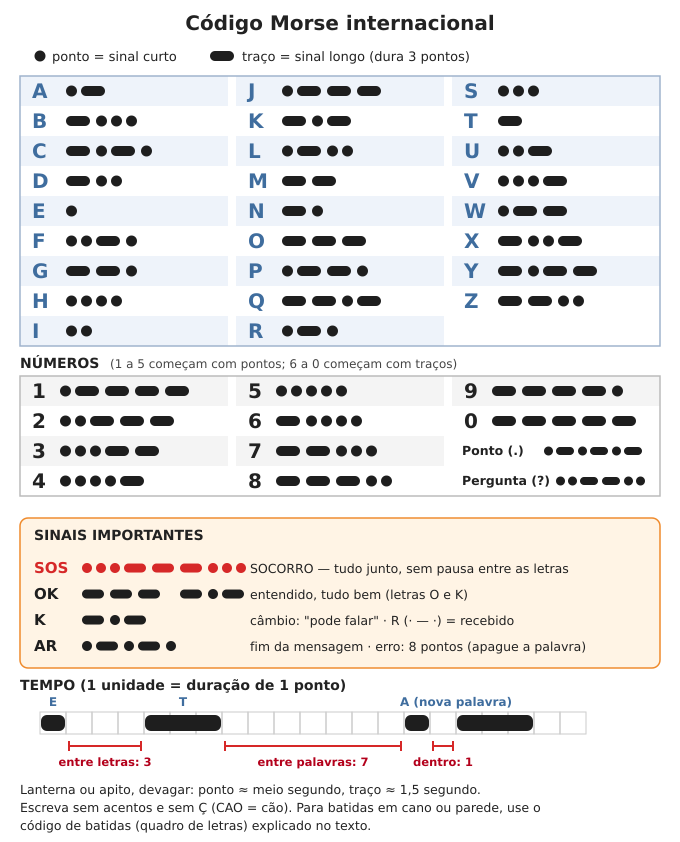
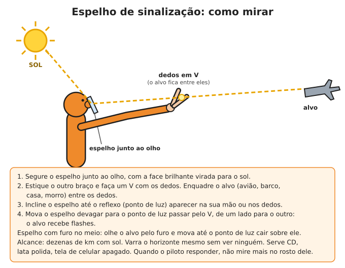
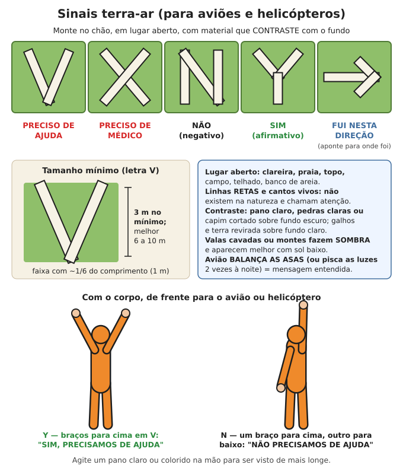

# Sinais e código Morse

**Resumo:** para pedir socorro ou falar à distância sem rádio, use **luz, som, fumaça, pano e
marcas no chão**. A regra universal é **3 de qualquer coisa** (3 apitos, 3 fogueiras, 3 flashes)
e o **SOS** em Morse (`··· ——— ···`). Para aviões, letras grandes no chão: **V** = preciso de
ajuda, **X** = preciso de médico. Combine antes com seu grupo os sinais de apito, de mão e de trilha.

---

## 1. Sinais de socorro universais

| Sinal | Como fazer |
|---|---|
| **3 de qualquer coisa** | 3 apitos, 3 batidas, 3 flashes, 3 fogueiras, 3 montes de pedra. Pausa de 1 minuto e repita |
| **SOS** em Morse | `··· ——— ···` sem pausa entre as letras, com luz, som ou rádio. Repita depois de 3–5 segundos |
| **MAYDAY** por voz no rádio | Ver [Rádio](01-radio.md) (perigo grave e imediato à vida) |
| Letras **V** ou **X** no chão | Para aviões e helicópteros (seção 4) |
| **SOS** ou **AJUDA** escrito no telhado | Letras de 2–3 m de altura com tinta, lençol, telhas viradas |
| Braços abertos em V para o alto, acenando | Pessoa pedindo resgate (seção 4) |
| Bandeira de cabeça para baixo; pano laranja com quadrado e círculo pretos | Sinal tradicional de barco em perigo |

- Socorro de verdade, só quando há perigo. Sinal falso tira o resgate de quem precisa.
- **Quem ouve ou vê** um pedido de socorro responde (com 2 apitos, um aceno, uma luz) para a
  vítima saber que foi percebida, e avisa os outros antes de ir até ela.

---

## 2. Código Morse

### Tabela em texto (ponto = `·`, traço = `—`)

| Letra | Código | Letra | Código | Letra | Código | Número | Código |
|---|---|---|---|---|---|---|---|
| A | `· —` | J | `· — — —` | S | `· · ·` | 1 | `· — — — —` |
| B | `— · · ·` | K | `— · —` | T | `—` | 2 | `· · — — —` |
| C | `— · — ·` | L | `· — · ·` | U | `· · —` | 3 | `· · · — —` |
| D | `— · ·` | M | `— —` | V | `· · · —` | 4 | `· · · · —` |
| E | `·` | N | `— ·` | W | `· — —` | 5 | `· · · · ·` |
| F | `· · — ·` | O | `— — —` | X | `— · · —` | 6 | `— · · · ·` |
| G | `— — ·` | P | `· — — ·` | Y | `— · — —` | 7 | `— — · · ·` |
| H | `· · · ·` | Q | `— — · —` | Z | `— — · ·` | 8 | `— — — · ·` |
| I | `· ·` | R | `· — ·` | | | 9 | `— — — — ·` |
| | | | | | | 0 | `— — — — —` |

### Sinais especiais

| Sinal | Código | Significado |
|---|---|---|
| SOS | `· · · — — — · · ·` (tudo junto) | Socorro |
| OK | `— — —` `— · —` | Entendido, tudo bem |
| K | `— · —` | "Câmbio": pode responder |
| R | `· — ·` | Recebido |
| AR | `· — · — ·` | Fim da mensagem |
| Erro | `· · · · · · · ·` (8 pontos) | Errei: desconsidere a última palavra |
| Pergunta (?) | `· · — — · ·` | Repita / tem pergunta |

### A regra do tempo (o segredo para ser entendido)
A unidade é a duração de **1 ponto**:

| Elemento | Duração |
|---|---|
| Ponto | 1 unidade |
| Traço | **3** unidades |
| Pausa entre pontos e traços da mesma letra | 1 unidade |
| Pausa entre letras | **3** unidades |
| Pausa entre palavras | **7** unidades |

- Com luz ou apito, **devagar é melhor**: ponto ≈ **0,5 s**, traço ≈ **1,5 s**, pausa entre letras
  ≈ 1,5 s, entre palavras ≈ 3,5 s. Quem recebe precisa conseguir contar.
- Escreva **sem acentos e sem Ç** (CAO = cão, AGUA = água). Abrevie: "PRECISO MEDICO 2 FERIDOS".
- Os números são fáceis: de 1 a 5 começam com tantos pontos quanto o número e completam com
  traços; de 6 a 0, o inverso (6 = 1 traço e 4 pontos).

### Como aprender em 2 semanas
1. Aprenda **pelo som**, não pela imagem: diga "di" para ponto e "dá" para traço.
   A = "di-dá", N = "dá-di", SOS = "di-di-di dá-dá-dá di-di-di".
2. Comece pelas letras mais usadas: **E T A I N O S R**. Depois 2 letras novas por dia.
3. Treine **10 minutos por dia**, em dupla: um transmite batendo na mesa, o outro escreve.
4. Mantenha uma velocidade de letra rápida e aumente as pausas no começo (assim você não
   aprende a "contar pontos").

### Como transmitir sem rádio
- **Lanterna:** ligue e desligue, ou mantenha ligada e tampe com a mão ou um papelão.
  Faróis de carro, lampião com um pano na frente e espelho ao sol também servem. Uma lanterna
  forte é vista a vários km à noite em lugar aberto.
- **Apito, buzina, sino:** som curto = ponto, som longo = traço.
- **Batidas** (cano, parede, trilho, casco de barco): bata nos tempos do Morse **ou** use o
  código de batidas abaixo, mais fácil de entender por batidas.
- **Bandeira ou pano:** balanço para a direita = ponto, para a esquerda = traço (combine antes).

### Código de batidas (para paredes, canos, escombros)
Cada letra é dada por **duas séries de batidas**: a linha e depois a coluna. O K usa o
mesmo lugar do C.

| | 1 | 2 | 3 | 4 | 5 |
|---|---|---|---|---|---|
| **1** | A | B | C/K | D | E |
| **2** | F | G | H | I | J |
| **3** | L | M | N | O | P |
| **4** | Q | R | S | T | U |
| **5** | V | W | X | Y | Z |

Exemplo: **S** = 4 batidas, pausa, 3 batidas. Uma pausa mais longa separa as letras.
- **Soterrado em escombros:** bata 3 vezes, pare, escute; repita a cada poucos minutos para
  poupar forças. Bater em cano ou estrutura de metal leva o som mais longe que gritar.

---

## 3. Luz, fogo e fumaça

### Fogueiras de sinalização
1. Monte **3 fogueiras em triângulo** (ou em linha), com **25 a 30 m** entre elas, em lugar
   aberto e visível: clareira, topo de morro, praia, banco de areia.
2. Deixe tudo **pronto e seco**, protegido da chuva (lona, casca de árvore), e acenda só quando
   ouvir ou vir avião, barco ou pessoas. Mantenha brasa acesa por perto.
3. Tenha ao lado um monte de material para fazer fumaça:

| Situação | O que queimar | Resultado |
|---|---|---|
| De dia, fundo escuro (mata, morro verde) | Folhas verdes, capim verde, musgo, um pouco de água | Fumaça **BRANCA** |
| De dia, fundo claro (areia, céu nublado) | Pedaço de pneu, borracha, óleo velho (pouco) | Fumaça **PRETA** (tóxica: fique contra o vento) |
| À noite | Lenha seca, bem acesa | **CHAMA** alta e clara |

- Fumaça sobe melhor com ar calmo, de manhã cedo e no fim da tarde; vento forte a espalha.

> **ATENÇÃO:** na estação seca (de maio a outubro no Cerrado, no Centro-Oeste e no Sudeste;
> no Nordeste, fora da época de chuva) um fogo de sinalização vira **incêndio florestal** em
> minutos. Limpe o chão até a terra num círculo de **3 m** em volta, deixe água ou terra solta
> ao lado e nunca acenda com vento forte. Ver [Fogo](../06-energia/01-fogo.md).

### Espelho de sinalização
O reflexo do sol num espelho é visto a **dezenas de km** e chama a atenção de aviões e barcos
quando nada mais funciona.

1. Segure o espelho junto ao olho, com a face brilhante virada para o sol.
2. Estique o outro braço e faça um **V com os dedos**; enquadre o alvo entre eles.
3. Incline o espelho até o ponto de luz aparecer na mão ou nos dedos.
4. Mova devagar para o ponto de luz passar pelo V: o alvo recebe flashes.
- Espelho com furo no meio (próprio para sinalização): olhe o alvo pelo furo e ajuste até o
  ponto de luz "cair" sobre ele.
- Serve: espelho de bolsa, CD, tampa de lata polida, tela de celular apagado, papel-alumínio
  bem esticado num papelão.
- **Varra o horizonte** de tempos em tempos mesmo sem ver ninguém. Quando o piloto responder
  (balançar as asas ou mudar de rumo para você), pare de mirar no rosto dele.

---

## 4. Sinais terra-ar (para aviões e helicópteros)

| Símbolo | Significado |
|---|---|
| **V** | Preciso de ajuda |
| **X** | Preciso de assistência médica |
| **N** | Não (negativo) |
| **Y** | Sim (afirmativo) |
| **→** (seta) | Fui nesta direção |

### Como montar
1. Escolha o **lugar mais aberto** perto de você: clareira, campo, praia, topo de morro, telhado.
2. Cada letra com **pelo menos 3 m** de comprimento (o mínimo internacional é 2,5 m); melhor
   **6 a 10 m**. A largura das faixas deve ser **1/6 do comprimento** (1 m para letras de 6 m).
3. **Contraste:** pano claro, pedras claras, capim cortado ou galhos descascados sobre fundo
   escuro; galhos verdes, terra revirada ou pedras escuras sobre areia ou capim seco.
4. Use **linhas retas e cantos vivos**: a natureza não faz isso, e o olho do piloto percebe.
5. Valas cavadas (30 cm) ou montes fazem **sombra**, que aparece muito bem com sol baixo.
6. Resposta do avião: **balançar as asas** de dia (ou piscar as luzes duas vezes à noite) =
   mensagem entendida.

### Sinais com o corpo
- **Os dois braços para o alto em V**, de frente para a aeronave: "SIM / precisamos de ajuda,
  venham nos buscar".
- **Um braço para cima e o outro para baixo** (como a letra N): "NÃO / não precisamos de ajuda".
- Agite um pano claro ou colorido. Deitado no chão com braços e pernas abertos você também
  é mais visível do que em pé.

### Panos e bandeiras na casa ou no bairro
Combine na comunidade um código visível de longe, por exemplo:
- **Pano verde** na janela ou portão = estamos bem.
- **Pano vermelho ou laranja** = precisamos de ajuda (alguém doente ou ferido, falta água).
- Em enchente, escreva **SOS** no telhado com tinta, lençóis ou telhas viradas e fique visível.

---

## 5. Sinais de mão (grupo em silêncio)

Combine e treine com o grupo. Quem vê o sinal **repete** para quem vem atrás.

| Sinal | Significado |
|---|---|
| Punho fechado erguido | **PARE / congele** (fique parado e quieto) |
| Mão aberta, palma para baixo, descendo devagar | Abaixe-se, devagar |
| Mão no alto da cabeça | Venha até mim / reunir em mim |
| Indicador e médio apontando para os olhos, depois para um ponto | Olhe ali / vi algo |
| Mão em concha atrás da orelha | Escute / ouvi algo |
| Braço apontando, depois movimento para a frente | Avance nessa direção |
| Polegar para cima | Entendi / tudo bem |
| Polegar para baixo | Perigo, inimigo ou problema |
| Mão cortando o pescoço | Pare a atividade / desligue / acabou |
| Dedos mostrando um número | Quantidade (pessoas, animais) |
| Mão balançando aberta (palma para baixo) | "Mais ou menos", não tenho certeza |

---

## 6. Apito: código combinado

O apito é ouvido a **1–2 km** (a voz, a 100–200 m) e gasta pouca energia. Dê um a cada pessoa,
preso no pescoço ou na mochila; prefira **apito sem bolinha** (funciona molhado).

| Apitos | Significado | Resposta |
|---|---|---|
| 1 longo | Atenção / onde você está? | 1 longo = estou aqui, tudo bem |
| 2 longos | Venha até mim / vamos nos juntar | 2 longos = entendi, estou indo |
| 3 longos (repetir a cada minuto) | **SOCORRO** | 2 longos = ouvi, estou indo; e siga o som |
| Curtos, rápidos, sem parar | **PERIGO: abriguem-se / fujam** (incêndio, enchente, ataque) | Todos executam o plano combinado |

- Para a comunidade inteira, use sino, sirene, panela ou buzina com o mesmo código, e
  combine um toque diferente para cada tipo de alarme (por exemplo: toque contínuo = enchente,
  série de 3 = incêndio).

---

## 7. Marcas de trilha (para quem vem atrás)

1. Marque **sempre do mesmo lado** do caminho (combine: lado direito), a cada **50 a 100 m** e
   em **toda bifurcação**.
2. Use materiais que não somem: pedras, galhos grandes, fita colorida, corte na casca da árvore
   à altura dos olhos (só em árvores de pouco valor, um corte pequeno).
3. **Bilhete:** escreva com lápis (não borra), dentro de saco plástico, preso num galho à vista:
   **data, hora, quem, para onde foi, estado de saúde do grupo, quanta água e comida tem.**
4. Ao voltar pelo mesmo caminho, olhe para trás de tempos em tempos: a trilha parece outra
   no sentido contrário.
5. Quem procura alguém perdido também deixa marcas, para não andar em círculos e para que
   a pessoa perdida, ao achar a marca, saiba que há busca e para onde ir.

---

Ver também: [Rádio](01-radio.md) · [Orientação e navegação](03-orientacao-e-navegacao.md) · [Perdido no mato](../11-natureza-e-desastres/01-perdido-no-mato.md) · [Desastres](../11-natureza-e-desastres/03-desastres.md) · [Fogo](../06-energia/01-fogo.md) · [Cartões de bolso](../00-emergencia/04-cartoes-de-bolso.md)
