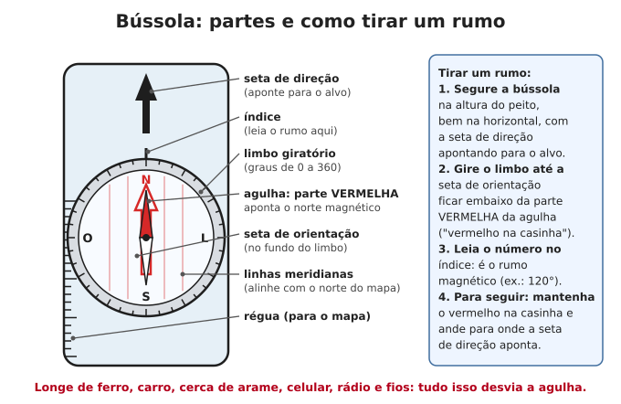
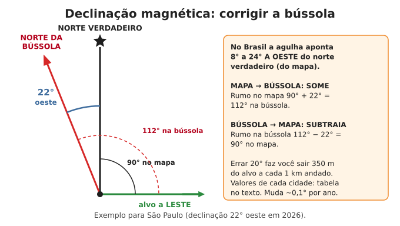
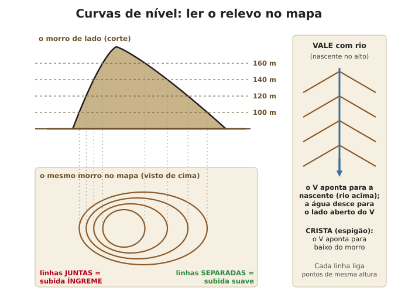
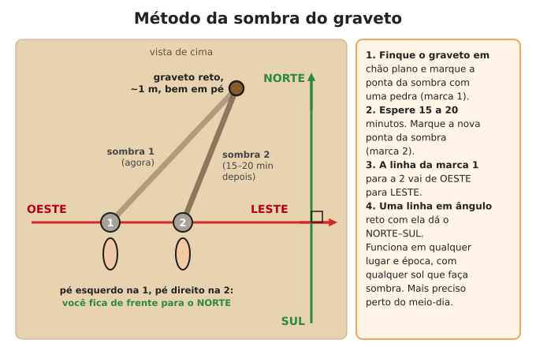
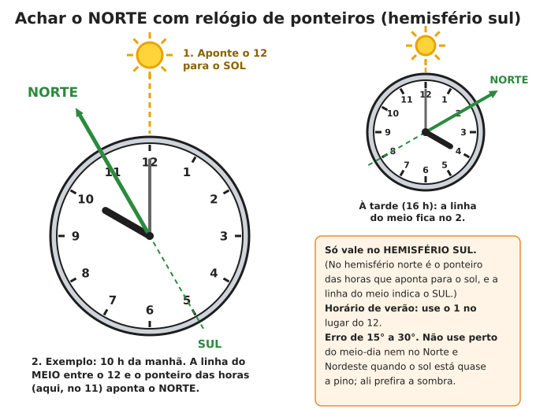
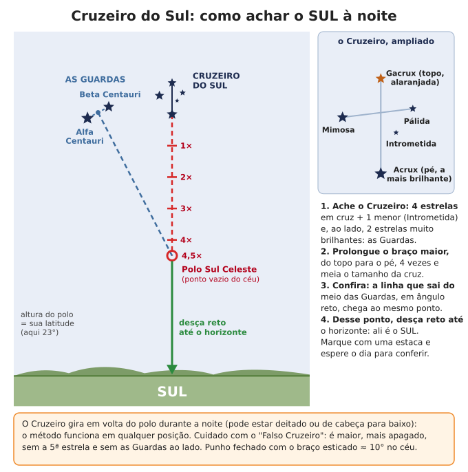

# Orientação e navegação

**Resumo:** tenha **mapa de papel da sua região e bússola**, e saiba corrigir a **declinação
magnética, que no Brasil é grande: a agulha aponta de 8° a 24° a OESTE do norte verdadeiro**.
Sem bússola: de dia use a **sombra do graveto** (a marca 1 é oeste, a marca 2 é leste); à noite,
o **Cruzeiro do Sul** (prolongue o braço maior 4,5 vezes e desça até o horizonte: é o sul).
Meça distâncias contando **passos duplos** e anote rumo, distância e tempo de cada trecho.

---

## 1. Bússola

### Que bússola ter
- **Bússola de placa transparente** (com régua e limbo giratório graduado de 0 a 360°) é a
  melhor para usar com mapa. Melhor ainda se tiver **ajuste de declinação**.
- Bússola de chaveiro só mostra mais ou menos o norte: serve como reserva.
- **Teste:** a ponta vermelha deve apontar para o lado **oposto** ao sul indicado pelo Cruzeiro
  do Sul ou pela sombra do meio-dia (com a diferença da declinação). Ímã forte por perto pode
  **inverter** a agulha: confira de tempos em tempos.

### Tirar um rumo (para onde fica o alvo)
1. Segure a bússola **na horizontal**, na altura do peito, com a **seta de direção** apontando
   para o alvo (morro, árvore, torre).
2. Gire o limbo até a **seta de orientação** ficar exatamente embaixo da ponta **vermelha** da
   agulha ("vermelho na casinha").
3. Leia o número no **índice**: é o **rumo magnético** (azimute). Anote.

### Seguir um rumo
1. Gire o limbo até o rumo desejado ficar no índice.
2. Gire o corpo até o vermelho entrar na casinha. A seta de direção aponta o caminho.
3. Escolha um **ponto de referência** nessa direção (árvore, pedra) a 50–200 m, guarde a bússola,
   ande até ele e repita. Assim você não precisa olhar a bússola a cada passo.
4. **Obstáculo no caminho (lagoa, barranco):** vire 90° e conte os passos (ex.: 40 passos);
   volte ao rumo original até passar o obstáculo; vire 90° para o outro lado e ande os mesmos
   40 passos; retome o rumo.
- **Rumo de volta (inverso):** some 180° se o rumo for menor que 180°; subtraia 180° se for
  maior. Ida a 70° → volta a 250°.

> **ATENÇÃO:** ferro e eletricidade desviam a agulha: afaste-se **3 m** de carro, cerca de arame,
> trilho; **1 m** de facão, panela, rádio, celular; e **mais de 30 m** de linhas de alta tensão.
> Em região de rocha com ferro (por exemplo, o Quadrilátero Ferrífero de Minas Gerais e Carajás,
> no Pará) a bússola pode errar muito: confira sempre pelo sol.

---

## 2. Declinação magnética (no Brasil é grande)

O norte da bússola **não é** o norte do mapa. Em todo o Brasil a agulha aponta para **oeste** do
norte verdadeiro, de **8° (oeste do Acre)** a **24° (Espírito Santo)**. Errar 20° faz você sair
**350 m do alvo a cada 1 km andado**.

### Declinação aproximada em 2026 (todas para OESTE)

| Cidade | Declinação | Cidade | Declinação |
|---|---|---|---|
| Porto Alegre (RS) | 18° | Salvador (BA) | 23° |
| Chuí / Uruguaiana (RS) | 14° | Recife (PE) | 21° |
| Florianópolis (SC) | 20° | Fortaleza (CE) / Natal (RN) | 20° |
| Curitiba (PR) | 20° | São Luís (MA) / Teresina (PI) | 21° |
| Foz do Iguaçu (PR) | 17° | Petrolina (PE) | 22° |
| São Paulo (SP) | 22° | Belém (PA) / Macapá (AP) | 20° |
| Rio de Janeiro (RJ) | 23° | Santarém (PA) | 19° |
| Belo Horizonte (MG) | 23° | Manaus (AM) | 17° |
| Vitória (ES) | 24° | Boa Vista (RR) | 16° |
| Brasília (DF) / Goiânia (GO) | 22° | Porto Velho (RO) | 14° |
| Palmas (TO) | 22° | Rio Branco (AC) | 11° |
| Campo Grande (MS) / Cuiabá (MT) | 19° | Tabatinga (AM) | 11° |
| Corumbá (MS) | 17° | Cruzeiro do Sul (AC) | 8° |

Valores calculados pelo modelo magnético mundial (WMM 2025). A declinação muda cerca de
**0,1° por ano** (em geral aumentando para oeste). Cartas topográficas antigas do IBGE trazem a
declinação do ano em que foram feitas e a variação anual: atualize somando os anos passados.

### A regra (declinação OESTE, todo o Brasil)
- **Do MAPA para a BÚSSOLA: SOME** a declinação. Rumo no mapa 90° + 22° = **112°** na bússola.
- **Da BÚSSOLA para o MAPA: SUBTRAIA.** Rumo na bússola 112° − 22° = **90°** no mapa.
- Se o resultado passar de 360°, subtraia 360°. Se ficar negativo, some 360°.
- Bússola com ajuste de declinação: regule uma vez para a sua região e esqueça a conta.

---

## 3. Mapas

### Guarde um mapa de papel da sua região (faça isso agora)
- **Cartas topográficas do IBGE e do Exército (DSG)** nas escalas 1:50.000 e 1:100.000 mostram
  relevo, rios, estradas, trilhas, casas e nascentes. São gratuitas para baixar enquanto houver
  internet. Imprima a folha da sua cidade e as vizinhas.
- **Mapa rodoviário do estado** (1:1.000.000 ou parecido) para viagens longas.
- **Mapas no celular para uso sem internet** (aplicativos com mapas baixados) funcionam com GPS
  sem rede, enquanto houver bateria. Baixe a região inteira agora.
- Plastifique ou guarde em saco plástico. Marque à mão: fontes de água, poços, pontos de
  encontro, casas de conhecidos, pontes, trilhas, áreas que alagam.

### Escala

| Escala | 1 cm no mapa = | 1 km = | Uso |
|---|---|---|---|
| 1:25.000 | 250 m | 4 cm | Detalhe de sítio e bairro |
| 1:50.000 | 500 m | 2 cm | **A melhor para andar a pé** |
| 1:100.000 | 1 km | 1 cm | Região, viagens de bicicleta e cavalo |
| 1:250.000 | 2,5 km | 4 mm | Estado, viagens de carro |

- Medir distância em caminho torto: deite um barbante sobre o caminho, estique na régua e
  converta. **Some 10 a 30%** em terreno acidentado (subidas e descidas aumentam a distância real).
- Nas cartas 1:50.000, a **quadrícula** (linhas finas) forma quadrados de **2 cm = 1 km**.

### Curvas de nível (ler o relevo)

- Cada linha liga pontos de **mesma altitude**. A diferença entre duas linhas (equidistância) vem
  na legenda: em geral **20 m** nas cartas 1:50.000.
- **Linhas juntas = subida íngreme; separadas = terreno suave.**
- **Curvas em V apontando para o alto** (para a nascente) = **vale**, quase sempre com água no
  fundo. **V apontando para baixo** = **crista ou espigão** (bom caminho, seco e com vista).
- Círculos fechados pequenos = topo de morro.

### Legenda e coordenadas
- Leia a **legenda** antes de usar: estrada pavimentada, de terra, trilha, cerca, linha de
  energia, brejo, mata, casa, igreja, escola.
- **Coordenadas geográficas:** latitude (graus ao sul do Equador; quase todo o Brasil é "S") e
  longitude (graus a oeste de Greenwich, "W" ou "O"). 1 minuto de latitude ≈ **1,85 km**.
- Anote as coordenadas dos lugares importantes enquanto o GPS funcionar.

### Orientar o mapa (deixar o mapa "do jeito do terreno")
1. **Com bússola:** gire o limbo até o índice marcar o **valor da declinação** (ex.: 22°). Ponha a
   bússola sobre o mapa com a lateral paralela às linhas norte-sul do mapa e a seta de direção
   para o norte do mapa. Gire mapa e bússola juntos até o vermelho entrar na casinha.
2. **Sem bússola:** gire o mapa até que uma estrada, rio ou crista do mapa fique na mesma
   direção da real, e dois pontos visíveis (morro, torre) estejam alinhados com o mapa.

---

## 4. Orientação pelo sol

### Onde o sol nasce e se põe
- O sol nasce **mais ou menos** a leste e se põe a oeste. **Exatamente** a leste e oeste só nos
  equinócios (~20 de março e ~22 de setembro).
- **Em junho** nasce a **nordeste** e se põe a **noroeste** (até 23° a 28° desviado para o norte).
- **Em dezembro** nasce a **sudeste** e se põe a **sudoeste** (até 23° a 28° para o sul).
- Então, ao ver o nascer do sol, considere um erro de até 25° conforme a época.

### Onde o sol fica ao meio-dia
- **Ao sul do Trópico de Capricórnio** (latitude maior que 23,4° S: cidade de São Paulo e sul do estado, Paraná,
  Santa Catarina, Rio Grande do Sul, sul do Mato Grosso do Sul): ao meio-dia o sol está
  **sempre ao NORTE**. A sombra do meio-dia aponta **sempre para o SUL**.
- **Entre o Equador e o Trópico** (quase todo o resto do Brasil): no inverno o sol do meio-dia
  fica ao norte, mas **perto do verão ele passa ao SUL** do ponto acima da cabeça, e a sombra
  do meio-dia aponta para o norte. Isso acontece porque o sol "visita" todas as latitudes entre
  os trópicos ao longo do ano: em 21 de dezembro ele está a pino sobre o Trópico de Capricórnio.

| Latitude (exemplo) | Sol ao SUL ao meio-dia entre... |
|---|---|
| 0° (Macapá) | 23 de setembro e 20 de março |
| 5° S (Natal, Teresina) | 6 de outubro e 7 de março |
| 10° S (Aracaju, Palmas) | 19 de outubro e 22 de fevereiro |
| 15° S (Brasília, Cuiabá) | 3 de novembro e 7 de fevereiro |
| 20° S (Vitória, Campo Grande) | 22 de novembro e 20 de janeiro |
| 23° S (Rio de Janeiro) | só de ~11 a 31 de dezembro, e quase a pino |

- Perto dessas datas o sol fica quase a pino ao meio-dia e **não indica direção**: use a sombra
  do graveto de manhã ou à tarde.

### Método da sombra do graveto (funciona em qualquer lugar e época)

1. Finque um graveto reto de ~1 m, **bem vertical**, em chão plano e limpo.
2. Marque a ponta da sombra com uma pedra (**marca 1**).
3. Espere **15 a 20 minutos** e marque a nova ponta (**marca 2**).
4. A linha da marca 1 para a marca 2 aponta de **OESTE para LESTE**.
5. Pé esquerdo na marca 1, pé direito na marca 2: você está de **frente para o NORTE**.
- **Versão precisa (sombras iguais):** de manhã, marque a ponta da sombra e desenhe um círculo
  com centro no graveto passando por ela (barbante amarrado no graveto). À tarde, marque onde a
  sombra **toca o círculo de novo**. A linha entre as duas marcas é oeste-leste exata, e a reta
  do graveto até o meio dessa linha aponta o sul (ou o norte, se a sombra do meio-dia apontar
  para o norte). Use essa direção para alinhar um relógio de sol ou conferir a bússola.

### Método do relógio de ponteiros (hemisfério sul)

1. Segure o relógio na horizontal e **aponte o 12 para o sol**.
2. A **linha do meio (bissetriz) entre o 12 e o ponteiro das horas** aponta o **NORTE**.
   Às 10 h ela passa pelo 11; às 16 h, pelo 2. De manhã use o ângulo do lado do 9-10-11; à
   tarde, do lado do 1-2-3.
3. Relógio digital: desenhe no papel um mostrador com o ponteiro na hora certa.
- **Horário de verão** (se voltar a existir): use o **1** no lugar do 12.
- O relógio marca a hora oficial, não a do sol. No extremo leste de um fuso (Recife, Natal) o sol
  está ~40 min "adiantado"; no extremo oeste (Porto Alegre) até ~25 min "atrasado". Isso e
  a inclinação do sol dão **erro de 15° a 30°**. Não use perto do meio-dia nem quando o sol
  está quase a pino (Norte e Nordeste): ali prefira a sombra do graveto.
- No **hemisfério norte** é o contrário (ponteiro das horas para o sol; a bissetriz indica o sul).

---

## 5. Orientação pelas estrelas

### Cruzeiro do Sul: achar o SUL

1. **Ache o Cruzeiro:** 4 estrelas em cruz e uma quinta menor (Intrometida) entre elas, com
   **duas estrelas muito brilhantes ao lado** (as **Guardas**, Alfa e Beta Centauri). É pequeno:
   cabe na palma da mão com o braço esticado.
2. **Prolongue o braço maior**, do topo (Gacrux, alaranjada) para o pé (Acrux, a mais brilhante),
   **4 vezes e meia** o comprimento da cruz. Ali está o **Polo Sul Celeste**, um ponto do céu
   sem estrela brilhante.
3. **Confira com as Guardas:** trace a linha entre elas e, do meio dessa linha, uma
   perpendicular (em ângulo reto) para o lado do Cruzeiro. Ela chega ao mesmo ponto.
4. Do polo, **desça reto até o horizonte**: aquele ponto é o **SUL**. Marque com duas estacas
   alinhadas e confira de dia.
- O Cruzeiro **gira em volta do polo** a noite toda (pode estar deitado ou de cabeça para baixo):
  o método vale em qualquer posição.
- **Quando ver:** de março a setembro fica alto no começo da noite. De outubro a fevereiro, no
  começo da noite está baixo a sudeste ou ainda não nasceu: procure de madrugada.
- **Falso Cruzeiro:** cruz maior e mais apagada, sem a quinta estrela no lugar certo e sem as
  Guardas ao lado. Fica mais a oeste do verdadeiro.
- **Latitude pelas estrelas:** a altura do Polo Sul Celeste acima do horizonte é igual à sua
  latitude. Com o braço esticado, **punho fechado ≈ 10°**, palmo aberto ≈ 20°, dedo mínimo ≈ 1°.
  Ex.: polo a 2 punhos e meio de altura → latitude ~25° S.

### Outros recursos à noite
- **Três Marias** (o cinturão de Órion, bem visível de dezembro a abril): a estrela da ponta
  (Mintaka) nasce **exatamente a leste** e se põe **exatamente a oeste**, em qualquer lugar.
- **Lua:** o lado iluminado aponta para onde está o sol. Lua crescente no início da noite fica a
  oeste; lua minguante de madrugada, a leste. Serve só como indicação grosseira.

---

## 6. Distância, tempo e posição

### Passo duplo calibrado
1. Meça **100 m** num chão plano (trena, ou um barbante de 50 m medido duas vezes).
2. Ande normalmente contando **cada vez que o pé direito toca o chão** (passo duplo).
3. Repita 3 vezes e faça a média. O normal é **60 a 70 passos duplos por 100 m** (passo duplo de
   1,4 a 1,7 m). Anote o seu número.
4. Correções: **subida forte, mata, areia, barro ou carga pesada:** conte 10 a 30% mais passos.
   Descida: um pouco menos. Calibre também no tipo de terreno da sua região.
- **Contar sem se perder:** a cada 100 m passe um nó, uma conta ou uma pedrinha de um bolso para
  o outro. Um cordão com 9 contas (100 m cada) e 4 contas maiores (1 km cada) conta até 5 km.

### Velocidade e tempo de caminhada

| Terreno | Velocidade aproximada |
|---|---|
| Estrada plana, sem carga | 4–5 km/h |
| Trilha boa, com mochila | 3–4 km/h |
| Morro, trilha ruim | 2–3 km/h |
| Mata fechada, abrindo caminho | 0,5–1 km/h |
| Banhado, areia fofa | 1–2 km/h |

- **Regra das subidas:** some **1 hora a cada 600 m de subida** (10 minutos a cada 100 m).
- Descanse 10 minutos a cada hora. Calor forte, crianças e idosos: conte o dobro do tempo.
- Planeje chegar com **pelo menos 1 hora de luz** sobrando. No Brasil o crepúsculo é curto:
  escurece em 20 a 30 minutos depois do pôr do sol.

### Estimar distância a olho

| Você enxerga | Distância aproximada |
|---|---|
| Olhos e boca de uma pessoa nitidamente | 50 m |
| Olhos como pontos | 100 m |
| Detalhes da roupa, rosto como mancha | 200 m |
| Pessoa: forma do corpo, cabeça | 300–500 m |
| Pessoa como um traço; troncos de árvore separados | 1 km |
| Casas, janelas (sem detalhe) | 2–4 km |

- **Método do polegar:** braço esticado, polegar para cima; feche um olho e alinhe o polegar com
  o alvo; troque de olho. O polegar "pula" para o lado. Estime esse pulo em metros (pelo tamanho de
  algo conhecido lá: uma casa tem ~8 m, um poste ~10 m) e **multiplique por 10**.

### Triangulação: descobrir onde você está no mapa
1. Ache dois ou três pontos que você vê no terreno **e** no mapa (topo de morro, torre, ponte),
   bem separados (o ideal é 60° a 120° entre eles).
2. Tire o rumo de cada um com a bússola e **subtraia a declinação** (vira rumo do mapa).
3. Calcule o **rumo inverso** (± 180°).
4. Com a bússola sobre o mapa, trace a partir de cada ponto uma linha nesse rumo inverso.
5. Onde as linhas se cruzam é você. Com três linhas forma-se um triângulo pequeno: você está
   dentro dele. Se estiver numa estrada ou rio conhecido, basta **uma** linha: o cruzamento
   dela com a estrada é a sua posição.

---

## 7. Navegar sem nada

- **Água corre para baixo e junta gente:** seguindo córregos rio abaixo você acaba encontrando
  rios maiores, estradas e casas. Na Amazônia e no Pantanal as comunidades ficam **na beira dos
  rios**. Cuidado com cachoeiras, cânions e brejos: contorne pelo alto, nunca desça paredão.
- **Cristas e espigões:** andar pela cumeeira é mais seco, mais limpo e dá vista para se orientar.
  Suba num ponto alto (ou numa árvore) para procurar fumaça, estradas, antenas, plantações.
- **Linhas de energia, cercas, estradas e trilhas de gado** levam a algum lugar habitado.
- **Para não andar em círculos** (todo mundo faz isso sem referência): mire num ponto distante,
  vá até ele e escolha outro na mesma direção; em dupla, um vai à frente e o outro corrige a
  direção de trás.
- **Mitos que não funcionam:** musgo "do lado sul" da árvore, cupinzeiro apontando direção,
  formigueiro virado para o sol. Dependem da umidade e da sombra de cada lugar.
- Perdido de verdade: **PARE**, fique onde está, faça sinais. Ver
  [Perdido no mato](../11-natureza-e-desastres/01-perdido-no-mato.md).

---

## 8. Registrar rotas (caderno de navegação)

Anote cada trecho **na hora**. Com isso você refaz o caminho, ensina a outros e monta mapas
novos (fontes de água, trilhas, perigos) para a comunidade.

| Trecho | De | Para | Rumo (bússola) | Passos / distância | Tempo | Referências e observações |
|---|---|---|---|---|---|---|
| 1 | Porteira | Cruzamento | 112° | 650 p. / ~1 km | 15 min | Cerca à direita, córrego no fim |
| 2 | Cruzamento | Mina d'água | 205° | 200 p. / ~300 m | 8 min | Descida forte; água boa |

- Desenhe um **croqui** (mapa à mão) no fim do dia: norte no alto, escala aproximada,
  caminhos, água, casas, perigos. Date e assine.
- Na volta, use os rumos inversos e a mesma contagem de passos.

---

Ver também: [Sinais e Morse](02-sinais-e-morse.md) · [Tempo, clima e calendário](04-tempo-clima-calendario.md) · [Perdido no mato](../11-natureza-e-desastres/01-perdido-no-mato.md) · [Kits e estoques](../00-emergencia/03-kits-e-estoques.md) · [Tabelas e conversões](../anexos/01-tabelas-e-conversoes.md)
